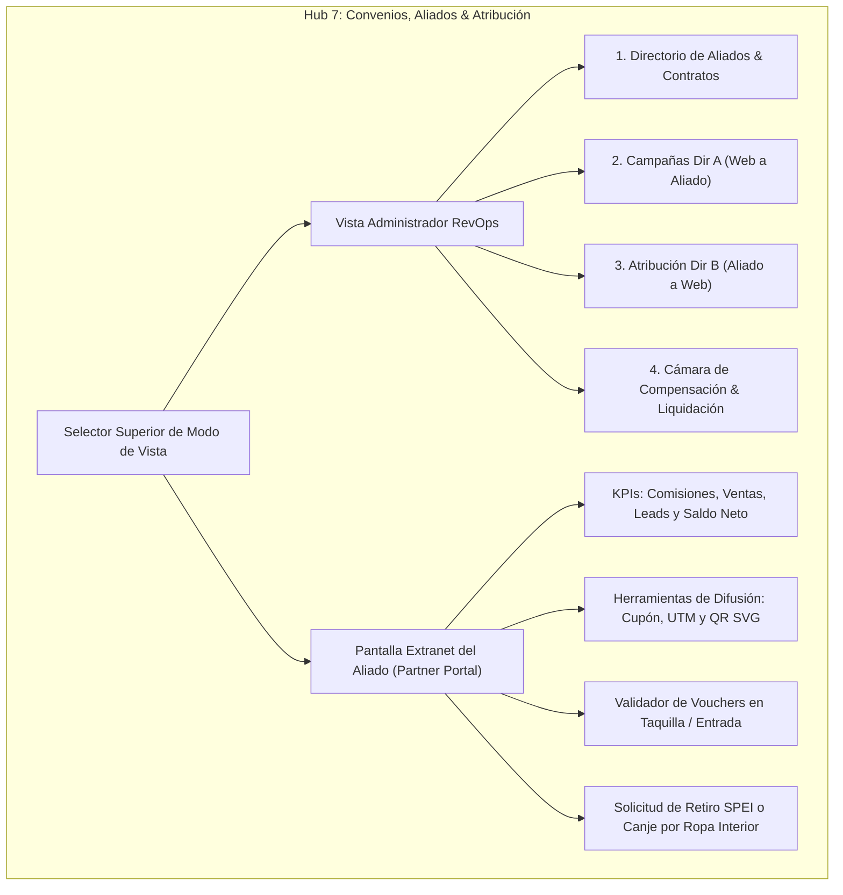

# Hoja de Ruta del Hub 7: Convenios, Aliados & Atribución Bidireccional (Allies & Clearing House Roadmap)
## Módulo de Acuerdos Comerciales de Nicho, Captura CAPI y Portal de Aliados Multiverso
**Ecosistema:** Terra (Matriz) | Marte (Masculino/Circuit/Gay) | Venus (Lencería/Beauty/Spa) | Tiresias / Afrodita (Trans/Ballroom/Afirmativo)  
**Dependencias Contractuales:** [BACKEND_INTEGRATION_SPEC.md](file:///c:/Users/Mickey/Documents/export/BACKEND_INTEGRATION_SPEC.md) (Sección 3.31, 4.25, 5.16, 6.3 Subsección CC)  
**Registro General:** [PENDING_TASKS.md](file:///c:/Users/Mickey/Documents/export/PENDING_TASKS.md)

---

## 1. Visión y Propósito Estratégico

El comercio electrónico de nicho para marcas directas al consumidor (D2C) enfrenta restricciones crecientes en plataformas tradicionales de pauta publicitaria (Meta Ads y Google Ads) por políticas de contenido sobre ropa interior y productos íntimos, sumado al encarecimiento del costo de adquisición de clientes (CAC).

El **Hub 7: Convenios, Aliados & Atribución Bidireccional** implementa un motor de crecimiento orgánico comunitario sustentado en alianzas recíprocas sin operar como taquilla transaccional:
1. **Dirección A (Web $\rightarrow$ Aliado / Lead Magnet & EMQ CAPI):** La tienda promociona accesos exclusivos, tragos de cortesía, descuentos en cover o beneficios en los canales/eventos de los aliados a cambio del registro de prospectos (Nombre, WhatsApp, Email). Esto nutre el CRM central (`users_leads`), eleva el Event Match Quality (EMQ > 9.0) en Meta Conversions API y genera un crédito contable a favor de la tienda en la cámara de compensación.
2. **Dirección B (Aliado $\rightarrow$ Web / Afiliación & Ventas):** Los aliados difunden cupones de descuento y enlaces tokenizados con UTMs en sus canales de confianza (grupos de WhatsApp, perfiles OnlyFans, historias de Instagram, flyers de eventos y saunas). Cada compra concretada devenga una comisión pactada (% o tarifa fija).
3. **Cámara de Compensación (Clearing House):** Audita periódicamente el saldo neto cruzado:
   $$\text{Saldo Neto} = (\text{Leads Dir A} \times \text{Tarifa Lead}) - \text{Comisiones Dir B}$$
   Permite liquidar el balance mediante **transferencia bancaria SPEI**, **canje de prendas en especie** (con asiento inmutable en Kardex) o **cruce por patrocinios y pases VIP**.
4. **Pantalla Extranet para Aliados (Partner Portal):** Espacio dedicado para los socios comerciales (organizadores, DJs, modelos, salones) accesible vía enlace seguro tokenizado (`/portal/aliado/{access_token}`) o conmutador de rol (`partner`), con validador de vouchers en taquilla, generador de enlaces con UTM, códigos QR SVG para flyers y solicitudes de retiro.

### 1.1 Características y Requerimientos Funcionales Clave
1. **Seguridad por Token:** El acceso del aliado no usa usuario/contraseña. Utiliza un token criptográfico único (`/portal/aliado/{access_token}`) que restringe la vista estrictamente a sus datos en modo lectura.
2. **Privacidad de Prospectos (Data Masking):** En la vista del aliado, los números telefónicos deben enmascararse (ej. "55 **** 1290") para proteger la base de datos de Marte Store hasta la fecha de corte acordada.
3. **Exportación Limpia:** Botón para descargar en CSV la lista de asistentes registrados con código de beneficio para validación en taquilla/puerta del club (`lista_taquilla_{ally}_{fecha}.csv` con BOM UTF-8 y teléfonos enmascarados).
4. **Lógica de Liquidación:** Un servicio que calcula el balance neto compensando el valor de los prospectos derivados contra las comisiones por prendas vendidas mediante la fórmula auditada: $\text{Saldo Neto} = (\text{Prospectos Derivados} \times \text{Tarifa Lead}) - \text{Comisiones por Prendas Vendidas}$.

---

## 2. Matriz de Tareas del Hub 7

| ID Tarea | Título Operativo | Submódulo / Vista | Estado | Prioridad | Dependencias |
| :--- | :--- | :---: | :---: | :---: | :--- |
| `TASK-ALY-01` | Directorio de Aliados & Acuerdos Multiverso | Submódulo 1: Directorio | **Completada (UI)** | **Alta** | Multiverso, DB Eloquent |
| `TASK-ALY-02` | Campañas Dir A (Web $\rightarrow$ Aliado), Lead Magnet y Meta CAPI | Submódulo 2: Campañas Dir A | **Completada (UI)** | **Alta** | `users_leads`, Meta Graph API |
| `TASK-ALY-03` | Atribución Dir B (Aliado $\rightarrow$ Web), Cupones y Comisiones | Submódulo 3: Atribución Dir B | **Completada (UI)** | **Alta** | Checkout, Cupones, Stripe |
| `TASK-ALY-04` | Cámara de Compensación con Liquidación SPEI, Especie y Patrocinio | Submódulo 4: Clearing House | **Completada (UI)** | **Alta** | Hub 5 Finanzas, Hub 4 Kardex |
| `TASK-ALY-05` | Pantalla Extranet del Aliado (Partner Portal) con Validador de Taquilla | Portal Extranet (Partner) | **Completada (UI)** | **Alta** | Token Auth, QR SVG, Taquilla |
| `TASK-INT-19` | Sincronización Automática de Liquidaciones a Cuentas por Pagar | Submódulo 4 / Hub 5 | **Completada (UI)** | **Alta** | `TASK-ALY-04`, `vendor_bills`, SPEI |
| `TASK-HUB-VND` | Extranet de Proveedores y Fabricantes en Hub 7 con Aislamiento B2B | Extranet Hub 7 (Vendor) | **Completada (Fullstack)** | **Crítica** | RBAC `vendor`, `EnsureEntityIsolation`, OCs |
| `TASK-INT-20` | Remisiones Fleteras B2B y Sincronización con Rampa Hub 4 y Tareas Hub 1 | Extranet Hub 7 / Rampa | **Completada (Fullstack)** | **Crítica** | `VendorShipment`, Rampa Hub 4, `OperationalTask` |

---

## 3. Arquitectura Funcional: Administrador RevOps vs Portal de Aliados

---

## 4. Adaptabilidad a Todo el Multiverso Terra

* **Marte (Masculino / Circuit / Gay):**
  - Fiestas gay y festivales Circuit en CDMX (Paradiso, Jubileo, Por Detroit, Hysteria), saunas (Sodome, Baños del Peñón), DJs, modelos y creadores de OnlyFans, RPs de vida nocturna.
  - Dir A: Banners de cover con descuento o trago gratis; Dir B: Cupones de 15% en jocks, boxers y arneses; Retiros: SPEI o prendas para shows.
* **Venus (Femenino / Lencería / Skincare):**
  - Salones de belleza boutique, spas, makeup artists, sex shops feministas, creadoras de lencería/lifestyle, estudios de yoga.
  - Dir A: 2x1 en tratamientos faciales o muestra cosmética; Dir B: Cupones en lencería de autor y skincare; Retiros: SPEI o sets de lencería para sesiones.
* **Tiresias / Afrodita (Trans & No Binario / Moda Afirmativa):**
  - Colectivos Ballroom (Kiki Houses), casas drag, activistas y creadores de contenido trans, espacios comunitarios seguros.
  - Dir A: Accesos 2x1 a Balls o decants neutros; Dir B: Cupones en binders de compresión y ropa afirmativa; Retiros: Patrocinio de premios para Balls o comisiones.
* **Terra (Matriz / Bienestar):**
  - Festivales de música electrónica/indie, gimnasios boutique (box, spinning, crossfit), marcas de bebidas funcionales/wellness.
  - Dir A: Pases preferenciales o clases demo; Dir B: Cupones en cajas de suscripción y combos; Retiros: Cajas de suscripción para miembros.

---

## 5. Compuerta Contractual Previa (Regla 12)

Todas las tareas de este módulo se rigen por la **Regla 12**: Antes de escribir código de interfaz, los esquemas de persistencia y contratos de API deben quedar congelados en `BACKEND_INTEGRATION_SPEC.md`:
* **Sección 3.31 DDL MySQL:** Tablas `allies`, `ally_campaigns_dir_a`, `ally_lead_captures`, `ally_coupons_dir_b`, `ally_attributed_orders`, `ally_clearing_settlements`.
* **Sección 4.25 Modelos Eloquent:** `Ally`, `AllyCampaignDirA`, `AllyLeadCapture`, `AllyCouponDirB`, `AllyAttributedOrder`, `AllyClearingSettlement`.
* **Sección 5.16 Servicios de Dominio:** `LeadMagnetCapiService`, `BidirectionalAttributionService`, `ClearingHouseSettlementService`, `AllyPortalService`.
* **Sección 6.1 y 6.3 Subsección CC:** Endpoints RESTful JSON administrativos y del portal de aliados.
* **Sección 10:** Registro del **Paso 32** en el Checklist de Implementación Laravel.

