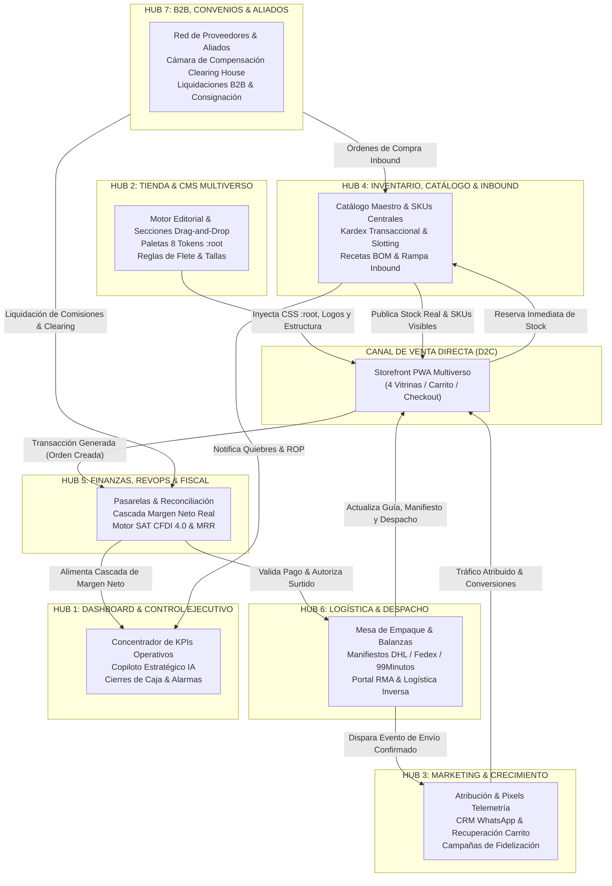
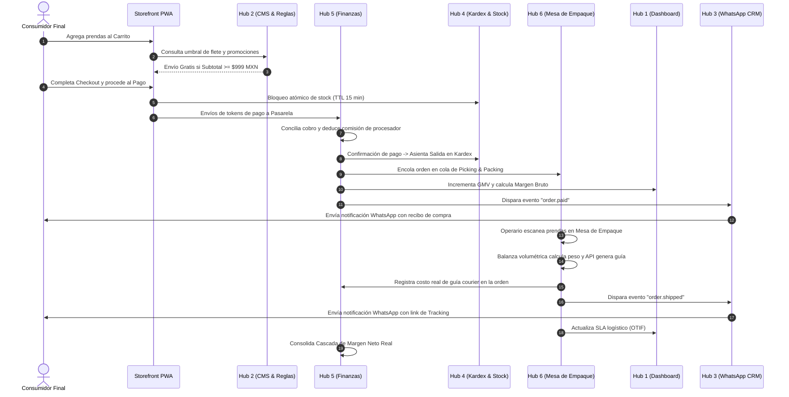
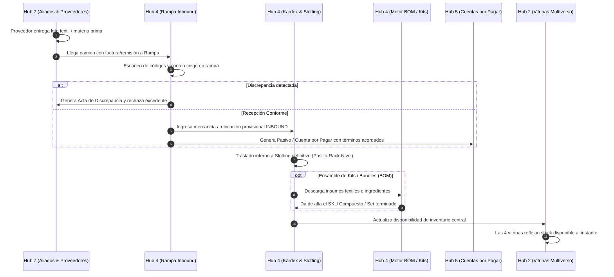
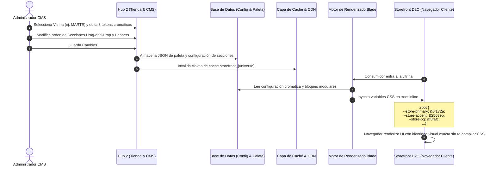
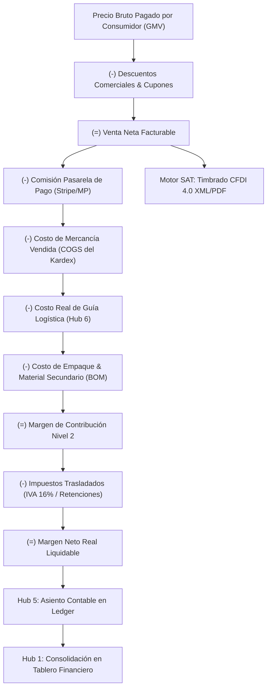
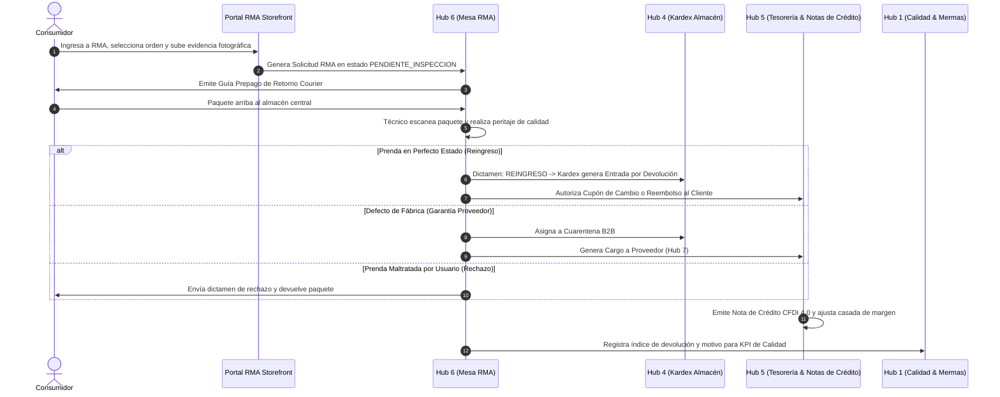

# ESPECIFICACIÓN TÉCNICA Y OPERATIVA DE WORKFLOWS DE LA APLICACIÓN
## Interconexión Sistémica entre Módulos, Hubs Operativos y Storefront D2C

**Versión del Sistema:** 2.6.0  
**Fecha de Publicación:** 30 de Septiembre de 2026  
**Ámbito:** Arquitectura Funcional y Flujos de Datos entre Módulos (Sin Enfoque en Roles de Usuario)  
**Estado:** Producción / Formalizado  

---

## 1. RESUMEN EJECUTIVO Y MODELO DE INTERCONEXIÓN

La plataforma **Mi Tienda** opera como un ecosistema e-commerce y ERP modular de circuito cerrado para comercio unificado (D2C y B2B). A diferencia de plataformas monolíticas tradicionales, la arquitectura se sustenta en un **Bus Central de Eventos y Transiciones de Estado (Event-Driven Architecture)** donde cada acción en un módulo desencadena sincronizaciones atómicas y reactivas en los demás hubs del sistema.

### Principio Rector de Interconexión:
> **"Un dato único en bodega o finanzas gobierna todas las vitrinas; una orden en el storefront recalcula en tiempo real inventario, fletes, margen neto, empaque y telemetría de marketing."**



---

## 2. MAPA DE MÓDULOS Y FUNCIONALIDADES NATIVAS

### 2.1 Storefront D2C PWA (Capa de Experiencia del Consumidor)
* **Vitrinas Multiverso:** Aislamiento visual de 4 marcas comerciales compartiendo un único catálogo central en bodega.
* **Carrito Híbrido & Checkout Express (3 Pasos):** Validación de datos de entrega, cotización dinámica de fletes, y reserva temporal de stock con TTL de 15 minutos.
* **PDP Modular:** Ficha de producto con selector de variantes textiles, galería interactiva WebP, calculadora de elasticidad de envío y tabla anatómica de tallas.
* **Portal de Autoservicio RMA:** Generación de solicitudes de devolución y cambio con carga de evidencia fotográfica por parte del cliente.

### 2.2 Hub 1: Dashboard Operativo & Concentrador Ejecutivo
* **KPIs Unificados en Tiempo Real:** GMV del día, Ticket Promedio ponderado, Nivel de Servicio Logístico (OTIF) y Tasa de Absorción de Envíos.
* **Feed de Incidentes Operativos:** Centro de alertas sobre quiebres de stock por debajo del ROP, discrepancias en rampa y paquetes demorados en courier.
* **Cierre Diario de Caja & Conciliación:** Consolidación de ingresos bancarios vs órdenes despachadas.
* **Copiloto Estratégico IA:** Motor analítico de consultas en lenguaje natural con acceso a telemetría financiera y de inventario.

### 2.3 Hub 2: Tienda & CMS Multiverso
* **Editor Visual Cromático (8 Tokens CSS `:root`):** Configuración de paleta extendida por vitrina (primario, secundario, acento, cabecera, fondo, superficie, bordes, texto) y branding (logos svg/webp y favicon).
* **Motor Modular de Hero & Vitrinas:** Control de ancho de pantalla (Full-Width Edge-to-Edge bleed de 100vw vs Contenedor Boxed 1320px), bifurcación mutuamente excluyente de renderizado (`hero_mode`: Estructurado vs Código Scoped para erradicar duplicaciones), gestor de imágenes de fondo con previsualización en vivo, capa de degradados overlay con control cromático/dirección/opacidad, y botones de acción dinámicos vinculados a rutas de la tienda.
* **Gestor de Secciones Drag-and-Drop & Rutas Ancla:** Maquetador modular desacoplado con generación de identificadores de anclaje únicos (`#section-{id}`), copiado al portapapeles en 1 clic y selector asistido de rutas internas (secciones, páginas institucionales `/pagina/{slug}` y vitrinas multiverso).
* **Motor de Reglas Comerciales de Flete:** Umbrales de envío gratis, tarifa fija metropolitana y simulador financiero de elasticidad de absorción.
* **Editorial & Guías Anatómicas Torzo:** Protocolos de cuidado textil, tablas de tallas y avisos regulatorios PROFECO.
* **Gestor de Navegación, Páginas CMS & Blog Magazine:** Rutas estáticas, artículos de contenido y enlaces de pie de página.
* **Telemetría de Tracking:** Inyección centralizada de Meta Conversions API (CAPI), Google Tag Manager y TikTok Pixel.

### 2.4 Hub 3: Marketing, Ads & CRM Automatizado
* **Motor de Campañas y Cupones:** Códigos promocionales con límites de canje, vigencia y exclusiones de categorías de bajo margen.
* **Atribución Multicanal:** Telemetría de UTMs cruzada con IDs de órdenes para cálculo de ROAS y CAC real.
* **CRM de Recuperación en WhatsApp:** Disparador automático de mensajes transaccionales (carritos abandonados, confirmación de pedido, guía en ruta).

### 2.5 Hub 4: Inventario, Catálogo Central & Inbound
* **Catálogo Maestro de SKUs:** Definición de producto padre, códigos de barra EAN-13 y variantes dimensionales (talla/color).
* **Kardex Transaccional Multialmacén:** Registro inmutable de Entradas, Salidas, Traspasos, Mermas y Ajustes con costos promedio ponderados.
* **Recepción en Rampa (Inbound):** Verificación de remisiones de proveedores contra órdenes de compra y generación de discrepancias.
* **Recetas BOM (Bill of Materials):** Estructura de ensambles, kits y empaques secundarios para prendas compuestas y cosmética.
* **Control de Slotting & ROP:** Asignación física por pasillo/rack/nivel y cálculo dinámico de Punto de Reorden.

### 2.6 Hub 5: Finanzas, RevOps & Cumplimiento Fiscal
* **Reconciliación de Pasarelas:** Conciliación automatizada de Stripe, Mercado Pago, PayPal y SPEI bancario contra el ledger interno.
* **Cascada de Margen Neto Real:** Desglose transaccional por orden: GMV $-$ Comisión Pasarela $-$ Costo Mercancía Vendida (COGS Kardex) $-$ Flete Courier $-$ Empaque $=$ Margen Neto Operativo.
* **Motor de Timbrado SAT CFDI 4.0:** Emisión y cancelación automática de facturas electrónicas y complementos de pago.
* **Suscripciones & MRR:** Administración de cargos recurrentes para clubes de producto o membresías premium.

### 2.7 Hub 6: Logística Outbound, Despacho & RMA
* **Mesa de Empaque Inteligente:** Verificación de picking mediante escaneo de código de barras para erradicar errores de surtido.
* **Pesaje Volumétrico y Generación de Guías:** Integración directa con APIs de couriers (DHL, FedEx, Estafeta, 99Minutos) con selección de tarifa más económica.
* **Manifiestos y Despacho:** Cierre de lote diario y traspaso formal de custodia a choferes de paquetería.
* **Módulo RMA e Inspección de Retornos:** Clasificación de devoluciones (Reingreso al Kardex vs Scrap/Merma) y emisión de dictamen de calidad.

### 2.8 Hub 7: Red B2B, Convenios & Clearing House
* **Acuerdos Comerciales B2B:** Precios por volumen, condiciones de crédito y catálogos restringidos por aliado.
* **Cámara de Compensación (Clearing House):** Liquidación neta entre ventas cruzadas, comisiones de afiliación y compras a proveedores.
* **Monitoreo de Stock en Consignación:** Trazabilidad de inventario entregado a tiendas asociadas o boutiques terceras.

---

## 3. MATRIZ DE INTERCONEXIÓN FUNCIONAL CROSS-HUB

| Módulo Origen | Evento / Disparador | Información Transmitida | Módulos Receptores | Acción Ejecutada en el Receptor |
| :--- | :--- | :--- | :--- | :--- |
| **Hub 2 (CMS)** | Actualización de paleta (8 tokens) o logo | Nuevos valores hexadecimales y URLs WebP | **Storefront D2C** | Inyección reactiva en `:root` CSS; Storefront adopta branding sin recrear la página. |
| **Hub 2 (CMS)** | Modificación de umbral de envío gratis | Nuevo threshold monetario (ej. $999 MXN) | **Storefront (Checkout)**<br>**Hub 5 (Finanzas)** | Checkout evalúa en tiempo real si cobra $149 o $0. Finanzas ajusta el simulador de absorción. |
| **Storefront** | Cliente confirma compra en Checkout | Carrito, datos fiscales, dirección, total | **Hub 4 (Inventario)**<br>**Hub 5 (Finanzas)**<br>**Hub 1 (Dashboard)** | Hub 4 genera bloqueo temporal de stock. Hub 5 procesa cobro en pasarela. Hub 1 suma a GMV proyectado. |
| **Hub 5 (Finanzas)** | Webhook de pasarela: `charge.succeeded` | Confirmación de cobro, ID pasarela, comisión deducida | **Hub 4 (Inventario)**<br>**Hub 6 (Logística)**<br>**Hub 3 (CRM)** | Hub 4 asienta salida definitiva en Kardex. Hub 6 libera la orden para Picking en Bodega. Hub 3 envía mensaje WhatsApp de confirmación. |
| **Hub 4 (Inventario)** | Stock disponible de SKU cruza umbral ROP | SKU, ubicación, cantidad remanente | **Hub 1 (Dashboard)**<br>**Hub 7 (B2B/Compras)** | Hub 1 dispara alerta crítica en feed ejecutivo. Hub 7 pre-genera Orden de Compra a proveedor. |
| **Hub 7 (B2B)** | Recepción validada en Rampa Inbound | Cantidad recibida, lote, costo unitario | **Hub 4 (Inventario)**<br>**Hub 5 (Finanzas)**<br>**Hub 2 (CMS)** | Hub 4 registra entrada en Kardex y actualiza slotting. Hub 5 programa cuenta por pagar. Hub 2 actualiza stock visible en vitrinas. |
| **Hub 6 (Logística)** | Escaneo y generación de guía en Mesa de Empaque | Número de tracking, carrier, peso, costo flete | **Hub 5 (Finanzas)**<br>**Storefront / PWA**<br>**Hub 3 (CRM)** | Hub 5 deduce costo flete en cascada de margen neto. Storefront actualiza estado de tracking. Hub 3 despacha WhatsApp con guía. |
| **Storefront** | Solicitud de RMA enviada por consumidor | Motivo, SKU devuelto, fotos, tipo (cambio/reembolso) | **Hub 6 (RMA)**<br>**Hub 1 (Incidentes)** | Hub 6 abre ticket de inspección física. Hub 1 incrementa métrica de RMA activa. |
| **Hub 6 (RMA)** | Dictamen: Aprobado para Reingreso | SKU, estado perfecto, lote | **Hub 4 (Inventario)**<br>**Hub 5 (Finanzas)** | Hub 4 hace entrada por devolución a Kardex. Hub 5 emite Nota de Crédito o autoriza reembolso en pasarela. |

---

## 4. FLUJOS OPERATIVOS DE PRINCIPIO A FIN (END-TO-END)

### FLUJO 1: Ciclo Completo Order-to-Cash & Fulfillment



1. **Selección y Validación Comercial:** El usuario navega en la vitrina activa del Storefront PWA. Al agregar artículos, el carrito consulta en tiempo real con Hub 2 las reglas de envío vigentes y valida con Hub 4 la existencia física en almacén.
2. **Reserva y Cobro Seguro:** Al entrar al checkout, se genera una reserva atómica de inventario por 15 minutos para evitar sobreventa. La pasarela de Hub 5 valida fondos; al recibir el webhook de éxito, se formaliza la venta.
3. **Sincronización en Kardex y Mesa de Empaque:** La orden cambia a estado `SURTIBLE`. Hub 4 descuenta el inventario del almacén principal registrando el movimiento de salida en el Kardex. De forma simultánea, la orden entra en la pantalla táctil de la Mesa de Empaque de Hub 6.
4. **Validación Óptica y Generación de Guía:** En la Mesa de Empaque, el operario escanea el código de barras de cada producto. El sistema valida contra el pedido; si hay coincidencia total, se pesa el paquete en balanza electrónica y se consume la API del carrier (DHL/FedEx/Estafeta) para imprimir la etiqueta de envío.
5. **Cierre de Ciclo Financiero y CRM:** El costo real de la guía se almacena en la orden en Hub 5, cerrando el cálculo de la Cascada de Margen Neto Real. Hub 3 envía automáticamente el mensaje de confirmación con el código de rastreo vía WhatsApp.

---

### FLUJO 2: Cadena de Suministro Inbound & Manufactura BOM



1. **Emisión y Arribo:** Se programa el arribo de mercancía desde el módulo de convenios y compras (Hub 7). El transportista arriba a la rampa de recepción en el centro logístico.
2. **Conteo Ciego e Inspección en Rampa:** El personal de almacén utiliza la interfaz de Inbound de Hub 4 para realizar el cotejo físico de bultos contra la orden de compra.
3. **Asentamiento en Kardex y Pasivo Financiero:** Al autorizarse el ingreso, el Kardex de Hub 4 asienta el movimiento de entrada afectando el costo promedio ponderado. De inmediato se notifica a Hub 5 para programar la cuenta por pagar en el calendario de flujo de caja.
4. **Slotting y Producción BOM:** La mercancía se traslada a sus ubicaciones de picking (slotting). Si los insumos forman parte de un kit o receta BOM (ej. set de ropa interior + accesorios), el submódulo BOM procesa la orden de ensamble, descontando las piezas individuales y sumando los productos compuestos al stock vendible.
5. **Apertura de Disponibilidad Comercial:** El stock neto consolidado se transmite a Hub 2, habilitando inmediatamente la venta en las vitrinas configuradas para esos SKUs.

---

### FLUJO 3: Motor Editorial, Merchandising Multiverso & Inyección CSS `:root`



1. **Edición Centralizada:** Desde Hub 2, el administrador selecciona la vitrina multiverso deseada y modifica la configuración visual (8 tokens cromáticos: Primario, Secundario, Acento, Cabecera, Fondo, Superficie, Bordes, Texto; banners WebP; favicon y logos).
2. **Persistencia e Invalidación Atómica:** Al guardar, se actualiza el registro en `cms_storefront_configs` y se limpian las claves de caché correspondientes.
3. **Inyección Dinámica sin Build Step:** Cuando un consumidor solicita la vitrina, el layout `store-pwa.blade.php` genera en el bloque `<head>` la declaración de variables CSS directas sobre `:root`. De este modo, la identidad gráfica cambia instantáneamente en producción sin necesidad de compilar paquetes de NodeJS o Tailwind en el servidor.
4. **Bifurcación y Renderizado del Hero Modular:** El motor de Hero implementa bifurcación mutuamente excluyente entre el modo visual estructurado y el editor de código scoped, erradicando duplicidades en la vitrina. Soporta sangrado de borde a borde a pantalla completa (`100vw` edge-to-edge breakout), capas de degradado superpuestas con ajuste de ángulo, colores y opacidad, e imágenes de fondo con subida directa y previsualización.
5. **Enrutamiento Asistido y Anclas Modulares:** Todas las secciones modulares exponen un ancla DOM única (`#section-{id}`). En el panel administrativo de Hub 2, cada sección y página institucional expone su ruta con badges de copia en un solo clic, complementado por un selector desplegable asistido que permite insertar rutas de secciones, páginas o vitrinas en los botones CTA sin errores.
6. **Resiliencia en Renderizado Móvil y Cache Busting Dinámico:** La hoja de estilos `store-pwa.css` aplica arquitectura de consultas de medios estrictamente balanceadas con validación de paridad de llaves para evitar que reglas móviles (< 769px) queden absorbidas por bloques desktop. Para erradicar persistencia de estilos obsoletos en navegadores móviles, el layout inyecta un parámetro de versionamiento dinámico (`?v={filemtime}`), garantizando que las actualizaciones de diseño se reflejen de inmediato en todos los clientes PWA y dispositivos móviles sin requerir purga manual de caché en el dispositivo del cliente.
7. **Conmutación Universal Multitransversal y Acordeón Unificado (TASK-H2-22):**
   - El selector de vitrinas multiverso (`.universe-selector-bar`) se ubica en el encabezado transversal del módulo, garantizando persistencia y conmutación reactiva instantánea en cualquiera de las pestañas activas, sincronizando KPIs de SKUs, marcas, muestras de 8 tokens, frames de previsualización y filtrado visual de tablas.
   - El submódulo administrativo se organiza en 5 pestañas principales: `1. Editor Visual`, `2. Contenido & Reglas`, `3. Páginas & Navbar`, `4. Tracking & Pixels` y `5. Filtros Catálogo`.
   - En la pestaña `Contenido & Reglas`, un acordeón unificado (`.store-accordion-section`) aloja cuatro bloques colapsables con controles globales de expansión/contracción masiva:
     - *Sección 1:* Banners Promocionales & Marquesinas Superiores (`accordionSecBanners`).
     - *Sección 2:* Reglas de Flete, Despacho & Simulador Financiero (`accordionSecShipping`).
     - *Sección 3:* Guía Oficial de Tallas & Protocolos de Cuidado (`accordionSecEditorial`).
     - *Sección 4:* CMS Blog & Revista Digital (`accordionSecMagazine`).
   - El Gestor de Secciones Modulares del Home (`#sectionsTable`) queda confinado con exclusividad dentro de `Editor Visual` (Tab 1), garantizando que no se visualice en ninguna otra pestaña.

---

### FLUJO 4: Cascada de Margen Neto Real & Cumplimiento Fiscal SAT



1. **Captura del Monto Transaccional:** Cada orden registrada en el Storefront entra a la cascada de Hub 5 con su importe total pagado.
2. **Deducción de Fricciones:** Se deducen de forma estricta las comisiones cobradas por los procesadores de pago bancarios.
3. **Cruce con Costos Reales de Inventario y Envíos:** A diferencia de sistemas contables teóricos, el sistema cruza la orden con el costo promedio exacto del Kardex (Hub 4) en el momento de la venta y con la factura real devuelta por la API del transportista en Hub 6.
4. **Cálculo de Utilidad Verdadera:** El margen neto real queda calculado y visible para la dirección ejecutiva en Hub 1, alertando si alguna orden tuvo margen negativo debido a políticas excesivas de absorción de flete.
5. **Cumplimiento Fiscal SAT:** Si el cliente solicitó factura o por omisión al cierre global diario, el motor SAT genera el archivo XML timbrado bajo estándar CFDI 4.0 con su respectiva representación impresa PDF.

---

### FLUJO 5: Logística Inversa, RMA & Reacondicionamiento



1. **Apertura de Caso:** El cliente ingresa al portal de devoluciones del Storefront, seleccionando los artículos de su orden y adjuntando imágenes.
2. **Generación de Retorno:** Hub 6 aprueba la solicitud inicial y expide una guía de retorno logístico.
3. **Peritaje en Mesa de Devoluciones:** Al ingresar el paquete a bodega, el personal técnico realiza una inspección física bajo protocolo estricto.
4. **Destino de Mercancía y Regularización Contable:**
   * **Reingreso:** Se reintegra al stock comercial en Hub 4. Hub 5 emite el reembolso correspondiente o un bono digital.
   * **Defecto:** Se aísla en bodega para reclamo a proveedor en Hub 7.
   * **Merma:** Se destruye registrando la pérdida neta en Hub 4 y Hub 5.

---

## 5. BUS DE EVENTOS Y TRANSICIONES DE ESTADO

La arquitectura utiliza un despachador de eventos con escuchas síncronas y asíncronas para garantizar atomicidad y alta concurrencia:

```
[ EVENTO DEL SISTEMA ] ─────────► [ EVENT DISPATCHER ]
                                           │
         ┌───────────────────┬─────────────┴───────┬───────────────────┐
         ▼                   ▼                     ▼                   ▼
[ Listener: Stock ] [ Listener: Factura ] [ Listener: Envíos ] [ Listener: Telemetría ]
   (DB Atómica)        (Job en Cola)         (Job en Cola)        (CAPI / Webhook)
```

### Catálogo de Eventos Nucleares

| Evento de Aplicación | Módulo Emisor | Tipo de Ejecución | Listeners Asociados |
| :--- | :--- | :--- | :--- |
| `OrderCreated` | Storefront | Síncrono (Transaccional) | `ReserveStockListener`, `CreateOrderDraftListener` |
| `PaymentCaptured` | Hub 5 | Asíncrono (Queue) | `DeductKardexListener`, `EnqueueFulfillmentListener`, `SendOrderNotifications` |
| `PackageManifested` | Hub 6 | Asíncrono (Queue) | `AttachTrackingInfoListener`, `SendTrackingLinkNotification`, `RecalculateNetMargin` |
| `InboundInventoryReceived` | Hub 4 | Síncrono (Transaccional) | `UpdateKardexAverageCostListener`, `CreateAccountsPayableDraft`, `SyncVisibleStockVitrinas` |
| `StorefrontConfigUpdated` | Hub 2 | Síncrono | `FlushStorefrontCacheListener`, `BroadcastConfigChanges` |
| `RmaDispositionApproved` | Hub 6 | Asíncrono (Queue) | `ProcessInventoryRestockListener`, `IssueCreditNoteOrRefundListener` |

---

## 6. CONTROL DE VERSIONES Y FORMALIZACIÓN DE CAMBIOS

* **Documento Base:** `docs/APPLICATION_WORKFLOW_SPEC.md`
* **Plantilla Imprimible A4:** `docs/APPLICATION_WORKFLOW_MANUAL.html`
* **Compilación Maestra:** `docs/APPLICATION_WORKFLOW_MANUAL.pdf`
* **Regla de Operación:** Todo ajuste a rutas de controladores, migraciones de base de datos o comportamientos visuales en los Hubs 1 a 7 debe actualizar inmediatamente este pliego de especificación y regenerar el archivo PDF adjunto.
