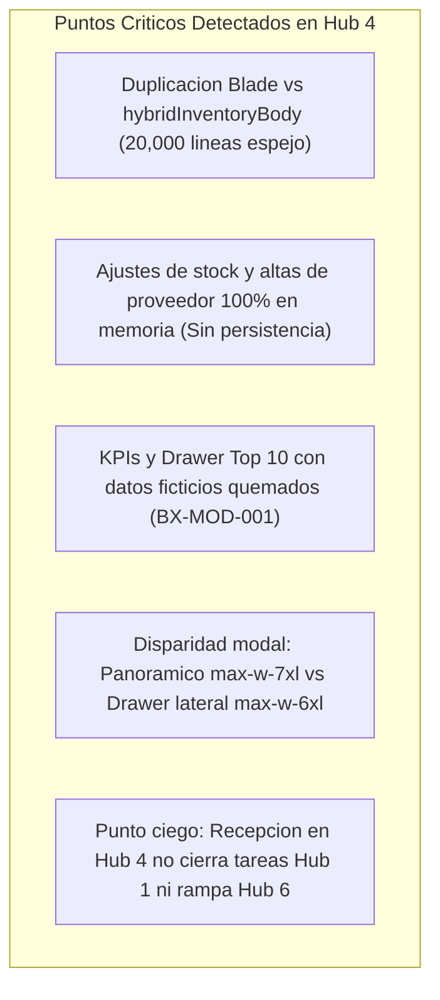

# Auditoria Integral de UX/UI, Arquitectura y Workflows del Hub 4 (Inventario, Compras & Cadena de Suministro)

> **Rama Activa:** `audit/hub4-ux-workflow-cleanup`  
> **Fecha de Auditoria:** 27 de Septiembre de 2026  
> **Roles de Ejecucion:** Arquitecto de Software Fullstack Senior & Lead UX/UI Designer  
> **Objetivo:** Auditar, catalogar y priorizar las inconsistencias de interfaz, componentes desfasados, operaciones simuladas en memoria y puntos ciegos de workflow entre el Hub 4 y los demas Hubs (Hub 1, Hub 3, Hub 5, Hub 6 y Hub 7), estableciendo una hoja de ruta quirurgica para limpiar la operacion diaria real.

---

## 1. Diagnostico General & Estado del Arte del Hub 4

El Hub 4 gestiona el nucleo mercantil y operativo del e-commerce: catalogo de 259 SKUs, recepcion de mercancia, ordenes de compra, integracion con proveedores y auditoria contable de Kardex.

A pesar de contar con modales y paneles visualmente densos, la auditoria de codigo revela una **brecha sustancial entre la apariencia de la interfaz y la ejecucion operativa real**, caracterizada por:
1. **Duplicacion masiva de plantillas (Doble Mantenimiento):** Coexisten `resources/views/portal/inventory.blade.php` (~10,365 lineas) y `hybridInventoryBody()` en `public/js/revops-panel/inventory-module.js` (~10,345 lineas dentro de un template literal de JS). Al navegar en SPA, `app.js` sobreescribe el DOM renderizado por Blade, provocando perdida de reactividad o renderizado de versiones desfasadas.
2. **Operaciones ficticias en memoria del navegador:** Acciones criticas como "Ajuste rapido de stock", "Agregar producto", "Guardar proveedor" y "Re-scrapear Torzo" alteran variables locales de JavaScript sin persistir en MySQL. Al presionar F5, todos los cambios se pierden.
3. **Puntos ciegos cross-hub en la operacion diaria:** La recepcion de mercancia no concluye las tareas operativas de almacen en Hub 1 ni libera las entradas de rampa en muelle, dejando procesos abiertos indefinidamente en otros modulos.



---

## 2. Hallazgos Detallados de Visualizacion y UX/UI

### Hallazgo 2.1: Inconsistencia Arquitectonica SPA vs Blade (Severidad: Critica)
* **Ubicacion:** `public/js/revops-panel/app.js` (linea 14917, 20795) vs `public/js/revops-panel/inventory-module.js` (linea 9994) vs `resources/views/portal/inventory.blade.php`.
* **Problema:** Laravel renderiza en el servidor el Blade `inventory.blade.php`. Inmediatamente al cargar el cliente, `app.js` ejecuta `render('inventory')`, ejecutando `main.innerHTML = window.hybridInventoryBody()`.
* **Impacto UX:** Destruye el DOM inicial ya procesado por el servidor, recarga bruscamente elementos visuales y si un cambio se realiza solo en Blade, queda invisible al usuario en modo SPA.
* **Solucion Requerida:** Respetar el contenido de Blade cuando el usuario ingresa por URL directa, o unificar el bundle asegurando que no haya sobreescritura destructiva ni duplicacion de 10,000 lineas.

### Hallazgo 2.2: KPIs de Inventario con Textos Estaticos Quemados (Severidad: Media)
* **Ubicacion:** `resources/views/portal/inventory.blade.php` (lineas 150, 218, 241).
* **Problema:**
  - Cabecera colapsada: Muestra texto fijo `'3,674 piezas disponibles | 25 modelos activos'` en vez de evaluar reactivamente las existencias del catalogo.
  - Tarjeta "Bajo Pedido": Muestra `0 referencias` en texto HTML estatico, ignorando los productos de catalogo marcados como dropship o proveedores externos.
  - Tarjeta "SKUs Activos": Muestra `25 modelos` en texto HTML estatico, a pesar de que el catalogo real inyecta 259 SKUs.
* **Impacto UX:** El operador ve metricas irreales que no concuerdan con la tabla inferior de productos ni con los datos del servidor.
* **Solucion Requerida:** Enlazar mediante `x-text` con las variables computadas reactivas (`products.length`, conteo de stock dropshipping) y los valores inyectados desde Laravel en `$summary`.

### Hallazgo 2.3: Drawer Lateral "Top 10 Productos" Ficticio y Huerfano (Severidad: Alta)
* **Ubicacion:** `resources/views/portal/inventory.blade.php` (lineas 2985 a 3680).
* **Problema:** El drawer contiene 10 filas de productos ficticios quemados en duro (`BX-MOD-001`, `BX-COT-007`, `JK-ATH-002`, `TOR-DRP-003`, etc.) con datos de venta y tallas falsos. Al hacer click en "Detalle", invoca `openDrawerForSku('BX-MOD-001')`. Como este SKU no existe en la base de datos real, el sistema lanza un toast de error: *"Producto BX-MOD-001 no encontrado en el catalogo"*.
* **Impacto UX:** El componente interactivo bandera de la cabecera es inutilizable con datos reales y frustra al usuario.
* **Solucion Requerida:** Convertir el contenido del drawer en una tabla reactiva `<template x-for="item in getTopTenProducts()">` calculada a partir de las existencias reales o historial de movimientos de salida por venta.

### Hallazgo 2.4: Disparidad de Modales para Gestion de Producto (Severidad: Media)
* **Ubicacion:** Modal Panoramico Centrado (`#skuPanoramicModal`, `drawerOpen = true`, `max-w-7xl`) vs Drawer Alta de Producto (`newProductDrawerOpen = true`, `max-w-6xl` lateral derecho).
* **Problema:** Para editar o ver un producto existente, se abre un modal panoramico centrado espacioso de tres columnas con fondo desenfocado (conforme a `TASK-INV-18`). Pero al presionar "Agregar Producto", se abre un drawer lateral corredizo que empuja la pantalla, con un lenguaje visual y flujo de navegacion distinto.
* **Impacto UX:** Falta de coherencia y ergonomia: el usuario experimenta dos paradigmas de interaccion diferentes para la misma entidad (Producto).
* **Solucion Requerida:** Homogeneizar el flujo de "Agregar Producto" adoptando la estructura modal centrada de alta densidad o reutilizando el layout panoramico en modo creacion.

### Hallazgo 2.5: Conflicto de Tooltips y Z-Index Superpuestos (Severidad: Baja)
* **Ubicacion:** Tooltips locales `x-data="{ tip: false }"` vs Botones globales `.section-help-btn` con `data-help-title`.
* **Problema:** En varias tarjetas y cabeceras de tabla, coexisten dos iconos de interrogacion ('?'): uno local de Alpine con tooltip negro flotante y otro gestionado por el motor global de `app.js` en la barra superior.
* **Impacto UX:** Parpadeo visual, tooltips que se quedan pegados al hacer scroll y elementos que quedan tapados por los sticky headers.
* **Solucion Requerida:** Unificar la iconografia de ayuda bajo el estandar universal de la Regla 8.

---

## 3. Hallazgos de Workflows Operativos Reales (Operaciones en Memoria)

### Hallazgo 3.1: Ajuste Rapido de Stock en Catologo 100% en Memoria (Severidad: Critica)
* **Ubicacion:** `public/js/revops-panel/inventory-module.js` (lineas 4865 a 4887: `applyQuickStockAdjustment`).
* **Problema:** En la tabla del catalogo, cada fila tiene un selector `+ Entr. / - Sal.`, input de cantidad, motivo y boton "Aplicar". Al hacer click, el codigo solo modifica `item.localStock += qty` en la memoria de Alpine. No realiza ninguna llamada `fetch` al backend ni genera el asiento en `inventory_movements` o `inventories`.
* **Impacto Operativo:** El almacenista cree haber registrado una merma o entrada fisica, pero al refrescar la pantalla el stock vuelve a su valor anterior y no queda huella de auditoria.
* **Solucion Requerida:** Conectar el boton "Aplicar" al endpoint `POST /api/v1/inventory/adjust` (o `InventoryMovementController`) para actualizar de forma atomica el stock de la variante y registrar el asiento contable inmutable.

### Hallazgo 3.2: Re-Scrape de Torzo con Numeros Aleatorios Simulados (Severidad: Alta)
* **Ubicacion:** `public/js/revops-panel/inventory-module.js` (lineas 4889 a 4900: `rescrapeProduct`).
* **Problema:** El boton de sincronizacion individual de Torzo ejecuta:
  ```javascript
  const newStock = Math.floor(Math.random() * 40) + 10;
  item.supplierStock = newStock;
  ```
* **Impacto Operativo:** Inventa existencias aleatorias sin consultar la tabla `supplier_products` ni el conector scraper.
* **Solucion Requerida:** Conectar a un endpoint de consulta real que devuelva el `last_checked_at` y disponibilidad real de `supplier_products`.

### Hallazgo 3.3: CRUD de Proveedores sin Persistencia en Base de Datos (Severidad: Critica)
* **Ubicacion:** `public/js/revops-panel/inventory-module.js` (lineas 7684 a 7810: `saveProvider`, `archiveProvider`, `restoreProvider`, `deleteProvider`).
* **Problema:**
  - `saveProvider()` hace `this.providers.unshift(newProvider)`. No existe llamada `fetch`.
  - La tabla `suppliers` en base de datos solo tiene 6 columnas basicas y carece de: `phone`, `contact_name`, `city`, `lead_time_days`, `payment_terms`, `vendor_code`, `status`.
  - En `StorefrontController.php`, los datos de los proveedores se completan con strings estaticos inventados (`'Carlos Mendoza'`, `'+52 55 4182 9901'`).
* **Impacto Operativo:** No se pueden dar de alta nuevos proveedores reales en produccion ni editar plazos de credito o tiempos de entrega.
* **Solucion Requerida:** Crear migracion de enriquecimiento para `suppliers`, controlador con endpoints RESTful (`GET/POST/PUT/DELETE /api/v1/inventory/suppliers`) y sincronizacion completa en el frontend.

### Hallazgo 3.4: Alta de Producto sin Persistencia en BD (Severidad: Alta)
* **Ubicacion:** `public/js/revops-panel/inventory-module.js` (lineas 8574 a 8631: `saveNewProduct`).
* **Problema:** `saveNewProduct()` ejecuta `this.products.unshift(createdItem)`. A diferencia de `saveDrawerChanges()` (que si llama a `/update-complete`), el formulario de nuevo producto no tiene endpoint de creacion.
* **Impacto Operativo:** Nuevos productos capturados en la bodega se borran al recargar.
* **Solucion Requerida:** Crear endpoint `POST /api/v1/inventory/products` que inserte en `products`, `product_variants` e `inventories`.

### Hallazgo 3.5: Bandeja de Solicitudes On-Demand con Datos Mockeados (Severidad: Media)
* **Ubicacion:** `public/js/revops-panel/inventory-module.js` (lineas 5396 a 5411: `customerOnDemandRequests`).
* **Problema:** La sub-pestaña de compras on-demand muestra un array estatico en JS con registros inventados (`REQ-2026-081`, Carlos Mendoza). No se alimenta de los pedidos bajo demanda reales de la tienda online (Hub 3).
* **Solucion Requerida:** Conectar la bandeja con las ordenes de clientes que tengan articulos de tipo `dropship` o `both` pendientes de confirmacion.

---

## 4. Hallazgos de Workflows Cross-Hub (Interaccion con Otros Hubs)

### Hallazgo 4.1: Hub 4 $\leftrightarrow$ Hub 1 (Action Center & Almacen)
* **Rompimiento de Flujo:**
  - Cuando un proveedor despacha una orden en el Extranet de Hub 7 (`VendorShipment`), el sistema crea exitosamente una tarea en Hub 1 (`OperationalTask`) asignada al almacenista (`assigned_role = 'warehouse'`).
  - Sin embargo, cuando el almacenista entra a Hub 4, abre el modal de recepcion (`receiveOrderModalOpen`) y confirma la recepcion (`confirmInboundReceipt`), el servicio `InboundReceiptService` actualiza el inventario y Kardex pero **NO actualiza la tarea de Hub 1 a `completed`**.
  - La tarea operativa queda permanentemente como `pending` en el tablero de control de Hub 1.
* **Solucion Requerida:** En `InboundReceiptService::receivePurchaseOrder`, buscar y marcar como completada la `OperationalTask` asociada a la orden de compra recibida, y asentar el evento en la Bitacora de Turno (`shiftLog`).

### Hallazgo 4.2: Hub 4 $\leftrightarrow$ Hub 6 (Logistica & Rampa de Muelle)
* **Rompimiento de Flujo:**
  - Al despacharse una remision fletera B2B, se genera una entrada en rampa en `warehouse_ramp_entries` con estatus `in_dock`.
  - Al completarse la recepcion fisica en Hub 4, la entrada en rampa no cambia de estatus; continua mostrando el camion anclado en muelle.
* **Solucion Requerida:** Transicionar el registro en `warehouse_ramp_entries` a `received` / `unloaded`, con estampa de tiempo y usuario receptor.

### Hallazgo 4.3: Hub 4 $\leftrightarrow$ Hub 7 (Extranet B2B de Proveedores)
* **Rompimiento de Flujo:**
  - En la Pestaña 2 (Proveedores), la tabla no muestra que proveedores tienen ya credenciales o usuario asignado en Hub 7 (`users.supplier_id`).
  - No existe un mecanismo en la pantalla para vincular un usuario proveedor o generar su invitacion al portal B2B.
* **Solucion Requerida:** Añadir en la tabla de proveedores una columna/badge con el estado de acceso a Extranet Hub 7 (`Con Acceso / Sin Acceso`) y accion rapida para vincular credencial de acceso.

### Hallazgo 4.4: Hub 4 $\leftrightarrow$ Hub 5 (Finanzas & Tesoreria)
* **Rompimiento de Flujo:**
  - Al recibirse la orden de compra en Hub 4 (incluso cuando incluye compensacion por nota de credito aprobada), no se genera el registro automatico en Cuentas por Pagar (`vendor_bills`) en Hub 5.
* **Solucion Requerida:** Emitir la pre-factura o cuenta por pagar en `vendor_bills` con el importe neto y citando la nota de credito aplicada, programando el vencimiento segun `payment_terms`.

---

## 5. Matriz y Plan de Accion Priorizado (Backlog por Slices)

Para abordar estas tareas de manera lenta, quirurgica y con sumo cuidado sin generar regresiones en los 304 tests existentes, se establece la siguiente secuencia de Slices:

| Slice | Titulo Operativo | Enfoque Principal | Prioridad | Dependencias |
| :--- | :--- | :--- | :---: | :--- |
| **Slice 1** | **Unificacion Arquitectonica & Sincronizacion de Plantillas (COMPLETADO)** | Eliminar sobreescritura destructiva de DOM en `app.js` al renderizar `inventory`; garantizar fuente unica de verdad entre Blade y runtime JS; eliminacion de 10,342 lineas duplicadas en `inventory-module.js`. | **Critica** | `app.js`, `inventory.blade.php` |
| **Slice 2** | **Limpieza Visual UX/UI de Catalogo y Top 10 Real (COMPLETADO)** | KPIs reactivos con datos reales de BD; transformar Drawer Top 10 en tabla dinamica con productos reales; resolver tooltips conflictivos. | **Alta** | `StorefrontController`, Catalogo |
| **Slice 3** | **Persistencia Real de Ajustes de Stock en Catalogo (COMPLETADO)** | Endpoint `POST /api/v1/inventory/adjust`; conexion de botones `+ Entr. / - Sal.` a tabla `inventories` y registro inmutable en `inventory_movements`. | **Critica** | `InventoryMovement`, Controller |
| **Slice 4** | **CRUD Fullstack Real de Proveedores & Enlace Hub 7 (COMPLETADO)** | Migracion enriquecida de `suppliers` (`phone`, `city`, `terms`, `status`); endpoints RESTful; guardar/editar/archivar persistente; badge de Extranet Hub 7. | **Alta** | `Supplier`, DB Migration, API |
| **Slice 5** | **Cierre del Circuito Cross-Hub (Hub 4 <-> Hub 1 <-> Hub 6 <-> Hub 5)** | Al recibir PO: autocompletar `OperationalTask` en Hub 1, liberar rampa `warehouse_ramp_entries` en Hub 6, y pre-asentar cuenta por pagar en Hub 5. | **Critica** | `InboundReceiptService`, Hubs 1/5/6 |
| **Slice 6** | **Modal Panoramico Unificado para Alta de Producto & On-Demand Hub 3** | Rediseñar alta de producto al estandar panoramico centrado con persistencia en BD; conectar bandeja on-demand con ordenes reales de tienda. | **Media** | `Product`, Catologo, Hub 3 |
| **Slice 7** | **Certificacion Integral E2E, Suite de Pruebas & Backlog Update** | Validar suite global de pruebas (304+ tests verdes), verificacion cero emojis y actualizacion de documentacion. | **Alta** | PHPUnit, CI/CD |

---

## 6. Reglas de Ejecucion para la Rama

1. **CERO Emojis:** Prohibido incorporar emojis en vistas Blade, JavaScript, migraciones, comentarios o mensajes de commit.
2. **Conservacion de la Suite Verde:** Cada slice debe ejecutarse y verificarse contra `php artisan test` manteniendo el 100% de pruebas aprobadas sin regresiones.
3. **Ergonomia Operativa:** Sidebar colapsado por defecto, ventanas principales a pantalla completa, densidades optimizadas para lectura de almacenista y tiempos de respuesta instantaneos.
4. **Validacion Paso a Paso:** Ningun slice se avanza sin previa revision y confirmacion por parte del usuario.
