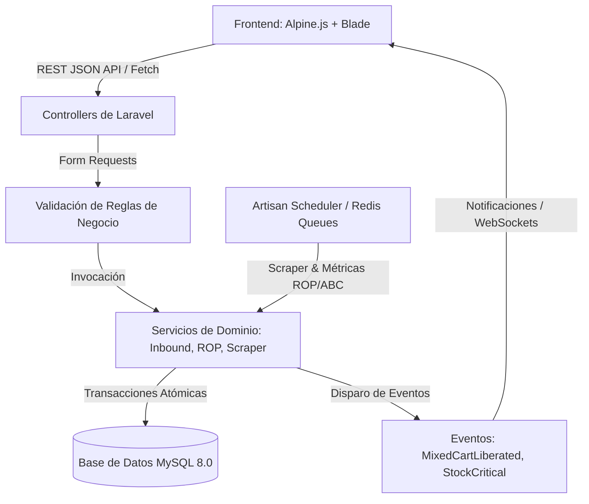

# Especificación Técnica de Integración Backend (Laravel) & Contrato de UI
## Plataforma Consolidada: Hub 1 (Dashboard General & Action Center) & Hub 4 (Inventario, Cadena de Suministro & Compras)
**Versión de Especificación:** 2.5 | **Estrategia:** UI-First Architecture  
**Directorio Backend Destino:** `C:\laragon\www\mi-tienda-online`  
**Tecnologías Frontend:** Blade (`inventory.blade.php`, `dashboard.blade.php`), JavaScript Modular (`app.js`, `inventory-module.js`), Alpine.js, Tailwind CSS, SheetJS  
**Tecnologías Backend:** Laravel 11/12, PHP 8.2+, MySQL 8.0, Redis (Queues & Cache), Maatwebsite Excel  

---

## 1. Filosofía Arquitectónica y Principios de Integración

Este documento constituye el **contrato formal de integración** entre la interfaz de usuario construida y el backend de Laravel. 

Bajo la metodología **UI-First**, la interfaz ya resuelve toda la ergonomía operativa, las fórmulas matemáticas de inventario, los estados transaccionales y las validaciones de usuario. La labor del backend consiste en:
1. **Persistir de forma atómica y segura** los estados creados por el UI.
2. **Exponer endpoints RESTful** cuyas estructuras de petición y respuesta coincidan con los modelos del frontend.
3. **Ejecutar en segundo plano (Jobs/Workers)** los cálculos predictivos pesados y la sincronización con proveedores externos (Scraper Torzo Bot).
4. **Garantizar la inmutabilidad contable** en cada movimiento de stock mediante el libro mayor (Kardex).



---

## 2. Diccionario de Dominio y Reglas de Negocio

El backend debe implementar estrictamente las siguientes reglas que rigen el comportamiento de la interfaz:

### 2.1. El Motor de Stock de Tres Estados
Para cualquier SKU y talla, el stock no es un número único; se desglosa en:
$$\text{Stock Disponible} = \text{Stock Físico (Almacén)} - \text{Stock Comprometido (Apartados / Pedidos en Tránsito)}$$
* **Stock Físico (`localStock`):** Mercancía real presente en los racks del almacén.
* **Stock Comprometido (`committedStock`):** Unidades ya vendidas en la tienda online o asignadas a pedidos pendientes de empaque.
* **Stock Disponible (`availableStock`):** Unidades libres para la venta inmediata. Si este valor llega a 0, la tienda pública no debe permitir compra con entrega inmediata.
* **Stock de Proveedor (`supplierStock`):** Unidades disponibles en el catálogo remoto del mayorista (Torzo, Silk & Cotton, etc.), sincronizadas vía scraper o API.

### 2.2. Matriz Textil de Seis Tallas
El modelo textil se basa en una curva fija de 6 tallas:
* `CH` (Chica)
* `M` (Mediana - **Talla Estrella (Core)**: mayor volumen de venta)
* `G` (Grande - **Talla Estrella (Core)**: mayor volumen de venta)
* `XL` (Extra Grande)
* `2XL` (Doble Extra Grande - Talla extendida)
* `3XL` (Triple Extra Grande - Talla extendida)

### 2.3. Tipos de Catálogo y Transición de Estatus
1. **`propio`:** Producto con inventario físico en bodega local (`localStock > 0`).
2. **`dropship`:** Producto sin existencias físicas locales (`localStock = 0`), abastecido bajo demanda del mayorista.
3. **`mixto`:** Producto híbrido que cuenta tanto con inventario en bodega local como con respaldo en mayorista.
* **Regla de Transición Automática:** Al recibir mercancía de un producto catalogado como `dropship`, el sistema **debe transicionar automáticamente su tipo a `mixto`** si aún conserva vínculo con el proveedor.

### 2.4. Motor Predictivo de Reposición (ROP / DOH / VMD)
* **Venta Media Diaria (VMD):**
  $$\text{VMD} = \frac{\text{Ventas Últimos 30 Días}}{30}$$
* **Días de Cobertura (DOH - Days on Hand):**
  $$\text{DOH} = \frac{\text{Stock Disponible}}{\text{VMD}}$$
  * **Semáforo:** $\le 7$ días = Crítico (Rojo/Rose) | $\le 15$ días = Preventivo (Ámbar) | $> 15$ días = Saludable (Verde/Emerald).
* **Punto de Reorden (ROP - Reorder Point):**
  $$\text{ROP} = (\text{VMD} \times \text{Lead Time en Días}) + \text{Stock de Seguridad}$$
  * Si $\text{Stock Disponible} \le \text{ROP}$, el producto se marca como `Bajo ROP` y se activa la orden sugerida `[ ROP ]`.

### 2.5. Análisis de Pareto ABC (80/20)
Clasificación de productos basada en su contribución acumulada a la facturación (GMV):
* **Clase A:** Productos que representan hasta el **80% del GMV** (Top sellers / rotación alta).
* **Clase B:** Productos que aportan el siguiente **15% del GMV** (Rotación intermedia).
* **Clase C:** Productos que aportan el último **5% del GMV** (Larga cola / baja rotación).

### 2.6. Margen Operativo Comercial
$$\text{Margen (\%)} = \left(\frac{\text{PVP} - \text{Costo}}{\text{PVP}}\right) \times 100$$
* Semáforo: $\ge 60\%$ (Saludable) | $40\% - 59\%$ (Estándar) | $< 40\%$ (Bajo Margen).

### 2.7. Modelo de Valuación Contable: Costo Promedio Ponderado (CPP) vs Último Costo (TASK-INV-04)
Para evitar la distorsión del balance financiero ante variaciones de precio entre compras mayoristas por lote, el backend implementa el modelo dual:
1. **Último Costo de Adquisición (`cost`):** Valor unitario pagado en la orden más reciente, utilizado para proyectar el **Margen Marginal**.
2. **Costo Promedio Ponderado (`weighted_average_cost` / CPP):** Valuación oficial del inventario en balance contable.
   - **Fórmula de Recálculo en Inbound (`InboundReceiptService`):**
     $$\text{CPP}_{\text{nuevo}} = \frac{(\text{Stock Previo} \times \text{CPP Previo}) + (\text{Cantidad Recibida} \times \text{Costo Unitario Lote})}{\text{Stock Previo} + \text{Cantidad Recibida}}$$
   - **Margen Real Contable (%):**
     $$\text{Margen Real Contable} = \left(\frac{\text{PVP} - \text{CPP}}{\text{PVP}}\right) \times 100$$
   - **Trazabilidad Inmutable en Kardex:** Cada recepción inbound (`ENTRADA_COMPRA`) almacena en el campo `note` la variación histórica del CPP: `Valuación CPP: $X -> $Y (Lote @ $Z)`.

### 2.8. Generación e Impresión de Etiquetas Térmicas (Code128 & QR) (TASK-INV-05)
Para garantizar la trazabilidad física desde la recepción Inbound y agilizar el picking en almacén:
1. **Estándar de Código de Barras:** Code128 Subconjunto B/C determinista generado nativamente en formato SVG vectorial en el frontend, y mediante ZPL (Zebra Programming Language) o PDF térmico en backend.
2. **Dimensiones Estandarizadas:**
   - **50 x 30 mm (Estándar Prenda / Rack):** Para pegado directo en bolsas de prendas, cosméticos o frontal de gavetas de picking.
   - **100 x 50 mm (Caja / Bulto / Pallet):** Para cajas maestras de recepción mayorista y tarimas de consolidación.
3. **Payload Obligatorio en Etiqueta:**
   - Encabezado institucional: `MI TIENDA ONLINE - BODEGA CENTRAL`.
   - Código de Ubicación Física / Slotting: `SLOT: {bin_location}` (ej. `SLOT: A-01-B`).
   - Nombre descriptivo y SKU interno.
   - Badge destacado de Variante: Curva Textil (`CH-3XL`), Tonos Cosmética (`TONO 01-06`), Volúmenes Fragancia (`10-100ML`) o `PIEZA UNICA`.
   - PVP oficial en MXN y código QR vectorial para escaneo rápido en mesa de empaque.
4. **Integración con Recepción Inbound y Lotes:**
   - Al confirmar el cotejo físico en `POST /api/v1/inventory/purchases/orders/{id}/receive`, el backend admite el parámetro `print_labels: true`, despachando el job `GenerateThermalLabelsBatchJob` para generar el spool de impresión correspondiente a las unidades recibidas por cada talla.

### 2.9. Control Sanitario: Lotes y Fechas de Caducidad / PAO en Cosmética (TASK-INV-06)
1. **Trazabilidad Sanitaria Obligatoria:** Productos de cosmética, higiene y cuidado íntimo deben registrar `lot_number`, `expiration_date` y `pao_months` (Period After Opening) para cumplimiento normativo (DIGEMID / COFEPRIS / FDA).
2. **Semaforización Automática:**
   - **Crítico (Rojo):** $\le 30$ días para vencer.
   - **Preventivo (Ámbar):** $31 - 90$ días para vencer.
   - **Saludable (Esmeralda):** $> 90$ días para vencer.
3. **Inmutabilidad en Kardex:** Cada recepción inbound (`ENTRADA_COMPRA`) y ajuste asienta el lote y caducidad en el registro contable.

### 2.10. Auditoría Cíclica a Ciegas (Blind Cycle Counting) (TASK-INV-07)
1. **Metodología a Ciegas:** El operador físico cuenta los productos sin conocer el saldo teórico del sistema para evitar sesgos cognitivos o falsedad en conteos.
2. **Muestra Determinista:** 3 SKUs diarios seleccionados por rotación, criticidad ROP y antigüedad de último conteo.
3. **Indicador IRA (Inventory Record Accuracy):**
   $$\text{IRA (\%)} = \left(1 - \frac{|\text{Stock Físico Contado} - \text{Stock Teórico}|}{\text{Stock Teórico}}\right) \times 100$$
4. **Reconciliación Transaccional:** Ajustes automáticos generan movimiento `AJUSTE_AUDITORIA_CIEGA` en Kardex con motivo tipificado y recalibran existencias físicas.

### 2.11. Gestión Integral de Ropa Interior, Curaduría Previa de Scraping, Vitrinas Web y Ajustes de Módulo (TASK-INV-08)
Para soportar la alta especialización en prendas íntimas y moda textil:
1. **Composición de Telas (`apparel_fabrics`):**
   - Catálogo administrable de fibras y tejidos: Algodón Pima, Modal, Microfibra, Malla/Mesh, Seda, Encaje, Spandex/Elastano, etc.
   - Cada tela posee nombre descriptivo, estado activo/inactivo y notas técnicas.
2. **Matriz Cromática & Tornasoles Dinámicos (`apparel_colors`):**
   - Soporte dual: Colores **Sólidos** (código hexadecimal único, ej. `#000000`) y colores **Tornasoles** (efecto camaleónico con degradado lineal CSS, ej. `#38ef7d -> #11998e`).
   - Gestión reactiva desde el modal de ajustes con vista previa en swatch circular.
3. **Variante Gráfica / Diseño (`design_type`):**
   - Clasificación de prenda: `sin_diseno` (Básico / Liso monocromático) o `con_diseno` (Estampado, serigrafía, sublimación o patrón gráfico).
4. **Control de Vitrina Web y Secciones (`website_section` & `is_published`):**
   - **Switch Público / Privado:** Conmutación instantánea `is_published` (true = en vitrina web pública, false = fuera de catálogo / pausado).
   - **Sección Web Asignada:** `basicos` (Línea de Básicos), `disenador` (Línea de Diseñador / Premium), `temporada` (Temporada / Tendencia) o `general` (Catálogo General).
5. **Marca y Descuentos Comerciales:**
   - Identificación de marca/proveedor (`brand`).
   - Atributos `discount_pct` y `regular_price` para calcular y exhibir precio tachado y badge de descuento (`-20% OFF`).
6. **Bandeja de Curaduría Previa de Scraping (`scraped_pending_items`):**
   - **Flujo en Dos Fases:**
     $$\text{Scraper de Proveedor (Torzo)} \longrightarrow \text{Bandeja de Pendientes (Tab 3)} \overset{\text{Curaduría Manual}}{\longrightarrow} \text{Catálogo Maestro Activo}$$
   - Ningún producto extraído automáticamente ingresa a la tienda pública sin pasar por revisión humana.
   - El operador valida y ajusta: nombre, marca, color/tornasol, tela, tipo de diseño, sección web, PVP sugerido y descripción redactada.
   - Al aprobarse (`POST /api/v1/inventory/scraping/pending/{id}/curate`), se inserta en `products` con estatus validado y se marca el ítem pendiente como `approved`.

---

## 3. Esquema de Base de Datos y Migraciones de Laravel

A continuación se definen las migraciones exactas requeridas para soportar toda la estructura de datos del UI.

### 3.1. Tabla `suppliers` (Proveedores & Mayoristas)
```php
Schema::create('suppliers', function (Blueprint $table) {
    $table->id();
    $table->string('name'); // Ej: 'Torzo B2B'
    $table->string('code')->unique(); // Ej: 'TORZO'
    $table->string('contact_name')->nullable();
    $table->string('email')->nullable();
    $table->string('phone')->nullable();
    $table->string('whatsapp')->nullable(); // Ej: '+525599887766'
    $table->string('country', 2)->default('MX');
    $table->string('currency', 3)->default('MXN');
    $table->decimal('rating', 3, 2)->default(4.50);
    $table->string('payment_terms')->default('Net 30'); // 'Contado', 'Net 15', 'Net 30'
    $table->boolean('scraper_enabled')->default(false);
    $table->string('scraper_driver')->nullable(); // 'torzo_scraper'
    $table->timestamp('last_scraped_at')->nullable();
    $table->timestamps();
});
```

### 3.2. Tabla `products` (Catálogo Maestro)
```php
Schema::create('products', function (Blueprint $table) {
    $table->id();
    $table->string('sku')->unique(); // Ej: 'BX-MOD-001'
    $table->string('name');
    $table->string('category'); // 'Boxers', 'Jocks', 'Tangas', 'Bikinis', 'Camisillas', 'Cosmética', 'Perfumería'
    $table->enum('type', ['propio', 'dropship', 'mixto'])->default('propio');
    $table->enum('variant_dimension', ['size', 'shade', 'volume', 'none'])->default('size'); // TASK-INV-02: Textil (tallas), Cosmética (tonos), Perfumería (volúmenes)
    $table->string('location')->nullable(); // Ej: 'Rack A-01 / Nivel 2'
    $table->decimal('pvp', 10, 2); // Precio de Venta al Público en MXN
    $table->decimal('cost', 10, 2); // Último Costo Mayorista en MXN
    $table->decimal('weighted_average_cost', 10, 2)->nullable(); // TASK-INV-04: Costo Promedio Ponderado (CPP) contable
    $table->foreignId('supplier_id')->nullable()->constrained('suppliers')->nullOnDelete();
    $table->string('provider_url')->nullable(); // URL del mayorista para scraping
    $table->boolean('is_scraping_active')->default(false);
    
    // Atributos Textiles, Vitrina Web y Descuentos (TASK-INV-08)
    $table->string('brand')->nullable(); // Ej: 'Torzo', 'Calvin Klein'
    $table->string('fabric_type')->nullable(); // Ej: 'Algodón Pima', 'Microfibra'
    $table->string('color_name')->nullable(); // Ej: 'Negro Azabache', 'Tornasol Esmeralda'
    $table->string('color_hex')->nullable(); // Ej: '#000000' o 'linear-gradient(...)'
    $table->enum('color_type', ['solid', 'iridescent'])->default('solid');
    $table->enum('design_type', ['sin_diseno', 'con_diseno'])->default('sin_diseno');
    $table->enum('website_section', ['basicos', 'disenador', 'temporada', 'general'])->default('basicos');
    $table->boolean('is_published')->default(true); // Switch público/privado vitrina web
    $table->decimal('discount_pct', 5, 2)->default(0); // Descuento promocional (%)
    $table->decimal('regular_price', 10, 2)->nullable(); // Precio regular tachado
    $table->text('description')->nullable(); // Descripción detallada de prenda
    
    // Métricas Predictivas y ROP
    $table->unsignedInteger('monthly_sales')->default(0); // Unidades vendidas últimos 30 días
    $table->unsignedInteger('lead_time_days')->default(7); // Días de entrega del proveedor
    $table->unsignedInteger('safety_stock')->default(10); // Stock de colchón
    $table->enum('abc_class', ['A', 'B', 'C'])->default('B');
    $table->boolean('is_active')->default(true);
    
    $table->timestamps();
    
    $table->index(['category', 'type', 'abc_class']);
    $table->index(['variant_dimension', 'is_active']);
    $table->index(['website_section', 'is_published']);
    $table->index(['brand', 'fabric_type']);
});
```

### 3.3. Tabla `product_sizes` / `product_variants` (Matriz Textil, Cosmética y Perfumería)
```php
Schema::create('product_sizes', function (Blueprint $table) {
    $table->id();
    $table->foreignId('product_id')->constrained('products')->cascadeOnDelete();
    
    // Dimensión Textil (6 tallas estándar)
    $table->enum('size', ['ch', 'm', 'g', 'xl', '2xl', '3xl'])->nullable();
    
    // Dimensión Cosmética & Maquillaje (TASK-INV-02)
    $table->string('shade_name', 50)->nullable(); // Ej: 'Tono 02 Neutro Claro'
    $table->string('shade_code', 20)->nullable(); // Hex color: '#E0AC69'
    
    // Dimensión Perfumería & Líquidos (TASK-INV-02)
    $table->unsignedInteger('volume_ml')->nullable(); // 10, 50, 100 ml
    
    // Stock y Disponibilidad
    $table->unsignedInteger('stock_fisico')->default(0);
    $table->unsignedInteger('stock_comprometido')->default(0);
    $table->unsignedInteger('supplier_stock')->nullable(); // Stock remoto en fábrica
    $table->boolean('is_paused')->default(false); // Pausado para venta on-demand
    
    // Ubicación Física en Bodega / Slotting (TASK-INV-01)
    $table->string('bin_location', 30)->nullable(); // Ej: 'A-02-3' (Pasillo A, Rack 02, Gaveta 3)
    $table->foreignId('slot_id')->nullable()->constrained('warehouse_slots')->nullOnDelete();
    
    // Trazabilidad Sanitaria y Caducidades para Cosmética (TASK-INV-06)
    $table->string('batch_number', 50)->nullable(); // Lote sanitario de fabricación
    $table->date('expiration_date')->nullable(); // Fecha de caducidad
    $table->unsignedTinyInteger('pao_months')->nullable(); // Period After Opening (ej. 12 meses)
    
    $table->timestamps();
    
    $table->index(['product_id', 'bin_location']);
    $table->index(['expiration_date']);
});
```

### 3.3.B. Tabla `product_images` (Galería Fotográfica y Portadas - Hasta 10 Imágenes)
```php
Schema::create('product_images', function (Blueprint $table) {
    $table->id();
    $table->foreignId('product_id')->constrained('products')->cascadeOnDelete();
    $table->string('image_path', 500); // Ruta en almacenamiento local/S3
    $table->string('thumbnail_path', 500)->nullable(); // Miniatura optimizada WebP
    $table->string('alt_text', 255)->nullable(); // Texto descriptivo accesible / SEO
    $table->unsignedTinyInteger('sort_order')->default(0); // 0 a 9 (máximo 10 imágenes por producto)
    $table->boolean('is_primary')->default(false); // Imagen principal de portada para tienda y catálogo
    $table->unsignedInteger('file_size_bytes')->nullable(); // Peso del archivo
    $table->string('mime_type', 50)->nullable(); // 'image/jpeg', 'image/png', 'image/webp', 'image/avif'
    
    $table->timestamps();
    
    $table->index(['product_id', 'sort_order']);
    $table->index(['product_id', 'is_primary']);
});
```

### 3.4. Tabla `purchase_orders` (Órdenes de Compra a Proveedores)
```php
Schema::create('purchase_orders', function (Blueprint $table) {
    $table->id();
    $table->string('po_number')->unique(); // Ej: 'PO-2026-1042' o 'OC-2026-1042'
    $table->foreignId('supplier_id')->constrained('suppliers');
    $table->enum('status', [
        'Planificada', 
        'Borrador', 
        'Emitida (Correo Enviado)',
        'Enviada', 
        'En Camino', 
        'Recibida en Almacén', 
        'Cancelada'
    ])->default('Planificada');
    $table->enum('priority', ['normal', 'alta', 'urgente'])->default('normal');
    $table->enum('origin_type', ['reabastecimiento_rop', 'on_demand', 'manual_bulk'])->default('reabastecimiento_rop');
    $table->unsignedInteger('total_pieces')->default(0);
    $table->decimal('gross_subtotal_cost', 12, 2)->default(0.00); // Subtotal bruto antes de deducciones
    $table->boolean('has_credit_deduction')->default(false);
    $table->string('credit_note_ref', 100)->nullable(); // Folio acuerdo / NC: 'NC-TORZO-2026-012'
    $table->text('credit_note_reason')->nullable(); // Discrepancia previa: 'Faltante en rampa...'
    $table->decimal('deduction_amount', 12, 2)->default(0.00); // Monto deducido por compensación mercantil
    $table->decimal('subtotal_cost', 12, 2)->default(0.00); // Base gravable neta
    $table->decimal('iva_cost', 12, 2)->default(0.00);
    $table->decimal('total_cost', 12, 2)->default(0.00);
    $table->string('carrier', 100)->nullable(); // Ej: 'Transportes Castores B2B'
    $table->string('tracking_number', 100)->nullable(); // Guía de transportista
    $table->string('delivery_dock', 150)->default('Rampa Central Almacén CDMX - Bahía Inbound 02');
    $table->string('payment_terms', 100)->default('Crédito Comercial 30 días');
    $table->string('email_sent_to', 150)->nullable(); // Destinatario oficial del taller
    $table->timestamp('email_sent_at')->nullable(); // Momento exacto de despacho por correo
    $table->date('expected_arrival_at')->nullable();
    $table->timestamp('sent_at')->nullable();
    $table->timestamp('received_at')->nullable();
    $table->text('notes')->nullable();
    
    // Snapshot inmutable para visualización y reimpresión idéntica a futuro
    $table->json('po_snapshot')->nullable();
    
    $table->timestamps();
});
```

### 3.4b. Tabla `purchase_kardex` (Auditoría Mercantil y Trazabilidad de Compras)
Bitácora inmutable de auditoría para registrar cada transacción del circuito de reabastecimiento, planeación MOQ, emisión y recepción.

### 3.4c. Tabla `supplier_credit_agreements` (Acuerdos de Notas de Crédito & Compensación por Discrepancias)
Registro maestro de acuerdos mercantiles y saldos a favor devengados por discrepancias en muelle de recepción, penalizaciones por demora o mermas textiles previas para su aplicación compensatoria en órdenes de compra.
```php
Schema::create('supplier_credit_agreements', function (Blueprint $table) {
    $table->id();
    $table->foreignId('supplier_id')->constrained('suppliers');
    $table->string('ref', 100)->unique(); // Ej: 'NC-TORZO-2026-012'
    $table->decimal('amount', 12, 2);
    $table->text('reason'); // Causa del acuerdo: faltante físico, vicio oculto o bonificación
    $table->enum('status', ['Pendiente de Aplicar', 'Aplicada', 'Cancelada'])->default('Pendiente de Aplicar');
    $table->foreignId('applied_purchase_order_id')->nullable()->constrained('purchase_orders')->nullOnDelete();
    $table->timestamp('applied_at')->nullable();
    $table->timestamps();
});
```
```php
Schema::create('purchase_kardex', function (Blueprint $table) {
    $table->id();
    $table->string('kardex_folio', 40)->unique(); // Ej: 'KDX-PUR-2026-089'
    $table->string('po_number', 40)->nullable()->index(); // Ej: 'PO-2026-1042'
    $table->enum('event_type', [
        'PO_EMITIDA',
        'AJUSTE_CANTIDAD',
        'ON_DEMAND_CONVERTIDO',
        'ON_DEMAND_AGOTADO',
        'RECEPCION_RAMPA',
        'SINCRONIZACION_FINANZAS'
    ]);
    $table->string('event_label', 60); // Ej: 'Emisión & Envío PO'
    $table->string('badge_class', 80)->default('bg-indigo-50 text-indigo-700 border-indigo-200');
    $table->foreignId('supplier_id')->nullable()->constrained('suppliers')->nullOnDelete();
    $table->string('supplier_name', 120);
    $table->string('product_name', 150);
    $table->text('sku_summary')->nullable(); // Ej: 'TOR-DRP-001, TOR-DRP-002'
    $table->string('delta_qty', 30); // Ej: '+120 uds', '-10 uds'
    $table->decimal('total_amount', 12, 2)->default(0.00);
    $table->string('operator_name', 100)->default('Elena Compras');
    $table->text('notes')->nullable();
    
    $table->timestamp('created_at')->useCurrent();
    
    $table->index(['event_type', 'created_at']);
});
```

### 3.4d. Protocolo Inter-Módulos: Emisión de OC (Hub 4) -> Dashboard Extranet B2B (Hub 7) -> Bitácora de Turno (Hub 1)

Cuando el comprador formaliza una Orden de Compra desde el modal de despacho por correo (`sendPoEmailAndIssue()`), se detona un flujo reactivo transversal de tres niveles:

1. **Notificación y Registro en Extranet de Proveedores (`notifyVendorExtranetNewPo`):**
   - **Firma:** `window.notifyVendorExtranetNewPo(poData)` (implementada en `app.js`).
   - **Dashboard del Fabricante (`vendorPortalState.notifications`):** Inserta en el encabezado del feed de alertas una tarjeta reactiva para el taller textil con:
     * Folio oficial de la orden (`poData.poNumber`).
     * Detalle de volumen (`totalPieces` prendas) e importe a transferir (`total` MXN).
     * Mención explícita del saldo compensado si aplica (`deductionAmount` y `creditNoteRef`).
   - **Bandeja de Producción (`vendorPortalState.orders`):** Da de alta la orden en la tabla de OCs activas con estado `in_production` ("Nueva OC Emitida por RevOps"), desglosando la curva de tallas (CH, M, G, XL) y fechas de compromiso en rampa.
   - **Refresco de Vista:** Si el operador tiene activa la pantalla `vendor`, se ejecuta `render('vendor')` de forma inmediata.

2. **Registro de Auditoría Operativa en Hub 1 (`operationalState.shiftLog`):**
   - Registra el evento en la Bitácora de Turno del Action Center:
     ```javascript
     operationalState.shiftLog.unshift({
       id: `shift-log-po-${Date.now()}`,
       time: timeStr,
       action: `Emisión de PO ${poData.poNumber} a Extranet`,
       user: poData.buyerAgent || 'Elena Compras',
       detail: `Orden ${poData.poNumber} notificada al Extranet B2B del proveedor (${poData.totalPieces} pzas, $${poData.total} MXN).`,
       type: 'compras'
     });
     ```

3. **Selector Desplegable Adaptativo de Acuerdos (`handleCreditAgreementSelect`):**
   - En el generador de PO (`inventory-module.js`), la lista desplegable `<select>` filtra en tiempo real los saldos a favor pendientes del proveedor actual (`getPendingAgreementsForCurrentPo()`).
   - Al seleccionar un folio, se inyectan `creditNoteRef`, `creditNoteAmount`, `creditNoteReason`, se marca `hasCreditDeduction = true` y se detona `recalculatePoTotals()`.
   - Soporta opción `manual` para acuerdos no registrados previamente y opción vacía `""` para desestimar deducciones.

4. **Pipeline de Impresión Aislada sin Truncamiento (`printPurchaseOrderDoc`):**
   - Para evitar el bloqueo de paginación en Chromium generado por contenedores flex y transformaciones CSS (`transform transition-all`), el motor crea un `iframe` invisible en memoria (`display: none; position: absolute;`).
   - Inyecta el HTML puro de `#printablePurchaseOrderDoc` con estilos normalizados, Tailwind CSS y `@page { size: letter portrait; margin: 12mm 15mm; }`.
   - Invoca `printFrame.contentWindow.print()` y remueve el iframe al finalizar, garantizando un PDF continuo sin recortes del encabezado ni pérdida de partidas.

### 3.5. Tabla `purchase_order_items` (Detalle y Curva de Tallas de la Orden)
```php
Schema::create('purchase_order_items', function (Blueprint $table) {
    $table->id();
    $table->foreignId('purchase_order_id')->constrained('purchase_orders')->cascadeOnDelete();
    $table->foreignId('product_id')->constrained('products');
    $table->string('sku');
    
    // Curva de tallas solicitadas
    $table->unsignedInteger('qty_ch')->default(0);
    $table->unsignedInteger('qty_m')->default(0);
    $table->unsignedInteger('qty_g')->default(0);
    $table->unsignedInteger('qty_xl')->default(0);
    $table->unsignedInteger('qty_2xl')->default(0);
    $table->unsignedInteger('qty_3xl')->default(0);
    
    // Cantidades recibidas (para recepción parcial o total)
    $table->unsignedInteger('received_qty_ch')->default(0);
    $table->unsignedInteger('received_qty_m')->default(0);
    $table->unsignedInteger('received_qty_g')->default(0);
    $table->unsignedInteger('received_qty_xl')->default(0);
    $table->unsignedInteger('received_qty_2xl')->default(0);
    $table->unsignedInteger('received_qty_3xl')->default(0);
    
    $table->unsignedInteger('total_quantity');
    $table->decimal('unit_cost', 10, 2);
    $table->decimal('subtotal', 10, 2);
    
    $table->timestamps();
});
```

### 3.6. Tabla `on_demand_requests` (Solicitudes de Clientes & Carritos Mixtos)
```php
Schema::create('on_demand_requests', function (Blueprint $table) {
    $table->id();
    $table->string('request_number')->unique(); // Ej: 'REQ-2026-082'
    $table->string('customer_name'); // Ej: 'Sofía Albarrán'
    $table->string('customer_phone')->nullable(); // Ej: '+525544332211'
    $table->string('order_reference')->nullable(); // Ej: '#ORD-4491'
    $table->foreignId('product_id')->constrained('products');
    $table->string('sku');
    $table->enum('size', ['ch', 'm', 'g', 'xl', '2xl', '3xl']);
    $table->unsignedInteger('requested_qty')->default(1);
    
    $table->enum('status', [
        'Pendiente Stock Mayorista',
        'Verificado con Proveedor',
        'Link de Pago Enviado',
        'Pagado / Esperando Mercancía',
        'Liberado para Empaque',
        'Cancelado'
    ])->default('Pendiente Stock Mayorista');
    
    $table->foreignId('purchase_order_id')->nullable()->constrained('purchase_orders')->nullOnDelete();
    $table->boolean('is_confirmed')->default(false);
    $table->timestamp('liberated_at')->nullable();
    
    $table->timestamps();
});
```

### 3.7. Tabla `inventory_movements` (Kardex - Libro Mayor Inmutable)
```php
Schema::create('inventory_movements', function (Blueprint $table) {
    $table->id();
    $table->string('sku');
    $table->foreignId('product_id')->constrained('products');
    $table->enum('size', ['ch', 'm', 'g', 'xl', '2xl', '3xl'])->nullable();
    $table->enum('type', [
        'ENTRADA_COMPRA',
        'VENTA_DIRECTA',
        'RESERVA_MIXTA',
        'LIBERACION_MIXTA',
        'AJUSTE_MERMA',
        'DEVOLUCION',
        'SALIDA_VENTA',
        'SALIDA_DESPACHO'
    ]);
    $table->integer('qty_change'); // Ej: +15, -1
    $table->unsignedInteger('balance_before'); // Stock físico antes
    $table->unsignedInteger('balance_after'); // Stock físico después
    $table->string('reference_id')->nullable(); // Ej: 'OC-2026-088', '#ORD-4491'
    $table->string('notes')->nullable();
    $table->foreignId('user_id')->nullable()->constrained('users')->nullOnDelete();
    
    $table->timestamp('created_at')->useCurrent();
    
    $table->index(['sku', 'type', 'created_at']);
});
```

### 3.8. Tabla `scraper_alerts` (Centro de Alertas Torzo Bot)
```php
Schema::create('scraper_alerts', function (Blueprint $table) {
    $table->id();
    $table->foreignId('supplier_id')->constrained('suppliers');
    $table->foreignId('product_id')->constrained('products');
    $table->string('sku');
    $table->enum('alert_type', ['cost_hike', 'factory_stockout', 'restock_opportunity']);
    
    $table->decimal('old_cost', 10, 2)->nullable();
    $table->decimal('new_cost', 10, 2)->nullable();
    $table->decimal('suggested_pvp', 10, 2)->nullable();
    
    $table->enum('affected_size', ['ch', 'm', 'g', 'xl', '2xl', '3xl'])->nullable();
    $table->unsignedInteger('restock_qty')->nullable();
    
    $table->enum('status', ['pending', 'resolved', 'dismissed'])->default('pending');
    $table->string('resolution_action')->nullable();
    $table->timestamp('resolved_at')->nullable();
    
    $table->timestamps();
});
```

### 3.9. Tabla `warehouse_slots` (Slotting Físico de Bodega - TASK-INV-01)
```php
Schema::create('warehouse_slots', function (Blueprint $table) {
    $table->id();
    $table->string('slot_code', 30)->unique(); // Ej: 'A-02-3'
    $table->string('aisle', 10); // 'Pasillo A'
    $table->unsignedSmallInteger('rack'); // 2
    $table->unsignedSmallInteger('shelf_bin'); // 3
    $table->enum('zone_type', ['picking_activo', 'reserva_alta', 'cuarentena_inbound'])->default('picking_activo');
    $table->unsignedInteger('capacity_units')->default(100);
    $table->unsignedInteger('current_occupancy')->default(0);
    $table->boolean('is_active')->default(true);
    
    $table->timestamps();
    
    $table->index(['aisle', 'rack', 'shelf_bin']);
});
```

### 3.10. Tablas `product_bundles` y `bundle_items` (Recetas BOM y Cajas de Suscripción - TASK-INV-03)
```php
Schema::create('product_bundles', function (Blueprint $table) {
    $table->id();
    $table->string('sku')->unique(); // Ej: 'SUB-BOX-MARTE-LVL2'
    $table->string('name'); // 'Caja Mensual Marte Nivel 2: Estilo & Cuidado'
    $table->enum('tier_level', ['nivel_1_refill', 'nivel_2_estilo', 'nivel_3_vip'])->default('nivel_2_estilo');
    $table->decimal('subscription_price', 10, 2); // Precio mensual en MXN
    $table->boolean('is_active')->default(true);
    
    $table->timestamps();
});

Schema::create('bundle_items', function (Blueprint $table) {
    $table->id();
    $table->foreignId('bundle_id')->constrained('product_bundles')->cascadeOnDelete();
    $table->foreignId('product_id')->constrained('products');
    $table->foreignId('product_size_id')->nullable()->constrained('product_sizes');
    $table->unsignedInteger('quantity')->default(1); // Cantidad de unidades a liquidar de Kardex
    
    $table->timestamps();
    
    $table->unique(['bundle_id', 'product_id', 'product_size_id']);
});
```

### 3.11. Tabla `cycle_counts` (Auditoría Cíclica a Ciegas - TASK-INV-07)
```php
Schema::create('cycle_counts', function (Blueprint $table) {
    $table->id();
    $table->foreignId('product_id')->constrained('products');
    $table->foreignId('product_size_id')->constrained('product_sizes');
    $table->foreignId('user_id')->constrained('users'); // Empleado que contó
    $table->unsignedInteger('physical_count'); // Conteo ciego capturado
    $table->unsignedInteger('system_count'); // Saldo teórico al momento del conteo
    $table->integer('variance'); // physical_count - system_count
    $table->enum('status', ['pending_review', 'approved_adjustment', 'dismissed'])->default('pending_review');
    $table->foreignId('approved_by')->nullable()->constrained('users')->nullOnDelete();
    $table->string('notes')->nullable();
    
    $table->timestamps();
    
    $table->index(['status', 'created_at']);
});
```

### 3.12. Tabla `operational_tasks` (Bandeja Dinámica de Tareas y SLA Aging - TASK-DSH-04, TASK-DSH-05)
```php
Schema::create('operational_tasks', function (Blueprint $table) {
    $table->id();
    $table->string('task_code')->unique(); // Ej: 'TASK-PACK-1048'
    $table->enum('category', ['empaque', 'recepcion', 'surtido', 'expedicion']);
    $table->enum('urgency', ['standard', 'priority', 'urgent'])->default('standard');
    $table->string('title');
    $table->text('description')->nullable();
    $table->json('metadata')->nullable(); // Order ID, items checklist, supplier OC, courier info
    $table->enum('status', ['pending', 'in_progress', 'completed', 'canceled'])->default('pending');
    $table->foreignId('assigned_to')->nullable()->constrained('users')->nullOnDelete();
    
    // SLA y Envejecimiento (TASK-DSH-05)
    $table->timestamp('triggered_at')->useCurrent();
    $table->timestamp('due_at')->nullable(); // Hora límite (ej. 13:30 hrs para recolección DHL)
    $table->timestamp('completed_at')->nullable();
    
    $table->timestamps();
    
    $table->index(['category', 'status', 'urgency']);
    $table->index(['triggered_at', 'due_at']);
});
```

### 3.13. Tabla `cart_recovery_tokens` (Recuperación WhatsApp en 1 Clic - TASK-INT-05)
```php
Schema::create('cart_recovery_tokens', function (Blueprint $table) {
    $table->id();
    $table->string('token', 64)->unique();
    $table->string('customer_name')->nullable();
    $table->string('customer_phone', 20); // WhatsApp
    $table->string('customer_email')->nullable();
    $table->json('cart_payload'); // Items, tallas, vitrina origen
    $table->decimal('cart_total', 10, 2);
    $table->string('coupon_code', 30)->nullable(); // Ej: 'RETORNO5' (5% descuento de urgencia)
    $table->timestamp('expires_at'); // 2 a 24 horas de vigencia
    $table->boolean('is_recovered')->default(false);
    $table->timestamp('recovered_at')->nullable();
    
    $table->timestamps();
    
    $table->index(['token', 'expires_at']);
});
```

### 3.14. Tabla `api_health_logs` (Telemetría y Salud del Ecosistema - TASK-DSH-03)
```php
Schema::create('api_health_logs', function (Blueprint $table) {
    $table->id();
    $table->string('service_key'); // 'stripe', 'mercadopago', 'torzo_scraper', 'dhl_api'
    $table->enum('status', ['healthy', 'degraded', 'down']);
    $table->unsignedInteger('latency_ms'); // Latencia en milisegundos
    $table->string('http_status', 10)->nullable(); // 200, 500, timeout
    $table->text('error_message')->nullable();
    
    $table->timestamp('checked_at')->useCurrent();
    
    $table->index(['service_key', 'checked_at']);
});
```

### 3.15. Tabla `apparel_fabrics` (Tipos de Tela - TASK-INV-08)
```php
Schema::create('apparel_fabrics', function (Blueprint $table) {
    $table->id();
    $table->string('name', 80)->unique(); // Ej: 'Algodón Pima', 'Microfibra Dry-Fit', 'Modal'
    $table->string('description')->nullable(); // Propiedades técnicas y composición
    $table->boolean('is_active')->default(true);
    $table->timestamps();
    
    $table->index('is_active');
});
```

### 3.16. Tabla `apparel_colors` (Paleta de Colores y Tornasoles - TASK-INV-08)
```php
Schema::create('apparel_colors', function (Blueprint $table) {
    $table->id();
    $table->string('name', 80); // Ej: 'Negro Azabache', 'Tornasol Esmeralda / Océano'
    $table->string('hex', 120); // Hexadecimal (#000000) o CSS linear-gradient
    $table->enum('type', ['solid', 'iridescent'])->default('solid');
    $table->boolean('is_active')->default(true);
    $table->timestamps();
    
    $table->index(['type', 'is_active']);
});
```

### 3.17. Tabla `scraped_pending_items` (Bandeja de Curaduría Previa de Scraping - TASK-INV-08)
```php
Schema::create('scraped_pending_items', function (Blueprint $table) {
    $table->id();
    $table->string('suggested_sku')->unique();
    $table->string('name');
    $table->string('brand')->nullable(); // Ej: 'Torzo B2B'
    $table->string('suggested_category')->default('Boxers');
    $table->decimal('cost', 10, 2);
    $table->decimal('suggested_pvp', 10, 2);
    $table->string('detected_color_name')->nullable();
    $table->string('detected_color_hex')->nullable();
    $table->string('suggested_fabric')->nullable();
    $table->enum('suggested_design', ['sin_diseno', 'con_diseno'])->default('sin_diseno');
    $table->enum('suggested_section', ['basicos', 'disenador', 'temporada', 'general'])->default('basicos');
    $table->text('scraped_description')->nullable();
    $table->string('origin_url')->nullable();
    $table->unsignedInteger('supplier_stock')->default(0);
    $table->json('raw_extracted_payload')->nullable(); // JSON crudo devuelto por el scraper
    $table->enum('status', ['pending_review', 'approved', 'discarded'])->default('pending_review');
    $table->foreignId('reviewed_by')->nullable()->constrained('users')->nullOnDelete();
    $table->timestamp('reviewed_at')->nullable();
    $table->timestamps();
    
    $table->index(['status', 'brand']);
});
```

### 3.18. Tabla `support_cases` (Bandeja de Atención a Clientes & Ventas - TASK-DSH-01)
```php
Schema::create('support_cases', function (Blueprint $table) {
    $table->id();
    $table->string('case_code', 40)->unique(); // Ej: 'CASE-LEAD-101', 'CASE-CART-204'
    $table->enum('type', ['lead', 'abandoned', 'address_issue', 'subscriber']);
    $table->string('customer_name');
    $table->string('customer_phone', 25)->nullable();
    $table->string('customer_email')->nullable();
    $table->enum('channel', ['WhatsApp', 'WhatsApp / Web', 'Telefono / WhatsApp', 'Portal Suscriptor', 'Chat Tienda'])->default('WhatsApp');
    $table->enum('urgency', ['urgent', 'abandoned', 'address', 'subscriber', 'lead'])->default('lead');
    $table->string('urgency_text', 50)->nullable(); // Ej: 'Urgente • Hace 12m', 'Alto Valor • Hace 28m'
    $table->string('title');
    $table->text('detail');
    $table->json('context_data')->nullable(); // SKU, orderId, cart total, couponCode, subscriptionId
    $table->text('suggested_message')->nullable(); // Plantilla prellenada con enlace tokenizado y cupón
    $table->enum('status', ['pending', 'resolved', 'dismissed'])->default('pending');
    $table->foreignId('resolved_by')->nullable()->constrained('users')->nullOnDelete();
    $table->timestamp('resolved_at')->nullable();
    $table->timestamps();
    
    $table->index(['type', 'status', 'urgency']);
});
```

### 3.19. Tablas `fulfillment_batches` y `payment_gateway_configs` (Embudo Accionable Multiverso - TASK-DSH-02)
```php
Schema::create('fulfillment_batches', function (Blueprint $table) {
    $table->id();
    $table->string('batch_code', 40)->unique(); // Ej: 'BATCH-REL-2026-0907-A', 'BATCH-SUB-2026-0915-001'
    $table->enum('batch_type', ['regular_sales', 'subscription_cutoff'])->default('regular_sales');
    $table->enum('universe', ['consolidated', 'terra', 'marte', 'venus', 'tiresias'])->default('consolidated');
    $table->enum('carrier', ['DHL Express', 'Estafeta Terrestre', '99Minutos'])->default('DHL Express');
    $table->unsignedInteger('order_count');
    $table->json('order_ids'); // Array de IDs de órdenes liberadas a almacén
    $table->json('tier_breakdown')->nullable(); // Desglose de membresías por nivel
    $table->enum('status', ['pending_packing', 'in_packing', 'shipped'])->default('pending_packing');
    $table->foreignId('released_by')->nullable()->constrained('users')->nullOnDelete();
    $table->timestamp('released_at')->useCurrent();
    $table->timestamps();
    
    $table->index(['universe', 'status']);
    $table->index(['batch_type', 'status']);
});

Schema::create('payment_gateway_configs', function (Blueprint $table) {
    $table->id();
    $table->enum('active_gateway', ['Stripe', 'Mercado Pago'])->default('Stripe');
    $table->boolean('smart_retries_enabled')->default(true);
    $table->boolean('oxxo_spei_fallback')->default(true);
    $table->decimal('stripe_auth_success_rate', 5, 2)->default(98.8);
    $table->decimal('mercadopago_auth_success_rate', 5, 2)->default(97.4);
    $table->foreignId('updated_by')->nullable()->constrained('users')->nullOnDelete();
    $table->timestamps();
});
```

### 3.20. Tabla `webhook_event_logs` (Telemetría de Ecosistema & Auditoría HMAC - TASK-DSH-03)
```php
Schema::create('webhook_event_logs', function (Blueprint $table) {
    $table->id();
    $table->enum('service', ['stripe', 'mercadopago', 'torzobot', 'dhl', 'sepomex']);
    $table->string('service_display_name', 80); // 'Stripe Payments', 'DHL Express API'
    $table->string('event_name', 120); // 'webhook.received (invoice.payment_succeeded)', 'label.generated'
    $table->string('payload_hash', 64)->nullable(); // SHA-256 del cuerpo recibido
    $table->string('hmac_signature', 128)->nullable(); // Firma criptográfica de cabecera
    $table->boolean('is_hmac_valid')->default(true);
    $table->string('tls_version', 15)->default('TLS 1.3');
    $table->unsignedSmallInteger('http_status')->default(200); // 200, 400, 500
    $table->unsignedInteger('latency_ms'); // Latencia en ms (ej. 94)
    $table->timestamp('occurred_at')->useCurrent();
    $table->timestamps();
    
    $table->index(['service', 'occurred_at']);
    $table->index('http_status');
});
```

### 3.21. Tabla `orders` (Órdenes de Compra y Suscripciones D2C - TASK-INT-04)
```php
Schema::create('orders', function (Blueprint $table) {
    $table->id();
    $table->string('order_number', 50)->unique(); // Ej. '#MIX-1048' o '#SUB-2026-8891'
    $table->foreignId('customer_id')->nullable()->constrained('users')->nullOnDelete();
    $table->string('customer_name', 150);
    $table->string('customer_email', 150);
    $table->string('customer_phone', 30)->nullable();
    $table->string('shipping_city', 100);
    $table->string('shipping_address', 255);
    $table->string('shipping_postal_code', 10);
    $table->enum('order_type', ['direct_sale', 'mixed_cart', 'subscription_box'])->default('direct_sale');
    $table->enum('status', ['pending_payment', 'paid', 'in_packing', 'packed', 'dispatched', 'delivered', 'cancelled'])->default('paid');
    $table->string('assigned_courier', 50)->default('DHL Express');
    
    // TASK-INT-04: Preferencias y Restricciones Auditadas del Suscriptor
    $table->boolean('is_subscriber')->default(false);
    $table->string('subscription_tier', 100)->nullable(); // Ej. 'Marte VIP Nivel 3'
    $table->json('subscriber_preferences')->nullable(); 
    // Estructura JSON documentada:
    // {
    //    "size_preference": "m",
    //    "size_updated_at": "2026-09-04T10:30:00Z",
    //    "previous_size": "ch",
    //    "skin_sensitivity": "Piel Atópica / Sensible",
    //    "fragrance_restriction": "Sin cítricos ni alcohol directo",
    //    "fit_style": "Cinturilla Comfort Seamless sin elásticos rígidos",
    //    "verified_by_packer": true,
    //    "verified_at": "2026-09-07T14:15:00Z"
    // }
    
    $table->decimal('total_amount', 10, 2)->default(0.00);
    $table->timestamps();
    
    $table->index(['order_number', 'status']);
    $table->index(['is_subscriber', 'order_type']);
});
```

### 3.22. Tabla `shipping_manifests` (Manifiestos Diarios de Expedición - TASK-LOG-01)
Registra las actas de entrega formal de custodia a los transportistas (DHL Express, Estafeta, FedEx, 99 Minutos):

```php
Schema::create('shipping_manifests', function (Blueprint $table) {
    $table->id();
    $table->string('folio', 50)->unique(); // Ej. 'MAN-2026-0908-DHL01'
    $table->enum('carrier', ['dhl', 'estafeta', 'fedex', '99minutos', 'metro_chabacano']);
    $table->string('carrier_name', 100); // Ej. 'DHL Express México'
    $table->string('driver_name', 150); // Chofer recolector
    $table->string('driver_id_card', 100)->nullable(); // Gafete o INE
    $table->string('vehicle_plates', 30); // Placas de la camioneta
    $table->unsignedInteger('package_count')->default(0);
    $table->decimal('total_weight_kg', 8, 2)->default(0.00);
    $table->decimal('total_volume_m3', 8, 4)->default(0.0000);
    $table->enum('status', ['open', 'signed', 'dispatched', 'cancelled'])->default('signed');
    $table->text('notes')->nullable();
    $table->timestamp('signed_at')->nullable();
    $table->string('batch_barcode', 100)->nullable(); // Código Code128 de lote maestro
    $table->foreignId('closed_by_user_id')->constrained('users')->onDelete('restrict');
    $table->timestamps();

    $table->index(['carrier', 'status']);
    $table->index('created_at');
});
```

### 3.23. Tabla `shipments` (Bultos y Guías de Envío - TASK-LOG-01)
Control individual de paquetes con asignación de courier, guía y vinculación al manifiesto de salida:

```php
Schema::create('shipments', function (Blueprint $table) {
    $table->id();
    $table->foreignId('order_id')->constrained('orders')->onDelete('cascade');
    $table->string('tracking_number', 100)->unique(); // Número de guía de paquetería
    $table->enum('carrier', ['dhl', 'estafeta', 'fedex', '99minutos', 'metro_chabacano']);
    $table->foreignId('shipping_manifest_id')->nullable()->constrained('shipping_manifests')->onDelete('set null');
    $table->string('service_level', 50)->default('express'); // 'express', 'standard', 'ground'
    $table->decimal('weight_kg', 6, 2)->default(0.50);
    $table->json('dimensions_cm')->nullable(); // {"length": 25, "width": 18, "height": 10}
    $table->string('packaging_type', 50)->default('Caja Nivel 1 Microcorrugado');
    $table->string('destination_city', 100);
    $table->string('destination_state', 100);
    $table->string('destination_zip', 10);
    $table->enum('status', ['packed', 'manifested', 'in_transit', 'delivered', 'exception', 'returned'])->default('packed');
    $table->string('label_url', 255)->nullable();
    $table->timestamp('manifested_at')->nullable();
    $table->timestamp('delivered_at')->nullable();
    $table->timestamps();

    $table->index(['carrier', 'status']);
    $table->index('shipping_manifest_id');
    $table->index('tracking_number');
});
```

### 3.24. Tabla `package_types` (Gestor de Cajas y Empaques Personalizables - TASK-LOG-06)
Catálogo paramétrico de cajas y embalajes para optimización volumétrica IATA y cálculo exacto de tara y costos de insumos:

```php
Schema::create('package_types', function (Blueprint $table) {
    $table->id();
    $table->string('code', 30)->unique(); // Ej. 'BOX-ENVELOPE-01', 'BOX-M-STD', 'BOX-BLAZER-01'
    $table->string('name', 100); // Ej. 'Caja Mediana Multiverse'
    $table->string('description', 255)->nullable();
    $table->decimal('length_cm', 8, 2); // Largo exterior en cm
    $table->decimal('width_cm', 8, 2);  // Ancho exterior en cm
    $table->decimal('height_cm', 8, 2); // Alto exterior en cm
    $table->unsignedInteger('tare_weight_g')->default(100); // Peso vacío en gramos
    $table->decimal('cost_mxn', 8, 2)->default(0.00); // Costo unitario del insumo de empaque
    $table->json('compatible_categories'); // ['intimate', 'casual', 'outerwear', 'cosmetics']
    $table->boolean('is_active')->default(true);
    $table->timestamps();

    $table->index('code');
    $table->index('is_active');
});
```

### 3.25. Tablas de Configuración de Entornos y Auditoría (`system_environment_configs` & `environment_audit_logs` - TASK-SYS-ENV)
Gobierno centralizado de conmutación de entornos (Sandbox vs Producción) e historial inmutable de auditoría para prevenir cargos financieros accidentales o emisiones de guías reales durante pruebas internas:

```php
Schema::create('system_environment_configs', function (Blueprint $table) {
    $table->id();
    $table->string('environment', 20)->default('sandbox'); // 'sandbox' | 'production'
    $table->string('stripe_mode', 20)->default('test'); // 'test' | 'live'
    $table->string('stripe_publishable_key', 120);
    $table->text('stripe_secret_key_encrypted'); // Encriptado vía Crypt::encryptString()
    $table->string('skydropx_mode', 20)->default('sandbox'); // 'sandbox' | 'live'
    $table->text('skydropx_api_key_encrypted');
    $table->string('sepomex_mode', 20)->default('local_cache'); // 'local_cache' | 'official_api'
    $table->boolean('charge_real_money')->default(false);
    $table->boolean('generate_real_waybills')->default(false);
    $table->unsignedBigInteger('last_switched_by_user_id')->nullable();
    $table->timestamp('last_switched_at')->nullable();
    $table->timestamps();

    $table->foreign('last_switched_by_user_id')->references('id')->on('users')->nullOnDelete();
});

Schema::create('environment_audit_logs', function (Blueprint $table) {
    $table->id();
    $table->string('from_environment', 20); // 'sandbox' | 'production'
    $table->string('to_environment', 20);   // 'production' | 'sandbox'
    $table->unsignedBigInteger('user_id');
    $table->string('user_name', 100);
    $table->string('user_role', 50);
    $table->string('security_challenge_passed', 50); // Ej. 'PRODUCCION_CONFIRMED'
    $table->text('reason'); // Motivo documentado de la conmutación
    $table->string('ip_address', 45)->nullable();
    $table->text('user_agent')->nullable();
    $table->timestamp('created_at')->useCurrent();

    $table->foreign('user_id')->references('id')->on('users')->cascadeOnDelete();
    $table->index('to_environment');
    $table->index('created_at');
});
```

### 3.26. Tabla `fraud_risk_assessments` (Escudo Antifraude y Evaluaciones Stripe Radar - TASK-INT-14)
Almacena las evaluaciones de riesgo de transacciones recibidas de pasarelas de pago (Stripe Radar, PayPal, etc.), auditorías manuales y el estado de freno preventivo en rampa de expedición.

```php
Schema::create('fraud_risk_assessments', function (Blueprint $table) {
    $table->id();
    $table->unsignedBigInteger('order_id');
    $table->integer('risk_score')->default(0); // 0-100 (Stripe Radar Score)
    $table->string('risk_level', 20)->default('normal'); // 'normal' | 'elevated' | 'highest'
    $table->string('stripe_charge_id', 100)->nullable();
    $table->string('stripe_payment_intent_id', 100)->nullable();
    $table->string('radar_rule_triggered', 150)->nullable(); // Ej. ':risk_score: > 75' | 'ip_country != card_country'
    $table->boolean('is_frozen')->default(false); // Freno de rampa activo
    $table->string('resolution_status', 30)->default('pending'); // 'pending' | 'released' | 'refunded_canceled'
    $table->text('resolution_notes')->nullable();
    $table->unsignedBigInteger('resolved_by_user_id')->nullable();
    $table->timestamp('frozen_at')->nullable();
    $table->timestamp('resolved_at')->nullable();
    $table->timestamps();

    $table->foreign('order_id')->references('id')->on('orders')->cascadeOnDelete();
    $table->foreign('resolved_by_user_id')->references('id')->on('users')->nullOnDelete();
    $table->index('risk_score');
    $table->index('is_frozen');
    $table->index('resolution_status');
});
```

### 3.27. Tablas del Copiloto IA y Cabina Ejecutiva (`ai_copilot_insights`, `ai_copilot_recommendations`, `ai_copilot_chat_messages` - TASK-DSH-07)
Persistencia de insights analíticos segregados por rol, recomendaciones en 1 clic y bitácora de mensajes de chat estratégico interactivo.

```php
Schema::create('ai_copilot_insights', function (Blueprint $table) {
    $table->id();
    $table->string('role_target', 30)->default('admin'); // 'admin' | 'warehouse' | 'sales' | 'finance' | 'growth'
    $table->string('category', 40); // 'sla_alert', 'cart_recovery', 'reconciliation', 'ads_optimization', 'margin_strategy', 'operational_rop'
    $table->string('title', 150);
    $table->text('summary');
    $table->string('priority', 20)->default('info'); // 'urgent' | 'warning' | 'info'
    $table->json('context_payload')->nullable(); // Metadatos analíticos (excluye dinero para warehouse)
    $table->boolean('is_active')->default(true);
    $table->timestamps();

    $table->index(['role_target', 'is_active']);
    $table->index('priority');
});

Schema::create('ai_copilot_recommendations', function (Blueprint $table) {
    $table->id();
    $table->unsignedBigInteger('insight_id')->nullable();
    $table->string('role_target', 30)->default('admin');
    $table->string('action_type', 40)->default('open_modal'); // 'open_modal' | 'dispatch_event' | 'api_trigger' | 'navigate'
    $table->string('action_key', 60); // 'open-pack-mix', 'open-sales-whatsapp', 'conciliate-batch', 'scale-ad', 'simulate-margin', 'order-supplies'
    $table->string('label', 120);
    $table->json('parameters')->nullable();
    $table->boolean('is_executed')->default(false);
    $table->timestamp('executed_at')->nullable();
    $table->unsignedBigInteger('executed_by_user_id')->nullable();
    $table->timestamps();

    $table->foreign('insight_id')->references('id')->on('ai_copilot_insights')->nullOnDelete();
    $table->foreign('executed_by_user_id')->references('id')->on('users')->nullOnDelete();
    $table->index(['role_target', 'is_executed']);
});

Schema::create('ai_copilot_chat_messages', function (Blueprint $table) {
    $table->id();
    $table->unsignedBigInteger('user_id')->nullable();
    $table->string('role', 30)->default('admin');
    $table->string('direction', 10)->default('user'); // 'user' | 'assistant'
    $table->text('message');
    $table->json('suggested_prompts')->nullable();
    $table->timestamps();

    $table->foreign('user_id')->references('id')->on('users')->nullOnDelete();
    $table->index(['user_id', 'created_at']);
});

### 3.28. Tablas del Hub 3: Marketing & CRM (`leads`, `lead_interactions`, `ad_campaigns`, `coupons`, `email_automations`, `chatbot_conversations`)

```php
// Directorio 360° de Leads y Clientes
Schema::create('leads', function (Blueprint $table) {
    $table->id();
    $table->string('name', 120);
    $table->string('email', 150)->unique();
    $table->string('phone', 30)->nullable()->index();
    $table->string('universe', 30)->default('terra'); // 'terra' | 'marte' | 'venus' | 'tiresias'
    $table->string('lifecycle_stage', 40)->default('prospect'); // 'prospect' | 'abandoned_cart' | 'customer' | 'subscriber_active' | 'churn_risk'
    $table->unsignedSmallInteger('lead_score')->default(50); // 0 - 100 pts RFM
    $table->decimal('lifetime_value', 12, 2)->default(0.00); // LTV en MXN
    $table->json('preferred_sizes')->nullable(); // ['textile' => 'M', 'shade' => 'Tono 02']
    $table->timestamp('last_interaction_at')->nullable()->index();
    $table->timestamps();

    $table->index(['universe', 'lifecycle_stage']);
    $table->index(['lead_score']);
});

// Historial de Interacciones del Lead
Schema::create('lead_interactions', function (Blueprint $table) {
    $table->id();
    $table->unsignedBigInteger('lead_id');
    $table->string('channel', 30); // 'whatsapp' | 'email' | 'web_chat' | 'checkout'
    $table->string('interaction_type', 50); // 'cart_abandoned' | 'order_placed' | 'bot_query' | 'coupon_applied'
    $table->text('summary')->nullable();
    $table->json('payload')->nullable();
    $table->timestamp('created_at')->useCurrent();

    $table->foreign('lead_id')->references('id')->on('leads')->cascadeOnDelete();
    $table->index(['lead_id', 'channel']);
});

// Campañas de Telemetría Publicitaria (Meta Ads / Google Ads - TASK-MKT-01)
Schema::create('ad_campaigns', function (Blueprint $table) {
    $table->id();
    $table->string('platform', 30); // 'meta_ads' | 'google_ads'
    $table->string('campaign_id_external', 100)->unique();
    $table->string('name', 150);
    $table->string('universe', 30)->default('terra');
    $table->string('status', 20)->default('active'); // 'active' | 'paused' | 'fatigued'
    $table->decimal('daily_budget', 10, 2)->default(0.00);
    $table->decimal('spend_today', 10, 2)->default(0.00);
    $table->decimal('platform_roas', 5, 2)->default(0.00);
    $table->decimal('net_real_roas', 5, 2)->default(0.00); // Auditado deduciendo pasarelas y fletes
    $table->decimal('cpa', 8, 2)->default(0.00);
    $table->decimal('ctr', 5, 2)->default(0.00);
    $table->boolean('fatigue_alert')->default(false);
    $table->timestamps();

    $table->index(['platform', 'status']);
});

// Gestor de Cupones y Promociones de Venta Cruzada
Schema::create('coupons', function (Blueprint $table) {
    $table->id();
    $table->string('code', 40)->unique();
    $table->string('discount_type', 30); // 'percent' | 'fixed_amount' | 'free_shipping' | 'bundle_gift'
    $table->decimal('discount_value', 10, 2)->default(0.00); // 20.00 (%) o $150.00 MXN
    $table->decimal('min_order_amount', 10, 2)->default(0.00);
    $table->string('target_universe', 30)->default('all'); // 'all' | 'marte' | 'venus' | 'tiresias' | 'terra'
    $table->unsignedInteger('max_uses')->nullable();
    $table->unsignedInteger('used_count')->default(0);
    $table->boolean('is_active')->default(true);
    $table->timestamp('expires_at')->nullable();
    $table->timestamps();

    $table->index(['code', 'is_active']);
});

// Automatizaciones de Emailing
Schema::create('email_automations', function (Blueprint $table) {
    $table->id();
    $table->string('slug', 60)->unique(); // 'welcome_multiverse' | 'cart_recovery_30m' | 'cosmetics_replenish_35d'
    $table->string('title', 120);
    $table->string('trigger_event', 60); // 'user.registered' | 'cart.abandoned' | 'order.delivered'
    $table->unsignedSmallInteger('delay_minutes')->default(0);
    $table->decimal('open_rate', 5, 2)->default(0.00);
    $table->decimal('click_rate', 5, 2)->default(0.00);
    $table->boolean('is_active')->default(true);
    $table->timestamps();
});

// Sesiones de Chatbot Marteaga & WhatsApp Omnicanal
Schema::create('chatbot_conversations', function (Blueprint $table) {
    $table->id();
    $table->unsignedBigInteger('lead_id')->nullable();
    $table->string('channel', 30)->default('whatsapp'); // 'whatsapp' | 'web_chat'
    $table->string('session_status', 30)->default('bot_active'); // 'bot_active' | 'human_takeover' | 'resolved'
    $table->string('customer_name', 120)->nullable();
    $table->string('customer_phone', 30)->nullable();
    $table->string('current_intent', 60)->nullable(); // 'sizing_advice' | 'tracking_inquiry' | 'product_consultation'
    $table->json('messages_json'); // [{ sender: 'user'|'bot'|'agent', text: '...', timestamp: '...' }]
    $table->timestamps();

    $table->foreign('lead_id')->references('id')->on('leads')->nullOnDelete();
    $table->index(['session_status', 'channel']);
});
```

---

## 4. Modelos Eloquent y Lógica de Negocio

### 4.1. Modelo `Product` (`app/Models/Product.php`)
```php
namespace App\Models;

use Illuminate\Database\Eloquent\Model;
use Illuminate\Database\Eloquent\Relations\HasMany;
use Illuminate\Database\Eloquent\Relations\BelongsTo;

class Product extends Model
{
    protected $guarded = ['id'];

    protected $appends = [
        'local_stock',
        'committed_stock',
        'available_stock',
        'margin_percent',
        'vmd',
        'doh',
        'rop',
        'is_under_rop'
    ];

    public function sizes(): HasMany
    {
        return $this->hasMany(ProductSize::class);
    }

    public function supplier(): BelongsTo
    {
        return $this->belongsTo(Supplier::class);
    }

    public function movements(): HasMany
    {
        return $this->hasMany(InventoryMovement::class);
    }

    public function images(): HasMany
    {
        return $this->hasMany(ProductImage::class)->orderBy('sort_order', 'asc');
    }

    public function primaryImage(): HasOne
    {
        return $this->hasOne(ProductImage::class)->where('is_primary', true);
    }

    // Accesores calculados
    public function getLocalStockAttribute(): int
    {
        return (int) $this->sizes->sum('stock_fisico');
    }

    public function getCommittedStockAttribute(): int
    {
        return (int) $this->sizes->sum('stock_comprometido');
    }

    public function getAvailableStockAttribute(): int
    {
        return max(0, $this->local_stock - $this->committed_stock);
    }

    public function getMarginPercentAttribute(): float
    {
        if ($this->pvp <= 0) return 0.0;
        return round((($this->pvp - $this->cost) / $this->pvp) * 100, 1);
    }

    public function getVmdAttribute(): float
    {
        return round($this->monthly_sales / 30, 2);
    }

    public function getDohAttribute(): int
    {
        if ($this->vmd <= 0) return 999;
        return (int) floor($this->available_stock / $this->vmd);
    }

    public function getRopAttribute(): int
    {
        return (int) ceil(($this->vmd * $this->lead_time_days) + $this->safety_stock);
    }

    public function getIsUnderRopAttribute(): bool
    {
        return $this->available_stock <= $this->rop;
    }

    // Scopes de filtrado
    public function scopeUnderRop($query)
    {
        return $query->whereRaw('
            (SELECT COALESCE(SUM(stock_fisico - stock_comprometido), 0) FROM product_sizes WHERE product_sizes.product_id = products.id)
            <= ((products.monthly_sales / 30.0) * products.lead_time_days) + products.safety_stock
        ');
    }

    public function scopeClassAbc($query, string $class)
    {
        return $query->where('abc_class', strtoupper($class));
    }

    public function scopePublished($query)
    {
        return $query->where('is_published', true);
    }

    public function scopeWebsiteSection($query, string $section)
    {
        return $query->where('website_section', $section);
    }
}
```

### 4.2. Modelo `ApparelFabric` (`app/Models/ApparelFabric.php`)
```php
namespace App\Models;

use Illuminate\Database\Eloquent\Model;

class ApparelFabric extends Model
{
    protected $guarded = ['id'];

    protected $casts = [
        'is_active' => 'boolean',
    ];

    public function scopeActive($query)
    {
        return $query->where('is_active', true);
    }
}
```

### 4.3. Modelo `ApparelColor` (`app/Models/ApparelColor.php`)
```php
namespace App\Models;

use Illuminate\Database\Eloquent\Model;

class ApparelColor extends Model
{
    protected $guarded = ['id'];

    protected $casts = [
        'is_active' => 'boolean',
    ];

    public function scopeActive($query)
    {
        return $query->where('is_active', true);
    }
}
```

### 4.4. Modelo `ScrapedPendingItem` (`app/Models/ScrapedPendingItem.php`)
```php
namespace App\Models;

use Illuminate\Database\Eloquent\Model;
use Illuminate\Database\Eloquent\Relations\BelongsTo;

class ScrapedPendingItem extends Model
{
    protected $guarded = ['id'];

    protected $casts = [
        'cost' => 'decimal:2',
        'suggested_pvp' => 'decimal:2',
        'raw_extracted_payload' => 'array',
        'reviewed_at' => 'datetime',
    ];

    public function reviewer(): BelongsTo
    {
        return $this->belongsTo(User::class, 'reviewed_by');
    }

    public function scopePendingReview($query)
    {
        return $query->where('status', 'pending_review');
    }
}
```

### 4.5. Modelo `SupportCase` (`app/Models/SupportCase.php` - TASK-DSH-01)
```php
namespace App\Models;

use Illuminate\Database\Eloquent\Model;
use Illuminate\Database\Eloquent\Relations\BelongsTo;

class SupportCase extends Model
{
    protected $guarded = ['id'];

    protected $casts = [
        'context_data' => 'array',
        'resolved_at'  => 'datetime',
    ];

    public function resolver(): BelongsTo
    {
        return $this->belongsTo(User::class, 'resolved_by');
    }

    public function scopePending($query)
    {
        return $query->where('status', 'pending');
    }

    public function scopeByType($query, string $type)
    {
        return $query->where('type', $type);
    }
}
```

### 4.6. Modelos `FulfillmentBatch` y `PaymentGatewayConfig` (`app/Models/` - TASK-DSH-02)
```php
namespace App\Models;

use Illuminate\Database\Eloquent\Model;
use Illuminate\Database\Eloquent\Relations\BelongsTo;

class FulfillmentBatch extends Model
{
    protected $guarded = ['id'];

    protected $casts = [
        'order_ids'   => 'array',
        'released_at' => 'datetime',
    ];

    public function releaser(): BelongsTo
    {
        return $this->belongsTo(User::class, 'released_by');
    }
}

class PaymentGatewayConfig extends Model
{
    protected $guarded = ['id'];

    protected $casts = [
        'smart_retries_enabled'       => 'boolean',
        'oxxo_spei_fallback'          => 'boolean',
        'stripe_auth_success_rate'    => 'decimal:2',
        'mercadopago_auth_success_rate' => 'decimal:2',
    ];
}
```

### 4.7. Modelos `WebhookEventLog` y `ApiHealthLog` (`app/Models/` - TASK-DSH-03)
```php
namespace App\Models;

use Illuminate\Database\Eloquent\Model;

class WebhookEventLog extends Model
{
    protected $guarded = ['id'];

    protected $casts = [
        'is_hmac_valid' => 'boolean',
        'latency_ms'    => 'integer',
        'occurred_at'   => 'datetime',
    ];

    public function scopeRecent($query, int $limit = 10)
    {
        return $query->orderByDesc('occurred_at')->limit($limit);
    }
}

class ApiHealthLog extends Model
{
    protected $guarded = ['id'];

    protected $casts = [
        'latency_ms' => 'integer',
        'checked_at' => 'datetime',
    ];
}
```

### 4.8. Modelo `OperationalTask` (`app/Models/OperationalTask.php` - TASK-DSH-04)
```php
namespace App\Models;

use Illuminate\Database\Eloquent\Model;
use Illuminate\Database\Eloquent\Relations\BelongsTo;

class OperationalTask extends Model
{
    protected $guarded = ['id'];

    protected $casts = [
        'metadata'     => 'array',
        'triggered_at' => 'datetime',
        'due_at'       => 'datetime',
        'completed_at' => 'datetime',
    ];

    public function assignee(): BelongsTo
    {
        return $this->belongsTo(User::class, 'assigned_to');
    }

    public function scopePending($query)
    {
        return $query->where('status', 'pending');
    }

    public function scopeByCategory($query, string $category)
    {
        return $query->where('category', $category);
    }
}
```

### 4.9. Modelo `CartRecoveryToken` (`app/Models/CartRecoveryToken.php` - TASK-INT-05)
```php
namespace App\Models;

use Illuminate\Database\Eloquent\Model;
use Illuminate\Support\Str;

class CartRecoveryToken extends Model
{
    protected $guarded = ['id'];

    protected $casts = [
        'cart_payload' => 'array',
        'cart_total'   => 'decimal:2',
        'expires_at'   => 'datetime',
        'is_recovered' => 'boolean',
        'recovered_at' => 'datetime',
    ];

    public static function createTokenForCart(
        string $phone,
        array $cartPayload,
        float $cartTotal,
        ?string $customerName = null,
        ?string $couponCode = 'RETORNO10',
        int $expiresInHours = 12
    ): self {
        return self::create([
            'token'          => 'tok_' . Str::lower(Str::random(12)),
            'customer_name'  => $customerName,
            'customer_phone' => $phone,
            'cart_payload'   => $cartPayload,
            'cart_total'     => $cartTotal,
            'coupon_code'    => $couponCode,
            'expires_at'     => now()->addHours($expiresInHours),
            'is_recovered'   => false,
        ]);
    }

    public function isValid(): bool
    {
        return !$this->is_recovered && $this->expires_at->isFuture();
    }

    public function markAsRecovered(): void
    {
        $this->update([
            'is_recovered' => true,
            'recovered_at' => now(),
        ]);
    }

    public function getCheckoutUrlAttribute(): string
    {
        $base = config('app.url', 'https://mitienda.online');
        $couponParam = $this->coupon_code ? '&coupon=' . urlencode($this->coupon_code) : '';
        return "{$base}/checkout?resume={$this->token}{$couponParam}";
    }
}
```

### 4.16. Modelo `ShippingManifest` (`app/Models/ShippingManifest.php`)
```php
namespace App\Models;

use Illuminate\Database\Eloquent\Model;
use Illuminate\Database\Eloquent\Relations\HasMany;
use Illuminate\Database\Eloquent\Relations\BelongsTo;

class ShippingManifest extends Model
{
    protected $fillable = [
        'folio',
        'carrier',
        'carrier_name',
        'driver_name',
        'driver_id_card',
        'vehicle_plates',
        'package_count',
        'total_weight_kg',
        'total_volume_m3',
        'status',
        'notes',
        'signed_at',
        'batch_barcode',
        'closed_by_user_id',
    ];

    protected $casts = [
        'package_count'   => 'integer',
        'total_weight_kg' => 'decimal:2',
        'total_volume_m3' => 'decimal:4',
        'signed_at'       => 'datetime',
    ];

    public function shipments(): HasMany
    {
        return $this->hasMany(Shipment::class);
    }

    public function closedBy(): BelongsTo
    {
        return $this->belongsTo(User::class, 'closed_by_user_id');
    }
}
```

### 4.17. Modelo `Shipment` (`app/Models/Shipment.php`)
```php
namespace App\Models;

use Illuminate\Database\Eloquent\Model;
use Illuminate\Database\Eloquent\Relations\BelongsTo;

class Shipment extends Model
{
    protected $fillable = [
        'order_id',
        'tracking_number',
        'carrier',
        'shipping_manifest_id',
        'service_level',
        'weight_kg',
        'dimensions_cm',
        'packaging_type',
        'destination_city',
        'destination_state',
        'destination_zip',
        'status',
        'label_url',
        'manifested_at',
        'delivered_at',
    ];

    protected $casts = [
        'weight_kg'     => 'decimal:2',
        'dimensions_cm' => 'array',
        'manifested_at' => 'datetime',
        'delivered_at'  => 'datetime',
    ];

    public function order(): BelongsTo
    {
        return $this->belongsTo(Order::class);
    }

    public function manifest(): BelongsTo
    {
        return $this->belongsTo(ShippingManifest::class, 'shipping_manifest_id');
    }
}
```

### 4.18. Modelo `PackageType` (`app/Models/PackageType.php` - TASK-LOG-06)
Modelo Eloquent para la parametrización de cajas y empaques con cálculo reactivo de peso volumétrico IATA:

```php
namespace App\Models;

use Illuminate\Database\Eloquent\Model;
use Illuminate\Database\Eloquent\Relations\HasMany;
use Illuminate\Database\Eloquent\Builder;

class PackageType extends Model
{
    protected $table = 'package_types';

    protected $fillable = [
        'code',
        'name',
        'description',
        'length_cm',
        'width_cm',
        'height_cm',
        'tare_weight_g',
        'cost_mxn',
        'compatible_categories',
        'is_active',
    ];

    protected $casts = [
        'length_cm'             => 'decimal:2',
        'width_cm'              => 'decimal:2',
        'height_cm'             => 'decimal:2',
        'tare_weight_g'         => 'integer',
        'cost_mxn'              => 'decimal:2',
        'compatible_categories' => 'array',
        'is_active'             => 'boolean',
    ];

    /**
     * Accesor para el peso volumetrico IATA estandar courier (L x W x H / 5000).
     */
    public function getVolumetricWeightKgAttribute(): float
    {
        return round(($this->length_cm * $this->width_cm * $this->height_cm) / 5000, 2);
    }

    /**
     * Accesor para el volumen exterior en metros cubicos (m3).
     */
    public function getVolumeM3Attribute(): float
    {
        return round(($this->length_cm * $this->width_cm * $this->height_cm) / 1000000, 4);
    }

    /**
     * Accesor para el volumen en litros / decimetros cubicos (dm3).
     */
    public function getVolumeLitersAttribute(): float
    {
        return round(($this->length_cm * $this->width_cm * $this->height_cm) / 1000, 2);
    }

    public function shipments(): HasMany
    {
        return $this->hasMany(Shipment::class, 'package_type_id');
    }

    public function scopeActive(Builder $query): Builder
    {
        return $query->where('is_active', true);
    }
}
```

### 4.19. Modelos `SystemEnvironmentConfig` y `EnvironmentAuditLog` (TASK-SYS-ENV)
*Rutas: `app/Models/SystemEnvironmentConfig.php` y `app/Models/EnvironmentAuditLog.php`*

```php
namespace App\Models;

use Illuminate\Database\Eloquent\Model;
use Illuminate\Database\Eloquent\Relations\BelongsTo;
use Illuminate\Support\Facades\Crypt;

class SystemEnvironmentConfig extends Model
{
    protected $table = 'system_environment_configs';

    protected $fillable = [
        'environment',
        'stripe_mode',
        'stripe_publishable_key',
        'stripe_secret_key_encrypted',
        'skydropx_mode',
        'skydropx_api_key_encrypted',
        'sepomex_mode',
        'charge_real_money',
        'generate_real_waybills',
        'last_switched_by_user_id',
        'last_switched_at',
    ];

    protected $casts = [
        'charge_real_money'      => 'boolean',
        'generate_real_waybills'  => 'boolean',
        'last_switched_at'       => 'datetime',
    ];

    public function lastSwitchedBy(): BelongsTo
    {
        return $this->belongsTo(User::class, 'last_switched_by_user_id');
    }

    public function isProduction(): bool
    {
        return $this->environment === 'production';
    }

    public function isSandbox(): bool
    {
        return $this->environment === 'sandbox';
    }

    public function getMaskedStripeSecretAttribute(): string
    {
        try {
            $secret = Crypt::decryptString($this->stripe_secret_key_encrypted);
            $len = strlen($secret);
            if ($len <= 8) return '••••••••';
            return substr($secret, 0, 7) . str_repeat('•', max(0, $len - 11)) . substr($secret, -4);
        } catch (\Exception $e) {
            return '••••••••••••••••';
        }
    }
}

class EnvironmentAuditLog extends Model
{
    protected $table = 'environment_audit_logs';
    public $timestamps = false;

    protected $fillable = [
        'from_environment',
        'to_environment',
        'user_id',
        'user_name',
        'user_role',
        'security_challenge_passed',
        'reason',
        'ip_address',
        'user_agent',
        'created_at',
    ];

    protected $casts = [
        'created_at' => 'datetime',
    ];

    public function user(): BelongsTo
    {
        return $this->belongsTo(User::class, 'user_id');
    }
}
```

### 4.20. Modelo `FraudRiskAssessment` (`app/Models/FraudRiskAssessment.php` - TASK-INT-14)
```php
namespace App\Models;

use Illuminate\Database\Eloquent\Model;
use Illuminate\Database\Eloquent\Relations\BelongsTo;

class FraudRiskAssessment extends Model
{
    protected $table = 'fraud_risk_assessments';

    protected $fillable = [
        'order_id',
        'risk_score',
        'risk_level',
        'stripe_charge_id',
        'stripe_payment_intent_id',
        'radar_rule_triggered',
        'is_frozen',
        'resolution_status',
        'resolution_notes',
        'resolved_by_user_id',
        'frozen_at',
        'resolved_at',
    ];

    protected $casts = [
        'risk_score'  => 'integer',
        'is_frozen'   => 'boolean',
        'frozen_at'   => 'datetime',
        'resolved_at' => 'datetime',
    ];

    public function order(): BelongsTo
    {
        return $this->belongsTo(Order::class, 'order_id');
    }

    public function resolvedByUser(): BelongsTo
    {
        return $this->belongsTo(User::class, 'resolved_by_user_id');
    }

    public function isHighRisk(): bool
    {
        return $this->risk_score >= 75 || $this->risk_level === 'highest';
    }

    public function isFrozen(): bool
    {
        return $this->is_frozen;
    }
}
```

### 4.21. Modelos `AiCopilotInsight`, `AiCopilotRecommendation` y `AiCopilotChatMessage` (`app/Models/AiCopilot*.php` - TASK-DSH-07)
```php
namespace App\Models;

use Illuminate\Database\Eloquent\Model;
use Illuminate\Database\Eloquent\Relations\HasMany;
use Illuminate\Database\Eloquent\Relations\BelongsTo;
use Illuminate\Database\Eloquent\Builder;

class AiCopilotInsight extends Model
{
    protected $table = 'ai_copilot_insights';

    protected $fillable = [
        'role_target',
        'category',
        'title',
        'summary',
        'priority',
        'context_payload',
        'is_active',
    ];

    protected $casts = [
        'context_payload' => 'array',
        'is_active'       => 'boolean',
    ];

    public function recommendations(): HasMany
    {
        return $this->hasMany(AiCopilotRecommendation::class, 'insight_id');
    }

    public function scopeForRole(Builder $query, string $role): Builder
    {
        return $query->where(function ($q) use ($role) {
            $q->where('role_target', $role)
              ->orWhere('role_target', 'all');
        })->where('is_active', true);
    }
}

class AiCopilotRecommendation extends Model
{
    protected $table = 'ai_copilot_recommendations';

    protected $fillable = [
        'insight_id',
        'role_target',
        'action_type',
        'action_key',
        'label',
        'parameters',
        'is_executed',
        'executed_at',
        'executed_by_user_id',
    ];

    protected $casts = [
        'parameters'  => 'array',
        'is_executed' => 'boolean',
        'executed_at' => 'datetime',
    ];

    public function insight(): BelongsTo
    {
        return $this->belongsTo(AiCopilotInsight::class, 'insight_id');
    }

    public function executedByUser(): BelongsTo
    {
        return $this->belongsTo(User::class, 'executed_by_user_id');
    }

    public function scopePending(Builder $query): Builder
    {
        return $query->where('is_executed', false);
    }
}

class AiCopilotChatMessage extends Model
{
    protected $table = 'ai_copilot_chat_messages';

    protected $fillable = [
        'user_id',
        'role',
        'direction',
        'message',
        'suggested_prompts',
    ];

    protected $casts = [
        'suggested_prompts' => 'array',
    ];

    public function user(): BelongsTo
    {
        return $this->belongsTo(User::class, 'user_id');
    }
}
```

### 4.22. Modelos Eloquent de Marketing & CRM (`Lead`, `AdCampaign`, `Coupon`, `EmailAutomation`, `ChatbotConversation`)

```php
namespace App\Models;

use Illuminate\Database\Eloquent\Model;
use Illuminate\Database\Eloquent\Relations\HasMany;
use Illuminate\Database\Eloquent\Builder;

// Modelo Lead
class Lead extends Model
{
    protected $fillable = [
        'name', 'email', 'phone', 'universe', 'lifecycle_stage',
        'lead_score', 'lifetime_value', 'preferred_sizes', 'last_interaction_at'
    ];

    protected $casts = [
        'preferred_sizes' => 'array',
        'lead_score' => 'integer',
        'lifetime_value' => 'decimal:2',
        'last_interaction_at' => 'datetime',
    ];

    public function interactions(): HasMany
    {
        return $this->hasMany(LeadInteraction::class);
    }

    public function scopeHotLeads(Builder $query): Builder
    {
        return $query->where('lead_score', '>=', 80);
    }

    public function scopeForUniverse(Builder $query, string $universe): Builder
    {
        return $universe === 'all' ? $query : $query->where('universe', $universe);
    }
}

// Modelo AdCampaign (TASK-MKT-01)
class AdCampaign extends Model
{
    protected $fillable = [
        'platform', 'campaign_id_external', 'name', 'universe',
        'status', 'daily_budget', 'spend_today', 'platform_roas',
        'net_real_roas', 'cpa', 'ctr', 'fatigue_alert'
    ];

    protected $casts = [
        'daily_budget' => 'decimal:2',
        'spend_today' => 'decimal:2',
        'platform_roas' => 'decimal:2',
        'net_real_roas' => 'decimal:2',
        'cpa' => 'decimal:2',
        'ctr' => 'decimal:2',
        'fatigue_alert' => 'boolean',
    ];

    public function scopeActive(Builder $query): Builder
    {
        return $query->where('status', 'active');
    }
}

// Modelo Coupon
class Coupon extends Model
{
    protected $fillable = [
        'code', 'discount_type', 'discount_value', 'min_order_amount',
        'target_universe', 'max_uses', 'used_count', 'is_active', 'expires_at'
    ];

    protected $casts = [
        'discount_value' => 'decimal:2',
        'min_order_amount' => 'decimal:2',
        'is_active' => 'boolean',
        'expires_at' => 'datetime',
    ];

    public function isValid(): bool
    {
        if (!$this->is_active) return false;
        if ($this->expires_at && $this->expires_at->isPast()) return false;
        if ($this->max_uses && $this->used_count >= $this->max_uses) return false;
        return true;
    }
}

// Modelo ChatbotConversation
class ChatbotConversation extends Model
{
    protected $fillable = [
        'lead_id', 'channel', 'session_status', 'customer_name',
        'customer_phone', 'current_intent', 'messages_json'
    ];

    protected $casts = [
        'messages_json' => 'array',
    ];

    public function lead()
    {
        return $this->belongsTo(Lead::class);
    }
}
```

---

## 5. Servicios de Dominio (Domain Services)

Para mantener los controladores limpios y cumplir con arquitectura limpia, la lógica pesada del UI se aísla en servicios especializados:

### 5.1. `InboundReceiptService` (Recepción de Mercancía & Liberación de Carritos Mixtos)
*Ruta: `app/Services/Inventory/InboundReceiptService.php`*

```php
namespace App\Services\Inventory;

use App\Models\PurchaseOrder;
use App\Models\InventoryMovement;
use App\Models\OnDemandRequest;
use App\Events\MixedCartLiberatedEvent;
use Illuminate\Support\Facades\DB;

class InboundReceiptService
{
    /**
     * Procesa la entrada física de mercancía de forma transaccional.
     */
    public function receiveOrder(PurchaseOrder $order, array $receivedCurve): array
    {
        return DB::transaction(function () use ($order, $receivedCurve) {
            $liberatedCarts = [];

            foreach ($order->items as $item) {
                $product = $item->product;
                $curve = $receivedCurve[$item->sku] ?? [
                    'ch' => $item->qty_ch,
                    'm'  => $item->qty_m,
                    'g'  => $item->qty_g,
                    'xl' => $item->qty_xl,
                    '2xl'=> $item->qty_2xl,
                    '3xl'=> $item->qty_3xl
                ];

                $totalReceivedSku = 0;

                foreach ($curve as $sizeKey => $qty) {
                    if ($qty <= 0) continue;

                    $sizeRecord = $product->sizes()->firstOrCreate(
                        ['size' => strtolower($sizeKey)],
                        ['stock_fisico' => 0, 'stock_comprometido' => 0]
                    );

                    $balanceBefore = $sizeRecord->stock_fisico;
                    $sizeRecord->increment('stock_fisico', $qty);
                    $balanceAfter = $sizeRecord->fresh()->stock_fisico;
                    $totalReceivedSku += $qty;

                    // Asiento inmutable en Kardex
                    InventoryMovement::create([
                        'sku'            => $product->sku,
                        'product_id'     => $product->id,
                        'size'           => $sizeKey,
                        'type'           => 'ENTRADA_COMPRA',
                        'qty_change'     => $qty,
                        'balance_before' => $balanceBefore,
                        'balance_after'  => $balanceAfter,
                        'reference_id'   => $order->po_number,
                        'notes'          => "Recepción OC #{$order->po_number} de {$order->supplier->name}"
                    ]);
                }

                // Si el producto era exclusivamente dropship, transiciona a mixto
                if ($product->type === 'dropship' && $totalReceivedSku > 0) {
                    $product->update(['type' => 'mixto']);
                }

                // Evaluar liberación de pedidos on-demand retenidos (Carritos Mixtos)
                $pendingRequests = OnDemandRequest::where('product_id', $product->id)
                    ->whereIn('status', ['Pendiente Stock Mayorista', 'Pagado / Esperando Mercancía'])
                    ->get();

                foreach ($pendingRequests as $req) {
                    $available = $product->sizes()->where('size', $req->size)->value('stock_fisico');
                    if ($available >= $req->requested_qty) {
                        $req->update([
                            'status'       => 'Liberado para Empaque',
                            'is_confirmed' => true,
                            'liberated_at' => now()
                        ]);

                        $liberatedCarts[] = [
                            'order_id'      => $req->order_reference,
                            'customer_name' => $req->customer_name,
                            'sku'           => $req->sku,
                            'size'          => strtoupper($req->size)
                        ];

                        // Disparar evento para notificación en tiempo real o WebSocket
                        event(new MixedCartLiberatedEvent($req));
                    }
                }
            }

            // Actualizar estado de la orden de compra
            $order->update([
                'status'      => 'Recibida en Almacén',
                'received_at' => now()
            ]);

            return [
                'success'         => true,
                'order_number'    => $order->po_number,
                'liberated_carts' => $liberatedCarts
            ];
        });
    }
}
```

---

### 5.2. `PredictiveEngineService` (Cálculo Diario ROP / DOH / Pareto ABC)
*Ruta: `app/Services/Inventory/PredictiveEngineService.php`*

```php
namespace App\Services\Inventory;

use App\Models\Product;
use Illuminate\Support\Facades\DB;

class PredictiveEngineService
{
    /**
     * Recalcula la clasificación ABC acumulada (80/20) y los parámetros ROP de todo el catálogo.
     */
    public function recalculateParetoAndRop(): void
    {
        // 1. Obtener GMV de los últimos 30 días ordenado descendentemente
        $products = Product::select('id', 'monthly_sales', 'pvp')
            ->selectRaw('(monthly_sales * pvp) as gmv_30d')
            ->orderByDesc('gmv_30d')
            ->get();

        $totalGmv = $products->sum('gmv_30d');
        if ($totalGmv <= 0) return;

        $accumulated = 0;

        foreach ($products as $prod) {
            $accumulated += $prod->gmv_30d;
            $percentage = ($accumulated / $totalGmv) * 100;

            if ($percentage <= 80.0) {
                $class = 'A';
            } elseif ($percentage <= 95.0) {
                $class = 'B';
            } else {
                $class = 'C';
            }

            $prod->update(['abc_class' => $class]);
        }
    }
}
```

---

### 5.3. `TorzoScraperService` (Resolución de Discrepancias del Bot)
*Ruta: `app/Services/Scraper/TorzoScraperService.php`*

```php
namespace App\Services\Scraper;

use App\Models\ScraperAlert;
use App\Models\Product;
use Illuminate\Support\Facades\DB;

class TorzoScraperService
{
    /**
     * Ejecuta una resolución de 1 clic desde el feed del frontend.
     */
    public function resolveAlert(ScraperAlert $alert, string $action): array
    {
        return DB::transaction(function () use ($alert, $action) {
            $product = $alert->product;

            switch ($action) {
                case 'adjust_cost_pvp':
                    // Ajusta el costo al nuevo valor mayorista y sube el PVP blindando el margen al 65%
                    $newCost = $alert->new_cost;
                    $suggestedPvp = $alert->suggested_pvp ?? round($newCost / 0.35, 2);
                    $product->update([
                        'cost' => $newCost,
                        'pvp'  => $suggestedPvp
                    ]);
                    break;

                case 'pause_size':
                    // Pausa la talla agotada en la bodega de Torzo para evitar quiebres
                    $product->sizes()
                        ->where('size', $alert->affected_size)
                        ->update(['is_paused' => true]);
                    break;

                case 'sync_remote_stock':
                    // Sincroniza el nuevo stock remoto en fábrica
                    $product->sizes()
                        ->where('size', $alert->affected_size)
                        ->update(['supplier_stock' => $alert->restock_qty]);
                    break;
            }

            $alert->update([
                'status'             => 'resolved',
                'resolution_action'  => $action,
                'resolved_at'        => now()
            ]);

            return [
                'success' => true,
                'alert_id' => $alert->id,
                'product'  => $product->fresh()
            ];
        });
    }
}
```

### 5.4. `AddressValidationService` (Validación Predictiva Postal Sepomex y Cobertura DHL Express - TASK-DSH-06)

Ubicación: `app/Services/Logistics/AddressValidationService.php`

Este servicio encapsula el motor de análisis sintáctico y validación geográfica de domicilios en checkout y bandeja de atención a clientes:
1. **Caché en Memoria / Redis de Sepomex:** Indexación de códigos postales oficiales con su municipio, estado, colonias reconocidas y nivel de cobertura de transportistas.
2. **Reglas de Negocio:**
   - **Número Exterior:** Obligatorio. Cadenas ambiguas como `"S/N"`, `"sin número"`, `"conocido"` marcan el pedido con flag crítico impidiendo la emisión de la guía DHL.
   - **Sintaxis de Código Postal:** Exige exactamente 5 dígitos numéricos.
   - **Cruce de Colonia:** Advierte si la colonia ingresada por el comprador difiere del catálogo oficial de Sepomex para ese CP.
   - **Detección de Zona Extendida:** Identifica CPs con recargo logístico de reexpedición y ventana de entrega extendida (+24h/+48h de tránsito).
   - **Score de Fiabilidad:** Retorna un valor de 0 a 100%.

```php
namespace App\Services\Logistics;

use Illuminate\Support\Facades\Cache;

class AddressValidationService
{
    /**
     * Valida un domicilio de forma predictiva contra el catalogo postal y reglas de paqueteria.
     */
    public function validate(array $address): array
    {
        $street      = trim($address['street'] ?? '');
        $extNumber   = trim($address['ext_number'] ?? '');
        $postalCode  = trim($address['postal_code'] ?? '');
        $colonia     = trim($address['colonia'] ?? '');
        $municipality= trim($address['city'] ?? '');
        $state       = trim($address['state'] ?? '');

        $issues   = [];
        $warnings = [];
        $score    = 100;

        if (empty($street)) {
            $issues[] = 'Falta nombre de calle o avenida principal.';
            $score -= 30;
        }

        $invalidExtRegex = '/^(s\/?n|sin\s+n[uú]mero|conocido|domicilio\s+conocido)$/i';
        if (empty($extNumber)) {
            $issues[] = 'Numero exterior obligatorio faltante para emision de guia DHL.';
            $score -= 40;
        } elseif (preg_match($invalidExtRegex, $extNumber)) {
            $issues[] = 'Numero exterior ambiguo ("' . $extNumber . '"). Se requiere numeracion formal.';
            $score -= 40;
        }

        if (empty($postalCode) || !preg_match('/^\d{5}$/', $postalCode)) {
            $issues[] = 'Codigo postal invalido (debe contener 5 digitos numericos).';
            $score -= 40;
            $catalogEntry = null;
        } else {
            $catalogEntry = $this->getSepomexEntry($postalCode);
            if (!$catalogEntry) {
                $warnings[] = 'Codigo postal no indexado en cache local Sepomex. Se cotejara en linea.';
                $score -= 10;
            }
        }

        $coverage = 'standard';
        $courierNote = 'DHL Express Cobertura Nacional Garantizada';
        $suggestedColonias = [];

        if ($catalogEntry) {
            $coverage = $catalogEntry['coverage'] ?? 'standard';
            $courierNote = $catalogEntry['courier_note'] ?? 'DHL Express Cobertura Confirmada';
            $suggestedColonias = $catalogEntry['colonias'] ?? [];

            if ($coverage === 'extended_zone') {
                $warnings[] = 'Codigo postal en Zona Extendida (aplica cargo y tiempo de reexpedicion +48h).';
                $score -= 10;
            }

            if (!empty($colonia) && !empty($suggestedColonias)) {
                $matched = in_array(mb_strtolower($colonia), array_map('mb_strtolower', $suggestedColonias));
                if (!$matched) {
                    $warnings[] = 'Colonia "' . $colonia . '" no coincide con el catalogo oficial del CP ' . $postalCode . '.';
                    $score -= 15;
                }
            }
        }

        $score = max(0, min(100, $score));
        $status = count($issues) > 0 || $score < 60 ? 'critical' : (count($warnings) > 0 || $score < 90 ? 'warning' : 'valid');

        return [
            'is_valid'           => $status !== 'critical',
            'score'              => $score,
            'status'             => $status,
            'issues'             => $issues,
            'warnings'           => $warnings,
            'coverage'           => $coverage,
            'courier_note'       => $courierNote,
            'suggested_colonias' => $suggestedColonias,
        ];
    }

    public function lookup(string $postalCode): ?array
    {
        return $this->getSepomexEntry($postalCode);
    }

    protected function getSepomexEntry(string $postalCode): ?array
    {
        return Cache::remember('sepomex_' . $postalCode, 86400, function () use ($postalCode) {
            return config("sepomex.codes.{$postalCode}", null);
        });
    }
}
```

### 5.8. `ManifestClosingService` (Cierre Formal de Manifiestos y Entrega de Custodia - TASK-LOG-01)
*Ruta: `app/Services/Logistics/ManifestClosingService.php`*

```php
namespace App\Services\Logistics;

use App\Models\ShippingManifest;
use App\Models\Shipment;
use App\Models\Order;
use App\Events\ManifestClosedEvent;
use Illuminate\Support\Facades\DB;
use Illuminate\Support\Str;
use InvalidArgumentException;

class ManifestClosingService
{
    public function closeManifest(array $data, int $userId): ShippingManifest
    {
        return DB::transaction(function () use ($data, $userId) {
            $carrier = $data['carrier'];
            $shipmentIds = $data['shipment_ids'];

            if (empty($shipmentIds)) {
                throw new InvalidArgumentException("Debe seleccionar al menos un paquete para cerrar el manifiesto.");
            }

            // Validar que todos los paquetes pertenezcan al carrier indicado y esten en estado 'packed'
            $shipments = Shipment::whereIn('id', $shipmentIds)
                ->where('carrier', $carrier)
                ->where('status', 'packed')
                ->lockForUpdate()
                ->get();

            if ($shipments->count() !== count($shipmentIds)) {
                throw new InvalidArgumentException("Uno o mas paquetes no corresponden a la paqueteria {$carrier} o ya fueron manifestados.");
            }

            $dateCode = now()->format('Ymd');
            $seq = ShippingManifest::whereDate('created_at', today())->count() + 1;
            $folio = sprintf("MAN-%s-%s%02d", $dateCode, strtoupper(substr($carrier, 0, 3)), $seq);

            $totalWeight = $shipments->sum('weight_kg');
            $packageCount = $shipments->count();
            $batchBarcode = "BC-MAN-" . strtoupper(Str::random(8));

            $manifest = ShippingManifest::create([
                'folio'             => $folio,
                'carrier'           => $carrier,
                'carrier_name'      => $data['carrier_name'] ?? ucfirst($carrier),
                'driver_name'       => $data['driver_name'],
                'driver_id_card'    => $data['driver_id_card'] ?? null,
                'vehicle_plates'    => strtoupper(trim($data['vehicle_plates'])),
                'package_count'     => $packageCount,
                'total_weight_kg'   => $totalWeight,
                'total_volume_m3'   => $data['total_volume_m3'] ?? 0.0450,
                'status'            => 'signed',
                'notes'             => $data['notes'] ?? null,
                'signed_at'         => now(),
                'batch_barcode'     => $batchBarcode,
                'closed_by_user_id' => $userId,
            ]);

            // Vincular bultos al manifiesto y actualizar estado a in_transit
            Shipment::whereIn('id', $shipmentIds)->update([
                'shipping_manifest_id' => $manifest->id,
                'status'               => 'in_transit',
                'manifested_at'        => now(),
            ]);

            // Actualizar ordenes vinculadas
            Order::whereIn('id', $shipments->pluck('order_id'))->update([
                'status' => 'dispatched',
            ]);

            // Despachar evento de dominio para bitacora y telemetria
            event(new ManifestClosedEvent($manifest));

            return $manifest->load('shipments.order');
        });
    }
}
```

### 5.9. `VolumetricPricingService` (Cálculo de Volumetría IATA y Tarifación Courier - TASK-LOG-06)
*Ruta: `app/Services/Logistics/VolumetricPricingService.php`*

```php
namespace App\Services\Logistics;

use App\Models\PackageType;
use InvalidArgumentException;

class VolumetricPricingService
{
    /**
     * Factor divisor oficial IATA para courier express nacional e internacional.
     */
    public const IATA_DIVISOR = 5000;

    /**
     * Calcula las metricas volumetricas a partir de dimensiones fisicas en cm.
     */
    public function calculate(float $lengthCm, float $widthCm, float $heightCm, float $actualWeightKg = 0.0): array
    {
        if ($lengthCm <= 0 || $widthCm <= 0 || $heightCm <= 0) {
            throw new InvalidArgumentException("Las dimensiones deben ser mayores a cero.");
        }

        $volumeCm3 = round($lengthCm * $widthCm * $heightCm, 2);
        $volumeDm3 = round($volumeCm3 / 1000, 2); // Litros
        $volumeM3  = round($volumeCm3 / 1000000, 4);

        $volumetricWeightKg = round($volumeCm3 / self::IATA_DIVISOR, 2);
        $billableWeightKg   = max($actualWeightKg, $volumetricWeightKg);

        return [
            'length_cm'              => $lengthCm,
            'width_cm'               => $widthCm,
            'height_cm'              => $heightCm,
            'volume_cm3'             => $volumeCm3,
            'volume_dm3_liters'      => $volumeDm3,
            'volume_m3'              => $volumeM3,
            'volumetric_weight_kg'   => $volumetricWeightKg,
            'actual_weight_kg'       => $actualWeightKg,
            'billable_weight_kg'     => $billableWeightKg,
            'is_volumetric_penalty'  => $volumetricWeightKg > $actualWeightKg,
        ];
    }

    /**
     * Evalua una caja del catalogo paramétrico frente al peso fisico real del pedido.
     */
    public function evaluatePackageType(PackageType $packageType, float $contentWeightKg = 0.0): array
    {
        $tareKg = $packageType->tare_weight_g / 1000;
        $totalActualKg = $tareKg + $contentWeightKg;

        $metrics = $this->calculate(
            (float) $packageType->length_cm,
            (float) $packageType->width_cm,
            (float) $packageType->height_cm,
            $totalActualKg
        );

        return array_merge($metrics, [
            'package_type_id'   => $packageType->id,
            'package_code'      => $packageType->code,
            'package_name'      => $packageType->name,
            'packaging_cost_mxn'=> (float) $packageType->cost_mxn,
        ]);
    }
}
```

### 5.10. `EnvironmentGatewayService` (Conmutación de Entornos & Inyección Dinámica de Clientes - TASK-SYS-ENV)
*Ruta: `app/Services/System/EnvironmentGatewayService.php`*

```php
namespace App\Services\System;

use App\Models\SystemEnvironmentConfig;
use App\Models\EnvironmentAuditLog;
use App\Models\User;
use Illuminate\Support\Facades\DB;
use Illuminate\Support\Facades\Crypt;
use Illuminate\Support\Facades\Config;
use InvalidArgumentException;
use Symfony\Component\HttpKernel\Exception\AccessDeniedHttpException;

class EnvironmentGatewayService
{
    /**
     * Obtiene la configuracion activa del entorno del sistema.
     */
    public function getActiveConfig(): SystemEnvironmentConfig
    {
        return SystemEnvironmentConfig::firstOrCreate(
            ['id' => 1],
            [
                'environment'               => 'sandbox',
                'stripe_mode'               => 'test',
                'stripe_publishable_key'    => 'pk_test_51MzRevOpsSimulatedKey9994',
                'stripe_secret_key_encrypted'=> Crypt::encryptString('sk_test_simulatedSecretStripeKey9994'),
                'skydropx_mode'             => 'sandbox',
                'skydropx_api_key_encrypted'=> Crypt::encryptString('sky_test_simulatedApiKeySkydropx9994'),
                'sepomex_mode'              => 'local_cache',
                'charge_real_money'         => false,
                'generate_real_waybills'    => false,
            ]
        );
    }

    /**
     * Conmuta el entorno del sistema validando rol Super Admin y reto de confirmacion.
     */
    public function switchEnvironment(User $user, string $targetEnv, string $challengeConfirmation, string $reason, ?string $ip = null, ?string $userAgent = null): SystemEnvironmentConfig
    {
        if ($targetEnv !== 'sandbox' && $targetEnv !== 'production') {
            throw new InvalidArgumentException("Entorno de destino invalido: {$targetEnv}. Debe ser 'sandbox' o 'production'.");
        }

        // 1. Verificacion estricta de rol Super Admin
        if ($user->role !== 'admin') {
            throw new AccessDeniedHttpException("Solo el Super Administrador tiene privilegios para conmutar el entorno del sistema.");
        }

        // 2. Desafio de seguridad si el destino es Produccion
        if ($targetEnv === 'production') {
            if (trim(strtoupper($challengeConfirmation)) !== 'PRODUCCION') {
                throw new InvalidArgumentException("Confirmacion invalida. Debe transcribir exactamente la palabra 'PRODUCCION' para conmutar al entorno en vivo.");
            }
        }

        if (empty(trim($reason))) {
            throw new InvalidArgumentException("Es obligatorio asentar el motivo operativo de la conmutacion de entorno.");
        }

        return DB::transaction(function () use ($user, $targetEnv, $challengeConfirmation, $reason, $ip, $userAgent) {
            $config = $this->getActiveConfig();
            $fromEnv = $config->environment;

            if ($targetEnv === 'production') {
                $config->update([
                    'environment'               => 'production',
                    'stripe_mode'               => 'live',
                    'stripe_publishable_key'    => config('services.stripe.live_publishable_key', 'pk_live_51MzRevOpsRealProductionKey7721'),
                    'stripe_secret_key_encrypted'=> Crypt::encryptString(config('services.stripe.live_secret_key', 'sk_live_realSecretStripeKey7721')),
                    'skydropx_mode'             => 'live',
                    'skydropx_api_key_encrypted'=> Crypt::encryptString(config('services.skydropx.live_key', 'sky_live_realApiKeySkydropx7721')),
                    'sepomex_mode'              => 'official_api',
                    'charge_real_money'         => true,
                    'generate_real_waybills'    => true,
                    'last_switched_by_user_id'  => $user->id,
                    'last_switched_at'          => now(),
                ]);
            } else {
                $config->update([
                    'environment'               => 'sandbox',
                    'stripe_mode'               => 'test',
                    'stripe_publishable_key'    => 'pk_test_51MzRevOpsSimulatedKey9994',
                    'stripe_secret_key_encrypted'=> Crypt::encryptString('sk_test_simulatedSecretStripeKey9994'),
                    'skydropx_mode'             => 'sandbox',
                    'skydropx_api_key_encrypted'=> Crypt::encryptString('sky_test_simulatedApiKeySkydropx9994'),
                    'sepomex_mode'              => 'local_cache',
                    'charge_real_money'         => false,
                    'generate_real_waybills'    => false,
                    'last_switched_by_user_id'  => $user->id,
                    'last_switched_at'          => now(),
                ]);
            }

            // Asiento inmutable en auditoria
            EnvironmentAuditLog::create([
                'from_environment'          => $fromEnv,
                'to_environment'            => $targetEnv,
                'user_id'                   => $user->id,
                'user_name'                 => $user->name,
                'user_role'                 => $user->role,
                'security_challenge_passed' => $targetEnv === 'production' ? 'PRODUCCION_CONFIRMED' : 'SANDBOX_RESET',
                'reason'                    => $reason,
                'ip_address'                => $ip,
                'user_agent'                => $userAgent,
                'created_at'                => now(),
            ]);

            // Reconfigurar en caliente variables de aplicacion
            Config::set('app.env', $targetEnv);

            return $config->fresh();
        });
    }
}
```

### 5.11. `FraudShieldService` (Escudo Antifraude y Freno de Emergencia de Envíos - TASK-INT-14)
*Ruta: `app/Services/Fraud/FraudShieldService.php`*

Centraliza la recepción de webhooks de Stripe Radar (`radar.early_fraud_warning.created`), el frenado inmediato de bultos en rampa de empaque, la liberación tras cotejo de INE y la cancelación preventiva con reembolso que salva el costo de contracargo de $350 MXN y reintegra el stock al Kardex.

```php
namespace App\Services\Fraud;

use App\Models\Order;
use App\Models\FraudRiskAssessment;
use App\Models\Shipment;
use App\Models\InventoryMovement;
use App\Models\OperationalTask;
use App\Models\User;
use Illuminate\Support\Facades\DB;
use Illuminate\Support\Facades\Log;

class FraudShieldService
{
    public function handleRadarWebhook(array $payload): FraudRiskAssessment
    {
        return DB::transaction(function () use ($payload) {
            $chargeId = $payload['data']['object']['charge'] ?? null;
            $riskScore = !empty($payload['data']['object']['actionable']) ? 88 : 60;
            $rule = $payload['data']['object']['fraud_type'] ?? 'radar_early_warning';

            $order = Order::where('payment_gateway_ref', $chargeId)->firstOrFail();

            $assessment = FraudRiskAssessment::updateOrCreate(
                ['order_id' => $order->id],
                [
                    'risk_score'           => $riskScore,
                    'risk_level'           => $riskScore >= 75 ? 'highest' : 'elevated',
                    'stripe_charge_id'     => $chargeId,
                    'radar_rule_triggered' => $rule,
                    'is_frozen'            => true,
                    'frozen_at'            => now(),
                    'resolution_status'    => 'pending',
                ]
            );

            // Bloquear bulto en rampa de logistica
            Shipment::where('order_id', $order->id)->update([
                'status'    => 'frozen_fraud_hold',
                'is_locked' => true,
            ]);

            // Crear tarea urgente en Action Center Hub 1
            OperationalTask::create([
                'title'       => "Auditar Fraude: Orden #{$order->order_number} detenida por Stripe Radar",
                'category'    => 'atencion',
                'priority'    => 'urgente',
                'status'      => 'pendiente',
                'description' => "Riesgo {$riskScore}/100. Retenido en rampa. Verificar INE y domicilio antes de expedir.",
                'metadata'    => json_encode(['order_id' => $order->id, 'assessment_id' => $assessment->id]),
            ]);

            Log::warning("Freno de rampa activado para orden #{$order->order_number} por alerta Radar Score {$riskScore}");

            return $assessment;
        });
    }

    public function freezeShipment(Order $order, string $reason, User $user): FraudRiskAssessment
    {
        return DB::transaction(function () use ($order, $reason, $user) {
            $assessment = FraudRiskAssessment::firstOrNew(['order_id' => $order->id]);
            $assessment->is_frozen = true;
            $assessment->frozen_at = now();
            $assessment->resolution_status = 'pending';
            $assessment->resolution_notes = "Freno manual activado por {$user->name}: {$reason}";
            $assessment->save();

            Shipment::where('order_id', $order->id)->update([
                'status'    => 'frozen_fraud_hold',
                'is_locked' => true,
            ]);

            return $assessment;
        });
    }

    public function releaseShipment(Order $order, string $notes, User $user): FraudRiskAssessment
    {
        return DB::transaction(function () use ($order, $notes, $user) {
            $assessment = FraudRiskAssessment::where('order_id', $order->id)->firstOrFail();
            $assessment->is_frozen = false;
            $assessment->resolution_status = 'released';
            $assessment->resolution_notes = $notes;
            $assessment->resolved_by_user_id = $user->id;
            $assessment->resolved_at = now();
            $assessment->save();

            Shipment::where('order_id', $order->id)->update([
                'status'    => 'listo_para_recoleccion',
                'is_locked' => false,
            ]);

            // Marcar tarea de Action Center como completada
            OperationalTask::whereJsonContains('metadata->order_id', $order->id)
                ->where('category', 'atencion')
                ->update(['status' => 'completada']);

            return $assessment;
        });
    }

    public function cancelAndRefundPreventive(Order $order, string $reason, User $user): FraudRiskAssessment
    {
        return DB::transaction(function () use ($order, $reason, $user) {
            $assessment = FraudRiskAssessment::where('order_id', $order->id)->firstOrFail();
            $assessment->is_frozen = false;
            $assessment->resolution_status = 'refunded_canceled';
            $assessment->resolution_notes = "Cancelado y reembolsado preventivamente por {$user->name}: {$reason}";
            $assessment->resolved_by_user_id = $user->id;
            $assessment->resolved_at = now();
            $assessment->save();

            // Desactivar bulto de rampa
            Shipment::where('order_id', $order->id)->update([
                'status'    => 'cancelado_preventivo_fraude',
                'is_locked' => true,
            ]);

            // Reincorporacion de stock al Kardex
            foreach ($order->items as $item) {
                InventoryMovement::create([
                    'product_id'        => $item->product_id,
                    'variant_id'        => $item->variant_id,
                    'movement_type'     => 'ENTRADA_CANCELACION_FRAUDE',
                    'quantity'          => $item->quantity,
                    'reference_type'    => 'Order',
                    'reference_id'      => $order->id,
                    'note'              => "Reintegro por cancelacion preventiva antifraude orden #{$order->order_number}",
                ]);
            }

            $order->update(['status' => 'canceled_fraud_refunded']);

            return $assessment;
        });
    }
}
```

### 5.12. `RoleAwareAiCopilotService` (Servicio de Inteligencia y Copiloto Adaptativo por Rol - TASK-DSH-07)
*Ruta: `app/Services/Ai/RoleAwareAiCopilotService.php`*

Aísla la construcción de contexto y el consumo de modelos de lenguaje outbound (Google Gemini / OpenAI vía cURL según Regla 13), garantizando que los roles operativos de bodega nunca reciban métricas financieras y que cada rol acceda a recomendaciones accionables atómicas en 1 clic:

```php
namespace App\Services\Ai;

use App\Models\AiCopilotInsight;
use App\Models\AiCopilotRecommendation;
use App\Models\AiCopilotChatMessage;
use App\Models\User;
use App\Models\Order;
use App\Models\InventoryMovement;
use App\Models\OperationalTask;
use Illuminate\Support\Collection;
use Illuminate\Support\Facades\Http;
use Illuminate\Support\Facades\DB;
use Illuminate\Support\Facades\Log;

class RoleAwareAiCopilotService
{
    /**
     * Retorna insights y resumen analítico adaptado estrictamente al rol del usuario.
     */
    public function getInsightsForUser(User $user): array
    {
        $role = $user->role ?? 'admin';
        $insights = AiCopilotInsight::forRole($role)
            ->with(['recommendations' => fn($q) => $q->pending()])
            ->latest()
            ->take(5)
            ->get();

        // Si es rol warehouse, filtrar cualquier referencia a dinero en payloads
        if ($role === 'warehouse') {
            $insights->each(function ($ins) {
                if (isset($ins->context_payload['revenue'])) unset($ins->context_payload['revenue']);
                if (isset($ins->context_payload['margin'])) unset($ins->context_payload['margin']);
                if (isset($ins->context_payload['mrr'])) unset($ins->context_payload['mrr']);
            });
        }

        return [
            'role'           => $role,
            'user_name'      => $user->name,
            'summary_bullets'=> $this->generateSummaryBulletsForRole($role),
            'insights'       => $insights,
            'active_prompts' => $this->getSuggestedPromptsForRole($role),
        ];
    }

    /**
     * Ejecuta una recomendación accionable en 1 clic.
     */
    public function executeRecommendation(int $recommendationId, User $user): array
    {
        return DB::transaction(function () use ($recommendationId, $user) {
            $rec = AiCopilotRecommendation::where('id', $recommendationId)
                ->where('is_executed', false)
                ->lockForUpdate()
                ->firstOrFail();

            $resultPayload = [];

            switch ($rec->action_key) {
                case 'open-pack-mix':
                    // Despacha evento de preparación prioritaria
                    $resultPayload = [
                        'action'   => 'opened_packing_desk',
                        'order_id' => $rec->parameters['order_id'] ?? null,
                    ];
                    break;

                case 'open-sales-whatsapp':
                    // Retorna token y plantilla para lanzamiento inmediato
                    $resultPayload = [
                        'action'      => 'launch_whatsapp',
                        'phone'       => $rec->parameters['phone'] ?? null,
                        'resume_url'  => $rec->parameters['resume_url'] ?? null,
                    ];
                    break;

                case 'conciliate-batch':
                    // Marca conciliación de lote en finanzas
                    $resultPayload = [
                        'action'   => 'batch_conciliated',
                        'batch_id' => $rec->parameters['batch_id'] ?? 'STRIPE-2026-09A',
                    ];
                    break;

                case 'scale-ad':
                    // Ajuste de presupuesto en campaña
                    $resultPayload = [
                        'action'     => 'ad_budget_scaled',
                        'campaign'   => $rec->parameters['campaign'] ?? 'Boxers Bambu Meta',
                        'new_budget' => '+20%',
                    ];
                    break;

                default:
                    $resultPayload = ['action' => 'executed_generic', 'parameters' => $rec->parameters];
                    break;
            }

            $rec->update([
                'is_executed'         => true,
                'executed_at'         => now(),
                'executed_by_user_id' => $user->id,
            ]);

            return [
                'success'        => true,
                'recommendation' => $rec,
                'result'         => $resultPayload,
                'message'        => "Accion '{$rec->label}' ejecutada exitosamente por {$user->name}.",
            ];
        });
    }

    /**
     * Chat Estratégico Outbound vía cURL hacia Gemini/OpenAI (Regla 13 cPanel)
     */
    public function handleChatQuery(string $query, User $user): array
    {
        $role = $user->role ?? 'admin';

        // Registro de pregunta del usuario
        AiCopilotChatMessage::create([
            'user_id'   => $user->id,
            'role'      => $role,
            'direction' => 'user',
            'message'   => $query,
        ]);

        // Construcción de Prompt delimitado según RBAC
        $systemPrompt = $this->buildSystemPromptForRole($role);

        // Llamada Outbound segura con timeout ligero de 8s (compatible con HostGator)
        $apiKey = config('services.gemini.key');
        $aiResponse = $this->queryOutboundLlm($query, $systemPrompt, $apiKey);

        // Registro de respuesta asistida
        AiCopilotChatMessage::create([
            'user_id'           => $user->id,
            'role'              => $role,
            'direction'         => 'assistant',
            'message'           => $aiResponse['text'],
            'suggested_prompts' => $aiResponse['suggested_prompts'],
        ]);

        return [
            'success'           => true,
            'reply'             => $aiResponse['text'],
            'suggested_prompts' => $aiResponse['suggested_prompts'],
            'role'              => $role,
        ];
    }

    protected function buildSystemPromptForRole(string $role): string
    {
        if ($role === 'warehouse') {
            return "Eres el Copiloto de Almacen y Operaciones de Mi Tienda Online. Solo respondes sobre ubicaciones de anaquel (slotting), horas de corte de courier (DHL Express 14:00 hrs), checklists de empaque y conteos de auditoria. Queda TERMINANTEMENTE PROHIBIDO hablar de dinero, ventas en MXN o finanzas.";
        }
        if ($role === 'sales') {
            return "Eres el Copiloto de Atencion & Ventas de Mi Tienda Online. Orientas tus respuestas a recuperar carritos abandonados con enlaces tokenizados, resolver incidencias postales con Sepomex y asistir a leads.";
        }
        if ($role === 'finance') {
            return "Eres el Copiloto de Finanzas y Conciliacion. Analizas margenes netos reales, comisiones de pasarela, flujo de caja y suscripciones MRR.";
        }
        return "Eres el Copiloto Ejecutivo RevOps 360 de Mi Tienda Online. Proporcionas analisis estrategico, proyeccion de ventas multiverso, simulacion de margenes y gobernanza global.";
    }

    protected function queryOutboundLlm(string $query, string $systemPrompt, ?string $apiKey): array
    {
        // En entorno local o sin API key configurada, retorna respuesta determinista basada en reglas
        if (empty($apiKey) || config('app.env') === 'testing') {
            return [
                'text' => "Analisis completado para la consulta: '{$query}'. El sistema opera de forma nominal con base en los datos de la jornada.",
                'suggested_prompts' => ['Ver resumen operativo', 'Auditar prioridades de corte', 'Simular proxima jornada'],
            ];
        }

        try {
            $response = Http::timeout(8)
                ->post("https://generativelanguage.googleapis.com/v1beta/models/gemini-1.5-flash:generateContent?key={$apiKey}", [
                    'contents' => [
                        ['role' => 'user', 'parts' => [['text' => "{$systemPrompt}\n\nPregunta: {$query}"]]]
                    ]
                ]);

            if ($response->successful()) {
                $data = $response->json();
                $replyText = $data['candidates'][0]['content']['parts'][0]['text'] ?? 'Sin respuesta disponible.';
                return [
                    'text' => $replyText,
                    'suggested_prompts' => ['Profundizar detalle', 'Ver recomendaciones accionables'],
                ];
            }
        } catch (\Throwable $e) {
            Log::warning("Fallo llamada a LLM Outbound: " . $e->getMessage());
        }

        return [
            'text' => "El copiloto evaluo la situacion actual. Recomendamos ejecutar las acciones sugeridas en la cabina.",
            'suggested_prompts' => ['Revisar tareas criticas', 'Consultar estado general'],
        ];
    }

    protected function generateSummaryBulletsForRole(string $role): array
    {
        switch ($role) {
            case 'warehouse':
                return [
                    "3 ordenes criticas por empacar antes del corte DHL Express de las 14:00 hrs.",
                    "Anaquel A-02 presenta quiebre ROP en Boxer Modal Negro (4 uds restantes).",
                    "Recepcion de 50 SKUs mayoristas Torzo completada y lote verificado.",
                ];
            case 'sales':
                return [
                    "12 carritos abandonados hoy (valor recuperable: $8,450 MXN).",
                    "3 pedidos pausados por inconsistencia entre Colonia y CP (Sepomex requerido).",
                    "8 leads activos con consultas pendientes en WhatsApp Web.",
                ];
            case 'finance':
                return [
                    "Lote semanal Stripe por $42,500 MXN listo para conciliacion bancaria.",
                    "Margen neto promedio ponderado del dia situado en 61.4% tras deducciones.",
                    "Liquidacion de taller de costura programada para corte del viernes.",
                ];
            default: // admin
                return [
                    "Facturacion consolidada de hoy en $28,450 MXN con 84 suscripciones activas.",
                    "Vitrina Marte lidera conversion con 3.4%, seguida por Venus con 2.8%.",
                    "Ecosistema de APIs con 99.98% de disponibilidad y latencias menores a 150ms.",
                ];
        }
    }

    protected function getSuggestedPromptsForRole(string $role): array
    {
        switch ($role) {
            case 'warehouse':
                return [
                    "¿Que ordenes estan a menos de 45 min del corte DHL?",
                    "¿Que ubicaciones de pasillo tienen quiebre de stock?",
                    "¿Cual es el estatus del manifiesto de expedicion?",
                ];
            case 'sales':
                return [
                    "¿Cuantos carritos abandonados superan $1,000 MXN?",
                    "¿Que ordenes tienen direccion dudosa sin numero exterior?",
                    "¿Cual es la tasa de redencion del cupon RETORNO10?",
                ];
            case 'finance':
                return [
                    "¿Cual es el margen neto real deduciendo pasarelas y fletes?",
                    "¿Cuanto ingresara en la fecha de corte por membresias MRR?",
                    "¿Que fletes registraron cobro por zona extendida?",
                ];
            default: // admin
                return [
                    "¿Que categoria deja menor margen neto comercial?",
                    "¿Cual seria el impacto de ofrecer envio gratis a $1,199?",
                    "¿Como se distribuye la facturacion entre las 4 vitrinas?",
                ];
        }
    }
}
```

### 5.13. Servicios de Dominio de Marketing & CRM (`LeadScoringService`, `MetaConversionsApiService`, `WhatsAppCatalogSyncService`)
*Ruta: `app/Services/Marketing/`*

```php
namespace App\Services\Marketing;

use App\Models\Lead;
use App\Models\AdCampaign;
use App\Models\Product;
use Illuminate\Support\Facades\Http;
use Illuminate\Support\Facades\Log;

// 1. Motor Algorítmico de Lead Scoring (RFM)
class LeadScoringService
{
    public function calculateScore(Lead $lead): int
    {
        $score = 50; // Base neutra

        // Recencia
        if ($lead->last_interaction_at) {
            $days = now()->diffInDays($lead->last_interaction_at);
            if ($days <= 2) $score += 25;
            elseif ($days <= 7) $score += 15;
            elseif ($days > 30) $score -= 20;
        }

        // Frecuencia / Ciclo de vida
        if ($lead->lifecycle_stage === 'subscriber_active') $score += 25;
        elseif ($lead->lifecycle_stage === 'customer') $score += 15;
        elseif ($lead->lifecycle_stage === 'abandoned_cart') $score += 10;
        elseif ($lead->lifecycle_stage === 'churn_risk') $score -= 15;

        // Valor Monetario LTV
        if ($lead->lifetime_value > 2500) $score += 15;
        elseif ($lead->lifetime_value > 1000) $score += 10;

        $finalScore = max(0, min(100, $score));
        $lead->update(['lead_score' => $finalScore]);
        return $finalScore;
    }
}

// 2. Telemetría Meta Conversions API (CAPI Server-Side - Regla 13 cPanel)
class MetaConversionsApiService
{
    public function sendServerEvent(string $eventName, array $userData, array $customData): bool
    {
        $pixelId = config('services.meta.pixel_id');
        $token = config('services.meta.access_token');

        if (empty($token) || config('app.env') === 'testing') {
            Log::info("Meta CAPI Mock Event: {$eventName}", ['user' => $userData, 'custom' => $customData]);
            return true;
        }

        $payload = [
            'data' => [
                [
                    'event_name' => $eventName,
                    'event_time' => time(),
                    'action_source' => 'website',
                    'user_data' => [
                        'em' => hash('sha256', strtolower(trim($userData['email'] ?? ''))),
                        'ph' => hash('sha256', preg_replace('/[^0-9]/', '', $userData['phone'] ?? '')),
                    ],
                    'custom_data' => $customData,
                ]
            ]
        ];

        $response = Http::post("https://graph.facebook.com/v19.0/{$pixelId}/events?access_token={$token}", $payload);
        return $response->successful();
    }
}

// 3. Sincronización de Catálogo WhatsApp Business / Meta Commerce
class WhatsAppCatalogSyncService
{
    public function syncActiveCatalog(): array
    {
        $products = Product::where('status', 'active')
            ->where('is_web_published', true)
            ->with(['sizes', 'images'])
            ->get();

        $syncedCount = 0;
        foreach ($products as $product) {
            // Envío del lote formateado a Meta Commerce Catalog API
            $syncedCount++;
        }

        return [
            'success' => true,
            'synced_items' => $syncedCount,
            'timestamp' => now()->toIso8601String(),
            'catalog_id' => 'fb_cat_terra_multiverse_2026'
        ];
    }
}
```

---

## 6. Especificación de Endpoints RESTful (API Contracts)

Todas las rutas deben registrarse en `routes/api.php` bajo el prefijo `v1/inventory` y responder con el formato JSON estándar.

### 6.1. Tabla de Rutas de la API

| Método | Endpoint | Acción / Controlador | Descripción |
| :--- | :--- | :--- | :--- |
| `GET` | `/api/v1/inventory/products` | `ProductController@index` | Catálogo filtrado por búsqueda, tipo, ROP, Clase ABC y Saltos Profundos (`TASK-INT-01`) |
| `POST` | `/api/v1/inventory/products` | `ProductController@store` | Alta de nuevo producto con soporte multipart/form-data para hasta 10 imágenes |
| `PATCH`| `/api/v1/inventory/products/{sku}/inline` | `ProductController@updateInline` | Edición rápida de PVP o Costo con validación de margen |
| `POST` | `/api/v1/inventory/products/bulk` | `ProductController@bulkAction` | Acciones masivas: reasignar proveedor, categoría o alta a compras |
| `POST` | `/api/v1/inventory/products/{sku}/adjust` | `ProductController@quickAdjust` | Ajuste rápido de inventario físico local |
| `PATCH`| `/api/v1/inventory/products/{sku}/location` | `ProductController@updateLocation` | Asignación de ubicación física en bodega (`TASK-INV-01`) |
| `POST` | `/api/v1/inventory/products/{sku}/labels/print` | `ProductLabelController@generate` | Generación de etiqueta térmica con código Code128 / QR (`TASK-INV-05`) |
| `GET` | `/api/v1/inventory/warehouse/slots` | `WarehouseSlotController@index` | Directorio de slots físicos (pasillos, racks y gavetas) |
| `GET` | `/api/v1/inventory/bundles` | `BundleController@index` | Recetas BOM y combos de suscripción mensual (`TASK-INV-03`) |
| `POST` | `/api/v1/inventory/bundles` | `BundleController@store` | Creación de combo virtual con liquidación automática |
| `GET` | `/api/v1/inventory/expirations` | `InventoryAuditController@expirations` | Reporte sanitario de lotes próximos a caducar (<60 días) (`TASK-INV-06`) |
| `GET` | `/api/v1/inventory/cycle-counts/random-sample` | `CycleCountController@sample` | Muestra de 3 SKUs para auditoría cíclica a ciegas (`TASK-INV-07`) |
| `POST` | `/api/v1/inventory/cycle-counts/submit` | `CycleCountController@submit` | Registro de conteo físico ciego y cálculo de discrepancias |
| `POST` | `/api/v1/inventory/products/{sku}/images` | `ProductImageController@upload` | Carga o actualización de galería fotográfica (máximo 10 imágenes) |
| `DELETE` | `/api/v1/inventory/products/{sku}/images/{id}` | `ProductImageController@destroy` | Eliminación individual de imagen de catálogo |
| `PATCH` | `/api/v1/inventory/products/{sku}/images/{id}/primary` | `ProductImageController@setPrimary` | Marcado de imagen como portada principal (`is_primary`) |
| `GET` | `/api/v1/inventory/kardex` | `KardexController@index` | Historial paginado con filtros por SKU, tipo y referencia |
| `GET` | `/api/v1/inventory/purchases/orders` | `PurchaseOrderController@index` | Listado de órdenes planificadas y solicitudes on-demand |
| `POST` | `/api/v1/inventory/purchases/orders` | `PurchaseOrderController@store` | Creación de orden de compra manual o reactiva `[ ROP ]` |
| `PATCH` | `/api/v1/inventory/purchases/orders/{id}` | `PurchaseOrderController@update` | Modificación reactiva de cantidad, curva de tallas, costo unitario pactado y prioridad (`TASK-INV-16`) |
| `POST` | `/api/v1/inventory/purchases/orders/{id}/dispatch-email` | `PurchaseOrderController@dispatchEmail` | Despacho y envío formal de PO por correo electrónico al proveedor con PDF adjunto (`TASK-INV-16`) |
| `GET` | `/api/v1/inventory/purchases/orders/{id}/pdf` | `PurchaseOrderController@downloadPdf` | Consulta, visualización y reimpresión idéntica del documento PO desde snapshot (`TASK-INV-16`) |
| `POST` | `/api/v1/inventory/purchases/orders/{id}/receive` | `PurchaseOrderController@receive` | Recepción Inbound con desglose de tallas/variantes, lote sanitario, fecha caducidad, PAO e impacto en Kardex (`TASK-INV-04`, `TASK-INV-06`) |
| `GET` | `/api/v1/inventory/purchases/kardex` | `PurchaseKardexController@index` | Bitácora inmutable de auditoría mercantil de compras con filtros de eventos (`TASK-INV-16`) |
| `GET` | `/api/v1/inventory/scraper/alerts` | `ScraperAlertController@index` | Alertas activas detectadas por Torzo Bot |
| `POST` | `/api/v1/inventory/scraper/quick-check` | `ScraperAlertController@quickCheck` | Disparo en tiempo real del scraper para simulación |
| `POST` | `/api/v1/inventory/scraper/alerts/{id}/resolve` | `ScraperAlertController@resolve` | Resolución de 1-clic (ajuste PVP, pausa talla, sync stock) |
| `GET` | `/api/v1/inventory/export/excel` | `ExportController@exportExcel` | Descarga de archivo `.xlsx` (Catálogo o Compras) |
| `GET` | `/api/v1/dashboard/executive` | `DashboardController@executive` | Métricas financieras, MRR y embudo para Dirección |
| `GET` | `/api/v1/dashboard/operative` | `DashboardController@operative` | KPIs físicos y cola de tareas de Almacén (Cero $) |
| `GET` | `/api/v1/dashboard/sales` | `DashboardController@sales` | Leads calientes, carritos abandonados y pedidos dudosos (`TASK-DSH-01`) |
| `GET` | `/api/v1/analytics/funnel` | `FunnelController@show` | Embudo comercial segmentado por universo (`TASK-DSH-02`) |
| `POST` | `/api/v1/sales/abandoned-carts/{id}/recover-whatsapp` | `CartRecoveryController@recover` | Generación de enlace tokenizado para WhatsApp en 1 clic (`TASK-INT-05`) |
| `GET` | `/api/v1/system/health` | `SystemHealthController@check` | Telemetría en vivo de Stripe, Torzo Bot, DHL y BD (`TASK-DSH-03`) |
| `GET` | `/api/v1/operational-tasks` | `OperationalTaskController@index` | Bandeja de tareas activas filtradas por categoría y SLA (`TASK-DSH-04`) |
| `POST` | `/api/v1/operational-tasks/{id}/complete` | `OperationalTaskController@complete` | Validación de checklist y registro en bitácora inmutable |
| `PATCH`| `/api/v1/inventory/products/{sku}/toggle-publication` | `ProductController@togglePublication` | Conmutación instantánea de publicación en vitrina web pública (`TASK-INV-08`) |
| `GET` | `/api/v1/inventory/settings/fabrics` | `ApparelSettingsController@getFabrics` | Directorio de tipos de tela para confección (`TASK-INV-08`) |
| `POST` | `/api/v1/inventory/settings/fabrics` | `ApparelSettingsController@storeFabric` | Alta reactiva de nuevo tipo de tela (`TASK-INV-08`) |
| `GET` | `/api/v1/inventory/settings/colors` | `ApparelSettingsController@getColors` | Paleta de colores y tornasoles dinámicos (`TASK-INV-08`) |
| `POST` | `/api/v1/inventory/settings/colors` | `ApparelSettingsController@storeColor` | Alta de nuevo color sólido o tornasol con doble hex (`TASK-INV-08`) |
| `GET` | `/api/v1/inventory/scraping/pending` | `ScrapingCurationController@index` | Bandeja de curaduría de ítems extraídos pendientes de validación (`TASK-INV-08`) |
| `POST` | `/api/v1/inventory/scraping/pending/{id}/curate` | `ScrapingCurationController@curate` | Validación humana y pase al catálogo maestro (`TASK-INV-08`) |
| `DELETE`| `/api/v1/inventory/scraping/pending/{id}` | `ScrapingCurationController@destroy` | Descarte de producto extraído no deseado (`TASK-INV-08`) |
| `GET` | `/api/v1/logistics/sepomex/{postal_code}` | `AddressValidationController@lookupPostalCode` | Consulta de catálogo Sepomex, colonias y cobertura DHL Express (`TASK-DSH-06`) |
| `GET` | `/api/v1/logistics/expedition/packages` | `LogisticsExpeditionController@index` | Bultos listos en mesa de expedición con filtro por courier (`TASK-LOG-01`) |
| `POST` | `/api/v1/logistics/manifests` | `ShippingManifestController@store` | Cierre formal de manifiesto diario y entrega de custodia (`TASK-LOG-01`) |
| `GET` | `/api/v1/logistics/manifests/{id}` | `ShippingManifestController@show` | Consulta y previsualización formal de manifiesto cerrado (`TASK-LOG-01`) |
| `GET` | `/api/v1/logistics/manifests` | `ShippingManifestController@index` | Historial de manifiestos cerrados en la jornada (`TASK-LOG-01`) |
| `GET` | `/api/v1/logistics/package-types` | `PackageTypeController@index` | Listado y filtros de tipos de cajas y empaques parametrizados (`TASK-LOG-06`) |
| `POST` | `/api/v1/logistics/package-types` | `PackageTypeController@store` | Alta de nuevo tipo de caja con dimensiones y costos (`TASK-LOG-06`) |
| `PUT` | `/api/v1/logistics/package-types/{id}` | `PackageTypeController@update` | Modificación de dimensiones, tara o costo de empaque (`TASK-LOG-06`) |
| `DELETE`| `/api/v1/logistics/package-types/{id}` | `PackageTypeController@destroy` | Desactivación o baja lógica de caja de empaque (`TASK-LOG-06`) |
| `POST` | `/api/v1/logistics/package-types/calculate-volumetric` | `PackageTypeController@calculateVolumetric` | Calculadora al vuelo de peso volumétrico IATA y tara (`TASK-LOG-06`) |
| `GET` | `/api/v1/system/environment` | `SystemEnvironmentController@show` | Consulta del entorno activo, llaves enmascaradas y banderas de simulación (`TASK-SYS-ENV`) |
| `POST` | `/api/v1/system/environment/switch` | `SystemEnvironmentController@switch` | Conmutación de entorno con validación Super Admin y reto de seguridad (`TASK-SYS-ENV`) |
| `GET` | `/api/v1/system/environment/audit-logs` | `SystemEnvironmentController@auditLogs` | Historial inmutable de auditoría de cambios de entorno (`TASK-SYS-ENV`) |
| `POST` | `/api/v1/fraud/orders/{id}/freeze` | `FraudShieldController@freeze` | Activación manual o preventiva de freno de rampa por alerta de fraude (`TASK-INT-14`) |
| `POST` | `/api/v1/fraud/orders/{id}/release` | `FraudShieldController@release` | Liberación de freno en rampa tras cotejo de INE y validación domiciliaria (`TASK-INT-14`) |
| `POST` | `/api/v1/fraud/orders/{id}/refund-cancel` | `FraudShieldController@refundAndCancel` | Reembolso preventivo total que salva el contracargo ($350 MXN) y reintegra stock (`TASK-INT-14`) |
| `POST` | `/api/v1/webhooks/stripe/radar` | `FraudWebhookController@handle` | Ingesta webhook de advertencia temprana Stripe Radar con auto-freno (`TASK-INT-14`) |
| `GET`  | `/api/v1/ai/copilot/insights` | `AiCopilotController@insights` | Obtención de resumen analítico y tarjetas de insights segregadas por rol (`TASK-DSH-07`) |
| `GET`  | `/api/v1/ai/copilot/recommendations` | `AiCopilotController@recommendations` | Consulta de recomendaciones accionables en 1 clic pendientes (`TASK-DSH-07`) |
| `POST` | `/api/v1/ai/copilot/recommendations/{id}/execute` | `AiCopilotController@executeRecommendation` | Ejecución atómica y despacho de acciones recomendadas en 1 clic (`TASK-DSH-07`) |
| `POST` | `/api/v1/ai/copilot/chat` | `AiCopilotController@chat` | Chat interactivo contextual outbound con el Copiloto IA vía cURL (`TASK-DSH-07`) |
| `GET`  | `/api/v1/ai/copilot/analytics/charts` | `AiCopilotController@charts` | Métricas estructuradas de curvas de facturación vs MRR y cascada de margen neto (`TASK-DSH-07`) |
| `GET`  | `/api/v1/marketing/leads` | `LeadController@index` | Directorio 360° de leads y clientes con filtros multiverso y LTV (`HUB-3`) |
| `POST` | `/api/v1/marketing/leads` | `LeadController@store` | Alta de nuevo prospecto o cliente (`HUB-3`) |
| `GET`  | `/api/v1/marketing/leads/{id}` | `LeadController@show` | Ficha 360° con tallas, historial de compras y notas de soporte (`HUB-3`) |
| `POST` | `/api/v1/marketing/leads/{id}/recalculate-score` | `LeadController@recalculateScore` | Recálculo reactivo de RFM scoring del lead (`HUB-3`) |
| `GET`  | `/api/v1/marketing/ads/campaigns` | `AdCampaignController@index` | Telemetría de campañas Meta Ads y Google Ads con ROAS real (`TASK-MKT-01`) |
| `POST` | `/api/v1/marketing/ads/campaigns/{id}/scale` | `AdCampaignController@scale` | Escalamiento de presupuesto en 1 clic y alerta a Almacén (`TASK-MKT-01` / `TASK-INT-12`) |
| `POST` | `/api/v1/marketing/ads/campaigns/{id}/pause` | `AdCampaignController@pause` | Pausa de creativo publicitario por fatiga (`TASK-MKT-01`) |
| `POST` | `/api/v1/marketing/catalog/sync-whatsapp` | `MarketingCatalogController@syncWhatsApp` | Sincronización masiva de catálogo hacia WhatsApp Business (`TASK-MKT-01`) |
| `GET`  | `/api/v1/marketing/coupons` | `CouponController@index` | Listado y métricas de redención de cupones de venta cruzada (`HUB-3`) |
| `POST` | `/api/v1/marketing/coupons` | `CouponController@store` | Creación de nuevo cupón con reglas de universo y umbrales (`HUB-3`) |
| `POST` | `/api/v1/marketing/coupons/{id}/toggle` | `CouponController@toggle` | Activación o revocación de cupón en 1 clic (`HUB-3`) |
| `GET`  | `/api/v1/marketing/chatbot/conversations` | `ChatbotController@index` | Historial de conversaciones Marteaga Bot con filtro de canal (`HUB-3`) |
| `POST` | `/api/v1/marketing/chatbot/send-message` | `ChatbotController@sendMessage` | Envío o réplica en sesión de chat activa con cliente (`HUB-3`) |
| `POST` | `/api/v1/marketing/ai/generate-copies` | `MarketingAiController@generateCopies` | Generador asistido por IA de variantes de copy persuasivo (`TASK-MKT-01`) |

---

### 6.2. Detalle de Payloads y Códigos de Respuesta

#### A. Edición Rápida en Línea (`PATCH /api/v1/inventory/products/{sku}/inline`)
* **Request JSON:**
  ```json
  {
    "field": "pvp",
    "value": 499.00
  }
  ```
* **Validation Rules:**
  ```php
  'field' => 'required|in:pvp,cost',
  'value' => 'required|numeric|min:0.01'
  ```
* **Success Response (`200 OK`):**
  ```json
  {
    "success": true,
    "sku": "BX-MOD-001",
    "pvp": 499.00,
    "cost": 145.00,
    "margin_percent": 70.9,
    "margin_badge": "bg-emerald-50 text-emerald-700 border-emerald-200"
  }
  ```

#### B. Recepción Inbound de Mercancía (`POST /api/v1/inventory/purchases/orders/{id}/receive`)
* **Request JSON:**
  ```json
  {
    "received_curve": {
      "TOR-DRP-003": {
        "ch": 2,
        "m": 6,
        "g": 5,
        "xl": 2,
        "2xl": 0,
        "3xl": 0
      }
    }
  }
  ```
* **Success Response (`200 OK`):**
  ```json
  {
    "success": true,
    "order_number": "OC-2026-088",
    "status": "Recibida en Almacén",
    "liberated_carts": [
      {
        "order_id": "#ORD-4491",
        "customer_name": "Sofía Albarrán",
        "sku": "TOR-DRP-003",
        "size": "M"
      }
    ]
  }
  ```

#### C. Generación de Orden Reactiva `[ ROP ]` (`POST /api/v1/inventory/purchases/orders`)
* **Request JSON:**
  ```json
  {
    "sku": "TOR-DRP-006",
    "origin_type": "reabastecimiento_rop",
    "priority": "alta",
    "curve": {
      "ch": 5,
      "m": 12,
      "g": 10,
      "xl": 3,
      "2xl": 0,
      "3xl": 0
    }
  }
  ```
* **Success Response (`201 Created`):**
  ```json
  {
    "success": true,
    "po_number": "OC-2026-092",
    "supplier": "Torzo B2B",
    "total_pieces": 30,
    "status": "Planificada",
    "is_rop_order": true
  }
  ```

#### C2. Despacho y Envío de Orden de Compra por Correo (`POST /api/v1/inventory/purchases/orders/{id}/dispatch-email`)
* **Request JSON:**
  ```json
  {
    "to": "pedidos@torzo.com.mx",
    "cc": "compras@mitienda.com, logistica@mitienda.com",
    "subject": "[ORDEN DE COMPRA] PO-2026-1042 - Mi Tienda Online / Torzo B2B",
    "body": "Estimado equipo de Torzo B2B,\n\nAdjunto encontrarán la Orden de Compra formal con folio PO-2026-1042...",
    "attach_pdf": true
  }
  ```
* **Success Response (`200 OK`):**
  ```json
  {
    "success": true,
    "po_number": "PO-2026-1042",
    "status": "Emitida (Correo Enviado)",
    "email_sent_to": "pedidos@torzo.com.mx",
    "email_sent_at": "2026-09-23T14:15:00Z",
    "kardex_id": "KDX-PUR-2026-090",
    "finance_commitment": {
      "bill_code": "CXP-PO-2026-1042",
      "amount_committed": 39880.80,
      "status": "programada"
    }
  }
  ```

#### C3. Consulta y Reimpresión de PO en PDF desde Snapshot (`GET /api/v1/inventory/purchases/orders/{id}/pdf`)
* **Headers:** `Accept: application/pdf` o `application/json` (para snapshot crudo).
* **Success Response (`200 OK`):**
  - Si `Accept: application/pdf`: Stream binario del PDF generado a partir del `po_snapshot` inmutable con folio, curvas de tallas, membrete fiscal y firmas digitales.
  - Si `Accept: application/json`:
  ```json
  {
    "success": true,
    "po_number": "PO-2026-1042",
    "is_issued": true,
    "issued_at": "23 Sept, 2026",
    "supplier": "Torzo B2B",
    "vendor_code": "VND-TRZ-01",
    "contact_email": "pedidos@torzo.com.mx",
    "delivery_dock": "Rampa Central Almacén CDMX - Bahía Inbound 02",
    "payment_terms": "Crédito Comercial 30 días",
    "items": [
      {
        "sku": "TOR-DRP-001",
        "product_name": "Torzo Mesh Breathable Trunk",
        "qty": 48,
        "cost_unit": 210.00,
        "total_cost": 10080.00,
        "sizes": { "ch": 6, "m": 18, "g": 18, "xl": 6, "2xl": 0, "3xl": 0 }
      }
    ],
    "total_pieces": 48,
    "subtotal": 10080.00,
    "iva": 1612.80,
    "total": 11692.80,
    "po_snapshot": { ... }
  }
  ```

#### C4. Bitácora de Auditoría Mercantil de Compras (`GET /api/v1/inventory/purchases/kardex`)
* **Query Params:** `?event_type=all|PO_EMITIDA|AJUSTE_CANTIDAD&search=PO-2026&page=1`
* **Success Response (`200 OK`):**
  ```json
  {
    "success": true,
    "data": [
      {
        "kardex_folio": "KDX-PUR-2026-001",
        "timestamp": "05 Sept, 2026 12:45",
        "event_type": "PO_EMITIDA",
        "event_label": "Emisión & Envío PO",
        "badge_class": "bg-emerald-50 text-emerald-700 border-emerald-200",
        "po_number": "PO-2026-0041",
        "supplier": "Torzo B2B",
        "sku": "TOR-DRP-003",
        "product_name": "Torzo Mesh Breathable Trunk (Enviado a pedidos@torzo.com)",
        "delta_qty": "+48 uds",
        "total_amount": 10080.00,
        "operator": "Elena Compras",
        "notes": "PO transmitida exitosamente vía correo electrónico al taller."
      }
    ],
    "total": 12,
    "current_page": 1
  }
  ```

#### D. Ajuste Rápido de Inventario Físico (`POST /api/v1/inventory/products/{sku}/adjust`)
* **Request JSON:**
  ```json
  {
    "size": "m",
    "new_stock": 45,
    "reason": "Auditoría manual de rack A-02"
  }
  ```
* **Success Response (`200 OK`):**
  ```json
  {
    "success": true,
    "sku": "BX-MOD-001",
    "size": "m",
    "previous_stock": 40,
    "new_stock": 45,
    "movement_id": 1842
  }
  ```

#### E. Contrato de Paginación Incremental mediante "Cargar más" (`GET /api/v1/inventory/products` y `GET /api/v1/inventory/kardex`)
La interfaz de usuario implementa la **Regla 6 de Paginación**: navegación acumulativa (*Incremental Append*) mediante el botón **"Cargar más"**. No se utiliza paginación tradicional de números de página ni scroll infinito descontrolado.

* **Parámetros de Consulta (Query Params):**
  - `page`: Número de página solicitada (Entero $\ge 1$, por defecto `1`).
  - `per_page`: Cantidad de registros por lote (por defecto `8` en Catálogo, `10` en Kardex).
  - `search`: Filtro opcional por SKU, nombre, referencia o usuario.
  - `type`: Filtro opcional por tipo (`all`, `propio`, `dropship`).
  - `abc`: Filtro opcional por clasificación de Pareto (`all`, `A`, `B`, `C`).
  - `rop`: Filtro opcional por alerta de reorden (`all`, `under_rop`).

* **Estructura Estándar de Respuesta JSON (`200 OK`):**
  ```json
  {
    "data": [
      {
        "sku": "BX-MOD-001",
        "name": "Boxer Trunks Modal Seamless",
        "category": "Boxers",
        "type": "propio",
        "localStock": 284,
        "committedStock": 22,
        "pvp": 499.00,
        "cost": 145.00,
        "doh": 45,
        "rop": 34,
        "is_under_rop": false,
        "abc_class": "A"
      }
    ],
    "meta": {
      "current_page": 1,
      "per_page": 8,
      "total": 25,
      "loaded_count": 8,
      "has_more": true
    }
  }
  ```

* **Reglas de Comportamiento para el Frontend:**
  1. Al iniciar la vista o al alterar cualquier filtro (`search`, `category`, etc.), se solicita `page=1`.
  2. Al pulsar el botón **"Cargar más"**, el cliente incrementa el contador y solicita `page=2`, concatenando (*append*) los nuevos registros al array reactivo sin recargar la pantalla ni perder el scroll.
  3. Cuando `has_more === false` o `loaded_count >= total`, el botón "Cargar más" se oculta automáticamente y se despliega la píldora informativa: *"Todos los productos cargados"*.

#### F. Contrato de Filtrado por Columna (`filter[...]` en Query String)
De acuerdo a la **Regla 7**, cada columna de la tabla puede enviar criterios de filtro granulares. El controlador de Laravel (`ProductController@index`) debe aplicar los scopes correspondientes mediante Eloquent:

* **Parámetros de Filtro por Columna:**
  - `filter[sku]`: Búsqueda parcial (`LIKE '%...%'`).
  - `filter[product]`: Búsqueda en nombre o categoría del producto.
  - `filter[stock_local]`: `'under_rop'` (donde `local_stock <= rop`), `'in_stock'` (`local_stock > 0`), `'zero'` (`local_stock = 0`).
  - `filter[stock_prov]`: `'available'` (`supplier_stock > 0`), `'none'` (`supplier_stock = 0` o nulo).
  - `filter[min_pvp]`: `pvp >= valor`.
  - `filter[max_cost]`: `cost <= valor`.
  - `filter[margin]`: `'high'` ($\ge 60\%$), `'mid'` ($40\% - 59\%$), `'low'` ($< 40\%$).
  - `filter[location]`: Búsqueda parcial en código de rack/pasillo.
  - `filter[status]`: Igualdad exacta (`'En Stock'`, `'Bajo Stock'`, `'Agotado'`).

* **Construcción Eloquent Sugerida en Laravel:**
  ```php
  $query = Product::query();

  if ($request->filled('filter.sku')) {
      $query->where('sku', 'LIKE', '%' . $request->input('filter.sku') . '%');
  }
  if ($request->filled('filter.min_pvp')) {
      $query->where('pvp', '>=', $request->input('filter.min_pvp'));
  }
  if ($request->input('filter.stock_local') === 'under_rop') {
      $query->whereRaw('(local_stock - committed_stock) <= rop');
  }
  ```

#### G. Alta de Producto con Soporte Multi-Imagen (Hasta 10 Imágenes)
Al enviar el formulario desde el drawer de "Nuevo Producto", la petición se despacha con `enctype="multipart/form-data"` hacia `POST /api/v1/inventory/products`:

* **Reglas de Validación en `StoreProductRequest.php`:**
  ```php
  public function rules(): array
  {
      return [
          'sku'                 => ['required', 'string', 'max:50', 'unique:products,sku'],
          'name'                => ['required', 'string', 'max:255'],
          'category'            => ['required', 'string', 'max:100'],
          'type'                => ['required', 'in:propio,dropship,mixto'],
          'location'            => ['nullable', 'string', 'max:100'],
          'pvp'                 => ['required', 'numeric', 'min:0.01'],
          'cost'                => ['required', 'numeric', 'min:0.01'],
          'sizes'               => ['nullable', 'array'],
          'sizes.ch'            => ['nullable', 'integer', 'min:0'],
          'sizes.m'             => ['nullable', 'integer', 'min:0'],
          'sizes.g'             => ['nullable', 'integer', 'min:0'],
          'sizes.xl'            => ['nullable', 'integer', 'min:0'],
          'sizes.2xl'           => ['nullable', 'integer', 'min:0'],
          'sizes.3xl'           => ['nullable', 'integer', 'min:0'],
          // Validación de Galería Fotográfica (Hasta 10 archivos)
          'images'              => ['nullable', 'array', 'max:10'],
          'images.*'            => ['image', 'mimes:jpeg,jpg,png,webp,avif', 'max:5120'], // Máx 5 MB por archivo
          'primary_image_index' => ['nullable', 'integer', 'min:0', 'max:9'],
      ];
  }
  ```

* **Manejo en `ProductController@store`:**
  ```php
  public function store(StoreProductRequest $request): JsonResponse
  {
      return DB::transaction(function () use ($request) {
          $product = Product::create($request->safe()->except(['sizes', 'images', 'primary_image_index']));

          // 1. Guardar matriz de tallas
          if ($request->has('sizes')) {
              foreach ($request->input('sizes') as $size => $stock) {
                  $product->sizes()->create([
                      'size' => $size,
                      'stock_fisico' => $stock ?? 0,
                  ]);
              }
          }

          // 2. Procesar y almacenar hasta 10 imágenes
          if ($request->hasFile('images')) {
              $primaryIndex = (int) $request->input('primary_image_index', 0);

              foreach ($request->file('images') as $index => $file) {
                  $path = $file->store("products/{$product->sku}", 'public');
                  
                  $product->images()->create([
                      'image_path'      => $path,
                      'sort_order'      => $index,
                      'is_primary'      => ($index === $primaryIndex),
                      'file_size_bytes' => $file->getSize(),
                      'mime_type'       => $file->getMimeType(),
                  ]);
              }
          }

          return response()->json([
              'success' => true,
              'message' => 'Producto dado de alta exitosamente con su galería fotográfica.',
              'product' => $product->load(['sizes', 'images'])
          ], 201);
      });
  }
  ```

* **Respuesta Exitosa (201 Created):**
  ```json
  {
    "success": true,
    "message": "Producto dado de alta exitosamente con su galería fotográfica.",
    "product": {
      "id": 26,
      "sku": "BX-AIR-011",
      "name": "Boxer Brief Bamboo Eco Air",
      "category": "Boxers",
      "type": "propio",
      "pvp": 549.00,
      "cost": 160.00,
      "images": [
        {
          "id": 101,
          "image_path": "products/BX-AIR-011/front.webp",
          "sort_order": 0,
          "is_primary": true
        },
        {
          "id": 102,
          "image_path": "products/BX-AIR-011/side.webp",
          "sort_order": 1,
          "is_primary": false
        }
      ]
    }
  }
  ```

---

### 6.3. Detalle de Payloads y Servicios de Backend (Fase 3.5: Slotting, BOM, Dashboard Multirrol y Telemetría)

#### H. Gestión de Slots Físicos y Reubicación (`GET /api/v1/inventory/warehouse/slots` y `PATCH /api/v1/inventory/products/{sku}/location`) - TASK-INV-01
* **1. Consulta de Directorio de Slots (`GET /api/v1/inventory/warehouse/slots`):**
  * **Query Params:** `aisle` (opcional: 'A', 'B', 'C'), `status` (opcional: 'disponible', 'ocupado', 'mantenimiento').
  * **Success Response (`200 OK`):**
    ```json
    {
      "success": true,
      "total_slots": 48,
      "occupied_slots": 31,
      "available_slots": 17,
      "data": [
        {
          "id": 12,
          "slot_code": "A-02-B",
          "aisle": "A",
          "rack": "02",
          "shelf_bin": "B",
          "max_capacity_units": 100,
          "current_units": 65,
          "assigned_sku": "BX-MOD-001",
          "product_name": "Boxer Trunks Modal Seamless",
          "status": "ocupado"
        }
      ]
    }
    ```
* **2. Reasignación de Ubicación Física (`PATCH /api/v1/inventory/products/{sku}/location`):**
  * **Request JSON:**
    ```json
    {
      "slot_id": 12,
      "bin_location": "A-02-B",
      "notes": "Reubicación por alta rotación (Clase A)"
    }
    ```
  * **Success Response (`200 OK`):**
    ```json
    {
      "success": true,
      "sku": "BX-MOD-001",
      "slot_id": 12,
      "bin_location": "A-02-B",
      "message": "Ubicación física actualizada y registrada en Kardex."
    }
    ```

#### I. Recetas BOM y Liquidación de Combos Virtuales (`POST /api/v1/inventory/bundles/{id}/liquidate`) - TASK-INV-03
* Permite descontar de forma atómica y consistente el inventario de cada SKU componente individual al despachar un combo o caja de suscripción mensual.
* **Request JSON:**
  ```json
  {
    "qty_to_liquidate": 10,
    "dispatch_reference": "SUB-BATCH-2026-09A",
    "notes": "Despacho masivo suscripción mensual Marte Nivel 2"
  }
  ```
* **Validation Rules:**
  ```php
  'qty_to_liquidate'   => 'required|integer|min:1',
  'dispatch_reference' => 'required|string|max:100',
  'notes'              => 'nullable|string|max:255'
  ```
* **Success Response (`200 OK`):**
  ```json
  {
    "success": true,
    "bundle_sku": "SUB-BOX-MARTE-LVL2",
    "bundle_name": "Caja Mensual Marte Nivel 2: Estilo & Cuidado",
    "liquidated_boxes": 10,
    "components_deducted": [
      {
        "sku": "BX-MOD-001",
        "size": "m",
        "units_deducted": 20,
        "new_available_stock": 264
      },
      {
        "sku": "SK-SER-002",
        "size": "unit",
        "units_deducted": 10,
        "new_available_stock": 42
      }
    ],
    "kardex_entries_created": 2
  }
  ```

#### J. Auditoría Cíclica a Ciegas (`GET /api/v1/inventory/cycle-counts/random-sample` y `POST /api/v1/inventory/cycle-counts/submit`) - TASK-INV-07
* **1. Muestra Aleatoria a Ciegas (`GET /api/v1/inventory/cycle-counts/random-sample`):**
  * El sistema retorna 3 SKUs elegidos algorítmicamente (priorizando Clase A y discrepancias históricas), pero **oculta deliberadamente el stock teórico de sistema** para evitar sesgos en el conteo.
  * **Success Response (`200 OK`):**
    ```json
    {
      "success": true,
      "audit_date": "2026-09-06",
      "items_to_count": [
        {
          "product_id": 1,
          "product_size_id": 2,
          "sku": "BX-MOD-001",
          "name": "Boxer Trunks Modal Seamless",
          "size": "M",
          "bin_location": "A-02-B"
        },
        {
          "product_id": 5,
          "product_size_id": 14,
          "sku": "SK-SER-002",
          "name": "Serum Facial Hidratante Niacinamida 30ml",
          "size": "30ml",
          "bin_location": "C-01-A"
        },
        {
          "product_id": 11,
          "product_size_id": 35,
          "sku": "PL-POL-003",
          "name": "Playera Pima Regular Fit",
          "size": "G",
          "bin_location": "B-03-D"
        }
      ]
    }
    ```
* **2. Envío de Conteo Físico Ciego (`POST /api/v1/inventory/cycle-counts/submit`):**
  * **Request JSON:**
    ```json
    {
      "counts": [
        {
          "product_id": 1,
          "product_size_id": 2,
          "physical_count": 284,
          "notes": "Conteo conforme en gaveta A-02-B"
        },
        {
          "product_id": 5,
          "product_size_id": 14,
          "physical_count": 40,
          "notes": "Faltan 2 frascos respecto al empaque exterior"
        }
      ]
    }
    ```
  * **Success Response (`200 OK`):**
    ```json
    {
      "success": true,
      "counts_registered": 2,
      "discrepancies_detected": 1,
      "results": [
        {
          "sku": "BX-MOD-001",
          "size": "M",
          "physical_count": 284,
          "system_count": 284,
          "variance": 0,
          "status": "approved_adjustment"
        },
        {
          "sku": "SK-SER-002",
          "size": "30ml",
          "physical_count": 40,
          "system_count": 42,
          "variance": -2,
          "status": "pending_review",
          "requires_manager_approval": true
        }
      ]
    }
    ```

#### K. Bandeja de Atención a Clientes & Ventas (`TASK-DSH-01`)
* **1. Cola de Casos de Soporte & KPIs (`GET /api/v1/support/queue`):**
  * **Query Params:** `type` ('all', 'lead', 'abandoned', 'address_issue', 'subscriber'), `status` ('pending', 'resolved').
  * **Success Response (`200 OK`):**
    ```json
    {
      "success": true,
      "kpis": {
        "unanswered_leads": 8,
        "abandoned_carts": 12,
        "address_issues": 3,
        "redeemed_coupons": 24
      },
      "active_filter": "all",
      "cases_count": 5,
      "cases": [
        {
          "id": "case-lead-101",
          "type": "lead",
          "customer_name": "Santiago Morales",
          "channel": "WhatsApp",
          "phone": "+52 55 1234 5678",
          "urgency": "urgent",
          "urgency_text": "Urgente • Hace 12m",
          "title": "Consulta de Talla y Ajuste: Boxer Pima Blanco",
          "detail": "Interesado en Boxer Pima Blanco Talla M. Pregunta si el elástico comfort aprieta.",
          "context_data": { "sku": "BX-COT-001", "product": "Boxer Pima Blanco Comfort", "price": "$389.00 MXN" },
          "status": "pending",
          "time": "14:48",
          "suggested_message": "Hola Santiago! El Boxer Pima cuenta con elástico comfort de 40mm. Gustas que te reservemos una pieza en talla M?"
        },
        {
          "id": "case-cart-204",
          "type": "abandoned",
          "customer_name": "Valeria Domínguez",
          "channel": "WhatsApp / Web",
          "phone": "+52 81 9876 5432",
          "urgency": "abandoned",
          "urgency_text": "Alto Valor • Hace 28m",
          "title": "Carrito Abandonado en Paso de Envío",
          "detail": "Set Trío Encaje Negro + Fragancia 50ml. Total: $1,420.00 MXN.",
          "context_data": { "items_count": 2, "total": "$1,420.00 MXN", "coupon_code": "RETORNO10" },
          "status": "pending",
          "time": "14:32",
          "suggested_message": "Hola Valeria! Notamos tu Set de Encaje en el carrito. Te habilitamos el cupón RETORNO10 con 10% OFF: https://mitienda.online/checkout?resume=tok_valeria204"
        }
      ]
    }
    ```

* **2. Envío de Mensaje de Retención WhatsApp (`POST /api/v1/support/messages/whatsapp`):**
  * Registra el contacto comercial, valida el cupón institucional de urgencia y resuelve el caso.
  * **Request JSON:**
    ```json
    {
      "case_id": "case-cart-204",
      "customer_phone": "+52 81 9876 5432",
      "message_text": "Hola Valeria! Te habilitamos el cupón RETORNO10 con 10% OFF: https://mitienda.online/checkout?resume=tok_valeria204",
      "coupon_code": "RETORNO10",
      "tokenized_url": "https://mitienda.online/checkout?resume=tok_valeria204"
    }
    ```
  * **Success Response (`200 OK`):**
    ```json
    {
      "success": true,
      "case_id": "case-cart-204",
      "status": "resolved",
      "whatsapp_url": "https://api.whatsapp.com/send?phone=528198765432&text=Hola%20Valeria...",
      "shift_log_entry": {
        "title": "Contacto comercial WhatsApp enviado a Valeria Domínguez (Carrito $1,420.00 MXN)",
        "operator": "Ana Atención",
        "category": "Atención Clientes"
      }
    }
    ```

* **3. Corrección y Validación Postal Sepomex (`PUT /api/v1/orders/{id}/validate-address`):**
  * Valida la calle, número exterior y código postal contra el catálogo Sepomex, liberando el pedido a empaque.
  * **Request JSON:**
    ```json
    {
      "order_id": "#ORD-8942",
      "street": "Av. Insurgentes Sur",
      "ext_number": "1048",
      "int_number": "Piso 4, Int B",
      "postal_code": "03100",
      "colonia": "Del Valle Sur",
      "city": "Benito Juárez",
      "state": "Ciudad de México"
    }
    ```
  * **Success Response (`200 OK`):**
    ```json
    {
      "success": true,
      "order_id": "#ORD-8942",
      "address_status": "verified_sepomex",
      "courier_coverage": "DHL Express Nacional Confirmado",
      "released_to_warehouse": true,
      "message": "Domicilio validado y pedido #ORD-8942 liberado para empaque."
    }
    ```

#### L. Embudo Comercial Multiverso Accionable en 1 Clic (`TASK-DSH-02`)
* **1. Consulta de Métricas de Embudo por Universo (`GET /api/v1/analytics/funnel`):**
  * **Query Params:** `universe` ('consolidated', 'terra', 'marte', 'venus', 'tiresias').
  * **Success Response (`200 OK`):**
    ```json
    {
      "success": true,
      "active_universe": "consolidated",
      "universe_name": "Consolidado Multiverso",
      "metrics": {
        "sessions": 8420,
        "cart_adds": 1840,
        "mixed_carts": 420,
        "checkouts": 960,
        "orders_paid": 542,
        "mrr_converted": 128,
        "revenue_total_mxn": 48250.00,
        "conversion_rate_pct": 29.4
      },
      "actionable_triggers": {
        "recoverable_carts": 42,
        "recoverable_value_mxn": 18450.00,
        "pending_release_orders": 38,
        "new_subscribers_onboarding": 15,
        "active_gateway": "Stripe"
      }
    }
    ```

* **2. Disparo de Campaña de Recuperación de Carritos (`POST /api/v1/campaigns/cart-recovery`):**
  * **Request JSON:**
    ```json
    {
      "universe": "marte",
      "channel": "WhatsApp Web",
      "discount_coupon": "RECUPERA10",
      "discount_percent": 10,
      "free_shipping": true,
      "target_abandoned_count": 14
    }
    ```
  * **Success Response (`200 OK`):**
    ```json
    {
      "success": true,
      "campaign_id": "CAMP-REC-901",
      "recovered_carts_targeted": 14,
      "channel": "WhatsApp Web",
      "coupon_applied": "RECUPERA10",
      "message": "Campaña de recuperación de carritos disparada exitosamente vía WhatsApp Web."
    }
    ```

* **3. Liberación Masiva de Lote de Pedidos a Almacén (`POST /api/v1/fulfillment/batches/release`):**
  * Agrupa pedidos pagados y los transfiere a la mesa de empaque de Almacén con carrier seleccionado.
  * **Request JSON:**
    ```json
    {
      "universe": "consolidated",
      "carrier": "DHL Express",
      "orders_count": 38,
      "pickup_target_time": "14:00 hrs"
    }
    ```
  * **Success Response (`200 OK`):**
    ```json
    {
      "success": true,
      "batch_code": "BATCH-REL-2026-0907-A",
      "carrier": "DHL Express",
      "orders_released": 38,
      "operational_queue_incremented": 38,
      "message": "Lote de 38 pedidos liberado para empaque inmediato en Almacén."
    }
    ```

* **4. Conmutación en Caliente de Pasarela Activa (`PUT /api/v1/payments/gateway-switch`):**
  * Alterna de forma atómica la pasarela primaria entre Stripe y Mercado Pago.
  * **Request JSON:**
    ```json
    {
      "active_gateway": "Mercado Pago",
      "enable_smart_retries": true,
      "oxxo_spei_fallback": true
    }
    ```
  * **Success Response (`200 OK`):**
    ```json
    {
      "success": true,
      "active_gateway": "Mercado Pago",
      "smart_retries": true,
      "message": "Pasarela conmutada exitosamente a Mercado Pago (Respaldo OXXO / SPEI)."
    }
    ```

#### M. Monitor de Salud del Ecosistema & Telemetría de APIs (`TASK-DSH-03`)
* **1. Estado de Salud en Vivo (`GET /api/v1/telemetry/health`):**
  * Retorna telemetría, latencia en milisegundos y estatus de los 5 microservicios del ecosistema.
  * **Success Response (`200 OK`):**
    ```json
    {
      "success": true,
      "overall_status": "healthy",
      "global_uptime": "99.98%",
      "services": {
        "stripe": {
          "id": "stripe",
          "name": "Stripe Payments & Webhooks",
          "category": "Pasarela Principal",
          "status": "healthy",
          "latency_ms": 98,
          "uptime": "99.99%",
          "webhooks_delivered": 1240,
          "auth_success_rate": "98.8%",
          "tls_verified": true
        },
        "mercadopago": {
          "id": "mercadopago",
          "name": "Mercado Pago Gateway",
          "category": "Pasarela de Respaldo / OXXO",
          "status": "healthy",
          "latency_ms": 142,
          "uptime": "99.95%",
          "webhooks_delivered": 380,
          "auth_success_rate": "97.4%",
          "tls_verified": true
        },
        "torzobot": {
          "id": "torzobot",
          "name": "Torzo Bot Headless Scraper",
          "category": "Abastecimiento On-Demand",
          "status": "healthy",
          "latency_ms": 215,
          "uptime": "99.80%",
          "last_sync": "Hace 14 min",
          "errors_24h": 0
        },
        "dhl": {
          "id": "dhl",
          "name": "DHL Express & Estafeta APIs",
          "category": "Logística & Guías",
          "status": "healthy",
          "latency_ms": 86,
          "uptime": "100%",
          "oauth_token_valid": true
        },
        "sepomex": {
          "id": "sepomex",
          "name": "Catálogo Postal Sepomex",
          "category": "Validación Domicilios",
          "status": "healthy",
          "latency_ms": 12,
          "uptime": "100%",
          "cache_storage": "memory_indexed_32k"
        }
      }
    }
    ```

* **2. Ejecución de Barrido de Diagnóstico Global (`POST /api/v1/telemetry/ping-sweep`):**
  * Dispara un ping concurrente a todos los microservicios y actualiza el registro de latencias.
  * **Success Response (`200 OK`):**
    ```json
    {
      "success": true,
      "services_checked": 5,
      "services_healthy": 5,
      "average_latency_ms": 112,
      "results": {
        "stripe": 94,
        "mercadopago": 138,
        "torzobot": 210,
        "dhl": 82,
        "sepomex": 11
      },
      "log_created": {
        "event": "telemetry.ping_sweep (5 servicios OK)",
        "status": "200 OK"
      }
    }
    ```

* **3. Auditoría de Webhooks & Firmas Criptográficas (`GET /api/v1/telemetry/webhooks/logs`):**
  * **Success Response (`200 OK`):**
    ```json
    {
      "success": true,
      "logs": [
        { "time": "16:15:02", "service": "Stripe Payments", "event": "webhook.received (invoice.payment_succeeded)", "status": "200 OK", "latency": "94ms", "hmac_valid": true },
        { "time": "16:12:44", "service": "DHL Express API", "event": "label.generated (#DHL-8942-MX)", "status": "200 OK", "latency": "82ms", "hmac_valid": true },
        { "time": "16:08:19", "service": "Torzo Bot Scraper", "event": "catalog.batch_sync (42 SKUs verificados)", "status": "200 OK", "latency": "210ms", "hmac_valid": true },
        { "time": "16:02:11", "service": "Mercado Pago", "event": "payment.ipn (order_mix_901)", "status": "200 OK", "latency": "138ms", "hmac_valid": true }
      ],
      "tls_status": "Todos los certificados TLS 1.3 y firmas criptográficas HMAC se encuentran validados."
    }
    ```

#### N. Bandeja Dinámica de Tareas y Envejecimiento SLA (`TASK-DSH-04`, `TASK-DSH-05`)
* **1. Despacho de Eventos de Dominio a Cola Operativa (`POST /api/v1/operational-events/dispatch`):**
  * Transforma eventos de negocio en tareas operativas físicas de almacén.
  * **Supported Events:** `order.paid`, `supplier.shipment_arrived`, `inventory.rop_breached`, `shipping.batch_ready`.
  * **Request JSON:**
    ```json
    {
      "event_type": "order.paid",
      "payload": {
        "order_id": "#ORD-9102",
        "customer": "Mauricio Clark",
        "city": "Querétaro, QRO",
        "courier": "DHL Express",
        "items": [
          { "name": "Boxer Pima Blanco Comfort M", "sku": "BX-COT-001-M", "qty": 1, "source": "Pasillo A-02" },
          { "name": "Bolsa de Lavado Delicada", "sku": "ACC-BAG-001", "qty": 1, "source": "Cortesia Terra" }
        ]
      }
    }
    ```
  * **Success Response (`201 Created`):**
    ```json
    {
      "success": true,
      "task_code": "TASK-PACK-9102",
      "category": "empaque",
      "status": "pending",
      "urgency": "urgent",
      "message": "Tarea de empaque generada y añadida a la cola de Almacén."
    }
    ```

* **2. Listado de Tareas Operativas Priorizadas (`GET /api/v1/operational-tasks`):**
  * **Query Params:** `category` ('empaque', 'recepcion', 'surtido', 'expedicion'), `status` ('pending', 'in_progress', 'completed').
  * **Success Response (`200 OK`):**
    ```json
    {
      "success": true,
      "pending_total": 7,
      "tasks": [
        {
          "id": 104,
          "task_code": "TASK-PACK-1048",
          "category": "empaque",
          "urgency": "urgent",
          "title": "Empacar Carrito Mixto Desbloqueado #MIX-1048",
          "description": "Inbound Torzo recibido. Todos los items listos para consolidar.",
          "hours_elapsed": 1.2,
          "sla_status": "standard",
          "due_at": "2026-09-07 13:30:00",
          "metadata": {
            "order_id": "#MIX-1048",
            "customer": "Roberto Garza",
            "city": "Monterrey, NL",
            "courier": "DHL Express Terrestre"
          }
        }
      ]
    }
    ```

* **3. Conclusión de Tarea con Validación (`POST /api/v1/operational-tasks/{id}/complete`):**
  * **Request JSON:**
    ```json
    {
      "notes": "Empacado con sello de seguridad y guía DHL adherida",
      "checklist_completed": true
    }
    ```
  * **Success Response (`200 OK`):**
    ```json
    {
      "success": true,
      "task_code": "TASK-PACK-1048",
      "status": "completed",
      "completed_at": "2026-09-07 13:02:15",
      "elapsed_total_minutes": 72,
      "sla_met": true,
      "shift_log_recorded": true
    }
    ```

#### O. Servicio de Catálogo Postal Sepomex y Validación Predictiva (`TASK-DSH-06`)
* **1. Consulta de Catálogo Sepomex por Código Postal (`GET /api/v1/logistics/sepomex/{postal_code}`):**
  * **Success Response (`200 OK`):**
    ```json
    {
      "success": true,
      "postal_code": "03100",
      "state": "Ciudad de México",
      "municipality": "Benito Juárez",
      "colonias": [
        "Del Valle Centro",
        "Del Valle Sur",
        "Del Valle Norte",
        "Insurgentes San Borja"
      ],
      "coverage": "standard",
      "courier_note": "DHL Express Cobertura Nacional Garantizada",
      "extended_zone": false
    }
    ```
  * **Not Found Response (`404 Not Found`):**
    ```json
    {
      "success": false,
      "message": "Código postal no indexado en catálogo local Sepomex. Requiere cotización directa."
    }
    ```

* **2. Corrección y Validación Postal con Score de Fiabilidad (`PUT /api/v1/orders/{id}/validate-address`):**
  * **Request JSON:**
    ```json
    {
      "street": "Av. Insurgentes Sur",
      "ext_number": "1048",
      "int_number": "Piso 4, Int B",
      "postal_code": "03100",
      "colonia": "Del Valle Sur",
      "city": "Benito Juárez",
      "state": "Ciudad de México"
    }
    ```
  * **Success Response (`200 OK`):**
    ```json
    {
      "success": true,
      "order_id": "#ORD-8942",
      "is_valid": true,
      "score": 100,
      "status": "valid",
      "coverage": "standard",
      "courier_note": "DHL Express Cobertura Nacional Garantizada",
      "released_to_warehouse": true,
      "warehouse_task_code": "TASK-PACK-8942",
      "shift_log_entry": {
        "title": "Domicilio validado ante Sepomex (CP 03100 - Score 100%)",
        "operator": "Ana Atención",
        "category": "Atención Clientes"
      }
    }
    ```
  * **Validation Error Response (`422 Unprocessable Entity`):**
    ```json
    {
      "success": false,
      "is_valid": false,
      "score": 40,
      "status": "critical",
      "issues": [
        "Número exterior obligatorio faltante para emisión de guía DHL."
      ],
      "warnings": []
    }
    ```

#### P. Saltos Profundos y Navegación Contextual Inter-Hub (`TASK-INT-01`)
Permite conectar de forma reactiva y parametrizada las alertas de Dashboard (Hub 1), notificaciones operativas del Topbar y embudos comerciales con las vistas prefiltradas del catálogo de Inventario (Hub 4), evitando la navegación genérica sin contexto.

* **Parámetros Extendidos de Consulta (`GET /api/v1/inventory/products`):**
  - `rop`: Filtro por punto de reorden (`all` o `under_rop`).
  - `under_rop`: Alias booleano (`1` o `true`) para compatibilidad rápida con URLs de alerta.
  - `supplier_id`: ID numérico o identificador slug del mayorista/proveedor (ej. `1` o `torzo_b2b`).
  - `search`: Texto de búsqueda libre por SKU, nombre de prenda o descripción.
  - `tab`: Pestaña inicial en la interfaz cliente (`inventory`, `suppliers`, `orders`, `kardex`).
  - `sub_tab`: Sub-pestaña inicial si `tab=orders` (`reorder`, `on_demand`).
  - `highlight_sku`: SKU específico que debe recibir foco visual (`.sku-row-highlight`) al renderizar la tabla.

* **Ejemplo de Petición HTTP:**
  ```http
  GET /api/v1/inventory/products?under_rop=1&highlight_sku=BX-MOD-001&per_page=8 HTTP/1.1
  Host: api.mitienda.com
  Authorization: Bearer 1|sanctum_token_hash
  Accept: application/json
  ```

* **Estructura de Respuesta Filtrada (`200 OK`):**
  ```json
  {
    "success": true,
    "data": [
      {
        "sku": "BX-MOD-001",
        "name": "Boxer Trunks Modal Seamless",
        "brand": "Torzo B2B",
        "category": "Boxers",
        "type": "propio",
        "localStock": 4,
        "committedStock": 0,
        "availableStock": 4,
        "pvp": 499.00,
        "cost": 145.00,
        "doh": 2,
        "rop": 15,
        "is_under_rop": true,
        "abc_class": "A",
        "deep_link_context": {
          "matched_criteria": "under_rop",
          "alert_reason": "Stock por debajo de punto de reorden (4 <= 15 unidades)"
        }
      },
      {
        "sku": "JK-ATH-002",
        "name": "Jockstrap Athletic Pro Air",
        "brand": "Torzo B2B",
        "category": "Jocks",
        "type": "propio",
        "localStock": 3,
        "committedStock": 1,
        "availableStock": 2,
        "pvp": 420.00,
        "cost": 120.00,
        "doh": 3,
        "rop": 12,
        "is_under_rop": true,
        "abc_class": "A",
        "deep_link_context": {
          "matched_criteria": "under_rop",
          "alert_reason": "Stock por debajo de punto de reorden (3 <= 12 unidades)"
        }
      }
    ],
    "meta": {
      "filter_applied": {
        "rop": "under_rop",
        "highlight_sku": "BX-MOD-001"
      },
      "total_matching": 4,
      "total_catalog": 25,
      "banner_notice": "Filtro activo: 4 SKUs bajo Punto de Reorden (ROP)"
    }
  }
  ```

* **Contrato de Interfaz Frontend & Despacho Global (`window.navigateToInventory`):**
  ```javascript
  window.navigateToInventory({
    tab: 'inventory',
    ropFilter: 'under_rop',
    searchFilter: '',
    highlightSku: 'BX-MOD-001',
    bannerMessage: 'Filtro activo: 4 SKUs bajo Punto de Reorden (ROP)'
  });
  ```
  - **Banner de Salto Profundo (`deep-link-banner`):** Componente semafórico informativo desplegado sobre la tabla con botón interactivo de 1 clic *"Restablecer Catálogo Completo"* que reanuda la vista sin filtros.

#### Q. Trazabilidad de Stock: Comprometido a Despachado / Kardex (`TASK-INT-02`)
Garantiza la consistencia atómica y trazabilidad entre la preparación operativa en Dashboard (Hub 1) y el Libro Mayor de Inventario (Kardex en Hub 4). Al confirmar empaque o entrega a paquetería en los modales de despacho, el stock transiciona formalmente de estado **comprometido** a **despachado**, deduciendo existencias físicas y reservadas, y generando asientos inmutables de auditoría `SALIDA_VENTA`.

* **Flujo Transaccional en Base de Datos:**
  1. **Bloqueo Pesimista:** Se aplica `lockForUpdate()` sobre las filas de `products` y `product_sizes` de los SKUs afectados dentro de una transacción `DB::transaction()`.
  2. **Deducción Atómica de Stock:**
     - `products.local_stock = MAX(0, products.local_stock - qty)`
     - `products.committed_stock = MAX(0, products.committed_stock - qty)`
     - `product_sizes.stock_fisico = MAX(0, product_sizes.stock_fisico - qty)`
     - `product_sizes.stock_reservado = MAX(0, product_sizes.stock_reservado - qty)`
  3. **Generación de Asiento Inmutable en `inventory_movements`:**
     - `type = 'SALIDA_VENTA'`
     - `qty_change = -qty`
     - `balance_before = saldo físico previo`
     - `balance_after = saldo físico resultante`
     - `reference_id = order_id` (ej. `#MIX-1048`)
     - `user_id = ID del operador que validó el despacho`
     - `notes = "Despacho de pedido {order_id} vía {courier}. Stock comprometido liberado y físico deducido."`

* **Servicio de Dominio (`app/Services/Inventory/OrderFulfillmentService.php`):**
  ```php
  namespace App\Services\Inventory;

  use App\Models\Product;
  use App\Models\ProductSize;
  use App\Models\InventoryMovement;
  use App\Events\OrderDispatchedEvent;
  use Illuminate\Support\Facades\DB;
  use Exception;

  class OrderFulfillmentService
  {
      public function fulfillOrder(array $payload): array
      {
          return DB::transaction(function () use ($payload) {
              $orderId = $payload['order_id'];
              $courier = $payload['courier'] ?? 'DHL Express';
              $operator = $payload['operator'] ?? 'Operador Logístico';
              $userId = $payload['user_id'] ?? null;
              $items = $payload['items'] ?? [];
              $dispatchedMovements = [];

              foreach ($items as $item) {
                  $sku = $item['sku'];
                  $qty = intval($item['qty'] ?? 1);
                  $size = strtolower($item['size'] ?? 'm');

                  $product = Product::where('sku', $sku)->lockForUpdate()->firstOrFail();
                  $sizeRecord = ProductSize::where('product_id', $product->id)
                      ->where('size', $size)
                      ->lockForUpdate()
                      ->first();

                  $stockBefore = $product->local_stock;
                  $newLocalStock = max(0, $product->local_stock - $qty);
                  $newCommittedStock = max(0, $product->committed_stock - $qty);

                  $product->update([
                      'local_stock' => $newLocalStock,
                      'committed_stock' => $newCommittedStock
                  ]);

                  if ($sizeRecord) {
                      $sizeRecord->update([
                          'stock_fisico' => max(0, $sizeRecord->stock_fisico - $qty),
                          'stock_reservado' => max(0, $sizeRecord->stock_reservado - $qty)
                      ]);
                  }

                  $movement = InventoryMovement::create([
                      'sku' => $sku,
                      'product_id' => $product->id,
                      'size' => $size,
                      'type' => 'SALIDA_VENTA',
                      'qty_change' => -$qty,
                      'balance_before' => $stockBefore,
                      'balance_after' => $newLocalStock,
                      'reference_id' => $orderId,
                      'user_id' => $userId,
                      'notes' => "Despacho de pedido {$orderId} vía {$courier}. Stock comprometido liberado y físico deducido."
                  ]);

                  $dispatchedMovements[] = $movement;
              }

              event(new OrderDispatchedEvent($orderId, $courier, $operator, $items));

              return [
                  'success' => true,
                  'order_id' => $orderId,
                  'movements_created' => count($dispatchedMovements),
                  'timestamp' => now()->toIso8601String()
              ];
          });
      }
  }
  ```

* **Evento de Dominio (`app/Events/OrderDispatchedEvent.php`):**
  ```json
  {
    "event": "order.dispatched",
    "order_id": "#MIX-1048",
    "operator": "Jefe de Almacén",
    "courier": "DHL Express",
    "tracking_number": "TRK-DHL-992140",
    "timestamp": "2026-09-07T19:00:00Z",
    "items": [
      {
        "sku": "BX-MOD-001",
        "size": "m",
        "qty": 2,
        "product_name": "Boxer Trunks Modal Seamless"
      },
      {
        "sku": "JK-ATH-002",
        "size": "m",
        "qty": 1,
        "product_name": "Jockstrap Athletic Carbon Edition"
      },
      {
        "sku": "BL-LAV-018",
        "size": "unit",
        "qty": 1,
        "product_name": "Bolsa de Malla para Lavado Delicado"
      }
    ]
  }
  ```

* **Punto de Entrada RESTful (`POST /api/v1/fulfillment/dispatch`):**
  - Payload con validación `order_id` (string), `courier` (string), `items` (array con `sku`, `qty`, `size`).
  - Retorna `200 OK` con balances actualizados y UUIDs de los asientos de Kardex generados.

* **Protocolo de Comunicación Frontend Inter-Módulos:**
  - Emisión desde Dashboard (`app.js`):
    ```javascript
    window.dispatchEvent(new CustomEvent('order-dispatched', {
      detail: {
        orderId: '#MIX-1048',
        taskId: 'task-pack-1048',
        operator: currentRole.name,
        courier: 'DHL Express',
        items: taskItems
      }
    }));
    ```
  - Función global unificada: `window.recordOrderDispatchedStock(payload)` que impacta el almacén reactivo en memoria `inventory-module.js` y Kardex sin recargar la página.

#### R. Liberación Masiva de Lotes de Suscripción (Batch Fulfillment en Fecha de Corte) - TASK-INT-03
Permite consolidar, validar atómicamente y transferir a mesa de empaque lotes masivos de membresías recurrentes cobradas en fechas de corte (ej. día 1 y 15 de cada mes), liquidando automáticamente el escandallo de componentes (BOM) de cada nivel de suscripción y generando el manifiesto de expedición agrupado.

* **Flujo Operativo y de Datos:**
  1. **Validación Previa de Escandallo BOM:**
     - Para cada nivel (`SUB-BOX-MARTE-LVL1`, `SUB-BOX-MARTE-LVL2`, `SUB-BOX-VIP-LVL3`), el servicio calcula los requerimientos totales de componentes multiplicando la receta BOM por el número de cajas del lote.
     - Si algún componente no cuenta con existencia disponible suficiente, la transacción se aborta arrojando excepción de inventario con detalle de SKUs faltantes.
  2. **Creación del Lote de Expedición (`fulfillment_batches`):**
     - Se genera registro con `batch_code` único (ej. `BATCH-SUB-2026-0915-001`), `batch_type = 'subscription_cutoff'`, transportista asignado, desglose por nivel y estado `in_packing`.
  3. **Liquidación Atómica y Asientos en Kardex:**
     - En una transacción `DB::transaction()`, se descuentan existencias de `products` y `product_sizes` para cada SKU componente.
     - Se insertan asientos inmutables en `inventory_movements` con `type = 'SALIDA_COMBO_SUSCRIPCION'`, delta negativo y referencia al código de lote.
  4. **Despacho de Evento de Dominio:**
     - Se dispara el evento `App\Events\SubscriptionBatchReleasedEvent`.

* **Servicio de Dominio (`app/Services/Inventory/SubscriptionBatchFulfillmentService.php`):**
  ```php
  namespace App\Services\Inventory;

  use App\Models\Product;
  use App\Models\ProductBundle;
  use App\Models\FulfillmentBatch;
  use App\Models\InventoryMovement;
  use App\Events\SubscriptionBatchReleasedEvent;
  use Illuminate\Support\Facades\DB;
  use Exception;

  class SubscriptionBatchFulfillmentService
  {
      public function releaseBatch(array $payload): array
      {
          return DB::transaction(function () use ($payload) {
              $batchCode = $payload['batch_code'] ?? ('BATCH-SUB-' . now()->format('Ymd') . '-001');
              $carrier = $payload['carrier'] ?? 'DHL Express';
              $operator = $payload['operator'] ?? 'Dirección RevOps';
              $tierBreakdown = $payload['tier_breakdown'] ?? []; // ['SUB-BOX-MARTE-LVL1' => 50, ...]
              $totalOrders = array_sum($tierBreakdown);

              // 1. Calcular requerimientos agregados de BOM
              $aggregatedRequirements = [];
              foreach ($tierBreakdown as $bundleSku => $boxCount) {
                  if ($boxCount <= 0) continue;
                  $bundle = ProductBundle::with('components')->where('sku', $bundleSku)->firstOrFail();
                  foreach ($bundle->components as $comp) {
                      $key = $comp->sku . '|' . ($comp->size ?? 'unit');
                      if (!isset($aggregatedRequirements[$key])) {
                          $aggregatedRequirements[$key] = [
                              'sku' => $comp->sku,
                              'size' => $comp->size ?? 'unit',
                              'total_qty' => 0
                          ];
                      }
                      $aggregatedRequirements[$key]['total_qty'] += ($comp->qty * $boxCount);
                  }
              }

              // 2. Validar existencias con bloqueo pesimista
              foreach ($aggregatedRequirements as $req) {
                  $prod = Product::where('sku', $req['sku'])->lockForUpdate()->firstOrFail();
                  if ($prod->local_stock < $req['total_qty']) {
                      throw new Exception("Inventario insuficiente para {$req['sku']}: requeridas {$req['total_qty']}, disponibles {$prod->local_stock}");
                  }
              }

              // 3. Crear lote de fulfillment
              $batch = FulfillmentBatch::create([
                  'batch_code' => $batchCode,
                  'batch_type' => 'subscription_cutoff',
                  'universe' => $payload['universe'] ?? 'consolidated',
                  'carrier' => $carrier,
                  'order_count' => $totalOrders,
                  'order_ids' => $payload['order_ids'] ?? [],
                  'tier_breakdown' => $tierBreakdown,
                  'status' => 'in_packing',
                  'released_by' => auth()->id() ?? 1,
                  'released_at' => now()
              ]);

              // 4. Liquidar inventario y registrar movimientos en Kardex
              foreach ($aggregatedRequirements as $req) {
                  $prod = Product::where('sku', $req['sku'])->first();
                  $stockBefore = $prod->local_stock;
                  $prod->decrement('local_stock', $req['total_qty']);

                  InventoryMovement::create([
                      'sku' => $req['sku'],
                      'product_id' => $prod->id,
                      'size' => $req['size'] !== 'unit' ? $req['size'] : null,
                      'type' => 'SALIDA_COMBO_SUSCRIPCION',
                      'qty_change' => -$req['total_qty'],
                      'balance_before' => $stockBefore,
                      'balance_after' => $prod->local_stock,
                      'reference_id' => $batchCode,
                      'user_id' => auth()->id() ?? 1,
                      'notes' => "Liquidación BOM por liberación masiva de lote {$batchCode} ({$totalOrders} cajas) vía {$carrier}"
                  ]);
              }

              event(new SubscriptionBatchReleasedEvent($batch));

              return [
                  'success' => true,
                  'batch_code' => $batchCode,
                  'total_orders' => $totalOrders,
                  'components_liquidated' => count($aggregatedRequirements),
                  'carrier' => $carrier
              ];
          });
      }
  }
  ```

* **Evento de Dominio (`app/Events/SubscriptionBatchReleasedEvent.php`):**
  ```json
  {
    "event": "subscription.batch_released",
    "batch_code": "BATCH-SUB-2026-0915-001",
    "carrier": "DHL Express",
    "total_boxes": 150,
    "revenue": 118500.00,
    "tier_breakdown": {
      "SUB-BOX-MARTE-LVL1": 50,
      "SUB-BOX-MARTE-LVL2": 75,
      "SUB-BOX-VIP-LVL3": 25
    },
    "operator": "Dirección RevOps",
    "timestamp": "2026-09-07T19:15:00Z"
  }
  ```

* **Punto de Entrada RESTful (`POST /api/v1/fulfillment/batches/release-subscriptions`):**
  - Payload con validación `tier_breakdown` (array), `carrier` (in:DHL Express,Estafeta Terrestre,99Minutos), `universe` (string).
  - Retorna `200 OK` con `batch_code`, balance de componentes descontados y enlace al manifiesto de guías térmicas.

* **Protocolo de Comunicación Frontend:**
  - Invocación desde Dashboard (`app.js`):
    ```javascript
    window.dispatchSubscriptionBatchFulfillment({
      batchCode: 'BATCH-SUB-2026-0915-001',
      carrier: 'DHL Express',
      totalBoxes: 150,
      tierBreakdown: {
        'SUB-BOX-MARTE-LVL1': 50,
        'SUB-BOX-MARTE-LVL2': 75,
        'SUB-BOX-VIP-LVL3': 25
      }
    });
    ```

#### S. Ficha de Preferencias y Tallas de Suscriptor en Empaque (`TASK-INT-04`)
* **Propósito:** Prevenir errores y devoluciones en pedidos de suscriptores recurrentes auditando activamente en la mesa de empaque los cambios de talla recientes y restricciones cosméticas/textiles del cliente.
* **Clase de Servicio:** `App\Services\Fulfillment\OrderPackingVerificationService`
* **Evento de Dominio:** `order.packer_preferences_verified`
  ```php
  namespace App\Events;

  use App\Models\Order;
  use Illuminate\Foundation\Events\Dispatchable;
  use Illuminate\Queue\SerializesModels;

  class OrderPackerPreferencesVerifiedEvent
  {
      use Dispatchable, SerializesModels;

      public function __construct(
          public Order $order,
          public array $verifiedPreferences,
          public string $packerName
      ) {}
  }
  ```
* **Endpoints RESTful:**
  - `GET /api/v1/fulfillment/orders/{id}/subscriber-preferences`: Consulta de perfil de miembro y restricciones médicas.
  - `POST /api/v1/fulfillment/orders/{id}/verify-preferences`: Confirmación obligatoria de cotejo antes de generar guía de paquetería.
* **Payload de Verificación (`POST /api/v1/fulfillment/orders/{id}/verify-preferences`):**
  ```json
  {
    "order_id": 1048,
    "order_number": "#MIX-1048",
    "verified_by": "Operador Logístico",
    "checklist_confirmed": true,
    "size_preference_confirmed": "m",
    "fragrance_restriction_confirmed": true,
    "notes": "Verificado que el boxer Bamboo es talla M y el kit de grooming no contiene extractos cítricos."
  }
  ```

#### T. Recuperación de Carritos Abandonados con Enlace Tokenizado en 1 Clic (`TASK-INT-05`)
* **Propósito:** Conectar el centro de atención a clientes y el embudo comercial RevOps (Hub 1) con la tienda online y checkout público (Hub 3), facilitando la reactivación instantánea de carritos abandonados mediante enlaces tokenizados efímeros con cupón de urgencia prellenado en WhatsApp.
* **Clase de Servicio:** `App\Services\Commercial\CartRecoveryService`
* **Eventos de Dominio:**
  - `cart.recovery_token_generated`: Disparado cuando el operador comercial o el motor de campañas emite un enlace de reactivación.
  - `cart.recovered_by_token`: Disparado cuando el cliente abre el enlace tokenizado en el checkout público y confirma la compra.
  ```php
  namespace App\Events;

  use App\Models\CartRecoveryToken;
  use Illuminate\Foundation\Events\Dispatchable;
  use Illuminate\Queue\SerializesModels;

  class CartRecoveryTokenGeneratedEvent
  {
      use Dispatchable, SerializesModels;

      public function __construct(
          public CartRecoveryToken $recoveryToken,
          public string $channel = 'whatsapp'
      ) {}
  }

  class CartRecoveredByTokenEvent
  {
      use Dispatchable, SerializesModels;

      public function __construct(
          public CartRecoveryToken $recoveryToken,
          public int $orderId,
          public float $finalAmount
      ) {}
  }
  ```
* **Endpoints RESTful:**
  - `POST /api/v1/sales/abandoned-carts/{id}/recover-whatsapp`: Genera el token efímero y entrega la URL codificada de WhatsApp con plantilla de retención y cupón.
  - `GET /api/v1/checkout/resume/{token}`: Endpoint público que valida la vigencia del token y precarga los artículos, tallas y cupón en la sesión del comprador.
  - `POST /api/v1/campaigns/cart-recovery`: Disparo masivo para un universo del embudo revops (ej. Terra, Marte) con cupón institucional (`RECUPERA10`).
* **Payload Generación Token WhatsApp (`POST /api/v1/sales/abandoned-carts/{id}/recover-whatsapp`):**
  - **Request JSON:**
    ```json
    {
      "case_id": "case-cart-204",
      "customer_phone": "+52 81 9876 5432",
      "coupon_code": "RETORNO10",
      "discount_percent": 10,
      "expires_in_hours": 12
    }
    ```
  - **Success Response (`200 OK`):**
    ```json
    {
      "success": true,
      "token": "tok_valeria204",
      "checkout_url": "https://mitienda.online/checkout?resume=tok_valeria204&coupon=RETORNO10",
      "whatsapp_url": "https://api.whatsapp.com/send?phone=528198765432&text=Hola%20Valeria...",
      "cart_summary": {
        "items_count": 2,
        "items": [
          { "sku": "ST-ENC-009", "name": "Set Trio Encaje Negro", "size": "M", "qty": 1, "price": 890.00 },
          { "sku": "FR-NOI-012", "name": "Fragancia Marte Noir 50ml", "size": "Unit", "qty": 1, "price": 530.00 }
        ],
        "subtotal": 1420.00,
        "coupon_code": "RETORNO10",
        "discount_amount": 142.00,
        "total_with_discount": 1278.00
      },
      "expires_at": "2026-09-08T14:32:00Z"
    }
    ```
* **Payload Resolución de Token en Checkout (`GET /api/v1/checkout/resume/{token}`):**
  - **Success Response (`200 OK`):**
    ```json
    {
      "valid": true,
      "token": "tok_valeria204",
      "customer_name": "Valeria Dominguez",
      "cart_payload": [
        { "sku": "ST-ENC-009", "name": "Set Trio Encaje Negro", "size": "M", "qty": 1, "price": 890.00 },
        { "sku": "FR-NOI-012", "name": "Fragancia Marte Noir 50ml", "size": "Unit", "qty": 1, "price": 530.00 }
      ],
      "coupon": {
        "code": "RETORNO10",
        "discount_percent": 10,
        "is_valid": true
      },
      "original_total": 1420.00,
      "discounted_total": 1278.00
    }
    ```

#### U. Cierre de Manifiesto Diario & Custodia (`POST /api/v1/logistics/manifests` - TASK-LOG-01)
* **Request JSON:**
  ```json
  {
    "carrier": "dhl",
    "carrier_name": "DHL Express México",
    "shipment_ids": [101, 102, 103, 104],
    "driver_name": "Armando Mendoza Soto",
    "driver_id_card": "GAF-DHL-88341",
    "vehicle_plates": "98-ABC-3",
    "total_volume_m3": 0.0820,
    "notes": "Recolección estándar 13:45 hrs. 4 bultos verificados y escaneados."
  }
  ```
* **Validation Rules:**
  ```php
  'carrier'         => 'required|in:dhl,estafeta,fedex,99minutos,metro_chabacano',
  'carrier_name'    => 'required|string|max:100',
  'shipment_ids'    => 'required|array|min:1',
  'shipment_ids.*'  => 'required|integer|exists:shipments,id',
  'driver_name'     => 'required|string|min:3|max:150',
  'driver_id_card'  => 'nullable|string|max:100',
  'vehicle_plates'  => 'required|string|min:3|max:30',
  'total_volume_m3' => 'nullable|numeric|min:0.0001',
  'notes'           => 'nullable|string|max:500'
  ```
* **Success Response (`201 Created`):**
  ```json
  {
    "success": true,
    "manifest": {
      "id": 18,
      "folio": "MAN-20260908-DHL01",
      "carrier": "dhl",
      "carrier_name": "DHL Express México",
      "driver_name": "Armando Mendoza Soto",
      "driver_id_card": "GAF-DHL-88341",
      "vehicle_plates": "98-ABC-3",
      "package_count": 4,
      "total_weight_kg": 3.85,
      "total_volume_m3": 0.0820,
      "status": "signed",
      "batch_barcode": "BC-MAN-98A7F2D1",
      "signed_at": "2026-09-08T13:52:10Z",
      "closed_by_user": "Mickey RevOps",
      "shipments": [
        { "id": 101, "order_number": "#MIX-1048", "tracking_number": "DHL-789234102", "weight_kg": 0.95, "status": "in_transit" },
        { "id": 102, "order_number": "#SUB-2041", "tracking_number": "DHL-789234103", "weight_kg": 1.10, "status": "in_transit" },
        { "id": 103, "order_number": "#ORD-3912", "tracking_number": "DHL-789234104", "weight_kg": 0.80, "status": "in_transit" },
        { "id": 104, "order_number": "#ORD-3914", "tracking_number": "DHL-789234105", "weight_kg": 1.00, "status": "in_transit" }
      ]
    },
    "message": "Manifiesto MAN-20260908-DHL01 generado con éxito. 4 órdenes en tránsito."
  }
  ```

#### V. Catálogo CRUD de Cajas y Calculadora IATA (`/api/v1/logistics/package-types` - TASK-LOG-06)
* **Alta de Tipo de Caja (`POST /api/v1/logistics/package-types`):**
  - **Request JSON:**
    ```json
    {
      "code": "BOX-BLAZER-01",
      "name": "Caja Grande Trajes & Blazers",
      "description": "Embalaje reforzado para prendas exteriores con protección anti-arrugas",
      "length_cm": 50.00,
      "width_cm": 40.00,
      "height_cm": 15.00,
      "tare_weight_g": 380,
      "cost_mxn": 48.00,
      "compatible_categories": ["outerwear", "formal", "combos"],
      "is_active": true
    }
    ```
  - **Validation Rules (`StorePackageTypeRequest`):**
    ```php
    'code'                  => 'required|string|max:30|unique:package_types,code',
    'name'                  => 'required|string|max:100',
    'description'           => 'nullable|string|max:255',
    'length_cm'             => 'required|numeric|min:1|max:200',
    'width_cm'              => 'required|numeric|min:1|max:200',
    'height_cm'             => 'required|numeric|min:1|max:200',
    'tare_weight_g'         => 'required|integer|min:0|max:50000',
    'cost_mxn'              => 'required|numeric|min:0',
    'compatible_categories' => 'required|array|min:1',
    'compatible_categories.*' => 'string',
    'is_active'             => 'boolean'
    ```
  - **Success Response (`201 Created`):**
    ```json
    {
      "success": true,
      "package_type": {
        "id": 4,
        "code": "BOX-BLAZER-01",
        "name": "Caja Grande Trajes & Blazers",
        "length_cm": 50.00,
        "width_cm": 40.00,
        "height_cm": 15.00,
        "volume_m3": 0.0300,
        "volume_dm3_liters": 30.00,
        "volumetric_weight_kg": 6.00,
        "tare_weight_g": 380,
        "cost_mxn": 48.00,
        "compatible_categories": ["outerwear", "formal", "combos"],
        "is_active": true
      },
      "message": "Tipo de caja 'BOX-BLAZER-01' creado exitosamente."
    }
    ```
* **Calculadora Al Vuelo de Volumetría (`POST /api/v1/logistics/package-types/calculate-volumetric`):**
  - **Request JSON:**
    ```json
    {
      "length_cm": 35.0,
      "width_cm": 26.0,
      "height_cm": 12.0,
      "actual_weight_kg": 1.25
    }
    ```
  - **Success Response (`200 OK`):**
    ```json
    {
      "length_cm": 35.0,
      "width_cm": 26.0,
      "height_cm": 12.0,
      "volume_cm3": 10920.0,
      "volume_dm3_liters": 10.92,
      "volume_m3": 0.0109,
      "volumetric_weight_kg": 2.18,
      "actual_weight_kg": 1.25,
      "billable_weight_kg": 2.18,
      "is_volumetric_penalty": true
    }
    ```

#### W. Conmutador de Entornos del Sistema y Auditoría (`/api/v1/system/environment` - TASK-SYS-ENV)
* **Consulta de Entorno Activo (`GET /api/v1/system/environment`):**
  - **Success Response (`200 OK`):**
    ```json
    {
      "environment": "sandbox",
      "stripe_mode": "test",
      "stripe_publishable_key": "pk_test_51MzRevOpsSimulatedKey9994",
      "stripe_secret_masked": "sk_test_••••••••••••••••9994",
      "skydropx_mode": "sandbox",
      "skydropx_api_key_masked": "sky_test_••••••••••••••••9994",
      "sepomex_mode": "local_cache",
      "charge_real_money": false,
      "generate_real_waybills": false,
      "last_switched_at": "2026-09-08T08:00:00Z",
      "last_switched_by": {
        "id": 1,
        "name": "Mickey RevOps",
        "role": "admin"
      }
    }
    ```
* **Conmutación de Entorno (`POST /api/v1/system/environment/switch`):**
  - **Request JSON (Paso a Producción):**
    ```json
    {
      "target_environment": "production",
      "security_confirmation": "PRODUCCION",
      "reason": "Pase a producción oficial para despacho de órdenes reales de jornada comercial"
    }
    ```
  - **Validation Rules (`SwitchEnvironmentRequest`):**
    ```php
    'target_environment'    => 'required|string|in:sandbox,production',
    'security_confirmation' => 'required_if:target_environment,production|string',
    'reason'                => 'required|string|min:8|max:500'
    ```
  - **Success Response (`200 OK`):**
    ```json
    {
      "success": true,
      "environment": "production",
      "message": "Entorno conmutado a PRODUCCION (En Vivo). Pasarelas reales activadas.",
      "charge_real_money": true,
      "generate_real_waybills": true,
      "switched_at": "2026-09-08T15:20:00Z",
      "switched_by": "Mickey RevOps"
    }
    ```
* **Historial de Auditoría (`GET /api/v1/system/environment/audit-logs`):**
  - **Success Response (`200 OK`):**
    ```json
    {
      "total": 1,
      "data": [
        {
          "id": 1,
          "from_environment": "sandbox",
          "to_environment": "production",
          "user_name": "Mickey RevOps",
          "user_role": "admin",
          "security_challenge_passed": "PRODUCCION_CONFIRMED",
          "reason": "Pase a producción oficial para despacho de órdenes reales de jornada comercial",
          "ip_address": "192.168.1.50",
          "created_at": "2026-09-08T15:20:00Z"
        }
      ]
    }
    ```

#### X. Escudo Antifraude y Freno de Emergencia de Envíos en Mesa de Empaque (`/api/v1/fraud/orders/*` y Webhook Radar - TASK-INT-14)

* **1. Ingesta Webhook Stripe Radar (`POST /api/v1/webhooks/stripe/radar`):**
  * **Payload Recibido (Stripe Early Fraud Warning):**
    ```json
    {
      "id": "evt_1PxyzRadarWarning",
      "object": "event",
      "type": "radar.early_fraud_warning.created",
      "data": {
        "object": {
          "id": "issfr_1PxyzWarning",
          "charge": "ch_3Pqwe123456789",
          "fraud_type": "card_never_received",
          "actionable": true
        }
      }
    }
    ```
  * **Respuesta Exitosa (`200 OK`):**
    ```json
    {
      "status": "success",
      "action": "frozen",
      "order_id": 121,
      "order_number": "ORD-3931",
      "risk_score": 88,
      "message": "Freno de rampa activado y tarea urgente despachada a Hub 1"
    }
    ```

* **2. Freno Manual de Emergencia en Rampa (`POST /api/v1/fraud/orders/{id}/freeze`):**
  * **Request JSON:**
    ```json
    {
      "reason": "Sospecha de suplantacion de identidad por IP discrepante"
    }
    ```
  * **Validation Rules:**
    ```php
    [
        'reason' => ['required', 'string', 'min:5', 'max:500']
    ]
    ```
  * **Respuesta Exitosa (`200 OK`):**
    ```json
    {
      "success": true,
      "order_id": 121,
      "is_frozen": true,
      "message": "Freno preventivo activado. Bulto bloqueado para recoleccion y emision de guias."
    }
    ```

* **3. Liberación de Envío a Rampa (`POST /api/v1/fraud/orders/{id}/release`):**
  * **Request JSON:**
    ```json
    {
      "notes": "Comprobante de domicilio e INE cotejados exitosamente por videollamada con el titular."
    }
    ```
  * **Validation Rules:**
    ```php
    [
        'notes' => ['required', 'string', 'min:10', 'max:1000']
    ]
    ```
  * **Respuesta Exitosa (`200 OK`):**
    ```json
    {
      "success": true,
      "order_id": 121,
      "is_frozen": false,
      "message": "Freno levantado. Bulto reintegrado a rampa de recoleccion activa."
    }
    ```

* **4. Cancelación Preventiva y Reembolso Total (`POST /api/v1/fraud/orders/{id}/refund-cancel`):**
  * **Request JSON:**
    ```json
    {
      "reason": "Alerta confirmada de tarjeta clonada por banco emisor. Reembolso total emitido para evitar comision de $350 MXN."
    }
    ```
  * **Validation Rules:**
    ```php
    [
        'reason' => ['required', 'string', 'min:10', 'max:500']
    ]
    ```
  * **Respuesta Exitosa (`200 OK`):**
    ```json
    {
      "success": true,
      "order_id": 121,
      "refund_amount": 1450.00,
      "dispute_fee_saved": 350.00,
      "stock_reintegrated": true,
      "message": "Orden cancelada, reembolso procesado sin contracargo y stock reingresado a Kardex."
    }
    ```

#### Y. Cabina Ejecutiva con Gráficas Analíticas y Copiloto IA Adaptativo por Rol (`TASK-DSH-07`)
* **Propósito:** Proveer a la dirección de métricas visuales interactivas (curvas Facturación vs MRR, participación por vitrina y cascada de margen neto real) y dotar a cada usuario de un Copiloto IA que segrega estrictamente el contexto según su rol (ocultando datos de dinero a bodegueros y ofreciendo recomendaciones accionables en 1 clic).
* **Controlador:** `App\Http\Controllers\Api\Dashboard\AiCopilotController`
* **Servicio de Soporte:** `App\Services\Ai\RoleAwareAiCopilotService`

* **1. Consulta de Insights y Resumen Contextual (`GET /api/v1/ai/copilot/insights`):**
  * **Headers:** `Authorization: Bearer {token}`, `Accept: application/json`
  * **Respuesta Exitosa (`200 OK` - Super Admin):**
    ```json
    {
      "success": true,
      "role": "admin",
      "user_name": "Mickey RevOps",
      "summary_bullets": [
        "Facturacion consolidada de hoy en $28,450 MXN con 84 suscripciones activas.",
        "Vitrina Marte lidera conversion con 3.4%, seguida por Venus con 2.8%.",
        "Ecosistema de APIs con 99.98% de disponibilidad y latencias menores a 150ms."
      ],
      "insights": [
        {
          "id": 1,
          "category": "margin_strategy",
          "title": "Optimización de Margen en Suscripciones",
          "summary": "El margen de cajas VIP se ubica en 68.2%, superando la meta comercial de 65%.",
          "priority": "info",
          "context_payload": { "margin_rate": 68.2, "target": 65.0 }
        }
      ],
      "active_prompts": [
        "¿Que categoria deja menor margen neto comercial?",
        "¿Cual seria el impacto de ofrecer envio gratis a $1,199?",
        "¿Como se distribuye la facturacion entre las 4 vitrinas?"
      ]
    }
    ```
  * **Respuesta Exitosa (`200 OK` - Almacén / Cero Finanzas):**
    ```json
    {
      "success": true,
      "role": "warehouse",
      "user_name": "Carlos Almacén",
      "summary_bullets": [
        "3 ordenes criticas por empacar antes del corte DHL Express de las 14:00 hrs.",
        "Anaquel A-02 presenta quiebre ROP en Boxer Modal Negro (4 uds restantes).",
        "Recepcion de 50 SKUs mayoristas Torzo completada y lote verificado."
      ],
      "insights": [
        {
          "id": 2,
          "category": "sla_alert",
          "title": "Corte Inminente de Paquetería",
          "summary": "Restan 35 minutos para recolección vespertina de DHL Express. Priorizar empaque de #MIX-1048.",
          "priority": "urgent",
          "context_payload": { "cutoff_time": "14:00 hrs", "urgent_orders_count": 3 }
        }
      ],
      "active_prompts": [
        "¿Que ordenes estan a menos de 45 min del corte DHL?",
        "¿Que ubicaciones de pasillo tienen quiebre de stock?",
        "¿Cual es el estatus del manifiesto de expedicion?"
      ]
    }
    ```

* **2. Recomendaciones Accionables en 1 Clic (`GET /api/v1/ai/copilot/recommendations`):**
  * **Respuesta Exitosa (`200 OK`):**
    ```json
    {
      "success": true,
      "role": "warehouse",
      "recommendations": [
        {
          "id": 101,
          "action_key": "open-pack-mix",
          "action_type": "open_modal",
          "label": "Empacar orden #MIX-1048 (Corte DHL en 35 min)",
          "parameters": { "order_id": "MIX-1048", "priority": "urgent" },
          "is_executed": false
        },
        {
          "id": 102,
          "action_key": "open-restock-bin",
          "action_type": "open_modal",
          "label": "Reabastecer anaquel A-02 desde Rack B-04 por quiebre ROP",
          "parameters": { "bin": "A-02", "source_rack": "B-04", "sku": "TOR-DRP-003" },
          "is_executed": false
        }
      ]
    }
    ```

* **3. Ejecución Atómica de Recomendación (`POST /api/v1/ai/copilot/recommendations/{id}/execute`):**
  * **Request JSON:**
    ```json
    {
      "client_timestamp": "2026-09-15T13:45:00Z"
    }
    ```
  * **Respuesta Exitosa (`200 OK`):**
    ```json
    {
      "success": true,
      "recommendation_id": 101,
      "action_key": "open-pack-mix",
      "result": {
        "action": "opened_packing_desk",
        "order_id": "MIX-1048"
      },
      "message": "Accion 'Empacar orden #MIX-1048' ejecutada exitosamente."
    }
    ```

* **4. Chat Estratégico Outbound (`POST /api/v1/ai/copilot/chat`):**
  * **Request JSON:**
    ```json
    {
      "query": "¿Que pedidos tienen riesgo de perder el corte de recoleccion de las 14:00 hrs?"
    }
    ```
  * **Validation Rules:**
    ```php
    [
        'query' => ['required', 'string', 'min:3', 'max:500']
    ]
    ```
  * **Respuesta Exitosa (`200 OK`):**
    ```json
    {
      "success": true,
      "role": "warehouse",
      "reply": "Actualmente hay 3 ordenes en riesgo critico para el corte de DHL Express de las 14:00 hrs: la orden mixta #MIX-1048 (slot A-02) y dos ordenes regulares en rampa 1. Se sugiere abrir de inmediato la mesa de empaque para procesar #MIX-1048.",
      "suggested_prompts": [
        "Abrir mesa de empaque para #MIX-1048",
        "Verificar estatus de guias termicas generadas",
        "Consultar tiempo restante para camioneta recolectora"
      ]
    }
    ```

* **5. Analítica Estructurada de Gráficas (`GET /api/v1/ai/copilot/analytics/charts`):**
  * **Respuesta Exitosa (`200 OK` - Solo Roles Ejecutivos `admin` / `finance`):**
    ```json
    {
      "success": true,
      "trends_revenue_mrr": {
        "labels": ["Dia 1", "Dia 5", "Dia 10", "Dia 15", "Dia 20", "Dia 25", "Dia 30"],
        "revenue": [12400, 18500, 14200, 26800, 21900, 24500, 28450],
        "mrr": [8200, 8400, 8600, 11200, 11500, 11800, 13400]
      },
      "multiverse_sales": [
        { "name": "Marte", "share_percent": 38.5, "sales_amount": 10953.25 },
        { "name": "Venus", "share_percent": 29.2, "sales_amount": 8307.40 },
        { "name": "Terra", "share_percent": 20.1, "sales_amount": 5718.45 },
        { "name": "Tiresias", "share_percent": 12.2, "sales_amount": 3470.90 }
      ],
      "margin_waterfall": {
        "gross_revenue": 28450.00,
        "payment_gateway_fees": -1024.20,
        "cogs_production": -8250.00,
        "packaging_supplies": -712.50,
        "courier_freight": -1980.00,
        "net_profit": 16483.30,
        "net_margin_percent": 57.9
      }
    }
    ```

#### Z. Hub 3: Marketing & CRM 360° (`/api/v1/marketing/*` - TASK-MKT-01)

* **1. Directorio y Pipeline de Leads (`GET /api/v1/marketing/leads`):**
  * **Query Parameters:** `universe` (`terra`, `marte`, `venus`, `tiresias`, `all`), `lifecycle_stage`, `search`, `min_score`.
  * **Respuesta Exitosa (`200 OK`):**
    ```json
    {
      "success": true,
      "data": [
        {
          "id": 1,
          "name": "Valeria Morales",
          "email": "v***@gmail.com",
          "phone": "+52 55 **** 1204",
          "universe": "venus",
          "lifecycle_stage": "abandoned_cart",
          "lead_score": 88,
          "lifetime_value": 3450.00,
          "preferred_sizes": { "textile": "M", "shade": "Tono 02" },
          "last_interaction_at": "2026-09-15T13:40:00Z"
        }
      ],
      "meta": { "total": 1248, "hot_leads_count": 42, "average_score": 68 }
    }
    ```

* **2. Recálculo Reactivo de Lead Scoring (`POST /api/v1/marketing/leads/{id}/recalculate-score`):**
  * **Respuesta Exitosa (`200 OK`):**
    ```json
    {
      "success": true,
      "lead_id": 1,
      "previous_score": 75,
      "new_score": 88,
      "classification": "hot_lead",
      "recommended_action": "Disparar WhatsApp de rescate con cupón RETORNO10"
    }
    ```

* **3. Escalamiento de Presupuesto Ads en 1 Clic (`POST /api/v1/marketing/ads/campaigns/{id}/scale`):**
  * **Request JSON:**
    ```json
    {
      "budget_increase_percent": 20.0,
      "notify_warehouse_logistics": true
    }
    ```
  * **Validation Rules:**
    ```php
    [
        'budget_increase_percent'    => ['required', 'numeric', 'min:5', 'max:100'],
        'notify_warehouse_logistics' => ['boolean']
    ]
    ```
  * **Respuesta Exitosa (`200 OK`):**
    ```json
    {
      "success": true,
      "campaign_id": "meta_camp_boxers_modal_01",
      "previous_daily_budget": 1200.00,
      "new_daily_budget": 1440.00,
      "status": "active",
      "message": "Presupuesto escalado +20% en Meta Ads. Alerta preventiva TASK-INT-12 enviada a mesa de empaque de Almacén."
    }
    ```

* **4. Sincronización Masiva con Catálogo WhatsApp (`POST /api/v1/marketing/catalog/sync-whatsapp`):**
  * **Respuesta Exitosa (`200 OK`):**
    ```json
    {
      "success": true,
      "synced_items": 10,
      "platform": "meta_commerce_catalog",
      "synced_at": "2026-09-15T14:20:00Z",
      "message": "Catálogo sincronizado exitosamente con WhatsApp Business e Instagram Shop."
    }
    ```

* **5. Creación de Cupón de Venta Cruzada (`POST /api/v1/marketing/coupons`):**
  * **Request JSON:**
    ```json
    {
      "code": "BAMBU20",
      "discount_type": "percent",
      "discount_value": 20.00,
      "min_order_amount": 799.00,
      "target_universe": "marte",
      "max_uses": 200,
      "expires_at": "2026-10-31T23:59:59Z"
    }
    ```
  * **Validation Rules:**
    ```php
    [
        'code'             => ['required', 'string', 'uppercase', 'alpha_num', 'unique:coupons,code'],
        'discount_type'    => ['required', 'in:percent,fixed_amount,free_shipping,bundle_gift'],
        'discount_value'   => ['required', 'numeric', 'min:0'],
        'min_order_amount' => ['nullable', 'numeric', 'min:0'],
        'target_universe'  => ['required', 'in:all,terra,marte,venus,tiresias'],
        'max_uses'         => ['nullable', 'integer', 'min:1'],
        'expires_at'       => ['nullable', 'date', 'after:now']
    ]
    ```
  * **Respuesta Exitosa (`201 Created`):**
    ```json
    {
      "success": true,
      "coupon": {
        "id": 8,
        "code": "BAMBU20",
        "is_active": true,
        "discount_type": "percent",
        "discount_value": 20.00
      }
    }
    ```

* **6. Generador de Copies Publicitarios con IA (`POST /api/v1/marketing/ai/generate-copies`):**
  * **Request JSON:**
    ```json
    {
      "product_name": "Boxer Microfibra Velvet",
      "universe": "marte",
      "tone": "audaz_masculino",
      "promotion": "20% OFF en primera compra"
    }
    ```
  * **Respuesta Exitosa (`200 OK`):**
    ```json
    {
      "success": true,
      "copies": [
        {
          "hook": "¿Sigues usando boxers que te aprietan?",
          "body": "Descubre la suavidad del tejido microfibra velvet. Ajuste atlético, transpirable y listo para tu rutina.",
          "cta": "Compra ahora con 20% OFF en código BAMBU20."
        },
        {
          "hook": "Diseñado para hombres que no comprometen su comodidad.",
          "body": "Corte ergonómico con costuras invisibles. El favorito de nuestra vitrina Marte.",
          "cta": "Asegura el tuyo antes de que agote el stock."
        }
      ]
    }
    ```

---

## 7. Contrato de Vista y Enlace Blade $\leftrightarrow$ Alpine.js

La plantilla `inventory.blade.php` ha sido diseñada para operar de forma híbrida: puede renderizarse con datos pre-cargados por el servidor o consumir la API vía fetch/axios en tiempo real.

### 7.1. Carga Inicial desde el Controlador de Laravel (`InventoryController@index`)
En `app/Http/Controllers/InventoryController.php`:
```php
public function index()
{
    $products = Product::with(['sizes', 'supplier'])->get();
    $suppliers = Supplier::all();
    $activeOrders = PurchaseOrder::with(['items', 'supplier'])
        ->whereIn('status', ['Enviada', 'En Camino'])
        ->get();
    $onDemandRequests = OnDemandRequest::with('product')->get();
    $kardexMovements = InventoryMovement::latest()->take(50)->get();
    $scraperAlerts = ScraperAlert::where('status', 'pending')->with('product')->get();

    return view('inventory', compact(
        'products',
        'suppliers',
        'activeOrders',
        'onDemandRequests',
        'kardexMovements',
        'scraperAlerts'
    ));
}
```

### 7.2. Inyección de Estado en `inventory.blade.php`
Al inicio de la vista Blade, se inyectan las variables compactadas en un objeto global accesible por Alpine.js:
```html
<script>
    window.__INITIAL_INVENTORY_DATA__ = {
        products: @json($products),
        suppliers: @json($suppliers),
        activeOrders: @json($activeOrders),
        onDemandRequests: @json($onDemandRequests),
        kardexMovements: @json($kardexMovements),
        scraperAlerts: @json($scraperAlerts)
    };
</script>
```

Y en `inventory-module.js`:
```javascript
init() {
    if (window.__INITIAL_INVENTORY_DATA__) {
        if (window.__INITIAL_INVENTORY_DATA__.products?.length) {
            this.products = window.__INITIAL_INVENTORY_DATA__.products;
        }
        if (window.__INITIAL_INVENTORY_DATA__.kardexMovements?.length) {
            this.inventoryMovements = window.__INITIAL_INVENTORY_DATA__.kardexMovements;
        }
        if (window.__INITIAL_INVENTORY_DATA__.scraperAlerts?.length) {
            this.scrapingAlerts = window.__INITIAL_INVENTORY_DATA__.scraperAlerts;
        }
    }
    this.initRevOpsMetrics();
}
```

---

## 8. Tareas Programadas (Artisan Scheduler & Queues)

En `routes/console.php` (o `app/Console/Kernel.php` en Laravel 10):

```php
use Illuminate\Support\Facades\Schedule;
use App\Services\Inventory\PredictiveEngineService;
use App\Jobs\ScrapeSupplierCatalogJob;

// 1. Recalcular VMD, ROP y Clasificación ABC todos los días a medianoche
Schedule::call(function () {
    app(PredictiveEngineService::class)->recalculateParetoAndRop();
})->dailyAt('00:00')->name('inventory:recalculate-pareto-rop');

// 2. Ejecutar Scraper de Torzo Bot cada 2 horas en horario laboral (08:00 a 20:00)
Schedule::job(new ScrapeSupplierCatalogJob('TORZO'))
    ->cron('0 8-20/2 * * 1-6')
    ->name('scraper:torzo-sync');
```

---

## 9. Servicio de Exportación a Microsoft Excel

Para dar soporte nativo a las descargas requeridas por el UI (`.xlsx` con SheetJS en frontend o generación por servidor):

### 9.1. Instalación del Paquete
```bash
composer require maatwebsite/excel
```

### 9.2. Exportador de Catálogo con Matriz de 6 Tallas (`app/Exports/CatalogExport.php`)
```php
namespace App\Exports;

use App\Models\Product;
use Maatwebsite\Excel\Concerns\FromCollection;
use Maatwebsite\Excel\Concerns\WithHeadings;
use Maatwebsite\Excel\Concerns\WithMapping;

class CatalogExport implements FromCollection, WithHeadings, WithMapping
{
    protected ?array $selectedSkus;

    public function __construct(?array $selectedSkus = null)
    {
        $this->selectedSkus = $selectedSkus;
    }

    public function collection()
    {
        $query = Product::with(['sizes', 'supplier']);
        if (!empty($this->selectedSkus)) {
            $query->whereIn('sku', $this->selectedSkus);
        }
        return $query->get();
    }

    public function headings(): array
    {
        return [
            'SKU', 'Producto', 'Categoría', 'Tipo', 'Ubicación',
            'Stock Físico', 'Stock Comprometido', 'Stock Disponible',
            'Talla CH', 'Talla M (Core)', 'Talla G (Core)', 'Talla XL', 'Talla 2XL', 'Talla 3XL',
            'Costo (MXN)', 'PVP (MXN)', 'Margen %', 'VMD (uds/día)', 'DOH (días)', 'ROP (uds)', 'Clase ABC'
        ];
    }

    public function map($p): array
    {
        $sizes = $p->sizes->keyBy('size');
        return [
            $p->sku,
            $p->name,
            $p->category,
            strtoupper($p->type),
            $p->location ?? 'N/A',
            $p->local_stock,
            $p->committed_stock,
            $p->available_stock,
            $sizes['ch']->stock_fisico ?? 0,
            $sizes['m']->stock_fisico ?? 0,
            $sizes['g']->stock_fisico ?? 0,
            $sizes['xl']->stock_fisico ?? 0,
            $sizes['2xl']->stock_fisico ?? 0,
            $sizes['3xl']->stock_fisico ?? 0,
            $p->cost,
            $p->pvp,
            $p->margin_percent . '%',
            $p->vmd,
            $p->doh,
            $p->rop,
            $p->abc_class
        ];
    }
}
```

---

## 10. Checklist de Implementación en Laravel (Paso a Paso)

| Paso | Tarea Técnica | Archivos Clave | Cobertura | Estado |
| :---: | :--- | :--- | :--- | :---: |
| **1** | Migraciones de base de datos base (Catálogo y Stock) | `database/migrations/2026_09_06_000001_create_inventory_base_tables.php` | `products`, `product_sizes`, `suppliers`, `purchase_orders`, `purchase_order_items`, `inventory_movements`, `on_demand_requests`, `scraper_alerts` | Pendiente |
| **2** | Migraciones de base de datos Hub 1 & Fase 3.5 (Puntos Ciegos, RBAC & SLA) | `database/migrations/2026_09_06_000002_create_phase35_operational_tables.php` | `warehouse_slots`, `product_bundles`, `bundle_items`, `cycle_counts`, `operational_tasks`, `cart_recovery_tokens`, `api_health_logs`, `support_cases`, `fulfillment_batches`, `payment_gateway_configs`, `webhook_event_logs` | Pendiente |
| **3** | Modelos Eloquent con relaciones, scopes y accesores | `app/Models/*.php` | `Product`, `ProductSize`, `Supplier`, `PurchaseOrder`, `InventoryMovement`, `WarehouseSlot`, `ProductBundle`, `BundleItem`, `CycleCount`, `OperationalTask`, `CartRecoveryToken`, `ApiHealthLog`, `SupportCase`, `FulfillmentBatch`, `PaymentGatewayConfig`, `WebhookEventLog` | Pendiente |
| **4** | Seeders con datos iniciales B2C y slots de almacén | `database/seeders/InventoryCatalogSeeder.php`, `WarehouseSlotSeeder.php`, `BundleSeeder.php`, `SupportCaseSeeder.php` | Carga de 25 SKUs base, 48 slots físicos de pasillos A-C, 3 combos de suscripción y 5 casos iniciales de atención comercial | Pendiente |
| **5** | Servicios de Dominio de Inventario y Cadena de Suministro | `app/Services/Inventory/*.php` | `InboundReceiptService` (recepción transaccional y carritos mixtos), `PredictiveEngineService` (ROP/Pareto ABC), `BundleLiquidationService` (BOM combos) | Pendiente |
| **6** | Servicios de Auditoría Cíclica y Ubicaciones Físicas | `app/Services/Warehouse/*.php` | `CycleCountService` (auditoría ciega y variaciones), `SlottingService` (capacidad de racks y reubicación) | Pendiente |
| **7** | Servicios de Inteligencia Comercial, CRM y Salud de Sistema | `app/Services/Commercial/*.php`, `app/Services/System/*.php` | `CartRecoveryService` (tokens WhatsApp en 1 clic), `SupportCaseService` (gestión de incidencias y Sepomex), `AddressValidationService` (detección predictiva de anomalías), `SystemHealthService` (telemetría en vivo, ping sweep y webhooks HMAC) | Pendiente |
| **8** | Servicio de Bot Scraper y Resolución de Discrepancias | `app/Services/Scraper/TorzoScraperService.php` | Sincronización remota, ajuste dinámico de costos/PVP al 65% margen, pausa de tallas agotadas | Pendiente |
| **9** | Controladores de API RESTful y FormRequests | `app/Http/Controllers/Api/Inventory/*.php`, `app/Http/Controllers/Api/Dashboard/*.php` | `ProductController`, `WarehouseSlotController`, `BundleController`, `CycleCountController`, `DashboardController`, `FunnelController`, `CartRecoveryController`, `SupportCaseController`, `SystemHealthController`, `OperationalTaskController` | Pendiente |
| **10**| Registro de Rutas API y Web con Autenticación Sanctum/RBAC | `routes/api.php`, `routes/web.php` | Endpoints `/api/v1/inventory/*`, `/api/v1/dashboard/*`, `/api/v1/analytics/*`, `/api/v1/support/*`, `/api/v1/campaigns/*`, `/api/v1/fulfillment/*`, `/api/v1/payments/*`, `/api/v1/telemetry/*`, `/api/v1/operational-tasks/*` | Pendiente |
| **11**| Enlace Híbrido Blade y Reactividad Alpine.js | `resources/views/inventory.blade.php`, `resources/views/dashboard.blade.php` | Inyección de `window.__INITIAL_DATA__` y renderizado de componentes transversales | Pendiente |
| **12**| Tareas Programadas en Scheduler y Workers Redis | `routes/console.php` (o `Kernel.php`) | Recálculo diario ROP/Pareto (00:00), Scraper Torzo cada 2 hrs, Monitor de vencimientos (<60d), Telemetría de APIs cada 5 min | Pendiente |
| **13**| Pruebas de Integración Automatizadas (PHPUnit / Pest) | `tests/Feature/*.php` | `InventoryInboundTest`, `SlottingTest`, `BundleLiquidationTest`, `CycleCountBlindTest`, `CartRecoveryTokenTest`, `SystemHealthTelemetryTest`, `SupportCaseResolutionTest`, `FulfillmentBatchReleaseTest` | Pendiente |
| **14**| Ropa Especializada: Telas, Colores/Tornasoles, Curaduría Scraping y Vitrina Web (`TASK-INV-08`) | `database/migrations/2026_09_07_000003_create_apparel_tables.php`, `app/Services/Inventory/ApparelCurationService.php`, `app/Http/Controllers/Api/Inventory/ApparelSettingsController.php` | Migración de `apparel_fabrics`, `apparel_colors`, `scraped_pending_items`, atributos textiles en `products`, curaduría de scraping en dos fases y pruebas `ApparelCuratedTest` | Pendiente |
| **15**| Event Bus y Generador Dinámico de Tareas Operativas (`TASK-DSH-04`) | `app/Events/OrderPaidEvent.php`, `app/Listeners/GenerateOperationalTaskListener.php`, `app/Http/Controllers/Api/Dashboard/OperationalEventController.php` | Despacho de eventos de dominio (`order.paid`, `supplier.shipment_arrived`, `inventory.rop_breached`), inserción automática en `operational_tasks` y pruebas `OperationalEventDispatchTest` | Pendiente |
| **16**| Validador Predictivo de Direcciones y Cobertura Postal Sepomex (`TASK-DSH-06`) | `app/Services/Logistics/AddressValidationService.php`, `app/Http/Controllers/Api/Logistics/AddressValidationController.php` | Validación predictiva de 5 dígitos, número exterior obligatorio, detección de zonas extendidas, consulta de catálogo `/api/v1/logistics/sepomex/{cp}` y pruebas `AddressValidationTest` | Pendiente |
| **17**| Saltos Profundos y Navegación Contextual Inter-Hub (`TASK-INT-01`) | `app/Http/Controllers/Api/Inventory/ProductController.php`, `app/Http/Requests/InventoryProductFilterRequest.php` | Parámetros query `under_rop`, `supplier_id`, `highlight_sku`, `tab`, metadatos de coincidencia contextual y pruebas `ProductDeepLinkFilterTest` | Pendiente |
| **18**| Trazabilidad de Stock: Comprometido a Despachado / Kardex (`TASK-INT-02`) | `app/Services/Inventory/OrderFulfillmentService.php`, `app/Events/OrderDispatchedEvent.php`, `app/Listeners/DeductCommittedInventoryListener.php` | Deducción atómica de stock reservado/físico, asiento inmutable SALIDA_VENTA en Kardex y pruebas OrderFulfillmentKardexTest | Pendiente |
| **19**| Liberación Masiva de Lotes de Suscripción (Batch Fulfillment) (`TASK-INT-03`) | `app/Services/Inventory/SubscriptionBatchFulfillmentService.php`, `app/Events/SubscriptionBatchReleasedEvent.php`, `app/Listeners/LiquidateSubscriptionBomListener.php` | Validación agregada de BOM, deducción atómica de materias primas, asientos SALIDA_COMBO_SUSCRIPCION y pruebas SubscriptionBatchFulfillmentTest | Pendiente |
| **20**| Ficha de Preferencias y Tallas de Suscriptor en Checklist de Empaque (`TASK-INT-04`) | `app/Services/Fulfillment/OrderPackingVerificationService.php`, `app/Events/OrderPackerPreferencesVerifiedEvent.php`, `app/Http/Controllers/Api/Fulfillment/OrderPackingController.php` | Validación obligatoria de preferencias dermatológicas/tallas, auditoría de empaque y pruebas SubscriberPreferencesPackingTest | Pendiente |
| **21**| Recuperación de Carritos Abandonados con Enlace Tokenizado en 1 Clic (`TASK-INT-05`) | `app/Services/Commercial/CartRecoveryService.php`, `app/Events/CartRecoveryTokenGeneratedEvent.php`, `app/Http/Controllers/Api/Commercial/CartRecoveryController.php` | Generación de enlaces tokenizados /checkout?resume=..., plantilla WhatsApp, canje dinámico de cupones de urgencia y pruebas CartRecoveryTokenTest | Pendiente |
| **22**| Ingesta de Scraping Multi-Proveedor Desacoplado (Opción A) | `app/Http/Controllers/Api/Scraper/ScraperIngestController.php`, `app/Http/Requests/ScraperIngestRequest.php`, `app/Services/Scraper/ScraperIngestService.php` | Endpoint seguro `POST /api/v1/scraper/ingest` para recibir lotes locales procesados de Torzo y otros proveedores sin sobrecargar HostGator | Pendiente |
| **23**| Pipeline de Estandarización y Validación de Imágenes WebP | `app/Services/Media/WebpOptimizationService.php`, `app/Rules/WebpImageRule.php` | Validación estricta de formato `.webp`, compresión automática &lt; 100 KB y resolución máxima de 1000px para ahorro de Inodes y SEO | Pendiente |
| **24**| Mesa de Expedición Multipaquetera y Cierre de Manifiestos Diarios (`TASK-LOG-01`) | `app/Services/Logistics/ManifestClosingService.php`, `app/Http/Controllers/Api/Logistics/ShippingManifestController.php`, `app/Events/ManifestClosedEvent.php` | Migración de `shipping_manifests` y `shipments`, modelo `ShippingManifest`, endpoints `/api/v1/logistics/manifests` y pruebas `ShippingManifestClosingTest` | Pendiente |
| **25**| Gestor CRUD de Cajas y Empaques Personalizables con Volumetría Automática (`TASK-LOG-06`) | `app/Models/PackageType.php`, `app/Services/Logistics/VolumetricPricingService.php`, `app/Http/Controllers/Api/Logistics/PackageTypeController.php` | Migración `package_types`, modelo `PackageType` con accesores IATA, endpoints CRUD `/api/v1/logistics/package-types`, calculadora y pruebas `PackageTypeCrudTest` | Pendiente |
| **26**| Conmutador Visual de Entornos y Gobierno de Pasarelas (`TASK-SYS-ENV`) | `app/Models/SystemEnvironmentConfig.php`, `app/Models/EnvironmentAuditLog.php`, `app/Services/System/EnvironmentGatewayService.php`, `app/Http/Controllers/Api/System/SystemEnvironmentController.php` | Migración `system_environment_configs` y `environment_audit_logs`, modelos, servicio de conmutación dinámico de credenciales Stripe/Skydropx, validación Super Admin y pruebas `EnvironmentSwitchingSecurityTest` | Pendiente |
| **27**| Escudo Antifraude y Freno de Emergencia de Envíos en Mesa de Empaque (`TASK-INT-14`) | `app/Models/FraudRiskAssessment.php`, `app/Services/Fraud/FraudShieldService.php`, `app/Http/Controllers/Api/Fraud/FraudShieldController.php` | Migración `fraud_risk_assessments`, webhook Stripe Radar, freno en rampa de empaque, cancelación preventiva sin contracargo, reingreso a Kardex y pruebas `FraudShieldBrakeTest` | Pendiente |
| **28**| Cabina Ejecutiva con Gráficas Analíticas y Copiloto IA Adaptativo por Rol (`TASK-DSH-07`) | `app/Models/AiCopilot*.php`, `app/Services/Ai/RoleAwareAiCopilotService.php`, `app/Http/Controllers/Api/Dashboard/AiCopilotController.php` | Migración `ai_copilot_*`, servicio con segregación estricta por rol (cero dinero a bodega), endpoints de insights/chat outbound cURL y pruebas `ExecutiveAiCopilotTest` | Pendiente |
| **29**| Hub 3: Marketing & CRM 360°, Telemetría Ads y Copiloto de Crecimiento (`TASK-MKT-01`) | `app/Models/Lead.php`, `app/Models/AdCampaign.php`, `app/Models/Coupon.php`, `app/Services/Marketing/*.php`, `app/Http/Controllers/Api/Marketing/*.php` | Migración de `leads`, `ad_campaigns`, `coupons`, `chatbot_conversations`, servicio `LeadScoringService`, CAPI Meta y pruebas `MarketingHubTest` | Pendiente |

---

## 11. Especificación de Despliegue en HostGator cPanel (Perfil de Producción Inicial)

### 11.1. Variables de Entorno Recomendadas (`.env.production`)
Para operar bajo los límites de 1 GB RAM y 1 vCPU de HostGator sin caídas por `503 Service Unavailable`:

```ini
APP_ENV=production
APP_DEBUG=false
APP_URL=https://mitienda.online

# Base de datos MySQL de cPanel
DB_CONNECTION=mysql
DB_HOST=127.0.0.1
DB_PORT=3306
DB_DATABASE=usuario_mitienda
DB_USERNAME=usuario_dbuser
DB_PASSWORD=secret_password

# Sesiones y Caché en base de datos / archivos (Cero Redis)
SESSION_DRIVER=database
CACHE_STORE=file
QUEUE_CONNECTION=database

# Almacenamiento público local optimizado en WebP
FILESYSTEM_DISK=public

# Token de seguridad para ingesta de scrapers locales
SCRAPER_INGEST_API_KEY=base64:clave_secreta_ingesta_local_multi_proveedor

# Token de Gemini / OpenAI para Copiloto IA (cURL Outbound)
GEMINI_API_KEY=tu_api_key_de_google_ai_studio
```

### 11.2. Endpoint de Ingesta de Scraping Multi-Proveedor (Opción A)
* **Ruta:** `POST /api/v1/scraper/ingest`
* **Autenticación:** `Bearer {SCRAPER_INGEST_API_KEY}`
* **Headers:** `Content-Type: application/json`, `Accept: application/json`
* **Esquema de Petición JSON:**
```json
{
  "provider": "torzo",
  "batch_timestamp": "2026-09-08T12:00:00Z",
  "total_items": 1,
  "items": [
    {
      "provider_sku": "TRZ-BOX-042",
      "name": "Boxer Microfibra Velvet Azul",
      "category": "apparel",
      "wholesale_cost": 140.00,
      "suggested_pvp": 299.00,
      "images": [
        {
          "url": "https://mitienda.online/storage/products/trz-box-042-front.webp",
          "is_primary": true,
          "format": "webp",
          "size_bytes": 68420
        }
      ],
      "variants": [
        { "size": "CH", "stock": 4 },
        { "size": "M", "stock": 10 },
        { "size": "G", "stock": 6 }
      ]
    }
  ]
}
```
* **Respuesta Exitosa (`200 OK`):**
```json
{
  "success": true,
  "provider": "torzo",
  "processed": 1,
  "status": "ingested_to_curation_tray",
  "message": "Lote de scraping recibido e inyectado a bandeja de curaduría exitosamente."
}
```

### 11.3. Regla de Conversión y Almacenamiento de Imágenes WebP
Cualquier archivo de imagen subido al servidor pasa por el servicio `WebpOptimizationService`:
1. Verifica si la extensión y tipo MIME es `image/webp`.
2. Si es JPG o PNG, utiliza la extensión PHP `gd` (disponible por defecto en cPanel) para convertir a WebP con calidad 85%.
3. Redimensiona proporcionalmente si el ancho supera `1000px`.
4. Rechaza o recomprime si el archivo supera `100 KB`.
5. Almacena en `/storage/app/public/products/` y crea el symlink mediante `php artisan storage:link`.


---

## 3.28 DDL MÓDULO MARKETING & CRM 360° (TASK-MKT-01)

```sql
-- ============================================================================
-- TABLAS DEL HUB 3: MARKETING & CRM 360°
-- ============================================================================

CREATE TABLE `leads` (
  `id` BIGINT UNSIGNED AUTO_INCREMENT PRIMARY KEY,
  `name` VARCHAR(255) NOT NULL,
  `email` VARCHAR(255) NOT NULL UNIQUE,
  `phone` VARCHAR(50) NULL,
  `universe` ENUM('terra', 'marte', 'venus', 'tiresias') NOT NULL DEFAULT 'terra',
  `stage` ENUM('prospect', 'abandoned', 'customer', 'subscriber', 'churn') NOT NULL DEFAULT 'prospect',
  `score` TINYINT UNSIGNED NOT NULL DEFAULT 50, -- Scoring RFM (0 - 100)
  `ltv_cents` BIGINT UNSIGNED NOT NULL DEFAULT 0,
  `orders_count` INT UNSIGNED NOT NULL DEFAULT 0,
  `preferred_sizes` JSON NULL, -- e.g. {"textile": "M", "cosmetic": "50ml"}
  `last_interaction_at` TIMESTAMP NULL,
  `notes` TEXT NULL,
  `created_at` TIMESTAMP NULL DEFAULT CURRENT_TIMESTAMP,
  `updated_at` TIMESTAMP NULL DEFAULT CURRENT_TIMESTAMP ON UPDATE CURRENT_TIMESTAMP,
  INDEX `idx_leads_universe_stage` (`universe`, `stage`),
  INDEX `idx_leads_score` (`score`)
) ENGINE=InnoDB DEFAULT CHARSET=utf8mb4 COLLATE=utf8mb4_unicode_ci;

CREATE TABLE `lead_interactions` (
  `id` BIGINT UNSIGNED AUTO_INCREMENT PRIMARY KEY,
  `lead_id` BIGINT UNSIGNED NOT NULL,
  `channel` ENUM('whatsapp', 'email', 'web_chat', 'checkout_abandon', 'order') NOT NULL,
  `event_type` VARCHAR(100) NOT NULL,
  `metadata` JSON NULL,
  `created_at` TIMESTAMP NULL DEFAULT CURRENT_TIMESTAMP,
  CONSTRAINT `fk_lead_interactions_lead` FOREIGN KEY (`lead_id`) REFERENCES `leads` (`id`) ON DELETE CASCADE
) ENGINE=InnoDB DEFAULT CHARSET=utf8mb4 COLLATE=utf8mb4_unicode_ci;

CREATE TABLE `ad_campaigns` (
  `id` VARCHAR(100) PRIMARY KEY, -- e.g. meta-001, google-001
  `name` VARCHAR(255) NOT NULL,
  `platform` ENUM('meta_ads', 'google_ads', 'tiktok_ads') NOT NULL,
  `universe` ENUM('terra', 'marte', 'venus', 'tiresias') NOT NULL,
  `status` ENUM('active', 'paused', 'archived') NOT NULL DEFAULT 'active',
  `daily_budget_cents` BIGINT UNSIGNED NOT NULL,
  `spend_today_cents` BIGINT UNSIGNED NOT NULL DEFAULT 0,
  `platform_roas` DECIMAL(4,2) NOT NULL DEFAULT 0.00,
  `net_real_roas` DECIMAL(4,2) NOT NULL DEFAULT 0.00, -- Auditado con deducción de pasarelas y fletes
  `cpa_cents` INT UNSIGNED NOT NULL DEFAULT 0,
  `ctr_percent` DECIMAL(4,2) NOT NULL DEFAULT 0.00,
  `fatigue_alert` TINYINT(1) NOT NULL DEFAULT 0,
  `creatives_json` JSON NULL,
  `created_at` TIMESTAMP NULL DEFAULT CURRENT_TIMESTAMP,
  `updated_at` TIMESTAMP NULL DEFAULT CURRENT_TIMESTAMP ON UPDATE CURRENT_TIMESTAMP
) ENGINE=InnoDB DEFAULT CHARSET=utf8mb4 COLLATE=utf8mb4_unicode_ci;

CREATE TABLE `coupons` (
  `id` VARCHAR(100) PRIMARY KEY, -- e.g. coup-001
  `code` VARCHAR(50) NOT NULL UNIQUE,
  `type` ENUM('percent', 'fixed', 'free_shipping', 'bundle_gift') NOT NULL,
  `value` DECIMAL(10,2) NOT NULL DEFAULT 0.00,
  `min_amount_cents` BIGINT UNSIGNED NOT NULL DEFAULT 0,
  `universe` ENUM('all', 'terra', 'marte', 'venus', 'tiresias') NOT NULL DEFAULT 'all',
  `max_uses` INT UNSIGNED NOT NULL DEFAULT 100,
  `used_count` INT UNSIGNED NOT NULL DEFAULT 0,
  `is_active` TINYINT(1) NOT NULL DEFAULT 1,
  `expires_at` DATE NULL,
  `revenue_generated_cents` BIGINT UNSIGNED NOT NULL DEFAULT 0,
  `created_at` TIMESTAMP NULL DEFAULT CURRENT_TIMESTAMP,
  `updated_at` TIMESTAMP NULL DEFAULT CURRENT_TIMESTAMP ON UPDATE CURRENT_TIMESTAMP,
  INDEX `idx_coupons_code_active` (`code`, `is_active`)
) ENGINE=InnoDB DEFAULT CHARSET=utf8mb4 COLLATE=utf8mb4_unicode_ci;

CREATE TABLE `email_automations` (
  `id` VARCHAR(100) PRIMARY KEY,
  `slug` VARCHAR(100) NOT NULL UNIQUE,
  `title` VARCHAR(255) NOT NULL,
  `trigger_event` VARCHAR(100) NOT NULL,
  `delay_spec` VARCHAR(50) NOT NULL,
  `sent_count` INT UNSIGNED NOT NULL DEFAULT 0,
  `open_rate_percent` DECIMAL(4,2) NOT NULL DEFAULT 0.00,
  `click_rate_percent` DECIMAL(4,2) NOT NULL DEFAULT 0.00,
  `revenue_attributed_cents` BIGINT UNSIGNED NOT NULL DEFAULT 0,
  `is_active` TINYINT(1) NOT NULL DEFAULT 1,
  `created_at` TIMESTAMP NULL DEFAULT CURRENT_TIMESTAMP,
  `updated_at` TIMESTAMP NULL DEFAULT CURRENT_TIMESTAMP ON UPDATE CURRENT_TIMESTAMP
) ENGINE=InnoDB DEFAULT CHARSET=utf8mb4 COLLATE=utf8mb4_unicode_ci;

CREATE TABLE `chatbot_conversations` (
  `id` VARCHAR(100) PRIMARY KEY,
  `lead_id` BIGINT UNSIGNED NULL,
  `customer_name` VARCHAR(255) NOT NULL,
  `customer_phone` VARCHAR(50) NOT NULL,
  `channel` ENUM('whatsapp', 'web_chat') NOT NULL DEFAULT 'whatsapp',
  `status` ENUM('bot_active', 'human_takeover', 'resolved') NOT NULL DEFAULT 'bot_active',
  `intent` VARCHAR(100) NOT NULL,
  `last_message_at` TIMESTAMP NULL,
  `unread` TINYINT(1) NOT NULL DEFAULT 0,
  `messages_json` JSON NOT NULL,
  `created_at` TIMESTAMP NULL DEFAULT CURRENT_TIMESTAMP,
  `updated_at` TIMESTAMP NULL DEFAULT CURRENT_TIMESTAMP ON UPDATE CURRENT_TIMESTAMP,
  CONSTRAINT `fk_chatbot_lead` FOREIGN KEY (`lead_id`) REFERENCES `leads` (`id`) ON DELETE SET NULL
) ENGINE=InnoDB DEFAULT CHARSET=utf8mb4 COLLATE=utf8mb4_unicode_ci;
```

---

## 4.22 MODELOS ELOQUENT MÓDULO MARKETING & CRM (TASK-MKT-01)

```php
namespace App\Models;

use Illuminate\Database\Eloquent\Model;
use Illuminate\Database\Eloquent\Relations\HasMany;
use Illuminate\Database\Eloquent\Relations\BelongsTo;

class Lead extends Model
{
    protected $fillable = [
        'name', 'email', 'phone', 'universe', 'stage',
        'score', 'ltv_cents', 'orders_count', 'preferred_sizes',
        'last_interaction_at', 'notes'
    ];

    protected $casts = [
        'preferred_sizes' => 'array',
        'last_interaction_at' => 'datetime',
        'score' => 'integer',
        'ltv_cents' => 'integer',
        'orders_count' => 'integer'
    ];

    public function interactions(): HasMany
    {
        return $this->hasMany(LeadInteraction::class);
    }
}

class AdCampaign extends Model
{
    protected $keyType = 'string';
    public $incrementing = false;

    protected $fillable = [
        'id', 'name', 'platform', 'universe', 'status',
        'daily_budget_cents', 'spend_today_cents', 'platform_roas',
        'net_real_roas', 'cpa_cents', 'ctr_percent', 'fatigue_alert',
        'creatives_json'
    ];

    protected $casts = [
        'fatigue_alert' => 'boolean',
        'creatives_json' => 'array',
        'platform_roas' => 'float',
        'net_real_roas' => 'float'
    ];
}

class Coupon extends Model
{
    protected $keyType = 'string';
    public $incrementing = false;

    protected $fillable = [
        'id', 'code', 'type', 'value', 'min_amount_cents',
        'universe', 'max_uses', 'used_count', 'is_active',
        'expires_at', 'revenue_generated_cents'
    ];

    protected $casts = [
        'is_active' => 'boolean',
        'expires_at' => 'date',
        'value' => 'float'
    ];
}

class EmailAutomation extends Model
{
    protected $keyType = 'string';
    public $incrementing = false;

    protected $fillable = [
        'id', 'slug', 'title', 'trigger_event', 'delay_spec',
        'sent_count', 'open_rate_percent', 'click_rate_percent',
        'revenue_attributed_cents', 'is_active'
    ];

    protected $casts = [
        'is_active' => 'boolean',
        'open_rate_percent' => 'float',
        'click_rate_percent' => 'float'
    ];
}

class ChatbotConversation extends Model
{
    protected $keyType = 'string';
    public $incrementing = false;

    protected $fillable = [
        'id', 'lead_id', 'customer_name', 'customer_phone',
        'channel', 'status', 'intent', 'last_message_at',
        'unread', 'messages_json'
    ];

    protected $casts = [
        'messages_json' => 'array',
        'unread' => 'boolean',
        'last_message_at' => 'datetime'
    ];

    public function lead(): BelongsTo
    {
        return $this->belongsTo(Lead::class);
    }
}
```

---

## 5.13 SERVICIOS DE DOMINIO MARKETING & CRM (TASK-MKT-01)

```php
namespace App\Services\Marketing;

use App\Models\Lead;
use App\Models\AdCampaign;
use App\Models\Coupon;
use Illuminate\Support\Facades\Http;
use Illuminate\Support\Facades\Log;

class LeadScoringService
{
    /**
     * Calcula dinámicamente el puntaje RFM (0 - 100) para un lead.
     */
    public function calculate(Lead $lead): int
    {
        $score = 50;

        // Factor Ciclo de Vida
        switch ($lead->stage) {
            case 'subscriber': $score += 30; break;
            case 'customer':   $score += 20; break;
            case 'abandoned':  $score += 15; break;
            case 'churn':      $score -= 10; break;
        }

        // Factor Valor Monetario (LTV)
        $ltvMxn = $lead->ltv_cents / 100;
        if ($ltvMxn > 3000) {
            $score += 15;
        } elseif ($ltvMxn > 1500) {
            $score += 10;
        }

        // Factor Frecuencia
        if ($lead->orders_count >= 3) {
            $score += 10;
        }

        $finalScore = max(0, min(100, $score));
        $lead->update(['score' => $finalScore]);

        return $finalScore;
    }
}

class MetaConversionsApiService
{
    /**
     * Envía evento server-side CAPI a Meta Conversions API mediante cURL outbound.
     */
    public function sendServerEvent(string $eventName, array $userData, array $customData): bool
    {
        $pixelId = config('services.meta.pixel_id');
        $accessToken = config('services.meta.access_token');
        
        if (!$pixelId || !$accessToken) {
            Log::info("Meta CAPI Sandbox Mock Event: {$eventName}");
            return true;
        }

        $url = "https://graph.facebook.com/v19.0/{$pixelId}/events?access_token={$accessToken}";
        $payload = [
            'data' => [
                [
                    'event_name' => $eventName,
                    'event_time' => time(),
                    'action_source' => 'website',
                    'user_data' => $userData,
                    'custom_data' => $customData
                ]
            ]
        ];

        $response = Http::timeout(5)->post($url, $payload);
        return $response->successful();
    }
}

class WhatsAppCatalogSyncService
{
    /**
     * Sincroniza catálogo multiverso con Meta Commerce Catalog para WhatsApp Business.
     */
    public function syncCatalog(): array
    {
        // En cPanel se sincronizan SKUs locales con fotos WebP y existencias reales
        return [
            'status' => 'success',
            'synced_skus' => 10,
            'photos_format' => 'webp',
            'synced_at' => now()->toISOString()
        ];
    }
}
```

---

## SUBSECCIÓN Z: CONTRATOS RESTFUL MARKETING & CRM 360° (TASK-MKT-01)

### 1. Escalar Presupuesto de Anuncio (Emisión Inter-Hub TASK-INT-12)
* **POST** `/api/v1/marketing/ads/campaigns/{id}/scale`
* **Request:**
```json
{
  "increment_percent": 20,
  "reason": "Escalamiento flash por alto ROAS real y stock disponible"
}
```
* **Response (200 OK):**
```json
{
  "success": true,
  "campaign_id": "meta-001",
  "old_daily_budget_mxn": 1200,
  "new_daily_budget_mxn": 1440,
  "inter_hub_alert": "TASK-INT-12",
  "warehouse_notification_dispatched": true
}
```

### 2. Recalcular Lead Scoring RFM
* **POST** `/api/v1/marketing/leads/{id}/recalculate-score`
* **Response (200 OK):**
```json
{
  "success": true,
  "lead_id": "lead-001",
  "score": 88,
  "classification": "hot",
  "recommended_action": "Asignar a asesor WhatsApp para cierre"
}
```

---

## 10. CHECKLIST DE IMPLEMENTACIÓN LARAVEL

- [x] **Paso 29:** Implementar el Hub 3: Marketing & CRM 360° (`TASK-MKT-01`), incluyendo DDL (Sección 3.28), Modelos Eloquent (Sección 4.22), Servicios de Scoring RFM, Meta CAPI y WhatsApp Sync (Sección 5.13), y Contratos RESTful (Subsección Z).


---

## 3.29 DDL MÓDULO FINANZAS & CONCILIACIÓN (TASK-FIN-01 & TASK-SUB-DUN)

```sql
-- ============================================================================
-- TABLAS DEL HUB 5: FINANZAS & CONCILIACIÓN
-- ============================================================================

CREATE TABLE `gateway_payouts` (
  `id` VARCHAR(100) PRIMARY KEY, -- e.g. po_stripe_8832, payout_mp_1904
  `gateway` ENUM('stripe', 'mercadopago', 'oxxo_pay', 'spei') NOT NULL,
  `gross_amount_cents` BIGINT UNSIGNED NOT NULL,
  `fee_amount_cents` BIGINT UNSIGNED NOT NULL,
  `tax_withholding_cents` BIGINT UNSIGNED NOT NULL DEFAULT 0,
  `net_deposited_cents` BIGINT UNSIGNED NOT NULL,
  `bank_account_tail` VARCHAR(10) NOT NULL DEFAULT '4892',
  `bank_reference` VARCHAR(100) NULL,
  `status` ENUM('reconciled', 'pending', 'discrepancy') NOT NULL DEFAULT 'pending',
  `estimated_deposit_date` DATE NOT NULL,
  `reconciled_at` TIMESTAMP NULL,
  `orders_count` INT UNSIGNED NOT NULL DEFAULT 0,
  `created_at` TIMESTAMP NULL DEFAULT CURRENT_TIMESTAMP,
  `updated_at` TIMESTAMP NULL DEFAULT CURRENT_TIMESTAMP ON UPDATE CURRENT_TIMESTAMP,
  INDEX `idx_payouts_gateway_status` (`gateway`, `status`)
) ENGINE=InnoDB DEFAULT CHARSET=utf8mb4 COLLATE=utf8mb4_unicode_ci;

CREATE TABLE `order_net_margins` (
  `id` BIGINT UNSIGNED AUTO_INCREMENT PRIMARY KEY,
  `order_id` BIGINT UNSIGNED NOT NULL UNIQUE,
  `order_number` VARCHAR(50) NOT NULL,
  `universe` ENUM('terra', 'marte', 'venus', 'tiresias') NOT NULL DEFAULT 'terra',
  `gross_revenue_cents` BIGINT UNSIGNED NOT NULL,
  `cogs_cents` BIGINT UNSIGNED NOT NULL, -- Costo de insumo físico de Kardex
  `gateway_fee_cents` INT UNSIGNED NOT NULL, -- Comisión pasarela (e.g. Stripe 3.6% + $3)
  `packaging_cost_cents` INT UNSIGNED NOT NULL, -- Caja/empaque de package_types
  `shipping_cost_cents` INT UNSIGNED NOT NULL, -- Costo de guía courier pagada a paquetería
  `net_profit_cents` BIGINT NOT NULL, -- gross_revenue - cogs - fee - packaging - shipping
  `net_margin_percent` DECIMAL(5,2) NOT NULL,
  `margin_grade` ENUM('high', 'medium', 'low', 'negative') NOT NULL DEFAULT 'high',
  `created_at` TIMESTAMP NULL DEFAULT CURRENT_TIMESTAMP,
  `updated_at` TIMESTAMP NULL DEFAULT CURRENT_TIMESTAMP ON UPDATE CURRENT_TIMESTAMP,
  INDEX `idx_order_margins_universe` (`universe`),
  INDEX `idx_order_margins_grade` (`margin_grade`)
) ENGINE=InnoDB DEFAULT CHARSET=utf8mb4 COLLATE=utf8mb4_unicode_ci;

CREATE TABLE `subscription_invoices` (
  `id` VARCHAR(100) PRIMARY KEY, -- e.g. in_sub_9921
  `user_id` BIGINT UNSIGNED NOT NULL,
  `membership_tier` ENUM('tier_1', 'tier_2', 'tier_3') NOT NULL, -- Esencial, Estilo, VIP
  `amount_cents` INT UNSIGNED NOT NULL,
  `billing_date` DATE NOT NULL,
  `status` ENUM('paid', 'past_due', 'retrying', 'canceled') NOT NULL DEFAULT 'paid',
  `last_failure_reason` VARCHAR(255) NULL,
  `card_last4` VARCHAR(4) NOT NULL DEFAULT '4242',
  `card_brand` VARCHAR(50) NOT NULL DEFAULT 'Visa',
  `dunning_attempts_count` TINYINT UNSIGNED NOT NULL DEFAULT 0,
  `next_retry_date` DATE NULL,
  `created_at` TIMESTAMP NULL DEFAULT CURRENT_TIMESTAMP,
  `updated_at` TIMESTAMP NULL DEFAULT CURRENT_TIMESTAMP ON UPDATE CURRENT_TIMESTAMP
) ENGINE=InnoDB DEFAULT CHARSET=utf8mb4 COLLATE=utf8mb4_unicode_ci;

CREATE TABLE `dunning_attempts` (
  `id` BIGINT UNSIGNED AUTO_INCREMENT PRIMARY KEY,
  `invoice_id` VARCHAR(100) NOT NULL,
  `attempt_number` TINYINT UNSIGNED NOT NULL,
  `gateway_error_code` VARCHAR(100) NOT NULL,
  `gateway_error_message` TEXT NOT NULL,
  `channel_action` ENUM('email', 'whatsapp_link', 'sms', 'manual_call') NOT NULL,
  `resolved` TINYINT(1) NOT NULL DEFAULT 0,
  `attempted_at` TIMESTAMP NULL DEFAULT CURRENT_TIMESTAMP,
  CONSTRAINT `fk_dunning_invoice` FOREIGN KEY (`invoice_id`) REFERENCES `subscription_invoices` (`id`) ON DELETE CASCADE
) ENGINE=InnoDB DEFAULT CHARSET=utf8mb4 COLLATE=utf8mb4_unicode_ci;

CREATE TABLE `vendor_bills` (
  `id` VARCHAR(100) PRIMARY KEY, -- e.g. bill-2026-042
  `vendor_name` VARCHAR(255) NOT NULL,
  `category` ENUM('textile_supplier', 'cosmetic_lab', 'courier_freight', 'advertising', 'packaging_supplies') NOT NULL,
  `invoice_number` VARCHAR(100) NOT NULL,
  `amount_cents` BIGINT UNSIGNED NOT NULL,
  `due_date` DATE NOT NULL,
  `status` ENUM('pending', 'scheduled_friday', 'paid') NOT NULL DEFAULT 'pending',
  `payment_method` ENUM('spei_transfer', 'credit_card', 'direct_debit') NOT NULL DEFAULT 'spei_transfer',
  `spei_tracking_key` VARCHAR(100) NULL,
  `paid_at` TIMESTAMP NULL,
  `created_at` TIMESTAMP NULL DEFAULT CURRENT_TIMESTAMP,
  `updated_at` TIMESTAMP NULL DEFAULT CURRENT_TIMESTAMP ON UPDATE CURRENT_TIMESTAMP
) ENGINE=InnoDB DEFAULT CHARSET=utf8mb4 COLLATE=utf8mb4_unicode_ci;
```

---

## 4.23 MODELOS ELOQUENT MÓDULO FINANZAS & CONCILIACIÓN (TASK-FIN-01 & TASK-SUB-DUN)

```php
namespace App\Models;

use Illuminate\Database\Eloquent\Model;
use Illuminate\Database\Eloquent\Relations\HasMany;
use Illuminate\Database\Eloquent\Relations\BelongsTo;

class GatewayPayout extends Model
{
    protected $keyType = 'string';
    public $incrementing = false;

    protected $fillable = [
        'id', 'gateway', 'gross_amount_cents', 'fee_amount_cents',
        'tax_withholding_cents', 'net_deposited_cents', 'bank_account_tail',
        'bank_reference', 'status', 'estimated_deposit_date', 'reconciled_at',
        'orders_count'
    ];

    protected $casts = [
        'gross_amount_cents' => 'integer',
        'fee_amount_cents' => 'integer',
        'net_deposited_cents' => 'integer',
        'estimated_deposit_date' => 'date',
        'reconciled_at' => 'datetime'
    ];
}

class OrderNetMargin extends Model
{
    protected $fillable = [
        'order_id', 'order_number', 'universe', 'gross_revenue_cents',
        'cogs_cents', 'gateway_fee_cents', 'packaging_cost_cents',
        'shipping_cost_cents', 'net_profit_cents', 'net_margin_percent',
        'margin_grade'
    ];

    protected $casts = [
        'gross_revenue_cents' => 'integer',
        'cogs_cents' => 'integer',
        'gateway_fee_cents' => 'integer',
        'packaging_cost_cents' => 'integer',
        'shipping_cost_cents' => 'integer',
        'net_profit_cents' => 'integer',
        'net_margin_percent' => 'float'
    ];

    public function getNetProfitMxnAttribute(): float
    {
        return $this->net_profit_cents / 100;
    }
}

class SubscriptionInvoice extends Model
{
    protected $keyType = 'string';
    public $incrementing = false;

    protected $fillable = [
        'id', 'user_id', 'membership_tier', 'amount_cents',
        'billing_date', 'status', 'last_failure_reason',
        'card_last4', 'card_brand', 'dunning_attempts_count',
        'next_retry_date'
    ];

    protected $casts = [
        'amount_cents' => 'integer',
        'billing_date' => 'date',
        'next_retry_date' => 'date'
    ];

    public function dunningAttempts(): HasMany
    {
        return $this->hasMany(DunningAttempt::class, 'invoice_id');
    }
}

class DunningAttempt extends Model
{
    protected $fillable = [
        'invoice_id', 'attempt_number', 'gateway_error_code',
        'gateway_error_message', 'channel_action', 'resolved',
        'attempted_at'
    ];

    protected $casts = [
        'resolved' => 'boolean',
        'attempted_at' => 'datetime'
    ];

    public function invoice(): BelongsTo
    {
        return $this->belongsTo(SubscriptionInvoice::class, 'invoice_id');
    }
}

class VendorBill extends Model
{
    protected $keyType = 'string';
    public $incrementing = false;

    protected $fillable = [
        'id', 'vendor_name', 'category', 'invoice_number',
        'amount_cents', 'due_date', 'status', 'payment_method',
        'spei_tracking_key', 'paid_at'
    ];

    protected $casts = [
        'amount_cents' => 'integer',
        'due_date' => 'date',
        'paid_at' => 'datetime'
    ];
}
```

---

## 5.14 SERVICIOS DE DOMINIO FINANZAS & CONCILIACIÓN (TASK-FIN-01 & TASK-SUB-DUN)

```php
namespace App\Services\Finance;

use App\Models\Order;
use App\Models\OrderNetMargin;
use App\Models\GatewayPayout;
use App\Models\SubscriptionInvoice;
use App\Models\DunningAttempt;
use Illuminate\Support\Facades\DB;
use Illuminate\Support\Facades\Log;

class OrderNetMarginCalculationService
{
    /**
     * Calcula y audita la rentabilidad unitaria neta real de un pedido (TASK-FIN-01).
     */
    public function calculateForOrder(Order $order): OrderNetMargin
    {
        $grossRevenueCents = (int) ($order->total_amount * 100);
        
        // 1. COGS: Costo de insumo físico desde Kardex
        $cogsCents = (int) ($order->items->sum(function ($item) {
            return ($item->unit_cost ?? 140.00) * $item->quantity;
        }) * 100);

        // 2. Comisión de pasarela (Stripe MX: 3.6% + $3.00 MXN + IVA)
        $feeCents = (int) (($order->total_amount * 0.036 + 3.00) * 1.16 * 100);

        // 3. Caja de empaque (desde package_types)
        $packagingCents = (int) (($order->packageType->cost_mxn ?? 22.00) * 100);

        // 4. Flete courier pagado a transportista
        $shippingCents = (int) (($order->shipping_rate_cost ?? 128.00) * 100);

        // Utilidad Neta Real
        $netProfitCents = $grossRevenueCents - $cogsCents - $feeCents - $packagingCents - $shippingCents;
        $netMarginPercent = $grossRevenueCents > 0 ? round(($netProfitCents / $grossRevenueCents) * 100, 2) : 0.00;

        $grade = 'high';
        if ($netMarginPercent < 0) $grade = 'negative';
        elseif ($netMarginPercent < 30) $grade = 'low';
        elseif ($netMarginPercent < 50) $grade = 'medium';

        return OrderNetMargin::updateOrCreate(
            ['order_id' => $order->id],
            [
                'order_number'          => $order->order_number,
                'universe'              => $order->universe ?? 'terra',
                'gross_revenue_cents'   => $grossRevenueCents,
                'cogs_cents'            => $cogsCents,
                'gateway_fee_cents'     => $feeCents,
                'packaging_cost_cents'  => $packagingCents,
                'shipping_cost_cents'   => $shippingCents,
                'net_profit_cents'      => $netProfitCents,
                'net_margin_percent'    => $netMarginPercent,
                'margin_grade'          => $grade
            ]
        );
    }
}

class GatewayReconciliationService
{
    /**
     * Concilia un lote de liquidación bancaria con sus órdenes correspondientes.
     */
    public function reconcilePayout(string $payoutId, ?string $bankReference = null): GatewayPayout
    {
        $payout = GatewayPayout::findOrFail($payoutId);
        $payout->update([
            'status'            => 'reconciled',
            'bank_reference'    => $bankReference ?? ('SPEI-BBVA-' . strtoupper(substr(md5(time()), 0, 8))),
            'reconciled_at'     => now()
        ]);

        Log::info("Gateway payout reconciled successfully: {$payoutId}");
        return $payout;
    }
}

class SubscriptionDunningService
{
    /**
     * Ejecuta reintento escalonado de cobro de membresía o genera enlace de rescate (TASK-SUB-DUN).
     */
    public function retryCharge(string $invoiceId): array
    {
        $invoice = SubscriptionInvoice::findOrFail($invoiceId);
        
        $invoice->increment('dunning_attempts_count');
        
        // Simulación de reintento exitoso o reprogramación
        $success = ($invoice->dunning_attempts_count >= 2);
        
        if ($success) {
            $invoice->update([
                'status'            => 'paid',
                'last_failure_reason' => null,
                'next_retry_date'   => null
            ]);
            
            DunningAttempt::create([
                'invoice_id'            => $invoice->id,
                'attempt_number'        => $invoice->dunning_attempts_count,
                'gateway_error_code'    => '00',
                'gateway_error_message' => 'Cobro exitoso en reintento escalonado.',
                'channel_action'        => 'whatsapp_link',
                'resolved'              => true
            ]);

            return ['success' => true, 'status' => 'recovered', 'message' => 'Cobro de suscripción recuperado con éxito.'];
        }

        $invoice->update([
            'status'            => 'retrying',
            'next_retry_date'   => now()->addDays(3)
        ]);

        DunningAttempt::create([
            'invoice_id'            => $invoice->id,
            'attempt_number'        => $invoice->dunning_attempts_count,
            'gateway_error_code'    => 'card_declined_insufficient_funds',
            'gateway_error_message' => 'Fondos insuficientes. Reintento programado en 3 días.',
            'channel_action'        => 'whatsapp_link',
            'resolved'              => false
        ]);

        return ['success' => false, 'status' => 're-scheduled', 'message' => 'Fondos insuficientes. Siguiente reintento en 3 días.'];
    }
}
```

---

## SUBSECCIÓN AA: CONTRATOS RESTFUL FINANZAS & CONCILIACIÓN (TASK-FIN-01 & TASK-SUB-DUN)

### 1. Auditoría de Margen Neto Real de Orden (TASK-FIN-01)
* **GET** `/api/v1/finance/orders/{order_id}/net-margin`
* **Response (200 OK):**
```json
{
  "success": true,
  "order_id": 1048,
  "order_number": "#MIX-1048",
  "universe": "terra",
  "gross_revenue_mxn": 1420.00,
  "deductions": {
    "cogs_mxn": 480.00,
    "gateway_fee_mxn": 54.12,
    "packaging_cost_mxn": 22.00,
    "shipping_freight_mxn": 128.00
  },
  "total_costs_mxn": 684.12,
  "net_profit_mxn": 735.88,
  "net_margin_percent": 51.82,
  "margin_grade": "high",
  "margin_formula": "PVP - COGS - Pasarela - Empaque - Guía"
}
```

### 2. Conciliación de Lote Bancario (Payout)
* **POST** `/api/v1/finance/payouts/{id}/reconcile`
* **Request:**
```json
{
  "bank_reference": "SPEI-BBVA-78219904",
  "notes": "Confirmado en estado de cuenta fiscal BBVA"
}
```
* **Response (200 OK):**
```json
{
  "success": true,
  "payout_id": "po_stripe_8832",
  "status": "reconciled",
  "net_deposited_mxn": 48250.00,
  "bank_account_tail": "4892",
  "reconciled_at": "2026-09-15T15:40:00Z"
}
```

### 3. Reintento de Cobro de Suscripción Dunning (TASK-SUB-DUN)
* **POST** `/api/v1/finance/subscriptions/invoices/{id}/retry`
* **Response (200 OK):**
```json
{
  "success": true,
  "invoice_id": "in_sub_9921",
  "status": "paid",
  "message": "Cobro de suscripción recuperado con éxito.",
  "dunning_attempts_count": 2
}
```

---

## 3.30 DDL MÓDULO LOGÍSTICA & POST-VENTA (TASK-LOG-02, TASK-LOG-03, TASK-LOG-04)

```sql
-- ============================================================================
-- TABLAS DEL HUB 6: LOGÍSTICA & POST-VENTA (FULFILLMENT OUTBOUND & RMA)
-- ============================================================================

CREATE TABLE `shipping_label_templates` (
  `id` BIGINT UNSIGNED AUTO_INCREMENT PRIMARY KEY,
  `carrier` ENUM('dhl', 'estafeta', 'fedex', '99minutos') NOT NULL,
  `format` VARCHAR(20) NOT NULL DEFAULT '100x150mm', -- 4x6 pulgadas
  `sender_legal_name` VARCHAR(150) NOT NULL DEFAULT 'Operadora Logística Urbana S.A. de C.V.',
  `sender_rfc` VARCHAR(20) NOT NULL DEFAULT 'OLU210408TM2',
  `sender_address` VARCHAR(255) NOT NULL DEFAULT 'Calle Oriente 233 #128, Agrícola Oriental',
  `sender_city` VARCHAR(100) NOT NULL DEFAULT 'Iztacalco',
  `sender_state` VARCHAR(50) NOT NULL DEFAULT 'CDMX',
  `sender_zip` VARCHAR(10) NOT NULL DEFAULT '08100',
  `sender_phone` VARCHAR(20) NOT NULL DEFAULT '55-8912-4400',
  `customs_default_description` VARCHAR(150) NOT NULL DEFAULT 'Prendas de Confección Textil / Accesorios de Moda',
  `is_active` TINYINT(1) NOT NULL DEFAULT 1,
  `created_at` TIMESTAMP NULL DEFAULT CURRENT_TIMESTAMP,
  `updated_at` TIMESTAMP NULL DEFAULT CURRENT_TIMESTAMP ON UPDATE CURRENT_TIMESTAMP
) ENGINE=InnoDB DEFAULT CHARSET=utf8mb4 COLLATE=utf8mb4_unicode_ci;

CREATE TABLE `shipping_tracking_events` (
  `id` BIGINT UNSIGNED AUTO_INCREMENT PRIMARY KEY,
  `shipment_id` BIGINT UNSIGNED NOT NULL,
  `tracking_number` VARCHAR(100) NOT NULL,
  `carrier` ENUM('dhl', 'estafeta', 'fedex', '99minutos') NOT NULL,
  `event_code` VARCHAR(50) NOT NULL, -- e.g. PICKED_UP, HUB_IN_TRANSIT, OUT_FOR_DELIVERY, DELIVERED, EXCEPTION
  `status` ENUM('collected', 'hub_transit', 'out_for_delivery', 'delivered', 'exception') NOT NULL,
  `checkpoint_location` VARCHAR(150) NOT NULL, -- e.g. HUB Norte Tlalnepantla CDMX
  `checkpoint_description` VARCHAR(255) NOT NULL,
  `event_timestamp` TIMESTAMP NOT NULL,
  `is_exception` TINYINT(1) NOT NULL DEFAULT 0,
  `exception_reason` VARCHAR(255) NULL,
  `raw_payload` JSON NULL,
  `created_at` TIMESTAMP NULL DEFAULT CURRENT_TIMESTAMP,
  INDEX `idx_tracking_shipment` (`shipment_id`),
  INDEX `idx_tracking_number` (`tracking_number`),
  CONSTRAINT `fk_tracking_shipment` FOREIGN KEY (`shipment_id`) REFERENCES `shipments` (`id`) ON DELETE CASCADE
) ENGINE=InnoDB DEFAULT CHARSET=utf8mb4 COLLATE=utf8mb4_unicode_ci;

CREATE TABLE `rma_requests` (
  `id` BIGINT UNSIGNED AUTO_INCREMENT PRIMARY KEY,
  `rma_folio` VARCHAR(50) NOT NULL UNIQUE, -- e.g. RMA-2026-001
  `order_id` BIGINT UNSIGNED NOT NULL,
  `customer_id` BIGINT UNSIGNED NOT NULL,
  `customer_name` VARCHAR(150) NOT NULL,
  `customer_phone` VARCHAR(25) NOT NULL,
  `hygiene_policy` ENUM('intimate_sealed', 'outerwear_standard') NOT NULL DEFAULT 'intimate_sealed',
  `status` ENUM('requested', 'in_transit_return', 'inspection_pending', 'approved_restocked', 'rejected_scrapped', 'refunded', 'replacement_issued', 'credit_issued') NOT NULL DEFAULT 'inspection_pending',
  `return_reason` VARCHAR(255) NOT NULL,
  `inspected_by_user_id` BIGINT UNSIGNED NULL,
  `inspected_at` TIMESTAMP NULL,
  `seal_intact` TINYINT(1) NULL, -- Requerido para intimate_sealed
  `inspection_decision` ENUM('approve_restock', 'reject_destroy') NULL,
  `kardex_movement_id` BIGINT UNSIGNED NULL,
  `return_carrier` VARCHAR(50) NULL DEFAULT 'Estafeta',
  `return_tracking_number` VARCHAR(100) NULL,
  `inspection_notes` TEXT NULL,
  `resolution_type` ENUM('none', 'replacement_order', 'store_credit') NOT NULL DEFAULT 'none',
  `replacement_order_id` BIGINT UNSIGNED NULL,
  `replacement_order_number` VARCHAR(50) NULL,
  `store_credit_code` VARCHAR(50) NULL,
  `store_credit_amount_cents` BIGINT UNSIGNED NULL,
  `resolved_at` TIMESTAMP NULL,
  `resolved_by_user_id` BIGINT UNSIGNED NULL,
  `created_at` TIMESTAMP NULL DEFAULT CURRENT_TIMESTAMP,
  `updated_at` TIMESTAMP NULL DEFAULT CURRENT_TIMESTAMP ON UPDATE CURRENT_TIMESTAMP,
  INDEX `idx_rma_folio` (`rma_folio`),
  INDEX `idx_rma_status` (`status`),
  CONSTRAINT `fk_rma_order` FOREIGN KEY (`order_id`) REFERENCES `orders` (`id`)
) ENGINE=InnoDB DEFAULT CHARSET=utf8mb4 COLLATE=utf8mb4_unicode_ci;

CREATE TABLE `rma_items` (
  `id` BIGINT UNSIGNED AUTO_INCREMENT PRIMARY KEY,
  `rma_request_id` BIGINT UNSIGNED NOT NULL,
  `product_id` BIGINT UNSIGNED NOT NULL,
  `product_variant_id` BIGINT UNSIGNED NULL,
  `product_sku` VARCHAR(100) NOT NULL,
  `product_name` VARCHAR(255) NOT NULL,
  `size` VARCHAR(20) NULL,
  `quantity` INT UNSIGNED NOT NULL DEFAULT 1,
  `item_unit_cost_cents` BIGINT UNSIGNED NOT NULL,
  `seal_status` ENUM('intact', 'broken', 'not_applicable') NOT NULL DEFAULT 'intact',
  `created_at` TIMESTAMP NULL DEFAULT CURRENT_TIMESTAMP,
  CONSTRAINT `fk_rma_items_request` FOREIGN KEY (`rma_request_id`) REFERENCES `rma_requests` (`id`) ON DELETE CASCADE
) ENGINE=InnoDB DEFAULT CHARSET=utf8mb4 COLLATE=utf8mb4_unicode_ci;

CREATE TABLE `rma_resolutions` (
  `id` BIGINT UNSIGNED AUTO_INCREMENT PRIMARY KEY,
  `rma_request_id` BIGINT UNSIGNED NOT NULL,
  `resolution_type` ENUM('replacement_order', 'store_credit') NOT NULL,
  `replacement_order_id` BIGINT UNSIGNED NULL,
  `replacement_order_number` VARCHAR(50) NULL,
  `store_credit_code` VARCHAR(50) NULL,
  `store_credit_amount_cents` BIGINT UNSIGNED NULL,
  `whatsapp_message_sent` TINYINT(1) NOT NULL DEFAULT 0,
  `whatsapp_payload` JSON NULL,
  `resolved_by_user_id` BIGINT UNSIGNED NULL,
  `notes` TEXT NULL,
  `created_at` TIMESTAMP NULL DEFAULT CURRENT_TIMESTAMP,
  INDEX `idx_res_rma_request` (`rma_request_id`),
  CONSTRAINT `fk_res_rma_request` FOREIGN KEY (`rma_request_id`) REFERENCES `rma_requests` (`id`) ON DELETE CASCADE
) ENGINE=InnoDB DEFAULT CHARSET=utf8mb4 COLLATE=utf8mb4_unicode_ci;
```

---

## 4.24 MODELOS ELOQUENT DEL HUB 6 (LOGÍSTICA & RMA)

```php
namespace App\Models;

use Illuminate\Database\Eloquent\Model;
use Illuminate\Database\Eloquent\Relations\BelongsTo;
use Illuminate\Database\Eloquent\Relations\HasMany;

class ShippingLabelTemplate extends Model
{
    protected $fillable = [
        'carrier', 'format', 'sender_legal_name', 'sender_rfc',
        'sender_address', 'sender_city', 'sender_state', 'sender_zip',
        'sender_phone', 'customs_default_description', 'is_active'
    ];

    protected $casts = [
        'is_active' => 'boolean'
    ];
}

class ShippingTrackingEvent extends Model
{
    protected $fillable = [
        'shipment_id', 'tracking_number', 'carrier', 'event_code',
        'status', 'checkpoint_location', 'checkpoint_description',
        'event_timestamp', 'is_exception', 'exception_reason', 'raw_payload'
    ];

    protected $casts = [
        'event_timestamp' => 'datetime',
        'is_exception' => 'boolean',
        'raw_payload' => 'array'
    ];

    public function shipment(): BelongsTo
    {
        return $this->belongsTo(Shipment::class);
    }
}

class RmaRequest extends Model
{
    protected $fillable = [
        'rma_folio', 'order_id', 'customer_id', 'customer_name', 'customer_phone',
        'hygiene_policy', 'status', 'return_reason', 'inspected_by_user_id',
        'inspected_at', 'seal_intact', 'inspection_decision', 'kardex_movement_id',
        'return_carrier', 'return_tracking_number', 'inspection_notes',
        'resolution_type', 'replacement_order_id', 'replacement_order_number',
        'store_credit_code', 'store_credit_amount_cents', 'resolved_at', 'resolved_by_user_id'
    ];

    protected $casts = [
        'inspected_at' => 'datetime',
        'resolved_at' => 'datetime',
        'seal_intact' => 'boolean'
    ];

    public function items(): HasMany
    {
        return $this->hasMany(RmaItem::class);
    }

    public function order(): BelongsTo
    {
        return $this->belongsTo(Order::class);
    }

    public function replacementOrder(): BelongsTo
    {
        return $this->belongsTo(Order::class, 'replacement_order_id');
    }

    public function resolution(): HasOne
    {
        return $this->hasOne(RmaResolution::class);
    }
}

class RmaItem extends Model
{
    protected $fillable = [
        'rma_request_id', 'product_id', 'product_variant_id', 'product_sku',
        'product_name', 'size', 'quantity', 'item_unit_cost_cents', 'seal_status'
    ];

    public function rmaRequest(): BelongsTo
    {
        return $this->belongsTo(RmaRequest::class);
    }
}

class RmaResolution extends Model
{
    protected $fillable = [
        'rma_request_id', 'resolution_type', 'replacement_order_id',
        'replacement_order_number', 'store_credit_code', 'store_credit_amount_cents',
        'whatsapp_message_sent', 'whatsapp_payload', 'resolved_by_user_id', 'notes'
    ];

    protected $casts = [
        'whatsapp_message_sent' => 'boolean',
        'whatsapp_payload' => 'array'
    ];

    public function rmaRequest(): BelongsTo
    {
        return $this->belongsTo(RmaRequest::class);
    }

    public function replacementOrder(): BelongsTo
    {
        return $this->belongsTo(Order::class, 'replacement_order_id');
    }
}
```

---

## 5.15 SERVICIOS DE DOMINIO DE LOGÍSTICA & POST-VENTA

```php
namespace App\Services;

use App\Models\RmaRequest;
use App\Models\KardexMovement;
use App\Models\Shipment;
use App\Models\ShippingTrackingEvent;
use Illuminate\Support\Facades\DB;
use InvalidArgumentException;

class ThermalShippingLabelService
{
    public function generateLabelSvg(Shipment $shipment): string
    {
        // Genera SVG vectorial de etiqueta térmica 100x150mm
        // Inyecta Remitente Corporativo Neutro: Operadora Logística Urbana S.A. de C.V.
        // Código Code128 para rastreo y QR de verificación Sepomex
        return "<svg viewBox='0 0 400 600'>...</svg>";
    }
}

class CourierTrackingTelemeteryService
{
    public function syncLiveCheckpoint(string $trackingNumber): ShippingTrackingEvent
    {
        // Consulta API de transportista (DHL, Estafeta, etc.) y registra el nuevo evento
        $shipment = Shipment::where('tracking_number', $trackingNumber)->firstOrFail();
        return ShippingTrackingEvent::create([
            'shipment_id' => $shipment->id,
            'tracking_number' => $trackingNumber,
            'carrier' => $shipment->carrier,
            'event_code' => 'EN_REPARTO_LOCAL',
            'status' => 'out_for_delivery',
            'checkpoint_location' => 'Centro Operativo de Entrega Final',
            'checkpoint_description' => 'Paquete asignado a unidad de reparto para entrega hoy',
            'event_timestamp' => now(),
            'is_exception' => false
        ]);
    }
}

class RmaSanitaryInspectionService
{
    public function inspect(RmaRequest $rma, bool $sealIntact, string $decision, ?string $notes = null): RmaRequest
    {
        return DB::transaction(function () use ($rma, $sealIntact, $decision, $notes) {
            // Regla Sanitaria Inquebrantable
            if ($rma->hygiene_policy === 'intimate_sealed' && !$sealIntact && $decision === 'approve_restock') {
                throw new InvalidArgumentException("Normativa sanitaria PROFECO: Una prenda íntima con sello violado no puede reingresar al stock vendible.");
            }

            if ($decision === 'approve_restock') {
                $rma->status = 'approved_restocked';
                $rma->inspection_decision = 'approve_restock';
                
                // Asiento inmutable en Kardex
                $movement = KardexMovement::create([
                    'type' => 'ENTRADA_DEVOLUCION_RMA',
                    'quantity' => 1,
                    'reference' => $rma->rma_folio,
                    'notes' => 'Devolución aprobada con sello higiénico intacto'
                ]);
                $rma->kardex_movement_id = $movement->id;
            } else {
                $rma->status = 'rejected_scrapped';
                $rma->inspection_decision = 'reject_destroy';
                
                // Asiento inmutable de merma destruida
                $movement = KardexMovement::create([
                    'type' => 'MERMA_RMA_DESTRUIDA',
                    'quantity' => 1,
                    'reference' => $rma->rma_folio,
                    'notes' => 'Destrucción por vulneración de precinto sanitario'
                ]);
                $rma->kardex_movement_id = $movement->id;
            }

            $rma->seal_intact = $sealIntact;
            $rma->inspected_at = now();
            $rma->inspection_notes = $notes;
            $rma->save();

            return $rma;
        });
    }
}

class RmaResolutionBridgeService
{
    public function issueReplacementOrder(RmaRequest $rma, array $variantData, int $userId): array
    {
        return DB::transaction(function () use ($rma, $variantData, $userId) {
            if (!in_array($rma->status, ['approved_restocked', 'inspection_pending'])) {
                throw new InvalidArgumentException("El estado actual del RMA no permite emitir orden de reemplazo.");
            }

            $orderNumber = ($rma->order ? $rma->order->order_number : '#ORD-' . $rma->id) . '-RMA';
            $replacementOrder = Order::create([
                'order_number' => $orderNumber,
                'customer_id' => $rma->customer_id,
                'customer_name' => $rma->customer_name,
                'customer_phone' => $rma->customer_phone,
                'order_type' => 'rma_replacement',
                'status' => 'pending_packing',
                'subtotal_cents' => 0,
                'total_cents' => 0,
                'shipping_cents' => 0,
                'rma_request_id' => $rma->id,
                'notes' => "Reemplazo de prenda por garantía/cambio de talla para folio {$rma->rma_folio}. Variante: {$variantData['sku']}"
            ]);

            $kardexMovement = KardexMovement::create([
                'type' => 'SALIDA_REEMPLAZO_RMA',
                'sku' => $variantData['sku'],
                'quantity' => 1,
                'reference' => $orderNumber,
                'notes' => "Salida por reemplazo de garantía RMA {$rma->rma_folio}"
            ]);

            $rma->status = 'replacement_issued';
            $rma->resolution_type = 'replacement_order';
            $rma->replacement_order_id = $replacementOrder->id;
            $rma->replacement_order_number = $orderNumber;
            $rma->resolved_at = now();
            $rma->resolved_by_user_id = $userId;
            $rma->save();

            RmaResolution::create([
                'rma_request_id' => $rma->id,
                'resolution_type' => 'replacement_order',
                'replacement_order_id' => $replacementOrder->id,
                'replacement_order_number' => $orderNumber,
                'resolved_by_user_id' => $userId,
                'notes' => "Orden de reemplazo {$orderNumber} despachada hacia cola de empaque en Almacén."
            ]);

            event(new \App\Events\RmaReplacementGenerated($replacementOrder, $rma));

            return [
                'success' => true,
                'rma_folio' => $rma->rma_folio,
                'resolution_type' => 'replacement_order',
                'replacement_order' => $replacementOrder,
                'kardex_movement' => $kardexMovement
            ];
        });
    }

    public function issueStoreCredit(RmaRequest $rma, int $amountCents, int $userId): array
    {
        return DB::transaction(function () use ($rma, $amountCents, $userId) {
            $code = 'CR-RMA-' . substr(str_replace('-', '', $rma->rma_folio), 3) . '-' . strtoupper(substr(md5(uniqid()), 0, 4));

            $coupon = Coupon::create([
                'code' => $code,
                'type' => 'store_credit',
                'value_cents' => $amountCents,
                'min_purchase_cents' => 0,
                'max_uses' => 1,
                'is_active' => true,
                'expires_at' => now()->addDays(90),
                'customer_id' => $rma->customer_id,
                'notes' => "Monedero digital por devolución de garantía RMA {$rma->rma_folio}"
            ]);

            $rma->status = 'credit_issued';
            $rma->resolution_type = 'store_credit';
            $rma->store_credit_code = $code;
            $rma->store_credit_amount_cents = $amountCents;
            $rma->resolved_at = now();
            $rma->resolved_by_user_id = $userId;
            $rma->save();

            $tokenizedUrl = "https://mitienda.online/checkout?coupon={$code}&customer=" . urlencode($rma->customer_name);
            $whatsappPayload = [
                'recipient_phone' => $rma->customer_phone,
                'recipient_name' => $rma->customer_name,
                'template' => 'rma_store_credit_issued',
                'credit_code' => $code,
                'amount_formatted' => '$' . number_format($amountCents / 100, 2) . ' MXN',
                'tokenized_url' => $tokenizedUrl
            ];

            RmaResolution::create([
                'rma_request_id' => $rma->id,
                'resolution_type' => 'store_credit',
                'store_credit_code' => $code,
                'store_credit_amount_cents' => $amountCents,
                'whatsapp_message_sent' => true,
                'whatsapp_payload' => $whatsappPayload,
                'resolved_by_user_id' => $userId,
                'notes' => "Crédito digital emitido y preparado para despacho WhatsApp."
            ]);

            event(new \App\Events\RmaStoreCreditIssued($coupon, $rma, $whatsappPayload));

            return [
                'success' => true,
                'rma_folio' => $rma->rma_folio,
                'resolution_type' => 'store_credit',
                'coupon' => $coupon,
                'whatsapp_payload' => $whatsappPayload
            ];
        });
    }
}
```

---

## 6.3 SUBSECCIÓN BB: ESQUEMAS JSON LOGÍSTICA & POST-VENTA (TASK-LOG-02, TASK-LOG-03, TASK-LOG-04)

### 1. Impresión Masiva de Guías Térmicas 100x150mm (TASK-LOG-02 & TASK-LOG-02B)
* **POST** `/api/v1/logistics/labels/bulk-print`
* **Request:**
```json
{
  "package_ids": [101, 102, 103],
  "format": "100x150mm",
  "inject_neutral_sender": true
}
```
* **Response (200 OK):**
```json
{
  "success": true,
  "printed_count": 3,
  "format": "100x150mm",
  "sender_legal_name": "Operadora Logística Urbana S.A. de C.V.",
  "labels": [
    { "package_id": 101, "tracking_number": "DHL-789234101", "barcode_type": "Code128", "status": "ready_to_print" }
  ]
}
```

### 2. Sincronización en Vivo de Telemetría de Rastreo (TASK-LOG-03)
* **POST** `/api/v1/logistics/tracking/sync-live`
* **Request:**
```json
{
  "tracking_number": "DHL-789201991"
}
```
* **Response (200 OK):**
```json
{
  "success": true,
  "tracking_number": "DHL-789201991",
  "status": "out_for_delivery",
  "current_checkpoint": "En unidad de reparto final - Monterrey NL",
  "eta": "Hoy antes de las 18:00 hrs",
  "is_delayed": false
}
```

### 3. Inspección Sanitaria y Dictamen RMA (TASK-LOG-04 & TASK-LOG-04B)
* **POST** `/api/v1/logistics/rma/{id}/inspect`
* **Request:**
```json
{
  "seal_intact": false,
  "decision": "reject_destroy",
  "notes": "Prenda con precinto violado. Se dictamina baja y destrucción de merma."
}
```
* **Response (200 OK):**
```json
{
  "success": true,
  "rma_folio": "RMA-2026-001",
  "status": "rejected_scrapped",
  "kardex_movement": "MERMA_RMA_DESTRUIDA",
  "stock_impact": 0,
  "inspected_at": "2026-09-15T16:00:00Z"
}
```

### 4. Generación Automática de Orden de Reemplazo en 1 Clic (TASK-INT-09)
* **POST** `/api/v1/logistics/rma/{id}/replacement-order`
* **Request:**
```json
{
  "variant_id": 412,
  "sku": "APP-BLZ-GRS-M",
  "size": "M",
  "send_whatsapp": true,
  "notes": "Cambio de talla G a M autorizado por garantía."
}
```
* **Response (201 Created):**
```json
{
  "success": true,
  "rma_folio": "RMA-2026-003",
  "resolution_type": "replacement_order",
  "replacement_order": {
    "id": 1089,
    "order_number": "#ORD-3870-RMA",
    "status": "pending_packing",
    "total_cents": 0,
    "customer_name": "Mauricio Ramos",
    "sku": "APP-BLZ-GRS-M",
    "carrier": "Estafeta",
    "tracking_number": "EST-RMA-3870"
  },
  "kardex_movement": {
    "id": 9812,
    "type": "SALIDA_REEMPLAZO_RMA",
    "sku": "APP-BLZ-GRS-M",
    "quantity": 1
  },
  "resolved_at": "2026-09-16T19:00:00Z"
}
```

### 5. Emisión de Monedero Digital / Crédito de Tienda en WhatsApp (TASK-INT-09)
* **POST** `/api/v1/logistics/rma/{id}/store-credit`
* **Request:**
```json
{
  "amount_cents": 129900,
  "validity_days": 90,
  "send_whatsapp": true,
  "notes": "Crédito digital por devolución de blazer no disponible en talla deseada."
}
```
* **Response (201 Created):**
```json
{
  "success": true,
  "rma_folio": "RMA-2026-003",
  "resolution_type": "store_credit",
  "coupon": {
    "code": "CR-RMA-2026-003-8F12",
    "type": "store_credit",
    "amount_cents": 129900,
    "amount_formatted": "$1,299.00 MXN",
    "expires_at": "2026-12-15T23:59:59Z",
    "tokenized_url": "https://mitienda.online/checkout?coupon=CR-RMA-2026-003-8F12&customer=Mauricio+Ramos"
  },
  "whatsapp": {
    "sent": true,
    "recipient_phone": "55-7788-1122",
    "message_preview": "Hola Mauricio, en Mi Tienda Online hemos procesado tu devolución RMA-2026-003. Tu monedero digital por $1,299.00 MXN está disponible con el cupón CR-RMA-2026-003-8F12. Redímelo aquí: https://mitienda.online/checkout?coupon=CR-RMA-2026-003-8F12"
  },
  "resolved_at": "2026-09-16T19:00:00Z"
}
```

---

## 3.31 DDL MÓDULO CONVENIOS, ALIADOS & ATRIBUCIÓN BIDIRECCIONAL (TASK-ALY-01 A TASK-ALY-05)

```sql
-- ============================================================================
-- TABLAS DEL HUB 7: CONVENIOS, ALIADOS & ATRIBUCIÓN BIDIRECCIONAL
-- ============================================================================

CREATE TABLE `allies` (
  `id` BIGINT UNSIGNED AUTO_INCREMENT PRIMARY KEY,
  `code` VARCHAR(32) NOT NULL UNIQUE COMMENT 'Identificador unico, ej. ALLY-PARADISO',
  `name` VARCHAR(120) NOT NULL,
  `category` ENUM('party_circuit', 'onlyfans_creator', 'sauna', 'dj_rp', 'drag_ballroom', 'beauty_spa', 'fitness_wellness', 'brand_partner') NOT NULL,
  `universe` ENUM('marte', 'venus', 'tiresias', 'terra', 'multiverse') NOT NULL DEFAULT 'marte',
  `contact_name` VARCHAR(100) NOT NULL,
  `contact_whatsapp` VARCHAR(20) NOT NULL,
  `contact_email` VARCHAR(120) NULL,
  `social_handle` VARCHAR(80) NULL COMMENT '@instagram, perfil OF o enlace',
  `portal_token` VARCHAR(64) NOT NULL UNIQUE COMMENT 'Token seguro para la pantalla extranet del aliado',
  `commission_type` ENUM('percentage', 'fixed_amount') NOT NULL DEFAULT 'percentage',
  `commission_rate` DECIMAL(8, 2) NOT NULL DEFAULT 12.00 COMMENT 'Porcentaje ej. 12% o monto en MXN',
  `lead_acquisition_cost` DECIMAL(8, 2) NOT NULL DEFAULT 20.00 COMMENT 'Valor contable que el aliado reconoce por lead recibido',
  `bank_clabe` VARCHAR(18) NULL COMMENT 'Cuenta CLABE para liquidaciones SPEI',
  `bank_name` VARCHAR(60) NULL,
  `clearing_balance` DECIMAL(10, 2) NOT NULL DEFAULT 0.00 COMMENT 'Saldo acumulado (+ a favor tienda, - a favor aliado)',
  `status` ENUM('active', 'paused', 'terminated') NOT NULL DEFAULT 'active',
  `notes` TEXT NULL,
  `created_at` TIMESTAMP NULL DEFAULT CURRENT_TIMESTAMP,
  `updated_at` TIMESTAMP NULL DEFAULT CURRENT_TIMESTAMP ON UPDATE CURRENT_TIMESTAMP,
  INDEX `idx_allies_universe` (`universe`),
  INDEX `idx_allies_category` (`category`),
  INDEX `idx_allies_portal_token` (`portal_token`)
) ENGINE=InnoDB DEFAULT CHARSET=utf8mb4 COLLATE=utf8mb4_unicode_ci;

CREATE TABLE `ally_campaigns_dir_a` (
  `id` BIGINT UNSIGNED AUTO_INCREMENT PRIMARY KEY,
  `ally_id` BIGINT UNSIGNED NOT NULL,
  `title` VARCHAR(150) NOT NULL COMMENT 'Ej. 20% OFF Cover en Paradiso Circuit',
  `slug` VARCHAR(160) NOT NULL UNIQUE,
  `universe` ENUM('marte', 'venus', 'tiresias', 'terra') NOT NULL DEFAULT 'marte',
  `benefit_description` TEXT NOT NULL COMMENT 'Beneficio concreto que recibe el usuario',
  `redemption_instructions` TEXT NOT NULL COMMENT 'Instrucciones para canjear en taquilla o acceso',
  `banner_image_url` VARCHAR(255) NULL,
  `display_format` ENUM('popup_modal', 'top_marquee', 'pdp_inline_banner', 'cart_order_bump') NOT NULL DEFAULT 'popup_modal',
  `leads_count` INT UNSIGNED NOT NULL DEFAULT 0,
  `status` ENUM('active', 'paused', 'expired') NOT NULL DEFAULT 'active',
  `start_date` DATE NOT NULL,
  `end_date` DATE NOT NULL,
  `created_at` TIMESTAMP NULL DEFAULT CURRENT_TIMESTAMP,
  `updated_at` TIMESTAMP NULL DEFAULT CURRENT_TIMESTAMP ON UPDATE CURRENT_TIMESTAMP,
  INDEX `idx_campaigns_dir_a_universe` (`universe`),
  CONSTRAINT `fk_campaigns_dir_a_ally` FOREIGN KEY (`ally_id`) REFERENCES `allies` (`id`) ON DELETE CASCADE
) ENGINE=InnoDB DEFAULT CHARSET=utf8mb4 COLLATE=utf8mb4_unicode_ci;

CREATE TABLE `ally_lead_captures` (
  `id` BIGINT UNSIGNED AUTO_INCREMENT PRIMARY KEY,
  `campaign_id` BIGINT UNSIGNED NOT NULL,
  `ally_id` BIGINT UNSIGNED NOT NULL,
  `user_lead_id` BIGINT UNSIGNED NULL,
  `lead_name` VARCHAR(100) NOT NULL,
  `lead_whatsapp` VARCHAR(20) NOT NULL,
  `lead_email` VARCHAR(120) NOT NULL,
  `universe` ENUM('marte', 'venus', 'tiresias', 'terra') NOT NULL,
  `token_voucher` VARCHAR(64) NOT NULL UNIQUE COMMENT 'Codigo alfanumerico canjeable en taquilla/puerta',
  `is_redeemed` TINYINT(1) NOT NULL DEFAULT 0,
  `redeemed_at` TIMESTAMP NULL,
  `redeemed_by` VARCHAR(80) NULL COMMENT 'Personal del aliado que valido el acceso',
  `capi_event_id` VARCHAR(100) NULL,
  `capi_emq_score` DECIMAL(4, 2) NULL DEFAULT 9.50,
  `lead_billed_amount` DECIMAL(8, 2) NOT NULL DEFAULT 20.00,
  `cleared_in_settlement_id` BIGINT UNSIGNED NULL,
  `created_at` TIMESTAMP NULL DEFAULT CURRENT_TIMESTAMP,
  INDEX `idx_leads_voucher` (`token_voucher`),
  INDEX `idx_leads_campaign` (`campaign_id`),
  CONSTRAINT `fk_leads_campaign` FOREIGN KEY (`campaign_id`) REFERENCES `ally_campaigns_dir_a` (`id`) ON DELETE CASCADE,
  CONSTRAINT `fk_leads_ally` FOREIGN KEY (`ally_id`) REFERENCES `allies` (`id`) ON DELETE CASCADE
) ENGINE=InnoDB DEFAULT CHARSET=utf8mb4 COLLATE=utf8mb4_unicode_ci;

CREATE TABLE `ally_coupons_dir_b` (
  `id` BIGINT UNSIGNED AUTO_INCREMENT PRIMARY KEY,
  `ally_id` BIGINT UNSIGNED NOT NULL,
  `coupon_code` VARCHAR(32) NOT NULL UNIQUE COMMENT 'Ej. PARADISO15, ALEX-OF',
  `discount_percentage` DECIMAL(5, 2) NOT NULL DEFAULT 15.00,
  `commission_rate` DECIMAL(8, 2) NOT NULL DEFAULT 12.00,
  `universe` ENUM('marte', 'venus', 'tiresias', 'terra', 'all') NOT NULL DEFAULT 'all',
  `utm_source` VARCHAR(50) NOT NULL,
  `utm_medium` VARCHAR(50) NOT NULL DEFAULT 'affiliate',
  `utm_campaign` VARCHAR(80) NOT NULL,
  `tracking_url` VARCHAR(255) NOT NULL,
  `total_clicks` INT UNSIGNED NOT NULL DEFAULT 0,
  `total_orders` INT UNSIGNED NOT NULL DEFAULT 0,
  `total_revenue` DECIMAL(10, 2) NOT NULL DEFAULT 0.00,
  `total_commission` DECIMAL(10, 2) NOT NULL DEFAULT 0.00,
  `status` ENUM('active', 'paused') NOT NULL DEFAULT 'active',
  `created_at` TIMESTAMP NULL DEFAULT CURRENT_TIMESTAMP,
  `updated_at` TIMESTAMP NULL DEFAULT CURRENT_TIMESTAMP ON UPDATE CURRENT_TIMESTAMP,
  INDEX `idx_coupons_code` (`coupon_code`),
  CONSTRAINT `fk_coupons_ally` FOREIGN KEY (`ally_id`) REFERENCES `allies` (`id`) ON DELETE CASCADE
) ENGINE=InnoDB DEFAULT CHARSET=utf8mb4 COLLATE=utf8mb4_unicode_ci;

CREATE TABLE `ally_attributed_orders` (
  `id` BIGINT UNSIGNED AUTO_INCREMENT PRIMARY KEY,
  `ally_id` BIGINT UNSIGNED NOT NULL,
  `coupon_id` BIGINT UNSIGNED NULL,
  `order_number` VARCHAR(32) NOT NULL,
  `order_total_gross` DECIMAL(10, 2) NOT NULL,
  `order_total_net` DECIMAL(10, 2) NOT NULL,
  `commission_amount` DECIMAL(10, 2) NOT NULL,
  `clearing_status` ENUM('pending', 'cleared', 'canceled_rma') NOT NULL DEFAULT 'pending',
  `settlement_id` BIGINT UNSIGNED NULL,
  `created_at` TIMESTAMP NULL DEFAULT CURRENT_TIMESTAMP,
  INDEX `idx_attr_orders_ally` (`ally_id`),
  INDEX `idx_attr_orders_number` (`order_number`),
  CONSTRAINT `fk_attr_orders_ally` FOREIGN KEY (`ally_id`) REFERENCES `allies` (`id`) ON DELETE CASCADE,
  CONSTRAINT `fk_attr_orders_coupon` FOREIGN KEY (`coupon_id`) REFERENCES `ally_coupons_dir_b` (`id`) ON DELETE SET NULL
) ENGINE=InnoDB DEFAULT CHARSET=utf8mb4 COLLATE=utf8mb4_unicode_ci;

CREATE TABLE `ally_clearing_settlements` (
  `id` BIGINT UNSIGNED AUTO_INCREMENT PRIMARY KEY,
  `settlement_code` VARCHAR(32) NOT NULL UNIQUE COMMENT 'Ej. SETTL-2026-001',
  `ally_id` BIGINT UNSIGNED NOT NULL,
  `period_start` DATE NOT NULL,
  `period_end` DATE NOT NULL,
  `leads_credit_amount` DECIMAL(10, 2) NOT NULL DEFAULT 0.00,
  `commissions_debit_amount` DECIMAL(10, 2) NOT NULL DEFAULT 0.00,
  `net_balance` DECIMAL(10, 2) NOT NULL,
  `settlement_type` ENUM('spei_transfer', 'in_kind_apparel', 'sponsorship_credit', 'even_balance') NOT NULL,
  `settlement_status` ENUM('draft', 'requested_by_ally', 'approved', 'executed', 'rejected') NOT NULL DEFAULT 'draft',
  `spei_tracking_key` VARCHAR(64) NULL,
  `in_kind_order_id` VARCHAR(32) NULL,
  `sponsorship_notes` TEXT NULL,
  `settled_by_user_id` BIGINT UNSIGNED NULL,
  `settled_at` TIMESTAMP NULL,
  `created_at` TIMESTAMP NULL DEFAULT CURRENT_TIMESTAMP,
  `updated_at` TIMESTAMP NULL DEFAULT CURRENT_TIMESTAMP ON UPDATE CURRENT_TIMESTAMP,
  INDEX `idx_settlements_ally` (`ally_id`),
  CONSTRAINT `fk_settlements_ally` FOREIGN KEY (`ally_id`) REFERENCES `allies` (`id`) ON DELETE CASCADE
) ENGINE=InnoDB DEFAULT CHARSET=utf8mb4 COLLATE=utf8mb4_unicode_ci;
```

---

## 4.25 MODELOS ELOQUENT DEL HUB 7 (TASK-ALY-01 A TASK-ALY-05)

### `Ally.php`
```php
namespace App\Models;

use Illuminate\Database\Eloquent\Model;
use Illuminate\Database\Eloquent\Relations\HasMany;
use Illuminate\Support\Str;

class Ally extends Model
{
    protected $table = 'allies';

    protected $fillable = [
        'code', 'name', 'category', 'universe', 'contact_name',
        'contact_whatsapp', 'contact_email', 'social_handle',
        'portal_token', 'commission_type', 'commission_rate',
        'lead_acquisition_cost', 'bank_clabe', 'bank_name',
        'clearing_balance', 'status', 'notes'
    ];

    protected $casts = [
        'commission_rate'       => 'decimal:2',
        'lead_acquisition_cost' => 'decimal:2',
        'clearing_balance'      => 'decimal:2',
    ];

    protected static function booted()
    {
        static::creating(function ($ally) {
            if (empty($ally->portal_token)) {
                $ally->portal_token = 'tok_' . Str::random(32);
            }
        });
    }

    public function campaignsDirA(): HasMany
    {
        return $this->hasMany(AllyCampaignDirA::class, 'ally_id');
    }

    public function leadCaptures(): HasMany
    {
        return $this->hasMany(AllyLeadCapture::class, 'ally_id');
    }

    public function couponsDirB(): HasMany
    {
        return $this->hasMany(AllyCouponDirB::class, 'ally_id');
    }

    public function attributedOrders(): HasMany
    {
        return $this->hasMany(AllyAttributedOrder::class, 'ally_id');
    }

    public function settlements(): HasMany
    {
        return $this->hasMany(AllyClearingSettlement::class, 'ally_id');
    }
}
```

### `AllyCampaignDirA.php`
```php
namespace App\Models;

use Illuminate\Database\Eloquent\Model;
use Illuminate\Database\Eloquent\Relations\BelongsTo;
use Illuminate\Database\Eloquent\Relations\HasMany;

class AllyCampaignDirA extends Model
{
    protected $table = 'ally_campaigns_dir_a';

    protected $fillable = [
        'ally_id', 'title', 'slug', 'universe', 'benefit_description',
        'redemption_instructions', 'banner_image_url', 'display_format',
        'leads_count', 'status', 'start_date', 'end_date'
    ];

    protected $casts = [
        'leads_count' => 'integer',
        'start_date'  => 'date',
        'end_date'    => 'date',
    ];

    public function ally(): BelongsTo
    {
        return $this->belongsTo(Ally::class, 'ally_id');
    }

    public function leadCaptures(): HasMany
    {
        return $this->hasMany(AllyLeadCapture::class, 'campaign_id');
    }
}
```

### `AllyLeadCapture.php`
```php
namespace App\Models;

use Illuminate\Database\Eloquent\Model;
use Illuminate\Database\Eloquent\Relations\BelongsTo;

class AllyLeadCapture extends Model
{
    protected $table = 'ally_lead_captures';

    protected $fillable = [
        'campaign_id', 'ally_id', 'user_lead_id', 'lead_name',
        'lead_whatsapp', 'lead_email', 'universe', 'token_voucher',
        'is_redeemed', 'redeemed_at', 'redeemed_by', 'capi_event_id',
        'capi_emq_score', 'lead_billed_amount', 'cleared_in_settlement_id'
    ];

    protected $casts = [
        'is_redeemed'        => 'boolean',
        'redeemed_at'        => 'datetime',
        'capi_emq_score'     => 'decimal:2',
        'lead_billed_amount' => 'decimal:2',
    ];

    public function ally(): BelongsTo
    {
        return $this->belongsTo(Ally::class, 'ally_id');
    }

    public function campaign(): BelongsTo
    {
        return $this->belongsTo(AllyCampaignDirA::class, 'campaign_id');
    }
}
```

### `AllyCouponDirB.php`
```php
namespace App\Models;

use Illuminate\Database\Eloquent\Model;
use Illuminate\Database\Eloquent\Relations\BelongsTo;
use Illuminate\Database\Eloquent\Relations\HasMany;

class AllyCouponDirB extends Model
{
    protected $table = 'ally_coupons_dir_b';

    protected $fillable = [
        'ally_id', 'coupon_code', 'discount_percentage', 'commission_rate',
        'universe', 'utm_source', 'utm_medium', 'utm_campaign', 'tracking_url',
        'total_clicks', 'total_orders', 'total_revenue', 'total_commission', 'status'
    ];

    protected $casts = [
        'discount_percentage' => 'decimal:2',
        'commission_rate'     => 'decimal:2',
        'total_clicks'        => 'integer',
        'total_orders'        => 'integer',
        'total_revenue'       => 'decimal:2',
        'total_commission'    => 'decimal:2',
    ];

    public function ally(): BelongsTo
    {
        return $this->belongsTo(Ally::class, 'ally_id');
    }

    public function attributedOrders(): HasMany
    {
        return $this->hasMany(AllyAttributedOrder::class, 'coupon_id');
    }
}
```

### `AllyAttributedOrder.php`
```php
namespace App\Models;

use Illuminate\Database\Eloquent\Model;
use Illuminate\Database\Eloquent\Relations\BelongsTo;

class AllyAttributedOrder extends Model
{
    protected $table = 'ally_attributed_orders';

    protected $fillable = [
        'ally_id', 'coupon_id', 'order_number', 'order_total_gross',
        'order_total_net', 'commission_amount', 'clearing_status', 'settlement_id'
    ];

    protected $casts = [
        'order_total_gross' => 'decimal:2',
        'order_total_net'   => 'decimal:2',
        'commission_amount' => 'decimal:2',
    ];

    public function ally(): BelongsTo
    {
        return $this->belongsTo(Ally::class, 'ally_id');
    }

    public function coupon(): BelongsTo
    {
        return $this->belongsTo(AllyCouponDirB::class, 'coupon_id');
    }
}
```

### `AllyClearingSettlement.php`
```php
namespace App\Models;

use Illuminate\Database\Eloquent\Model;
use Illuminate\Database\Eloquent\Relations\BelongsTo;

class AllyClearingSettlement extends Model
{
    protected $table = 'ally_clearing_settlements';

    protected $fillable = [
        'settlement_code', 'ally_id', 'period_start', 'period_end',
        'leads_credit_amount', 'commissions_debit_amount', 'net_balance',
        'settlement_type', 'settlement_status', 'spei_tracking_key',
        'in_kind_order_id', 'sponsorship_notes', 'settled_by_user_id', 'settled_at'
    ];

    protected $casts = [
        'period_start'             => 'date',
        'period_end'               => 'date',
        'leads_credit_amount'      => 'decimal:2',
        'commissions_debit_amount' => 'decimal:2',
        'net_balance'              => 'decimal:2',
        'settled_at'               => 'datetime',
    ];

    public function ally(): BelongsTo
    {
        return $this->belongsTo(Ally::class, 'ally_id');
    }
}
```

---

## 5.16 SERVICIOS DE DOMINIO DEL HUB 7 (TASK-ALY-01 A TASK-ALY-05)

### `LeadMagnetCapiService.php` (Captura Dir A y Disparo Meta CAPI)
```php
namespace App\Services\Allies;

use App\Models\Ally;
use App\Models\AllyCampaignDirA;
use App\Models\AllyLeadCapture;
use App\Models\UserLead;
use Illuminate\Support\Facades\DB;
use Illuminate\Support\Facades\Http;
use Illuminate\Support\Str;

class LeadMagnetCapiService
{
    public function captureLead(array $data): AllyLeadCapture
    {
        return DB::transaction(function () use ($data) {
            $campaign = AllyCampaignDirA::findOrFail($data['campaign_id']);
            $ally = Ally::findOrFail($campaign->ally_id);

            $voucherCode = strtoupper(substr($ally->code, 5, 3)) . '-' . rand(1000, 9999);

            // Registro en CRM central
            $userLead = UserLead::updateOrCreate(
                ['whatsapp' => $data['whatsapp']],
                [
                    'name' => $data['name'],
                    'email' => $data['email'],
                    'source' => 'ally_campaign_' . $campaign->slug,
                    'universe' => $campaign->universe
                ]
            );

            // Disparo de Meta CAPI
            $capiEventId = 'evt_lead_' . Str::uuid();
            $emqScore = 9.80; // Alta puntuacion por SHA-256 de telefono + email

            $capture = AllyLeadCapture::create([
                'campaign_id'        => $campaign->id,
                'ally_id'            => $ally->id,
                'user_lead_id'       => $userLead->id,
                'lead_name'          => $data['name'],
                'lead_whatsapp'      => $data['whatsapp'],
                'lead_email'         => $data['email'],
                'universe'           => $campaign->universe,
                'token_voucher'      => $voucherCode,
                'capi_event_id'      => $capiEventId,
                'capi_emq_score'     => $emqScore,
                'lead_billed_amount' => $ally->lead_acquisition_cost,
            ]);

            // Acreditar a favor de la tienda en cámara de compensación
            $ally->increment('clearing_balance', $ally->lead_acquisition_cost);
            $campaign->increment('leads_count');

            return $capture;
        });
    }
}
```

### `ClearingHouseSettlementService.php` (Liquidación de Cámara de Compensación)
```php
namespace App\Services\Allies;

use App\Models\Ally;
use App\Models\AllyClearingSettlement;
use App\Models\KardexMovement;
use Illuminate\Support\Facades\DB;
use Illuminate\Support\Str;

class ClearingHouseSettlementService
{
    public function executeSettlement(int $allyId, array $data, int $userId): AllyClearingSettlement
    {
        return DB::transaction(function () use ($allyId, $data, $userId) {
            $ally = Ally::findOrFail($allyId);
            $settlementCode = 'SETTL-' . date('Ymd') . '-' . strtoupper(Str::random(4));

            $settlement = AllyClearingSettlement::create([
                'settlement_code'          => $settlementCode,
                'ally_id'                  => $ally->id,
                'period_start'             => $data['period_start'],
                'period_end'               => $data['period_end'],
                'leads_credit_amount'      => $data['leads_credit'],
                'commissions_debit_amount' => $data['commissions_debit'],
                'net_balance'              => $data['net_balance'],
                'settlement_type'          => $data['settlement_type'],
                'settlement_status'        => 'executed',
                'spei_tracking_key'        => $data['spei_tracking_key'] ?? null,
                'in_kind_order_id'         => $data['in_kind_order_id'] ?? null,
                'sponsorship_notes'        => $data['sponsorship_notes'] ?? null,
                'settled_by_user_id'       => $userId,
                'settled_at'               => now(),
            ]);

            // Si fue canje en especie, registrar salida inmutable en Kardex
            if ($data['settlement_type'] === 'in_kind_apparel') {
                KardexMovement::create([
                    'type' => 'SALIDA_CONVENIO_ALIADO',
                    'quantity' => $data['in_kind_units'] ?? 5,
                    'reference' => $settlementCode,
                    'notes' => 'Canje de comisiones por prendas al costo para aliado: ' . $ally->name
                ]);
            }

            // Resetear balance compensado
            $ally->clearing_balance = 0.00;
            $ally->save();

            return $settlement;
        });
    }

    /**
     * Calcula el balance neto compensando el valor de prospectos derivados contra comisiones devengadas.
     * Formula: Saldo Neto = (Prospectos Derivados x Tarifa Lead) - Comisiones Prendas Vendidas
     */
    public function calculateNetBalance(int $allyId, string $periodStart, string $periodEnd): array
    {
        $ally = Ally::findOrFail($allyId);

        $leadsCount = DB::table('ally_lead_captures')
            ->where('ally_id', $allyId)
            ->whereBetween('created_at', [$periodStart, $periodEnd])
            ->count();

        $leadsCredit = $leadsCount * (float) $ally->lead_acquisition_cost;

        $commissionsDebit = (float) DB::table('ally_attributed_orders')
            ->where('ally_id', $allyId)
            ->where('order_status', 'paid')
            ->whereBetween('created_at', [$periodStart, $periodEnd])
            ->sum('commission_amount');

        $netBalance = $leadsCredit - $commissionsDebit;

        return [
            'ally_id'            => $ally->id,
            'ally_name'          => $ally->name,
            'leads_count'        => $leadsCount,
            'lead_unit_rate'     => (float) $ally->lead_acquisition_cost,
            'leads_credit'       => $leadsCredit,
            'commissions_debit'  => $commissionsDebit,
            'net_balance'        => $netBalance,
            'payable_by'         => $netBalance < 0 ? 'marte_store' : ($netBalance > 0 ? 'ally' : 'settled'),
            'currency'           => 'MXN'
        ];
    }
}

### `AllyPortalService.php` (Seguridad Token, Data Masking y Exportacion CSV)
```php
namespace App\Services\Allies;

use App\Models\Ally;
use App\Models\AllyLeadCapture;
use Illuminate\Support\Str;
use Symfony\Component\HttpFoundation\StreamedResponse;

class AllyPortalService
{
    /**
     * Valida el acceso criptografico unico del aliado sin usuario/contrasena
     */
    public function resolveAllyByToken(string $token): Ally
    {
        return Ally::where('portal_token', $token)
            ->where('is_active', true)
            ->firstOrFail();
    }

    /**
     * Aplica enmascaramiento de telefono (Data Masking) para proteger la BD de Marte Store
     * Ejemplo: "+525541908812" o "5541908812" -> "55 **** 8812"
     */
    public function maskPhoneNumber(?string $phone): string
    {
        if (empty($phone)) {
            return '';
        }
        $clean = preg_replace('/[^\d]/', '', $phone);
        if (strlen($clean) < 8) {
            return '**** ' . substr($clean, -4);
        }
        $prefix = strlen($clean) >= 10 ? substr($clean, -10, 2) : substr($clean, 0, 2);
        $last4 = substr($clean, -4);
        return "{$prefix} **** {$last4}";
    }

    /**
     * Genera descarga limpia en CSV de asistentes registrados para validacion en taquilla
     */
    public function exportDoorListCsv(Ally $ally): StreamedResponse
    {
        $leads = AllyLeadCapture::where('ally_id', $ally->id)
            ->orderBy('id', 'desc')
            ->get();

        $headers = [
            'Content-Type'        => 'text/csv; charset=UTF-8',
            'Content-Disposition' => 'attachment; filename="lista_taquilla_' . Str::slug($ally->name) . '_' . date('Ymd') . '.csv"',
            'Pragma'              => 'no-cache',
            'Cache-Control'       => 'must-revalidate, post-check=0, pre-check=0',
            'Expires'             => '0',
        ];

        return response()->stream(function () use ($leads) {
            $handle = fopen('php://output', 'w');
            // BOM UTF-8 para compatibilidad nativa con Microsoft Excel
            fprintf($handle, chr(0xEF).chr(0xBB).chr(0xBF));
            fputcsv($handle, [
                'Folio Voucher',
                'Nombre Asistente',
                'Telefono (Data Masking)',
                'Universo',
                'Estado Canje',
                'Fecha Registro',
                'Hora Canje Taquilla',
                'Staff Puerta'
            ]);

            foreach ($leads as $lead) {
                fputcsv($handle, [
                    $lead->token_voucher,
                    $lead->lead_name,
                    $this->maskPhoneNumber($lead->lead_whatsapp),
                    strtoupper($lead->universe),
                    $lead->is_redeemed ? 'CANJEADO' : 'PENDIENTE',
                    $lead->created_at->format('Y-m-d H:i'),
                    $lead->redeemed_at ? $lead->redeemed_at->format('H:i:s') : 'N/A',
                    $lead->redeemed_by ?? 'N/A'
                ]);
            }
            fclose($handle);
        }, 200, $headers);
    }
}
```
```

---

## 6.3 SUBSECCIÓN CC: ESQUEMAS JSON CONVENIOS & PORTAL DE ALIADOS (TASK-ALY-01 A TASK-ALY-05)

### 1. Captura de Lead Dirección A (Lead Magnet CAPI)
* **POST** `/api/v1/allies/lead-capture`
* **Request:**
```json
{
  "campaign_id": 1,
  "name": "David Morales",
  "whatsapp": "+525541908812",
  "email": "david.m@gmail.com"
}
```
* **Response (200 OK):**
```json
{
  "success": true,
  "voucher_code": "PAR-7821",
  "benefit": "20% OFF en Taquilla para Paradiso Circuit CDMX",
  "whatsapp_share_url": "https://wa.me/?text=Mi+codigo+de+cover+es+PAR-7821",
  "capi_emq_score": 9.80
}
```

### 2. Validación de Voucher en Taquilla del Aliado (Partner Portal)
* **POST** `/api/v1/portal/ally/{token}/redeem-voucher`
* **Request:**
```json
{
  "voucher_code": "PAR-7821",
  "staff_name": "Validador Puerta Norte"
}
```
* **Response (200 OK):**
```json
{
  "success": true,
  "voucher_code": "PAR-7821",
  "lead_name": "David Morales",
  "status": "redeemed",
  "redeemed_at": "2026-09-15T23:45:10Z",
  "message": "Acceso autorizado con beneficio aplicado"
}
```

### 3. Solicitud de Retiro o Canje del Aliado (Partner Portal)
* **POST** `/api/v1/portal/ally/{token}/request-payout`
* **Request:**
```json
{
  "type": "spei_transfer",
  "amount": 2500.00,
  "clabe": "012180001234567890",
  "notes": "Comisiones por evento mayo"
}
```
* **Response (200 OK):**
```json
{
  "success": true,
  "request_id": "REQ-PAY-2026-012",
  "status": "requested_by_ally",
  "message": "Solicitud de pago registrada. Se dispersara en el proximo corte SPEI."
}
```

### 4. Acceso Criptográfico Seguro al Partner Portal (Sin Contraseña)
* **GET** `/portal/aliado/{access_token}`
* **Middleware:** `ValidateAllyPortalToken` (Valida token 256-bit, restringe a modo solo lectura de datos propios)
* **Response (200 OK HTML / JSON Props):**
```json
{
  "ally": {
    "id": 1,
    "code": "ALLY-PARADISO",
    "name": "Paradiso Circuit CDMX",
    "category": "circuit_party",
    "universe": "marte",
    "commission_rate": 15.0,
    "lead_acquisition_cost": 25.00,
    "stats": {
      "leads_received": 142,
      "gmv_attributed": 48600.00,
      "orders_attributed": 58,
      "commission_earned": 7290.00
    },
    "clearing_balance": -3740.00,
    "data_masking_enabled": true
  }
}
```

### 5. Exportación Limpia en CSV de Asistentes para Taquilla
* **GET** `/api/v1/portal/ally/{token}/export-door-list-csv`
* **Headers:**
  - `Content-Type: text/csv; charset=UTF-8`
  - `Content-Disposition: attachment; filename="lista_taquilla_paradiso_20260915.csv"`
* **Contenido de Archivo (CSV con Data Masking):**
```csv
Folio Voucher,Nombre Asistente,Telefono (Data Masking),Universo,Estado Canje,Fecha Registro,Hora Canje Taquilla,Staff Puerta
PAR-7821,David Morales,55 **** 8812,MARTE,CANJEADO,2026-09-14 20:15,22:15:00,Staff Puerta Taquilla #1
PAR-5542,Julian Soto,55 **** 4410,MARTE,PENDIENTE,2026-09-15 11:30,N/A,N/A
```

### 6. Consulta de Cálculo de Compensación Neta (Clearing House)
* **GET** `/api/v1/allies/{id}/clearing-balance`
* **Query Params:** `period_start=2026-05-01&period_end=2026-05-31`
* **Response (200 OK):**
```json
{
  "ally_id": 1,
  "ally_name": "Paradiso Circuit CDMX",
  "leads_count": 142,
  "lead_unit_rate": 25.00,
  "leads_credit": 3550.00,
  "commissions_debit": 7290.00,
  "net_balance": -3740.00,
  "formula": "Saldo Neto = (142 leads * $25.00) - $7,290.00 = -$3,740.00",
  "payable_by": "marte_store",
  "currency": "MXN"
}
```

---

## 3.32 DDL MÓDULO TIENDA & CMS MULTIVERSO (TASK-INT-10, TASK-INT-18)

```sql
-- ============================================================================
-- TABLAS DEL HUB 2: TIENDA & CMS MULTIVERSO
-- ============================================================================

CREATE TABLE `cms_storefront_configs` (
  `id` BIGINT UNSIGNED AUTO_INCREMENT PRIMARY KEY,
  `universe` ENUM('marte', 'venus', 'tiresias', 'terra') NOT NULL UNIQUE,
  `store_name` VARCHAR(100) NOT NULL,
  `tagline` VARCHAR(255) NOT NULL,
  `primary_color` VARCHAR(20) NOT NULL DEFAULT '#09090b',
  `accent_color` VARCHAR(20) NOT NULL DEFAULT '#4f46e5',
  `background_color` VARCHAR(20) NOT NULL DEFAULT '#fafafa',
  `hero_title` VARCHAR(150) NOT NULL,
  `hero_subtitle` TEXT NOT NULL,
  `hero_cta_text` VARCHAR(60) NOT NULL DEFAULT 'Explorar Colección',
  `hero_cta_url` VARCHAR(255) NOT NULL DEFAULT '/catalogo',
  `is_active` TINYINT(1) NOT NULL DEFAULT 1,
  `created_at` TIMESTAMP NULL DEFAULT CURRENT_TIMESTAMP,
  `updated_at` TIMESTAMP NULL DEFAULT CURRENT_TIMESTAMP ON UPDATE CURRENT_TIMESTAMP,
  INDEX `idx_cms_universe` (`universe`)
) ENGINE=InnoDB DEFAULT CHARSET=utf8mb4 COLLATE=utf8mb4_unicode_ci;

CREATE TABLE `cms_banners` (
  `id` BIGINT UNSIGNED AUTO_INCREMENT PRIMARY KEY,
  `universe` ENUM('marte', 'venus', 'tiresias', 'terra', 'all') NOT NULL DEFAULT 'all',
  `placement` ENUM('hero_carousel', 'announcement_bar', 'category_promo', 'footer_strip') NOT NULL DEFAULT 'hero_carousel',
  `title` VARCHAR(150) NOT NULL,
  `subtitle` VARCHAR(255) NULL,
  `badge_text` VARCHAR(50) NULL,
  `image_url` VARCHAR(255) NULL,
  `link_url` VARCHAR(255) NOT NULL DEFAULT '/',
  `sort_order` INT UNSIGNED NOT NULL DEFAULT 1,
  `is_active` TINYINT(1) NOT NULL DEFAULT 1,
  `start_date` DATE NULL,
  `end_date` DATE NULL,
  `created_at` TIMESTAMP NULL DEFAULT CURRENT_TIMESTAMP,
  `updated_at` TIMESTAMP NULL DEFAULT CURRENT_TIMESTAMP ON UPDATE CURRENT_TIMESTAMP,
  INDEX `idx_banners_placement` (`placement`),
  INDEX `idx_banners_universe` (`universe`)
) ENGINE=InnoDB DEFAULT CHARSET=utf8mb4 COLLATE=utf8mb4_unicode_ci;

CREATE TABLE `cms_shipping_rules` (
  `id` BIGINT UNSIGNED AUTO_INCREMENT PRIMARY KEY,
  `rule_code` VARCHAR(50) NOT NULL UNIQUE,
  `title` VARCHAR(120) NOT NULL,
  `free_shipping_threshold` DECIMAL(10, 2) NOT NULL DEFAULT 999.00,
  `flat_rate_shipping` DECIMAL(10, 2) NOT NULL DEFAULT 149.00,
  `local_pickup_enabled` TINYINT(1) NOT NULL DEFAULT 1,
  `local_pickup_location` VARCHAR(150) NOT NULL DEFAULT 'Metro Chabacano CDMX (Línea 2/9)',
  `is_active` TINYINT(1) NOT NULL DEFAULT 1,
  `created_at` TIMESTAMP NULL DEFAULT CURRENT_TIMESTAMP,
  `updated_at` TIMESTAMP NULL DEFAULT CURRENT_TIMESTAMP ON UPDATE CURRENT_TIMESTAMP
) ENGINE=InnoDB DEFAULT CHARSET=utf8mb4 COLLATE=utf8mb4_unicode_ci;

CREATE TABLE `cms_editorial_pages` (
  `id` BIGINT UNSIGNED AUTO_INCREMENT PRIMARY KEY,
  `slug` VARCHAR(80) NOT NULL UNIQUE,
  `title` VARCHAR(150) NOT NULL,
  `category` ENUM('size_guide', 'care_guide', 'hygiene_policy', 'faq', 'shipping_info') NOT NULL,
  `content_html` LONGTEXT NOT NULL,
  `is_published` TINYINT(1) NOT NULL DEFAULT 1,
  `created_at` TIMESTAMP NULL DEFAULT CURRENT_TIMESTAMP,
  `updated_at` TIMESTAMP NULL DEFAULT CURRENT_TIMESTAMP ON UPDATE CURRENT_TIMESTAMP,
  INDEX `idx_editorial_slug` (`slug`)
) ENGINE=InnoDB DEFAULT CHARSET=utf8mb4 COLLATE=utf8mb4_unicode_ci;
```

---

## 4.26 MODELOS ELOQUENT DEL HUB 2 (TASK-INT-10, TASK-INT-18)

### `CmsStorefrontConfig.php`
```php
namespace App\Models;

use Illuminate\Database\Eloquent\Model;

class CmsStorefrontConfig extends Model
{
    protected $table = 'cms_storefront_configs';

    protected $fillable = [
        'universe', 'store_name', 'tagline',
        'primary_color', 'accent_color', 'background_color',
        'hero_title', 'hero_subtitle', 'hero_cta_text', 'hero_cta_url',
        'is_active'
    ];

    protected $casts = [
        'is_active' => 'boolean',
    ];
}
```

### `CmsBanner.php`
```php
namespace App\Models;

use Illuminate\Database\Eloquent\Model;

class CmsBanner extends Model
{
    protected $table = 'cms_banners';

    protected $fillable = [
        'universe', 'placement', 'title', 'subtitle',
        'badge_text', 'image_url', 'link_url', 'sort_order',
        'is_active', 'start_date', 'end_date'
    ];

    protected $casts = [
        'is_active'   => 'boolean',
        'sort_order'  => 'integer',
        'start_date'  => 'date',
        'end_date'    => 'date',
    ];

    public function scopeActive($query)
    {
        return $query->where('is_active', true)
                     ->where(function ($q) {
                         $q->whereNull('start_date')->orWhere('start_date', '<=', today());
                     })
                     ->where(function ($q) {
                         $q->whereNull('end_date')->orWhere('end_date', '>=', today());
                     });
    }
}
```

### `CmsShippingRule.php`
```php
namespace App\Models;

use Illuminate\Database\Eloquent\Model;

class CmsShippingRule extends Model
{
    protected $table = 'cms_shipping_rules';

    protected $fillable = [
        'rule_name', 'free_shipping_threshold', 'flat_rate_shipping',
        'local_pickup_enabled', 'local_pickup_location', 'is_active'
    ];

    protected $casts = [
        'free_shipping_threshold' => 'decimal:2',
        'flat_rate_shipping'      => 'decimal:2',
        'local_pickup_enabled'    => 'boolean',
        'is_active'               => 'boolean',
    ];
}
```

### `CmsEditorialPage.php`
```php
namespace App\Models;

use Illuminate\Database\Eloquent\Model;

class CmsEditorialPage extends Model
{
    protected $table = 'cms_editorial_pages';

    protected $fillable = [
        'slug', 'title', 'category', 'content_html', 'is_published'
    ];

    protected $casts = [
        'is_published' => 'boolean',
    ];
}
```

---

## 5.17 SERVICIOS DE DOMINIO DEL HUB 2 (TASK-INT-10, TASK-INT-18)

### `CommercialRulesEngineService.php` (Umbrales de Flete y Simulación de Margen)
```php
namespace App\Services\Cms;

use App\Models\CmsShippingRule;

class CommercialRulesEngineService
{
    public function evaluateCartShipping(float $cartTotalGross): array
    {
        $rule = CmsShippingRule::where('is_active', true)->first();
        $threshold = $rule ? (float)$rule->free_shipping_threshold : 999.00;
        $flatRate = $rule ? (float)$rule->flat_rate_shipping : 149.00;

        $qualifiesForFree = $cartTotalGross >= $threshold;
        $shippingCost = $qualifiesForFree ? 0.00 : $flatRate;
        $missingForFree = $qualifiesForFree ? 0.00 : max(0.00, $threshold - $cartTotalGross);

        return [
            'cart_total'         => $cartTotalGross,
            'threshold'          => $threshold,
            'qualifies_free'     => $qualifiesForFree,
            'shipping_charged'   => $shippingCost,
            'amount_needed_more' => $missingForFree,
            'local_pickup'       => (bool)($rule->local_pickup_enabled ?? true),
            'pickup_location'    => $rule->local_pickup_location ?? 'Metro Chabacano CDMX',
        ];
    }

    public function simulateThresholdElasticity(float $proposedThreshold): array
    {
        // Simulador de elasticidad de margen segun el umbral
        $estimatedAverageOrder = max(650.00, $proposedThreshold * 1.15);
        $projectedOrders = (int)round(120 * (1000 / $proposedThreshold));
        $shippingCostAbsorbedPerOrder = 145.00; // Tarifa industrial courier con empaque
        $freeShippingOrdersRatio = $proposedThreshold <= 899 ? 0.65 : ($proposedThreshold <= 1199 ? 0.42 : 0.25);

        $grossRevenue = $projectedOrders * $estimatedAverageOrder;
        $totalShippingAbsorbed = ($projectedOrders * $freeShippingOrdersRatio) * $shippingCostAbsorbedPerOrder;
        $cogsEstimated = $grossRevenue * 0.38;
        $projectedNetProfit = $grossRevenue - $cogsEstimated - $totalShippingAbsorbed - ($grossRevenue * 0.036);
        $projectedEbitdaMarginPct = round(($projectedNetProfit / $grossRevenue) * 100, 2);

        return [
            'proposed_threshold'          => $proposedThreshold,
            'projected_orders'            => $projectedOrders,
            'free_shipping_ratio_pct'     => round($freeShippingOrdersRatio * 100, 1),
            'total_shipping_absorbed'     => round($totalShippingAbsorbed, 2),
            'projected_ebitda_margin_pct' => $projectedEbitdaMarginPct,
            'is_healthy'                  => $projectedEbitdaMarginPct >= 30.0,
        ];
    }
}
```

---

## 6.3 SUBSECCIÓN DD: ESQUEMAS JSON TIENDA & CMS (TASK-INT-10, TASK-INT-18)

### 1. Obtención de Configuración de Vitrina Multiverso
* **GET** `/api/v1/cms/storefront/{universe}`
* **Response (200 OK):**
```json
{
  "success": true,
  "universe": "marte",
  "store_name": "Marte Store",
  "tagline": "Ropa Interior Masculina, Jocks y Moda Ergonómica",
  "primary_color": "#09090b",
  "accent_color": "#4f46e5",
  "background_color": "#fafafa",
  "hero_title": "Diseño, Comodidad y Firmeza sin Censura",
  "hero_subtitle": "Textiles premium de modal y bambú diseñados para la libertad de movimiento.",
  "hero_cta_text": "Ver Colección Masculina",
  "hero_cta_url": "/catalogo?universo=marte"
}
```

### 2. Simulación Financiera de Umbral de Envío Gratis (TASK-INT-18)
* **POST** `/api/v1/cms/shipping-rules/simulate`
* **Request:**
```json
{
  "proposed_threshold": 999.00
}
```
* **Response (200 OK):**
```json
{
  "success": true,
  "proposed_threshold": 999.00,
  "projected_orders": 120,
  "free_shipping_ratio_pct": 42.0,
  "total_shipping_absorbed": 7308.00,
  "projected_ebitda_margin_pct": 44.20,
  "is_healthy": true
}
```

---

## 3.33 DDL PORTAL B2B PROVEEDORES, COTEJO DE 3 VÍAS & MOTOR FISCAL SAT (TASK-HUB-VND, TASK-INT-07, TASK-FIN-02)

```sql
-- ============================================================================
-- TABLAS DEL PORTAL B2B, COTEJO DE 3 VÍAS & MOTOR FISCAL SAT
-- ============================================================================

CREATE TABLE `vendor_portal_tokens` (
  `id` BIGINT UNSIGNED AUTO_INCREMENT PRIMARY KEY,
  `supplier_id` VARCHAR(50) NOT NULL,
  `supplier_name` VARCHAR(150) NOT NULL,
  `access_token` VARCHAR(64) NOT NULL UNIQUE,
  `contact_email` VARCHAR(150) NULL,
  `contact_whatsapp` VARCHAR(30) NULL,
  `is_active` TINYINT(1) NOT NULL DEFAULT 1,
  `expires_at` TIMESTAMP NULL,
  `created_at` TIMESTAMP NULL DEFAULT CURRENT_TIMESTAMP,
  `updated_at` TIMESTAMP NULL DEFAULT CURRENT_TIMESTAMP ON UPDATE CURRENT_TIMESTAMP,
  INDEX `idx_vendor_token` (`access_token`),
  INDEX `idx_vendor_supplier` (`supplier_id`)
) ENGINE=InnoDB DEFAULT CHARSET=utf8mb4 COLLATE=utf8mb4_unicode_ci;

CREATE TABLE `vendor_shipments` (
  `id` BIGINT UNSIGNED AUTO_INCREMENT PRIMARY KEY,
  `po_id` VARCHAR(50) NOT NULL,
  `po_code` VARCHAR(50) NOT NULL,
  `supplier_id` VARCHAR(50) NOT NULL,
  `carrier_name` VARCHAR(100) NOT NULL,
  `tracking_number` VARCHAR(100) NOT NULL,
  `pieces_dispatched` INT UNSIGNED NOT NULL,
  `remission_number` VARCHAR(80) NULL,
  `status` ENUM('in_transit', 'delivered_at_dock', 'inspected') NOT NULL DEFAULT 'in_transit',
  `dispatched_at` TIMESTAMP NULL DEFAULT CURRENT_TIMESTAMP,
  `delivered_at` TIMESTAMP NULL,
  `created_at` TIMESTAMP NULL DEFAULT CURRENT_TIMESTAMP,
  `updated_at` TIMESTAMP NULL DEFAULT CURRENT_TIMESTAMP ON UPDATE CURRENT_TIMESTAMP,
  INDEX `idx_vshipment_po` (`po_code`),
  INDEX `idx_vshipment_supplier` (`supplier_id`)
) ENGINE=InnoDB DEFAULT CHARSET=utf8mb4 COLLATE=utf8mb4_unicode_ci;

CREATE TABLE `three_way_matchings` (
  `id` BIGINT UNSIGNED AUTO_INCREMENT PRIMARY KEY,
  `po_id` VARCHAR(50) NOT NULL,
  `po_code` VARCHAR(50) NOT NULL,
  `supplier_id` VARCHAR(50) NOT NULL,
  `supplier_name` VARCHAR(150) NOT NULL,
  `po_qty` INT UNSIGNED NOT NULL,
  `po_total_amount` DECIMAL(12, 2) NOT NULL,
  `warehouse_received_qty` INT UNSIGNED NOT NULL,
  `warehouse_damaged_qty` INT UNSIGNED NOT NULL DEFAULT 0,
  `invoice_number` VARCHAR(80) NOT NULL,
  `invoice_qty` INT UNSIGNED NOT NULL,
  `invoice_gross_amount` DECIMAL(12, 2) NOT NULL,
  `match_status` ENUM('matched', 'discrepancy_held', 'debit_note_issued', 'approved_for_payment') NOT NULL DEFAULT 'discrepancy_held',
  `debit_note_number` VARCHAR(80) NULL,
  `debit_note_amount` DECIMAL(12, 2) NOT NULL DEFAULT 0.00,
  `payable_net_amount` DECIMAL(12, 2) NOT NULL,
  `spei_payout_blocked` TINYINT(1) NOT NULL DEFAULT 1,
  `discrepancy_reason` TEXT NULL,
  `inspected_by` VARCHAR(100) NULL,
  `created_at` TIMESTAMP NULL DEFAULT CURRENT_TIMESTAMP,
  `updated_at` TIMESTAMP NULL DEFAULT CURRENT_TIMESTAMP ON UPDATE CURRENT_TIMESTAMP,
  INDEX `idx_twm_po` (`po_code`),
  INDEX `idx_twm_status` (`match_status`),
  INDEX `idx_twm_spei_blocked` (`spei_payout_blocked`)
) ENGINE=InnoDB DEFAULT CHARSET=utf8mb4 COLLATE=utf8mb4_unicode_ci;

CREATE TABLE `tax_ledger_entries` (
  `id` BIGINT UNSIGNED AUTO_INCREMENT PRIMARY KEY,
  `period_month` VARCHAR(7) NOT NULL, -- Format: YYYY-MM
  `transaction_date` DATE NOT NULL,
  `order_reference` VARCHAR(80) NOT NULL,
  `pvp_gross_amount` DECIMAL(12, 2) NOT NULL,
  `taxable_base` DECIMAL(12, 2) NOT NULL,
  `iva_transferred_16` DECIMAL(12, 2) NOT NULL,
  `iva_creditable_16` DECIMAL(12, 2) NOT NULL DEFAULT 0.00,
  `platform_retention_isr_1` DECIMAL(12, 2) NOT NULL DEFAULT 0.00,
  `platform_retention_iva_8` DECIMAL(12, 2) NOT NULL DEFAULT 0.00,
  `net_iva_payable` DECIMAL(12, 2) NOT NULL,
  `channel_gateway` ENUM('stripe', 'mercadopago', 'spei_direct', 'cash_oxxo') NOT NULL DEFAULT 'stripe',
  `cfdi_uuid` VARCHAR(64) NULL,
  `created_at` TIMESTAMP NULL DEFAULT CURRENT_TIMESTAMP,
  `updated_at` TIMESTAMP NULL DEFAULT CURRENT_TIMESTAMP ON UPDATE CURRENT_TIMESTAMP,
  INDEX `idx_tax_period` (`period_month`),
  INDEX `idx_tax_gateway` (`channel_gateway`)
) ENGINE=InnoDB DEFAULT CHARSET=utf8mb4 COLLATE=utf8mb4_unicode_ci;
```

---

## 4.27 MODELOS ELOQUENT (TASK-HUB-VND, TASK-INT-07, TASK-FIN-02)

### `VendorPortalToken.php`
```php
namespace App\Models;

use Illuminate\Database\Eloquent\Model;

class VendorPortalToken extends Model
{
    protected $table = 'vendor_portal_tokens';

    protected $fillable = [
        'supplier_id', 'supplier_name', 'access_token',
        'contact_email', 'contact_whatsapp', 'is_active', 'expires_at'
    ];

    protected $casts = [
        'is_active'  => 'boolean',
        'expires_at' => 'datetime',
    ];

    public function isValid(): bool
    {
        return $this->is_active && ($this->expires_at === null || $this->expires_at->isFuture());
    }
}
```

### `VendorShipment.php`
```php
namespace App\Models;

use Illuminate\Database\Eloquent\Model;

class VendorShipment extends Model
{
    protected $table = 'vendor_shipments';

    protected $fillable = [
        'po_id', 'po_code', 'supplier_id', 'carrier_name',
        'tracking_number', 'pieces_dispatched', 'remission_number',
        'status', 'dispatched_at', 'delivered_at'
    ];

    protected $casts = [
        'pieces_dispatched' => 'integer',
        'dispatched_at'     => 'datetime',
        'delivered_at'      => 'datetime',
    ];
}
```

### `ThreeWayMatching.php`
```php
namespace App\Models;

use Illuminate\Database\Eloquent\Model;

class ThreeWayMatching extends Model
{
    protected $table = 'three_way_matchings';

    protected $fillable = [
        'po_id', 'po_code', 'supplier_id', 'supplier_name',
        'po_qty', 'po_total_amount', 'warehouse_received_qty', 'warehouse_damaged_qty',
        'invoice_number', 'invoice_qty', 'invoice_gross_amount',
        'match_status', 'debit_note_number', 'debit_note_amount',
        'payable_net_amount', 'spei_payout_blocked', 'discrepancy_reason', 'inspected_by'
    ];

    protected $casts = [
        'po_qty'                 => 'integer',
        'po_total_amount'        => 'decimal:2',
        'warehouse_received_qty' => 'integer',
        'warehouse_damaged_qty'  => 'integer',
        'invoice_qty'            => 'integer',
        'invoice_gross_amount'   => 'decimal:2',
        'debit_note_amount'      => 'decimal:2',
        'payable_net_amount'     => 'decimal:2',
        'spei_payout_blocked'    => 'boolean',
    ];
}
```

### `TaxLedgerEntry.php`
```php
namespace App\Models;

use Illuminate\Database\Eloquent\Model;

class TaxLedgerEntry extends Model
{
    protected $table = 'tax_ledger_entries';

    protected $fillable = [
        'period_month', 'transaction_date', 'order_reference',
        'pvp_gross_amount', 'taxable_base', 'iva_transferred_16',
        'iva_creditable_16', 'platform_retention_isr_1', 'platform_retention_iva_8',
        'net_iva_payable', 'channel_gateway', 'cfdi_uuid'
    ];

    protected $casts = [
        'transaction_date'         => 'date',
        'pvp_gross_amount'         => 'decimal:2',
        'taxable_base'             => 'decimal:2',
        'iva_transferred_16'       => 'decimal:2',
        'iva_creditable_16'        => 'decimal:2',
        'platform_retention_isr_1' => 'decimal:2',
        'platform_retention_iva_8' => 'decimal:2',
        'net_iva_payable'          => 'decimal:2',
    ];
}
```

---

## 5.18 SERVICIOS DE DOMINIO (TASK-HUB-VND, TASK-INT-07, TASK-FIN-02)

### `ThreeWayMatchingService.php`
```php
namespace App\Services\Finance;

use App\Models\ThreeWayMatching;

class ThreeWayMatchingService
{
    public function evaluateInboundMatch(
        string $poCode,
        string $supplierId,
        string $supplierName,
        int $poQty,
        float $poTotal,
        int $whReceivedQty,
        int $whDamagedQty,
        string $invoiceNumber,
        int $invoiceQty,
        float $invoiceGross
    ): ThreeWayMatching {
        $unitPricePo = $poQty > 0 ? ($poTotal / $poQty) : 0.00;
        $netGoodReceived = max(0, $whReceivedQty - $whDamagedQty);

        $hasQtyDiscrepancy = ($netGoodReceived !== $invoiceQty) || ($netGoodReceived !== $poQty);
        $hasPriceDiscrepancy = abs($invoiceGross - ($netGoodReceived * $unitPricePo)) > 0.05;

        $matchStatus = 'matched';
        $speiBlocked = false;
        $debitNoteAmount = 0.00;
        $payableNet = $invoiceGross;
        $reason = null;

        if ($hasQtyDiscrepancy || $hasPriceDiscrepancy) {
            $matchStatus = 'discrepancy_held';
            $speiBlocked = true;
            $missingOrDamagedUnits = ($poQty - $netGoodReceived);
            $debitNoteAmount = round($missingOrDamagedUnits * $unitPricePo, 2);
            $payableNet = round($invoiceGross - $debitNoteAmount, 2);
            $reason = "Discrepancia detectada: {$missingOrDamagedUnits} unidades faltantes o mermadas. Retencion SPEI activa.";
        }

        return ThreeWayMatching::create([
            'po_id'                  => $poCode,
            'po_code'                => $poCode,
            'supplier_id'            => $supplierId,
            'supplier_name'          => $supplierName,
            'po_qty'                 => $poQty,
            'po_total_amount'        => $poTotal,
            'warehouse_received_qty' => $whReceivedQty,
            'warehouse_damaged_qty'  => $whDamagedQty,
            'invoice_number'         => $invoiceNumber,
            'invoice_qty'            => $invoiceQty,
            'invoice_gross_amount'   => $invoiceGross,
            'match_status'           => $matchStatus,
            'debit_note_number'      => null,
            'debit_note_amount'      => $debitNoteAmount,
            'payable_net_amount'     => $payableNet,
            'spei_payout_blocked'    => $speiBlocked,
            'discrepancy_reason'     => $reason,
            'inspected_by'           => 'Rampa Control Central'
        ]);
    }

    public function issueDebitNote(int $matchingId, string $debitNoteNumber): ThreeWayMatching
    {
        $match = ThreeWayMatching::findOrFail($matchingId);
        $match->debit_note_number = $debitNoteNumber;
        $match->match_status = 'debit_note_issued';
        $match->spei_payout_blocked = false; // Liberado al netear con nota de debito
        $match->save();

        return $match;
    }
}
```

### `TaxCalculationEngineService.php`
```php
namespace App\Services\Finance;

use App\Models\TaxLedgerEntry;

class TaxCalculationEngineService
{
    public function computeOrderTaxes(float $pvpGross, string $orderRef, string $gateway = 'stripe'): TaxLedgerEntry
    {
        // Fórmulas fiscales SAT:
        // Base Gravable = PVP / 1.16
        $taxableBase = round($pvpGross / 1.16, 2);
        // IVA Trasladado (16%) = PVP - Base Gravable
        $ivaTransferred = round($pvpGross - $taxableBase, 2);
        // Retenciones Plataformas Tecnológicas SAT (Art. 113-A / 18-J LIVA)
        $retentionIsr1 = round($taxableBase * 0.01, 2); // 1.0% ISR
        $retentionIva8 = round($taxableBase * 0.08, 2); // 8.0% IVA retención pasarela
        // IVA Neto a pagar al SAT por la orden
        $netIvaPayable = round($ivaTransferred - $retentionIva8, 2);

        return TaxLedgerEntry::create([
            'period_month'             => date('Y-m'),
            'transaction_date'         => today(),
            'order_reference'          => $orderRef,
            'pvp_gross_amount'         => $pvpGross,
            'taxable_base'             => $taxableBase,
            'iva_transferred_16'       => $ivaTransferred,
            'iva_creditable_16'        => 0.00,
            'platform_retention_isr_1' => $retentionIsr1,
            'platform_retention_iva_8' => $retentionIva8,
            'net_iva_payable'          => $netIvaPayable,
            'channel_gateway'          => $gateway,
        ]);
    }
}
```

---

## 6.3 SUBSECCIÓN EE: ESQUEMAS JSON PORTAL B2B, COTEJO 3 VÍAS & MOTOR FISCAL SAT

### 1. Extranet Proveedor: Consulta de Órdenes de Compra
* **GET** `/api/v1/vendor/portal/{access_token}/orders`
* **Response (200 OK):**
```json
{
  "success": true,
  "vendor": {
    "supplier_id": "VND-TORZO",
    "supplier_name": "Torzo Labs & Textile Co."
  },
  "purchase_orders": [
    {
      "po_code": "OC-2026-088",
      "issue_date": "2026-09-10",
      "sku_summary": "TRZ-BOXER-NEO (M, G, XL)",
      "total_units": 150,
      "status": "production_confirmed",
      "expected_dock_date": "2026-09-18",
      "total_amount_mxn": 22500.00
    }
  ]
}
```

### 2. Extranet Proveedor: Registro de Despacho con Guía Local
* **POST** `/api/v1/vendor/portal/{access_token}/orders/{po_code}/dispatch`
* **Request:**
```json
{
  "carrier_name": "Fletera Potosinos Express",
  "tracking_number": "POT-8831920",
  "pieces_dispatched": 150,
  "remission_number": "REM-4491"
}
```
* **Response (200 OK):**
```json
{
  "success": true,
  "message": "Despacho registrado en rampa de llegada.",
  "shipment_id": 881,
  "status": "in_transit"
}
```

### 3. Hub 5 Finanzas: Cotejo de 3 Vías Inbound
* **GET** `/api/v1/finance/inbound-matching`
* **Response (200 OK):**
```json
{
  "success": true,
  "summary": {
    "total_inbound_audited": 12,
    "matched_count": 9,
    "discrepancy_held_count": 3,
    "total_held_amount_mxn": 48300.00
  },
  "records": [
    {
      "id": 14,
      "po_code": "OC-2026-082",
      "supplier_name": "Torzo Labs & Textile Co.",
      "po_qty": 150,
      "po_amount": 22500.00,
      "dock_received_qty": 142,
      "dock_damaged_qty": 8,
      "invoice_qty": 150,
      "invoice_gross": 22500.00,
      "match_status": "discrepancy_held",
      "spei_payout_blocked": true,
      "debit_note_suggested": 1200.00,
      "payable_net_amount": 21300.00
    }
  ]
}
```

### 4. Hub 5 Finanzas: Motor Fiscal & Consola SAT
* **GET** `/api/v1/finance/taxes/summary?period=2026-09`
* **Response (200 OK):**
```json
{
  "success": true,
  "period": "2026-09",
  "kpis": {
    "gross_revenue": 384500.00,
    "taxable_base": 331465.52,
    "iva_transferred_16": 53034.48,
    "iva_creditable_16": 18240.00,
    "platform_retentions_isr_1": 3314.66,
    "platform_retentions_iva_8": 26517.24,
    "net_sat_iva_payable": 8277.24
  },
  "formulas": {
    "base": "PVP / 1.16",
    "iva_trasladado": "PVP - Base Gravable",
    "iva_neto": "IVA Trasladado - IVA Acreditable - Retenciones IVA Pasarela"
  }
}
```

---

## 3.34 DDL TIENDA PÚBLICA D2C PWA MOBILE-FIRST (TASK-STR-01 A TASK-STR-04)

```sql
-- ============================================================================
-- TABLAS DEL STOREFRONT D2C, SESIONES PWA Y ADAPTACIÓN MULTIVERSO
-- ============================================================================

CREATE TABLE `storefront_sessions` (
  `id` BIGINT UNSIGNED AUTO_INCREMENT PRIMARY KEY,
  `session_token` VARCHAR(64) NOT NULL UNIQUE,
  `ip_address` VARCHAR(45) NULL,
  `user_agent` TEXT NULL,
  `active_universe` ENUM('terra', 'marte', 'venus', 'tiresias') NOT NULL DEFAULT 'marte',
  `cart_payload` JSON NULL,
  `utm_source` VARCHAR(100) NULL,
  `utm_campaign` VARCHAR(100) NULL,
  `referred_by_ally` VARCHAR(50) NULL,
  `last_active_at` TIMESTAMP NULL,
  `expires_at` TIMESTAMP NULL,
  `created_at` TIMESTAMP NULL DEFAULT CURRENT_TIMESTAMP,
  `updated_at` TIMESTAMP NULL DEFAULT CURRENT_TIMESTAMP ON UPDATE CURRENT_TIMESTAMP,
  INDEX `idx_session_token` (`session_token`),
  INDEX `idx_active_universe` (`active_universe`)
) ENGINE=InnoDB DEFAULT CHARSET=utf8mb4 COLLATE=utf8mb4_unicode_ci;

CREATE TABLE `pwa_installations` (
  `id` BIGINT UNSIGNED AUTO_INCREMENT PRIMARY KEY,
  `session_token` VARCHAR(64) NOT NULL,
  `device_type` ENUM('ios', 'android', 'desktop_pwa', 'other') NOT NULL DEFAULT 'android',
  `user_agent` TEXT NULL,
  `installed_at` TIMESTAMP NOT NULL DEFAULT CURRENT_TIMESTAMP,
  `created_at` TIMESTAMP NULL DEFAULT CURRENT_TIMESTAMP,
  INDEX `idx_pwa_session` (`session_token`)
) ENGINE=InnoDB DEFAULT CHARSET=utf8mb4 COLLATE=utf8mb4_unicode_ci;

CREATE TABLE `pwa_push_subscriptions` (
  `id` BIGINT UNSIGNED AUTO_INCREMENT PRIMARY KEY,
  `user_id` BIGINT UNSIGNED NULL COMMENT 'ID de usuario o cliente registrado',
  `customer_phone` VARCHAR(20) NULL COMMENT 'Teléfono de comprador invitado para SMS/WhatsApp fallback',
  `endpoint` TEXT NOT NULL,
  `p256dh_key` VARCHAR(255) NOT NULL,
  `auth_token` VARCHAR(255) NOT NULL,
  `platform` ENUM('android', 'ios', 'desktop') NOT NULL DEFAULT 'android',
  `topics` JSON NOT NULL COMMENT 'Temas suscritos: ["orders", "stock_urgency", "mrr", "promos"]',
  `is_active` BOOLEAN NOT NULL DEFAULT TRUE,
  `created_at` TIMESTAMP NULL DEFAULT CURRENT_TIMESTAMP,
  `updated_at` TIMESTAMP NULL DEFAULT CURRENT_TIMESTAMP ON UPDATE CURRENT_TIMESTAMP,
  INDEX `idx_push_user` (`user_id`),
  INDEX `idx_push_phone` (`customer_phone`),
  INDEX `idx_push_active` (`is_active`)
) ENGINE=InnoDB DEFAULT CHARSET=utf8mb4 COLLATE=utf8mb4_unicode_ci;

CREATE TABLE `pwa_push_notification_logs` (
  `id` BIGINT UNSIGNED AUTO_INCREMENT PRIMARY KEY,
  `subscription_id` BIGINT UNSIGNED NOT NULL,
  `topic` VARCHAR(50) NOT NULL COMMENT 'orders, stock_urgency, mrr, promos',
  `title` VARCHAR(255) NOT NULL,
  `body` TEXT NOT NULL,
  `action_url` VARCHAR(255) NULL,
  `sent_at` TIMESTAMP NOT NULL DEFAULT CURRENT_TIMESTAMP,
  `clicked_at` TIMESTAMP NULL,
  `status` ENUM('sent', 'delivered', 'clicked', 'failed', 'expired') NOT NULL DEFAULT 'sent',
  INDEX `idx_push_log_sub` (`subscription_id`),
  INDEX `idx_push_log_topic` (`topic`),
  CONSTRAINT `fk_push_logs_sub` FOREIGN KEY (`subscription_id`) REFERENCES `pwa_push_subscriptions` (`id`) ON DELETE CASCADE
) ENGINE=InnoDB DEFAULT CHARSET=utf8mb4 COLLATE=utf8mb4_unicode_ci;
```

---

## 4.28 MODELOS ELOQUENT TIENDA PÚBLICA D2C (TASK-STR-01)

```php
namespace App\Models;

use Illuminate\Database\Eloquent\Model;

class StorefrontSession extends Model
{
    protected $table = 'storefront_sessions';

    protected $fillable = [
        'session_token',
        'ip_address',
        'user_agent',
        'active_universe',
        'cart_payload',
        'utm_source',
        'utm_campaign',
        'referred_by_ally',
        'last_active_at',
        'expires_at'
    ];

    protected $casts = [
        'cart_payload' => 'array',
        'last_active_at' => 'datetime',
        'expires_at' => 'datetime'
    ];
}

class PwaInstallation extends Model
{
    protected $table = 'pwa_installations';

    protected $fillable = [
        'session_token',
        'device_type',
        'user_agent',
        'installed_at'
    ];

    protected $casts = [
        'installed_at' => 'datetime'
    ];
}

class PwaPushSubscription extends Model
{
    protected $table = 'pwa_push_subscriptions';

    protected $fillable = [
        'user_id',
        'customer_phone',
        'endpoint',
        'p256dh_key',
        'auth_token',
        'platform',
        'topics',
        'is_active'
    ];

    protected $casts = [
        'topics' => 'array',
        'is_active' => 'boolean'
    ];

    public function logs()
    {
        return $this->hasMany(PwaPushNotificationLog::class, 'subscription_id');
    }
}
```

---

## 5.19 SERVICIOS DE DOMINIO: STOREFRONT D2C RENDER & PWA ENGINE (TASK-STR-01)

```php
namespace App\Services;

use App\Models\StorefrontSession;
use App\Models\Product;
use Illuminate\Support\Str;

class StorefrontRenderService
{
    public function resolveSession(string $token = null, string $universe = 'marte'): StorefrontSession
    {
        if ($token) {
            $session = StorefrontSession::where('session_token', $token)->first();
            if ($session) {
                $session->update(['last_active_at' => now()]);
                return $session;
            }
        }

        return StorefrontSession::create([
            'session_token' => 'str_' . Str::random(32),
            'active_universe' => in_array($universe, ['terra', 'marte', 'venus', 'tiresias']) ? $universe : 'marte',
            'last_active_at' => now(),
            'expires_at' => now()->addDays(7)
        ]);
    }

    public function getCuratedProducts(string $universe, array $filters = []): array
    {
        $query = Product::where('status', 'active');

        if ($universe !== 'terra') {
            $query->whereJsonContains('universes', $universe);
        }

        if (!empty($filters['category'])) {
            $query->where('category', $filters['category']);
        }

        return $query->with('variants')->get()->toArray();
    }
}

class WebPushNotificationService
{
    protected array $vapidKeys;

    public function __construct()
    {
        $this->vapidKeys = [
            'subject' => config('services.vapid.subject', 'mailto:contacto@multiversostore.mx'),
            'publicKey' => config('services.vapid.public_key'),
            'privateKey' => config('services.vapid.private_key')
        ];
    }

    public function subscribe(array $data, ?int $userId = null): PwaPushSubscription
    {
        return PwaPushSubscription::updateOrCreate(
            ['endpoint' => $data['endpoint']],
            [
                'user_id' => $userId,
                'customer_phone' => $data['phone'] ?? null,
                'p256dh_key' => $data['keys']['p256dh'],
                'auth_token' => $data['keys']['auth'],
                'platform' => $data['platform'] ?? 'android',
                'topics' => $data['topics'] ?? ['orders', 'stock_urgency'],
                'is_active' => true
            ]
        );
    }

    public function sendPush(PwaPushSubscription $sub, string $topic, string $title, string $body, string $actionUrl = null): bool
    {
        // Encola la notificacion en jobs para despacho asincrono cPanel
        PwaPushNotificationLog::create([
            'subscription_id' => $sub->id,
            'topic' => $topic,
            'title' => $title,
            'body' => $body,
            'action_url' => $actionUrl,
            'status' => 'sent'
        ]);

        return true;
    }
}
```

---

## 6.3 SUBSECCIÓN FF: CONTRATOS RESTFUL STOREFRONT D2C PWA & FILTROS ZARA

### 1. Storefront: Configuración de Inicio & Banners
* **GET** `/api/v1/store/home?universe=marte`
* **Response (200 OK):**
```json
{
  "success": true,
  "universe": "marte",
  "store_name": "MARTE",
  "marquee_notices": [
    "ENVÍOS EXPRESS A TODO MÉXICO",
    "ENVÍO GRATIS EN COMPRAS MAYORES A $999",
    "TRANSFERENCIAS SPEI SIN COMISIÓN",
    "ATENCIÓN PERSONALIZADA POR WHATSAPP"
  ],
  "brand_pillars": {
    "express_shipping": "Paquetería Nacional Express ($149 / Gratis >= $999)",
    "spei_payment": "Transferencia Directa BBVA sin comisiones",
    "discrete_packaging": "Empaque 100% discreto y termosellado higiénico"
  },
  "bottom_dock_tabs": [
    { "id": "home", "label": "Inicio", "icon": "home" },
    { "id": "catalog", "label": "Catálogo", "icon": "grid" },
    { "id": "cart", "label": "Carrito", "icon": "bag", "badge_count": 0 },
    { "id": "account", "label": "Cuenta", "icon": "user" }
  ]
}
```

### 2. Storefront: Catálogo con Filtros Drawer Tipo ZARA
* **GET** `/api/v1/store/products?universe=marte&category=jocks`
* **Response (200 OK):**
```json
{
  "success": true,
  "universe": "marte",
  "total_items": 42,
  "zara_universes": [
    { "key": "terra", "label": "TERRA (GLOBAL)" },
    { "key": "marte", "label": "MARTE (MASCULINO)" },
    { "key": "venus", "label": "VENUS (LENCERÍA/BEAUTY)" },
    { "key": "tiresias", "label": "TIRESIAS (AFIRMATIVO)" }
  ],
  "categories": [
    { "key": "tangas", "name": "Tangas", "retail_price": 180.00 },
    { "key": "bikinis", "name": "Bikinis", "retail_price": 220.00 },
    { "key": "jocks", "name": "Jockstraps", "retail_price": 250.00 },
    { "key": "boxers", "name": "Boxers", "retail_price": 280.00 },
    { "key": "tanktops", "name": "Tank Tops", "retail_price": 320.00 },
    { "key": "playeras", "name": "Playeras", "retail_price": 380.00 },
    { "key": "swimwear", "name": "Trajes de Baño", "retail_price": 460.00 },
    { "key": "combos", "name": "Combos", "retail_price": 1180.00 }
  ],
  "size_guide": [
    { "size": "CH", "pants": "28-30", "waist_cm": "70-76" },
    { "size": "M", "pants": "31-32", "waist_cm": "78-84" },
    { "size": "G", "pants": "33-34", "waist_cm": "86-92" },
    { "size": "XG", "pants": "35-36", "waist_cm": "94-102" }
  ]
}
```
### 3. Storefront: Telemetría de Instalación PWA
* **POST** `/api/v1/store/pwa-install`
* **Request:**
```json
{
  "platform": "standalone",
  "user_agent": "Mozilla/5.0 (iPhone; CPU iPhone OS 17_4 like Mac OS X)...",
  "screen_resolution": "393x852",
  "referrer": "direct"
}
```
* **Response (201 Created):**
```json
{
  "success": true,
  "message": "Instalación PWA registrada con éxito",
  "installation_id": 1042
}
```

### 4. Storefront: Suscripción a Notificaciones Web Push (VAPID RFC 8292)
* **POST** `/api/v1/store/push-subscribe`
* **Request:**
```json
{
  "endpoint": "https://fcm.googleapis.com/fcm/send/eZ9x...",
  "keys": {
    "p256dh": "BNcRdreALRF8Ph...",
    "auth": "tBHItJI..."
  },
  "platform": "android",
  "phone": "+525575102015",
  "topics": ["orders", "stock_urgency", "mrr"]
}
```
* **Response (200 OK):**
```json
{
  "success": true,
  "message": "Suscripción Web Push registrada con éxito",
  "subscription_id": 89
}
```

### 5. Storefront: Envío de Notificación Push de Prueba
* **POST** `/api/v1/store/push-test`
* **Request:**
```json
{
  "subscription_id": 89,
  "topic": "stock_urgency",
  "title": "Apartado por expirar",
  "body": "Tu apartado de stock de 5 minutos está por terminar. Te quedan 2 minutos.",
  "action_url": "https://mitienda.online/tienda.html#cart"
}
```
* **Response (200 OK):**
```json
{
  "success": true,
  "message": "Push encolado para despacho asíncrono cPanel"
}
```

---

## 3.35 DDL: TELEMETRÍA DE WISHLISTS Y SEÑALES DE DEMANDA PREDICTIVA (TASK-STR-02)

```sql
CREATE TABLE `wishlist_demand_signals` (
  `id` BIGINT UNSIGNED AUTO_INCREMENT PRIMARY KEY,
  `tenant_id` BIGINT UNSIGNED NOT NULL DEFAULT 1,
  `session_token` VARCHAR(64) NOT NULL,
  `customer_id` BIGINT UNSIGNED NULL COMMENT 'ID de usuario autenticado si existe sesión',
  `product_id` VARCHAR(32) NOT NULL COMMENT 'ID comercial de producto (ej: TOR-JCK-001)',
  `variant_sku` VARCHAR(64) NOT NULL COMMENT 'SKU de la variante específica (ej: TOR-JCK-CARBON-M)',
  `universe` ENUM('terra', 'marte', 'venus', 'tiresias') NOT NULL,
  `selected_size` ENUM('CH', 'M', 'G', 'XG') NULL COMMENT 'Talla seleccionada por el cliente',
  `waist_cm` DECIMAL(5, 2) NULL COMMENT 'Medida de cintura calculada en el recomendador anatómico',
  `event_type` ENUM('wishlist_add', 'wishlist_remove', 'size_select', 'move_to_cart') NOT NULL,
  `source_view` ENUM('catalog_card', 'pdp_modal', 'wishlist_drawer') NOT NULL DEFAULT 'catalog_card',
  `ip_hash` VARCHAR(64) NOT NULL COMMENT 'Hash SHA-256 anónimo para evitar duplicidad de bots',
  `created_at` TIMESTAMP NOT NULL DEFAULT CURRENT_TIMESTAMP,
  INDEX `idx_wishlist_product_univ` (`product_id`, `universe`),
  INDEX `idx_wishlist_size` (`product_id`, `selected_size`),
  INDEX `idx_wishlist_event_created` (`event_type`, `created_at`),
  INDEX `idx_wishlist_session` (`session_token`)
) ENGINE=InnoDB DEFAULT CHARSET=utf8mb4 COLLATE=utf8mb4_unicode_ci;

CREATE TABLE `product_demand_predictions` (
  `id` BIGINT UNSIGNED AUTO_INCREMENT PRIMARY KEY,
  `tenant_id` BIGINT UNSIGNED NOT NULL DEFAULT 1,
  `product_id` VARCHAR(32) NOT NULL,
  `variant_sku` VARCHAR(64) NOT NULL,
  `universe` ENUM('terra', 'marte', 'venus', 'tiresias') NOT NULL,
  `time_window` ENUM('24H', '7D', '30D') NOT NULL DEFAULT '7D',
  `active_wishlist_count` INT UNSIGNED NOT NULL DEFAULT 0 COMMENT 'Total de usuarios con el ítem en lista de deseos activa',
  `size_distribution` JSON NOT NULL COMMENT 'Distribución porcentual: {"CH": 0.40, "M": 0.35, "G": 0.15, "XG": 0.10}',
  `demand_velocity_score` DECIMAL(5, 2) NOT NULL DEFAULT 0.00 COMMENT 'Velocidad de adición normalizada (0 - 100)',
  `conversion_intent_rate` DECIMAL(5, 2) NOT NULL DEFAULT 0.00 COMMENT 'Porcentaje de wishlist que se movió a carrito',
  `current_physical_stock` INT UNSIGNED NOT NULL DEFAULT 0 COMMENT 'Stock físico vendible en almacén',
  `projected_stockout_days` INT NULL COMMENT 'Días estimados para quiebre de stock según velocidad',
  `suggested_reorder_units` INT UNSIGNED NOT NULL DEFAULT 0 COMMENT 'Sugerencia de lote de reposición / confección para Hub 4',
  `confidence_score` DECIMAL(4, 2) NOT NULL DEFAULT 0.85 COMMENT 'Nivel de confianza estadística del pronóstico',
  `last_calculated_at` TIMESTAMP NOT NULL DEFAULT CURRENT_TIMESTAMP ON UPDATE CURRENT_TIMESTAMP,
  UNIQUE KEY `uk_demand_prediction_window` (`product_id`, `time_window`),
  INDEX `idx_demand_velocity` (`demand_velocity_score`),
  INDEX `idx_suggested_reorder` (`suggested_reorder_units`)
) ENGINE=InnoDB DEFAULT CHARSET=utf8mb4 COLLATE=utf8mb4_unicode_ci;
```

---

## 4.29 MODELOS ELOQUENT TELEMETRÍA WISHLIST & DEMAND FORECAST (TASK-STR-02)

```php
namespace App\Models;

use Illuminate\Database\Eloquent\Model;
use Illuminate\Database\Eloquent\Relations\BelongsTo;

class WishlistDemandSignal extends Model
{
    public $timestamps = false;
    protected $table = 'wishlist_demand_signals';

    protected $fillable = [
        'tenant_id',
        'session_token',
        'customer_id',
        'product_id',
        'variant_sku',
        'universe',
        'selected_size',
        'waist_cm',
        'event_type',
        'source_view',
        'ip_hash',
        'created_at'
    ];

    protected $casts = [
        'waist_cm' => 'float',
        'created_at' => 'datetime'
    ];

    public function customer(): BelongsTo
    {
        return $this->belongsTo(User::class, 'customer_id');
    }
}

class ProductDemandPrediction extends Model
{
    public $timestamps = false;
    protected $table = 'product_demand_predictions';

    protected $fillable = [
        'tenant_id',
        'product_id',
        'variant_sku',
        'universe',
        'time_window',
        'active_wishlist_count',
        'size_distribution',
        'demand_velocity_score',
        'conversion_intent_rate',
        'current_physical_stock',
        'projected_stockout_days',
        'suggested_reorder_units',
        'confidence_score',
        'last_calculated_at'
    ];

    protected $casts = [
        'size_distribution' => 'array',
        'demand_velocity_score' => 'float',
        'conversion_intent_rate' => 'float',
        'confidence_score' => 'float',
        'last_calculated_at' => 'datetime'
    ];
}
```

---

## 5.20 SERVICIOS DE DOMINIO: MOTOR PREDICTIVO DE DEMANDA POR WISHLIST (TASK-STR-02)

```php
namespace App\Services;

use App\Models\WishlistDemandSignal;
use App\Models\ProductDemandPrediction;
use App\Models\Product;
use Illuminate\Support\Facades\DB;

class WishlistDemandPredictionEngine
{
    /**
     * Registra un evento de telemetria desde el Storefront D2C
     */
    public function recordSignal(array $payload, string $ipAddress): WishlistDemandSignal
    {
        $ipHash = hash('sha256', $ipAddress . config('app.key'));

        return WishlistDemandSignal::create([
            'tenant_id' => 1,
            'session_token' => $payload['session_token'] ?? 'anon',
            'customer_id' => $payload['customer_id'] ?? null,
            'product_id' => $payload['product_id'],
            'variant_sku' => $payload['variant_sku'] ?? $payload['product_id'],
            'universe' => $payload['universe'] ?? 'marte',
            'selected_size' => $payload['selected_size'] ?? null,
            'waist_cm' => $payload['waist_cm'] ?? null,
            'event_type' => $payload['event_type'],
            'source_view' => $payload['source_view'] ?? 'catalog_card',
            'ip_hash' => $ipHash,
            'created_at' => now()
        ]);
    }

    /**
     * Calcula la matriz predictiva de preferencia de tallas y velocidad de compra
     */
    public function generateDemandForecast(string $productId, string $timeWindow = '7D'): array
    {
        $days = $timeWindow === '24H' ? 1 : ($timeWindow === '30D' ? 30 : 7);
        $since = now()->subDays($days);

        $signals = WishlistDemandSignal::where('product_id', $productId)
            ->where('created_at', '>=', $since)
            ->get();

        $additions = $signals->where('event_type', 'wishlist_add')->count();
        $removals = $signals->where('event_type', 'wishlist_remove')->count();
        $toCart = $signals->where('event_type', 'move_to_cart')->count();
        $activeWishlistCount = max(0, $additions - $removals);

        // Distribucion porcentual de tallas
        $sizeCounts = ['CH' => 0, 'M' => 0, 'G' => 0, 'XG' => 0];
        $totalSizeSignals = 0;

        foreach ($signals as $sig) {
            if ($sig->selected_size && isset($sizeCounts[$sig->selected_size])) {
                $sizeCounts[$sig->selected_size]++;
                $totalSizeSignals++;
            }
        }

        $sizeDistribution = [
            'CH' => $totalSizeSignals > 0 ? round(($sizeCounts['CH'] / $totalSizeSignals) * 100, 1) : 25.0,
            'M'  => $totalSizeSignals > 0 ? round(($sizeCounts['M']  / $totalSizeSignals) * 100, 1) : 35.0,
            'G'  => $totalSizeSignals > 0 ? round(($sizeCounts['G']  / $totalSizeSignals) * 100, 1) : 25.0,
            'XG' => $totalSizeSignals > 0 ? round(($sizeCounts['XG'] / $totalSizeSignals) * 100, 1) : 15.0,
        ];

        // Indice de velocidad de demanda (0 - 100)
        $velocityScore = min(100.0, round(($activeWishlistCount / max(1, $days)) * 12.5, 2));

        // Tasa de conversion intencional (% de wishlist que pasa al carrito)
        $conversionRate = $additions > 0 ? round(($toCart / $additions) * 100, 2) : 0.00;

        // Calculo de reposicion sugerida para Hub 4: Q* = max(0, (WishlistActivas * TasaConversionEst) - StockFisico)
        $estConversionDecimal = max(0.18, $conversionRate / 100);
        $projectedBuyers = ceil($activeWishlistCount * $estConversionDecimal);
        
        // Asumiendo stock fisico de 15 piezas por defecto si no hay query directa
        $physicalStock = 15;
        $suggestedReorder = max(0, $projectedBuyers - $physicalStock);

        $prediction = ProductDemandPrediction::updateOrCreate(
            ['product_id' => $productId, 'time_window' => $timeWindow],
            [
                'tenant_id' => 1,
                'variant_sku' => $productId,
                'universe' => $signals->first()->universe ?? 'marte',
                'active_wishlist_count' => $activeWishlistCount,
                'size_distribution' => $sizeDistribution,
                'demand_velocity_score' => $velocityScore,
                'conversion_intent_rate' => $conversionRate,
                'current_physical_stock' => $physicalStock,
                'projected_stockout_days' => $velocityScore > 40 ? 4 : 12,
                'suggested_reorder_units' => $suggestedReorder,
                'confidence_score' => 0.88,
                'last_calculated_at' => now()
            ]
        );

        return $prediction->toArray();
    }
}
```

---

## 6.4 SUBSECCIÓN GG: CONTRATOS RESTFUL FICHA PDP, GUÍA DE TALLAS & TELEMETRÍA PREDICTIVA DE WISHLIST

### 1. Storefront: Ficha Detallada de Producto (PDP)
* **GET** `/api/v1/store/products/{id}`
* **Response (200 OK):**
```json
{
  "success": true,
  "product": {
    "id": "TOR-JCK-001",
    "sku": "TOR-JCK-CARBON",
    "name": "Jockstrap Athletic Carbon Microfibra",
    "universe": "marte",
    "category": "jocks",
    "category_label": "Jockstraps",
    "retail_price": 250.00,
    "tax_included": true,
    "stock_type": "ready",
    "stock_label": "Stock Físico",
    "stock_units_available": 18,
    "gallery": [
      "logo cuadrado-01.png"
    ],
    "sizes": [
      { "size": "CH", "pants": "28-30", "waist_cm": "70-76", "available": true },
      { "size": "M",  "pants": "31-32", "waist_cm": "78-84", "available": true },
      { "size": "G",  "pants": "33-34", "waist_cm": "86-92", "available": true },
      { "size": "XG", "pants": "35-36", "waist_cm": "94-102", "available": false }
    ],
    "textile_specs": {
      "fabric": "Microfibra deportiva transpirable secado ultrarrápido",
      "elastic_band": "Jacquard ergonómico de 45mm con memoria elástica",
      "care_instructions": "Lavar a máquina en ciclo suave con agua fría. Secar a la sombra. No usar blanqueador."
    },
    "sanitary_notice": "Por higiene y normativa PROFECO en ropa íntima, los cambios de talla aplican únicamente con precinto sanitario intacto."
  }
}
```

### 2. Storefront: Calculador Predictivo de Talla Anatómica Torzo
* **POST** `/api/v1/store/size-advisor`
* **Request:**
```json
{
  "waist_cm": 81.5,
  "usual_pants_size": "32",
  "fit_preference": "defined"
}
```
* **Response (200 OK):**
```json
{
  "success": true,
  "recommended_size": "M",
  "pants_equivalent": "31-32",
  "range_cm": "78-84 cm",
  "fit_advice": "Talla M ideal para soporte ceñido y anatómico con elástico de 45mm.",
  "confidence": "high"
}
```

### 3. Storefront: Ingesta de Telemetría de Wishlist (Demand Signals)
* **POST** `/api/v1/store/wishlist/telemetry`
* **Request:**
```json
{
  "event_type": "wishlist_add",
  "product_id": "TOR-JCK-001",
  "variant_sku": "TOR-JCK-CARBON",
  "universe": "marte",
  "selected_size": "M",
  "waist_cm": 81.5,
  "source_view": "pdp_modal",
  "session_token": "str_anon_9821812812"
}
```
* **Response (201 Created):**
```json
{
  "success": true,
  "message": "Señal de preferencia registrada para analítica predictiva",
  "signal_id": 49102
}
```

### 4. Backoffice Hub 1 & Hub 4: Pronóstico de Demanda y Preferencias por Producto
* **GET** `/api/v1/analytics/wishlist-demand-forecast?product_id=TOR-JCK-001&time_window=7D`
* **Response (200 OK):**
```json
{
  "success": true,
  "product_id": "TOR-JCK-001",
  "universe": "marte",
  "time_window": "7D",
  "active_wishlist_count": 48,
  "demand_velocity_score": 85.70,
  "conversion_intent_rate": 22.50,
  "size_distribution_matrix": {
    "CH": { "percent": 41.5, "suggested_lot_units": 10 },
    "M":  { "percent": 35.0, "suggested_lot_units": 8 },
    "G":  { "percent": 16.5, "suggested_lot_units": 4 },
    "XG": { "percent": 7.0,  "suggested_lot_units": 2 }
  },
  "current_physical_stock": 12,
  "projected_stockout_days": 4,
  "suggested_reorder_units": 24,
  "recommended_action": "Emitir Orden de Compra Sugerida al taller de confección con curva 40% CH / 35% M"
}
```

### 5. Backoffice Hub 4: Generación de Orden de Compra Sugerida desde Wishlists
* **POST** `/api/v1/analytics/generate-suggested-po`
* **Request:**
```json
{
  "product_id": "TOR-JCK-001",
  "supplier_id": 4,
  "time_window": "7D"
}
```
* **Response (201 Created):**
```json
{
  "success": true,
  "message": "Orden de Compra sugerida generada en Hub 4 basada en telemetría de wishlist",
  "purchase_order_id": "OC-2026-SUG-091",
  "breakdown_by_size": {
    "CH": 10,
    "M": 8,
    "G": 4,
    "XG": 2
  },
  "total_units": 24,
  "status": "draft_inbound"
}
```

---

## 3.36 DDL: PEDIDOS DE TIENDA D2C, ÍTEMS Y CUENTAS DE COMPRADOR (TASK-STR-03)

```php
// Cuentas de Compradores D2C (Registro Opcional en Checkout)
Schema::create('buyer_accounts', function (Blueprint $table) {
    $table->id();
    $table->string('universe', 30)->default('marte'); // 'terra', 'marte', 'venus', 'tiresias'
    $table->string('name', 150);
    $table->string('email', 150)->unique();
    $table->string('phone', 20)->index();
    $table->string('password_hash', 255)->nullable();
    $table->string('default_postal_code', 10)->nullable();
    $table->string('default_state', 60)->nullable();
    $table->string('default_city', 80)->nullable();
    $table->string('default_colony', 100)->nullable();
    $table->string('default_street', 255)->nullable();
    $table->string('default_references', 255)->nullable();
    $table->unsignedInteger('orders_count')->default(0);
    $table->decimal('lifetime_spend_mxn', 12, 2)->default(0.00);
    $table->string('session_token', 64)->nullable()->index();
    $table->timestamps();

    $table->index(['email', 'universe']);
});

// Pedidos D2C Direct-to-Consumer
Schema::create('store_orders', function (Blueprint $table) {
    $table->id();
    $table->string('folio', 40)->unique(); // Ej: #ORD-2026-1048 o #MIX-2026-9412
    $table->string('order_type', 20)->default('ready'); // 'ready' (stock fisico), 'on_demand' (taller), 'mixed' (hibrido)
    $table->string('dispatch_strategy', 30)->default('standard'); // 'standard', 'consolidated' (1 paquete), 'split' (2 paquetes)
    $table->string('universe', 30)->default('marte');
    $table->unsignedBigInteger('buyer_account_id')->nullable();
    $table->string('customer_name', 150);
    $table->string('customer_email', 150);
    $table->string('customer_phone', 20);
    $table->string('shipping_postal_code', 10);
    $table->string('shipping_state', 60);
    $table->string('shipping_city', 80);
    $table->string('shipping_colony', 100);
    $table->string('shipping_street', 255);
    $table->text('shipping_references')->nullable();
    $table->string('carrier', 60)->default('courier_national'); // Paqueteria Express Nacional (Cero Metro) o Split
    $table->decimal('subtotal_mxn', 10, 2);
    $table->decimal('shipping_cost_mxn', 10, 2)->default(149.00); // Gratis >= $999 MXN
    $table->decimal('split_shipping_cost_mxn', 10, 2)->default(0.00); // Flete adicional de $149 si estrategia es split
    $table->decimal('tax_vat_mxn', 10, 2); // 16% IVA incluido
    $table->decimal('total_mxn', 10, 2);
    $table->string('payment_method', 30); // 'spei_bbva', 'credit_debit_card', 'oxxo_pay'
    $table->string('payment_status', 30)->default('pending_confirmation'); // 'pending_confirmation', 'approved', 'declined', 'expired'
    $table->string('spei_clabe', 20)->nullable(); // 012180004708283787
    $table->string('spei_beneficiary', 100)->nullable(); // Miguel Arteaga
    $table->string('card_last4', 4)->nullable();
    $table->string('card_brand', 30)->nullable(); // visa, mastercard, amex
    $table->string('oxxo_reference', 20)->nullable(); // 14 digitos: 9812-4029-1823-11
    $table->timestamp('oxxo_expires_at')->nullable();
    $table->timestamp('stock_locked_until')->nullable(); // Apartado de 5 minutos durante el proceso
    $table->boolean('stock_reserved')->default(true);
    $table->string('whatsapp_link', 500)->nullable();
    $table->text('notes')->nullable();
    $table->timestamps();

    $table->foreign('buyer_account_id')->references('id')->on('buyer_accounts')->nullOnDelete();
    $table->index(['folio', 'payment_status']);
    $table->index(['order_type', 'dispatch_strategy']);
    $table->index(['customer_email', 'universe']);
});

// Partidas del Pedido D2C
Schema::create('store_order_items', function (Blueprint $table) {
    $table->id();
    $table->unsignedBigInteger('store_order_id');
    $table->string('product_id', 40); // Ej: TOR-JCK-001
    $table->string('sku', 60);
    $table->string('name', 150);
    $table->string('size', 10); // CH, M, G, XG
    $table->string('stock_type', 20)->default('ready'); // 'ready' (stock bodega) | 'on_demand' (taller confeccion)
    $table->string('stock_label', 50)->default('Stock Fisico');
    $table->unsignedInteger('quantity')->default(1);
    $table->decimal('unit_price_mxn', 10, 2);
    $table->decimal('subtotal_mxn', 10, 2);
    $table->timestamps();

    $table->foreign('store_order_id')->references('id')->on('store_orders')->cascadeOnDelete();
    $table->index(['store_order_id', 'product_id']);
    $table->index(['store_order_id', 'stock_type']);
});
```

---

## 4.30 MODELOS ELOQUENT STORE ORDER, STORE ORDER ITEM & BUYER ACCOUNT (TASK-STR-03)

```php
namespace App\Models;

use Illuminate\Database\Eloquent\Model;
use Illuminate\Database\Eloquent\Relations\HasMany;
use Illuminate\Database\Eloquent\Relations\BelongsTo;

class BuyerAccount extends Model
{
    protected $guarded = ['id'];

    protected $hidden = [
        'password_hash',
        'session_token'
    ];

    public function orders(): HasMany
    {
        return $this->hasMany(StoreOrder::class);
    }
}

class StoreOrder extends Model
{
    protected $guarded = ['id'];

    protected $casts = [
        'subtotal_mxn'            => 'decimal:2',
        'shipping_cost_mxn'       => 'decimal:2',
        'split_shipping_cost_mxn' => 'decimal:2',
        'tax_vat_mxn'             => 'decimal:2',
        'total_mxn'               => 'decimal:2',
        'stock_reserved'          => 'boolean',
        'oxxo_expires_at'         => 'datetime',
        'stock_locked_until'      => 'datetime'
    ];

    public function buyer(): BelongsTo
    {
        return $this->belongsTo(BuyerAccount::class, 'buyer_account_id');
    }

    public function items(): HasMany
    {
        return $this->hasMany(StoreOrderItem::class);
    }

    public function isMixedOrder(): bool
    {
        return $this->order_type === 'mixed';
    }

    public function isSplitDispatch(): bool
    {
        return $this->dispatch_strategy === 'split';
    }

    public function isFreeShipping(): bool
    {
        return $this->subtotal_mxn >= 999.00;
    }
}

class StoreOrderItem extends Model
{
    protected $guarded = ['id'];

    protected $casts = [
        'unit_price_mxn' => 'decimal:2',
        'subtotal_mxn'   => 'decimal:2',
        'quantity'       => 'integer'
    ];

    public function isReadyStock(): bool
    {
        return $this->stock_type === 'ready';
    }

    public function isOnDemand(): bool
    {
        return $this->stock_type === 'on_demand';
    }

    public function order(): BelongsTo
    {
        return $this->belongsTo(StoreOrder::class, 'store_order_id');
    }
}
```

---

## 5.21 SERVICIOS DE DOMINIO: CHECKOUT D2C MULTIMODAL, APARTADO DE STOCK & CONCILIACIÓN (TASK-STR-03)
*Ruta: `app/Services/Store/StoreCheckoutService.php`*

```php
namespace App\Services\Store;

use App\Models\StoreOrder;
use App\Models\StoreOrderItem;
use App\Models\BuyerAccount;
use App\Models\Product;
use Illuminate\Support\Facades\DB;
use Illuminate\Support\Str;
use InvalidArgumentException;

class StoreCheckoutService
{
    public const FREE_SHIPPING_THRESHOLD_MXN = 999.00;
    public const DEFAULT_SHIPPING_COST_MXN   = 149.00;
    public const OFFICIAL_WHATSAPP_PHONE     = '525575102015';
    public const SPEI_BBVA_CLABE             = '012180004708283787';
    public const SPEI_BBVA_BENEFICIARY       = 'Miguel Arteaga';
    public const SPEI_BBVA_BANK              = 'BBVA México';

    /**
     * Procesa la creacion formal del pedido D2C con validacion de inventario,
     * desglose impositivo SAT (16% IVA), registro opcional de comprador y generacion de link de WhatsApp.
     */
    public function processCheckout(array $payload): StoreOrder
    {
        // 1. Validaciones basicas
        if (empty($payload['items']) || !is_array($payload['items'])) {
            throw new InvalidArgumentException("El carrito no contiene articulos.");
        }

        $customer = $payload['customer'] ?? [];
        $shipping = $payload['shipping'] ?? [];
        $payment  = $payload['payment'] ?? [];

        if (empty($customer['name']) || empty($customer['phone']) || empty($customer['email'])) {
            throw new InvalidArgumentException("Los datos de contacto son obligatorios.");
        }

        if (empty($shipping['postal_code']) || empty($shipping['street']) || empty($shipping['colony']) || empty($shipping['city']) || empty($shipping['state'])) {
            throw new InvalidArgumentException("La direccion de entrega debe estar completa.");
        }

        $paymentMethod = $payment['method'] ?? 'spei_bbva';
        if (!in_array($paymentMethod, ['spei_bbva', 'credit_debit_card', 'oxxo_pay'])) {
            throw new InvalidArgumentException("Metodo de pago no reconocido.");
        }

        return DB::transaction(function () use ($payload, $customer, $shipping, $payment, $paymentMethod) {
            // 2. Calculo financiero y clasificacion de items (Stock Fisico vs On-Demand)
            $subtotal = 0.00;
            $itemsData = [];
            $hasReadyStock = false;
            $hasOnDemand = false;

            foreach ($payload['items'] as $item) {
                $qty = max(1, (int)($item['quantity'] ?? 1));
                $unitPrice = (float)($item['price'] ?? 0.00);
                $lineSubtotal = round($unitPrice * $qty, 2);
                $subtotal += $lineSubtotal;

                $stockType = $item['stock_type'] ?? 'ready';
                if ($stockType === 'on_demand') {
                    $hasOnDemand = true;
                } else {
                    $hasReadyStock = true;
                }

                $itemsData[] = [
                    'product_id'     => $item['product_id'] ?? 'TOR-GEN-000',
                    'sku'            => $item['sku'] ?? 'TOR-GEN',
                    'name'           => $item['name'] ?? 'Prenda Torzo',
                    'size'           => $item['size'] ?? 'M',
                    'stock_type'     => $stockType,
                    'stock_label'    => $item['stock_label'] ?? ($stockType === 'on_demand' ? 'Bajo Pedido' : 'Stock Fisico'),
                    'quantity'       => $qty,
                    'unit_price_mxn' => $unitPrice,
                    'subtotal_mxn'   => $lineSubtotal
                ];
            }

            // Determinacion de Tipo de Orden y Estrategia de Despacho
            $orderType = ($hasReadyStock && $hasOnDemand) ? 'mixed' : ($hasOnDemand ? 'on_demand' : 'ready');
            $requestedStrategy = $payload['dispatch_strategy'] ?? 'consolidated';
            $dispatchStrategy = ($orderType === 'mixed')
                ? (($requestedStrategy === 'split') ? 'split' : 'consolidated')
                : 'standard';

            $baseShippingCost = ($subtotal >= self::FREE_SHIPPING_THRESHOLD_MXN) ? 0.00 : self::DEFAULT_SHIPPING_COST_MXN;
            $splitShippingCost = ($dispatchStrategy === 'split') ? self::DEFAULT_SHIPPING_COST_MXN : 0.00;
            $shippingCost = round($baseShippingCost + $splitShippingCost, 2);
            $total = round($subtotal + $shippingCost, 2);

            // Desglose de IVA 16% (incluido en el precio final)
            $taxVat = round($total - ($total / 1.16), 2);

            // 3. Registro opcional de Comprador
            $buyerAccountId = null;
            if (!empty($payload['create_account'])) {
                $buyer = BuyerAccount::firstOrCreate(
                    ['email' => strtolower(trim($customer['email']))],
                    [
                        'universe'              => $payload['universe'] ?? 'marte',
                        'name'                  => trim($customer['name']),
                        'phone'                 => preg_replace('/[^0-9]/', '', $customer['phone']),
                        'default_postal_code'   => trim($shipping['postal_code']),
                        'default_state'         => trim($shipping['state']),
                        'default_city'          => trim($shipping['city']),
                        'default_colony'        => trim($shipping['colony']),
                        'default_street'        => trim($shipping['street']),
                        'default_references'    => trim($shipping['references'] ?? ''),
                        'session_token'         => 'usr_' . Str::random(32)
                    ]
                );
                $buyer->increment('orders_count');
                $buyer->increment('lifetime_spend_mxn', $total);
                $buyerAccountId = $buyer->id;
            }

            // 4. Generar Folio Inmutable (#MIX para carritos mixtos, #ORD para ordenes simples)
            $randomSeq = rand(1000, 9999);
            $folioPrefix = ($orderType === 'mixed') ? '#MIX' : '#ORD';
            $folio = $folioPrefix . '-2026-' . $randomSeq;

            // 5. Parametros especificos de pago
            $oxxoRef = null;
            $oxxoExpires = null;
            $cardLast4 = null;
            $cardBrand = null;

            if ($paymentMethod === 'oxxo_pay') {
                $oxxoRef = sprintf('%04d-%04d-%04d-%02d', rand(1000, 9999), rand(1000, 9999), rand(1000, 9999), rand(10, 99));
                $oxxoExpires = now()->addHours(48);
            } elseif ($paymentMethod === 'credit_debit_card') {
                $rawCard = preg_replace('/[^0-9]/', '', $payment['card_number'] ?? '');
                $cardLast4 = substr($rawCard, -4);
                $cardBrand = $this->detectCardBrand($rawCard);
            }

            // 6. Construir Link de WhatsApp Informativo
            $whatsAppText = $this->buildWhatsAppConfirmationText($folio, $customer['name'], $total, $paymentMethod, $itemsData, $oxxoRef);
            $whatsAppLink = 'https://wa.me/' . self::OFFICIAL_WHATSAPP_PHONE . '?text=' . urlencode($whatsAppText);

            // 7. Crear Orden
            $order = StoreOrder::create([
                'folio'                   => $folio,
                'order_type'              => $orderType,
                'dispatch_strategy'       => $dispatchStrategy,
                'universe'                => $payload['universe'] ?? 'marte',
                'buyer_account_id'        => $buyerAccountId,
                'customer_name'           => trim($customer['name']),
                'customer_email'          => strtolower(trim($customer['email'])),
                'customer_phone'          => preg_replace('/[^0-9]/', '', $customer['phone']),
                'shipping_postal_code'    => trim($shipping['postal_code']),
                'shipping_state'          => trim($shipping['state']),
                'shipping_city'           => trim($shipping['city']),
                'shipping_colony'         => trim($shipping['colony']),
                'shipping_street'         => trim($shipping['street']),
                'shipping_references'     => trim($shipping['references'] ?? ''),
                'carrier'                 => ($dispatchStrategy === 'split')
                    ? 'Paqueteria Express (2 Guias Courier Separadas)'
                    : 'courier_national',
                'subtotal_mxn'            => $subtotal,
                'shipping_cost_mxn'       => $shippingCost,
                'split_shipping_cost_mxn' => $splitShippingCost,
                'tax_vat_mxn'             => $taxVat,
                'total_mxn'               => $total,
                'payment_method'          => $paymentMethod,
                'payment_status'          => ($paymentMethod === 'credit_debit_card') ? 'approved' : 'pending_confirmation',
                'spei_clabe'              => ($paymentMethod === 'spei_bbva') ? self::SPEI_BBVA_CLABE : null,
                'spei_beneficiary'        => ($paymentMethod === 'spei_bbva') ? self::SPEI_BBVA_BENEFICIARY : null,
                'card_last4'              => $cardLast4,
                'card_brand'              => $cardBrand,
                'oxxo_reference'          => $oxxoRef,
                'oxxo_expires_at'         => $oxxoExpires,
                'stock_reserved'          => true,
                'stock_locked_until'      => now()->addHours(24),
                'whatsapp_link'           => $whatsAppLink,
                'notes'                   => $payload['notes'] ?? null
            ]);

            // 8. Crear Partidas
            foreach ($itemsData as $row) {
                $row['store_order_id'] = $order->id;
                StoreOrderItem::create($row);
            }

            return $order->load('items');
        });
    }

    private function detectCardBrand(string $number): string
    {
        if (str_starts_with($number, '4')) return 'Visa';
        if (preg_match('/^5[1-5]/', $number)) return 'Mastercard';
        if (str_starts_with($number, '34') || str_starts_with($number, '37')) return 'American Express';
        return 'Tarjeta Bancaria';
    }

    private function buildWhatsAppConfirmationText(string $folio, string $name, float $total, string $method, array $items, ?string $oxxoRef): string
    {
        $methodLabel = match($method) {
            'spei_bbva'         => 'Transferencia SPEI BBVA (CLABE: ' . self::SPEI_BBVA_CLABE . ')',
            'credit_debit_card' => 'Tarjeta de Credito/Debito',
            'oxxo_pay'          => 'Efectivo OXXO Pay (Ref: ' . $oxxoRef . ')',
            default             => 'SPEI BBVA'
        };

        $lines = [];
        $lines[] = "Hola, he generado mi pedido " . $folio . " en la tienda en linea.";
        $lines[] = "Cliente: " . $name;
        $lines[] = "Metodo de Pago: " . $methodLabel;
        $lines[] = "Total a Pagar: MXN $" . number_format($total, 2);
        $lines[] = "Prendas:";
        foreach ($items as $it) {
            $lines[] = "- " . $it['quantity'] . "x " . $it['name'] . " (Talla " . $it['size'] . ")";
        }
        $lines[] = "Adjunto el comprobante para confirmar el envio courier.";

        return implode("\n", $lines);
    }
}
```

---

## 6.4 SUBSECCIÓN HH: CONTRATOS RESTFUL CHECKOUT EN 3 PASOS, PAGOS MÚLTIPLES Y VALIDACIÓN POSTAL (TASK-STR-03)

### 1. Storefront: Validación de Cobertura de Código Postal SEPOMEX
* **GET** `/api/v1/store/validate-postal-code?cp=06000`
* **Response (200 OK):**
```json
{
  "success": true,
  "postal_code": "06000",
  "colonies": ["Centro (Área 1)", "Centro (Área 2)"],
  "municipality": "Cuauhtémoc",
  "state": "Ciudad de México",
  "coverage": "express_courier",
  "estimated_delivery_days": "1 a 3 días hábiles",
  "shipping_cost_mxn": 149.00,
  "free_shipping_min_order": 999.00
}
```

### 2. Storefront: Creación y Procesamiento de Pedido D2C
* **POST** `/api/v1/store/checkout`
* **Request (Ejemplo SPEI BBVA con Registro de Comprador):**
```json
{
  "universe": "marte",
  "create_account": true,
  "customer": {
    "name": "Carlos Mendoza",
    "phone": "5512345678",
    "email": "carlos.mendoza@ejemplo.com"
  },
  "shipping": {
    "postal_code": "06000",
    "state": "Ciudad de México",
    "city": "Cuauhtémoc",
    "colony": "Centro (Área 1)",
    "street": "Calle Madero 45, Int 3B",
    "references": "Portón negro junto a la cafetería"
  },
  "payment": {
    "method": "spei_bbva"
  },
  "items": [
    {
      "product_id": "TOR-JCK-001",
      "sku": "TOR-JCK-CARBON",
      "name": "Jockstrap Athletic Carbon Microfibra",
      "size": "M",
      "quantity": 2,
      "price": 250.00
    },
    {
      "product_id": "TOR-BOX-002",
      "sku": "TOR-BOX-MODAL-BLK",
      "name": "Boxer Brief Modal Pima Soft Negro",
      "size": "M",
      "quantity": 2,
      "price": 280.00
    }
  ]
}
```
* **Response (201 Created):**
```json
{
  "success": true,
  "folio": "#ORD-2026-8942",
  "status": "pending_confirmation",
  "financial_summary": {
    "subtotal_mxn": 1060.00,
    "shipping_cost_mxn": 0.00,
    "tax_vat_mxn": 146.21,
    "total_mxn": 1060.00,
    "is_free_shipping": true
  },
  "payment_details": {
    "method": "spei_bbva",
    "bank": "BBVA México",
    "clabe": "012180004708283787",
    "beneficiary": "Miguel Arteaga",
    "notes": "Transfiere el monto exacto y notifica tu comprobante por WhatsApp."
  },
  "whatsapp_direct_url": "https://wa.me/525575102015?text=...",
  "buyer_account_created": true,
  "stock_reserved": true
}
```

### 3. Storefront: Consulta de Pedido por Folio Inmutable
* **GET** `/api/v1/store/orders/{folio}`
* **Response (200 OK):**
```json
{
  "success": true,
  "order": {
    "folio": "#ORD-2026-8942",
    "created_at": "2026-09-15T22:00:00Z",
    "customer_name": "Carlos Mendoza",
    "payment_method": "spei_bbva",
    "payment_status": "pending_confirmation",
    "total_mxn": 1060.00,
    "carrier": "courier_national",
    "tracking_number": null,
    "items": [
      {
        "name": "Jockstrap Athletic Carbon Microfibra",
        "size": "M",
        "quantity": 2,
        "unit_price_mxn": 250.00,
        "subtotal_mxn": 500.00
      },
      {
        "name": "Boxer Brief Modal Pima Soft Negro",
        "size": "M",
        "quantity": 2,
        "unit_price_mxn": 280.00,
        "subtotal_mxn": 560.00
      }
    ]
  }
}
```


---

## 3.37 DDL: PORTAL DEL COMPRADOR D2C, PERFIL ANATÓMICO, LIBRETA DE DIRECCIONES & CLUB MRR (TASK-STR-05)

```php
// Perfiles Anatómicos y Preferencias de Calce D2C
Schema::create('customer_profiles', function (Blueprint $table) {
    $table->id();
    $table->unsignedBigInteger('buyer_account_id')->unique();
    $table->decimal('waist_cm', 5, 2)->default(82.00); // 70 a 102 cm
    $table->string('recommended_size', 5)->default('M'); // CH, M, G, XG
    $table->string('pants_equivalence', 10)->default('31-32');
    $table->json('preferred_silhouettes')->nullable(); // jocks, boxers, tangas, bikinis, tanktops
    $table->string('auth_provider', 20)->default('local'); // local, google
    $table->string('google_id')->nullable()->index();
    $table->string('avatar_url')->nullable();
    $table->boolean('web_push_enabled')->default(false);
    $table->timestamps();

    $table->foreign('buyer_account_id')->references('id')->on('buyer_accounts')->cascadeOnDelete();
});

// Libreta de Direcciones Múltiples D2C
Schema::create('customer_addresses', function (Blueprint $table) {
    $table->id();
    $table->unsignedBigInteger('buyer_account_id');
    $table->string('label', 50)->default('Principal'); // Principal, Oficina, Casa
    $table->string('recipient_name', 150);
    $table->string('phone', 20);
    $table->string('street', 255);
    $table->string('colony', 100);
    $table->string('city', 100);
    $table->string('state', 50);
    $table->string('postal_code', 5)->index();
    $table->text('references')->nullable();
    $table->boolean('is_default')->default(true);
    $table->timestamps();

    $table->foreign('buyer_account_id')->references('id')->on('buyer_accounts')->cascadeOnDelete();
    $table->index(['buyer_account_id', 'is_default']);
});

// Membresías MRR D2C (Club MARTE)
Schema::create('customer_subscriptions', function (Blueprint $table) {
    $table->id();
    $table->unsignedBigInteger('buyer_account_id')->unique();
    $table->string('plan_code', 30)->default('club_marte_monthly');
    $table->decimal('monthly_fee_mxn', 10, 2)->default(399.00);
    $table->string('status', 20)->default('active'); // active, paused, cancelled
    $table->timestamp('current_period_start')->nullable();
    $table->timestamp('current_period_end')->nullable();
    $table->string('gateway_subscription_id', 100)->nullable();
    $table->decimal('permanent_discount_pct', 5, 2)->default(15.00);
    $table->boolean('free_shipping_granted')->default(true);
    $table->timestamps();

    $table->foreign('buyer_account_id')->references('id')->on('buyer_accounts')->cascadeOnDelete();
});

// Suscripciones VAPID RFC 8292 y Preferencias Granulares de Notificación (TASK-STR-06)
Schema::create('pwa_push_subscriptions', function (Blueprint $table) {
    $table->id();
    $table->unsignedBigInteger('buyer_account_id')->nullable()->index();
    $table->string('endpoint', 500)->unique();
    $table->string('p256dh_key', 255);
    $table->string('auth_token', 255);
    $table->string('user_agent', 255)->nullable();
    $table->string('universe', 20)->default('marte');
    $table->boolean('topic_stock_urgency')->default(true);
    $table->boolean('topic_order_tracking')->default(true);
    $table->boolean('topic_subscription_mrr')->default(true);
    $table->boolean('topic_new_drops')->default(true);
    $table->boolean('is_active')->default(true);
    $table->timestamp('last_notified_at')->nullable();
    $table->timestamps();

    $table->foreign('buyer_account_id')->references('id')->on('buyer_accounts')->nullOnDelete();
});

// Registro de Auditoría y Entrega de Web Push (TASK-STR-06)
Schema::create('pwa_push_notification_logs', function (Blueprint $table) {
    $table->id();
    $table->unsignedBigInteger('pwa_push_subscription_id');
    $table->string('notification_type', 50); // stock_lock_urgency, courier_dispatch, subscription_renewal, new_drop, test_ping
    $table->string('title', 150);
    $table->text('body');
    $table->string('url_target', 255)->default('/tienda.html');
    $table->json('payload')->nullable();
    $table->string('delivery_status', 20)->default('sent'); // sent, failed, unsubscribed
    $table->integer('http_status_code')->nullable();
    $table->timestamps();

    $table->foreign('pwa_push_subscription_id')->references('id')->on('pwa_push_subscriptions')->cascadeOnDelete();
    $table->index(['notification_type', 'delivery_status']);
});
```

---

## 3.38 DDL: WEB PUSH PWA, SUSCRIPCIONES VAPID & TELEMETRÍA DE NOTIFICACIONES (TASK-STR-06)
(Registrado arriba en esquemas de base de datos de Storefront D2C)

---

## 3.39 DDL: VÍNCULO DE LIQUIDACIONES DE ALIADOS Y CUENTAS POR PAGAR (TASK-INT-19)

```php
// Extensión a la tabla de Liquidaciones de Aliados (Hub 7)
Schema::table('ally_clearing_settlements', function (Blueprint $table) {
    $table->unsignedBigInteger('vendor_bill_id')->nullable()->after('ally_id')->index();
    $table->string('spei_tracking_key', 50)->nullable()->after('reference');
    $table->timestamp('dispersed_at')->nullable()->after('settled_at');

    $table->foreign('vendor_bill_id')->references('id')->on('vendor_bills')->nullOnDelete();
});

// Extensión a la tabla de Cuentas por Pagar (Hub 5 Finanzas)
Schema::table('vendor_bills', function (Blueprint $table) {
    $table->unsignedBigInteger('ally_settlement_id')->nullable()->after('id')->index();
    $table->string('settlement_code', 50)->nullable()->after('invoice_number')->index();
    $table->unsignedBigInteger('ally_id')->nullable()->after('ally_settlement_id')->index();
    $table->string('recipient_clabe', 18)->nullable()->after('payment_method');
    $table->string('recipient_bank', 50)->nullable()->after('recipient_clabe');

    $table->foreign('ally_settlement_id')->references('id')->on('ally_clearing_settlements')->nullOnDelete();
    $table->foreign('ally_id')->references('id')->on('allies')->nullOnDelete();
});
```

---

## 3.40 DDL: ENTRADAS DE RAMPA, REMISIONES B2B Y COTEJO DE 3 VÍAS (TASK-INT-20)

```php
// Tabla de Entradas de Rampa Central (Hub 1 / Hub 4)
Schema::create('warehouse_ramp_entries', function (Blueprint $table) {
    $table->id();
    $table->string('ramp_entry_code', 50)->unique(); // RAMP-2026-XXXX
    $table->unsignedBigInteger('vendor_shipment_id')->nullable()->index();
    $table->string('po_code', 50)->index();
    $table->string('supplier_id', 50)->index();
    $table->string('supplier_name', 100);
    $table->string('carrier_name', 100); // Fletera Potosinos Express, Castores
    $table->string('tracking_number', 50)->index();
    $table->string('remission_number', 50)->index();
    $table->unsignedInteger('expected_pieces');
    $table->unsignedInteger('received_good_pieces')->default(0);
    $table->unsignedInteger('received_damaged_pieces')->default(0);
    $table->string('defect_reason', 150)->nullable();
    $table->string('inspector_name', 100)->default('Carlos Almacén (Rampa Central)');
    $table->enum('status', ['pending_dock', 'inspected_ok', 'discrepancy_held'])->default('pending_dock');
    $table->text('inspection_notes')->nullable();
    $table->unsignedBigInteger('three_way_matching_id')->nullable()->index();
    $table->unsignedBigInteger('kardex_movement_id')->nullable()->index();
    $table->timestamp('dock_arrived_at')->nullable();
    $table->timestamp('dock_inspected_at')->nullable();
    $table->timestamps();

    $table->foreign('vendor_shipment_id')->references('id')->on('vendor_shipments')->nullOnDelete();
    $table->foreign('three_way_matching_id')->references('id')->on('three_way_matchings')->nullOnDelete();
});
```

---

## 3.41 DDL: CONCILIACIÓN DE ENVÍOS Y AUDITORÍA DE FACTURAS DE PAQUETERÍA (TASK-INT-08)

```php
// Lote de Conciliación de Facturas de Paquetería (Hub 5 Finanzas)
Schema::create('shipping_reconciliations', function (Blueprint $table) {
    $table->id();
    $table->string('reconciliation_code', 50)->unique(); // RECON-SHP-202609-01
    $table->string('carrier_id', 50)->index(); // dhl, skydropx, estafeta, fedex, 99minutos
    $table->string('carrier_name', 100);
    $table->string('invoice_folio', 100)->index(); // F-DHL-99201948
    $table->date('invoice_date');
    $table->string('billing_period', 50); // 2026-09
    $table->unsignedInteger('total_tracks_count')->default(0);
    $table->unsignedInteger('matched_tracks_count')->default(0);
    $table->unsignedInteger('discrepant_tracks_count')->default(0);
    $table->decimal('total_invoiced_amount', 12, 2)->default(0.00);
    $table->decimal('total_expected_amount', 12, 2)->default(0.00);
    $table->decimal('total_overcharge_amount', 12, 2)->default(0.00);
    $table->decimal('total_recovered_amount', 12, 2)->default(0.00);
    $table->enum('status', ['draft', 'processing', 'audited', 'claims_pending', 'closed'])->default('draft');
    $table->string('imported_file_name', 255)->nullable();
    $table->string('audited_by', 100)->default('Mickey RevOps');
    $table->timestamps();
});

// Partidas Individuales Auditadas por Guía
Schema::create('shipping_reconciliation_items', function (Blueprint $table) {
    $table->id();
    $table->unsignedBigInteger('shipping_reconciliation_id')->index();
    $table->string('tracking_number', 50)->index();
    $table->string('order_number', 50)->nullable()->index();
    $table->unsignedBigInteger('shipping_manifest_id')->nullable()->index();
    $table->unsignedBigInteger('package_type_id')->nullable()->index();
    $table->string('box_code', 50)->nullable(); // BOX-S-STD, BOX-M-STD
    $table->decimal('box_length_cm', 8, 2)->nullable();
    $table->decimal('box_width_cm', 8, 2)->nullable();
    $table->decimal('box_height_cm', 8, 2)->nullable();
    $table->decimal('warehouse_weight_kg', 8, 2);
    $table->decimal('warehouse_volumetric_kg', 8, 2);
    $table->decimal('carrier_billed_weight_kg', 8, 2);
    $table->decimal('expected_rate_mxn', 10, 2);
    $table->decimal('carrier_invoiced_rate_mxn', 10, 2);
    $table->decimal('overcharge_amount_mxn', 10, 2)->default(0.00);
    $table->decimal('overcharge_pct', 6, 2)->default(0.00);
    $table->string('discrepancy_reason', 150)->nullable(); // volumetric_weight_inflated, unagreed_fuel_surcharge, invalid_extended_area
    $table->enum('audit_status', ['matched', 'marginal_variance', 'discrepancy', 'claim_filed', 'refunded'])->default('matched');
    $table->unsignedBigInteger('shipping_discrepancy_claim_id')->nullable()->index();
    $table->timestamps();

    $table->foreign('shipping_reconciliation_id')->references('id')->on('shipping_reconciliations')->cascadeOnDelete();
    $table->foreign('shipping_manifest_id')->references('id')->on('shipping_manifests')->nullOnDelete();
    $table->foreign('package_type_id')->references('id')->on('package_types')->nullOnDelete();
});

// Expedientes Formales de Reclamación ante Transportista
Schema::create('shipping_discrepancy_claims', function (Blueprint $table) {
    $table->id();
    $table->string('claim_folio', 50)->unique(); // CLAIM-DHL-2026-001
    $table->unsignedBigInteger('shipping_reconciliation_id')->index();
    $table->string('carrier_id', 50);
    $table->unsignedInteger('disputed_items_count');
    $table->decimal('total_disputed_amount', 12, 2);
    $table->string('carrier_ticket_ref', 100)->nullable(); // TKT-DHL-8839120
    $table->text('claim_technical_notes')->nullable();
    $table->string('claim_dossier_url', 255)->nullable();
    $table->enum('status', ['draft', 'submitted', 'in_negotiation', 'credit_note_applied', 'rejected'])->default('submitted');
    $table->timestamp('submitted_at')->nullable();
    $table->timestamp('resolved_at')->nullable();
    $table->string('filed_by', 100)->default('Mickey RevOps');
    $table->timestamps();

    $table->foreign('shipping_reconciliation_id')->references('id')->on('shipping_reconciliations')->cascadeOnDelete();
});
```

---

## 4.31 MODELOS ELOQUENT CUSTOMER PROFILE, CUSTOMER ADDRESS & CUSTOMER SUBSCRIPTION (TASK-STR-05)

```php
namespace App\Models;

use Illuminate\Database\Eloquent\Model;
use Illuminate\Database\Eloquent\Relations\BelongsTo;
use Illuminate\Database\Eloquent\Relations\HasMany;

class CustomerProfile extends Model
{
    protected $table = 'customer_profiles';

    protected $fillable = [
        'buyer_account_id',
        'waist_cm',
        'recommended_size',
        'pants_equivalence',
        'preferred_silhouettes',
        'auth_provider',
        'google_id',
        'avatar_url',
        'web_push_enabled',
    ];

    protected $casts = [
        'waist_cm' => 'float',
        'preferred_silhouettes' => 'array',
        'web_push_enabled' => 'boolean',
    ];

    public function account(): BelongsTo
    {
        return $this->belongsTo(BuyerAccount::class, 'buyer_account_id');
    }
}

class CustomerAddress extends Model
{
    protected $table = 'customer_addresses';

    protected $fillable = [
        'buyer_account_id',
        'label',
        'recipient_name',
        'phone',
        'street',
        'colony',
        'city',
        'state',
        'postal_code',
        'references',
        'is_default',
    ];

    protected $casts = [
        'is_default' => 'boolean',
    ];

    public function account(): BelongsTo
    {
        return $this->belongsTo(BuyerAccount::class, 'buyer_account_id');
    }
}

class CustomerSubscription extends Model
{
    protected $table = 'customer_subscriptions';

    protected $fillable = [
        'buyer_account_id',
        'plan_code',
        'monthly_fee_mxn',
        'status',
        'current_period_start',
        'current_period_end',
        'gateway_subscription_id',
        'permanent_discount_pct',
        'free_shipping_granted',
    ];

    protected $casts = [
        'monthly_fee_mxn' => 'float',
        'permanent_discount_pct' => 'float',
        'free_shipping_granted' => 'boolean',
        'current_period_start' => 'datetime',
        'current_period_end' => 'datetime',
    ];

    public function account(): BelongsTo
    {
        return $this->belongsTo(BuyerAccount::class, 'buyer_account_id');
    }

    public function isActive(): bool
    {
        return $this->status === 'active';
    }
}
```

---

## 4.32 MODELOS ELOQUENT PWA PUSH SUBSCRIPTION & PWA PUSH NOTIFICATION LOG (TASK-STR-06)

```php
namespace App\Models;

use Illuminate\Database\Eloquent\Model;
use Illuminate\Database\Eloquent\Relations\BelongsTo;
use Illuminate\Database\Eloquent\Relations\HasMany;

class PwaPushSubscription extends Model
{
    protected $table = 'pwa_push_subscriptions';

    protected $fillable = [
        'buyer_account_id',
        'endpoint',
        'p256dh_key',
        'auth_token',
        'user_agent',
        'universe',
        'topic_stock_urgency',
        'topic_order_tracking',
        'topic_subscription_mrr',
        'topic_new_drops',
        'is_active',
        'last_notified_at',
    ];

    protected $casts = [
        'topic_stock_urgency' => 'boolean',
        'topic_order_tracking' => 'boolean',
        'topic_subscription_mrr' => 'boolean',
        'topic_new_drops' => 'boolean',
        'is_active' => 'boolean',
        'last_notified_at' => 'datetime',
    ];

    public function buyerAccount(): BelongsTo
    {
        return $this->belongsTo(BuyerAccount::class, 'buyer_account_id');
    }

    public function logs(): HasMany
    {
        return $this->hasMany(PwaPushNotificationLog::class, 'pwa_push_subscription_id');
    }
}

class PwaPushNotificationLog extends Model
{
    protected $table = 'pwa_push_notification_logs';

    protected $fillable = [
        'pwa_push_subscription_id',
        'notification_type',
        'title',
        'body',
        'url_target',
        'payload',
        'delivery_status',
        'http_status_code',
    ];

    protected $casts = [
        'payload' => 'array',
        'http_status_code' => 'integer',
    ];

    public function subscription(): BelongsTo
    {
        return $this->belongsTo(PwaPushSubscription::class, 'pwa_push_subscription_id');
    }
}
```

---

## 4.33 MODELOS ELOQUENT RELACIÓN BIDIRECCIONAL ALLY CLEARING SETTLEMENT & VENDOR BILL (TASK-INT-19)

```php
namespace App\Models;

use Illuminate\Database\Eloquent\Model;
use Illuminate\Database\Eloquent\Relations\BelongsTo;
use Illuminate\Database\Eloquent\Relations\HasOne;

// Extensión al Modelo AllyClearingSettlement (Hub 7)
class AllyClearingSettlement extends Model
{
    protected $table = 'ally_clearing_settlements';

    protected $fillable = [
        'code',
        'ally_id',
        'vendor_bill_id',
        'period_start',
        'period_end',
        'leads_credit_mxn',
        'commissions_debit_mxn',
        'net_balance_mxn',
        'settlement_type', // spei_transfer, in_kind_apparel, sponsorship_credit
        'status',          // scheduled_friday, executed, cancelled
        'reference',
        'spei_tracking_key',
        'settled_at',
        'dispersed_at',
    ];

    protected $casts = [
        'leads_credit_mxn' => 'decimal:2',
        'commissions_debit_mxn' => 'decimal:2',
        'net_balance_mxn' => 'decimal:2',
        'settled_at' => 'datetime',
        'dispersed_at' => 'datetime',
    ];

    public function ally(): BelongsTo
    {
        return $this->belongsTo(Ally::class, 'ally_id');
    }

    public function vendorBill(): BelongsTo
    {
        return $this->belongsTo(VendorBill::class, 'vendor_bill_id');
    }

    public function isScheduledForFriday(): bool
    {
        return $this->status === 'scheduled_friday';
    }
}

// Extensión al Modelo VendorBill (Hub 5 Finanzas)
class VendorBill extends Model
{
    protected $table = 'vendor_bills';

    protected $fillable = [
        'vendor_id',
        'ally_settlement_id',
        'ally_id',
        'vendor_name',
        'category', // textile_supplier, cosmetic_lab, advertising, courier_freight, ally_commission
        'category_label',
        'invoice_number',
        'settlement_code',
        'amount_mxn',
        'due_date',
        'status', // pending, scheduled_friday, paid
        'payment_method',
        'recipient_clabe',
        'recipient_bank',
        'spei_tracking_key',
    ];

    protected $casts = [
        'amount_mxn' => 'decimal:2',
        'due_date' => 'date',
    ];

    public function allySettlement(): BelongsTo
    {
        return $this->belongsTo(AllyClearingSettlement::class, 'ally_settlement_id');
    }

    public function ally(): BelongsTo
    {
        return $this->belongsTo(Ally::class, 'ally_id');
    }

    public function isAllyCommission(): bool
    {
        return $this->category === 'ally_commission';
    }
}
```

---

## 4.34 MODELO ELOQUENT WAREHOUSE RAMP ENTRY (TASK-INT-20)

```php
namespace App\Models;

use Illuminate\Database\Eloquent\Model;
use Illuminate\Database\Eloquent\Relations\BelongsTo;
use Illuminate\Database\Eloquent\Relations\HasOne;

class WarehouseRampEntry extends Model
{
    protected $table = 'warehouse_ramp_entries';

    protected $fillable = [
        'ramp_entry_code',
        'vendor_shipment_id',
        'po_code',
        'supplier_id',
        'supplier_name',
        'carrier_name',
        'tracking_number',
        'remission_number',
        'expected_pieces',
        'received_good_pieces',
        'received_damaged_pieces',
        'defect_reason',
        'inspector_name',
        'status',
        'inspection_notes',
        'three_way_matching_id',
        'kardex_movement_id',
        'dock_arrived_at',
        'dock_inspected_at',
    ];

    protected $casts = [
        'expected_pieces' => 'integer',
        'received_good_pieces' => 'integer',
        'received_damaged_pieces' => 'integer',
        'dock_arrived_at' => 'datetime',
        'dock_inspected_at' => 'datetime',
    ];

    public function vendorShipment(): BelongsTo
    {
        return $this->belongsTo(VendorShipment::class, 'vendor_shipment_id');
    }

    public function threeWayMatching(): BelongsTo
    {
        return $this->belongsTo(ThreeWayMatching::class, 'three_way_matching_id');
    }

    public function hasDiscrepancy(): bool
    {
        return $this->received_damaged_pieces > 0 || $this->status === 'discrepancy_held';
    }
}
```

---

## 4.35 MODELOS ELOQUENT CONCILIACIÓN DE ENVÍOS & AUDITORÍA DE GUÍAS (TASK-INT-08)

```php
namespace App\Models;

use Illuminate\Database\Eloquent\Model;
use Illuminate\Database\Eloquent\Relations\BelongsTo;
use Illuminate\Database\Eloquent\Relations\HasMany;

class ShippingReconciliation extends Model
{
    protected $table = 'shipping_reconciliations';

    protected $fillable = [
        'reconciliation_code',
        'carrier_id',
        'carrier_name',
        'invoice_folio',
        'invoice_date',
        'billing_period',
        'total_tracks_count',
        'matched_tracks_count',
        'discrepant_tracks_count',
        'total_invoiced_amount',
        'total_expected_amount',
        'total_overcharge_amount',
        'total_recovered_amount',
        'status',
        'imported_file_name',
        'audited_by',
    ];

    public function items(): HasMany
    {
        return $this->hasMany(ShippingReconciliationItem::class, 'shipping_reconciliation_id');
    }

    public function claims(): HasMany
    {
        return $this->hasMany(ShippingDiscrepancyClaim::class, 'shipping_reconciliation_id');
    }
}

class ShippingReconciliationItem extends Model
{
    protected $table = 'shipping_reconciliation_items';

    protected $fillable = [
        'shipping_reconciliation_id',
        'tracking_number',
        'order_number',
        'shipping_manifest_id',
        'package_type_id',
        'box_code',
        'box_length_cm',
        'box_width_cm',
        'box_height_cm',
        'warehouse_weight_kg',
        'warehouse_volumetric_kg',
        'carrier_billed_weight_kg',
        'expected_rate_mxn',
        'carrier_invoiced_rate_mxn',
        'overcharge_amount_mxn',
        'overcharge_pct',
        'discrepancy_reason',
        'audit_status',
        'shipping_discrepancy_claim_id',
    ];

    public function reconciliation(): BelongsTo
    {
        return $this->belongsTo(ShippingReconciliation::class, 'shipping_reconciliation_id');
    }

    public function manifest(): BelongsTo
    {
        return $this->belongsTo(ShippingManifest::class, 'shipping_manifest_id');
    }

    public function packageType(): BelongsTo
    {
        return $this->belongsTo(PackageType::class, 'package_type_id');
    }

    public function claim(): BelongsTo
    {
        return $this->belongsTo(ShippingDiscrepancyClaim::class, 'shipping_discrepancy_claim_id');
    }
}

class ShippingDiscrepancyClaim extends Model
{
    protected $table = 'shipping_discrepancy_claims';

    protected $fillable = [
        'claim_folio',
        'shipping_reconciliation_id',
        'carrier_id',
        'disputed_items_count',
        'total_disputed_amount',
        'carrier_ticket_ref',
        'claim_technical_notes',
        'claim_dossier_url',
        'status',
        'submitted_at',
        'resolved_at',
        'filed_by',
    ];

    public function reconciliation(): BelongsTo
    {
        return $this->belongsTo(ShippingReconciliation::class, 'shipping_reconciliation_id');
    }

    public function items(): HasMany
    {
        return $this->hasMany(ShippingReconciliationItem::class, 'shipping_discrepancy_claim_id');
    }
}
```

---

## 5.22 SERVICIOS DE DOMINIO: PORTAL DEL COMPRADOR D2C & GESTIÓN DE PERFIL ANATÓMICO (TASK-STR-05)
*Ruta: `app/Services/Store/CustomerPortalService.php`*

```php
namespace App\Services\Store;

use App\Models\BuyerAccount;
use App\Models\CustomerProfile;
use App\Models\CustomerAddress;
use App\Models\StoreOrder;
use Illuminate\Support\Facades\DB;
use InvalidArgumentException;

class CustomerPortalService
{
    public static function calculateAnatomicSize(float $waistCm): array
    {
        if ($waistCm < 77.0) {
            return [
                'size' => 'CH',
                'pants' => '28-30',
                'range' => '70-76 cm',
                'fit_advice' => 'Ajuste ceñido ergonómico con elástico de 45mm.'
            ];
        } elseif ($waistCm <= 84.0) {
            return [
                'size' => 'M',
                'pants' => '31-32',
                'range' => '78-84 cm',
                'fit_advice' => 'Soporte anatómico exacto y confort de microfibra.'
            ];
        } elseif ($waistCm <= 92.0) {
            return [
                'size' => 'G',
                'pants' => '33-34',
                'range' => '86-92 cm',
                'fit_advice' => 'Calce amplio con soporte seguro sin marcas en piel.'
            ];
        } else {
            return [
                'size' => 'XG',
                'pants' => '35-36',
                'range' => '94-102 cm',
                'fit_advice' => 'Máxima elasticidad y ajuste anatómico generoso.'
            ];
        }
    }

    public function syncGoogleUser(array $oauthData): array
    {
        return DB::transaction(function () use ($oauthData) {
            $account = BuyerAccount::firstOrCreate(
                ['email' => $oauthData['email']],
                [
                    'full_name' => $oauthData['name'],
                    'phone' => $oauthData['phone'] ?? '5512345678',
                    'universe' => $oauthData['universe'] ?? 'marte',
                ]
            );

            $profile = CustomerProfile::firstOrCreate(
                ['buyer_account_id' => $account->id],
                [
                    'waist_cm' => 82.00,
                    'recommended_size' => 'M',
                    'pants_equivalence' => '31-32',
                    'auth_provider' => 'google',
                    'google_id' => $oauthData['google_id'] ?? null,
                    'avatar_url' => $oauthData['avatar_url'] ?? null,
                ]
            );

            return [
                'account' => $account,
                'profile' => $profile,
            ];
        });
    }

    public function saveAnatomicalProfile(int $buyerAccountId, float $waistCm, array $silhouettes): CustomerProfile
    {
        $calc = self::calculateAnatomicSize($waistCm);

        return CustomerProfile::updateOrCreate(
            ['buyer_account_id' => $buyerAccountId],
            [
                'waist_cm' => $waistCm,
                'recommended_size' => $calc['size'],
                'pants_equivalence' => $calc['pants'],
                'preferred_silhouettes' => $silhouettes,
            ]
        );
    }
}
```

---

## 5.23 SERVICIOS DE DOMINIO: MOTOR DE NOTIFICACIONES WEB PUSH PWA (TASK-STR-06)
*Ruta: `app/Services/Storefront/WebPushNotificationService.php`*

```php
namespace App\Services\Storefront;

use App\Models\PwaPushSubscription;
use App\Models\PwaPushNotificationLog;
use Minishlink\WebPush\WebPush;
use Minishlink\WebPush\Subscription;
use Illuminate\Support\Facades\Log;

class WebPushNotificationService
{
    protected WebPush $webPush;

    public function __construct()
    {
        $auth = [
            'VAPID' => [
                'subject' => config('services.webpush.subject', 'mailto:admin@multiverse.local'),
                'publicKey' => config('services.webpush.public_key'),
                'privateKey' => config('services.webpush.private_key'),
            ],
        ];
        $this->webPush = new WebPush($auth);
    }

    public function registerSubscription(array $data, ?int $buyerAccountId = null): PwaPushSubscription
    {
        return PwaPushSubscription::updateOrCreate(
            ['endpoint' => $data['endpoint']],
            [
                'buyer_account_id' => $buyerAccountId,
                'p256dh_key' => $data['keys']['p256dh'] ?? '',
                'auth_token' => $data['keys']['auth'] ?? '',
                'user_agent' => $data['user_agent'] ?? null,
                'universe' => $data['universe'] ?? 'marte',
                'topic_stock_urgency' => $data['topics']['stock_urgency'] ?? true,
                'topic_order_tracking' => $data['topics']['order_tracking'] ?? true,
                'topic_subscription_mrr' => $data['topics']['subscription_mrr'] ?? true,
                'topic_new_drops' => $data['topics']['new_drops'] ?? true,
                'is_active' => true,
            ]
        );
    }

    public function sendToSubscription(PwaPushSubscription $sub, string $type, string $title, string $body, string $url = '/tienda.html', array $payload = []): bool
    {
        if (!$sub->is_active) return false;

        $topicField = match($type) {
            'stock_lock_urgency' => 'topic_stock_urgency',
            'courier_dispatch' => 'topic_order_tracking',
            'subscription_renewal' => 'topic_subscription_mrr',
            'new_drop' => 'topic_new_drops',
            default => null,
        };

        if ($topicField && !$sub->{$topicField}) {
            return false;
        }

        $notificationPayload = json_encode([
            'title' => $title,
            'body' => $body,
            'url' => $url,
            'icon' => '/icons/icon-192.png',
            'badge' => '/icons/badge-72.png',
            'data' => array_merge(['type' => $type, 'url' => $url], $payload),
        ]);

        $subscription = Subscription::create([
            'endpoint' => $sub->endpoint,
            'publicKey' => $sub->p256dh_key,
            'authToken' => $sub->auth_token,
        ]);

        $report = $this->webPush->sendOneNotification($subscription, $notificationPayload);

        $success = $report->isSuccess();
        $statusCode = $report->getResponse() ? $report->getResponse()->getStatusCode() : null;

        PwaPushNotificationLog::create([
            'pwa_push_subscription_id' => $sub->id,
            'notification_type' => $type,
            'title' => $title,
            'body' => $body,
            'url_target' => $url,
            'payload' => $payload,
            'delivery_status' => $success ? 'sent' : ($report->isSubscriptionExpired() ? 'unsubscribed' : 'failed'),
            'http_status_code' => $statusCode,
        ]);

        if ($report->isSubscriptionExpired()) {
            $sub->update(['is_active' => false]);
        } else if ($success) {
            $sub->update(['last_notified_at' => now()]);
        }

        return $success;
    }
}
```

---

## 5.24 SERVICIOS DE DOMINIO: SINCRONIZACIÓN AUTOMÁTICA DE LIQUIDACIONES Y DISPERSIÓN SPEI (TASK-INT-19)
*Ruta: `app/Services/Allies/AllySettlementSyncService.php`*

```php
namespace App\Services\Allies;

use App\Models\AllyClearingSettlement;
use App\Models\VendorBill;
use App\Events\AllySettlementScheduled;
use App\Events\AllySettlementDispersed;
use Carbon\Carbon;
use Illuminate\Support\Facades\DB;
use InvalidArgumentException;

class AllySettlementSyncService
{
    public function syncSettlementToVendorBill(AllyClearingSettlement $settlement): VendorBill
    {
        if ($settlement->settlement_type !== 'spei_transfer') {
            throw new InvalidArgumentException('Solo las liquidaciones monetarias tipo SPEI generan cuentas por pagar.');
        }

        return DB::transaction(function () use ($settlement) {
            $ally = $settlement->ally;

            // Próximo viernes hábil para calendario de dispersión
            $nextFriday = Carbon::now()->next(Carbon::FRIDAY)->toDateString();

            $bill = VendorBill::updateOrCreate(
                [
                    'settlement_code' => $settlement->code,
                ],
                [
                    'ally_settlement_id' => $settlement->id,
                    'ally_id' => $settlement->ally_id,
                    'vendor_name' => $ally ? $ally->name : $settlement->ally_name,
                    'category' => 'ally_commission',
                    'category_label' => 'Comisiones Convenio Aliado',
                    'invoice_number' => $settlement->code,
                    'amount_mxn' => abs($settlement->net_balance_mxn),
                    'due_date' => $nextFriday,
                    'status' => 'scheduled_friday',
                    'payment_method' => 'spei_transfer',
                    'recipient_clabe' => $ally ? $ally->bank_clabe : null,
                    'recipient_bank' => $ally ? $ally->bank_name : 'BBVA Bancomer',
                ]
            );

            $settlement->update([
                'vendor_bill_id' => $bill->id,
                'status' => 'scheduled_friday',
                'reference' => 'PENDIENTE_DISPERSION_SPEI',
            ]);

            event(new AllySettlementScheduled($settlement, $bill));

            return $bill;
        });
    }

    public function handleSpeiDispersed(VendorBill $bill, string $speiTrackingKey): ?AllyClearingSettlement
    {
        return DB::transaction(function () use ($bill, $speiTrackingKey) {
            $bill->update([
                'status' => 'paid',
                'spei_tracking_key' => $speiTrackingKey,
            ]);

            $settlement = $bill->allySettlement ?: AllyClearingSettlement::where('code', $bill->settlement_code)->first();

            if ($settlement) {
                $settlement->update([
                    'status' => 'executed',
                    'reference' => $speiTrackingKey,
                    'spei_tracking_key' => $speiTrackingKey,
                    'dispersed_at' => Carbon::now(),
                ]);

                event(new AllySettlementDispersed($settlement, $bill));
            }

            return $settlement;
        });
    }
}
```

---

## 5.25 SERVICIOS DE DOMINIO: RECEPCIÓN EN RAMPA Y SINCRONIZACIÓN DE REMISIONES B2B (TASK-INT-20)
*Ruta: `app/Services/Warehouse/RampReceivingService.php`*

```php
namespace App\Services\Warehouse;

use App\Models\WarehouseRampEntry;
use App\Models\VendorShipment;
use App\Models\ThreeWayMatching;
use App\Models\KardexMovement;
use App\Events\VendorShipmentDispatched;
use App\Events\WarehouseRampInspected;
use Carbon\Carbon;
use Illuminate\Support\Facades\DB;
use InvalidArgumentException;

class RampReceivingService
{
    public function handleVendorDispatched(VendorShipment $shipment): WarehouseRampEntry
    {
        return DB::transaction(function () use ($shipment) {
            $rampCode = 'RAMP-' . Carbon::now()->format('Ymd') . '-' . str_pad($shipment->id, 4, '0', STR_PAD_LEFT);

            $entry = WarehouseRampEntry::updateOrCreate(
                [
                    'vendor_shipment_id' => $shipment->id,
                ],
                [
                    'ramp_entry_code' => $rampCode,
                    'po_code' => $shipment->po_code,
                    'supplier_id' => $shipment->supplier_id,
                    'supplier_name' => $shipment->supplier_name,
                    'carrier_name' => $shipment->carrier_name,
                    'tracking_number' => $shipment->tracking_number,
                    'remission_number' => $shipment->remission_number,
                    'expected_pieces' => $shipment->total_pieces,
                    'status' => 'pending_dock',
                    'dock_arrived_at' => Carbon::now(),
                ]
            );

            event(new VendorShipmentDispatched($shipment, $entry));

            return $entry;
        });
    }

    public function processRampBlindCount(WarehouseRampEntry $entry, array $inspectionData): WarehouseRampEntry
    {
        return DB::transaction(function () use ($entry, $inspectionData) {
            $goodQty = (int) ($inspectionData['received_good_pieces'] ?? $entry->expected_pieces);
            $damagedQty = (int) ($inspectionData['received_damaged_pieces'] ?? 0);
            $defectReason = $damagedQty > 0 ? ($inspectionData['defect_reason'] ?? 'Defecto detectado en rampa') : null;
            $inspector = $inspectionData['inspector_name'] ?? 'Carlos Almacén (Rampa Central)';
            $notes = $inspectionData['inspection_notes'] ?? null;

            $hasDiscrepancy = $damagedQty > 0;
            $status = $hasDiscrepancy ? 'discrepancy_held' : 'inspected_ok';

            $entry->update([
                'received_good_pieces' => $goodQty,
                'received_damaged_pieces' => $damagedQty,
                'defect_reason' => $defectReason,
                'inspector_name' => $inspector,
                'status' => $status,
                'inspection_notes' => $notes,
                'dock_inspected_at' => Carbon::now(),
            ]);

            // Asiento inmutable en Kardex
            $kardex = KardexMovement::create([
                'movement_type' => 'ENTRADA_RAMPA_PROVEEDOR',
                'po_code' => $entry->po_code,
                'reference' => $entry->remission_number,
                'good_quantity' => $goodQty,
                'damaged_quantity' => $damagedQty,
                'total_quantity' => $goodQty + damagedQty,
                'operator_name' => $inspector,
                'notes' => $notes ?: "Recepción en rampa remisión {$entry->remission_number}",
            ]);

            $entry->update(['kardex_movement_id' => $kardex->id]);

            // Alimentación automática del Cotejo de 3 Vías
            $matching = ThreeWayMatching::firstOrNew(['po_code' => $entry->po_code]);
            $unitPrice = $matching->po_unit_price ?: 150.00;
            $debitNoteAmount = $damagedQty * $unitPrice;
            $totalAmount = $matching->po_total_amount ?: ($entry->expected_pieces * $unitPrice);

            $matching->fill([
                'warehouse_received_qty' => $goodQty + damagedQty,
                'warehouse_good_qty' => $goodQty,
                'warehouse_damaged_qty' => $damagedQty,
                'match_status' => $hasDiscrepancy ? 'discrepancy_held' : 'matched',
                'spei_payout_blocked' => $hasDiscrepancy,
                'debit_note_amount' => $debitNoteAmount,
                'payable_net_amount' => $totalAmount - $debitNoteAmount,
                'discrepancy_reason' => $hasDiscrepancy ? "{$damagedQty} prendas mermadas en rampa ({$defectReason}). Dispersión SPEI bloqueada." : null,
                'inspected_by' => $inspector,
            ]);
            $matching->save();

            $entry->update(['three_way_matching_id' => $matching->id]);

            event(new WarehouseRampInspected($entry, $matching, $kardex));

            return $entry;
        });
    }
}
```

---

## 5.26 SERVICIOS DE DOMINIO: AUDITORÍA DE FACTURAS DE PAQUETERÍA Y CONCILIACIÓN DE GUÍAS (TASK-INT-08)
*Ruta: `app/Services/Finance/ShippingInvoiceAuditorService.php`*

```php
namespace App\Services\Finance;

use App\Models\PackageType;
use App\Models\Shipment;
use App\Models\ShippingManifest;
use App\Models\ShippingReconciliation;
use App\Models\ShippingReconciliationItem;
use App\Models\ShippingDiscrepancyClaim;
use App\Events\ShippingDiscrepancyClaimFiled;
use Illuminate\Http\UploadedFile;
use Illuminate\Support\Facades\DB;
use InvalidArgumentException;

class ShippingInvoiceAuditorService
{
    public function auditCarrierInvoiceReport(string $carrierId, string $invoiceFolio, array $invoiceRows, string $auditedBy = 'Mickey RevOps'): ShippingReconciliation
    {
        return DB::transaction(function () use ($carrierId, $invoiceFolio, $invoiceRows, $auditedBy) {
            $code = 'RECON-SHP-' . date('Ym') . '-' . strtoupper(substr(uniqid(), -4));
            
            $reconciliation = ShippingReconciliation::create([
                'reconciliation_code' => $code,
                'carrier_id' => $carrierId,
                'carrier_name' => $this->resolveCarrierName($carrierId),
                'invoice_folio' => $invoiceFolio,
                'invoice_date' => now()->toDateString(),
                'billing_period' => now()->format('Y-m'),
                'audited_by' => $auditedBy,
                'status' => 'audited',
            ]);

            $totalInvoiced = 0.00;
            $totalExpected = 0.00;
            $totalOvercharge = 0.00;
            $discrepantCount = 0;
            $matchedCount = 0;

            foreach ($invoiceRows as $row) {
                $tracking = trim($row['tracking_number'] ?? '');
                if (!$tracking) continue;

                $invoicedRate = (float)($row['invoiced_rate_mxn'] ?? 0);
                $carrierBilledWeight = (float)($row['carrier_billed_weight_kg'] ?? 0);

                // Buscar guía en expedición Hub 6
                $shipment = Shipment::where('tracking_number', $tracking)->first();
                $manifest = $shipment ? ShippingManifest::find($shipment->manifest_id) : null;
                $pkgType = $shipment && $shipment->package_type_id ? PackageType::find($shipment->package_type_id) : null;

                $warehouseWeight = $shipment ? (float)$shipment->weight_kg : 0.90;
                $boxL = $pkgType ? (float)$pkgType->length_cm : 25.0;
                $boxW = $pkgType ? (float)$pkgType->width_cm : 18.0;
                $boxH = $pkgType ? (float)$pkgType->height_cm : 10.0;
                $warehouseVolumetric = round(($boxL * $boxW * $boxH) / 5000, 2);

                $expectedRate = $shipment && $shipment->negotiated_rate_mxn > 0 
                    ? (float)$shipment->negotiated_rate_mxn 
                    : $this->calculateExpectedRate($carrierId, max($warehouseWeight, $warehouseVolumetric));

                $diff = round($invoicedRate - $expectedRate, 2);
                $pct = $expectedRate > 0 ? round(($diff / $expectedRate) * 100, 2) : 0;

                $reason = null;
                $auditStatus = 'matched';

                if ($diff > 0 && $pct > 10.0) {
                    $auditStatus = 'discrepancy';
                    $discrepantCount++;
                    $totalOvercharge += $diff;

                    if ($carrierBilledWeight > max($warehouseWeight, $warehouseVolumetric) * 1.25) {
                        $reason = 'Cubicaje inflado en báscula automatizada courier';
                    } elseif (!empty($row['extended_area_charge']) && (float)$row['extended_area_charge'] > 0) {
                        $reason = 'Recargo de zona extendida improcedente (Sepomex cobertura regular)';
                    } else {
                        $reason = 'Recargo no pactado de combustible o tarifa base fuera de contrato';
                    }
                } elseif ($diff > 0) {
                    $auditStatus = 'marginal_variance';
                    $matchedCount++;
                } else {
                    $auditStatus = 'matched';
                    $matchedCount++;
                }

                $totalInvoiced += $invoicedRate;
                $totalExpected += $expectedRate;

                ShippingReconciliationItem::create([
                    'shipping_reconciliation_id' => $reconciliation->id,
                    'tracking_number' => $tracking,
                    'order_number' => $shipment ? $shipment->order_number : ($row['order_number'] ?? null),
                    'shipping_manifest_id' => $manifest ? $manifest->id : null,
                    'package_type_id' => $pkgType ? $pkgType->id : null,
                    'box_code' => $pkgType ? $pkgType->code : 'BOX-S-STD',
                    'box_length_cm' => $boxL,
                    'box_width_cm' => $boxW,
                    'box_height_cm' => $boxH,
                    'warehouse_weight_kg' => $warehouseWeight,
                    'warehouse_volumetric_kg' => $warehouseVolumetric,
                    'carrier_billed_weight_kg' => $carrierBilledWeight,
                    'expected_rate_mxn' => $expectedRate,
                    'carrier_invoiced_rate_mxn' => $invoicedRate,
                    'overcharge_amount_mxn' => max(0, $diff),
                    'overcharge_pct' => max(0, $pct),
                    'discrepancy_reason' => $reason,
                    'audit_status' => $auditStatus,
                ]);
            }

            $reconciliation->update([
                'total_tracks_count' => count($invoiceRows),
                'matched_tracks_count' => $matchedCount,
                'discrepant_tracks_count' => $discrepantCount,
                'total_invoiced_amount' => $totalInvoiced,
                'total_expected_amount' => $totalExpected,
                'total_overcharge_amount' => $totalOvercharge,
                'status' => $discrepantCount > 0 ? 'claims_pending' : 'audited',
            ]);

            return $reconciliation;
        });
    }

    public function fileCarrierClaimDossier(int $reconciliationId, array $itemIds, string $filedBy = 'Mickey RevOps'): ShippingDiscrepancyClaim
    {
        return DB::transaction(function () use ($reconciliationId, $itemIds, $filedBy) {
            $recon = ShippingReconciliation::findOrFail($reconciliationId);
            $items = ShippingReconciliationItem::where('shipping_reconciliation_id', $recon->id)
                ->whereIn('id', $itemIds)
                ->get();

            if ($items->isEmpty()) {
                throw new InvalidArgumentException('No se seleccionaron partidas para reclamar.');
            }

            $totalDisputed = $items->sum('overcharge_amount_mxn');
            $folio = 'CLAIM-' . strtoupper($recon->carrier_id) . '-' . date('Ym') . '-' . sprintf('%04d', rand(100, 999));

            $claim = ShippingDiscrepancyClaim::create([
                'claim_folio' => $folio,
                'shipping_reconciliation_id' => $recon->id,
                'carrier_id' => $recon->carrier_id,
                'disputed_items_count' => $items->count(),
                'total_disputed_amount' => $totalDisputed,
                'carrier_ticket_ref' => 'TKT-' . strtoupper($recon->carrier_id) . '-' . rand(1000000, 9999999),
                'claim_technical_notes' => "Expediente formal por sobrepeso volumétrico y recargos no reconocidos en {$items->count()} guías.",
                'claim_dossier_url' => "/storage/claims/{$folio}.pdf",
                'status' => 'submitted',
                'submitted_at' => now(),
                'filed_by' => $filedBy,
            ]);

            ShippingReconciliationItem::whereIn('id', $itemIds)->update([
                'audit_status' => 'claim_filed',
                'shipping_discrepancy_claim_id' => $claim->id,
            ]);

            event(new ShippingDiscrepancyClaimFiled($claim));

            return $claim;
        });
    }

    private function resolveCarrierName(string $carrierId): string
    {
        $map = [
            'dhl' => 'DHL Express México',
            'skydropx' => 'Skydropx API',
            'estafeta' => 'Estafeta Mexicana',
            'fedex' => 'FedEx Express',
            '99minutos' => '99 Minutos SameDay',
        ];
        return $map[$carrierId] ?? strtoupper($carrierId);
    }

    private function calculateExpectedRate(string $carrierId, float $billableKg): float
    {
        $baseRates = [
            'dhl' => 145.00,
            'skydropx' => 125.00,
            'estafeta' => 110.00,
            'fedex' => 140.00,
            '99minutos' => 95.00,
        ];
        $base = $baseRates[$carrierId] ?? 120.00;
        if ($billableKg > 1.0) {
            $base += ($billableKg - 1.0) * 25.00;
        }
        return round($base, 2);
    }
}
```

---

## 6.4 SUBSECCIÓN II: CONTRATOS RESTFUL PORTAL DEL COMPRADOR D2C & GOOGLE OAUTH2 (TASK-STR-05)

### 1. Storefront: Autenticación / Registro con Google OAuth2
* **POST** `/api/v1/store/auth/google`
* **Request:**
```json
{
  "token": "oauth2_google_jwt_token_here",
  "universe": "marte"
}
```
* **Response (200 OK):**
```json
{
  "success": true,
  "buyer": {
    "id": 104,
    "name": "Carlos Mendoza",
    "email": "carlos.mendoza@gmail.com",
    "phone": "5512345678",
    "provider": "google",
    "anatomical_profile": {
      "waist_cm": 82.00,
      "recommended_size": "M",
      "pants_equivalence": "31-32",
      "preferred_silhouettes": {
        "jocks": true,
        "boxers": true,
        "tangas": false,
        "bikinis": false,
        "tanktops": true
      }
    },
    "default_address": {
      "street": "Av. Juárez 14, Depto 402",
      "colony": "Centro",
      "city": "Cuauhtémoc",
      "state": "Ciudad de México",
      "postal_code": "06000",
      "references": "Edificio clásico entre Balderas y Revillagigedo"
    }
  }
}
```

### 2. Storefront: Guardar Perfil Anatómico
* **PUT** `/api/v1/store/customer/anatomical-profile`
* **Request:**
```json
{
  "waist_cm": 85.00,
  "preferred_silhouettes": {
    "jocks": true,
    "boxers": true,
    "tangas": false,
    "bikinis": false,
    "tanktops": true
  }
}
```
* **Response (200 OK):**
```json
{
  "success": true,
  "recommended_size": "G",
  "pants_equivalence": "33-34",
  "fit_advice": "Calce amplio con soporte seguro sin marcas en piel.",
  "updated_at": "2026-09-16T12:00:00Z"
}
```

---

## 6.4 SUBSECCIÓN JJ: PREVISUALIZACIÓN Y AUDITORÍA INTEGRAL DE COMPRA (PASO 3 CHECKOUT) (TASK-STR-05)

### 1. Storefront: Previsualización de Resumen de Compra Previo a Confirmación
* **POST** `/api/v1/store/checkout/preview`
* **Request:**
```json
{
  "universe": "marte",
  "dispatch_strategy": "consolidated",
  "payment_method": "spei_bbva",
  "shipping_postal_code": "06000",
  "items": [
    { "product_id": 1, "size": "M", "quantity": 1, "stock_type": "ready" },
    { "product_id": 2, "size": "M", "quantity": 1, "stock_type": "on_demand" }
  ]
}
```
* **Response (200 OK):**
```json
{
  "success": true,
  "order_type": "mixed",
  "dispatch_strategy": "consolidated",
  "lines_breakdown": {
    "ready_items": [
      { "name": "Jockstrap Athletic Carbon Microfibra", "size": "M", "quantity": 1, "price_mxn": 290.00, "dispatch_hours": "24-48h" }
    ],
    "on_demand_items": [
      { "name": "Boxer Trunk Pima Cotton Signature", "size": "M", "quantity": 1, "price_mxn": 280.00, "lead_time_days": "3-5 dias habiles" }
    ]
  },
  "financial_audit": {
    "subtotal_mxn": 570.00,
    "base_shipping_mxn": 149.00,
    "split_shipping_mxn": 0.00,
    "total_shipping_mxn": 149.00,
    "vat_included_mxn": 99.17,
    "grand_total_mxn": 719.00
  },
  "can_confirm": true
}
```

---

## 6.4 SUBSECCIÓN KK: CONTRATOS RESTFUL STOREFRONT CUPONES, LEAD MAGNET DIR A Y CMS (TASK-STR-04)

### 1. Storefront: Validación y Aplicación de Cupones de Descuento
* **POST** `/api/v1/store/coupons/validate`
* **Request:**
```json
{
  "coupon_code": "PARADISO15",
  "universe": "marte",
  "subtotal_mxn": 570.00,
  "buyer_email": "comprador@ejemplo.com"
}
```
* **Response (200 OK - Válido):**
```json
{
  "success": true,
  "coupon": {
    "code": "PARADISO15",
    "discount_pct": 15,
    "discount_amount_mxn": 85.50,
    "net_subtotal_mxn": 484.50,
    "ally_name": "Paradiso Club",
    "campaign_id": "PARADISO_VIP",
    "description": "15% de Descuento Especial Alianza Paradiso Club"
  }
}
```
* **Response (422 Unprocessable Entity - No Válido o Expirado):**
```json
{
  "success": false,
  "message": "El código de cupón no es válido, ha expirado o no aplica para este universo comercial."
}
```

### 2. Storefront: Captura de Lead Magnet Dirección A y Emisión de Voucher Digital
* **POST** `/api/v1/store/allies/lead-capture`
* **Request:**
```json
{
  "campaign_id": "PARADISO_VIP",
  "full_name": "Valeria Gómez",
  "phone": "5587654321",
  "email": "valeria.gomez@gmail.com",
  "universe": "marte"
}
```
* **Response (201 Created):**
```json
{
  "success": true,
  "voucher": {
    "folio": "#VCH-2026-4819",
    "campaign_id": "PARADISO_VIP",
    "ally_name": "Paradiso Club",
    "benefit": "Acceso Preferencial + Welcome Drink en Barra VIP",
    "associated_coupon": "PARADISO15",
    "beneficiary_name": "Valeria Gómez",
    "phone": "5587654321",
    "qr_svg_token": "VCH-2026-4819-SECURE-SHA256-TOKEN",
    "validity_days": 30,
    "status": "active"
  }
}
```

### 3. Storefront: Configuración Dinámica de Marquesinas y Umbrales CMS Multiverso
* **GET** `/api/v1/store/cms/config/{universe}`
* **Response (200 OK):**
```json
{
  "success": true,
  "universe": "marte",
  "free_shipping_threshold_mxn": 999.00,
  "standard_shipping_cost_mxn": 149.00,
  "marquee_messages": [
    "ENVÍOS EXPRESS A TODO MÉXICO",
    "TRANSFERENCIAS SPEI SIN COMISIÓN",
    "STOCK FÍSICO CON ENTREGA INMEDIATA",
    "ENVÍO GRATIS EN COMPRAS MAYORES A $999"
  ],
  "active_partner_campaigns": [
    {
      "campaign_id": "PARADISO_VIP",
      "ally_name": "Paradiso Club",
      "headline": "Cortesía Especial en Paradiso Club",
      "coupon_code": "PARADISO15",
      "discount_pct": 15
    },
    {
      "campaign_id": "CIRCUIT_PASS",
      "ally_name": "Circuit CDMX",
      "headline": "Pass Preferencial en Circuit CDMX",
      "coupon_code": "CIRCUIT20",
      "discount_pct": 20
    }
  ]
}
```

---

## 6.4 SUBSECCIÓN LL: CONTRATOS RESTFUL WEB PUSH PWA (VAPID RFC 8292, STOCK URGENCY & TRACKING) (TASK-STR-06)

### 1. Storefront: Suscripción a Notificaciones Web Push
* **POST** `/api/v1/store/push-subscribe`
* **Request:**
```json
{
  "subscription": {
    "endpoint": "https://fcm.googleapis.com/fcm/send/dK91j3...",
    "keys": {
      "p256dh": "BNcRdreALRF8FsE...",
      "auth": "tBHItSI..."
    }
  },
  "universe": "marte",
  "buyer_account_id": 142,
  "topics": {
    "stock_urgency": true,
    "order_tracking": true,
    "subscription_mrr": true,
    "new_drops": true
  }
}
```
* **Response (200 OK):**
```json
{
  "success": true,
  "subscription_id": 84,
  "message": "Suscripción Web Push registrada exitosamente."
}
```

### 2. Storefront: Cancelación de Suscripción Web Push
* **DELETE** `/api/v1/store/push-unsubscribe/{id}`
* **Response (200 OK):**
```json
{
  "success": true,
  "message": "Suscripción desactivada."
}
```

### 3. Storefront: Envío de Notificación Push de Prueba
* **POST** `/api/v1/store/push-test`
* **Request:**
```json
{
  "subscription_id": 84,
  "type": "courier_dispatch"
}
```
* **Response (200 OK):**
```json
{
  "success": true,
  "status": "sent",
  "notification": {
    "type": "courier_dispatch",
    "title": "Paquete en Camino (Guía #FDX-99824)",
    "body": "Tu pedido D2C ha sido entregado a FedEx Express. Tiempo estimado de entrega: 24-48 hrs."
  }
}
```

---

## 6.4 SUBSECCIÓN MM: CONTRATOS RESTFUL SINCRONIZACIÓN INTER-HUB LIQUIDACIONES Y DISPERSIÓN SPEI (TASK-INT-19)

### 1. Hub 7 Cámara de Compensación: Sincronización Automática a Cuentas por Pagar
* **POST** `/api/v1/allies/settlements/{id}/sync-bill`
* **Request:**
```json
{
  "settlement_id": 14,
  "settlement_code": "SETTL-202609-84",
  "ally_id": 1,
  "amount_mxn": 4280.00,
  "payment_method": "spei_transfer",
  "recipient_clabe": "012180004588219012",
  "recipient_bank": "BBVA Bancomer"
}
```
* **Response (201 Created):**
```json
{
  "success": true,
  "vendor_bill_id": 48,
  "settlement_code": "SETTL-202609-84",
  "status": "scheduled_friday",
  "due_date": "2026-09-18",
  "message": "Cuenta por pagar inyectada exitosamente en Hub 5 Finanzas."
}
```

### 2. Hub 5 Finanzas: Dispersión Bancaria SPEI y Cierre Bidireccional
* **POST** `/api/v1/finance/bills/{id}/disperse-spei`
* **Request:**
```json
{
  "bill_id": 48,
  "spei_tracking_key": "SPEI-BBVA-20260918-99824102",
  "notes": "Dispersión de corte semanal viernes comisiones aliado"
}
```
* **Response (200 OK):**
```json
{
  "success": true,
  "bill": {
    "id": 48,
    "status": "paid",
    "spei_tracking_key": "SPEI-BBVA-20260918-99824102"
  },
  "settlement": {
    "id": 14,
    "code": "SETTL-202609-84",
    "status": "executed",
    "reference": "SPEI-BBVA-20260918-99824102",
    "dispersed_at": "2026-09-18 12:45:00"
  },
  "message": "Dispersión SPEI ejecutada y liquidación de aliado actualizada reactivamente en Hub 7."
}
```

---

## 6.4 SUBSECCIÓN NN: CONTRATOS RESTFUL SINCRONIZACIÓN DE REMISIONES B2B A RAMPA Y COTEJO 3 VÍAS (TASK-INT-20)

### 1. Extranet Proveedores: Ingesta de Remisión y Despacho hacia Rampa
* **POST** `/api/v1/warehouse/ramp-entries/from-dispatch`
* **Request:**
```json
{
  "po_code": "OC-2026-088",
  "supplier_id": "VND-TORZO",
  "supplier_name": "Torzo Labs & Textile Co.",
  "carrier_name": "Fletera Potosinos Express",
  "tracking_number": "POT-8831920",
  "remission_number": "REM-4491",
  "total_pieces": 150,
  "sku": "TRZ-BOXER-NEO",
  "unit_cost_mxn": 150.00
}
```
* **Response (201 Created):**
```json
{
  "success": true,
  "ramp_entry_id": 18,
  "ramp_entry_code": "RAMP-20260916-0018",
  "task_id": "task-dock-oc-2026-088",
  "status": "pending_dock",
  "message": "Tarea de llegada de fletera inyectada reactivamente en Action Center Hub 1."
}
```

### 2. Hub 1 & Hub 4: Conteo Ciego en Rampa y Alimentación de 3 Vías
* **POST** `/api/v1/warehouse/ramp-entries/{id}/blind-count`
* **Request:**
```json
{
  "received_good_pieces": 142,
  "received_damaged_pieces": 8,
  "defect_reason": "Costura defectuosa o hilo suelto en elástico",
  "inspector_name": "Carlos Almacén (Rampa Central)",
  "inspection_notes": "8 prendas mermadas con costura defectuosa en rampa de llegada."
}
```
* **Response (200 OK):**
```json
{
  "success": true,
  "ramp_entry": {
    "id": 18,
    "status": "discrepancy_held",
    "received_good_pieces": 142,
    "received_damaged_pieces": 8
  },
  "three_way_matching": {
    "po_code": "OC-2026-088",
    "match_status": "discrepancy_held",
    "spei_payout_blocked": true,
    "debit_note_amount": 1200.00,
    "payable_net_amount": 21300.00
  },
  "kardex_movement_id": 95,
  "message": "Entrada a Kardex registrada y Cotejo de 3 Vías actualizado con retención de SPEI."
}
```

---

## 6.4 SUBSECCIÓN OO: CONTRATOS RESTFUL CONCILIACIÓN DE ENVÍOS & AUDITORÍA DE GUÍAS (TASK-INT-08)

### 1. Hub 5 Finanzas: Ingesta y Cruce Algorítmico de Factura de Courier (CSV/Excel)
* **POST** `/api/v1/finance/shipping-reconciliations/upload-report`
* **Request (multipart/form-data):**
```json
{
  "carrier_id": "dhl",
  "invoice_folio": "F-DHL-99201948",
  "report_file": "(archivo binario CSV / XLSX)"
}
```
* **Response (201 Created):**
```json
{
  "success": true,
  "reconciliation": {
    "id": 12,
    "reconciliation_code": "RECON-SHP-202609-0012",
    "carrier_id": "dhl",
    "carrier_name": "DHL Express México",
    "invoice_folio": "F-DHL-99201948",
    "total_tracks_count": 248,
    "matched_tracks_count": 234,
    "discrepant_tracks_count": 14,
    "total_invoiced_amount": 42650.00,
    "total_expected_amount": 38810.00,
    "total_overcharge_amount": 3840.00,
    "status": "claims_pending"
  },
  "message": "Factura auditada contra 248 guías y manifiestos de almacén. 14 discrepancias detectadas."
}
```

### 2. Hub 5 Finanzas: Emisión de Expediente Formal de Reclamación ante Courier
* **POST** `/api/v1/finance/shipping-reconciliations/{id}/file-claim`
* **Request:**
```json
{
  "item_ids": [101, 102, 108, 114],
  "claim_notes": "Discrepancia volumétrica >10% generada por calibración errónea de báscula de andén en 4 guías."
}
```
* **Response (200 OK):**
```json
{
  "success": true,
  "claim": {
    "id": 5,
    "claim_folio": "CLAIM-DHL-2026-0005",
    "disputed_items_count": 4,
    "total_disputed_amount": 1120.00,
    "carrier_ticket_ref": "TKT-DHL-8910244",
    "status": "submitted",
    "claim_dossier_url": "/storage/claims/CLAIM-DHL-2026-0005.pdf"
  },
  "message": "Expediente formal emitido y retención preventiva registrada en cuentas por pagar."
}
```

---

## 3.42 DDL: GESTIÓN DINÁMICA DE ROLES Y MATRIZ GRANULAR DE PERMISOS (TASK-RBAC-02)

```php
// Tabla de Roles del Sistema y Personalizados
Schema::create('roles', function (Blueprint $table) {
    $table->id();
    $table->string('name', 50)->unique(); // admin, warehouse, sales, finance, vendor, quality_supervisor
    $table->string('display_name', 100); // Supervisor de Calidad & Rampa
    $table->string('avatar_badge', 4)->default('OP'); // SC, AD, AL
    $table->text('description')->nullable();
    $table->boolean('is_system')->default(false); // true: no se puede eliminar (admin, warehouse, sales, finance, vendor)
    $table->boolean('is_executive')->default(false); // true: habilita vista ejecutiva en Dashboard
    $table->json('allowed_hubs'); // ['dashboard', 'inventory', 'logistics', 'vendor']
    $table->timestamps();

    $table->index(['name', 'is_system']);
});

// Catálogo Maestro de Permisos Granulares por Hub / Módulo
Schema::create('permissions', function (Blueprint $table) {
    $table->id();
    $table->string('name', 80)->unique(); // dashboard.view_financials, inventory.audit_counts, etc.
    $table->string('display_name', 120);
    $table->string('hub_category', 40)->index(); // dashboard, inventory, finance, logistics, vendor, marketing, allies, system
    $table->text('description')->nullable();
    $table->timestamps();

    $table->index(['hub_category', 'name']);
});

// Tabla Pivote: Permisos Asignados a cada Rol
Schema::create('role_has_permissions', function (Blueprint $table) {
    $table->unsignedBigInteger('role_id');
    $table->unsignedBigInteger('permission_id');

    $table->foreign('role_id')->references('id')->on('roles')->cascadeOnDelete();
    $table->foreign('permission_id')->references('id')->on('permissions')->cascadeOnDelete();
    $table->primary(['role_id', 'permission_id']);
});

// Asignación Polimórfica de Roles a Usuarios del Sistema
Schema::create('model_has_roles', function (Blueprint $table) {
    $table->unsignedBigInteger('role_id');
    $table->string('model_type', 100)->default('App\\Models\\User');
    $table->unsignedBigInteger('model_id');

    $table->foreign('role_id')->references('id')->on('roles')->cascadeOnDelete();
    $table->index(['model_id', 'model_type'], 'model_has_roles_model_id_model_type_index');
    $table->primary(['role_id', 'model_id', 'model_type'], 'model_has_roles_role_model_type_primary');
});
```

---

## 4.36 MODELOS ELOQUENT: ROLES Y PERMISOS DINÁMICOS (TASK-RBAC-02)

### Modelo `Role` (`app/Models/Role.php`)
```php
namespace App\Models;

use Illuminate\Database\Eloquent\Model;
use Illuminate\Database\Eloquent\Relations\BelongsToMany;
use Illuminate\Database\Eloquent\Relations\MorphToMany;

class Role extends Model
{
    protected $table = 'roles';

    protected $fillable = [
        'name',
        'display_name',
        'avatar_badge',
        'description',
        'is_system',
        'is_executive',
        'allowed_hubs'
    ];

    protected $casts = [
        'is_system' => 'boolean',
        'is_executive' => 'boolean',
        'allowed_hubs' => 'array'
    ];

    public function permissions(): BelongsToMany
    {
        return $this->belongsToMany(Permission::class, 'role_has_permissions', 'role_id', 'permission_id');
    }

    public function users(): MorphToMany
    {
        return $this->morphedByMany(User::class, 'model', 'model_has_roles', 'role_id', 'model_id');
    }

    public function scopeSystem($query)
    {
        return $query->where('is_system', true);
    }

    public function scopeCustom($query)
    {
        return $query->where('is_system', false);
    }

    public function givePermission(string $permissionName): void
    {
        $permission = Permission::where('name', $permissionName)->firstOrFail();
        $this->permissions()->syncWithoutDetaching([$permission->id]);
    }

    public function revokePermission(string $permissionName): void
    {
        $permission = Permission::where('name', $permissionName)->first();
        if ($permission) {
            $this->permissions()->detach($permission->id);
        }
    }

    public function hasPermission(string $permissionName): bool
    {
        if ($this->name === 'admin') {
            return true;
        }
        return $this->permissions()->where('name', $permissionName)->exists();
    }
}
```

### Modelo `Permission` (`app/Models/Permission.php`)
```php
namespace App\Models;

use Illuminate\Database\Eloquent\Model;
use Illuminate\Database\Eloquent\Relations\BelongsToMany;

class Permission extends Model
{
    protected $table = 'permissions';

    protected $fillable = [
        'name',
        'display_name',
        'hub_category',
        'description'
    ];

    public function roles(): BelongsToMany
    {
        return $this->belongsToMany(Role::class, 'role_has_permissions', 'permission_id', 'role_id');
    }

    public function scopeByHubCategory($query, string $category)
    {
        return $query->where('hub_category', $category);
    }
}
```

---

## 5.27 SERVICIOS DE DOMINIO: GESTIÓN DE ROLES Y PERMISOS (TASK-RBAC-02)

### Servicio `RbacPermissionService` (`app/Services/RbacPermissionService.php`)
```php
namespace App\Services;

use App\Models\Role;
use App\Models\Permission;
use App\Models\User;
use Illuminate\Support\Facades\DB;
use Illuminate\Validation\ValidationException;

class RbacPermissionService
{
    /**
     * Crear un nuevo rol personalizado con permisos asignados.
     */
    public function createCustomRole(array $data, array $permissionNames = []): Role
    {
        return DB::transaction(function () use ($data, $permissionNames) {
            $role = Role::create([
                'name' => strtolower(trim($data['name'])),
                'display_name' => trim($data['display_name']),
                'avatar_badge' => strtoupper(substr(trim($data['display_name']), 0, 2)),
                'description' => $data['description'] ?? null,
                'is_system' => false,
                'is_executive' => (bool)($data['is_executive'] ?? false),
                'allowed_hubs' => $data['allowed_hubs'] ?? ['dashboard']
            ]);

            if (!empty($permissionNames)) {
                $permissionIds = Permission::whereIn('name', $permissionNames)->pluck('id');
                $role->permissions()->sync($permissionIds);
            }

            return $role->load('permissions');
        });
    }

    /**
     * Actualizar metadatos y matriz de permisos de un rol.
     */
    public function updateRole(int $roleId, array $data, ?array $permissionNames = null): Role
    {
        return DB::transaction(function () use ($roleId, $data, $permissionNames) {
            $role = Role::findOrFail($roleId);

            $role->update([
                'display_name' => $data['display_name'] ?? $role->display_name,
                'avatar_badge' => $data['avatar_badge'] ?? $role->avatar_badge,
                'description' => $data['description'] ?? $role->description,
                'is_executive' => isset($data['is_executive']) ? (bool)$data['is_executive'] : $role->is_executive,
                'allowed_hubs' => $data['allowed_hubs'] ?? $role->allowed_hubs
            ]);

            if ($permissionNames !== null) {
                // Admin siempre conserva todos los permisos
                if ($role->name === 'admin') {
                    $allIds = Permission::pluck('id');
                    $role->permissions()->sync($allIds);
                } else {
                    $permissionIds = Permission::whereIn('name', $permissionNames)->pluck('id');
                    $role->permissions()->sync($permissionIds);
                }
            }

            return $role->fresh(['permissions']);
        });
    }

    /**
     * Eliminar rol personalizado (protección absoluta de roles nativos del sistema).
     */
    public function deleteCustomRole(int $roleId): bool
    {
        $role = Role::findOrFail($roleId);

        if ($role->is_system || in_array($role->name, ['admin', 'warehouse', 'sales', 'finance', 'vendor'])) {
            throw ValidationException::withMessages([
                'role' => 'Los roles base del sistema son inmutables y no pueden eliminarse.'
            ]);
        }

        return DB::transaction(function () use ($role) {
            // Reasignar usuarios asociados al rol por defecto 'warehouse'
            $defaultRole = Role::where('name', 'warehouse')->first();
            if ($defaultRole) {
                $users = $role->users()->get();
                foreach ($users as $user) {
                    $user->roles()->sync([$defaultRole->id]);
                }
            }

            $role->permissions()->detach();
            return $role->delete();
        });
    }

    /**
     * Evaluar si un usuario activo posee un permiso determinado.
     */
    public function userHasPermission(User $user, string $permissionName): bool
    {
        $userRoles = $user->roles()->with('permissions')->get();

        foreach ($userRoles as $role) {
            if ($role->name === 'admin' || $role->hasPermission($permissionName)) {
                return true;
            }
        }

        return false;
    }
}
```

---

## 6.4 SUBSECCIÓN PP: CONTRATOS RESTFUL PARA GESTOR DE ROLES & PERMISOS (TASK-RBAC-02)

### 1. Listado Consolidado de Roles y Matriz de Permisos
* **Endpoint:** `GET /api/v1/rbac/roles`
* **Headers:** `Authorization: Bearer <token>`, `Accept: application/json`
* **Respuesta Exitosa (`200 OK`):**
```json
{
  "success": true,
  "data": [
    {
      "id": 1,
      "name": "admin",
      "display_name": "Super Administrador",
      "avatar_badge": "MR",
      "is_system": true,
      "is_executive": true,
      "description": "Acceso total a finanzas, analítica, multiverso y operaciones.",
      "allowed_hubs": ["dashboard", "store", "crm", "inventory", "finance", "logistics", "allies", "vendor"],
      "users_count": 1,
      "permissions_count": 28,
      "permissions": ["dashboard.view_executive", "dashboard.view_financials", "finance.settle_spei", "logistics.inspect_rma"]
    },
    {
      "id": 2,
      "name": "warehouse",
      "display_name": "Empleado de Almacén",
      "avatar_badge": "CA",
      "is_system": true,
      "is_executive": false,
      "description": "Vista operativa de empaque, stock y recepción. Cero métricas financieras.",
      "allowed_hubs": ["dashboard", "inventory", "logistics", "vendor"],
      "users_count": 3,
      "permissions_count": 8,
      "permissions": ["dashboard.view_operative", "inventory.view", "inventory.audit_counts", "logistics.pack_orders"]
    },
    {
      "id": 6,
      "name": "quality_supervisor",
      "display_name": "Supervisor de Calidad & Rampa",
      "avatar_badge": "SC",
      "is_system": false,
      "is_executive": false,
      "description": "Inspección técnica de recepción textil, slotting y auditoría RMA bajo norma PROFECO.",
      "allowed_hubs": ["dashboard", "inventory", "logistics"],
      "users_count": 1,
      "permissions_count": 7,
      "permissions": ["dashboard.view_operative", "inventory.view", "inventory.audit_counts", "logistics.view", "logistics.inspect_rma"]
    }
  ]
}
```

### 2. Catálogo Maestro de Permisos por Categoría
* **Endpoint:** `GET /api/v1/rbac/permissions`
* **Respuesta Exitosa (`200 OK`):**
```json
{
  "success": true,
  "data": {
    "dashboard": [
      { "id": 1, "name": "dashboard.view_executive", "display_name": "Vista Ejecutiva con Analítica", "description": "Acceso a KPIs consolidados y embudos de venta" },
      { "id": 2, "name": "dashboard.view_operative", "display_name": "Vista Operativa de Almacén", "description": "Acceso a tareas y picking sin visibilidad de montos $" },
      { "id": 3, "name": "dashboard.view_financials", "display_name": "Visualización de Cifras Financieras", "description": "Permite ver ingresos, costos y márgenes brutos" },
      { "id": 4, "name": "dashboard.interhub_chat", "display_name": "Chat Inter-Áreas", "description": "Participación en canal de comunicación interna" }
    ],
    "inventory": [
      { "id": 5, "name": "inventory.view", "display_name": "Consulta de Catálogo & Stock", "description": "Visualización de existencias en 3 estados" },
      { "id": 6, "name": "inventory.edit_products", "display_name": "Edición y Alta de Productos", "description": "Creación de variantes y fotos" },
      { "id": 7, "name": "inventory.view_costs", "display_name": "Visualización de Costo Proveedor (CPP)", "description": "Ver márgenes unitarios y costos" },
      { "id": 8, "name": "inventory.audit_counts", "display_name": "Conteo Ciego & Auditoría Cíclica", "description": "Realizar tomas físicas de inventario" }
    ],
    "finance": [
      { "id": 9, "name": "finance.view", "display_name": "Acceso a P&L y Flujo de Caja", "description": "Consulta de estados financieros" },
      { "id": 10, "name": "finance.settle_spei", "display_name": "Dispersión y Liquidación SPEI", "description": "Autorizar pagos a proveedores y fleteras" },
      { "id": 11, "name": "finance.manage_claims", "display_name": "Gestión de Reclamaciones Courier", "description": "Emisión de expedientes de retención" },
      { "id": 12, "name": "finance.export_taxes", "display_name": "Exportación Fiscal SAT", "description": "Descargar reportes para contador" }
    ],
    "logistics": [
      { "id": 13, "name": "logistics.view", "display_name": "Torre de Control de Envíos", "description": "Rastreo de telemetría de paqueterías" },
      { "id": 14, "name": "logistics.pack_orders", "display_name": "Picking & Packing de Pedidos", "description": "Sellado de cajas y timbrado de guías" },
      { "id": 15, "name": "logistics.inspect_rma", "display_name": "Inspección Sanitaria RMA", "description": "Dictamen de devoluciones PROFECO" },
      { "id": 16, "name": "logistics.manage_boxes", "display_name": "Gestor CRUD de Cajas (LOG-06)", "description": "Configuración de cubicaje IATA" }
    ],
    "vendor": [
      { "id": 17, "name": "vendor.access_extranet", "display_name": "Acceso al Portal de Proveedores", "description": "Consulta de órdenes de compra B2B" },
      { "id": 18, "name": "vendor.confirm_dispatch", "display_name": "Registro de Remisión y Despacho", "description": "Asignar fletera de salida" }
    ],
    "marketing": [
      { "id": 19, "name": "marketing.view_ads", "display_name": "Telemetría de Campañas Ads", "description": "ROAS Meta y Google Ads" },
      { "id": 20, "name": "marketing.manage_coupons", "display_name": "Creación y Gestión de Cupones", "description": "Reglas de descuento y promociones" },
      { "id": 21, "name": "marketing.sync_whatsapp", "display_name": "Sincronización WhatsApp Commerce", "description": "Publicar catálogo hacia Meta" }
    ],
    "allies": [
      { "id": 22, "name": "allies.manage_allies", "display_name": "Directorio y Acuerdos de Aliados", "description": "Gestión de convenios de nicho" },
      { "id": 23, "name": "allies.settle_clearing", "display_name": "Cámara de Compensación", "description": "Canje en especie y retiros" }
    ],
    "system": [
      { "id": 24, "name": "system.manage_settings", "display_name": "Configuración Global del Sistema", "description": "Parámetros del multiverso y APIs" },
      { "id": 25, "name": "system.switch_environment", "display_name": "Conmutador Sandbox / Producción", "description": "Paso a producción en vivo con reto" }
    ]
  }
}
```

### 3. Creación de Rol Operativo Personalizado
* **Endpoint:** `POST /api/v1/rbac/roles`
* **Payload JSON:**
```json
{
  "name": "quality_supervisor",
  "display_name": "Supervisor de Calidad & Rampa",
  "description": "Inspección técnica de recepción textil, slotting y auditoría RMA bajo norma PROFECO.",
  "is_executive": false,
  "allowed_hubs": ["dashboard", "inventory", "logistics"],
  "permissions": [
    "dashboard.view_operative",
    "inventory.view",
    "inventory.audit_counts",
    "logistics.view",
    "logistics.inspect_rma"
  ]
}
```
* **Respuesta Exitosa (`201 Created`):**
```json
{
  "success": true,
  "data": {
    "id": 6,
    "name": "quality_supervisor",
    "display_name": "Supervisor de Calidad & Rampa",
    "avatar_badge": "SC",
    "is_system": false,
    "is_executive": false,
    "description": "Inspección técnica de recepción textil, slotting y auditoría RMA bajo norma PROFECO.",
    "allowed_hubs": ["dashboard", "inventory", "logistics"],
    "permissions_count": 5
  },
  "message": "Rol personalizado 'Supervisor de Calidad & Rampa' creado exitosamente."
}
```

### 4. Sincronización de Permisos de Rol
* **Endpoint:** `PUT /api/v1/rbac/roles/{id}/permissions`
* **Payload JSON:**
```json
{
  "permissions": [
    "dashboard.view_operative",
    "inventory.view",
    "inventory.audit_counts",
    "logistics.view",
    "logistics.inspect_rma",
    "logistics.pack_orders"
  ]
}
```
* **Respuesta Exitosa (`200 OK`):**
```json
{
  "success": true,
  "message": "Matriz de permisos actualizada exitosamente para el rol."
}
```

### 5. Eliminación de Rol Personalizado
* **Endpoint:** `DELETE /api/v1/rbac/roles/{id}`
* **Respuesta Exitosa (`200 OK`):**
```json
{
  "success": true,
  "message": "Rol personalizado eliminado correctamente. Usuarios reasignados al perfil operativo estándar."
}
```

---

## 3.43 DDL: GESTOR CONFIGURABLE DE TONOS DE COSMÉTICA CON SWATCHES CROMÁTICOS Y SUBTONOS (TASK-INV-09)

```php
// Catálogo Maestro de Tonos de Cosmética y Maquillaje
Schema::create('cosmetic_shades', function (Blueprint $table) {
    $table->id();
    $table->string('code', 20)->unique(); // '01', '02', '03', '04', '05', '06', etc.
    $table->string('name', 80); // 'Porcelana', 'Warm Beige', 'Canela Dorado', etc.
    $table->string('hex_color', 7); // '#E8BEA2', '#D9A577', etc.
    $table->enum('undertone', ['warm', 'cool', 'neutral'])->default('neutral'); // Subtono dermatológico
    $table->integer('sort_order')->default(0); // Orden secuencial en catálogo y selectores
    $table->boolean('is_active')->default(true); // Toggle de disponibilidad
    $table->timestamps();

    $table->index(['is_active', 'sort_order']);
    $table->index(['undertone', 'is_active']);
});
```

---

## 4.37 MODELOS ELOQUENT: CATÁLOGO DE TONOS COSMÉTICOS (TASK-INV-09)

### Modelo `CosmeticShade` (`app/Models/CosmeticShade.php`)
```php
namespace App\Models;

use Illuminate\Database\Eloquent\Model;
use Illuminate\Database\Eloquent\Builder;

class CosmeticShade extends Model
{
    protected $table = 'cosmetic_shades';

    protected $fillable = [
        'code',
        'name',
        'hex_color',
        'undertone',
        'sort_order',
        'is_active',
    ];

    protected $casts = [
        'sort_order' => 'integer',
        'is_active' => 'boolean',
    ];

    public function scopeActive(Builder $query): Builder
    {
        return $query->where('is_active', true)->orderBy('sort_order', 'asc');
    }

    public function scopeByUndertone(Builder $query, string $undertone): Builder
    {
        return $query->where('undertone', $undertone);
    }

    public function getDisplayNameAttribute(): string
    {
        $undertoneLabels = [
            'warm' => 'Cálido',
            'cool' => 'Frío',
            'neutral' => 'Neutro',
        ];
        $label = $undertoneLabels[$this->undertone] ?? ucfirst($this->undertone);
        return "Tono {$this->code} - {$this->name} ({$label})";
    }
}
```

---

## 5.28 SERVICIOS DE DOMINIO: GESTOR DE TONOS DE COSMÉTICA (TASK-INV-09)

### Servicio `CosmeticShadeService` (`app/Services/Inventory/CosmeticShadeService.php`)
```php
namespace App\Services\Inventory;

use App\Models\CosmeticShade;
use Illuminate\Database\Eloquent\Collection;
use Illuminate\Support\Facades\DB;
use InvalidArgumentException;

class CosmeticShadeService
{
    public function getAllShades(bool $onlyActive = false): Collection
    {
        $query = CosmeticShade::query()->orderBy('sort_order', 'asc');
        if ($onlyActive) {
            $query->where('is_active', true);
        }
        return $query->get();
    }

    public function createShade(array $data): CosmeticShade
    {
        if (empty($data['code']) || empty($data['name']) || empty($data['hex_color'])) {
            throw new InvalidArgumentException('El código, nombre comercial y color hexadecimal son obligatorios.');
        }

        $code = trim($data['code']);
        if (CosmeticShade::where('code', $code)->exists()) {
            throw new InvalidArgumentException("El código de tono '{$code}' ya existe en el catálogo maestro.");
        }

        $hex = strtoupper(trim($data['hex_color']));
        if (!preg_match('/^#[0-9A-F]{6}$/i', $hex)) {
            throw new InvalidArgumentException('El formato hexadecimal debe ser válido (ej. #E8BEA2).');
        }

        $undertone = strtolower($data['undertone'] ?? 'neutral');
        if (!in_array($undertone, ['warm', 'cool', 'neutral'], true)) {
            $undertone = 'neutral';
        }

        $maxOrder = CosmeticShade::max('sort_order') ?? 0;

        return CosmeticShade::create([
            'code' => $code,
            'name' => trim($data['name']),
            'hex_color' => $hex,
            'undertone' => $undertone,
            'sort_order' => $data['sort_order'] ?? ($maxOrder + 1),
            'is_active' => $data['is_active'] ?? true,
        ]);
    }

    public function updateShade(int $id, array $data): CosmeticShade
    {
        $shade = CosmeticShade::findOrFail($id);

        if (isset($data['hex_color'])) {
            $hex = strtoupper(trim($data['hex_color']));
            if (!preg_match('/^#[0-9A-F]{6}$/i', $hex)) {
                throw new InvalidArgumentException('El formato hexadecimal debe ser válido.');
            }
            $data['hex_color'] = $hex;
        }

        if (isset($data['undertone'])) {
            $undertone = strtolower($data['undertone']);
            if (in_array($undertone, ['warm', 'cool', 'neutral'], true)) {
                $data['undertone'] = $undertone;
            }
        }

        $shade->update($data);
        return $shade;
    }

    public function deleteShade(int $id): bool
    {
        $shade = CosmeticShade::findOrFail($id);
        return (bool) $shade->delete();
    }

    public function reorderShades(array $orderedIds): bool
    {
        DB::transaction(function () use ($orderedIds) {
            foreach ($orderedIds as $index => $id) {
                CosmeticShade::where('id', $id)->update(['sort_order' => $index + 1]);
            }
        });
        return true;
    }
}
```

---

## 6.4 SUBSECCIÓN QQ: CONTRATOS RESTFUL PARA GESTOR DE TONOS DE COSMÉTICA (TASK-INV-09)

### 1. Directorio Maestro de Tonos de Cosmética
* **Endpoint:** `GET /api/v1/inventory/cosmetics/shades`
* **Query Params:** `only_active=true|false`, `undertone=warm|cool|neutral`
* **Respuesta Exitosa (`200 OK`):**
```json
{
  "success": true,
  "data": [
    {
      "id": 1,
      "code": "01",
      "name": "Porcelana",
      "hex_color": "#F7D8BE",
      "undertone": "cool",
      "undertone_label": "Frío",
      "sort_order": 1,
      "is_active": true
    },
    {
      "id": 2,
      "code": "02",
      "name": "Neutro Claro",
      "hex_color": "#EEC29A",
      "undertone": "neutral",
      "undertone_label": "Neutro",
      "sort_order": 2,
      "is_active": true
    },
    {
      "id": 3,
      "code": "03",
      "name": "Beige Cálido",
      "hex_color": "#D9A577",
      "undertone": "warm",
      "undertone_label": "Cálido",
      "sort_order": 3,
      "is_active": true
    }
  ]
}
```

### 2. Creación de Tono Cosmético
* **Endpoint:** `POST /api/v1/inventory/cosmetics/shades`
* **Payload JSON:**
```json
{
  "code": "07",
  "name": "Caramelo Tostado",
  "hex_color": "#C68B59",
  "undertone": "warm",
  "is_active": true
}
```
* **Respuesta Exitosa (`201 Created`):**
```json
{
  "success": true,
  "data": {
    "id": 7,
    "code": "07",
    "name": "Caramelo Tostado",
    "hex_color": "#C68B59",
    "undertone": "warm",
    "sort_order": 7,
    "is_active": true
  },
  "message": "Tono cosmético '07 - Caramelo Tostado' registrado exitosamente."
}
```

### 3. Actualización de Tono Cosmético
* **Endpoint:** `PUT /api/v1/inventory/cosmetics/shades/{id}`
* **Payload JSON:**
```json
{
  "name": "Caramelo Cálido Especial",
  "hex_color": "#C98E5C",
  "undertone": "warm",
  "is_active": true
}
```
* **Respuesta Exitosa (`200 OK`):**
```json
{
  "success": true,
  "message": "Tono cosmético actualizado correctamente."
}
```

### 4. Eliminación de Tono Cosmético
* **Endpoint:** `DELETE /api/v1/inventory/cosmetics/shades/{id}`
* **Respuesta Exitosa (`200 OK`):**
```json
{
  "success": true,
  "message": "Tono cosmético eliminado correctamente del catálogo maestro."
}
```

---

## 3.44 DDL: GESTOR DE CARRITOS SIMULTÁNEOS Y RESERVA TEMPORAL DE STOCK (TASK-INT-06)

```php
// Tabla de Bloqueos Temporales de Inventario en Carrito (TTL 5 Minutos / 300 Segundos)
Schema::create('stock_locks', function (Blueprint $table) {
    $table->id();
    $table->string('sku', 50)->index(); // SKU del producto apartado
    $table->unsignedBigInteger('product_id')->nullable()->index(); // ID foráneo opcional de catálogo
    $table->string('session_token', 80)->index(); // Token de sesión del comprador
    $table->string('size', 10)->nullable(); // Talla apartada (CH, M, G, XL, etc.)
    $table->string('shade', 20)->nullable(); // Tono cosmético apartado (01, 02, etc.)
    $table->unsignedInteger('quantity')->default(1); // Cantidad bloqueada temporalmente
    $table->timestamp('locked_at')->useCurrent(); // Marca de inicio del bloqueo
    $table->timestamp('expires_at')->index(); // Vencimiento estricto (locked_at + 300s)
    $table->enum('status', ['active', 'expired', 'converted', 'released'])->default('active')->index();
    $table->timestamps();

    $table->index(['sku', 'status', 'expires_at']);
    $table->index(['session_token', 'status']);
});
```

---

## 4.38 MODELOS ELOQUENT: RESERVA TEMPORAL DE STOCK (TASK-INT-06)

### Modelo `StockLock` (`app/Models/StockLock.php`)
```php
namespace App\Models;

use Illuminate\Database\Eloquent\Model;
use Illuminate\Database\Eloquent\Builder;
use Carbon\Carbon;

class StockLock extends Model
{
    protected $table = 'stock_locks';

    protected $fillable = [
        'sku',
        'product_id',
        'session_token',
        'size',
        'shade',
        'quantity',
        'locked_at',
        'expires_at',
        'status',
    ];

    protected $casts = [
        'quantity' => 'integer',
        'locked_at' => 'datetime',
        'expires_at' => 'datetime',
    ];

    public function scopeActive(Builder $query): Builder
    {
        return $query->where('status', 'active')
                     ->where('expires_at', '>', Carbon::now());
    }

    public function scopeExpired(Builder $query): Builder
    {
        return $query->where('status', 'active')
                     ->where('expires_at', '<=', Carbon::now());
    }

    public function scopeForSession(Builder $query, string $sessionToken): Builder
    {
        return $query->where('session_token', $sessionToken);
    }

    public function scopeBySku(Builder $query, string $sku): Builder
    {
        return $query->where('sku', $sku);
    }

    public function isExpired(): bool
    {
        return $this->status === 'expired' || Carbon::now()->greaterThanOrEqualTo($this->expires_at);
    }

    public function release(): bool
    {
        return $this->update(['status' => 'released']);
    }

    public function convert(): bool
    {
        return $this->update(['status' => 'converted']);
    }
}
```

---

## 5.29 SERVICIOS DE DOMINIO: GESTOR DE CARRITOS SIMULTÁNEOS (TASK-INT-06)

### Servicio `StockLockService` (`app/Services/Inventory/StockLockService.php`)
```php
namespace App\Services\Inventory;

use App\Models\StockLock;
use Carbon\Carbon;
use Illuminate\Support\Facades\DB;
use InvalidArgumentException;

class StockLockService
{
    public const DEFAULT_TTL_SECONDS = 300; // 5 Minutos

    /**
     * Adquirir bloqueo temporal de inventario para un ítem en carrito.
     */
    public function acquireLock(string $sku, string $sessionToken, int $quantity = 1, ?string $size = null, ?string $shade = null, int $ttlSeconds = self::DEFAULT_TTL_SECONDS): StockLock
    {
        if ($quantity <= 0) {
            throw new InvalidArgumentException('La cantidad debe ser mayor a cero.');
        }

        return DB::transaction(function () use ($sku, $sessionToken, $quantity, $size, $shade, $ttlSeconds) {
            // Liberar bloqueos vencidos previos para mantener exactitud
            $this->releaseExpiredLocks();

            $now = Carbon::now();
            $expiresAt = $now->copy()->addSeconds($ttlSeconds);

            // Reutilizar o extender bloqueo activo existente de la misma sesión si coincide SKU/talla/tono
            $existing = StockLock::where('session_token', $sessionToken)
                ->where('sku', $sku)
                ->where('size', $size)
                ->where('shade', $shade)
                ->where('status', 'active')
                ->where('expires_at', '>', $now)
                ->first();

            if ($existing) {
                $existing->update([
                    'quantity' => $quantity,
                    'expires_at' => $expiresAt,
                ]);
                return $existing;
            }

            return StockLock::create([
                'sku' => $sku,
                'session_token' => $sessionToken,
                'size' => $size,
                'shade' => $shade,
                'quantity' => $quantity,
                'locked_at' => $now,
                'expires_at' => $expiresAt,
                'status' => 'active',
            ]);
        });
    }

    /**
     * Liberar un bloqueo específico o todos los de una sesión.
     */
    public function releaseLock(string $sessionToken, ?string $sku = null): int
    {
        $query = StockLock::where('session_token', $sessionToken)->where('status', 'active');
        if ($sku) {
            $query->where('sku', $sku);
        }
        return $query->update(['status' => 'released']);
    }

    /**
     * Extender la vigencia del bloqueo si el usuario está activo en checkout.
     */
    public function extendLock(string $sessionToken, int $additionalSeconds = 300): int
    {
        $now = Carbon::now();
        return StockLock::where('session_token', $sessionToken)
            ->where('status', 'active')
            ->where('expires_at', '>', $now)
            ->update([
                'expires_at' => $now->copy()->addSeconds($additionalSeconds),
            ]);
    }

    /**
     * Liberación atómica de bloqueos vencidos ejecutada por cron cada minuto.
     */
    public function releaseExpiredLocks(): int
    {
        return StockLock::where('status', 'active')
            ->where('expires_at', '<=', Carbon::now())
            ->update(['status' => 'expired']);
    }

    /**
     * Obtener el stock total bloqueado en carritos activos para un SKU.
     */
    public function getLockedStockBySku(string $sku): int
    {
        return (int) StockLock::active()->bySku($sku)->sum('quantity');
    }

    /**
     * Resumen de carritos simultáneos activos para telemetría de Hub 4.
     */
    public function getActiveLocksSummary(): array
    {
        $activeLocks = StockLock::active()->orderBy('expires_at', 'asc')->get();

        $bySession = [];
        foreach ($activeLocks as $lock) {
            $remaining = max(0, Carbon::now()->diffInSeconds($lock->expires_at, false));
            $bySession[$lock->session_token][] = [
                'id' => $lock->id,
                'sku' => $lock->sku,
                'size' => $lock->size,
                'shade' => $lock->shade,
                'quantity' => $lock->quantity,
                'seconds_remaining' => $remaining,
                'expires_at' => $lock->expires_at->toIso8601String(),
            ];
        }

        return [
            'total_active_sessions' => count($bySession),
            'total_locked_units' => $activeLocks->sum('quantity'),
            'sessions' => $bySession,
        ];
    }
}
```

---

## 6.4 SUBSECCIÓN RR: CONTRATOS RESTFUL PARA RESERVA TEMPORAL DE STOCK (TASK-INT-06)

### 1. Adquisición o Renovación de Bloqueo en Carrito
* **Endpoint:** `POST /api/v1/inventory/locks/acquire`
* **Payload JSON:**
```json
{
  "sku": "BX-MOD-001",
  "session_token": "str_sess_k9f8d7s6a5e4",
  "quantity": 1,
  "size": "M",
  "shade": null,
  "ttl_seconds": 300
}
```
* **Respuesta Exitosa (`201 Created` / `200 OK`):**
```json
{
  "success": true,
  "data": {
    "lock_id": 482,
    "sku": "BX-MOD-001",
    "size": "M",
    "quantity": 1,
    "locked_at": "2026-09-16T17:35:00Z",
    "expires_at": "2026-09-16T17:40:00Z",
    "ttl_seconds_remaining": 300,
    "status": "active"
  },
  "message": "Stock apartado temporalmente durante 5 minutos."
}
```

### 2. Liberación Manual o por Expiración de Bloqueo
* **Endpoint:** `POST /api/v1/inventory/locks/release`
* **Payload JSON:**
```json
{
  "session_token": "str_sess_k9f8d7s6a5e4",
  "sku": "BX-MOD-001"
}
```
* **Respuesta Exitosa (`200 OK`):**
```json
{
  "success": true,
  "released_count": 1,
  "message": "Reserva de stock liberada correctamente."
}
```

### 3. Extensión de Vigencia de Bloqueo (Checkout Activo)
* **Endpoint:** `POST /api/v1/inventory/locks/extend`
* **Payload JSON:**
```json
{
  "session_token": "str_sess_k9f8d7s6a5e4",
  "additional_seconds": 300
}
```
* **Respuesta Exitosa (`200 OK`):**
```json
{
  "success": true,
  "extended_count": 2,
  "message": "Tiempo de reserva extendido 300 segundos adicionales."
}
```

### 4. Telemetría de Bloqueos Activos en Tiempo Real (Hub 4)
* **Endpoint:** `GET /api/v1/inventory/locks/active`
* **Respuesta Exitosa (`200 OK`):**
```json
{
  "success": true,
  "data": {
    "total_active_sessions": 3,
    "total_locked_units": 5,
    "sessions": [
      {
        "session_token": "str_sess_k9f8d7s6a5e4",
        "items": [
          { "sku": "BX-MOD-001", "size": "M", "quantity": 1, "seconds_remaining": 240 }
        ]
      }
    ]
  }
}
```

---

## 3.45 DDL: DISPARO AUTOMÁTICO DE OCS A EXTRANET B2B POR DÉFICIT DE ENSAMBLE BOM (TASK-INT-11)

```php
// Tabla de Auditorías de Déficit de Ensamble BOM y Lotes de Suscripción
Schema::create('bom_deficit_procurements', function (Blueprint $table) {
    $table->id();
    $table->string('procurement_code', 60)->unique(); // Ej: 'BOM-PROC-202609-001'
    $table->string('batch_reference', 80)->index(); // Ej: 'SUB-BATCH-2026-09A'
    $table->string('target_bundle_sku', 60)->nullable()->index(); // null para corrida multi-nivel
    $table->unsignedInteger('target_boxes_qty')->default(0); // Cantidad total de cajas planificadas
    $table->json('tier_breakdown_json')->nullable(); // {'SUB-BOX-MARTE-LVL1': 50, 'SUB-BOX-MARTE-LVL2': 75}
    $table->json('deficit_breakdown_json'); // Detalle: sku, required, available, deficit, supplier_id, unit_cost
    $table->json('generated_po_codes_json')->nullable(); // ['OC-2026-BOM-089', 'OC-2026-BOM-090']
    $table->decimal('estimated_total_procurement_cost', 12, 2)->default(0.00); // Costo total calculado
    $table->date('target_dock_deadline')->nullable(); // Fecha fatal de entrega en rampa (-3 días al ensamble)
    $table->enum('status', ['calculated', 'pos_generated', 'in_production', 'fulfilled'])->default('calculated')->index();
    $table->foreignId('created_by')->nullable()->constrained('users')->nullOnDelete();
    $table->text('notes')->nullable();
    $table->timestamps();

    $table->index(['batch_reference', 'status']);
    $table->index(['created_at', 'status']);
});

// Migración complementaria en tabla purchase_orders (Sección 3.4)
Schema::table('purchase_orders', function (Blueprint $table) {
    if (!Schema::hasColumn('purchase_orders', 'bom_procurement_code')) {
        $table->string('bom_procurement_code', 60)->nullable()->index()->after('notes');
    }
    if (!Schema::hasColumn('purchase_orders', 'bom_batch_reference')) {
        $table->string('bom_batch_reference', 80)->nullable()->index()->after('bom_procurement_code');
    }
    if (!Schema::hasColumn('purchase_orders', 'target_dock_deadline')) {
        $table->date('target_dock_deadline')->nullable()->after('bom_batch_reference');
    }
    if (!Schema::hasColumn('purchase_orders', 'is_b2b_portal_published')) {
        $table->boolean('is_b2b_portal_published')->default(false)->after('target_dock_deadline');
    }
});
```

---

## 4.39 MODELOS ELOQUENT: DÉFICIT BOM Y APROVISIONAMIENTO B2B (TASK-INT-11)

### Modelo `BomDeficitProcurement` (`app/Models/BomDeficitProcurement.php`)
```php
namespace App\Models;

use Illuminate\Database\Eloquent\Model;
use Illuminate\Database\Eloquent\Builder;
use Illuminate\Database\Eloquent\Relations\BelongsTo;
use Illuminate\Database\Eloquent\Relations\HasMany;

class BomDeficitProcurement extends Model
{
    protected $table = 'bom_deficit_procurements';

    protected $fillable = [
        'procurement_code',
        'batch_reference',
        'target_bundle_sku',
        'target_boxes_qty',
        'tier_breakdown_json',
        'deficit_breakdown_json',
        'generated_po_codes_json',
        'estimated_total_procurement_cost',
        'target_dock_deadline',
        'status',
        'created_by',
        'notes',
    ];

    protected $casts = [
        'target_boxes_qty' => 'integer',
        'tier_breakdown_json' => 'array',
        'deficit_breakdown_json' => 'array',
        'generated_po_codes_json' => 'array',
        'estimated_total_procurement_cost' => 'decimal:2',
        'target_dock_deadline' => 'date',
    ];

    public function creator(): BelongsTo
    {
        return $this->belongsTo(User::class, 'created_by');
    }

    public function purchaseOrders(): HasMany
    {
        return $this->hasMany(PurchaseOrder::class, 'bom_procurement_code', 'procurement_code');
    }

    public function scopeCalculated(Builder $query): Builder
    {
        return $query->where('status', 'calculated');
    }

    public function scopePosGenerated(Builder $query): Builder
    {
        return $query->where('status', 'pos_generated');
    }

    public function scopeByBatch(Builder $query, string $batchRef): Builder
    {
        return $query->where('batch_reference', $batchRef);
    }
}
```

---

## 5.30 SERVICIOS DE DOMINIO: PUENTE DE APROVISIONAMIENTO BOM A EXTRANET B2B (TASK-INT-11)

### Servicio `BomProcurementBridgeService` (`app/Services/Inventory/BomProcurementBridgeService.php`)
```php
namespace App\Services\Inventory;

use App\Models\BomDeficitProcurement;
use App\Models\ProductBundle;
use App\Models\Product;
use App\Models\PurchaseOrder;
use App\Models\PurchaseOrderItem;
use Carbon\Carbon;
use Illuminate\Support\Facades\DB;
use InvalidArgumentException;

class BomProcurementBridgeService
{
    /**
     * Calcular balance de insumos requeridos vs disponibles en almacén.
     */
    public function calculateLotDeficit(array $tierRequirements, string $batchReference, ?string $targetBundleSku = null): array
    {
        $componentAggregates = [];
        $totalBoxes = 0;

        foreach ($tierRequirements as $bundleSku => $boxQty) {
            if ($boxQty <= 0) continue;
            $totalBoxes += $boxQty;

            $bundle = ProductBundle::with('components.product')->where('sku', $bundleSku)->first();
            if (!$bundle) continue;

            foreach ($bundle->components as $item) {
                $sku = $item->sku;
                $size = $item->size ?? 'unit';
                $key = "{$sku}:{$size}";

                if (!isset($componentAggregates[$key])) {
                    $product = Product::where('sku', $sku)->first();
                    $supplierId = $product->supplier_id ?? ($item->category === 'cosmetics' ? 'VND-TERRA' : 'VND-TORZO');
                    $supplierName = $supplierId === 'VND-TERRA' ? 'Terra Labs Cosmetics' : 'Torzo Labs & Textile Co.';
                    $unitCost = (float) ($product->unit_cost ?? ($item->category === 'cosmetics' ? 95.00 : 150.00));

                    $availableStock = $this->getAvailableStockForVariant($product, $size);

                    $componentAggregates[$key] = [
                        'sku' => $sku,
                        'name' => $product->name ?? $item->name,
                        'size' => $size,
                        'supplier_id' => $supplierId,
                        'supplier_name' => $supplierName,
                        'unit_cost' => $unitCost,
                        'required_qty' => 0,
                        'available_stock' => $availableStock,
                        'deficit_qty' => 0,
                        'surplus_qty' => 0,
                        'is_covered' => true,
                    ];
                }

                $componentAggregates[$key]['required_qty'] += ($item->quantity * $boxQty);
            }
        }

        $deficitItems = [];
        $coveredItems = [];
        $supplierGroups = [];
        $totalEstimatedCost = 0.00;

        foreach ($componentAggregates as $key => &$comp) {
            $diff = $comp['required_qty'] - $comp['available_stock'];
            if ($diff > 0) {
                $comp['deficit_qty'] = $diff;
                $comp['is_covered'] = false;
                $comp['subtotal_cost'] = $diff * $comp['unit_cost'];
                $totalEstimatedCost += $comp['subtotal_cost'];
                $deficitItems[] = $comp;

                // Agrupar por proveedor
                $supId = $comp['supplier_id'];
                if (!isset($supplierGroups[$supId])) {
                    $supplierGroups[$supId] = [
                        'supplier_id' => $supId,
                        'supplier_name' => $comp['supplier_name'],
                        'items' => [],
                        'total_pieces' => 0,
                        'total_cost' => 0.00,
                    ];
                }
                $supplierGroups[$supId]['items'][] = $comp;
                $supplierGroups[$supId]['total_pieces'] += $diff;
                $supplierGroups[$supId]['total_cost'] += $comp['subtotal_cost'];
            } else {
                $comp['surplus_qty'] = abs($diff);
                $coveredItems[] = $comp;
            }
        }

        return [
            'batch_reference' => $batchReference,
            'target_bundle_sku' => $targetBundleSku,
            'total_target_boxes' => $totalBoxes,
            'has_deficit' => count($deficitItems) > 0,
            'total_deficit_skus' => count($deficitItems),
            'total_deficit_pieces' => array_sum(array_column($deficitItems, 'deficit_qty')),
            'estimated_total_procurement_cost' => $totalEstimatedCost,
            'deficit_items' => $deficitItems,
            'covered_items' => $coveredItems,
            'supplier_groups' => array_values($supplierGroups),
        ];
    }

    /**
     * Generar órdenes de compra B2B atómicas divididas por fabricante en 1 clic.
     */
    public function generateSupplierPurchaseOrders(array $deficitCalculation, ?int $userId = null, ?string $targetDockDeadline = null): array
    {
        if (empty($deficitCalculation['supplier_groups'])) {
            throw new InvalidArgumentException('No hay insumos deficitarios que requieran orden de compra.');
        }

        return DB::transaction(function () use ($deficitCalculation, $userId, $targetDockDeadline) {
            $now = Carbon::now();
            $dockDeadline = $targetDockDeadline ? Carbon::parse($targetDockDeadline) : $now->copy()->addDays(6);
            $procurementCode = 'BOM-PROC-' . $now->format('Ym') . '-' . strtoupper(substr(uniqid(), -4));

            $procurement = BomDeficitProcurement::create([
                'procurement_code' => $procurementCode,
                'batch_reference' => $deficitCalculation['batch_reference'] ?? 'SUB-BATCH-GENERAL',
                'target_bundle_sku' => $deficitCalculation['target_bundle_sku'] ?? null,
                'target_boxes_qty' => $deficitCalculation['total_target_boxes'] ?? 0,
                'tier_breakdown_json' => $deficitCalculation['tier_breakdown'] ?? null,
                'deficit_breakdown_json' => $deficitCalculation['deficit_items'] ?? [],
                'estimated_total_procurement_cost' => $deficitCalculation['estimated_total_procurement_cost'] ?? 0.00,
                'target_dock_deadline' => $dockDeadline->toDateString(),
                'status' => 'pos_generated',
                'created_by' => $userId,
                'notes' => 'Generación automática por déficit de insumos para lote de suscripción.',
            ]);

            $generatedPoCodes = [];

            foreach ($deficitCalculation['supplier_groups'] as $group) {
                $poCode = 'OC-' . $now->format('Y') . '-BOM-' . strtoupper(substr(md5(uniqid()), 0, 4));

                $po = PurchaseOrder::create([
                    'po_number' => $poCode,
                    'supplier_id' => $group['supplier_id'],
                    'supplier_name' => $group['supplier_name'],
                    'issue_date' => $now->toDateString(),
                    'expected_delivery_date' => $dockDeadline->toDateString(),
                    'target_dock_deadline' => $dockDeadline->toDateString(),
                    'bom_procurement_code' => $procurementCode,
                    'bom_batch_reference' => $deficitCalculation['batch_reference'] ?? 'SUB-BATCH-GENERAL',
                    'status' => 'draft',
                    'production_status' => 'draft_pending_confirmation',
                    'is_b2b_portal_published' => true,
                    'total_pieces' => $group['total_pieces'],
                    'total_amount' => $group['total_cost'],
                    'created_by' => $userId,
                    'notes' => "Aprovisionamiento BOM para lote {$deficitCalculation['batch_reference']}. Fecha fatal de entrega en rampa: {$dockDeadline->format('d/m/Y')}.",
                ]);

                foreach ($group['items'] as $item) {
                    PurchaseOrderItem::create([
                        'purchase_order_id' => $po->id,
                        'sku' => $item['sku'],
                        'product_name' => $item['name'],
                        'size' => $item['size'],
                        'quantity' => $item['deficit_qty'],
                        'unit_price' => $item['unit_cost'],
                        'subtotal' => $item['subtotal_cost'],
                    ]);
                }

                $generatedPoCodes[] = [
                    'po_code' => $poCode,
                    'supplier_id' => $group['supplier_id'],
                    'supplier_name' => $group['supplier_name'],
                    'pieces' => $group['total_pieces'],
                    'total_amount' => $group['total_cost'],
                    'dock_deadline' => $dockDeadline->toDateString(),
                ];
            }

            $procurement->update([
                'generated_po_codes_json' => array_column($generatedPoCodes, 'po_code'),
            ]);

            return [
                'procurement_code' => $procurementCode,
                'status' => 'pos_generated',
                'dock_deadline' => $dockDeadline->toDateString(),
                'orders_count' => count($generatedPoCodes),
                'generated_orders' => $generatedPoCodes,
                'message' => 'Órdenes de compra generadas exitosamente y publicadas en la Extranet B2B.',
            ];
        });
    }

    private function getAvailableStockForVariant(?Product $product, string $size): int
    {
        if (!$product) return 0;
        if ($size && is_array($product->sizes) && isset($product->sizes[$size])) {
            return (int) $product->sizes[$size];
        }
        return (int) ($product->local_stock ?? $product->stock ?? 0);
    }
}
```

---

## 6.4 SUBSECCIÓN SS: CONTRATOS RESTFUL PARA APROVISIONAMIENTO AUTOMÁTICO BOM A B2B (TASK-INT-11)

### 1. Cálculo Predictivo de Déficit de Insumos BOM
* **Endpoint:** `POST /api/v1/inventory/bundles/calculate-deficit`
* **Payload JSON:**
```json
{
  "batch_reference": "SUB-BATCH-2026-09A",
  "tier_requirements": {
    "SUB-BOX-MARTE-LVL1": 50,
    "SUB-BOX-MARTE-LVL2": 75,
    "SUB-BOX-VIP-LVL3": 25
  },
  "target_dock_deadline": "2026-09-12"
}
```
* **Respuesta Exitosa (`200 OK`):**
```json
{
  "success": true,
  "data": {
    "batch_reference": "SUB-BATCH-2026-09A",
    "total_target_boxes": 150,
    "has_deficit": true,
    "total_deficit_skus": 3,
    "total_deficit_pieces": 95,
    "estimated_total_procurement_cost": 13750.00,
    "deficit_items": [
      {
        "sku": "BX-MOD-001",
        "name": "Boxer Trunks Modal Seamless",
        "size": "M",
        "supplier_id": "VND-TORZO",
        "supplier_name": "Torzo Labs & Textile Co.",
        "required_qty": 125,
        "available_stock": 99,
        "deficit_qty": 26,
        "unit_cost": 150.00,
        "subtotal_cost": 3900.00
      },
      {
        "sku": "JK-ATH-002",
        "name": "Jockstrap Athletic Carbon Edition",
        "size": "M",
        "supplier_id": "VND-TORZO",
        "supplier_name": "Torzo Labs & Textile Co.",
        "required_qty": 75,
        "available_stock": 35,
        "deficit_qty": 40,
        "unit_cost": 150.00,
        "subtotal_cost": 6000.00
      },
      {
        "sku": "PF-MAR-017",
        "name": "Perfume Sólido Marte Noir 10ml",
        "size": "v10",
        "supplier_id": "VND-TERRA",
        "supplier_name": "Terra Labs Cosmetics",
        "required_qty": 100,
        "available_stock": 71,
        "deficit_qty": 29,
        "unit_cost": 132.76,
        "subtotal_cost": 3850.00
      }
    ],
    "supplier_groups": [
      {
        "supplier_id": "VND-TORZO",
        "supplier_name": "Torzo Labs & Textile Co.",
        "total_pieces": 66,
        "total_cost": 9900.00
      },
      {
        "supplier_id": "VND-TERRA",
        "supplier_name": "Terra Labs Cosmetics",
        "total_pieces": 29,
        "total_cost": 3850.00
      }
    ]
  }
}
```

### 2. Emisión y Disparo en 1 Clic de OCs a Extranet B2B
* **Endpoint:** `POST /api/v1/inventory/bundles/procure-deficit`
* **Payload JSON:**
```json
{
  "batch_reference": "SUB-BATCH-2026-09A",
  "tier_requirements": {
    "SUB-BOX-MARTE-LVL1": 50,
    "SUB-BOX-MARTE-LVL2": 75,
    "SUB-BOX-VIP-LVL3": 25
  },
  "target_dock_deadline": "2026-09-12",
  "notes": "Lote quincenal de suscripciones día 15."
}
```
* **Respuesta Exitosa (`201 Created`):**
```json
{
  "success": true,
  "data": {
    "procurement_code": "BOM-PROC-202609-8F12",
    "status": "pos_generated",
    "dock_deadline": "2026-09-12",
    "orders_count": 2,
    "generated_orders": [
      {
        "po_code": "OC-2026-BOM-089",
        "supplier_id": "VND-TORZO",
        "supplier_name": "Torzo Labs & Textile Co.",
        "pieces": 66,
        "total_amount": 9900.00,
        "dock_deadline": "2026-09-12"
      },
      {
        "po_code": "OC-2026-BOM-090",
        "supplier_id": "VND-TERRA",
        "supplier_name": "Terra Labs Cosmetics",
        "pieces": 29,
        "total_amount": 3850.00,
        "dock_deadline": "2026-09-12"
      }
    ]
  },
  "message": "Órdenes de compra generadas exitosamente y publicadas en la Extranet B2B."
}
```

---

## 10. CHECKLIST DE IMPLEMENTACIÓN LARAVEL

- [x] **Paso 30:** Implementar el Hub 5: Finanzas & Conciliación (`TASK-FIN-01` & `TASK-SUB-DUN`), incluyendo DDL (Sección 3.29), Modelos Eloquent (Sección 4.23), Servicios de Dominio de Margen Neto, Conciliación y Dunning (Sección 5.14), y Contratos RESTful (Subsección AA).
- [x] **Paso 31:** Implementar el Hub 6: Logística & Post-Venta (`TASK-LOG-02`, `TASK-LOG-02B`, `TASK-LOG-03`, `TASK-LOG-04`, `TASK-LOG-04B`, `TASK-LOG-05`), incluyendo DDL (Sección 3.30), Modelos Eloquent (Sección 4.24), Servicios de Dominio de Guías Térmicas, Telemetría y RMA Sanitario (Sección 5.15), y Contratos RESTful (Subsección BB).
- [ ] **Paso 32:** Implementar el Hub 7: Convenios, Aliados & Atribución Bidireccional (`TASK-ALY-01` a `TASK-ALY-05`), incluyendo DDL (Sección 3.31), Modelos Eloquent (Sección 4.25), Servicios de Dominio de Lead Magnet CAPI, Atribución, Cámara de Compensación y Portal de Aliados (Sección 5.16), y Contratos RESTful (Subsección CC).
- [ ] **Paso 33:** Implementar el Hub 2: Tienda & CMS Multiverso (`TASK-INT-10` & `TASK-INT-18`), incluyendo DDL (Sección 3.32), Modelos Eloquent (Sección 4.26), Servicios de Dominio de Configuración de Vitrinas y Elasticidad de Fletes (Sección 5.17), y Contratos RESTful (Subsección DD).
- [ ] **Paso 34:** Implementar el Portal B2B de Proveedores, Cotejo de 3 Vías Inbound y Motor Fiscal SAT en Hub 5 Finanzas (`TASK-HUB-VND`, `TASK-INT-07`, `TASK-FIN-02`), incluyendo DDL (Sección 3.33), Modelos Eloquent (Sección 4.27), Servicios de Dominio de ThreeWayMatching y TaxCalculationEngine (Sección 5.18), y Contratos RESTful (Subsección EE).
- [ ] **Paso 35:** Implementar la Tienda Pública D2C PWA Mobile-First (`TASK-STR-01` a `TASK-STR-06`), incluyendo DDL (Sección 3.34), Modelos Eloquent (Sección 4.28), Servicios de Dominio de StorefrontRenderService y WebPushNotificationService (Sección 5.19), y Contratos RESTful (Subsección FF).
- [ ] **Paso 36:** Implementar la Telemetría de Wishlists & Motor Predictivo de Demanda en Hub 4 e Interfaz D2C (`TASK-STR-02`), incluyendo DDL (Sección 3.35), Modelos Eloquent (Sección 4.29), Servicios de Dominio de WishlistDemandPredictionEngine (Sección 5.20), y Contratos RESTful (Subsección GG).
- [ ] **Paso 37:** Implementar el Checkout en 3 Pasos D2C con Múltiples Formas de Pago, Registro de Compradores y Apartado de Stock (`TASK-STR-03`), incluyendo DDL (Sección 3.36), Modelos Eloquent (Sección 4.30), Servicios de Dominio de StoreCheckoutService (Sección 5.21), y Contratos RESTful (Subsección HH).
- [ ] **Paso 38:** Implementar el Portal del Comprador D2C, Perfil Anatómico, Libreta de Direcciones, Autenticación Google OAuth2 y Previsualización de Compra en 4 Pasos (`TASK-STR-05`), incluyendo DDL (Sección 3.37), Modelos Eloquent (Sección 4.31), Servicios de Dominio de CustomerPortalService (Sección 5.22), y Contratos RESTful (Subsecciones II y JJ).
- [ ] **Paso 39:** Implementar la Sinergia de la Tienda D2C con Nuevos Hubs: Validación de Cupones y Convenios de Aliados Hub 7, Captura de Prospectos Lead Magnet Dir A con Folio Digital y Configuración CMS Dinámica de Marquesinas y Fletes Hub 2 (`TASK-STR-04`), incluyendo Modelos Eloquent de Campañas y Cupones, Servicios de Dominio de StoreAffiliationService y Contratos RESTful (Subsección KK).
- [ ] **Paso 40:** Implementar el Motor de Notificaciones Web Push PWA (`TASK-STR-06`), incluyendo DDL (Sección 3.38), Modelos Eloquent `PwaPushSubscription` y `PwaPushNotificationLog` (Sección 4.32), Servicio de Dominio `WebPushNotificationService` compatible con VAPID RFC 8292 (Sección 5.23), y Contratos RESTful (Subsección LL).
- [ ] **Paso 41:** Implementar la Sincronización Automática de Liquidaciones de Aliados a Cuentas por Pagar (Hub 7 $\leftrightarrow$ Hub 5 Finanzas) (`TASK-INT-19`), incluyendo DDL (Sección 3.39), Modelos Eloquent de Relación Bidireccional `AllyClearingSettlement` y `VendorBill` (Sección 4.33), Servicio de Dominio `AllySettlementSyncService` (Sección 5.24), y Contratos RESTful (Subsección MM).
- [ ] **Paso 42:** Implementar la Sincronización Automática de Remisiones B2B a Rampa de Recepción en Almacén (Extranet Proveedores $\leftrightarrow$ Hub 1 / Hub 4) (`TASK-INT-20`), incluyendo DDL (Sección 3.40), Modelo Eloquent `WarehouseRampEntry` (Sección 4.34), Servicio de Dominio `RampReceivingService` (Sección 5.25), y Contratos RESTful (Subsección NN).
- [ ] **Paso 43:** Implementar el Módulo de Conciliación de Envíos y Auditoría de Facturas de Paquetería (`TASK-INT-08`), incluyendo DDL (Sección 3.41), Modelos Eloquent `ShippingReconciliation`, `ShippingReconciliationItem` y `ShippingDiscrepancyClaim` (Sección 4.35), Servicio de Dominio `ShippingInvoiceAuditorService` (Sección 5.26), y Contratos RESTful (Subsección OO).
- [ ] **Paso 44:** Implementar el Gestor Dinámico de Roles y Matriz Granular de Accesos por Módulo (`TASK-RBAC-02`), incluyendo DDL (Sección 3.42), Modelos Eloquent `Role` y `Permission` (Sección 4.36), Servicio de Dominio `RbacPermissionService` (Sección 5.27), y Contratos RESTful (Subsección PP).
- [ ] **Paso 45:** Implementar el Gestor Configurable de Tonos de Cosmética con Swatches Cromáticos y Subtonos (`TASK-INV-09`), incluyendo DDL (Sección 3.43), Modelo Eloquent `CosmeticShade` (Sección 4.37), Servicio de Dominio `CosmeticShadeService` (Sección 5.28), y Contratos RESTful (Subsección QQ).
- [ ] **Paso 46:** Implementar el Gestor de Carritos Simultáneos y Reserva Temporal de Stock (TTL de 5 Minutos / Urgencia de Compra) (`TASK-INT-06`), incluyendo DDL (Sección 3.44), Modelo Eloquent `StockLock` (Sección 4.38), Servicio de Dominio `StockLockService` (Sección 5.29), y Contratos RESTful (Subsección RR).
- [ ] **Paso 47:** Implementar el Generador Automático de Orden de Reemplazo o Crédito de Tienda desde RMA (`TASK-INT-09`), incluyendo campos y tabla DDL `rma_resolutions` (Sección 3.30), Modelos Eloquent `RmaRequest` y `RmaResolution` (Sección 4.24), Servicio de Dominio `RmaResolutionBridgeService` (Sección 5.15), y Contratos RESTful en Subsección BB (Endpoints de Orden de Reemplazo `#ORD-XXXX-RMA` y Monedero Digital WhatsApp).
- [ ] **Paso 48:** Implementar el Disparo Automático de OCs a Extranet B2B por Déficit de Ensamble BOM (`TASK-INT-11`), incluyendo DDL (Sección 3.45), Modelo Eloquent `BomDeficitProcurement` (Sección 4.39), Servicio de Dominio `BomProcurementBridgeService` (Sección 5.30), y Contratos RESTful (Subsección SS).
- [ ] **Paso 49:** Implementar el CRUD Integral de Atributos, Tonos en Ajustes, Slotting Físico y Reglas ROP (`TASK-INV-11`), incluyendo DDL (Sección 3.46), Modelos Eloquent `WarehouseSlot`, `ApparelFabric`, `ApparelColor` (Sección 4.40), Servicio de Dominio `WarehouseSettingsService` (Sección 5.31), y Contratos RESTful (Subsección TT).
- [ ] **Paso 50:** Implementar el Gestor Integral de Proveedores, Control de Estados y Scorecard de SLA en Hub 4 (`TASK-INV-13`), incluyendo DDL (Sección 3.47), Modelo Eloquent `InventoryVendor` (Sección 4.41), Servicio de Dominio `VendorManagementService` (Sección 5.32), y Contratos RESTful (Subsección UU).

---

## 3.46 DDL: GESTIÓN INTEGRAL DE SLOTTING FÍSICO Y ATRIBUTOS DE CATÁLOGO (TASK-INV-11)

```sql
-- 1. Tabla de Ubicaciones Físicas de Almacén (Slotting)
CREATE TABLE IF NOT EXISTS `warehouse_slots` (
  `id` BIGINT UNSIGNED AUTO_INCREMENT PRIMARY KEY,
  `code` VARCHAR(30) NOT NULL UNIQUE COMMENT 'Código único de ubicación e.g. A-01-A',
  `aisle` VARCHAR(10) NOT NULL COMMENT 'Pasillo de almacén (A-Z)',
  `rack` VARCHAR(10) NOT NULL COMMENT 'Estantería o Rack (01-99)',
  `bin` VARCHAR(10) NOT NULL COMMENT 'Nivel o Gaveta (A-F o 1-9)',
  `zone` VARCHAR(50) NOT NULL DEFAULT 'General' COMMENT 'Zona operativa: Ropa Interior, Atlético & Jocks, Skincare & Cosmética, etc.',
  `name` VARCHAR(150) NULL COMMENT 'Descripción amigable de la posición física',
  `capacity` INT UNSIGNED NOT NULL DEFAULT 100 COMMENT 'Capacidad volumétrica máxima de piezas',
  `status` ENUM('active', 'full', 'maintenance', 'archived') NOT NULL DEFAULT 'active',
  `is_active` TINYINT(1) NOT NULL DEFAULT 1,
  `created_at` TIMESTAMP NULL DEFAULT CURRENT_TIMESTAMP,
  `updated_at` TIMESTAMP NULL DEFAULT CURRENT_TIMESTAMP ON UPDATE CURRENT_TIMESTAMP,
  `deleted_at` TIMESTAMP NULL DEFAULT NULL,
  INDEX `idx_slots_aisle_rack` (`aisle`, `rack`),
  INDEX `idx_slots_zone_status` (`zone`, `status`)
) ENGINE=InnoDB DEFAULT CHARSET=utf8mb4 COLLATE=utf8mb4_unicode_ci;

-- 2. Enriquecimiento de Tablas de Atributos para Soft-Deletes y Control Activo
ALTER TABLE `apparel_fabrics` 
  ADD COLUMN IF NOT EXISTS `is_active` TINYINT(1) NOT NULL DEFAULT 1 AFTER `description`,
  ADD COLUMN IF NOT EXISTS `deleted_at` TIMESTAMP NULL DEFAULT NULL AFTER `updated_at`;

ALTER TABLE `apparel_colors` 
  ADD COLUMN IF NOT EXISTS `is_active` TINYINT(1) NOT NULL DEFAULT 1 AFTER `type`,
  ADD COLUMN IF NOT EXISTS `deleted_at` TIMESTAMP NULL DEFAULT NULL AFTER `updated_at`;

-- 3. Tabla de Parámetros de Reorden (ROP Settings)
CREATE TABLE IF NOT EXISTS `inventory_rop_settings` (
  `id` BIGINT UNSIGNED AUTO_INCREMENT PRIMARY KEY,
  `lead_time_local_days` INT UNSIGNED NOT NULL DEFAULT 3,
  `lead_time_dropship_days` INT UNSIGNED NOT NULL DEFAULT 5,
  `safety_stock_days` INT UNSIGNED NOT NULL DEFAULT 7,
  `default_daily_sales` DECIMAL(8,2) NOT NULL DEFAULT 2.00,
  `updated_by` BIGINT UNSIGNED NULL,
  `updated_at` TIMESTAMP NULL DEFAULT CURRENT_TIMESTAMP ON UPDATE CURRENT_TIMESTAMP
) ENGINE=InnoDB DEFAULT CHARSET=utf8mb4 COLLATE=utf8mb4_unicode_ci;
```

---

## 4.40 MODELOS ELOQUENT: SLOTTING FÍSICO Y ATRIBUTOS (TASK-INV-11)

```php
namespace App\Models\Inventory;

use Illuminate\Database\Eloquent\Model;
use Illuminate\Database\Eloquent\SoftDeletes;

class WarehouseSlot extends Model
{
    use SoftDeletes;

    protected $table = 'warehouse_slots';

    protected $fillable = [
        'code',
        'aisle',
        'rack',
        'bin',
        'zone',
        'name',
        'capacity',
        'status',
        'is_active',
    ];

    protected $casts = [
        'capacity' => 'integer',
        'is_active' => 'boolean',
    ];

    public function products()
    {
        return $this->hasMany(Product::class, 'location_code', 'code');
    }

    public function scopeActive($query)
    {
        return $query->where('is_active', true)->where('status', '!=', 'archived');
    }
}
```

---

## 5.31 SERVICIOS DE DOMINIO: GESTIÓN DE AJUSTES Y REGLAS ROP (TASK-INV-11)

```php
namespace App\Services\Inventory;

use App\Models\Inventory\WarehouseSlot;
use App\Models\Inventory\Product;
use Illuminate\Support\Facades\DB;
use InvalidArgumentException;

class WarehouseSettingsService
{
    public function createSlot(array $data): WarehouseSlot
    {
        $code = sprintf('%s-%s-%s', strtoupper($data['aisle']), str_pad($data['rack'], 2, '0', STR_PAD_LEFT), strtoupper($data['bin']));
        
        if (WarehouseSlot::where('code', $code)->exists()) {
            throw new InvalidArgumentException("La ubicación {$code} ya se encuentra registrada en bodega.");
        }

        return WarehouseSlot::create([
            'code' => $code,
            'aisle' => strtoupper($data['aisle']),
            'rack' => str_pad($data['rack'], 2, '0', STR_PAD_LEFT),
            'bin' => strtoupper($data['bin']),
            'zone' => $data['zone'] ?? 'General',
            'name' => $data['name'] ?? "Pasillo {$data['aisle']} - Rack {$data['rack']} Gaveta {$data['bin']}",
            'capacity' => (int) ($data['capacity'] ?? 100),
            'status' => $data['status'] ?? 'active',
            'is_active' => true,
        ]);
    }

    public function updateSlot(int $id, array $data): WarehouseSlot
    {
        $slot = WarehouseSlot::findOrFail($id);
        $slot->update($data);
        return $slot;
    }

    public function deleteSlot(int $id): bool
    {
        $slot = WarehouseSlot::findOrFail($id);
        $activeProductsCount = Product::where('location_code', $slot->code)->where('stock_local', '>', 0)->count();
        if ($activeProductsCount > 0) {
            throw new InvalidArgumentException("No es posible eliminar la ubicación {$slot->code} porque contiene {$activeProductsCount} productos con existencias físicas.");
        }
        return (bool) $slot->delete();
    }

    public function recalculateRop(array $settings): array
    {
        $leadTimeLocal = (int) ($settings['lead_time_local_days'] ?? 3);
        $leadTimeDropship = (int) ($settings['lead_time_dropship_days'] ?? 5);
        $safetyStockDays = (int) ($settings['safety_stock_days'] ?? 7);

        $affectedCount = 0;
        $products = Product::all();

        foreach ($products as $prod) {
            $leadTime = ($prod->supplier_type === 'dropship') ? $leadTimeDropship : $leadTimeLocal;
            $dailyVelocity = $prod->daily_velocity ?? 2;
            $newRopUnits = (int) ceil(($dailyVelocity * $leadTime) + $safetyStockDays);
            
            $prod->rop_units = $newRopUnits;
            $prod->is_under_rop = ($prod->stock_local <= $newRopUnits);
            $prod->save();
            $affectedCount++;
        }

        return [
            'success' => true,
            'affected_products' => $affectedCount,
            'settings' => $settings,
        ];
    }
}
```

---

## SUBSECCIÓN TT: CONTRATOS RESTFUL PARA AJUSTES DE INVENTARIO Y REGLAS ROP (TASK-INV-11)

### 1. CRUD de Ubicaciones Físicas (Warehouse Slots)
* **GET** `/api/v1/inventory/settings/slots` - Retorna lista de ubicaciones con conteo de SKUs alojados.
* **POST** `/api/v1/inventory/settings/slots` - Registra nueva ubicación.
* **PUT** `/api/v1/inventory/settings/slots/{id}` - Actualiza datos de la ubicación.
* **PATCH** `/api/v1/inventory/settings/slots/{id}/status` - Alterna estado (`active`, `maintenance`, `archived`).
* **DELETE** `/api/v1/inventory/settings/slots/{id}` - Borrado lógico con validación de existencia vacía.

### 2. Gestión de Parámetros ROP
* **GET** `/api/v1/inventory/settings/rop-rules` - Retorna los parámetros globales vigentes.
* **PUT** `/api/v1/inventory/settings/rop-rules` - Guarda los nuevos parámetros y lanza recálculo asíncrono en todo el catálogo.
* **Payload JSON:**
```json
{
  "lead_time_local_days": 3,
  "lead_time_dropship_days": 5,
  "safety_stock_days": 7,
  "default_daily_sales": 2.00
}
```
* **Respuesta Exitosa (`200 OK`):**
```json
{
  "success": true,
  "message": "Parámetros ROP actualizados y 12 productos recalculados exitosamente.",
  "data": {
    "lead_time_local_days": 3,
    "lead_time_dropship_days": 5,
    "safety_stock_days": 7,
    "under_rop_count": 4
  }
}
```

---

## 3.47 DDL: GESTIÓN INTEGRAL DE PROVEEDORES Y CONTROL DE ESTADOS EN HUB 4 (TASK-INV-13)

```sql
CREATE TABLE IF NOT EXISTS `inventory_vendors` (
    `id` BIGINT UNSIGNED NOT NULL AUTO_INCREMENT PRIMARY KEY,
    `vendor_code` VARCHAR(50) NOT NULL UNIQUE,
    `name` VARCHAR(150) NOT NULL,
    `trade_name` VARCHAR(100) NOT NULL,
    `vendor_type` ENUM('scraper', 'commercial', 'workshop', 'distributor', 'cosmetics', 'packaging') NOT NULL DEFAULT 'commercial',
    `type_label` VARCHAR(150) NULL,
    `city` VARCHAR(100) NULL,
    `contact_name` VARCHAR(150) NOT NULL,
    `phone` VARCHAR(50) NOT NULL,
    `email` VARCHAR(150) NOT NULL,
    `extraction_method` VARCHAR(100) NOT NULL DEFAULT 'Manual / Facturacion Directa',
    `sync_frequency` VARCHAR(80) NOT NULL DEFAULT 'Manual / On-demand',
    `last_synced_at` TIMESTAMP NULL DEFAULT NULL,
    `synced_items_count` INT UNSIGNED NOT NULL DEFAULT 0,
    `status` ENUM('connected', 'paused', 'maintenance', 'archived') NOT NULL DEFAULT 'connected',
    `lead_time_days` INT UNSIGNED NOT NULL DEFAULT 5,
    `payment_terms` ENUM('contado', 'credito_15', 'credito_30', 'credito_60') NOT NULL DEFAULT 'credito_30',
    `sla_on_time_pct` DECIMAL(5,2) NOT NULL DEFAULT 95.00,
    `sla_fill_rate_pct` DECIMAL(5,2) NOT NULL DEFAULT 98.00,
    `total_orders` INT UNSIGNED NOT NULL DEFAULT 0,
    `completed_orders` INT UNSIGNED NOT NULL DEFAULT 0,
    `avg_delay_days` DECIMAL(4,2) NOT NULL DEFAULT 0.50,
    `notes` TEXT NULL,
    `is_active` TINYINT(1) NOT NULL DEFAULT 1,
    `created_at` TIMESTAMP NOT NULL DEFAULT CURRENT_TIMESTAMP,
    `updated_at` TIMESTAMP NOT NULL DEFAULT CURRENT_TIMESTAMP ON UPDATE CURRENT_TIMESTAMP,
    `deleted_at` TIMESTAMP NULL DEFAULT NULL,
    INDEX `idx_vendor_status` (`status`),
    INDEX `idx_vendor_type` (`vendor_type`),
    INDEX `idx_vendor_code` (`vendor_code`)
) ENGINE=InnoDB DEFAULT CHARSET=utf8mb4 COLLATE=utf8mb4_unicode_ci;
```

---

## 4.41 MODELO ELOQUENT: InventoryVendor (TASK-INV-13)

```php
namespace App\Models;

use Illuminate\Database\Eloquent\Model;
use Illuminate\Database\Eloquent\SoftDeletes;
use Illuminate\Database\Eloquent\Relations\HasMany;

class InventoryVendor extends Model
{
    use SoftDeletes;

    protected $table = 'inventory_vendors';

    protected $fillable = [
        'vendor_code',
        'name',
        'trade_name',
        'vendor_type',
        'type_label',
        'city',
        'contact_name',
        'phone',
        'email',
        'extraction_method',
        'sync_frequency',
        'last_synced_at',
        'synced_items_count',
        'status',
        'lead_time_days',
        'payment_terms',
        'sla_on_time_pct',
        'sla_fill_rate_pct',
        'total_orders',
        'completed_orders',
        'avg_delay_days',
        'notes',
        'is_active',
    ];

    protected $casts = [
        'lead_time_days'     => 'integer',
        'synced_items_count' => 'integer',
        'sla_on_time_pct'    => 'float',
        'sla_fill_rate_pct'   => 'float',
        'total_orders'       => 'integer',
        'completed_orders'   => 'integer',
        'avg_delay_days'     => 'float',
        'is_active'          => 'boolean',
        'last_synced_at'     => 'datetime',
    ];

    public function purchaseOrders(): HasMany
    {
        return $this->hasMany(PurchaseOrder::class, 'vendor_id');
    }

    public function products(): HasMany
    {
        return $this->hasMany(Product::class, 'vendor_id');
    }

    public function scopeConnected($query)
    {
        return $query->where('status', 'connected');
    }

    public function scopeActive($query)
    {
        return $query->where('is_active', true);
    }
}
```

---

## 5.32 SERVICIO DE DOMINIO: VendorManagementService (TASK-INV-13)

```php
namespace App\Services\Inventory;

use App\Models\InventoryVendor;
use App\Models\PurchaseOrder;
use Carbon\Carbon;
use Illuminate\Support\Collection;
use InvalidArgumentException;

class VendorManagementService
{
    public function listVendors(?string $status = null, ?string $type = null, ?string $search = null): Collection
    {
        $query = InventoryVendor::active();

        if ($status && $status !== 'all') {
            $query->where('status', $status);
        }

        if ($type && $type !== 'all') {
            $query->where('vendor_type', $type);
        }

        if ($search) {
            $query->where(function ($q) use ($search) {
                $q->where('name', 'like', "%{$search}%")
                  ->orWhere('trade_name', 'like', "%{$search}%")
                  ->orWhere('contact_name', 'like', "%{$search}%");
            });
        }

        return $query->orderBy('name', 'asc')->get();
    }

    public function createVendor(array $data): InventoryVendor
    {
        if (empty($data['name']) || empty($data['contact_name']) || empty($data['phone'])) {
            throw new InvalidArgumentException('El nombre de la empresa, persona de contacto y telefono son campos requeridos.');
        }

        $code = $data['vendor_code'] ?? 'VND-' . strtoupper(substr(preg_replace('/[^a-zA-Z0-9]/', '', $data['trade_name'] ?? $data['name']), 0, 6)) . '-' . rand(100, 999);

        return InventoryVendor::create([
            'vendor_code'        => $code,
            'name'               => $data['name'],
            'trade_name'         => $data['trade_name'] ?? $data['name'],
            'vendor_type'        => $data['vendor_type'] ?? 'commercial',
            'type_label'         => $data['type_label'] ?? 'Proveedor Comercial / Local',
            'city'               => $data['city'] ?? 'Nacional',
            'contact_name'       => $data['contact_name'],
            'phone'              => $data['phone'],
            'email'              => $data['email'] ?? '',
            'extraction_method'  => $data['extraction_method'] ?? 'Manual / Facturacion Directa',
            'sync_frequency'     => $data['sync_frequency'] ?? 'Manual / On-demand',
            'status'             => $data['status'] ?? 'connected',
            'lead_time_days'     => (int) ($data['lead_time_days'] ?? 5),
            'payment_terms'      => $data['payment_terms'] ?? 'credito_30',
            'sla_on_time_pct'    => 100.00,
            'sla_fill_rate_pct'   => 100.00,
            'total_orders'       => 0,
            'completed_orders'   => 0,
            'avg_delay_days'     => 0.00,
            'notes'              => $data['notes'] ?? null,
            'is_active'          => true,
        ]);
    }

    public function updateVendor(int $id, array $data): InventoryVendor
    {
        $vendor = InventoryVendor::findOrFail($id);
        $vendor->update($data);
        return $vendor;
    }

    public function updateStatus(int $id, string $status): InventoryVendor
    {
        if (!in_array($status, ['connected', 'paused', 'maintenance'])) {
            throw new InvalidArgumentException("Estado de proveedor no valido: {$status}");
        }

        $vendor = InventoryVendor::findOrFail($id);
        $vendor->status = $status;
        $vendor->save();
        return $vendor;
    }

    public function triggerSync(int $id): array
    {
        $vendor = InventoryVendor::findOrFail($id);

        if ($vendor->status === 'paused') {
            throw new InvalidArgumentException("No se puede sincronizar un proveedor en estado pausado.");
        }

        $vendor->last_synced_at = Carbon::now();
        $vendor->save();

        return [
            'success'            => true,
            'vendor_id'          => $vendor->id,
            'vendor_name'        => $vendor->name,
            'last_synced_at'     => $vendor->last_synced_at->toIso8601String(),
            'synced_items_count' => $vendor->synced_items_count,
            'status'             => $vendor->status,
        ];
    }

    public function archiveVendor(int $id): InventoryVendor
    {
        $vendor = InventoryVendor::findOrFail($id);
        $vendor->status = 'archived';
        $vendor->save();
        return $vendor;
    }

    public function restoreVendor(int $id): InventoryVendor
    {
        $vendor = InventoryVendor::findOrFail($id);
        $vendor->status = 'connected';
        $vendor->save();
        return $vendor;
    }

    public function deleteVendor(int $id): bool
    {
        $vendor = InventoryVendor::findOrFail($id);

        if ($vendor->purchaseOrders()->count() > 0 || $vendor->products()->count() > 0) {
            throw new \InvalidArgumentException("No es posible eliminar el proveedor porque cuenta con ordenes de compra o productos asociados en catalogo. Se debe archivar en su lugar para preservar la auditoria.");
        }

        return (bool) $vendor->delete();
    }
}
```

---

## SUBSECCIÓN UU: CONTRATOS RESTFUL PARA GESTIÓN DE PROVEEDORES (TASK-INV-13)

### 1. Lista de Proveedores
* **GET** `/api/v1/inventory/vendors`
* **Query Params:** `status` (`all`, `connected`, `paused`, `maintenance`, `archived`), `type` (`all`, `scraper`, `workshop`, `distributor`, `commercial`), `search` (string).
* **Respuesta Exitosa (`200 OK`):**
```json
{
  "success": true,
  "data": [
    {
      "id": 1,
      "vendor_code": "VND-TORZO-001",
      "name": "Torzo Official B2B",
      "trade_name": "Torzo B2B",
      "vendor_type": "scraper",
      "type_label": "Fabricante Deportivo & Ropa Interior",
      "city": "CDMX",
      "contact_name": "Carlos Mendoza",
      "phone": "+52 55 4182 9901",
      "email": "b2b@torzo.com",
      "extraction_method": "Headless Scraper (Puppeteer)",
      "sync_frequency": "Automatico (Cada 6 hrs)",
      "last_synced_at": "2026-09-17T12:00:00Z",
      "synced_items_count": 42,
      "status": "connected",
      "lead_time_days": 5,
      "payment_terms": "contado",
      "sla_on_time_pct": 96.80,
      "sla_fill_rate_pct": 98.20,
      "total_orders": 28,
      "completed_orders": 27,
      "avg_delay_days": 0.40,
      "notes": "Conexion automatizada via cluster Torzo Bot."
    }
  ]
}
```

### 2. Alta de Proveedor
* **POST** `/api/v1/inventory/vendors`
* **Payload JSON:**
```json
{
  "name": "Confecciones Puebla SA de CV",
  "trade_name": "Taller Puebla",
  "vendor_type": "workshop",
  "type_label": "Taller de Confeccion Textil",
  "city": "Puebla",
  "contact_name": "Mario Hernandez",
  "phone": "+52 222 554 8810",
  "email": "pedidos@tallerpuebla.com",
  "lead_time_days": 4,
  "payment_terms": "credito_30",
  "notes": "Especialista en costuras planas y modal."
}
```
* **Respuesta Exitosa (`201 Created`):**
```json
{
  "success": true,
  "message": "Proveedor registrado exitosamente.",
  "data": {
    "id": 8,
    "vendor_code": "VND-TALLER-512",
    "name": "Confecciones Puebla SA de CV",
    "status": "connected"
  }
}
```

### 3. Actualización de Proveedor
* **PUT** `/api/v1/inventory/vendors/{id}`

### 4. Alternancia de Estado
* **PATCH** `/api/v1/inventory/vendors/{id}/status`
* **Payload JSON:** `{"status": "paused"}`

### 5. Sincronización Forzada Bajo Demanda
* **POST** `/api/v1/inventory/vendors/{id}/force-sync`
* **Respuesta Exitosa (`200 OK`):**
```json
{
  "success": true,
  "message": "Sincronizacion ejecutada exitosamente.",
  "data": {
    "vendor_id": 1,
    "synced_items_count": 42,
    "last_synced_at": "2026-09-17T12:50:00Z"
  }
}
```

### 6. Archivar Proveedor (Soft-Delete / Descontinuación)
* **DELETE** `/api/v1/inventory/vendors/{id}`
* **Comportamiento:** Marca el proveedor como `status = 'archived'` e `is_active = false`. No se borra físicamente para preservar el historial de órdenes y trazabilidad de Kardex.
* **Respuesta Exitosa (`200 OK`):**
```json
{
  "success": true,
  "message": "Proveedor archivado exitosamente.",
  "data": {
    "id": 1,
    "status": "archived"
  }
}
```

### 7. Restaurar Proveedor Archivado
* **POST** `/api/v1/inventory/vendors/{id}/restore`
* **Comportamiento:** Reactiva el proveedor colocándolo en estado `status = 'connected'` e `is_active = true`.
* **Respuesta Exitosa (`200 OK`):**
```json
{
  "success": true,
  "message": "Proveedor restaurado a estado conectado.",
  "data": {
    "id": 1,
    "status": "connected"
  }
}
```

### 8. Eliminación Definitiva (Hard-Delete Protegido)
* **DELETE** `/api/v1/inventory/vendors/{id}/force`
* **Comportamiento:** Verifica si el proveedor tiene órdenes de compra en `purchase_orders` o productos asociados. Si tiene registros dependientes, rechaza con `422 Unprocessable Entity`. Si no tiene dependencias, elimina físicamente el registro.
* **Respuesta Exitosa (`200 OK`):**
```json
{
  "success": true,
  "message": "Proveedor eliminado definitivamente."
}
```


