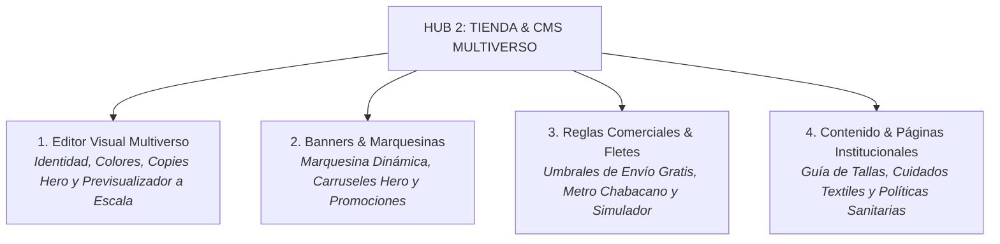

# Hoja de Ruta del Hub 2: Tienda & CMS Multiverso (Storefront & CMS Roadmap)
## Módulo de Control Visual, Vitrinas Desacopladas, Marquesinas, Fletes y Páginas Institucionales
**Ecosistema:** Terra (Matriz) | Marte (Masculino) | Venus (Femenino) | Tiresias / Afrodita (Trans & No Binario)  
**Dependencias Contractuales:** [BACKEND_INTEGRATION_SPEC.md](file:///c:/Users/Mickey/Documents/export/BACKEND_INTEGRATION_SPEC.md) (Sección 3.32, 4.26, 5.17, 6.3 Subsección DD)  
**Registro Maestro:** [PENDING_TASKS.md](file:///c:/Users/Mickey/Documents/export/PENDING_TASKS.md)

---

## 1. Visión y Propósito Estratégico

El **Hub 2: Tienda & CMS Multiverso** es el centro de control editorial y de diseño de la plataforma **RevOps**. Permite a los operadores gestionar la apariencia, marquesinas, banners, reglas comerciales y páginas institucionales de la tienda online sin tocar código fuente, manteniendo el desacoplamiento entre el inventario centralizado único (*Single Inventory Pool*) y la experiencia visual segmentada por identidad (*Terra, Marte, Venus, Tiresias*).

### Principios Rectores:
1. **Desacoplamiento Editorial vs Stock Físico (`TASK-INT-10`):** Una prenda (ej. Boxer Modal Negro) existe como un único registro físico en bodega (Hub 4), pero su narrativa visual, banners y páginas de colección se adaptan dinámicamente según la vitrina activa del cliente (*Marte, Venus, Tiresias o Terra*).
2. **Elasticidad Financiera de Fletes (`TASK-INT-18`):** El umbral de envío gratis ($999 MXN) y la opción de entrega en Metro Chabacano CDMX se auditan contra el impacto en el margen neto real de Finanzas (Hub 5), evitando promociones que degraden la rentabilidad por debajo del 30% EBITDA.
3. **Ergonomía de Tallas y Cuidado Sanitario:** Prevención de mermas y devoluciones RMA (Hub 6) mediante una guía interactiva de tallas anatómicas Torzo y educación del consumidor sobre telas delicadas y precinto higiénico termosellado.

---

## 2. Matriz de Tareas del Hub 2

> [!IMPORTANT]
> **Plan Maestro Activo de Conexión Real:** Ver especificación técnica detallada en [`PLAN_IMPLEMENTACION_HUB2_CMS_STOREFRONT_REAL.md`](PLAN_IMPLEMENTACION_HUB2_CMS_STOREFRONT_REAL.md).

| ID Tarea | Título Operativo | Submódulo / Vista | Estado | Prioridad | Dependencias |
| :--- | :--- | :---: | :---: | :---: | :--- |
| `TASK-CMS-01` | Editor Visual Multiverso & Previsualizador en Vivo | Submódulo 1: Editor Visual | **Completada (UI Mock)** | **Alta** | Multiverso, Paletas CSS |
| `TASK-CMS-02` | Gestor de Marquesinas Dinámicas & Carruseles Hero | Submódulo 2: Banners & Marquesina | **Completada (UI Mock)** | **Alta** | WebP Only (Regla 14) |
| `TASK-INT-18` | Reglas Comerciales, Umbral Envío Gratis & Simulador de Flete | Submódulo 3: Fletes & Reglas | **Completada (UI Mock)** | **Alta** | Hub 5 Finanzas, Margen Neto |
| `TASK-INT-10` | Capa Editorial Desacoplada, Guía de Tallas Torzo & Cuidados | Submódulo 4: Contenido Editorial | **Completada (UI Mock)** | **Alta** | Hub 4 Inventario, Hub 6 RMA |
| `TASK-STR-01` | Storefront D2C PWA Mobile-First & Conexión al Navbar RevOps (Ref: `pop`) | Storefront Público D2C | **Completada (UI Mock)** | **Alta** | `pop/index.html`, Navbar RevOps |
| `TASK-H2-01` | DDL & Capa de Persistencia Relacional CMS (Base de Datos) | Backend Core | **Planificada** | **Alta** | Migraciones MySQL |
| `TASK-H2-02` | Motor Drag & Drop de Secciones en Hub 2 (Categorías, Tags, Custom) | Submódulo 1: Editor Visual | **Planificada** | **Alta** | SortableJS, TASK-H2-01 |
| `TASK-H2-03` | Gestor de Documentos Oficiales (Tallas Torzo, Cuidados, PROFECO) | Submódulo 4: Contenido Editorial | **Planificada** | **Alta** | TASK-H2-01 |
| `TASK-H2-04` | CMS de Páginas Dinámicas & Sincronización Navbar | Páginas & Navegación | **Planificada** | **Alta** | TASK-H2-01 |
| `TASK-H2-05` | Motor de Paletas Globales & Variables CSS (`:root`) | Estilos Globales | **Planificada** | **Alta** | TASK-H2-01 |
| `TASK-H2-06` | Renderizador Modular de Secciones en Storefront PWA | Storefront PWA Mobile-First | **Planificada** | **Alta** | TASK-H2-02, TASK-H2-05 |
| `TASK-H2-07` | CMS de Blog / Revista Digital & SEO Schema | Revista Digital | **Planificada** | **Media** | TASK-H2-01 |
| `TASK-H2-08` | Ficha de Producto (PDP) a Pantalla Completa Dedicada (Sin Drawers) | Storefront PDP (`/productos/{slug}`) | **Planificada** | **Alta** | Hub 4 Inventario |
| `TASK-H2-09` | Editor Dinámico de Filtros & Taxonomías de Catálogo | Catálogo PWA | **Planificada** | **Media** | Hub 4 Categorías |
| `TASK-H2-10` | Suite de Tracking & Analítica (GTM, GA4, Meta Pixel & CAPI) | Analytics & Tracking | **Planificada** | **Alta** | Layout PWA, Checkout |
| `TASK-H2-11` | Batería de Pruebas Automatizadas & Auditoría QA Lighthouse | Calidad & QA | **Planificada** | **Alta** | PHPUnit, Lighthouse |

---

## 3. Arquitectura de las 4 Pestañas Operativas (Regla 10)

### 3.1. Submódulo 1: Editor Visual Multiverso (`TASK-CMS-01`)
* Conmutador reactivo entre las 4 vitrinas:
  - **Terra:** Ecosistema global neutro, cuidado personal, suscripciones y combos. Paleta sobria `#09090b` / acento `#0284c7`.
  - **Marte:** Enfoque masculino, atlético, ergonómico y sensual. Paleta `#09090b` / acento `#4f46e5`.
  - **Venus:** Enfoque femenino, lencería de autor, bralettes y skincare. Paleta `#1c1917` / acento `#db2777`.
  - **Tiresias / Afrodita:** Moda afirmativa, binders de compresión segura y packing/tucking. Paleta `#0f172a` / acento `#8b5cf6`.
* Editor de tipografía, títulos Hero, subtítulos y botones CTA.
* Previsualizador en vivo responsive (Desktop vs Mobile) que refleja de inmediato las modificaciones.

### 3.2. Submódulo 2: Banners & Marquesinas Dinámicas (`TASK-CMS-02`)
* **Marquesina Superior (Announcement Bar):**
  - Switch de activación On/Off.
  - Intervalo de transición automática (3s, 5s, 8s).
  - Rotación de 3 avisos estratégicos:
    * *"Envío gratis nacional en compras mayores a $999 MXN"*.
    * *"Entrega personal segura en Metro Chabacano CDMX (Líneas 2 y 9)"*.
    * *"Nueva Colección Modal Velvet: Máxima suavidad y transpirabilidad"*.
* **Gestor de Carruseles Hero y Promociones:**
  - Lista de banners activos con orden de aparición, vitrina objetivo y switch de visibilidad.
  - Validación de peso WebP (< 100 KB - Regla 14).

### 3.3. Submódulo 3: Reglas Comerciales, Fletes & Simulador (`TASK-INT-18`)
* Configuración de umbral nacional de envío gratuito ($999 MXN).
* Configuración de tarifa estándar para compras menores ($149 MXN).
* Habilitación de entrega en punto físico: *Pick-up sin costo en Metro Chabacano CDMX*.
* **Simulador Financiero de Elasticidad:**
  - Slider interactivo para modelar el umbral entre $699 y $1,499 MXN.
  - Cálculo proyectado en tiempo real: volumen de pedidos, tasa de pedidos con flete absorbido, costo total de paquetería absorbido y margen neto EBITDA proyectado con semáforo de viabilidad (&ge; 30% saludable).

### 3.4. Submódulo 4: Contenido Editorial & Páginas Institucionales (`TASK-INT-10`)
* **Guía Interactiva de Tallas Textiles Torzo:**
  - Matriz completa de 6 tallas (`CH, M, G, XL, 2XL, 3XL`) con medidas exactas en centímetros (cintura, cadera) y tallas comerciales de pantalón (28 a 40).
  - Recomendación de calce: *Si estás entre dos tallas, elige la superior para confort o la inferior para soporte atlético*.
* **Protocolo de Cuidado Textil:**
  - Instrucciones de preservación para fibras de modal, bambú, microfibra velvet y elásticos de jockstraps (lavado con agua fría, bolsa protectora Terra, secado a la sombra).
* **Aviso Sanitario PROFECO:**
  - Fundamento legal sobre higiene y no retorno de prendas íntimas sin precinto termosellado original.

---

## 4. Compuerta Contractual Previa (Regla 12)
* **Sección 3.32 DDL:** Tablas `cms_storefront_configs`, `cms_banners`, `cms_shipping_rules`, `cms_editorial_pages`.
* **Sección 4.26 Modelos Eloquent:** `CmsStorefrontConfig`, `CmsBanner`, `CmsShippingRule`, `CmsEditorialPage`.
* **Sección 5.17 Servicios de Dominio:** `CommercialRulesEngineService` (fórmulas de elasticidad y evaluación de flete).
* **Sección 6.3 Subsección DD:** Schemas JSON `/api/v1/cms/storefront/{universe}`, `/api/v1/cms/shipping-rules/simulate`.
* **Sección 10:** Paso 33 registrado en el Checklist de Laravel.

