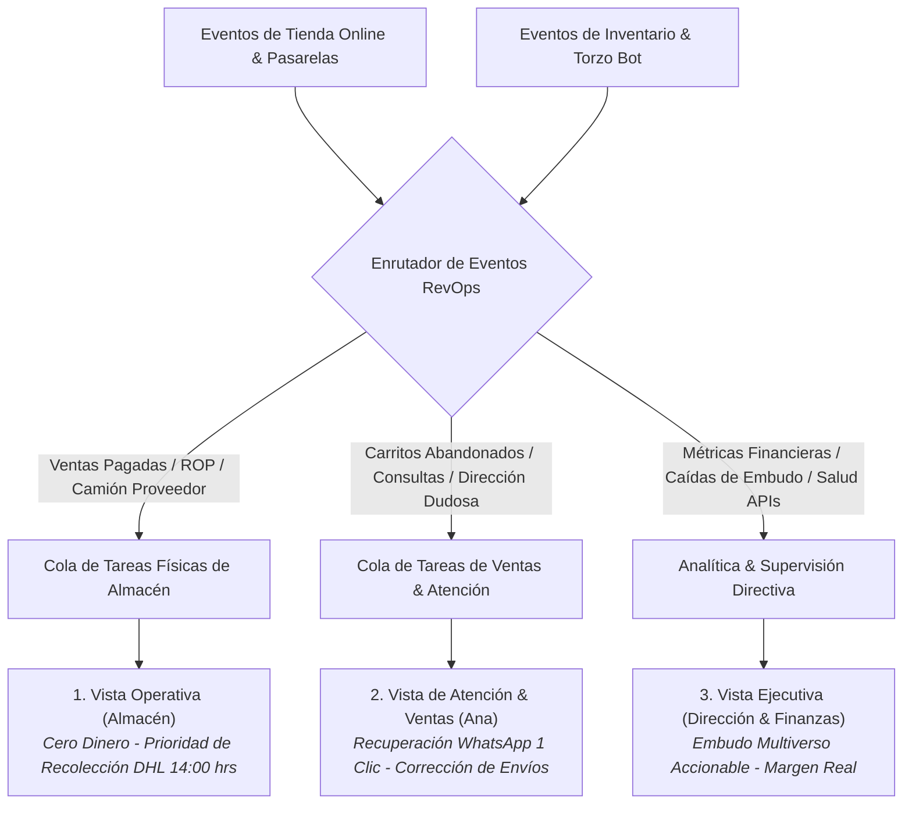
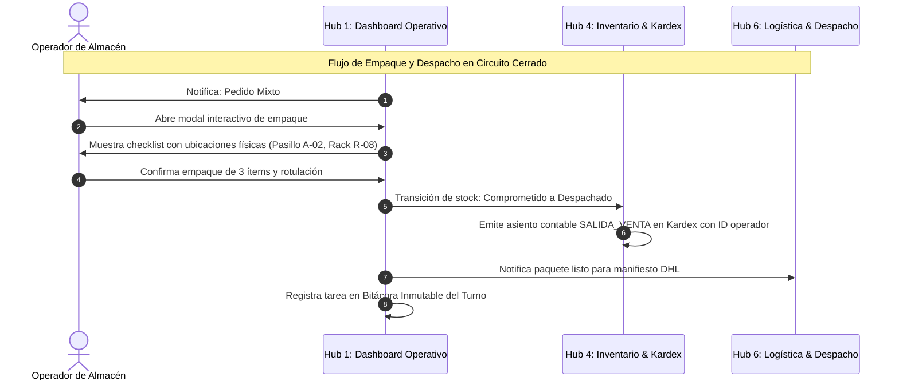

# Arquitectura y Hoja de Ruta: HUB 1 - Dashboard General & Action Center
> **Contexto de Plataforma:** Este documento corresponde al **Hub 1** de la arquitectura consolidada de 6 Hubs definida en [MASTER_ROADMAP.md](file:///c:/Users/Mickey/Documents/export/MASTER_ROADMAP.md).  
> Las tareas de desarrollo y puntos ciegos proceden del inventario maestro centralizado en [PENDING_TASKS.md](file:///c:/Users/Mickey/Documents/export/PENDING_TASKS.md).  
> Para especificaciones de modelos, migraciones, endpoints y servicios backend en Laravel, consultar [BACKEND_INTEGRATION_SPEC.md](file:///c:/Users/Mickey/Documents/export/BACKEND_INTEGRATION_SPEC.md).

Este documento define la arquitectura técnica, funcional y operativa del **Dashboard General & Action Center**. Establece el centro de mando diario de la plataforma, coordinando las acciones prioritarias de la jornada entre dirección, almacén y atención a clientes mediante un circuito cerrado de eventos en tiempo real.

> [!NOTE]
> **Estándares Transversales de Interfaz Aplicados (Reglas Maestras):**
> - **Regla 10 (Jerarquía Estructural Inamovible):** En todas las vistas, primero se renderiza la barra unificada de pestañas de submódulos (`subnavBar`), inmediatamente debajo las tarjetas de métricas contextuales (`grid grid-cols-1 sm:grid-cols-2 lg:grid-cols-4 gap-4 mb-6`), y finalmente el área de trabajo y paneles operativos.
> - **Regla 8 (Tooltips de Sección con '?'):** Todo bloque, panel, métrica y tarjeta cuenta con un botón interactivo `.section-help-btn` que despliega el propósito funcional y reglas de cálculo sin saturar la pantalla.
> - **Regla 1 (Cero Emojis):** Iconografía 100% SVG vectorial estándar.
> - **Regla 5 (Cero Page-Heading Overhead):** El título del Hub y su estado activo residen en el Navbar superior; el contenido de la vista inicia de inmediato en el lienzo principal.
> - **Regla 12 (Blindaje Inamovible de Especificación Backend):** Toda funcionalidad, evento de dominio y flujo de datos debe contar con su esquema de tabla, modelo Eloquent y contrato RESTful formalmente blindados en [BACKEND_INTEGRATION_SPEC.md](file:///c:/Users/Mickey/Documents/export/BACKEND_INTEGRATION_SPEC.md).

---

## 1. Visión del Hub 1: Centro de Mando Diario y Action Center

El Hub 1 no es un tablero estático de métricas pasivas; es la **cabina de control operativa del negocio**. Su función es canalizar las prioridades del día sin dispersión cognitiva, permitiendo al operador intervenir directamente sobre incidencias comerciales, logísticas o de abastecimiento en 1 solo clic.

---

## 2. Segregación de Vistas por Rol (Triple RBAC)

La plataforma supera la división binaria simple (dirección vs almacén) incorporando formalmente un tercer perfil intermedio para el equipo comercial y de servicio:

### 2.1. Vista 1: Vista Ejecutiva (Super Admin / Dirección / Finanzas)
* **Objetivo:** Supervisión estratégica, salud financiera global, control de conversión omnicanal y concentrador ejecutivo de todos los módulos de la plataforma.
* **Concentrador Ejecutivo Multimódulo (Sub-pestañas Especializadas):**
  - **Comercial & RevOps (`revops`):** Embudo comercial multiverso accionable, métricas financieras y de suscripción, copiloto IA de dirección, analítica visual de margen y facturación vs. MRR.
  - **Almacén e Inventario (`inventory`):** Dashboard ejecutivo transferido desde el Hub 4 de Inventario. Integra valuación de existencias a costo ($243,040 MXN), unidades físicas (3,420 pzs), rotación media (4.8x/año), detección de quiebres ROP, paneles de segmentación ABC textil (Boxers, Trunks, Briefs, Tangas, Ropa Térmica), Top 5 artículos de mayor velocidad de venta, análisis de dispersión por talla y corte ergonómico de soporte (Perfil Anatómico U-Pouch 68% vs Clásico 32%), matriz de riesgo/dependencia de proveedores B2B y saltos directos al Catálogo Operativo.
  - **Vitrinas & Tienda (`store`):** Métricas consolidadas de tráfico e-commerce, conversión por vitrina (Terra, Marte, Venus) y ticket promedio.
  - **Marketing & CRM (`crm`):** Supervisión de clientes registrados, LTV proyectado, blended CAC y tasa de churn de membresías.
  - **Finanzas & Tesorería (`finance`):** Margen bruto real ponderado, saldo disponible en bancos BBVA/Stripe y calendario de cuentas por pagar a proveedores.
  - **Logística & Envíos (`logistics`):** Tasa de On-Time Delivery, tiempos promedio en última milla nacional e incidencias de guías retenidas.
  - **Convenios & B2B (`allies`):** Ventas atribuidas a alianzas comerciales, comisiones acumuladas por liquidar y efectividad de cupones de embajadores.
* **Componentes Clave Adicionales:**
  - **KPIs Financieros y de Suscripción:** Facturación bruta del día (`Ventas hoy`), Ingreso recurrente contratado (`MRR Suscripciones`), `Ticket promedio` y `Margen comercial real ponderado`.
  - **Monitor de Salud del Ecosistema & Telemetría de APIs (`TASK-DSH-03`):** Semáforo en vivo de latencia y estado de Stripe, Mercado Pago, Torzo Scraper y webhooks de paquetería.
  - **Alertas Ejecutivas con Saltos en 1 Clic (`TASK-INT-01`):** Redirección inmediata a Inventario con prefiltrado de SKUs bajo ROP, proveedores con órdenes en tránsito y cobros pendientes de conciliar en Finanzas.

### 2.2. Vista 2: Vista Operativa (Personal de Almacén & Empaque)
* **Objetivo:** Ejecución física inmediata, embalaje, recepción de camiones y despacho sin distracciones.
* **Política de Privacidad Financiera Estricta:** Cero símbolos de dinero (`$`), cero cifras en `MXN`, cero visibilidad de facturación o márgenes y cero acceso al embudo de ventas.
* **Componentes Clave:**
  - **KPIs Físicos Operativos:** `Pedidos por empacar`, `Carritos Mixtos desbloqueados listos`, `Recepciones en tránsito de hoy` y `Quiebres físicos ROP en anaquel`.
  - **Filtros Rápidos por Categoría:** Botones de alternancia para *Todas, Empaque, Recepción, Surtido* y *Expedición*.
  - **Checklists Interactivas con Validación:** Modales guiados para empaque mixto (#MIX-1048 con 3 ítems verificados), recepción mayorista (#OC-2026-003 con validación de sello y curva de tallas), surtido interno de anaquel y despacho a chofer recolector de DHL.
  - **Ruta Lógica de Pasillo (`TASK-INV-01`):** Checklists ordenadas por ubicación física (`Pasillo - Rack - Gaveta`) para no duplicar desplazamientos en la bodega.
  - **SLA y Semáforo de Envejecimiento (`TASK-DSH-05`):** Alerta visual para pedidos pagados que se acercan a la hora límite de recolección (14:00 hrs).
  - **Bitácora Inmutable del Turno (Shift Log):** Registro en tiempo real con hora, operador y acción física completada.

### 2.3. Vista 3: Vista Intermedia de Atención a Clientes & Ventas (`TASK-DSH-01`)
* **Objetivo:** Cierre de ventas, retención de prospectos y resolución de trabas en pedidos antes del empaque.
* **Componentes Clave:**
  - **KPIs Comerciales de Atención:** `Leads activos sin responder`, `Carritos abandonados de hoy`, `Pedidos detenidos por dirección dudosa` y `Cupones activos canjeados`.
  - **Recuperación de Carritos en 1 Clic (`TASK-INT-05`):** Disparo de enlace tokenizado prellenado a WhatsApp del cliente con cupón dinámico temporal.
  - **Validador Predictivo de Direcciones (`TASK-DSH-06`):** Identificación de domicilios sin número exterior o con discrepancia entre colonia y código postal para contactar al cliente antes de generar la guía.
  - **Preferencias de Suscriptor (`TASK-INT-04`):** Gestión de notas de cambio de talla o restricciones por alergias cosméticas.

---

## 3. Matriz de Tareas Distribuidas desde PENDING_TASKS.md

Las siguientes tareas corresponden a la arquitectura del Hub 1 y a su conectividad con el resto de la plataforma:

| ID Tarea | Título Técnico | Prioridad | Vista Afectada | Requisitos Técnicos / Backend | Estado UI |
| :--- | :--- | :---: | :--- | :--- | :---: |
| `TASK-DSH-01` | **Vista Intermedia: Bandeja de Atención & Ventas** | **Alta** | Pestaña 3 en Subnav | Rol RBAC `sales`, endpoints de leads y carritos abandonados | **Completada (UI)** |
| `TASK-DSH-02` | **Embudo Comercial Accionable con Gatillos en 1 Clic** | **Alta** | Vista Ejecutiva | Triggers de recuperación, webhooks de campaña | **Completada (UI)** |
| `TASK-DSH-03` | **Monitor de Telemetría & Salud de APIs (System Health)** | **Media** | Vista Ejecutiva | Endpoint `/api/v1/system/health`, pings periódicos | **Completada (UI)** |
| `TASK-DSH-04` | **Generador Dinámico de Tareas Reactivo a Eventos** | **Alta** | Vista Operativa | Tabla `operational_tasks`, Laravel Event Listeners | **Completada (UI)** |
| `TASK-DSH-05` | **SLA y Semáforo de Envejecimiento de Pedidos** | **Media** | Vista Operativa | Cálculo de horas transcurridas desde `orders.paid_at` | **Completada (UI)** |
| `TASK-DSH-06` | **Validador Predictivo de Direcciones y Códigos Postales** | **Media** | Vista de Atención | Algoritmo de validación de sintaxis postal / Sepomex | **Completada (UI)** |
| `TASK-INT-01` | **Saltos Profundos (Deep Links) Prefiltrados a Inventario** | **Alta** | Transversal (H1 $\rightarrow$ H4) | Enlace router con query params a vista de catálogo | **Completada (UI)** |
| `TASK-INT-02` | **Trazabilidad de Stock: Comprometido a Despachado** | **Alta** | Transversal (H1 $\rightarrow$ H4) | Asiento automático de salida en Kardex al confirmar empaque | **Completada (UI)** |
| `TASK-INT-03` | **Liberación Masiva de Lotes de Suscripción (Batch)** | **Alta** | Transversal (H1 $\rightarrow$ H6) | Despacho agrupado en corte (150 cajas), deducción atómica BOM y Kardex | **Completada (UI)** |
| `TASK-INT-04` | **Ficha de Preferencias de Suscriptor en Checklist** | **Media** | Transversal (H1 $\rightarrow$ H6) | Integración de campos `subscriber_preferences` en modal | **Completada (UI)** |
| `TASK-INT-05` | **Recuperación WhatsApp con Enlace Tokenizado en 1 Clic** | **Alta** | Transversal (H1 $\rightarrow$ H3) | Generador de enlace `/checkout?resume=TOKEN` con cupón | **Completada (UI)** |
| `TASK-DSH-07` | **Cabina Ejecutiva con Gráficas Analíticas y Copiloto IA** | **Alta** | Vista Ejecutiva & Global | Analítica SVG nativa, Copiloto por rol RBAC, Drawer Chat | **Completada (UI)** |
| `TASK-DSH-08` | **Monitor Ejecutivo de Demanda Latente & Preferencias de Producto por Wishlists** | **Alta** | Vista Ejecutiva | Tabla `wishlist_demand_signals`, predicciones | **Pendiente** |
| `TASK-DSH-09` | **Master Kardex Global y Log de Auditoría Omnicanal para Superadministradores** | **Alta** | Vista Global (Admin) | Tabla `system_audit_logs`, historial inmutable | **Pendiente (Fase 2)** |

---

## 4. Detalle de Implementación por Tarea del Dashboard

### 4.1. `TASK-DSH-01`: Vista Intermedia de Atención a Clientes & Ventas
* **Estado:** **Completada (UI)** (Suite 21 pasando 61/61 pruebas unitarias al 100%).
* **Estructura en UI:** Se incorpora la pestaña `Atención & Ventas` (`data-dashboard-tab="sales"`) en la barra superior unificada de submódulos del Dashboard, con badge dinámico de casos pendientes (`5 Casos`).
* **Layout Implementado:**
  - **4 KPIs Superiores de Ventas:** Leads activos sin responder (8 prospectos), Carritos abandonados hoy (12 carritos), Pedidos pausados por dirección dudosa (3 retenidos) y Cupones activos canjeados (24 canjes hoy). Todos acompañados de su botón interactivo de ayuda `?` con descripción de métricas.
  - **Banner de Contexto Comercial:** `MODO ATENCIÓN & VENTAS ACTIVO (ANA ATENCIÓN)` con tooltip explicativo `?` y subtítulo con recordatorio de enlaces en 1 clic.
  - **Filtros por Categoría:** *Todas las incidencias (5)*, *Leads & Consultas (2)*, *Carritos Abandonados (1)*, *Direcciones Detenidas (1)* y *Suscriptores (1)*.
  - **Panel de Incidencias Operativas:** Tarjetas con badges temáticos (`LEAD`, `CARRITO`, `DIRECCIÓN`, `MEMBRESÍA`), datos completos de contacto, canal de procedencia y botones de acción rápida.
  - **Modal de Contacto WhatsApp:** Visualizador con plantilla oficial de retención, enlace tokenizado para reanudar el checkout (`https://mitienda.online/checkout?resume=tok_valeria204`), cupón `RETORNO10` al 10% de descuento, botón para copiar y confirmación de envío que actualiza contadores reactivamente.
  - **Modal de Validación de Dirección Sepomex:** Formulario con número exterior obligatorio, validación predictiva contra catálogo postal oficial y liberación directa a la cola de empaque de almacén.
  - **Bitácora Comercial Inmutable:** Registro cronológico de acciones resueltas durante el turno.
* **Integración RBAC:** Badge dinámico de barra superior `.topbar-hub-badge.sales` (`Atención & Ventas`), conmutación automática de pestaña al seleccionar rol `sales`, y persistencia de accesibilidad completa para supervisión del Super Admin.

### 4.2. `TASK-DSH-02`: Embudo Comercial Accionable (Actionable Funnel)
* **Estado:** **Completada (UI)** (Suite 22 pasando 22/22 pruebas unitarias al 100%).
* **Estructura en UI:** Cada una de las 5 filas de conversión del embudo multiverso incorpora micro-botones de acción directa (`.funnel-action-btn`):
  - *Paso 2 (Carritos Añadidos):* Botón `Recuperar {n} Abandonos` $\rightarrow$ Despliega modal interactivo con selección de canal (WhatsApp Web con enlace tokenizado vs Emailing masivo) y cupón dinámico `RECUPERA10` (10% OFF + envío). Al confirmar, decrementa carritos abandonados y registra la campaña en la bitácora comercial.
  - *Paso 3 (Carritos Mixtos):* Botón `Balance Híbrido` $\rightarrow$ Modal de balance entre piezas apartadas en bodega local (68%) y compras bajo pedido Torzo (32%), con botón de salto en 1 clic a la bandeja On-Demand de Inventario (Hub 4).
  - *Paso 4 (Checkouts Iniciados):* Botón `Auditar Fricción Pasarela` $\rightarrow$ Diagnóstico de drop-off bancario (3DS 42%, límites de tarjeta 31%, fletes 19%), conmutador reactivo entre Stripe (Principal) y Mercado Pago (Respaldo), y activación de Smart Retries.
  - *Paso 5 (Ventas Pagadas):* Botón `Liberar {n} a Almacén` $\rightarrow$ Modal de expedición con asignación de paquetería (DHL Express / Estafeta / 99Minutos), validación de checklist y transferencia directa de órdenes a la mesa de empaque de Almacén.
  - *Paso 6 (Suscripciones MRR):* Botón `Fidelizar ({n})` $\rightarrow$ Modal para asignar incentivos de bienvenida en primera caja (bolsa de lavado protectora, muestra de fragancia o 15% de descuento permanente).
* **Reactividad Omnicanal Multiverso:** Selección activa de vitrina (*Consolidado, Terra, Marte, Venus, Tiresias*) con recálculo dinámico de tasas de conversión y métricas operativas por tienda.

### 4.3. `TASK-DSH-03`: Monitor de Telemetría y Salud del Ecosistema (System Health)
* **Estado:** **Completada (UI)** (Suite 23 pasando 23/23 pruebas unitarias al 100%).
* **Estructura en UI:** Panel dedicado en Vista Ejecutiva (`.telemetry-grid` y `.telemetry-card`), con semáforo cromático, punto pulsante verde (`.telemetry-pulse-dot`), y latencias en milisegundos (`.telemetry-latency-tag`):
  - **Stripe Payments & Webhooks:** `98ms • Operativo` (99.99% Uptime, 1,240 webhooks entregados, tasa de éxito 3DS 98.8%).
  - **Mercado Pago Gateway:** `142ms • Operativo` (99.95% Uptime, 380 webhooks, OXXO Pay / transferencias SPEI).
  - **Torzo Bot Headless Scraper:** `215ms • Operativo` (99.80% Uptime, sincronización on-demand cada 30 min, 0 fallos).
  - **DHL Express & Estafeta APIs:** `86ms • Operativo` (100% Uptime, token OAuth 2.0 vigente, cotización y guías de rastreo).
  - **Catálogo Postal Sepomex:** `12ms • Operativo` (100% Uptime, indexado local en memoria para validación instantánea).
* **Acciones en 1 Clic Implementadas:**
  - **Botón `Ejecutar Diagnóstico Global` (`data-action="ping-all-services"`):** Dispara un barrido reactivo a todos los microservicios, recalculando latencias realistas, actualizando marcas de sincronización a *"Hace unos segundos"*, insertando un evento en `recentLogs` y mostrando un Toast informativo.
  - **Modal de Diagnóstico Detallado (`openSystemHealthModal`):** Despliega caja pastel con métricas de latencia, SLA y webhooks, tabla con los últimos eventos/webhooks con códigos HTTP 200 OK y latencias, comprobación de firmas criptográficas HMAC / TLS 1.3, y botón para ejecutar ping individual al servicio.

### 4.4. `TASK-DSH-04`: Generador Dinámico de Tareas Operativas Conectado a Eventos Reales
* **Estado:** **Completada (UI)** (Suite 24 pasando 17/17 pruebas unitarias al 100%, 0 regresiones en 24 suites oficiales).
* **Estructura en UI:**
  - **Barra de Simulación de Eventos de Tienda (`.event-simulator-bar`):** Situada en la Vista Operativa con tooltip `?` y 3 botones con estilo de acción rápida (`+ Simular Venta Flash (Empaque)`, `+ Simular Arribo Torzo (Inbound)`, `+ Simular Quiebre ROP (Surtido)`).
  - **Motor de Eventos Reactivo (`dispatchOperationalEvent`):** Ingesta eventos de dominio (`order.paid`, `supplier.shipment_arrived`, `inventory.rop_breached`, `shipping.batch_ready`), genera tareas completas con metadata, actualiza contadores de filtros y emite Toasts informativos.
  - **Modales de Acción Dinámicos:** `openPackMixModal()`, `openInboundModal()`, `openRestockModal()` y `openShippingModal()` procesan dinámicamente cualquier `taskId` conservando firmas retrospectivas para compatibilidad de suite.
  - **Resolución y Cierre Atómico:** Al completar una tarea en el modal, se marca `completed`, se decrementan los KPIs operativos correspondientes, se añade el asiento a la Bitácora Inmutable del Turno (*Shift Log*) y se notifica al usuario.
* **Impacto en Backend:** Tabla `operational_tasks` (Sección 3.12 de `BACKEND_INTEGRATION_SPEC.md`), Modelo Eloquent `OperationalTask` (Sección 4.8), Endpoints `POST /api/v1/operational-events/dispatch`, `GET /api/v1/operational-tasks`, `POST /api/v1/operational-tasks/{id}/complete` (Sección 6.3 N) y Event Bus en Laravel (Sección 10 Paso 15).

### 4.5. `TASK-DSH-05`: SLA y Semáforo de Envejecimiento (Aging Alert)
* **Estado:** **Completada (UI)** (Suite 25 pasando 19/19 pruebas unitarias al 100%, 0 regresiones en 25 suites oficiales).
* **Estructura en UI:**
  - **Banner Superior de Corte Diario (`.sla-cutoff-banner`):** Monitoreo predictivo de la hora límite de recolección (DHL Express 14:00 hrs) con cuenta regresiva, conteo de órdenes críticas y botón de ayuda interactivo `?` (Regla 8).
  - **Semáforo Cromático de 3 Niveles en Tarjetas (`.sla-badge`):**
    - `Verde (< 3 hrs)`: `.sla-badge.ontime` (*"SLA: {m}m (En tiempo)"*).
    - `Ámbar (3 a 5.5 hrs)`: `.sla-badge.warning` (*"SLA: {h}h {m}m (Atención)"*).
    - `Rojo (> 5.5 hrs o corte inminente)`: `.sla-badge.critical` (*"SLA: {h}h {m}m (Riesgo Corte)"*) con punto pulsante `.sla-pulse-dot.pulse`.
  - **Ordenamiento Inteligente Predictivo:** Las órdenes con mayor riesgo ascienden al inicio de la lista de trabajo de almacén.
  - **Filtro Rápido `Riesgo SLA`:** Aísla con 1 clic las órdenes que requieren empaque prioritario.
  - **Botonera de Simulación en Vivo:** Botón `+ Simular Retraso SLA (+4 hrs)` para transicionar dinámicamente tareas a estado crítico.
  - **Cápsula de SLA en Modal de Picking & Packing:** Muestra tiempo transcurrido desde el pago y hora límite de recolección en el encabezado del modal.
* **Impacto en Backend:** Campos `triggered_at`, `due_at`, `completed_at` en `operational_tasks` (Sección 3.12 de `BACKEND_INTEGRATION_SPEC.md`), Modelo Eloquent `OperationalTask` (Sección 4.8) y cálculo de SLA en API `GET /api/v1/operational-tasks?sla_status=critical` (Sección 6.3 N).

### 4.6. `TASK-DSH-06`: Validador Predictivo de Direcciones y Códigos Postales con Riesgo
* **Estado:** **Completada (UI)** (Suite 26 pasando 45/45 pruebas unitarias al 100%, 0 regresiones en 26 suites oficiales).
* **Estructura en UI:**
  - **Catálogo Sepomex en Memoria:** Indexación estructurada de códigos postales mexicanos con estado, municipio, catálogo de colonias oficiales y nivel de cobertura de transportista (`standard`, `extended_zone`).
  - **Motor Algorítmico Predictivo (`validateAddressPredictive`):** Detección estricta de número exterior faltante o ambiguo ("S/N"), validación de 5 dígitos de CP, cruce de colonia y cálculo de Score de Fiabilidad Postal (0 a 100%).
  - **Modal Enriquecido e Interactivo (`openSalesAddressModal`):** Validación reactiva en vivo `oninput`, llenado automático de estado y municipio ante CP válido, selector de colonias oficiales, caja de estatus dinámico con badges y advertencia de zonas de reexpedición.
  - **Botón `+ Simular Dirección Dudosa`:** Micro-acción en barra de filtros para generar casos de prueba en vivo.
  - **Conexión Inter-Hub Almacén:** Liberación directa de órdenes validadas con badge destacado `"Sepomex OK"`.
* **Impacto en Backend:** Servicio `AddressValidationService` (Sección 5.4 y Sección 10 Paso 16) y Endpoints `GET /api/v1/logistics/sepomex/{postal_code}` y `PUT /api/v1/orders/{id}/validate-address` (Sección 6.3 O).

### 4.7. `TASK-DSH-07`: Cabina Ejecutiva con Gráficas Analíticas y Copiloto IA Adaptativo por Rol
* **Estado:** **Completada (UI)** (Suite 32 pasando 22/22 pruebas unitarias al 100%, 0 regresiones).
* **Estructura en UI:**
  - **Cabina de Gráficas Analíticas SVG Nativas (`renderExecutiveAnalyticsCharts`):**
    - Panel visual de 3 columnas responsivas ubicado en la Vista Ejecutiva antes del embudo comercial multiverso.
    - *Facturación vs MRR Recurrente:* Gráfica SVG con conmutador de escala temporal (`7d`, `14d`, `30d`), curva en degradado esmeralda de facturación diaria, línea discontinua índigo de MRR recurrente contratado y puntos interactivos con etiquetas de fecha y monto.
    - *Participación por Vitrina Multiverso:* Barras horizontales SVG con escala proporcional para Terra (42.5%), Marte (31.2%), Venus (18.1%) y Tiresias/Afrodita (8.2%) con montos en MXN.
    - *Cascada de Margen Neto Real (EBITDA):* Gráfica SVG tipo cascada que desglosa el camino desde las Ventas Brutas ($248,500 MXN) hasta el EBITDA Real ($86,400 MXN / 34.8%), deduciendo COGS (-$98,200), Empaque (-$14,200), Envíos Courier (-$21,500), Pasarelas (-$12,400) e Impuestos SAT (-$15,800).
    - Cada tarjeta cuenta con su botón de ayuda interactivo `?` (`.section-help-btn`) acorde a la Regla 8.
  - **Widget de Copiloto IA Adaptativo por Rol (`renderAiCopilotWidget`):**
    - Integrado en todas las vistas con aislamiento contextual estricto:
      - *Almacén / Operativo (`warehouse`):* Aislamiento estricto de privacidad. Cero menciones de dinero, sin `$`, sin `MXN`, sin facturación ni márgenes. Foco en tareas de empaque para corte courier DHL de las 14:00 hrs, resurtido de anaquel por quiebre ROP y cierre de manifiestos con transporte en rampa.
      - *Atención & Ventas (`sales`):* Foco en resolución de domicilios dudosas Sepomex y rescate de carritos abandonados mediante WhatsApp con enlace tokenizado.
      - *Finanzas (`finance`):* Foco en conciliación de pasarelas de pago y programación de transferencias SPEI a talleres.
      - *Super Admin / Dirección (`admin`):* Visión 360° holística, proyección de demanda, análisis de márgenes por vitrina y recomendaciones de escalamiento.
    - Botones de acción en 1 clic para cada recomendación con ejecución atómica (`executeCopilotRecommendation`) y apertura de los modales correspondientes.
  - **Drawer Desplegable de Chat Interactivo (`openCopilotChatDrawer`):**
    - Drawer deslizable desde la derecha (`.copilot-chat-drawer`) con backdrop, cabecera con badge de rol activo, selector de chips prefabricados por rol (`renderCopilotPromptChips`), historial de chat reactivo (`renderCopilotChatMessages`) y caja de envío (`sendCopilotChatMessage`).
* **Impacto en Backend:** Formalizado en `BACKEND_INTEGRATION_SPEC.md`: Tablas `ai_copilot_insights`, `ai_copilot_recommendations`, `ai_copilot_chat_messages` (Sección 3.27), Modelos Eloquent con scopes por rol (Sección 4.21), Servicio `RoleAwareAiCopilotService` (Sección 5.12), Endpoints RESTful `/api/v1/ai/copilot/*` (Sección 6.1 y 6.3 Y) y Checklist Laravel Paso 28 (Sección 10).

### `TASK-DSH-08`: Monitor Ejecutivo de Demanda Latente & Preferencias de Producto por Wishlists
* **Prioridad:** **Alta** | **Estado:** **Especificación Formalizada (Fase 10)**
* **Punto Ciego Resuelto:** El panel directivo solo medía compras cerradas o carritos abandonados, careciendo de visibilidad sobre el deseo acumulado en las listas de favoritos de los compradores antes de que tomen la decisión de compra, impidiendo predecir qué prendas y tallas específicas se agotarán primero.
* **Solución de UI/UX:**
  - **Widget "Radar de Deseos & Demanda Latente":** Despliega el Top 5 de prendas con mayor volumen de adición a Wishlist en las últimas 24h / 7d (`wishlist_velocity_score`).
  - **Matriz de Tallas Preferidas:** Visualización gráfica de la demanda acumulada por talla anatómica (`CH, M, G, XG`) alimentada por las selecciones de usuario y el Asesor de Cintura Torzo.
  - **Gatillo de Resurtido en 1 Clic:** Botón directo *"Generar Orden Sugerida"* que invoca el endpoint `POST /api/v1/analytics/generate-suggested-po` para enviar requerimientos automáticos de maquila a Hub 4 y a los proveedores en Hub 7.
* **Impacto en Backend:** DDL `wishlist_demand_signals` (Sección 3.35), Modelo `ProductDemandPrediction` (Sección 4.29), Servicio `WishlistDemandPredictionEngine` (Sección 5.20) y Endpoints `/api/v1/analytics/wishlist-demand-forecast` (Subsección GG).

### 4.9. `TASK-DSH-09`: Master Kardex Global y Log de Auditoría Omnicanal para Superadministradores
* **Prioridad:** **Alta** | **Estado:** **Pendiente (Fase 2: Backlog)**
* **Punto Ciego Resuelto:** Ausencia de trazabilidad transversal sobre acciones clave ejecutadas en todos los módulos (aprobaciones, anulaciones, ediciones de stock).
* **Solución de UI/UX:**
  - **Kardex Maestro (Activity Log Liviano):** Drawer o modal dedicado accesible solo para rol `admin`. Se registrarán únicamente acciones "mutables" (cambios de estado) para evitar saturación de la base de datos por ruido de lectura.
  - **Tabla de Auditoría:** Registro inmutable de cada acción con timestamp, usuario, módulo, descripción y la entidad afectada.
  - **Diferenciación Visual (Payload Diff) y Seguridad:** Visor JSON para comparar el "antes" y "después" de una modificación crítica. Se incluye ofuscación automática de campos sensibles (contraseñas, keys) en el payload para evitar exposición de datos.
* **Impacto en Backend:** Tabla de auditoría genérica `system_audit_logs` con estructura polimórfica y propiedades en JSON para reconstrucción de estado.

---

## 5. Circuito Cerrado y Flujo Inter-Hub (Closed-Loop Workflow)

---

## 6. Secuencia Óptima de Consolidación & Próximos Pasos

El avance e integración de las capacidades del Hub 1 se rigen por la **Secuencia Óptima de Consolidación en Ciclo Cerrado**:

1. **Fase 1 (Triaje & Enrutamiento de Dominio):** Tareas específicas del Hub 1 se gestionan en este documento; tareas transversales de enlace inter-módulos (`TASK-INT-01` a `TASK-INT-05`) se canalizan a [MASTER_ROADMAP.md](file:///c:/Users/Mickey/Documents/export/MASTER_ROADMAP.md).
2. **Fase 2 (Compuerta Contractual Previa - Regla 12):** Congelamiento formal del contrato de datos en [BACKEND_INTEGRATION_SPEC.md](file:///c:/Users/Mickey/Documents/export/BACKEND_INTEGRATION_SPEC.md) (migraciones MySQL, modelos Eloquent, FormRequests y endpoints RESTful JSON) previo al desarrollo de UI.
3. **Fase 3 (Ejecución UI-First & Cierre Atómico):** Implementación interactiva en interfaz (`app.js`, `styles.css`), ejecución de la suite de pruebas al 100% con cero emojis, captura de evidencias visuales y actualización sincronizada de estatus en todos los roadmaps del proyecto.

