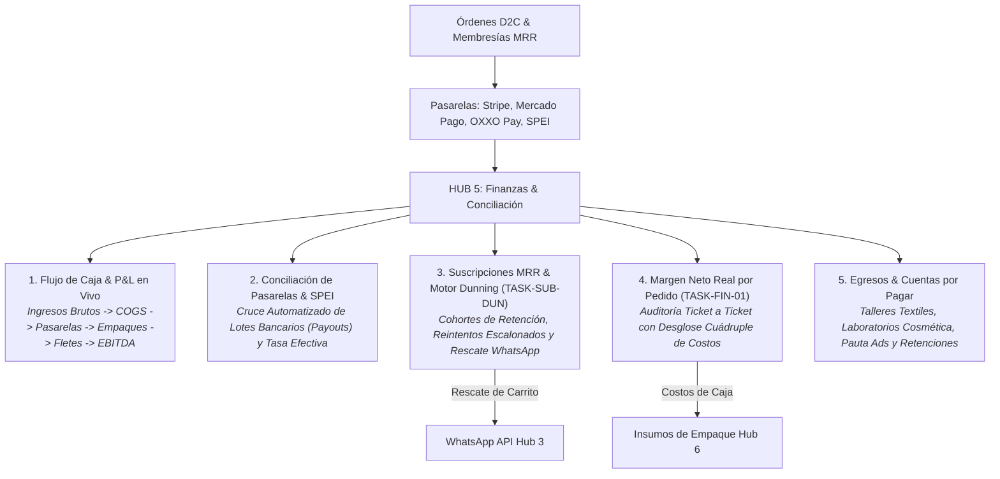

# Arquitectura y Hoja de Ruta: HUB 5 - Finanzas & Conciliación
> **Contexto de Plataforma:** Este documento corresponde al **Hub 5** de la arquitectura consolidada de 6 Hubs definida en [MASTER_ROADMAP.md](file:///c:/Users/Mickey/Documents/export/MASTER_ROADMAP.md).  
> Las tareas de desarrollo y puntos ciegos proceden del inventario maestro centralizado en [PENDING_TASKS.md](file:///c:/Users/Mickey/Documents/export/PENDING_TASKS.md).  
> Para especificaciones de modelos, migraciones, endpoints y servicios backend en Laravel, consultar [BACKEND_INTEGRATION_SPEC.md](file:///c:/Users/Mickey/Documents/export/BACKEND_INTEGRATION_SPEC.md).

Este documento define la arquitectura técnica, funcional y operativa del **Hub 5: Finanzas & Conciliación**. Establece el centro de mando de Revenue Operations (RevOps) para el ecosistema multiverso (*Terra, Marte, Venus, Tiresias*), integrando el flujo de caja con cascada P&L en vivo, conciliación de pasarelas y transferencias bancarias SPEI, gestión de cobros recurrentes MRR con motor de Dunning (`TASK-SUB-DUN`), calculadora de Margen Neto Real ticket por ticket (`TASK-FIN-01`) y programación de egresos a talleres y proveedores.

> [!NOTE]
> **Estándares Transversales de Interfaz Aplicados (Reglas Maestras):**
> - **Regla 10 (Jerarquía Estructural Inamovible):** En todas las vistas, primero se renderiza la barra unificada de pestañas de submódulos (`subnavBar`), inmediatamente debajo las 4 tarjetas de métricas contextuales (`grid grid-cols-1 sm:grid-cols-2 lg:grid-cols-4 gap-4 mb-6`), y finalmente el área de trabajo y paneles operativos.
> - **Regla 8 (Tooltips de Sección con '?'):** Todo bloque, panel, métrica y tarjeta cuenta con un botón interactivo `.section-help-btn` que despliega el propósito funcional y reglas de cálculo sin saturar la pantalla.
> - **Regla 1 (Cero Emojis):** Iconografía 100% SVG vectorial estándar.
> - **Regla 5 (Cero Page-Heading Overhead):** El título del Hub y su estado activo residen en el Navbar superior; el contenido de la vista inicia de inmediato en el lienzo principal.
> - **Regla 12 (Blindaje Inamovible de Especificación Backend):** Toda funcionalidad, evento de dominio y flujo de datos debe contar con su esquema de tabla, modelo Eloquent y contrato RESTful formalmente blindados en [BACKEND_INTEGRATION_SPEC.md](file:///c:/Users/Mickey/Documents/export/BACKEND_INTEGRATION_SPEC.md).
> - **Regla 13 (Compatibilidad cPanel HostGator):** Procesamiento de conciliación y cobros recurrentes sin demonios pesados, utilizando colas de base de datos (`QUEUE_CONNECTION=database`) y llamadas cURL outbound ligeras.

---

## 1. Visión Estratégica del Hub 5

El Hub 5 garantiza que cada peso que ingresa a la plataforma esté plenamente auditado frente a sus costos directos de absorción (mercancía, empaque, pasarela y envío) y que los cobros recurrentes de membresías mantengan un flujo de caja predecible:

---

## 2. Estructura de los 5 Submódulos Unificados

### 2.1. Submódulo 1: Flujo de Caja & P&L en Vivo
* **Objetivo:** Visualizar en tiempo real el estado de resultados consolidado de la operación multiverso, contrastando ingresos netos frente a costos de absorción.
* **Componentes Clave:**
  - **4 KPIs Contextuales:**
    1. *Facturación Neta del Mes:* Consolidado cobrado limpio de devoluciones ($486,200 MXN).
    2. *Margen Bruto Consolidado:* Ponderación de líneas textiles (62.5%) vs cosmética (76.8%) = 68.4%.
    3. *Costos Operativos & Deducciones:* Suma de pasarelas, empaques, fletes y pauta ($184,350 MXN).
    4. *Utilidad Neta Líquida Real (EBITDA):* Margen final de operación ($148,150 MXN / 30.5%).
  - **Cascada Financiera P&L (Waterfall):**
    - Ingreso Bruto Facturado $\rightarrow$ (-) Descuentos y Cupones $\rightarrow$ (-) Costo de Mercancía (COGS) $\rightarrow$ (-) Comisiones Pasarela $\rightarrow$ (-) Cajas de Empaque $\rightarrow$ (-) Fletes Courier $\rightarrow$ (-) Pauta Publicitaria Ads $\rightarrow$ (=) Utilidad Neta Real.
  - **Selector Temporal:** Filtro reactivo por periodo (`Hoy`, `7D`, `30D`, `Mes Actual`, `Año`).

### 2.2. Submódulo 2: Conciliación de Pasarelas & SPEI
* **Objetivo:** Cruzar cada dispersión bancaria enviada por las pasarelas frente a las órdenes cobradas en la tienda online.
* **Componentes Clave:**
  - **4 KPIs Contextuales:**
    1. *Cobrado en Pasarelas:* Monto bruto capturado en pasarelas ($142,500 MXN).
    2. *Comisiones Deducidas:* Retenciones de pasarelas ($5,130 MXN - tasa efectiva 3.6%).
    3. *Depósitos Bancarios Conciliados:* Fondos efectivamente depositados en cuenta BBVA ($137,370 MXN).
    4. *Discrepancias en Tránsito:* Saldo pendiente de liquidación o en disputa ($0.00 MXN).
  - **Tabla de Lotes de Liquidación (Payouts):**
    - Identificador de lote (ej. `po_stripe_8832`, `payout_mp_1904`).
    - Pasarela y fecha estimada de depósito bancario.
    - Monto bruto, comisiones retenidas, retención de IVA/ISR y monto neto depositado.
    - Badge de estado: `Conciliado` (verde) o `Pendiente de Dispersión` (ámbar).
    - Botón de 1 clic: *"Auditar Lote Bancario"* con desglose de órdenes vinculadas.

### 2.3. Submódulo 3: Suscripciones MRR & Motor de Dunning (`TASK-SUB-DUN`)
* **Objetivo:** Administrar los ingresos recurrentes mensuales de membresías (*Caja Marte Nivel 1, 2 y 3*) y automatizar la recuperación de cobros declinados.
* **Componentes Clave:**
  - **4 KPIs Contextuales:**
    1. *MRR Recurrente Activo:* Ingresos mensuales contratados ($112,400 MXN / mes).
    2. *Suscriptores Vigentes:* Total de miembros con membresía activa (184 suscriptores).
    3. *Tasa de Churn Mensual:* Bajas voluntarias o involuntarias (2.1% - Nivel Saludable).
    4. *Cobros Rescatados por Dunning:* Ingresos recuperados tras fallo de tarjeta ($8,650 MXN).
  - **Matriz de Cohortes de Retención:** Desglose de suscriptores por antigüedad (Mes 1, Mes 3, Mes 6, Mes 12) y nivel de membresía.
  - **Cola de Dunning Reactiva:**
    - Registro de cobros declinados por fondos insuficientes o tarjeta expirada.
    - Calendario de reintentos escalonados (Día 1, Día 3, Día 7).
    - Botón de 1 clic: *"Reintentar Cobro Ahora"*.
    - Botón de 1 clic: *"Enviar Link de Actualización de Tarjeta por WhatsApp"*.

### 2.4. Submódulo 4: Calculadora de Margen Neto Real por Pedido (`TASK-FIN-01`)
* **Objetivo:** Auditar la rentabilidad unitaria exacta de cada orden despachada en la plataforma, garantizando que ningún pedido se venda a pérdida.
* **Fórmula Matemática del Margen Neto Real:**
  $$\text{Utilidad Neta} = \text{PVP Pagado} - \text{COGS} - \text{Comisión Pasarela} - \text{Caja Empaque} - \text{Flete Courier}$$
  $$\text{Margen Neto \%} = \left(\frac{\text{Utilidad Neta}}{\text{PVP Pagado}}\right) \times 100$$
* **Componentes Clave:**
  - **4 KPIs Contextuales:**
    1. *Ticket Promedio Neto:* Valor medio por orden ($890.00 MXN).
    2. *Margen Neto Promedio:* Porcentaje de utilidad final tras todas las deducciones (57.9%).
    3. *Insumo de Empaque Promedio:* Gasto medio en caja/bolsa por pedido ($18.50 MXN).
    4. *Flete Courier Promedio:* Costo medio de guía pagado a transportistas ($128.00 MXN).
  - **Tabla de Auditoría Ticket por Ticket:**
    - Folio de orden y cliente.
    - Vitrina multiverso de procedencia (*Terra, Marte, Venus, Tiresias*).
    - Desglose de deducciones con badges de colores claros.
    - Utilidad neta resultante en pesos y píldora de margen (`.margin-pill.high` > 50%, `.medium` 30-50%, `.low` < 30%).
    - Botón de acción: *"Ficha de Rentabilidad"* (Modal a 2 columnas con desglose analítico).

### 2.5. Submódulo 5: Egresos & Cuentas por Pagar
* **Objetivo:** Planificar y controlar los pagos a fabricantes textiles, maquiladores cosméticos, transportistas y pauta de Meta/Google Ads.
* **Componentes Clave:**
  - **4 KPIs Contextuales:**
    1. *Cuentas por Pagar Esta Semana:* Compromisos con vencimiento inmediato ($38,500 MXN).
    2. *Talleres Textiles / Confección:* Saldo pendiente con fabricantes ($24,200 MXN).
    3. *Pauta Publicitaria Meta/Google:* Gasto acumulado en facturación publicitaria ($14,300 MXN).
    4. *Días Promedio de Pago:* Plazo medio de liquidación a proveedores (14 días).
  - **Tabla de Cuentas por Pagar:**
    - Folio de factura / remisión y proveedor (*Torzo B2B, Talleres Confección CDMX, Terra Labs Cosmética, Skydropx*).
    - Concepto de egreso y fecha de corte.
    - Estatus: `Pendiente`, `Programado Viernes`, `Pagado`.
    - Botón de acción: *"Asentar Comprobante SPEI / Marcar Pagado"*.

---

## 3. Matriz de Pruebas y Criterios de Aceptación (Suite 37)

La certificación oficial del Hub 5 se realiza mediante la **Suite 37** ([`scratch/test_finance_hub_5.js`](file:///c:/Users/Mickey/.gemini/antigravity/brain/b40e2c4a-ad34-43cf-883b-b6e8dc356887/scratch/test_finance_hub_5.js)):
1. Inicialización de `financeState` con todas sus colecciones (`transactions`, `payouts`, `subscriptions`, `dunningQueue`, `orderMargins`, `vendorBills`).
2. Renderizado reactivo de los 5 submódulos cumpliendo la Regla 10 (Pestañas antes de KPIs).
3. Verificación de cálculo matemático del Margen Neto Real deduciendo COGS + Pasarela + Empaque + Flete (`TASK-FIN-01`).
4. Operatividad del motor de reintentos de cobro y rescate vía WhatsApp (`TASK-SUB-DUN`).
5. Conciliación atómica en 1 clic de lotes bancarios (Payouts).
6. Regla 1 (Cero Emojis) en la totalidad de la interfaz y textos financieros.
7. Regla 8 (Tooltips de ayuda '?') en todas las secciones, métricas y cascadas P&L.
8. Preservación del estado de no regresión en Suites 32 y 36.

