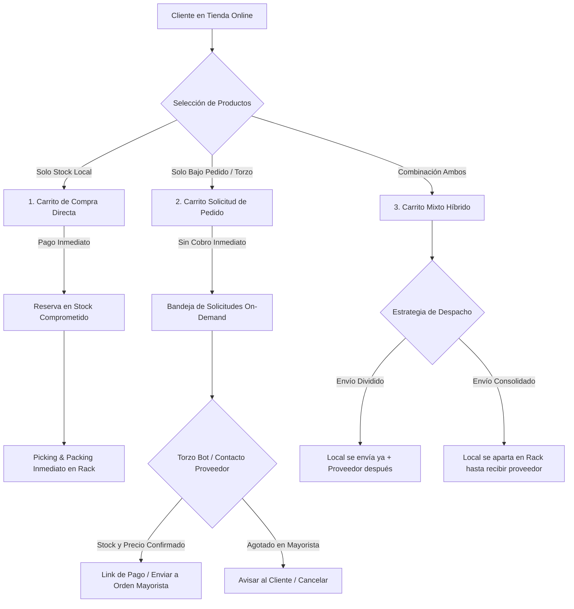
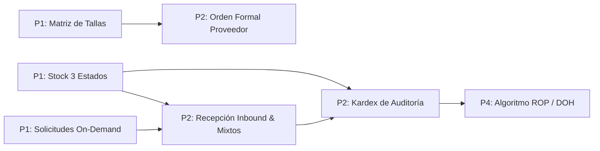

# Arquitectura y Hoja de Ruta: HUB 4 - Inventario, Compras & Cadena de Suministro
> **Contexto de Plataforma:** Este documento corresponde al **Hub 4** de la arquitectura consolidada de 6 Hubs definida en [MASTER_ROADMAP.md](file:///c:/Users/Mickey/Documents/export/MASTER_ROADMAP.md).
> Para la guía técnica de integración con Laravel (migraciones, modelos, endpoints, servicios y colas), consultar [BACKEND_INTEGRATION_SPEC.md](file:///c:/Users/Mickey/Documents/export/BACKEND_INTEGRATION_SPEC.md).
> Absorbe el módulo independiente de *Proveedores* e interactúa directamente con el **Hub 1 (Dashboard General / Action Center)** para alimentar las alertas y tareas críticas del día a día, y con el **Hub 6 (Logística)** para la liberación de pedidos mixtos.
> 
> *Nota Arquitectónica:* El **Dashboard de Inventario** ha sido transferido al **Hub 1 (Dashboard General -> Pestaña Dashboard Ejecutivo -> Sub-pestaña Almacén e Inventario)** para concentrar la analítica directiva multimódulo en un solo lugar. El Hub 4 opera enfocado en la ejecución física mediante sus 3 pestañas principales: **1. Catálogo Operativo**, **2. Proveedores & Scraping** y **3. Compras & Reabastecimiento**.

Este documento define la visión técnica, funcional y operativa del **Módulo de Inventario Híbrido & Cadena de Suministro**. Establece la resolución de puntos ciegos, el modelo de 3 carritos y la descomposición del trabajo en un **backlog priorizado por niveles de impacto operativo y dependencias técnicas**.

> [!NOTE]
> **Estándares de Interfaz Aplicados:**
> - **100% Iconografía SVG:** Sin uso de emoticones/emojis en ninguna parte de la vista, modales o toasts.
> - **Tablas con Drawer a Pantalla Completa:** Las vistas con tablas operativas y los drawers de datos (Top 10 y Kardex) se expanden al ancho total de la pantalla (`w-full` / `w-screen max-w-full`).
> - **Tooltips con Signo de Interrogación ('?') en Cada Sección:** Botón de ayuda interactivo (`.section-help-btn`) en cada panel, tarjeta y tabla para consultar reglas operativas y fórmulas.
> - **Estandarización Absoluta de Imágenes en Formato WebP y SEO:** Toda imagen de producto subida o curada se almacena y sirve exclusivamente en formato **`.webp`** con peso estrictamente menor a 100 KB y resolución máxima de 1000px, optimizando el uso de Inodes en HostGator y disparando el puntaje Core Web Vitals en Google.
> - **Scraping Headless Multi-Proveedor Desacoplado (Opción A):** El scraping automatizado de Torzo y futuros proveedores se ejecuta de forma local en la máquina del operador vía CLI Node.js/Puppeteer, enviando los productos validados mediante el endpoint `POST /api/v1/scraper/ingest` para mantener en 0% el uso de CPU/RAM en HostGator compartido.

---

## 1. Visión del Producto y Modelo Comercial de 3 Carritos

En el e-commerce de la tienda, la experiencia de compra no es lineal. Para maximizar la conversión sin arriesgar ventas con falsas promesas de entrega, la tienda maneja **tres modalidades de carrito**:



### 1.1. Las 3 Modalidades de Carrito y su Impacto Operativo

1. **Carrito de Compra Directa (Stock Local Inmediato)**:
   * **Naturaleza:** Artículos físicos con existencia verificada en almacén local (`tipo: 'propio'`).
   * **Impacto en Inventario:** 
     - Al entrar en checkout, incrementa temporalmente el `Stock Comprometido`.
     - Al confirmarse el pago, decrementa el `Stock Físico` y genera un asiento `SALIDA_VENTA` en el Kardex.
     - Flujo de salida: Empaque y generación de guía en el mismo día.

2. **Carrito de Solicitud de Pedido (Bajo Pedido / On-Demand / Torzo)**:
   * **Naturaleza:** Artículos sin inventario local o de catálogo extendido de proveedores externos (`tipo: 'dropshipping'`).
   * **Impacto en Inventario:** 
     - **No toca el stock físico local.**
     - Genera una **Solicitud de Pedido de Cliente (Customer Backorder)** en el módulo de Compras / Proveedores.
     - **Regla de Oro:** No se cobra al cliente hasta que el bot de Torzo o el operador valide existencias reales y precio actualizado con el mayorista.
     - Al confirmarse: Se emite la orden al proveedor y se activa la cobranza al cliente.

3. **Carrito Mixto (Híbrido)**:
   * **Naturaleza:** El cliente agrega artículos disponibles en rack local Y artículos que deben pedirse al proveedor.
   * **Impacto en Inventario y Logística:**
     - **Bifurcación de Inventario:** El sistema separa internamente la orden en dos líneas:
       * *Línea A (Inmediata):* Reserva stock físico local (queda en estado `Comprometido / En Espera`).
       * *Línea B (On-Demand):* Entra a la cola de confirmación con proveedor.
     - **Políticas de Despacho:**
       * **Despacho Consolidado (Por defecto):** El stock local queda apartado en rack hasta que arribe la mercancía del proveedor para despachar en un solo paquete (ahorra flete al cliente).
       * **Despacho Dividido (Split Fulfillment):** El cliente paga flete doble y recibe su stock local en 24-48h, mientras el resto se envía al arribar del fabricante.

---

## 2. Diagnóstico del Estado Actual (Baseline v1.0)

| Sección Actual | Propósito Principal | Estado y Fortaleza | Limitaciones con Respecto a los 3 Carritos |
| :--- | :--- | :--- | :--- |
| **Dashboard Ejecutivo** | Visibilidad directiva de inventario y Top 10 | **8.5 / 10**<br>Drawer expandido muy ágil, desglose visual limpio. | No separa las ventas por origen (Compra directa vs Solicitudes bajo pedido concretadas). |
| **Catálogo Operativo** | Gestión granular de 25 SKUs con desglose de tallas | **9.0 / 10**<br>Filtros instantáneos, Drawers aislados, alta de productos funcional. | La etiqueta `propio` / `dropshipping` / `mixto` es estática; falta vincularla a las reglas de activación en cada carrito. |
| **Proveedores & Scraping** | Monitoreo de 7 proveedores, Torzo Bot y APIs | **7.5 / 10**<br>Métricas de latencia y fiabilidad bien representadas. | Falta una bandeja de entrada para verificar solicitudes de pedidos de clientes contra el scraper en 1 clic. |
| **Compras & Reabastecimiento** | Control de compras en tránsito y lista de reorden | **8.0 / 10**<br>Reactividad directa desde el Drawer de producto. | Mezcla en un solo saco las compras preventivas con las solicitudes originadas por carritos de clientes. |

---

## 3. Resolución de Puntos Ciegos (Blind Spots)

### 3.1. Punto Ciego: Mezcla de Compras Preventivas vs. Solicitudes de Clientes (Backorders)
* **Diagnóstico:** En la pestaña de Compras, una orden para rellenar stock de seguridad tiene una urgencia y tratamiento totalmente diferente a una pieza que ya solicitó un cliente en un *Carrito Bajo Pedido* y que está esperando respuesta.
* **Solución Arquitectónica:**
  - Dividir la pestaña de Compras con un selector de dos vistas:
    1. **Bandeja de Solicitudes On-Demand (Carritos de Clientes):** Órdenes respaldadas por un cliente con temporizador de respuesta (*SLA < 2 horas*).
    2. **Reabastecimiento Planificado (Stock Preventivo):** Lotes para acumular volumen mayorista (MOQ).

### 3.2. Punto Ciego: Quiebres Asimétricos por Talla vs. Reorden Global
* **Diagnóstico:** En prendas de vestir y ropa interior, las tallas centrales (`M` y `G`) concentran el 70% de la demanda, mientras `CH` y `XL` representan colas medias. Además, existen tallas extendidas (`2XL` y `3XL`) que tienen demanda real pero de muy baja rotación; si se compran en bultos estándar generan inventario ocioso permanente.
* **Solución Arquitectónica:**
  - **Matriz Dual de Tallas:**
    1. *Tallas Núcleo (Core Sizes):* `CH`, `M `, `G `, `XL` (85-90% del volumen de compra y venta directa).
    2. *Tallas Extendidas (Plus Sizes):* `2XL` y `3XL` (10-15% del volumen; ideales para gestionarse bajo el *Carrito de Solicitud de Pedido On-Demand* o con reórdenes mínimos controlados).
  - La UI en los Drawers separa limpiamente el bloque núcleo de las tallas plus para no saturar la pantalla ni sobrecargar los pedidos automáticos.

### 3.3. Punto Ciego: Stock Físico vs. Comprometido en Carrito Directo y Mixto
* **Diagnóstico:** En un carrito mixto con despacho consolidado, el producto local queda apartado esperando al proveedor. Si no se marca como `Comprometido`, otro cliente podría comprarlo en línea.
* **Solución Arquitectónica:**
  - Motor de 3 estados de stock por talla:
    $$\text{Stock Disponible para Compra Directa} = \text{Stock Físico} - \text{Stock Comprometido (Directos en empaque + Mixtos en espera)}$$

### 3.4. Punto Ciego: Falsa Disponibilidad en Carrito de Solicitud de Pedido
* **Diagnóstico:** Un cliente arma un carrito de solicitud de pedido, pero el mayorista cambió el precio o quebró la talla.
* **Solución Arquitectónica:**
  - Conexión con **Torzo Bot Quick-Check**: Botón en la solicitud del cliente para ejecutar una verificación instantánea de URL contra el sitio del mayorista antes de responderle al cliente.

---

## 4. Matriz de Dependencias Técnicas

Antes de priorizar, es crucial entender cómo se relacionan los módulos entre sí:



---

## 5. Backlog de Tareas Ordenado por Prioridad Estratégica

La priorización se clasifica en 4 niveles según dos criterios: **Impacto Directo en Evitar Pérdidas de Ventas** y **Precedencia Lógica (dependencias técnicas)**:

### [Prioridad Alta] PRIORIDAD 1: Crítica / Inmediata (Fundamentos de Operación y Prevención de Errores)
> *Objetivo: Evitar compras ciegas por tallas erróneas, evitar vender stock ya apartado (over-selling) y atender de inmediato a clientes que piden bajo pedido.*

1. **[P1.1] Matriz de Tallas en Reabastecimiento de Producto** [Completado] *(Completada)*
   - **Por qué va primero:** Es la raíz de la exactitud textil. Reemplaza el input plano de cantidad por campos individuales para `CH, M, G, XL` en el drawer de producto al agregar a la lista de compras.
   - **Impacto:** Elimina compras de tallas muertas y asegura reposición de tallas de alta rotación.
   - **Entregables:** Actualización del drawer de producto, recálculo reactivo de piezas totales y costo consolidado.

2. **[P1.2] Motor de Stock de 3 Estados (Físico vs. Comprometido vs. Disponible)** [Completado] *(Completada)*
   - **Por qué va aquí:** Es el corazón de la disponibilidad. Define `Disponible = Físico - Comprometido`.
   - **Impacto:** Protege a los carritos mixtos que apartan mercancía local en espera del proveedor; previene reclamos de clientes por prendas vendidas dos veces.
   - **Entregables:** Campos `sizes` (físico) y `committed` (apartado) en el objeto de producto, badge semafórico en catálogo y drawer.

3. **[P1.3] Bandeja de Solicitudes On-Demand en Compras (Carritos Bajo Pedido de Clientes)** [Completado] *(Completada)*
   - **Por qué va aquí:** Atiende el flujo comercial de solicitudes de pedido que llegan desde la tienda.
   - **Impacto:** Canaliza los leads con intención de compra real antes de que se enfríen o compren en otro lado.
   - **Entregables:** Sub-vista en la pestaña Compras con lista de solicitudes de clientes, producto, talla requerida, estado de verificación y botón rápido para confirmar con proveedor.

---

###  PRIORIDAD 2: Alta / Cierre del Ciclo Físico (Logística y Comunicación con Proveedor) [Completado] *(COMPLETADA)*
> *Objetivo: Cerrar el ciclo operativo cuando el proveedor despacha la mercancía y mantener una comunicación formal y eficiente.*

4. **[P2.1] Recepción de Mercancía (Inbound) & Liberación de Carritos Mixtos** [Completado] *(Completada)*
   - **Dependencia:** Requiere P1.1 (tallas) y P1.2 (stock 3 estados).
   - **Implementación:** Modal reactivo de recepción física con cotejo por tallas (`CH, M, G, XL, 2XL, 3XL`), ingreso automático a existencias físicas de catálogo, cambio dinámico de `dropship` a `mixto`, incremento de saldo por talla y alerta animada de liberación del Carrito Mixto #ORD-4491 de Sofía Albarrán.
   - **Impacto:** Conecta la llegada física del flete de Torzo B2B directamente con la orden de empaque para logística.

5. **[P2.2] Generador Formal de Orden de Compra (WhatsApp / Formato Limpio)** [Completado] *(Completada)*
   - **Dependencia:** Requiere P1.1 (tallas consolidadas).
   - **Implementación:** Modal de exportación con selector de proveedor (`Torzo B2B`, `Silk & Cotton`, `ModaIntima`, `Consolidado Multimarca`), filtros para compras planificadas y solicitudes on-demand, caja de previsualización monospace con formato WhatsApp (emojis, curva de tallas, costos, totales e instrucciones) y copiado en 1 clic al portapapeles con toast de confirmación.
   - **Impacto:** Reduce errores humanos de transcripción con proveedores y agiliza el despacho.

6. **[P2.3] Kardex & Auditoría de Movimientos Multicanal** [Completado] *(Completada)*
   - **Dependencia:** Requiere P1.2 y P2.1.
   - **Implementación:** Slide-over Drawer lateral accesible desde el botón del Catálogo Operativo (`[ [Planificada] Kardex / Auditoría ]`) y desde cada Drawer individual de SKU. Incluye 4 tarjetas KPI de resumen, barra de búsqueda reactiva por texto, filtros rápidos por tipo (`ENTRADA_COMPRA`, `VENTA_DIRECTA`, `RESERVA_MIXTA`, `AJUSTE_MERMA`), badges cromáticos y registro inmutable automático tras cada recepción inbound (alineado a `inventory_movements` de Laravel).
   - **Impacto:** Trazabilidad inmutable de entradas, salidas, reservas y mermas.

---

### [Prioridad Media] PRIORIDAD 3: Media / Usabilidad y Productividad del Catálogo (Velocidad Administrativa) [Completado] *(COMPLETADA)*
> *Objetivo: Hacer que la administración cotidiana del catálogo sea ágil y no requiera abrir drawers laterales para tareas repetitivas.*

7. **[P3.1] Edición Rápida en Línea (Inline Quick Edit) en Catálogo** [Completado] *(Completada)*
   - **Impacto:** Modificar PVP y costos unitarios con un clic directo sobre la celda de la tabla, con confirmación inmediata (`Enter` o `blur`), micro-animación de check verde (`savedCellFeedback`), y cálculo reactivo de margen comercial `((PVP - Costo)/PVP) * 100` con insignias cromáticas automáticas (Esmeralda >= 60%, Azul >= 40%, Ámbar < 40%).
   - **Entregables:** Celdas reactivas con `<input>` inline numérico, atajos de teclado (`Enter` para guardar, `Escape` para cancelar), toasts de notificación de actualización de precio y recálculo unificado de margen en toda la aplicación.

8. **[P3.2] Acciones en Lote (Bulk Actions) en Catálogo** [Completado] *(Completada)*
   - **Impacto:** Modificar múltiples productos a la vez de forma masiva sin abrir modales individuales, acelerando tareas administrativas rutinarias.
   - **Entregables:** Checkbox maestro en el `<thead>` y checkboxes por cada fila en `<tbody>` con selección selectiva o global (`toggleSelectAll`), barra flotante animada inferior (`z-[60]`) con contador en vivo (`selectedSkus.length`), exportación en 1 clic tanto a **CSV** (`exportSelectedToCsv`) como a **Microsoft Excel** (`exportSelectedToExcel` con soporte nativo `.xlsx` vía SheetJS, curva de 6 tallas y fallback `.xls` offline), exportación de órdenes de compra consolidadas a Excel (`exportPurchaseOrdersToExcel`), reasignación masiva de proveedor mayorista (`applyBulkProvider`), reasignación masiva de categoría comercial (`applyBulkCategory`), y agregado masivo a la lista de compras planificadas con curva completa de tallas (`addSelectedToPurchases`).

---

### [Prioridad] PRIORIDAD 4: Estratégica / Automatización y RevOps (Escalabilidad Inteligente) [Completado] *(COMPLETADA)*
> *Objetivo: Automatizar decisiones para que el sistema trabaje de forma preventiva mediante algoritmos y scrapers.*

9. **[P4.1] Algoritmo de Punto de Reorden (ROP) y Días de Inventario Restante (DOH)** [Completado] *(Completada)*
   - **Dependencia:** Requiere el histórico de rotación y Kardex.
   - **Impacto:** El sistema predice quiebres de inventario antes de que ocurran mediante $\text{VMD} = \frac{\text{Venta Mensual}}{30}$, $\text{DOH} = \frac{\text{Stock Disponible}}{\text{VMD}}$ y $\text{ROP} = (\text{VMD} \times \text{Lead Time}) + \text{Stock Seguridad}$.
   - **Entregables:** Badges semafóricos de DOH en el catálogo operativo (rojo $\le 7$d, ámbar $\le 15$d, verde $> 15$d), botón de 1 clic `[  ROP ]` para autogenerar la orden de compra en Tab 4 calculando la curva completa de tallas (`CH, M, G, XL, 2XL, 3XL`), y filtro selectivo en catálogo para ver exclusivamente productos bajo ROP.

10. **[P4.2] Centro de Alertas y Quick-Check de Torzo Bot (Scraping)** [Completado] *(Completada)*
    - **Impacto:** Monitorea aumentos de costo, rupturas de talla y reingresos en las páginas de los mayoristas y permite resolverlos al instante sin salir del módulo.
    - **Entregables:** Panel interactivo en Tab 3 (Proveedores & Scraping) con estado del bot headless, botón de simulación `[  Ejecutar Quick-Check ]` con spinner de carga, y feed de discrepancias con acciones de resolución en 1 clic: *"Ajustar Costo y PVP para mantener margen 65%"*, *"Pausar Talla M en tienda"* y *"Sincronizar Stock Remoto (+150)"*.

11. **[P4.3] Filtros Temporales y Análisis ABC (Pareto) en Dashboard** [Completado] *(Completada)*
    - **Impacto:** Permite auditar el 20% de SKUs que genera el 80% del valor (Clase A) vs el 30% complementario (Clase B) vs el 50% de cola larga (Clase C), permitiendo enfocar las compras en los productos más rentables.
    - **Entregables:** Selector de rango temporal en Tab 1 (`Hoy`, `7 Días`, `30 Días`, `Año 2026`, `Histórico`), tarjeta interactiva de Análisis ABC de Pareto con barras de participación de GMV, badges cromáticos de Clase ABC en cada producto del catálogo, y filtrado reactivo del catálogo desde el Dashboard.

---

### [Completado] GESTIÓN MULTI-IMAGEN DEL CATÁLOGO [Completado] *(COMPLETADA)*

12. **[P3.3] Carga y Gestión Multi-Imagen en Alta de Productos (Hasta 10 Imágenes)** [Completado] *(Completada)*
    - **Contexto Operativo:** Al dar de alta un producto en el catálogo mediante el drawer lateral (`newProductDrawerOpen`), el operador necesita subir el material gráfico oficial para alimentar tanto la ficha técnica interna como la vitrina pública del e-commerce.
    - **Requisitos Funcionales:**
      * **Capacidad:** Carga simultánea o incremental de hasta 10 imágenes por producto.
      * **Zona de Carga:** Área interactiva drag-and-drop y selector de archivos nativo con vista previa en cuadrícula responsive.
      * **Formatos Soportados:** `.jpg`, `.jpeg`, `.png`, `.webp`, `.avif` con peso máximo parametrizado de 5 MB por archivo.
      * **Imagen Principal / Portada (`is_primary`):** Marcador visual interactivo (insignia de "Portada" con selector en 1 clic) para definir qué fotografía encabeza la ficha de producto y catálogo público.
      * **Reordenamiento y Eliminación:** Control de orden secuencial (posiciones 1 a 10) y botón de eliminación individual (`[ x ]`) con confirmación sin recargar la vista.
      * **Contador Reactivo:** Indicador visual en tiempo real del límite (ej. `Imágenes: 4 / 10 subidas`).
    - **Impacto RevOps:** Evita altas incompletas, agiliza la publicación inmediata de nuevos SKUs y previene cuellos de botella entre el equipo de compras/inventario y el equipo de diseño/marketing.
    - **Entregables:**
      * Componente visual en el Drawer de Alta de Producto de [inventory.blade.php](file:///c:/Users/Mickey/Documents/export/inventory.blade.php) e [inventory-module.js](file:///c:/Users/Mickey/Documents/export/inventory-module.js).
      * Estado reactivo en Alpine.js (`newProduct.images = []`, `addImage()`, `removeImage()`, `setPrimaryImage()`).
      * Especificación de base de datos relacional `product_images` y endpoints de API multipart en [BACKEND_INTEGRATION_SPEC.md](file:///c:/Users/Mickey/Documents/export/BACKEND_INTEGRATION_SPEC.md).

---

## 6. Resumen de Ejecución Recomendada

```
┌────────────────────────────────────────────────────────┐
│  BLOQUE 1: P1 (Tareas 1, 2 y 3)                        │
│  → Matriz de tallas + Stock 3 estados + Backorders     │
│  [Blindaje contra errores y over-selling]              │
└──────────────────────────┬─────────────────────────────┘
                           ▼
┌────────────────────────────────────────────────────────┐
│  BLOQUE 2: P2 (Tareas 4, 5 y 6)                        │
│  → Recepción Inbound + Orden WhatsApp + Kardex         │
│  [Cierre de logística física y auditoría]              │
└──────────────────────────┬─────────────────────────────┘
                           ▼
┌────────────────────────────────────────────────────────┐
│  BLOQUE 3: P3 (Tareas 7 y 8)                           │
│  → Edición rápida en tabla + Acciones en lote          │
│  [Velocidad operativa del día a día]                   │
└──────────────────────────┬─────────────────────────────┘
                           ▼
┌────────────────────────────────────────────────────────┐
│  BLOQUE 4: P4 (Tareas 9, 10 y 11)                      │
│  → ROP / DOH automático + Torzo Alertas + Pareto ABC   │
│  [Inteligencia predictiva y automatización]            │
└────────────────────────────────────────────────────────┘
```

---

## 7. Evolución del Catálogo: Productos Unitarios, Cosmética, Perfumería y Suscripciones

Para respaldar el ecosistema multiverso de **Terra** (*Marte, Venus y Tiresias/Afrodita*), el Hub 4 amplía su modelo de datos y reglas operativas:

### 7.1. Tipología de Productos en Inventario
1. **Prendas Textiles (Ropa Interior & Lencería):**
   - Requiere curva de 6 tallas (`CH, M, G, XL, 2XL, 3XL`).
   - Compras con reparto por curvas según rotación de tallas.
2. **Cosmética & Maquillaje:**
   - Requiere variante por **Tonos y Subtonos de Piel** (ej. *Tono 01 Claro* a *Tono 06 Oscuro*).
   - Control de caducidad y lotes de fabricación en Kardex.
3. **Perfumería & Fragancias:**
   - Requiere variante por **Volumen** (*10ml Decant/Travel, 50ml Regular, 100ml Deluxe*).
   - Protocolo de embalaje a prueba de fugas.
4. **Productos Fijos / Unitarios (Cuidado Personal & Accesorios):**
   - **Artículos:** Jabones íntimos en barra y líquidos pH neutro, desodorantes, shampoos, cremas corporales, aceites de rasurado/hidratantes, bolsas de lavado de malla para prendas delicadas y toallas de microfibra de secado rápido.
   - **Comportamiento en UI:** Sin matriz de tallas; muestra insignia de *Pieza Única / Unitario* con control directo de existencias en rack.
   - **Compras:** Pedidos en lotes simples (ej. *100 barras de jabón íntimo* o *150 bolsas de lavado*), sin curva textil.

### 7.2. Sinergias Comerciales de Ticket Promedio (AOV)
* **Bolsa de Malla Protectora para Lavadora ($99 - $140 MXN):**
  - Resuelve el dolor de desgaste prematuro de telas delicadas (modal, bambú, microfibra y elásticos de jocks).
  - Funciona como *Order Bump* de 1 clic en checkout o regalo en compras superiores a $1,200 MXN.
* **Cuidado Íntimo y Grooming (Consumibles Recurrentes):**
  - Productos de consumo continuo (se terminan cada 30-45 días), incrementando drásticamente el LTV y la recompra automatizada.

### 7.3. Motor de Suscripciones Mensuales & Combos Virtuales (Bundles / BOM)
* **Recetas de Ensamblado (Bill of Materials):**
  - Las cajas de suscripción periódica (*Nivel 1: Esencial/Refill*, *Nivel 2: Estilo & Cuidado*, *Nivel 3: VIP Box*) no ocupan un espacio físico como SKU rígido en bodega.
  - Al confirmarse el cobro mensual, el sistema genera la orden de empaque y descuenta de forma atómica los componentes individuales del inventario físico (ej. *1x Boxer Modal Talla M + 1x Jabón Íntimo + 1x Decant Perfume 10ml*).
* **Compras Predictivas Just-in-Time:**
  - Los suscriptores activos tienen registradas sus tallas y tonos de piel. El motor ROP del Hub 4 calcula la demanda exacta 15 días antes del despacho mensual, erradicando el inventario ocioso.

### 7.4. Estrategia de Abastecimiento Lean
* **Fase 1 (Actual / Lanzamiento):** Alianzas comerciales con **marcas asociadas y distribuidores**. Bajo riesgo de capital, cero trámites sanitarios de formulación y validación empírica de demanda de mercado.
* **Fase 2 (Escalamiento / Terra Labs):** Maquila de **marca propia** con laboratorios cosméticos para los SKUs de mayor rotación comprobada, elevando el margen comercial del 40%-55% al 75%-85%.

---

## 8. Distribución de Tareas Pendientes & Puntos Ciegos (Backlog Consolidado desde PENDING_TASKS.md)

Las siguientes tareas proceden del análisis crítico general registrado en [PENDING_TASKS.md](file:///c:/Users/Mickey/Documents/export/PENDING_TASKS.md) y se integran formalmente a la hoja de ruta del Hub 4 siguiendo la **Secuencia Óptima de Consolidación y Compuerta Contractual Previa (Regla 12)**:

| ID Tarea | Título Técnico | Prioridad | Componente Afectado | Impacto en Backend / Base de Datos |
| :--- | :--- | :---: | :--- | :--- |
| `TASK-INV-01` | **Slotting y Ubicaciones Físicas en Bodega** | **Alta** | Catálogo, Drawers, Checklists | **Completada (UI)** - Badges de pasillo, picker estructurado y modal de reubicación con Kardex |
| `TASK-INV-02` | **Matriz de Variantes no Textiles (Tonos y Volúmenes)** | **Alta** | Catálogo Multidimensional | **Completada (UI)** - Dimensiones textil, cosmética, perfumería y unitario reactivas |
| `TASK-INV-03` | **Escandallos / Recetas para Suscripciones & Combos (BOM)** | **Alta** | Compras, Kardex, Suscripciones | **Completada (UI)** - Modal BOM, cuello de botella de insumos y despacho atómico en Kardex |
| `TASK-INV-04` | **Valuación: Costo Promedio Ponderado (CPP) vs Último Costo** | **Media** | Edición de Costos, Kardex | **Completada (UI)** - Métrica CPP en catálogo, sub-badge en tabla, calculadora dual y recálculo automático en recepción Inbound |
| `TASK-INV-05` | **Generación e Impresión de Etiquetas Térmicas (Code128/QR)** | **Media** | Catálogo, Recepción Inbound | **Completada (UI)** - Modal térmico 50x30 y 100x50mm, Code128 SVG determinista, impresión en lote y print CSS aislado |
| `TASK-INV-06` | **Control Sanitario: Lotes y Fechas de Caducidad / PAO** | **Media** | Recepción Inbound, Kardex | **Completada (UI)** - Semaforización de caducidad, lote, PAO, filtro sanitario y asiento en Kardex |
| `TASK-INV-07` | **Auditoría Cíclica a Ciegas (Blind Cycle Counting)** | **Baja** | Kardex, Operaciones | **Completada (UI)** - Modal interactivo de 3 SKUs ciegos con slotting, revelación de discrepancias (IRA %) y reconciliación en Kardex |
| `TASK-INV-08` | **Gestión de Ropa: Telas, Colores/Tornasoles, Curaduría Scraping & Ajustes** | **Alta** | Catálogo, Proveedores, Drawers, Ajustes | **Completada (UI)** - Telas dinámicas, paleta de colores/tornasoles degradados, switch vitrina web, staging curaduría Tab 3, drawer 2 columnas y modal de ajustes |
| `TASK-INV-09` | **Gestor Configurable de Tonos de Cosmética con Swatches Cromáticos Hex y Subtonos** | **Media** | Catálogo, Drawers, Ajustes Globales | **Completada (UI)** - Catálogo maestro de tonos, modal CRUD 2 columnas, swatches 20px, badges de subtono y reactividad total |
| `TASK-INV-10` | **Rediseño Ergonómico de Barra de Acciones y Menú de Herramientas Hub 4** | **Alta** | Toolbar Hub 4, Header, Layout Responsivo | **Completada (UI)** - Reorganización jerárquica, menú desplegable inteligente de auditoría y stock, flex-wrap anti-desbordamiento |
| `TASK-INV-11` | **CRUD Integral con Archivado y Restauración para Telas, Colores y Parámetros ROP** | **Alta** | Modal Ajustes Módulo, Telas, Colores, ROP | **Completada (UI)** - Modal max-w-5xl/6xl, 7 pestañas, canonización en navbar y retiro en toolbar, CRUD telas/colores/slotting, inputs numéricos y recálculo ROP en caliente |
| `TASK-INV-12` | **Gestor Configurable de Vitrinas Web y Etiquetado Dinámico de Catálogo** | **Media** | Modal Ajustes, Drawers, Storefront D2C | **Delegada a Hub 2 CMS (`TASK-CMS-03` / `TASK-INT-10`)** - CRUD canónico en Hub 2; Hub 4 conserva selector dinámico en drawers |
| `TASK-INV-13` | **Gestor Integral de Proveedores y Control de Estados** | **Alta** | Pestaña Proveedores, Modal Alta/Edición | **Completada (UI)** - Colección reactiva de 7 proveedores híbridos, KPIs en vivo, modal 2 columnas con Scorecard SLA (On-time %, Fill rate %), switcher de estados, sync reactivo, archivado/restauración, borrado protegido y DDL 3.47 / Eloquent 4.41 |
| `TASK-INV-14` | **Gestor Configurable de Tallas Textiles y Volúmenes de Perfumería en Matriz de Variantes** | **Alta** | Drawer Producto, Matriz Variantes, Ajustes | **Pendiente (Fase 2)** - Creador de curvas de tallas (XS-5XL, numéricas, copas) y gestor dinámico de volúmenes (ml/oz) |
| `TASK-INV-15` | **Drawer de Producto Full-Width con Auto-SKU, Asistente IA de Descripción y Detección de Duplicados** | **Alta** | Drawer Producto, Copiloto IA, Validación | **Pendiente (Fase 2)** - Drawer pantalla completa, SKU inteligente sin bloqueo, generador IA con fotos y modal anti-duplicados |
| `TASK-INV-16` | **Refactorización de Bandeja de Compras y Solicitudes On-Demand** | **Alta** | Pestaña Compras, Solicitudes | **Completada (Fullstack)** - Curvas de tallas 100% inline, costo unitario y prioridad editables en caliente, generador PO PDF con motor de impresión Carta limpio, despacho de email, persistencia real de OCs (`purchase_orders`), partidas (`purchase_order_items`), compensación de notas de crédito y Kardex mercantil inmutable |
| `TASK-INV-17` | **CRUD Integral y Gestor de Fórmulas para Recetas BOM & Combos Virtuales** | **Alta** | Modal Ajustes Inventario, Insumos Catálogo, Fórmulas | **Completada (UI)** - Integrado en Ajustes de Inventario (Tab 8), CRUD con alta/edición/archivado/borrado, selector dinámico de insumos del catálogo físico y normativa de roles con diagramas de decisión |
| `TASK-UX-03` | **Sistema Global de Toasts y Notificaciones en Cola (Z-Index Máximo, TTL Extendido y Stack Acumulativo)** | **Alta** | Toasts Globales, Topbar, Modales, Drawers | **Pendiente (Fase 2)** - Stack apilado, z-index 99999, TTL extendido (6-10s) y pause on hover |
| `TASK-INT-01` | **Saltos Profundos Prefiltrados desde Alertas de Dashboard** | **Alta** | Router interno, Filtros Catálogo | **Completada (UI)** - `window.navigateToInventory`, banner reactivo de filtro activo, resaltado de fila y Suite 27 aprobada |
| `TASK-INT-02` | **Trazabilidad de Stock: Comprometido a Despachado / Kardex** | **Alta** | Modales de Acción, Kardex | **Completada (UI)** - Deducción atómica de stock comprometido/físico, asiento inmutable `SALIDA_VENTA`, badge púrpura y Suite 28 aprobada |
| `TASK-INT-03` | **Liberación Masiva de Lotes de Suscripción (Batch Fulfillment)** | **Alta** | Recetas BOM, Salida Kardex | **Completada (UI)** - Validación atómica BOM para 150 cajas (400 unidades), asientos `SALIDA_COMBO_SUSCRIPCION`, badge violeta, filtro Kardex y Suite 29 aprobada |
| `TASK-INT-11` | **Disparo Automático de OCs a Extranet B2B por Déficit BOM** | **Alta** | Recetas BOM, Hub 7 Extranet B2B | **Completada (UI)** - Modal interactivo de balance, cálculo reactivo de faltantes por lote y emisión de OCs en 1 clic hacia B2B |

### 8.1. Detalle de Requisitos por Tarea

1. **`TASK-INV-01` (Slotting Físico en Bodega - Completada en UI):**
   - Incorporar columna `Ubicación` (`A-02-3`: Pasillo A, Rack 02, Nivel/Gaveta 3) en la tabla del catálogo.
   - En el Drawer de Alta/Edición, agregar campos individuales: Pasillo (select/texto), Rack (numérico), Nivel/Gaveta (numérico).
   - En los checklists de empaque y surtido de almacén, ordenar los artículos recolectados por secuencia lógica de pasillo para minimizar tiempos de recorrido.

2. **`TASK-INV-02` (Matriz no Textil para Cosmética y Perfumería - Completada en UI):**
   - Si la categoría del producto es textil: desplegar la curva clásica de 6 tallas (`CH` a `3XL`).
   - Si la categoría es cosmética: desplegar la matriz de tonos (`Tono 01` a `Tono 06` con selector de subtono cálido/neutro/frío).
   - Si la categoría es perfumería: desplegar la matriz de volumen (`10ml`, `50ml`, `100ml`).
   - Si la categoría es accesorio o cuidado unitario: mantener campo plano de existencia única.

3. **`TASK-INV-03` (Combos Virtuales y Recetas BOM - Completada en UI):**
   - Sub-vista / modal interactivo de "Recetas de Ensamble BOM & Combos Virtuales" donde se vinculan los SKUs que componen cada membresía mensual (ej. Caja Nivel 2 = 1x boxer modal + 1x jockstrap + 1x perfume 10ml).
   - Cálculo predictivo de cuello de botella de armado según existencias físicas reales en bodega.
   - Al generarse la orden de despacho masivo, liquidar automáticamente los insumos individuales en el inventario central y asentar las salidas en Kardex (`SALIDA_COMBO_SUSCRIPCION`).
   - **`TASK-INT-11` (Disparo Automático de OCs a Extranet B2B por Déficit BOM - Completada en UI):**
     * Modal reactivo de Auditoría de Déficit BOM con cálculo predictivo para lotes masivos de suscripciones (`bomDeficitState`, `calculateLotDeficit`).
     * Detección exacta de piezas faltantes por componente y desglose de inversión estimada.
     * Generación en 1 clic de órdenes de compra planificadas (`#OC-2026-BOM-XXX`) divididas por taller/fabricante (`VND-TORZO`, `VND-TERRA`) e inyección automática en la Extranet B2B (`vendorPortalState.orders`).
     * Disparo de tarea de monitoreo en rampa hacia el Action Center de Hub 1 y registro de auditoría en bitácora de turno.
     * Suite 57 oficial de pruebas aprobada al 100%.

4. **`TASK-INV-04` (Costo Promedio Ponderado - CPP - Completada en UI):**
   - Atributo contable `weightedAverageCost` en cada producto del catálogo base.
   - Columna de costo con Último Costo editable y sub-badge `CPP: $XXX.XX` con tooltip interactivo de la fórmula contable oficial.
   - Calculadora dual en Drawer de Producto: comparativa reactiva de Margen Real Contable (sobre CPP) vs Margen Marginal (sobre Último Costo) con detección de brechas de valuación.
   - Recálculo reactivo y automático del CPP al confirmar recepciones Inbound con registro inmutable de trazabilidad en Kardex (`ENTRADA_COMPRA`).
   - Suite 16 de pruebas unitarias aprobada al 100% con 0 regresiones.

5. **`TASK-INV-05` (Etiquetado Térmico en 1 Clic - Completada en UI):**
   - Modal interactivo de previsualización `thermalLabelModal` con selector de medidas estándar (50x30 mm para prendas/racks y 100x50 mm para cajas/pallets).
   - Generador nativo determinista de código de barras Code128 en SVG sin dependencias externas, con dígitos legibles y código QR.
   - 3 gatillos operativos de 1 clic: botón en columna Estado de tabla de catálogo, botón en modal de recepción Inbound (impresión masiva por el conteo exacto recibido por talla) y botón en barra flotante de acciones masivas.
   - Reglas de impresión `@media print` optimizadas para Zebra, Rollo, Xprinter, Dymo o impresoras convencionales.
   - Suite 17 de pruebas unitarias aprobada al 100% con 0 regresiones.

6. **`TASK-INV-06` (Trazabilidad de Caducidades y Lotes Sanitarios - Completada en UI):**
   - Registro y visualización de lote de fabricación (`batchNumber`), fecha de caducidad (`expirationDate`) y Period After Opening (`paoMonths`).
   - Semaforización reactiva en tabla de catálogo: Crítico (&le; 30 días, borde e insignia roja), Preventivo (31-90 días, ámbar) y Saludable (>90 días, esmeralda).
   - Selector en barra de filtros del catálogo con opciones: Todos, Solo Cosmética/Cuidado Personal, Por Vencer (&le; 90 días) y Vencimiento Crítico (&le; 30 días).
   - Modal de recepción Inbound con captura obligatoria de lote y caducidad para SKUs cosméticos, dejando constancia inmutable en el Kardex.
   - Sección de especificaciones sanitarias en el Drawer de Detalle y persistencia reactiva de cambios.
   - Trazabilidad sanitaria integrada en previsualización e impresión de etiquetas térmicas Code128 / QR.
   - Suite 18 de pruebas unitarias aprobada al 100% (18/18 suites oficiales pasando con 0 regresiones).

7. **`TASK-INV-07` (Auditoría Cíclica a Ciegas - Completada en UI):**
   - Herramienta diaria de conteo ciego accesible desde la barra superior con badge de estatus del día (`3 SKUs` o `OK`).
   - Muestra ponderada de 3 SKUs de stock propio en bodega (1 Clase A de alta rotación, 1 textil básico y 1 producto sensible de cosmética/cuidado personal).
   - Guía visual del recorrido con código de slotting físico (`A-01-B`) visible para ubicar el producto en anaquel.
   - Ocultamiento estricto del stock del sistema durante la captura física (tallas textiles, tonos cosméticos, volúmenes de perfume y unitarios).
   - Paso 2 de revelación con cálculo de exactitud de inventario (IRA %), discrepancias netas e impacto cuantitativo.
   - Reconciliación con actualización atómica del stock local en catálogo y emisión de asientos inmutables `AJUSTE_AUDITORIA_CIEGA` en el Kardex.
   - Suite 19 de pruebas unitarias aprobada al 100% (19/19 suites oficiales pasando con 0 regresiones).

8. **`TASK-INV-08` (Gestión de Ropa: Telas, Colores/Tornasoles, Curaduría Scraping & Ajustes - Completada en UI):**
   - **Catálogo y Alta de Telas (`apparelFabrics`):** Gestión dinámica de composiciones textiles (*Modal Seamless, Algodón Pima, Algodón Peinado, Elastano/Spandex, Malla/Mesh, Microfibra, Bambú*) con formulario de registro al vuelo en el modal de ajustes (`addNewFabric()`).
   - **Paleta de Colores Sólidos y Tornasoles (`apparelColors`):** Soporte nativo para colores HEX sólidos y efectos tornasol holográficos iridiscentes mediante degradados CSS multi-tono (`linear-gradient(135deg, ...)`), con formulario para agregar nuevos colores y tornasoles a la paleta.
   - **Variante de Diseño Textil (`designType`):** Selector de dos estados para clasificar prendas en *Sin Diseño (Liso / Sólido)* y *Con Diseño (Estampado / Pattern)*, con badges visuales en tabla y drawer.
   - **Marca / Nombre de Proveedor (`brand`):** Atributo editable integrado en catálogo, drawer y vistas de curaduría.
   - **Descripción de Prenda:** Captura y edición de la descripción técnica y comercial de la prenda para la vitrina web.
   - **Reflejo Visual de Descuentos:** Despliegue de PVP regular tachado (`line-through text-slate-400`), badge de descuento (`-X%` en rose-100) y precio neto final en bold esmeralda. *(Recordatorio de arquitectura: las reglas de descuentos se configuran en Hub 3 Cupones y Hub 2 Banners/Colecciones)*.
   - **Switch de Publicación en Vitrina Web (`isPublished`):** Alternador interactivo de 1 clic en tabla de datos (*En Sitio* vs *Oculto*) y en el drawer, con filtro dedicado en la barra de filtros del catálogo.
   - **Secciones del Sitio Web (`websiteSection`):** Clasificación en *Línea Básicos Esenciales*, *Línea Diseñador & Autor*, *Colección Temporada / Drops* y *Catálogo General*.
   - **Bandeja de Curaduría Previa de Scraping en Tab 3:** Las prendas extraídas por Torzo Bot llegan a una bandeja de pre-curaduría (`scrapedPendingItems`). Modal de curaduría humana para revisar/editar la descripción scrapeada, asignar color/tornasol, tela, diseño y sección web antes de aprobar y publicar al catálogo.
   - **Drawer de Producto Espacioso (`max-w-4xl` en 2 Columnas):** Rediseño ergonómico eliminando la estrechez del drawer anterior. Columna izquierda: Vitrina web, catalogación, proveedor, variantes, color swatch y descripción. Columna derecha: Stock RevOps 3 estados, curva de tallas, slotting, calculadora de rentabilidad y ROP.
   - **Ajustes y Configuración del Módulo:** Botón de engranaje en Topbar de [index.html](file:///c:/Users/Mickey/Documents/export/index.html) y botón *Ajustes Módulo* en Sección 3 de [inventory.blade.php](file:///c:/Users/Mickey/Documents/export/inventory.blade.php). Modal interactivo con 5 pestañas (*Telas, Colores, ROP, Scraping, Secciones*).
   - **Suite 20 de Pruebas Unitarias Aprobada al 100%:** 20/20 suites oficiales pasando con 0 regresiones.

9. **`TASK-INV-09` (Gestor Configurable de Tonos de Cosmética con Swatches Cromáticos Hex y Subtonos - Completada en UI):**
   - **Catálogo Maestro de Tonos de Cosmética:** Colección reactiva de tonos con persistencia global en `window.cosmeticShadesMaster` y acceso dual (Toolbar de Hub 4 y pestaña `inventory-rules` de Ajustes Globales).
   - **Modal Ergonómico a 2 Columnas (`cosmeticShadesModal`):** Columna izquierda con formulario reactivo de registro/edición con código alfanumérico, nombre comercial, colorpicker nativo + input HEX, previsualización en vivo, selector de subtono (*Cálido / Frío / Neutro*) y switch de estado activo. Columna derecha con cuadrícula de tarjetas de tono con conmutación rápida de estado (*Activo* vs *Pausa*), edición y eliminación.
   - **Muestras Cromáticas Circulares de 20px (`.cosmetic-swatch-20`):** Renderizado en filas de catálogo para productos cosméticos con desglose de tonos, tooltips completos, badges de subtono (`.undertone-badge-warm`, `.undertone-badge-cool`, `.undertone-badge-neutral`) y conteo de piezas.
   - **Desglose Dinámico de Inventario en Drawers:** Matriz dinámica con inputs numéricos para cada tono cosmético activo, tanto en el drawer de detalle/edición de producto existente (`drawerShades`) como en el drawer de alta de nuevo producto (`newProduct.shades`), con sincronización atómica con el stock local.
   - **Paridad Estricta Blade-JS al 100%:** Sincronización idéntica entre [inventory-module.js](file:///c:/Users/Mickey/Documents/export/inventory-module.js) y [inventory.blade.php](file:///c:/Users/Mickey/Documents/export/inventory.blade.php).
   - **Compuerta Contractual Previa (Regla 12):** DDL 3.43 (`cosmetic_shades`), Modelo Eloquent 4.37 (`CosmeticShade`), Servicio de Dominio 5.28 (`CosmeticShadeService`), Contratos REST Subsección QQ, Paso 45 del Checklist en [BACKEND_INTEGRATION_SPEC.md](file:///c:/Users/Mickey/Documents/export/BACKEND_INTEGRATION_SPEC.md).
   - **Suite 54 de Pruebas Oficiales Aprobada al 100%:** 0 regresiones.

10. **`TASK-STR-02` (Sinergia D2C: Predicción de Demanda y Curva Óptima de Tallas por Telemetría de Wishlists):**
   - **Sinergia D2C $\rightarrow$ Hub 4:** Ingesta en tiempo real de señales de demanda desde las wishlists del Storefront (`wishlist_demand_signals`) y de las mediciones de cintura capturadas en el Recomendador Anatómico Torzo.
   - **Matriz Predictiva de Confección:** Desglose porcentual exacto de tallas preferidas (`CH, M, G, XG`) por SKU y por universo (`TERRA`, `MARTE`, `VENUS`, `TIRESIAS`), eliminando el quiebre de stock en tallas de alta demanda y evitando sobre-stock de tallas poco solicitadas.
   - **Generador de Órdenes de Compra Sugeridas en 1 Clic (`generate-suggested-po`):** Algoritmo que evalúa:
      $$Q^* = \max(0, (\text{Wishlists Activas} \times \text{Tasa de Conversión Estimada}) - \text{Stock Físico Almacén})$$
      Al detectar aceleración de demanda (Wishlist Velocity Score $> 60$), proyecta la fecha estimada de agotamiento y sugiere la emisión automática de una orden de compra o lote de maquila en el Portal B2B de Proveedores (`TASK-HUB-VND`).

11. **`TASK-INT-06` (Gestor de Carritos Simultáneos y Reserva Temporal de Stock TTL 5m - Completada en UI):**
   - **Fórmula Tripartita de Stock:** Descuento en tiempo real del inventario bloqueado en carritos activos de clientes: $\text{Disponible} = \text{Físico} - \text{Comprometido} - \text{En Carrito (TTL 5m)}$ en `getAvailableStock()` y `getAvailableSize()`.
   - **Sub-badge Reactivo en Catálogo (`.badge-stock-locked`):** Indicador visual en la columna de stock local con animación de pulso cuando una o más prendas están retenidas en un carrito activo.
   - **Botón y Modal de Carritos Activos (`stockLocksModal`):** Acceso directo en la barra superior con contador reactivo de sesiones en espera. Modal interactivo con listado de sesiones, SKUs, tallas, cantidades, temporizador regresivo de TTL y botón de liberación forzada de reservas.
   - **Sincronización Inter-Hub:** Conexión mediante eventos CustomEvent (`stock-lock-acquired`, `stock-lock-released`, `stock-lock-expired`) y API `window.stockLockMaster` entre Storefront (Hub 2) e Inventario (Hub 4).
   - **Paridad Blade-JS al 100%:** Sincronización exacta entre [inventory-module.js](file:///c:/Users/Mickey/Documents/export/inventory-module.js) y [inventory.blade.php](file:///c:/Users/Mickey/Documents/export/inventory.blade.php).
   - **Parámetros Blade-JS al 100%:** Sincronización exacta entre [inventory-module.js](file:///c:/Users/Mickey/Documents/export/inventory-module.js) y [inventory.blade.php](file:///c:/Users/Mickey/Documents/export/inventory.blade.php).
   - **Compuerta Contractual Previa (Regla 12):** DDL 3.44 (`stock_locks`), Modelo Eloquent 4.38 (`StockLock`), Servicio de Dominio 5.29 (`StockLockService`), Subsección RR y Paso 46 del Checklist en [BACKEND_INTEGRATION_SPEC.md](file:///c:/Users/Mickey/Documents/export/BACKEND_INTEGRATION_SPEC.md).
   - **Suite 55 de Pruebas Oficiales Aprobada al 100%:** 0 regresiones.

12. **`TASK-INV-10` (Rediseño Ergonómico de Barra de Acciones y Menú de Herramientas Hub 4 - Completada en UI):**
   - **Reorganización Jerárquica:** Separación clara del CTA principal (`+ Agregar Producto`) y `Ajustes Módulo` a la derecha, mientras que `Kardex / Auditoría` y `Carritos Activos` (con stock locks en espera) se mantienen fijos y visibles afuera.
   - **Reubicación de Tonos:** El botón `Tonos Cosmética` se retira de la barra operativa y se traslada como pestaña dedicada a `Ajustes Módulo` (`TASK-INV-11`).
   - **Menú Desplegable "Herramientas de Stock":** Agrupa únicamente `Recetas & Combos BOM`, `Déficit BOM & OCs B2B` y `Auditoría Diaria a Ciegas`.
   - **Badges Reactivos y Alertas:** Punto indicador rojo/ámbar en el botón activador si la toma ciega diaria está pendiente o hay quiebres graves.

13. **`TASK-INV-11` (CRUD Integral de Atributos, Tonos, ROP y Rediseño Amplio de Ajustes - Completada en UI):**
   - **Amplitud Ergonómica del Modal (`max-w-5xl` / `max-w-6xl`):** Expansión del ancho del diálogo para que todas las pestañas respiren holgadamente en una sola fila, erradicando la barra de navegación horizontal (scroll).
   - **Pestaña Nativa "Tonos de Cosmética":** Integración del gestor de tonos cromáticos dentro del modal de ajustes unificando los atributos del catálogo.
   - **Gestor de Telas y Fibras (`apparelFabrics`):** Incorporación de capacidades de edición de nombre, soft-delete con estado archivado (`is_active: false`), restauración de ítems y eliminación definitiva con validación de no uso en productos.
   - **Gestor de Colores y Tornasoles (`apparelColors`):** Edición completa de paleta cromática sólida y degradados tornasol holográficos (doble HEX interactivo) con previsualización en vivo, archivado y desarchivado.
   - **Parámetros ROP y Recálculo Inmediato:** Edición de Lead Times y Stocks de Seguridad mediante inputs numéricos. Al guardar, se dispara inmediatamente un recálculo asíncrono de riesgo en todo el catálogo en vivo.

14. **`TASK-INV-12` (Gestor Configurable de Vitrinas Web y Etiquetado Dinámico de Catálogo - Delegada a Hub 2 CMS `TASK-CMS-03` / `TASK-INT-10` & Backlog Dinámico en Hub 4):**
   - **Alineación de Responsabilidad:** La creación, reordenamiento comercial y CRUD de Vitrinas/Secciones Web corresponde canónicamente a Hub 2 (CMS / Merchandising).
   - **Etiquetado Dinámico en Hub 4:** El selector de vitrina en el drawer de producto y en la bandeja de curaduría de scraping en Hub 4 consume dinámicamente las vitrinas publicadas desde el CMS sin duplicar pantallas de configuración en ajustes.
   - **Sincronización Transversal:** Publicación automática hacia el Storefront Público, mapeando la vitrina dinámica como un filtro facetado interactivo y URL.

15. **`TASK-INV-13` (Gestor Integral de Proveedores y Control de Estados - Completada en UI):**
   - **Colección Reactiva Híbrida:** 7 proveedores con metadata completa cubriendo automatizados por scraping (Puppeteer, Shopify Webhooks, GraphQL) y talleres/distribuidores directos.
   - **KPIs y Filtros Dinámicos:** Tarjetas con conteo reactivo en vivo de proveedores conectados, en mantenimiento, pausados y catálogo de ítems sincronizados, con buscador y filtros por estado y tipología.
   - **Ficha Comercial & SLA Scorecard (`max-w-4xl`):** Modal de 2 columnas con edición completa de datos comerciales, plazos de pago, lead time, notas y Scorecard de Confiabilidad cruzado con OCs (Tasa de entrega a tiempo, Fill Rate, demora promedio).
   - **Control de Estados, Sincronización y Archivado:** Botones de alternancia de estado operativo (*Conectado*, *En Mantenimiento*, *Pausado*), forzado asíncrono de sincronización con spinner, **Archivado (Soft-Delete)** para descontinuar proveedores preservando historial contable, **Restauración a Activo**, y **Eliminación Definitiva** protegida con validación estricta de dependencias (bloqueo automático si existen OCs asociadas o ítems en catálogo).
   - **Backend Spec:** DDL 3.47 (`inventory_vendors` con `archived`), Modelo 4.41 (`InventoryVendor`), Servicio 5.32 (`VendorManagementService` con `archiveVendor`, `restoreVendor`, `deleteVendor`), endpoints RESTful (Subsección UU incluyendo `DELETE`, `restore` y `force`) y Paso 50 del checklist en `BACKEND_INTEGRATION_SPEC.md`.
   - **Paridad Estricta:** 100% sincronizado entre `inventory-module.js` y `inventory.blade.php`.

16. **`TASK-INV-14` (Gestor Configurable de Tallas Textiles y Volúmenes de Perfumería - Pendiente en Fase 2):**
   - **Gestor y Plantillas de Curvas de Tallas:** Acceso rápido junto a la matriz textil del drawer de producto y en ajustes para crear **Plantillas de Curvas** (ej. Americana, Copas, Numéricas). Al alta de producto se selecciona la plantilla y se despliega la matriz.
   - **Gestor de Volúmenes de Fragancia:** Botón y modal interactivo para registrar y configurar nuevas presentaciones volumétricas (`ml`, `oz`) dinámicamente.

17. **`TASK-INV-15` (Drawer Full-Width con Auto-SKU, Asistente IA y Detección de Duplicados - Pendiente en Fase 2):**
   - **Drawer de Ancho Completo (`w-full`):** Rediseño espacioso sin scroll horizontal para captura ergonómica.
   - **Auto-SKU Inteligente:** Generación reactiva de SKU por nomenclatura estándar sin bloqueo de la creación de producto por omisión manual.
   - **Asistente IA para Descripciones y Tags SEO:** Botón mágico para que el copiloto LLM redacte la ficha de producto y analice visualmente las fotografías cargadas para autogenerar **Etiquetas (Tags) Ocultas de SEO** que mejoran la búsqueda en tienda.
   - **Modal de Validación Anti-Duplicados:** Detección visual e inteligente de similitud con productos existentes para comparación lado a lado y dictamen humano antes de guardar.

18. **`TASK-INV-16` (Refactorización de Bandeja de Compras, Generador de PO con Impresión PDF Multi-Hoja & Compensación de Notas de Crédito - Completada Fullstack - Fase 2):**
   - **Edición de Tallas 100% Inline:** Se eliminó el modal de edición forzado (`sizeEditModalOpen`) en favor de celdas con inputs numéricos editables directamente en la tabla, disponibles tanto en Vista Ramificada / Tree-View (con barra de progreso MOQ y subtotales por proveedor) como en Vista de Lista Plana.
   - **Edición en Caliente de Costo Unitario Pactado:** Campo numérico directo por partida con recálculo dinámico en tiempo real del subtotal de la partida, del subtotal del fabricante y de la inversión global estimada del submódulo.
   - **Edición Directa de Prioridad con Asignación Dinámica ROP:** Selector interactivo (`CRÍTICA`, `ALTA`, `MEDIA`, `BAJA`) con códigos visuales de color; el sistema asigna de forma reactiva la criticidad al crearse la orden por reglas ROP (0 existencias = CRÍTICA; $\le 50\%$ ROP = ALTA; normal = MEDIA) y permite al comprador modificarla en cualquier momento.
   - **Motor de Impresión PDF Multi-Página vía Iframe Oculto (`printPurchaseOrderDoc`):** Pipeline de impresión aislada en memoria que extrae `#printablePurchaseOrderDoc.outerHTML` hacia un `iframe` invisible inyectando Tailwind CSS y `@page { size: letter portrait; margin: 12mm 15mm; }`. Esto erradica de raíz cualquier contexto GPU rasterizado o recorte de página provocado por CSS transforms o contenedores flex en la ventana principal, garantizando paginación continua limpia en Chromium con fallback a `window.print()` y clases desmanteladoras `body.printing-po-doc`.
   - **Selector Desplegable Adaptativo de Acuerdos por Discrepancias (`handleCreditAgreementSelect`):** Menú desplegable interactivo (`<select>`) dentro de `po-discrepancy-panel` que se adapta reactivamente al proveedor de la orden actual (`getPendingAgreementsForCurrentPo()`), mostrando el folio de la nota de crédito, importe a compensar y motivo de la merma/faltante. Incluye opciones estándar para omitir deducción o activar captura manual (`manual`). Al seleccionar un acuerdo, se actualizan automáticamente las variables del modelo y se recalculan subtotales e impuestos en tiempo real.
   - **Sincronización Reactiva con Dashboard Extranet del Proveedor (`notifyVendorExtranetNewPo`):** Al emitir y despachar la orden de compra (`sendPoEmailAndIssue`), se dispara la notificación al Extranet B2B (Hub 7), insertando una tarjeta de alerta en el feed del proveedor (`vendorPortalState.notifications`), registrando la nueva orden formal en su panel de producción (`vendorPortalState.orders`) y asentando el evento en la Bitácora de Turno de Hub 1 (`operationalState.shiftLog`).
   - **Cálculo Reactivo y Citación Jurídica-Comercial de Compensación:** Resumen económico que desglosa el Importe Bruto, la deducción `(-) Nota de Crédito / Deducción`, la base neta gravable, el IVA (16%) y el total final a liquidar. En el cuerpo de la PO se añade automáticamente la Cláusula 4 citando la retención pactada.
   - **Modal de Despacho de Correo Electrónico Sincronizado:** Flujo obligatorio previo a la emisión (`emailDispatchModalOpen`) con campos `to`, `cc`, `subject`, `body` y badge visual de PDF adjunto y Extranet B2B sincronizado; el borrador de correo cita explícitamente el acuerdo de compensación mercantil y el subtotal neto a transferir.
   - **Repositorio de Órdenes Emitidas & Seguimiento Fletero:** Sub-pestaña dedicada (`inbound_tracking`) con listado de OCs activas, transportista, número de guía y almacenamiento de instantánea inmutable (`poSnapshot` / `po_snapshot` JSON), permitiendo la reimpresión idéntica en cualquier momento con el botón `[Reimprimir / Ver PDF]`.
   - **Integración con Kardex de Compras:** Bitácora inmutable en sub-pestaña 4 (`purchaseKardexLog`) que audita la deducción aplicada amparada bajo el acuerdo y permite consultar el PDF oficial emitido desde cualquier asiento de auditoría.
   - **Flujo On-Demand Integrado:** Conversión inmediata en 1 clic hacia compras planificadas o rechazo tipificado por agotado con emisión automática de ticket a Hub 3 (`TASK-INT-22`).
   - **Regla Universal de Pantalla Completa para Ajustes:** La configuración de inventario (`inventoryCurrentScreen = 'settings'`) se ejecuta dentro de `<main>` como pantalla completa con 7 pestañas organizadas, eliminando modales y drawers de configuración.

19. **`TASK-INV-17` (CRUD Integral y Gestor de Fórmulas para Recetas BOM & Combos Virtuales - Completada en UI):**
   - **Gobernanza Canónica en Ajustes de Inventario:** Pestaña 8 en el modal de ajustes y configuración del inventario (`activeSettingsTab === 'bundles'`), eliminando ventanas huérfanas y conectando la toma de decisiones con la administración general.
   - **Formulario de Creación y Edición (`bundleEditor`):** Alta y modificación de fórmulas BOM y packs promocionales comerciales con SKU padre, nombre, categoría, PVP y badge.
   - **Constructor Dinámico a Decisión del Almacenista:** Selector reactivo de insumos físicos del catálogo operativo para asignar SKUs hijos, talla/variante y cantidades por caja (`cant / caja`), visualizando en vivo el stock en rack y slotting físico.
   - **Ciclo de Vida Completo:** Acciones de edición de componentes en caliente, archivado (soft-delete), reactivación y eliminación protegida de recetas.
   - **Recálculo Reactivo de Capacidad:** Sincronización inmediata con el cálculo de cajas armables (`calculateBundleStock`), visualización de cuellos de botella y simulador de despacho a Kardex.
   - **Especificación de Roles & Flujos Diarios:** Documento normativo `ROLES_AND_WORKFLOWS_SPEC.md` con funciones operativas de 5 roles, puntos ciegos inter-departamentales y 5 diagramas de decisión en Mermaid (estricto cumplimiento cero emojis).

20. **`TASK-INV-18` (Modal Panorámico de Edición de SKU `max-w-7xl` & Reactividad Integral - Pendiente en Fase 2):**
   - **De Drawer Lateral a Modal Panorámico Centrado (`max-w-7xl` / 95vw):** Sustitución del drawer lateral estrecho por un modal centrado de alta densidad con fondo desenfocado (`backdrop-blur-sm`), organizado en 3 columnas ergonómicas para erradicar barras de navegación superfluas:
     - *Columna 1 (Catalogación & Vitrina Web):* Switch de publicación en tienda, catalogación por marca y sección, variante de diseño liso/estampado, telas, paleta visual de colores/tornasoles y descripción comercial.
     - *Columna 2 (Existencias & Ubicación):* 4 KPIs reactivos en vivo (`Físico en Rack`, `Comprometido`, `Retenido en Carritos`, `Disponible Venta`), matriz completa de tallas (`CH, M, G, XL, 2XL, 3XL`) con cálculo en tiempo real de unidades disponibles por talla, slotting físico y control sanitario limpio (sin duplicidad).
     - *Columna 3 (Métricas RevOps & Reorden):* Calculadora reactiva de margen con impacto directo del descuento (%) sobre el PVP Efectivo, utilidad unitaria en vivo y semáforo de rentabilidad contable (CPP vs Costo); plan de reposición rápida con presets (+30, +60, +120) e inversión estimada en tiempo real.
   - **Reactividad y Guardado Directo:** Todos los valores reaccionan instantáneamente a cualquier edición en inputs. Guardado directo al catálogo activo con toast de confirmación sin interrupciones ni modales bloqueantes no solicitados.

21. **`TASK-UX-03` (Sistema Global de Toasts y Notificaciones en Cola - Pendiente en Fase 2):**
   - **Stack Acumulativo Flotante:** Contenedor superior con `z-index: 99999` para que ninguna alerta quede oculta tras drawers o modales.
   - **TTL Extendido & Pause on Hover:** Durabilidad de 6s para éxitos y 10s o persistente para advertencias/errores con pausa al pasar el cursor.

---

## 9. Secuencia Óptima de Consolidación & Próximos Pasos

El avance de las capacidades de Inventario y Cadena de Suministro se rige por la **Secuencia Óptima de Consolidación en Ciclo Cerrado**:

1. **Fase 1 (Triaje & Enrutamiento de Dominio):** Tareas específicas del Hub 4 (matrices textiles, slotting físico, auditorías ciegas) se gestionan y auditan en este documento; tareas transversales de conectividad inter-módulos (`TASK-INT-01` a `TASK-INT-05`) se canalizan directamente a [MASTER_ROADMAP.md](file:///c:/Users/Mickey/Documents/export/MASTER_ROADMAP.md).
2. **Fase 2 (Compuerta Contractual Previa - Regla 12):** Congelamiento formal del contrato técnico en [BACKEND_INTEGRATION_SPEC.md](file:///c:/Users/Mickey/Documents/export/BACKEND_INTEGRATION_SPEC.md) (migraciones MySQL, modelos Eloquent, FormRequests y endpoints RESTful JSON) previo a la programación de la interfaz.
3. **Fase 3 (Ejecución UI-First & Cierre Atómico):** Implementación de componentes interactivos, ejecución de la suite oficial correspondiente al 100% con cero emojis, captura de evidencia visual y actualización sincrónica en todos los roadmaps.
