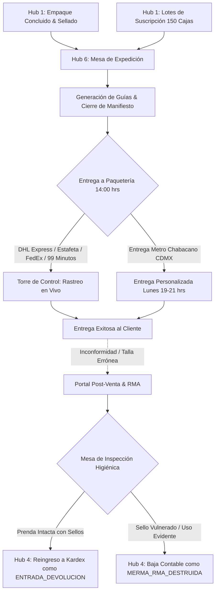
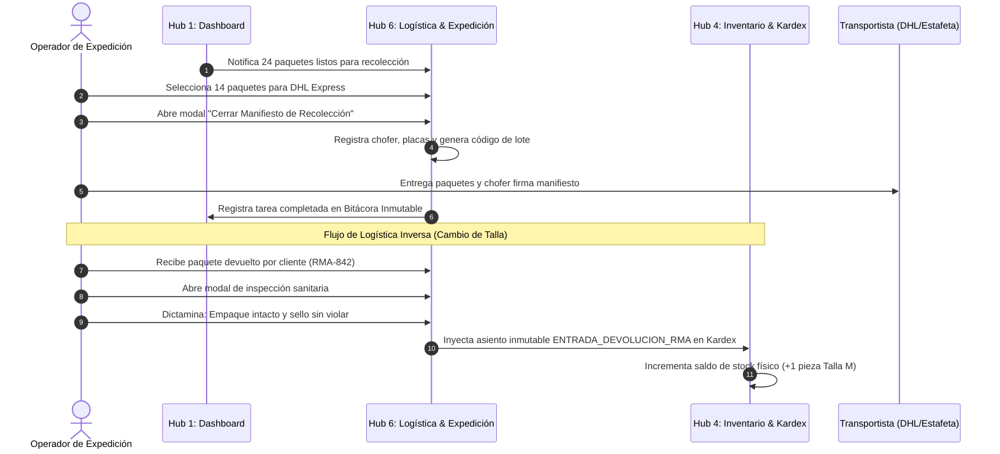

# Arquitectura y Hoja de Ruta: HUB 6 - Logística, Expedición & Post-Venta (Fulfillment & RMA)
> **Contexto de Plataforma:** Este documento corresponde al **Hub 6** de la arquitectura consolidada de 6 Hubs definida en [MASTER_ROADMAP.md](file:///c:/Users/Mickey/Documents/export/MASTER_ROADMAP.md).  
> Las tareas de desarrollo y puntos ciegos proceden del inventario maestro centralizado en [PENDING_TASKS.md](file:///c:/Users/Mickey/Documents/export/PENDING_TASKS.md).  
> Para especificaciones de modelos, migraciones, endpoints y servicios backend en Laravel, consultar [BACKEND_INTEGRATION_SPEC.md](file:///c:/Users/Mickey/Documents/export/BACKEND_INTEGRATION_SPEC.md).

Este documento define la arquitectura técnica, funcional y operativa del **Hub 6: Logística, Expedición & Post-Venta (Fulfillment Outbound & RMA)**. Conecta la mesa de empaque de Hub 1 y el stock de Hub 4 con las empresas de transporte (DHL Express, Estafeta, FedEx, 99 Minutos), la torre de control de rastreo y el ciclo de devoluciones y cambios de talla (RMA) con retorno contable a Kardex.

> [!NOTE]
> **Estándares Transversales de Interfaz Aplicados (Reglas Maestras):**
> - **Regla 10 (Jerarquía Estructural Inamovible):** En todas las vistas, primero se renderiza la barra unificada de pestañas de submódulos (`subnavBar`), inmediatamente debajo las tarjetas de métricas contextuales (`grid grid-cols-1 sm:grid-cols-2 lg:grid-cols-4 gap-4 mb-6`), y finalmente el área de trabajo y tablas operativas.
> - **Regla 8 (Tooltips de Sección con '?'):** Todo bloque, panel, métrica y tarjeta cuenta con un botón interactivo `.section-help-btn` que despliega el propósito funcional y reglas de cálculo sin saturar la pantalla.
> - **Regla 1 (Cero Emojis):** Iconografía 100% SVG vectorial estándar.
> - **Regla 5 (Cero Page-Heading Overhead):** El título del Hub y su estado activo residen en el Navbar superior; el contenido de la vista inicia de inmediato en el lienzo principal.
> - **Regla 12 (Compuerta Contractual Previa):** Toda funcionalidad, evento de dominio y flujo de datos debe contar con su esquema de tabla, modelo Eloquent y contrato RESTful formalmente blindados en [BACKEND_INTEGRATION_SPEC.md](file:///c:/Users/Mickey/Documents/export/BACKEND_INTEGRATION_SPEC.md).

---

## 1. Visión del Hub 6: Cadena Física de Expedición y Logística Inversa

El Hub 6 no es un simple visor de guías de paquetería; es la **torre de control de fulfillment y post-venta** del negocio. Su misión es garantizar que los paquetes sellados en almacén salgan a tiempo antes del corte de recolección (14:00 hrs), monitorear su trayecto nacional y resolver cualquier eventualidad post-venta (garantías y cambios de talla) reincorporando el stock al libro mayor contable (Kardex).

---

## 2. Sub-módulos y Pestañas Operativas del Hub 6

El Hub 6 se organiza en **4 submódulos funcionales** accesibles desde la barra superior unificada (`subnavBar`):

### 2.1. Pestaña 1: Mesa de Expedición & Manifiestos Diarios (`data-logistics-tab="expedition"`)
* **Objetivo:** Agrupar todos los paquetes listos en mesa de salida, asignar transportista según zona postal y emitir el manifiesto formal de recolección firmado con el chofer.
* **Componentes Principales:**
  - **4 KPIs Superiores de Expedición:** Paquetes listos para recolección (hoy), Guías emitidas pendientes de manifiesto, Corte DHL (cuenta regresiva a las 14:00 hrs) y Volumen cúbico total del lote.
  - **Filtros por Transportista:** *Todas (24)*, *DHL Express (14)*, *Estafeta (6)*, *FedEx (2)*, *99 Minutos (2)* y *Entrega Local Metro Chabacano (0)*.
  - **Tabla de Bultos en Espera:** Folio de orden, cliente, destino (CP / Ciudad), peso volumétrico, courier asignado, estado de etiqueta térmica y checkbox de selección masiva.
  - **Acción en 1 Clic:** Botón *"Cerrar Manifiesto de Recolección"* que genera el PDF/formato oficial con código de barras de lote para firma del chofer y transiciona las órdenes a estado `DESPACHADO_EN_TRANSITO`.

### 2.2. Pestaña 2: Torre de Control & Rastreo en Vivo (`data-logistics-tab="tracking"`)
* **Objetivo:** Supervisión en tiempo real de todos los envíos activos en la red nacional de transporte, con semaforización predictiva de retrasos.
* **Componentes Principales:**
  - **4 KPIs de Tránsito:** Envíos en tránsito nacional, En reparto hoy, Entregados últimas 24h y Envíos con retraso / excepción operativa.
  - **Filtros de Estado de Envío:** *Todos (48)*, *Recolectado (12)*, *En Centro de Distribución (16)*, *En Ruta de Entrega (14)*, *Entregado (5)* e *Incidencia / Retraso (1)*.
  - **Tarjetas de Telemetría Detallada:** Guía maestra, transportista, último checkpoint reportado por la API de rastreo, fecha estimada de entrega, historial de eventos y botón *"Consultar API en Vivo"*.
  - **Alerta de Zonas de Reexpedición:** Indicador destacado para envíos en zonas extendidas con tiempos adicionales (+2 a 3 días hábiles).

### 2.3. Pestaña 3: Garantías, Cambios de Talla & RMA (`data-logistics-tab="rma"`)
* **Objetivo:** Gestión de post-venta para cambios de talla o solicitudes de garantía, con flujo de inspección higiénica y reincorporación contable al almacén.
* **Componentes Principales:**
  - **4 KPIs de Garantías:** Solicitudes abiertas, En tránsito de devolución, Inspeccionadas hoy y Tasa de RMA mensual (%).
  - **Protocolo de Higiene en Ropa Interior:** Distinción rigurosa: las prendas textiles íntimas solo admiten cambio si el empaque termosellado o etiqueta de higiene no han sido violados.
  - **Mesa de Inspección Técnica (Modal Interactivo):**
    - Cotejo de SKU y talla recibida.
    - Dictamen del evaluador: `Aprobado (Empaque Intacto)` vs `Rechazado (Sello Abierto / Uso)`.
    - Resolución automática:
      - Si se aprueba: Emisión de nueva orden de sustitución y asiento inmutable `ENTRADA_DEVOLUCION_RMA` en el Kardex de Hub 4.
      - Si se rechaza: Notificación al cliente con evidencia fotográfica y asiento contable `MERMA_DESTRUCCION_HIGIENE` en Kardex.
  - **Generador de Guía Inversa:** Emisión en 1 clic de guía de retorno prepagada para el cliente vía Estafeta o DHL.

### 2.4. Pestaña 4: Protocolos de Empaque & Embalaje Seguro (`data-logistics-tab="packaging"`)
* **Objetivo:** Guía operativa de empaque estandarizado para proteger los productos y garantizar la privacidad del cliente.
* **Componentes Principales:**
  - **Protocolo Cosmética Líquida (Kits de Grooming):** Sellado obligatorio en bolsa ziploc hermética individual antes de introducir a la caja para evitar derrames accidentales sobre prendas textiles.
  - **Protocolo de Privacidad y Discreción:** Uso exclusivo de cajas y bolsas de seguridad opacas sin logotipos gráficos explícitos de lencería, cumpliendo la política de empaque neutro y confidencial.
  - **Checklist de Calidad:** Verificación de tarjeta de agradecimiento, aroma de firma Marteaga y papel tissue protector.

---

## 3. Matriz de Tareas Técnicas del Hub 6

| ID Tarea | Título Operativo | Prioridad | Módulo / Sub-área | Entregables Clave | Estado |
| :--- | :--- | :---: | :--- | :--- | :---: |
| `TASK-LOG-01` | **Mesa de Expedición Multipaquetera y Cierre de Manifiestos** | **Alta** | Expedición | Tabla de bultos, selector de courier, modal de manifiesto con firma y lote | **Completada (UI)** |
| `TASK-LOG-02` | **Emisión e Impresión Masiva de Guías Térmicas (100x150mm)** | **Alta** | Expedición | Generador SVG Code128 de guías oficiales para DHL/Estafeta e impresión masiva | **Completada (UI)** |
| `TASK-LOG-02B`| **Remitente Neutro Corporativo y Protocolo de Privacidad** | **Alta** | Expedición / Privacidad | Remitente "Operadora Logística Urbana" y descripción aduanal neutra sin lencería | **Completada (UI)** |
| `TASK-LOG-03` | **Torre de Control de Envíos y Telemetría de Tránsito** | **Media** | Rastreo | Monitoreo en vivo, semáforo de retrasos, checkpoints y sincronización en tiempo real | **Completada (UI)** |
| `TASK-LOG-04` | **Portal de Garantías, Cambios de Talla y RMA con Retorno a Kardex** | **Alta** | Post-Venta | Modal de inspección de higiene, dictamen y asiento automático en Kardex Hub 4 | **Completada (UI)** |
| `TASK-LOG-04B`| **Matriz Sanitaria Diferenciada (Íntimo Sellado vs Exterior)** | **Alta** | Post-Venta / Sanitario | Regla inquebrantable de precinto inviolado para ropa interior vs checklist exterior | **Completada (UI)** |
| `TASK-LOG-05` | **Protocolo de Embalaje Seguro para Cosmética Líquida y Privacidad** | **Media** | Protocolos | Ficha técnica de embalaje seguro, sellado hermético ziploc y empaque discreto | **Completada (UI)** |
| `TASK-LOG-06` | **Gestor CRUD de Cajas y Empaques Personalizables con Volumetría Automática** | **Alta** | Cajas & Empaques | Catálogo de cajas, cálculo IATA 5000 en tiempo real, peso tara, costo unitario y CRUD reactivo | **Completada (UI)** |
| `TASK-INT-09` | **Generador Automático de Reemplazo o Crédito de Tienda desde RMA** | **Alta** | Post-Venta / Transversal | Reemplazo #ORD-XXXX-RMA ($0.00 MXN) a cola de empaque y monedero digital CR-RMA a WhatsApp | **Completada (UI)** |
| `TASK-INT-14` | **Escudo Antifraude y Freno de Emergencia de Envíos en Mesa de Empaque** | **Crítica** | Expedición / Antifraude | Retención de paquetes con score Stripe Radar (>= 75 pts), freno de emergencia, desbloqueo a rampa y cancelación preventiva ($350 MXN) | **Completada (UI)** |

---

## 4. Detalle de Implementación por Tarea

### 4.1. `TASK-LOG-01`: Mesa de Expedición Multipaquetera y Cierre de Manifiestos Diarios
* **Estado:** **Completada (UI)** | **Suite de Pruebas:** Suite 32 Oficial (`test_logistics_manifest_task_log_01.js` - 11,273 aserciones pasadas, 32/32 suites al 100%, 0 regresiones)
* **Punto Ciego Resuelto:** Aunque el almacén marca pedidos como empacados en Hub 1, no existía una mesa centralizada de consolidación donde agrupar los bultos por paquetería para formalizar la entrega de custodia con chofer, placas y manifiesto legal firmado antes del corte crítico de las 14:00 hrs.
* **Solución de UI/UX Implementada en `export`:**
  - Estructura Regla 10: Barra de subnavegación primero (4 pestañas: *Expedición & Manifiestos, Torre de Control & Rastreo, Garantías & RMA, Cajas & Protocolos*), seguida de 4 tarjetas de KPIs contextuales con tooltips de ayuda `?` (Regla 8) y cero cabeceras redundantes (Regla 5).
  - Pestaña `Expedición & Manifiestos` con conteo reactivo de paquetes listos (24 bultos iniciales: 14 DHL Express, 6 Estafeta, 2 FedEx, 2 99 Minutos).
  - Filtros por paquetería (*Todas, DHL Express, Estafeta, FedEx, 99 Minutos*) con conteos vivos y buscador reactivo.
  - Selector múltiple con checkbox por paquete, selección masiva y barra flotante inteligente `.manifest-floating-bar` con protección anti-mezcla (impide legalmente cerrar manifiestos que mezclen transportistas diferentes).
  - Modal interactivo de cierre de manifiesto: resumen de bultos seleccionados, captura de datos del transportista (nombre del chofer, gafete, placas de la unidad), código de barras Code128 en SVG vectorial de lote maestro y confirmación de custodia legal.
  - Modal formal e imprimible de manifiesto (`manifestDetailModal`) con cabecera corporativa oficial, desglose tabular de bultos con peso y destino, totales consolidados, bloques de doble firma (entrega y recibe) y reglas `@media print`.
  - Al confirmar: Las órdenes pasan a estado `En Tránsito`, se registra la entrega en la bitácora inmutable del turno (*Shift Log*), se descuentan del pool y se habilita el botón de reimpresión formal.
* **Compuerta Contractual Previa (Backend Laravel - Regla 12):** Secciones 3.22 y 3.23 (tablas `shipping_manifests` y `shipments`), Secciones 4.16 y 4.17 (modelos Eloquent `ShippingManifest` y `Shipment`), Sección 5.8 (`ManifestClosingService`), Sección 6 (4 rutas REST y payload `POST /api/v1/logistics/manifests`), y Paso 24 en Checklist de Laravel de [BACKEND_INTEGRATION_SPEC.md](file:///c:/Users/Mickey/Documents/export/BACKEND_INTEGRATION_SPEC.md).

### 4.2. `TASK-LOG-02` & `TASK-LOG-02B`: Emisión e Impresión Masiva de Guías Térmicas (100x150mm) con Remitente Neutro
* **Estado:** **Completada (UI)**
* **Punto Ciego Resuelto:** La emisión individual de guías generaba cuellos de botella antes de las 14:00 hrs y existía riesgo de violar la privacidad del cliente si la etiqueta exterior declaraba ropa íntima o marcas explícitas.
* **Solución de UI/UX Implementada en `export`:**
  - Botón en barra flotante *"Imprimir Guías Térmicas (100x150mm)"* para impresión continua de los bultos seleccionados.
  - Botón individual en cada fila de bulto para previsualizar su etiqueta térmica oficial en modal ergonómico.
  - Generador SVG vectorial de alta fidelidad para formato 100x150mm (4x6 pulgadas):
    * Código de barras Code128 Subconjunto B/C y código QR para lectura láser inmediata del transportista.
    * Remitente Corporativo Neutro Oficial: **"Operadora Logística Urbana S.A. de C.V."** (Calle Oriente 233 #128, Agrícola Oriental, Iztacalco CDMX, C.P. 08100).
    * Descripción aduanal discreta: **"Prendas de Confección Textil / Accesorios de Moda"** (bloqueo total de términos explícitos como lencería o ropa interior).
    * Bloque de destinatario con datos validados de Sepomex, peso físico y peso volumétrico IATA.
    * Reglas `@media print` optimizadas para impresoras térmicas Zebra / Rollo.
* **Compuerta Contractual Previa (Backend Laravel - Regla 12):** Sección 3.30 (tabla `shipping_label_templates`), Sección 4.24 (`ShippingLabelTemplate`), Sección 5.15 (`ThermalShippingLabelService`), Sección 6.3 BB (esquema JSON) y Paso 31 del checklist de Laravel.

### 4.3. `TASK-LOG-03`: Torre de Control de Envíos y Telemetría de Tránsito en Vivo
* **Estado:** **Completada (UI)**
* **Punto Ciego Resuelto:** Ceguera operativa respecto al estado real de los bultos en ruta nacional, imposibilitando actuar preventivamente ante demoras o zonas de reexpedición.
* **Solución de UI/UX Implementada en `export`:**
  - Pestaña "Torre de Control & Rastreo" con 4 KPIs contextuales (En Tránsito Nacional 28, En Reparto Local 14, Entregados 12, Incidencias 1).
  - Filtros interactivos por estado (*Todos, Recolectado, En Hub Nacional, En Reparto, Entregado, Incidencias*).
  - Tarjetas de bulto en ruta con semaforización reactiva, badge de courier, ETA estimada e indicador de zona extendida (+48h).
  - Modal interactivo de telemetría detallada (`openTrackingDetailModal`) que renderiza la línea de tiempo vertical (timeline) de checkpoints reportados por la paquetería.
  - Botón de acción en 1 clic *"Sincronizar Telemetría API"* que simula la recepción en tiempo real de nuevos eventos de transporte y actualiza el estado.
* **Compuerta Contractual Previa (Backend Laravel - Regla 12):** Sección 3.30 (tabla `shipping_tracking_events`), Sección 4.24 (`ShippingTrackingEvent`), Sección 5.15 (`CourierTrackingTelemeteryService`), Sección 6.3 BB y Paso 31 del checklist de Laravel.

### 4.4. `TASK-LOG-04` & `TASK-LOG-04B`: Portal de Garantías, Cambios de Talla y RMA con Criterio Sanitario
* **Estado:** **Completada (UI)**
* **Punto Ciego Resuelto:** Los cambios de prendas íntimas y cosméticos requieren un protocolo sanitario inviolable conforme a normativas de salud y PROFECO; una prenda sin sello no puede volver al stock comercial, y el impacto debe reflejarse en Kardex.
* **Solución de UI/UX Implementada en `export`:**
  - Pestaña "Garantías & RMA" con semáforo de solicitudes y clasificación por política higiénica (`intimate_sealed` vs `outerwear_standard`).
  - Modal interactivo de Inspección Sanitaria (`openRmaInspectionModal`):
    * **Prendas Íntimas / Cosmética:** Toggle interactivo *"¿Precinto higiénico termosellado original INTACTO?"*. Si el precinto fue vulnerado, el sistema bloquea irreversiblemente la opción de reingreso a inventario y solo permite *"Rechazar y Destruir Merma"*, registrando el asiento `MERMA_RMA_DESTRUIDA` en el Kardex de Hub 4. Si el precinto está intacto, permite *"Aprobar y Reincorporar a Stock"* con asiento `ENTRADA_DEVOLUCION_RMA`.
    * **Prendas Exteriores (Blazers, Pantalones):** Checklist de evaluación textil (etiquetas intactas, sin manchas ni olores). Al aprobar, reingresa al inventario vendible en Hub 4.
  - Botón en 1 clic para generar guía inversa de retorno prepagada con el transportista.
  - **Resolución Automatizada de Garantías (`TASK-INT-09`):**
    * **Opción A (Orden de Reemplazo):** Creación de orden `#ORD-XXXX-RMA` ($0.00 MXN) que inyecta el paquete a `logisticsState.packages`, asigna tarea prioritaria a la mesa de empaque de Almacén (`operationalState.tasks`) y genera el asiento contable `SALIDA_REEMPLAZO_RMA` en Kardex.
    * **Opción B (Monedero Digital / Crédito de Tienda):** Generación de cupón digital `CR-RMA-XXXX` de un solo uso registrado en CRM (`marketingState.coupons`), enlace tokenizado de checkout y plantilla oficial de WhatsApp para notificación al comprador.
* **Compuerta Contractual Previa (Backend Laravel - Regla 12):** Sección 3.30 (tablas `rma_requests`, `rma_items`, `rma_resolutions`), Sección 4.24 (`RmaRequest`, `RmaResolution`), Sección 5.15 (`RmaSanitaryInspectionService`, `RmaResolutionBridgeService`), Sección 6.3 BB (endpoints 4 y 5) y Pasos 31 y 47 del checklist de Laravel.

### 4.5. `TASK-LOG-05`: Protocolos de Embalaje Seguro para Cosmética Líquida y Privacidad
* **Estado:** **Completada (UI)**
* **Punto Ciego Resuelto:** Riesgo de daño de prendas finas por derrames accidentales de lociones o perfumes en carritos mixtos y vulneración de privacidad si el empaque exterior no es hermético y neutro.
* **Solución de UI/UX Implementada en `export`:**
  - Integración en la pestaña "Cajas & Protocolos" de fichas interactivas de protocolo:
    * **Protocolo de Cosmética Líquida:** Requisito de bolsa ziploc hermética individual con prueba de presión previa antes de introducir a la caja corrugada.
    * **Protocolo de Privacidad y Discreción:** Uso exclusivo de cajas microcorrugadas sin logotipos de lencería y cinta de seguridad inviolable.
    * **Protocolo de Unboxing:** Inclusión de papel tissue protector, aroma de firma Marteaga y tarjeta de bienvenida personalizada.

### 4.5. `TASK-LOG-05`: Protocolo de Embalaje Seguro para Cosmética Líquida y Privacidad Textil
* **Punto Ciego Resuelto:** La combinación de frascos de vidrio (perfumes, lociones íntimas) con prendas textiles de alto valor en carritos mixtos puede causar mermas por rotura o manchas. Además, los clientes exigen máxima discreción.
* **Solución de UI/UX en `export`:**
  - Guía visual interactiva de estándares de embalaje con checklists de validación en mesa.
  - Indicadores de sellado hermético por SKU en la orden de empaque.
* **Impacto en Backend (Laravel):** Tabla `packaging_protocols` y campo `requires_liquid_seal` en `products`.

### 4.6. `TASK-LOG-06`: Gestor CRUD de Cajas y Empaques Personalizables con Volumetría Automática
* **Estado:** **Completada (UI)** | **Suite de Pruebas:** Suite 33 Oficial (`test_package_types_task_log_06.js` - 61 aserciones pasadas, 33/33 suites al 100%, 0 regresiones)
* **Punto Ciego Resuelto:** La incorporación de líneas textiles de alto volumen (blazers, trajes, abrigos) y cosmética requiere parametrizar nuevos tamaños y pesos de empaque al vuelo para evitar penalizaciones de couriers por peso volumétrico erróneo.
* **Solución de UI/UX Implementada en `export`:**
  - Pestaña *"Cajas & Empaques"* con contador dinámico de formatos activos.
  - 4 KPIs contextuales con tooltips de ayuda `?` (Regla 8 y 10): Cajas Parametrizadas, Costo Promedio Insumo, Peso Volumétrico Promedio IATA y Cobertura de Familias (100%).
  - Filtros interactivos por familias de prendas y buscador reactivo.
  - Tabla de empaques con 5 configuraciones iniciales estándar (`BOX-ENVELOPE-01`, `BOX-S-STD`, `BOX-M-STD`, `BOX-BLAZER-01`, `BOX-PREMIUM-BOX`).
  - Modal interactivo de 2 columnas con previsualización volumétrica reactiva en vivo bajo estándar oficial IATA 5000: $(L \times W \times H / 5000)$ kg, cubicaje en litros y cm3, ilustración isométrica SVG y alerta de cobro courier.
  - Flujo CRUD completo: Crear, Editar, Alternar Activo/Inactivo y Eliminar con auditoría en bitácora de turno.
* **Impacto en Backend (Laravel):** Tabla `package_types` (Sección 3.24 DDL), Modelo `PackageType` con accesores volumétricos IATA (Sección 4.18), Servicio `VolumetricPricingService` con divisor 5000 (Sección 5.9), Endpoints RESTful y FormRequests (Sección 6.1 y 6.2 V), y Paso 25 del Checklist Laravel (Sección 10).

### 4.7. `TASK-INT-14`: Escudo Antifraude y Freno de Emergencia de Envíos en Mesa de Empaque
* **Estado:** **Completada (UI)** | **Suite de Pruebas:** Suite 35 Oficial (`test_fraud_shield_task_int_14.js` - 57 aserciones pasadas, 35/35 suites al 100%, 0 regresiones)
* **Punto Ciego Resuelto:** Si una transacción es aprobada inicialmente pero horas después es clasificada como fraude por Stripe Radar o el banco emisor, despachar el paquete genera la pérdida física irreversible del producto más una penalización por contracargo de $350 MXN impuesta por la pasarela de pagos.
* **Solución de UI/UX Implementada en `export`:**
  - Al clasificar Stripe Radar un pedido con riesgo crítico (`radar.early_fraud_warning` o score >= 75):
    - En la Mesa de Expedición (Hub 6), la fila del bulto se resalta de inmediato en rojo preventivo (`.fraud-row-highlight bg-red-50/50`), la casilla de selección para manifiestos queda deshabilitada físicamente con tooltip de advertencia, se despliega el badge rojo pulsante `DETENIDO POR FRAUDE (88/100)` y se añade el botón de acción rápida `[Auditar Fraude]`.
    - La orden queda estrictamente excluida de la selección masiva y de la agregación de manifiestos diarios (`getSelectedPackagesAnalysis`).
    - En el Action Center de Hub 1 se inyecta una tarjeta urgente prioritaria (`category: 'atencion'`, badge rojo `Alerta Fraude`) para auditar la orden.
    - Modal interactivo `openFraudShieldModal(packageId)` con telemetría Stripe Radar (gauge de riesgo 88/100, reglas disparadas, discrepancia geográfica IP vs tarjeta) y 3 botones de control operativo:
      1. *"Activar Freno de Emergencia"* (bloquea el bulto en rampa de salida).
      2. *"Liberar Envío a Rampa"* (levanta el freno tras cotejo de INE y comprobante de domicilio).
      3. *"Cancelar & Reembolsar Preventivo"* (emite reembolso completo antes de que consolide la disputa bancaria, salvando la penalización de $350 MXN y reincorporando el stock físico al Kardex).
    - Registro inmutable de auditoría en `operationalState.shiftLog` para las 3 operaciones con tipo `fraude`.
* **Compuerta Contractual en Backend (Laravel - Regla 12):** Sincronizada en [BACKEND_INTEGRATION_SPEC.md](file:///c:/Users/Mickey/Documents/export/BACKEND_INTEGRATION_SPEC.md) (Sección 3.26 tabla `fraud_risk_assessments`, Sección 4.20 modelo `FraudRiskAssessment`, Sección 5.11 servicio `FraudShieldService`, Sección 6.1 rutas `/api/v1/fraud/orders/*`, Sección 6.3 Subsección X payloads/validaciones y Sección 10 Paso 27).
* **Validación Visual:** Capturas de pantalla generadas: `fraud_shield_expedition_desk.png`, `fraud_shield_modal.png` y `fraud_shield_action_center.png`.

---

## 5. Circuito Cerrado: Conexión Transversal con Hub 1 y Hub 4

---

## 6. Secuencia Óptima de Ejecución & Próximos Pasos

1. **Fase 1 (Compuerta Contractual Previa - Regla 12):** Congelar en [BACKEND_INTEGRATION_SPEC.md](file:///c:/Users/Mickey/Documents/export/BACKEND_INTEGRATION_SPEC.md) las tablas `shipments`, `shipping_manifests`, `rma_requests`, `rma_items`, eventos de dominio y endpoints RESTful para Hub 6.
2. **Fase 2 (UI-First en `export`):** Implementar la vista completa de Hub 6 en `app.js` (`logisticsBody`), incorporando la barra de pestañas (`subnavBar`), las 4 tarjetas de KPIs, la tabla de expedición y el modal interactivo de cierre de manifiestos.
3. **Fase 3 (Pruebas Automatizadas):** Crear la **Suite 32 oficial** (`test_logistics_manifest_task_log_01.js`), elevar el test runner a 32 suites oficiales al 100% y capturar evidencias visuales de alta resolución.

