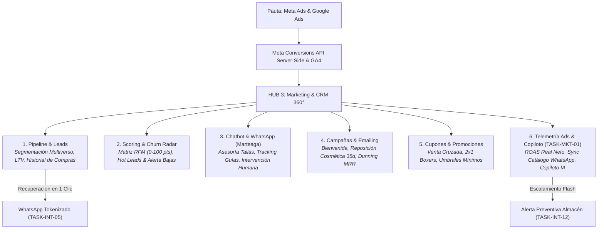

# Arquitectura y Hoja de Ruta: HUB 3 - Marketing & CRM 360°
> **Contexto de Plataforma:** Este documento corresponde al **Hub 3** de la arquitectura consolidada de 6 Hubs definida en [MASTER_ROADMAP.md](file:///c:/Users/Mickey/Documents/export/MASTER_ROADMAP.md).  
> Las tareas de desarrollo y puntos ciegos proceden del inventario maestro centralizado en [PENDING_TASKS.md](file:///c:/Users/Mickey/Documents/export/PENDING_TASKS.md).  
> Para especificaciones de modelos, migraciones, endpoints y servicios backend en Laravel, consultar [BACKEND_INTEGRATION_SPEC.md](file:///c:/Users/Mickey/Documents/export/BACKEND_INTEGRATION_SPEC.md).

Este documento define la arquitectura técnica, funcional y operativa del **Hub 3: Marketing & CRM 360°**. Establece el centro de mando comercial y de crecimiento omnicanal para el ecosistema multiverso (*Terra, Marte, Venus, Tiresias*), integrando pipeline de prospectos, motor de scoring RFM, visor de chatbot y WhatsApp, automatizaciones de emailing, gestor de cupones de venta cruzada y el dashboard de telemetría publicitaria con Copiloto de Crecimiento (**`TASK-MKT-01`**).

> [!NOTE]
> **Estándares Transversales de Interfaz Aplicados (Reglas Maestras):**
> - **Regla 10 (Jerarquía Estructural Inamovible):** En todas las vistas, primero se renderiza la barra unificada de pestañas de submódulos (`subnavBar`), inmediatamente debajo las tarjetas de métricas contextuales (`grid grid-cols-1 sm:grid-cols-2 lg:grid-cols-4 gap-4 mb-6`), y finalmente el área de trabajo y paneles operativos.
> - **Regla 8 (Tooltips de Sección con '?'):** Todo bloque, panel, métrica y tarjeta cuenta con un botón interactivo `.section-help-btn` que despliega el propósito funcional y reglas de cálculo sin saturar la pantalla.
> - **Regla 1 (Cero Emojis):** Iconografía 100% SVG vectorial estándar.
> - **Regla 5 (Cero Page-Heading Overhead):** El título del Hub y su estado activo residen en el Navbar superior; el contenido de la vista inicia de inmediato en el lienzo principal.
> - **Regla 12 (Blindaje Inamovible de Especificación Backend):** Toda funcionalidad, evento de dominio y flujo de datos debe contar con su esquema de tabla, modelo Eloquent y contrato RESTful formalmente blindados en [BACKEND_INTEGRATION_SPEC.md](file:///c:/Users/Mickey/Documents/export/BACKEND_INTEGRATION_SPEC.md).
> - **Regla 13 (Compatibilidad cPanel HostGator):** Ingesta de CAPI y sincronización con WhatsApp mediante jobs asíncronos y llamadas cURL outbound ligeras.

---

## 1. Visión Estratégica del Hub 3

El Hub 3 trasciende el CRM tradicional para convertirse en el **motor de adquisición, retención y monetización recurrente** de la plataforma. Coordina el viaje del cliente en un circuito cerrado de datos:

---

## 2. Estructura de los 6 Submódulos Unificados

### 2.1. Submódulo 1: Pipeline & Leads (Directorio CRM 360°)
* **Objetivo:** Registro unificado de clientes, compradores y prospectos con trazabilidad completa de su historial comercial e intereses.
* **Componentes Clave:**
  - **4 KPIs Contextuales:** Total Leads (1,248), Clientes Activos (842), Suscriptores Vigentes (184), LTV Promedio ($1,850 MXN).
  - **Tabla de Prospectos & Clientes:**
    - Identificación (Nombre, Teléfono WhatsApp, Email con máscara de privacidad).
    - Segmentación por Universo Comercial (*Terra Matriz, Marte Masculino, Venus Femenino, Tiresias No-Binario*).
    - Estado de Ciclo de Vida: *Prospecto*, *Carrito Abandonado*, *Comprador Recurrente*, *Suscriptor Activo*, *En Riesgo*.
    - Valor Histórico Acumulado (Customer Lifetime Value - LTV).
    - Botones de acción directa: Contactar WhatsApp y Ver Ficha 360°.
  - **Ficha 360° del Cliente (Modal a 2 Columnas):** Tallas textiles preferidas, tonos de cosmética guardados, historial de pedidos y notas internas de soporte.

### 2.2. Submódulo 2: Scoring de Leads & Churn Radar
* **Objetivo:** Identificar compradores con alta probabilidad de conversión inmediata (*Hot Leads*) y suscriptores con riesgo de cancelación (*Churn Risk*).
* **Componentes Clave:**
  - **4 KPIs Contextuales:** Hot Leads Listos (> 80 pts: 42), Temperatura Media (68 pts), Suscripciones en Riesgo Churn (6), Tasa de Reactivación (18.4%).
  - **Matriz Algorítmica RFM (Recencia, Frecuencia, Valor):**
    - Puntuación matemática de 0 a 100 calculada reactivamente.
    - Badges cromáticos: `.score-hot` (> 80 pts, verde esmeralda pulsante), `.score-warm` (50-79 pts, ámbar atención), `.score-cold` (< 50 pts, pizarra neutro).
  - **Acción en 1 Clic:** Botón *"Contactar Hot Lead por WhatsApp"* con plantilla tokenizada precargada.
  - **Radar de Churn para Suscripciones:** Detección predictiva de tarjetas próximas a expirar o 45 días sin interacción para activar campañas de retención.

### 2.3. Submódulo 3: Chatbot & WhatsApp Omnicanal (Marteaga Bot)
* **Objetivo:** Automatizar consultas frecuentes y permitir la intervención fluida de asesores humanos para cierre de ventas complejas.
* **Componentes Clave:**
  - **4 KPIs Contextuales:** Conversaciones Hoy (68), Resueltas Automáticas (82%), Escaladas a Humano (12), Tiempo Promedio Respuesta (1.2s).
  - **Visor Interactivo de Chats:**
    - Panel lateral de chats activos con tags de canal (*WhatsApp*, *Web Chat*, *Instagram DM*).
    - Ventana central de conversación en tiempo real estilo chat con burbujas de diálogo diferenciadas.
  - **Árbol de Respuestas Automatizadas:**
    - Asesor de Tallas: Guía reactiva para prendas textiles según medidas corporales.
    - Rastreador de Envíos: Consulta en vivo de estatus con APIs de transportistas (DHL / Estafeta).
    - Transferir a Agente Humano: Deriva la conversación a la bandeja de atención de Ana en Hub 1 (`TASK-DSH-01`).

### 2.4. Submódulo 4: Campañas & Emailing Automatizado
* **Objetivo:** Disparar flujos de mensajes programados ante eventos de comportamiento del usuario sin intervención manual.
* **Componentes Clave:**
  - **4 KPIs Contextuales:** Emails Enviados Hoy (1,450), Tasa de Apertura (38.2%), CTR (6.4%), Ingresos Atribuidos ($48,200 MXN).
  - **Flujos de Automatización Activos:**
    1. *Bienvenida Multiverso:* Doble opt-in, presentación de vitrinas y cupón `BIENVENIDA10`.
    2. *Recuperación de Carritos Abandonados:* Disparo a los 30 min y 24 hrs con token seguro (`TASK-INT-05`).
    3. *Reposición de Cosmética (Día 35):* Recordatorio automático para recompra de desodorantes, fragancias o jabones íntimos.
    4. *Aviso de Envío de Membresía:* Notificación previa al cobro del día 1 o 15 para actualización de preferencias.
  - Conmutadores en 1 clic para activar o pausar flujos.

### 2.5. Submódulo 5: Cupones & Promociones de Venta Cruzada
* **Objetivo:** Administrar incentivos comerciales estratégicos protegiendo el margen neto real.
* **Componentes Clave:**
  - **4 KPIs Contextuales:** Cupones Vigentes (6), Canjes Hoy (38), Descuento Total Otorgado ($4,850 MXN), Ventas Generadas ($38,900 MXN).
  - **Gestor CRUD de Cupones:**
    - Modal `openCreateCouponModal()` para alta de cupones con código, tipo de descuento (porcentaje, monto fijo, envío gratis, regalo), universo objetivo, compra mínima requerida y límite de usos.
    - Tabla de control con métricas de redención, vigencia y botón para pausar o revocar en 1 clic.

### 2.6. Submódulo 6: Telemetría Ads, Atribución CAPI & Copiloto (`TASK-MKT-01`)
* **Objetivo:** Monitorear la pauta publicitaria en Meta y Google Ads, auditar el ROAS neto real y optimizar campañas con IA.
* **Componentes Clave:**
  - **4 KPIs Contextuales:** Inversión Hoy ($3,400 MXN), ROAS Plataforma (4.2x), **ROAS Neto Real (3.1x - auditado con Finanzas)**, CPA Promedio ($54 MXN).
  - **Telemetría Meta CAPI & GA4:** Semáforo de salud de eventos del servidor (9.8/10 de calidad) para evitar pérdida de atribución por bloqueadores de cookies.
  - **Sincronización Automática con WhatsApp Business:**
    - Botón *"Forzar Sincronización de Catálogo WhatsApp"*: Sincroniza en tiempo real fotos WebP, tallas y stock disponible con Meta Commerce Catalog.
  - **Copiloto IA de Crecimiento (Growth Copilot):**
    - Recomendaciones accionables en 1 clic para escalar anuncios rentables (ROAS > 4x) o pausar creativos con fatiga.
    - Generador asistido por IA de variantes de copy publicitario para redes sociales.
  - **Conexión Inter-Hub `TASK-INT-12`:** Al escalar presupuesto publicitario de una venta flash, se emite una alerta preventiva automática a la mesa de empaque de Almacén en Hub 1.

---

## 3. Matriz de Pruebas y Criterios de Aceptación (Suite 36)

La implementación se valida formalmente mediante la **Suite 36**:
1. Inicialización formal de `marketingState` con todas sus colecciones (`leads`, `scoringRules`, `conversations`, `automations`, `coupons`, `adsMetrics`).
2. Renderizado reactivo de los 6 submódulos respetando la Regla 10 (Pestañas antes de KPIs).
3. Verificación de cálculo algorítmico de RFM scoring y badges cromáticos.
4. Operatividad del visor de chat Marteaga con envío y recepción de mensajes simulados.
5. Creación y validación de reglas de cupones de descuento.
6. Cálculo de ROAS Neto Real cruzado con deducción de pasarelas y fletes.
7. Ejecución atómica de recomendaciones del Copiloto IA de Crecimiento.
8. Validación de sincronización con Meta Commerce / WhatsApp Catalog.
9. Regla 1 (Cero Emojis) en la totalidad de la interfaz y textos de marketing.
10. Regla 8 (Tooltips de ayuda '?') en todas las secciones, paneles y métricas.

