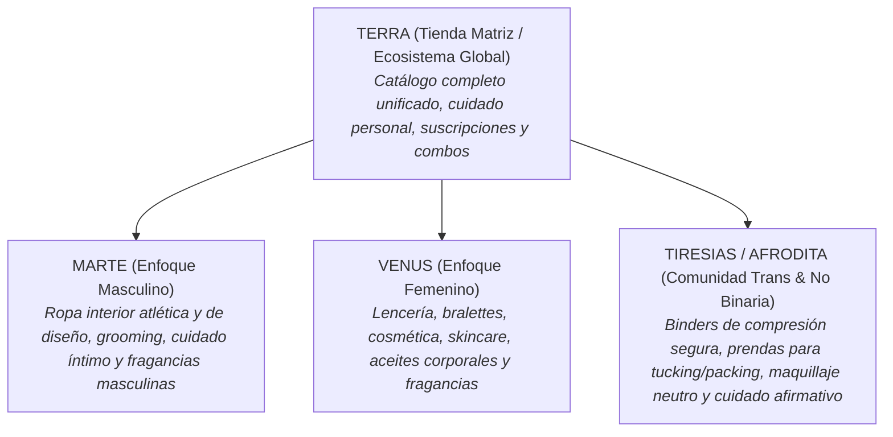
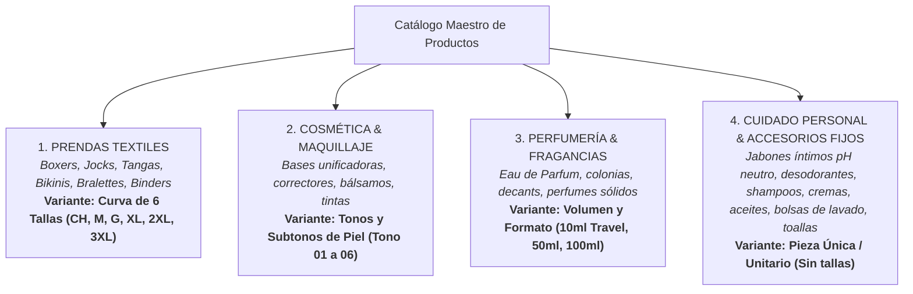
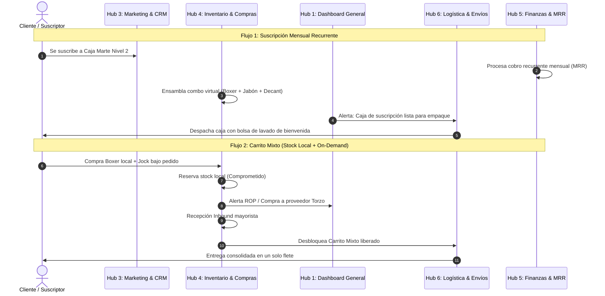
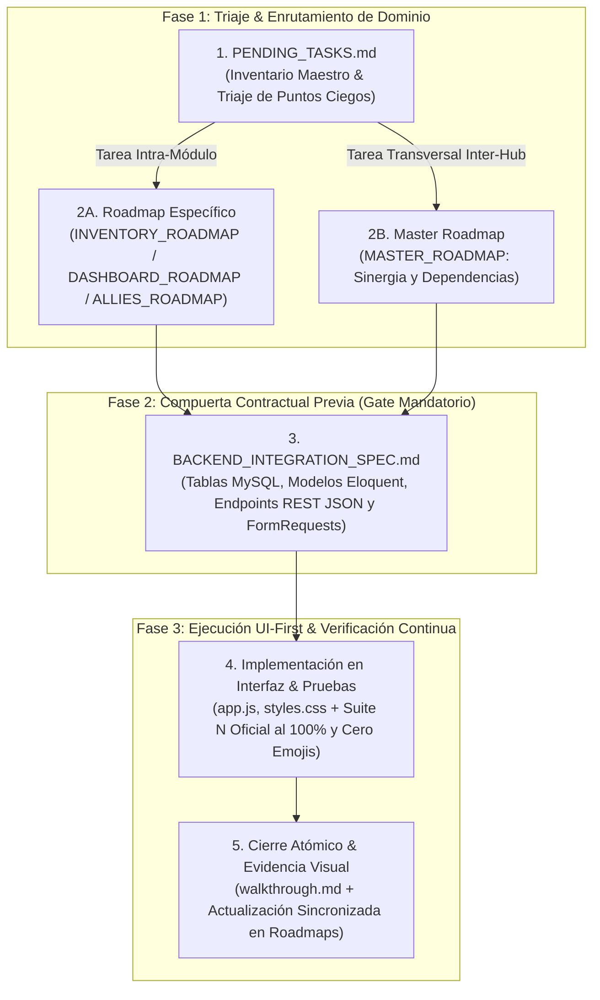

# Hoja de Ruta Maestra de la Plataforma RevOps (Master Roadmap v2.0)
## Arquitectura Consolidada de 7 Hubs Operativos
**Ecosistema:** Terra (Matriz) | Marte (Masculino) | Venus (Femenino) | Tiresias / Afrodita (Trans & No Binario)  
**Modelo Comercial:** Venta Directa D2C + Suscripciones Mensuales Recurrentes (MRR) + Catálogo Híbrido (Stock Propio + On-Demand)

Este documento establece la visión técnica, de producto y operativa para la consolidación de toda la plataforma administrativa de **Mi Tienda Online**. Reestructura los módulos originales en **7 Hubs Operativos Estratégicos**, optimizando el flujo de trabajo diario y eliminando la dispersión cognitiva.

> [!IMPORTANT]
> ### Reglas Transversales de Diseño y UI para Toda la Plataforma:
> 1. **Cero Emoticones (Zero Emojis):** Queda estrictamente prohibido el uso de emoticones o caracteres emoji en la interfaz. Toda la iconografía se construye exclusivamente mediante **iconos SVG vectoriales** limpios.
> 2. **Tablas con Drawer a Pantalla Completa:** Las tablas que cuentan con paneles laterales o drawers asociados, así como los drawers que contienen tablas de datos (Top 10, Kardex, etc.), deben abarcar **todo el ancho de la pantalla** (`w-full`, `w-screen max-w-full`) para maximizar la legibilidad y densidad informativa.
> 3. **Navbar con Títulos de Hub, Notificaciones y Chat:** El Navbar aloja a la izquierda el identificador y título del Hub activo (`[data-hub-kicker]`, `[data-hub-title]`). A la derecha, incorpora la **campanita de notificaciones** operativas y el **chat desplegable inter-áreas** para la comunicación fluida entre almacén, compras, ventas y finanzas.
> 4. **Sidebar con 6 Hubs, Roles y Ajustes:** La barra lateral consolida los 6 Hubs Operativos. En su extremo inferior (footer) se ubican el **avatar de usuario / selector de roles** y el **icono de engranaje de Ajustes del Sistema** (configuración global de multiverso, APIs y parámetros).
> 5. **Alineación Navbar & Cero Cabeceras Redundantes (Zero Page-Heading Overhead en Todos los Módulos):** Los identificadores de Hub (`[data-hub-kicker]`), títulos (`[data-hub-title]`) y píldoras de estado (`[data-hub-status]`) residen exclusivamente en la barra superior (Navbar). Queda estrictamente prohibido renderizar bloques `.page-heading` en el área de contenido (`<main>`) en cualquiera de los 6 Hubs. El contenido de cada módulo arranca de inmediato en la parte superior (KPIs, pestañas y tablas), maximizando la altura vertical útil y eliminando redundancia visual.
> 6. **Paginación en Tablas mediante "Cargar más" (Incremental Append):** Toda tabla de datos que maneje listas extensas (Catálogo Operativo, Kardex, Órdenes de Compra, Leads, Conciliación) prescinde de paginación numérica tradicional (`1, 2, 3...`) y de scroll infinito descontrolado. La navegación opera mediante un botón explícito llamado **"Cargar más"** que anexa acumulativamente el siguiente lote de registros al final de la tabla, preservando la posición del scroll y las casillas de selección masiva, acompañado de un indicador de avance (*"Mostrando X de Y registros"*).
> 7. **Filtros por Columna en Tablas (Column-Level Filtering):** Cada columna de las tablas de datos incorpora controles de filtrado específicos (búsqueda textual por SKU/Producto, selectores de rango de stock, umbrales de PVP/Costo y filtros de estado). Operan de forma acumulativa y cuentan con un botón para limpiar todos los filtros de columna en 1 clic.
> 8. **Tooltips Contextuales con Icono de Interrogación ('?') en Cada Sección (Section Help Tooltips):** Toda sección, panel, tarjeta de métricas o bloque operativo de la plataforma debe contar obligatoriamente con un botón de ayuda con signo de interrogación (`?`) en su cabecera (`.section-help-btn`). Al posicionar el cursor encima (hover) o pulsar sobre él (clic o tap en móvil), despliega un tooltip contextual interactivo (`[data-section-tooltip]`) con el propósito funcional de la sección, lógica de cálculo, atajos o reglas de negocio asociadas, facilitando la inducción y reduciendo errores operativos sin saturar la pantalla.
> 9. **Tokens de Diseño y Minimalismo Industrial SaaS (Design System RevOps):** La plataforma unifica todos sus componentes bajo una arquitectura visual limpia:
>    - **Curvatura (Corner Radius):** `4px` para badges, pills y botón de ayuda `?`; `6px` para botones `.button`/`.btn`, inputs y tarjetas de acción; `8px` para paneles `.panel`/`.card` y tablas; `12px` exclusivamente para modales flotantes y drawers deslizables. Se prohíben curvaturas informales mayores a 12px (`rounded-2xl`) y bordes completamente afilados (`0px`).
>    - **Jerarquía de Botones:** Primario (`#09090b` / texto blanco), Secundario/Light (`#ffffff` / borde `#d4d4d8`), Acento Operativo (`#eef2ff` / texto `#4338ca`) y Peligro/Alerta (`#fee2e2` / texto `#991b1b`), con altura mínima estándar de `34px` (`28px` en tablas).
>    - **Paleta de Superficie:** Lienzo `#fafafa`, tarjetas `#ffffff` con borde `1px solid #e4e4e7` y sombra suave funcional.
> 10. **Jerarquía Estructural Inamovible: Pestañas de Submódulos Primero, KPIs Específicos Debajo (Submodule Tabs Before KPIs):** Toda vista de módulo en la plataforma sigue obligatoriamente un orden de apilamiento vertical estricto e inalterable, tomando como estándar de oro la estructura de Inventario:
>    - **1° Nivel Superior:** Barra unificada de navegación de submódulos (`subnavBar` / pestañas de navegación interna de Alpine o dataset) con alineación a la izquierda y controles de estado/actualización a la derecha (`mb-6 border-b border-slate-200`).
>    - **2° Nivel Inmediato:** Tarjetas de métricas y KPIs contextuales correspondientes a la vista o submódulo activo (`grid grid-cols-1 sm:grid-cols-2 lg:grid-cols-4 gap-4 mb-6`).
>    - **3° Nivel Inferior:** Área de trabajo principal, paneles operativos, filtros, embudos analíticos, tablas de datos y bitácoras.
>    Queda terminantemente prohibido renderizar tarjetas de KPIs por encima de las pestañas de navegación de submódulos en cualquier pantalla del sistema.
> 11. **Metodología de Trabajo en Ciclos Iterativos Continuos (Secuencia Óptima & Cadencia de Desarrollo):** El avance de la plataforma se rige por un bucle iterativo cerrado e inquebrantable de 4 etapas optimizadas:
>    - **Etapa 1 (Triaje & Enrutamiento de Dominio):** Evaluación conjunta de puntos ciegos en `PENDING_TASKS.md`. Si la tarea es intra-módulo, se enruta a su roadmap específico (`INVENTORY_ROADMAP.md` o `DASHBOARD_ROADMAP.md`); si es transversal inter-hub (conectividad, trazabilidad Kardex, suscripciones MRR), se enruta directamente a `MASTER_ROADMAP.md`.
>    - **Etapa 2 (Compuerta Contractual Previa - Regla 12):** Congelamiento formal del contrato de datos en `BACKEND_INTEGRATION_SPEC.md` (migraciones MySQL, modelos Eloquent, FormRequests y endpoints RESTful JSON) antes de escribir código de interfaz.
>    - **Etapa 3 (Desarrollo UI-First y Verificación):** Implementación interactiva en interfaz (`app.js`, `styles.css`), ergonomía de usuario y ejecución de la suite de pruebas unitarias/regresión con 100% de éxito y cero emojis.
>    - **Etapa 4 (Cierre Atómico y Sincronización de Evidencias):** Documentación del walkthrough con capturas visuales, actualización simultánea de estatus en roadmaps y reinicio del ciclo.
> 12. **Blindaje Inamovible de Especificación Backend (Mandatory Pre-Implementation Contractual Gate):** Ninguna tarea pasa a desarrollo de interfaz ni se da por completada sin que su contrato técnico completo (migración de tablas en base de datos, modelo Eloquent con scopes/casts, endpoints RESTful con esquemas exactos de petición y respuesta JSON, y registro en el checklist de Laravel) quede **100% formalizado e integrado de antemano en [BACKEND_INTEGRATION_SPEC.md](file:///c:/Users/Mickey/Documents/export/BACKEND_INTEGRATION_SPEC.md)**. Este blindaje garantiza la paridad absoluta entre persistencia, API y experiencia de usuario.
> 13. **Arquitectura Inamovible para Hosting Compartido (HostGator cPanel Inicial) & Desacoplamiento de Carga:** La versión inicial de la plataforma se despliega sobre un plan compartido de HostGator (cPanel / CloudLinux) con límites estrictos de 1 GB RAM, 1 vCPU y sin demonios persistentes. Toda la arquitectura se adapta a estas restricciones sin perder robustez:
>    - **Scraping Multi-Proveedor Desacoplado (Opción A):** El scraping de Torzo y futuros proveedores textiles/cosméticos se ejecuta exclusivamente en la computadora del operador (CLI Node.js/Puppeteer) y envía lotes procesados a través del endpoint seguro `POST /api/v1/scraper/ingest`, protegiendo la RAM del servidor.
>    - **Colas Ligeras sin Demonios:** Configuración `QUEUE_CONNECTION=database` y ejecución mediante Cron cPanel cada minuto con flag `--stop-when-empty --max-time=50` para procesar tareas y apagarse limpiamente.
>    - **Caché y Bloqueo de Stock en MySQL con Urgencia de Compra:** Manejo de sesiones y reservas temporales de carrito (`stock_locks` con TTL de 5 minutos / 300s para inducir presión a la compra) en tablas MySQL indexadas, prescindiendo de servidores Redis en memoria.
>    - **Copiloto IA Outbound:** Llamadas externas cURL hacia Gemini/OpenAI sin procesamiento local.
> 14. **Estandarización Absoluta de Imágenes en Formato WebP y SEO (WebP-Only Standard):** Queda terminantemente prohibido almacenar o servir imágenes en formatos pesados no optimizados (PNG sin compresión, BMP o JPG tradicionales). Toda fotografía de producto, banner de vitrina o imagen de scraping se convierte y almacena obligatoriamente en formato **`.webp`** con compresión de calidad 82-85%, resolución máxima de `1000px` y peso estrictamente **menor a 100 KB**. Esta norma reduce en un 70% el consumo de Inodes y espacio en HostGator y garantiza puntuaciones óptimas en Google Core Web Vitals (LCP &lt; 1.8s) para el posicionamiento orgánico en motores de búsqueda.
> 15. **Regla Universal de Ajustes como Pantalla Completa (Cero Modales ni Drawers para Configuración):** Toda interfaz de ajustes y configuración del sistema (tanto los Ajustes del Sistema globales accesibles desde el footer del sidebar como los Ajustes del Módulo específicos accesibles desde el engranaje del navbar) debe renderizarse **estrictamente a pantalla completa dentro del contenedor principal (`<main id="mainContent">`)**, quedando terminantemente prohibido el uso de modales flotantes o drawers laterales para paneles de ajustes. Toda pantalla de ajustes debe incorporar una cabecera con botón de retorno al módulo operativo anterior (`Volver al Módulo Operativo` / `Volver al Catálogo Operativo`), navegación clara por pestañas y área de trabajo despejada.

---

## 1. Visión Estratégica: De 15 Módulos Dispersos a 6 Centros de Mando

```mermaid
graph TD
    subgraph Menú Anterior (15 Ítems)
        M1[Dashboard]
        M2[Tienda]
        M3[Leads]
        M4[CRM]
        M5[Scoring]
        M6[Inventario]
        M7[Finanzas]
        M8[Proveedores]
        M9[Chatbot]
        M10[Atribución]
        M11[Emailing]
        M12[Cupones]
        M13[Conciliación]
        M14[Logística]
        M15[Garantías]
    end

    subgraph Plataforma Consolidada (7 Hubs Operativos)
        H1["1. DASHBOARD GENERAL<br><i>Centro de Mando Diario (Action Center)</i>"]
        H2["2. TIENDA & CMS<br><i>Diseño Visual, Banners y Vitrinas Multiverso</i>"]
        H3["3. MARKETING & CRM<br><i>Leads, CRM, Scoring, Chatbot, Atribución, Emailing, Cupones</i>"]
        H4["4. INVENTARIO & CADENA DE SUMINISTRO<br><i>Catálogo Multivariante, Proveedores, Compras y Kardex</i>"]
        H5["5. FINANZAS & CONCILIACIÓN<br><i>Flujo de Caja, MRR de Suscripciones, Pasarelas y Márgenes</i>"]
        H6["6. LOGÍSTICA & POST-VENTA<br><i>Fulfillment Outbound, Cajas de Suscripción y Garantías/RMA</i>"]
        H7["7. CONVENIOS & ALIADOS<br><i>Alianzas de Nicho, Atribución Bidireccional y Portal de Aliados</i>"]
    end

    M1 --> H1
    M2 --> H2
    M3 & M4 & M5 & M9 & M10 & M11 & M12 --> H3
    M6 & M8 --> H4
    M7 & M13 --> H5
    M14 & M15 --> H6
```

---

## 2. Arquitectura de Marca y Universos Comerciales

La plataforma opera bajo una estructura de **Vitrinas Curadas Segmentadas por Género e Identidad**, sustentada en una **única base de datos e inventario centralizado (Single Inventory Pool)**:



### Principios Operativos del Multiverso Terra:
1. **Inventario Centralizado y Descuento Atómico:**
   - Un jabón íntimo neutro o un perfume unisex existe como un solo registro de stock en el almacén central. Si se vende desde la vitrina *Marte*, se descuenta en tiempo real del saldo disponible que ven los usuarios en *Venus*, *Tiresias* o *Terra*.
2. **Tagging Multidimensional de Catálogo (`universos`):**
   - Cada producto en el catálogo posee un atributo de pertenencia: `universos: ['marte', 'terra_unisex']`, `universos: ['tiresias', 'terra_unisex']`, `universos: ['venus']` o `universos: ['marte', 'venus', 'tiresias']`.
3. **Interruptor Dinámico en Tienda Pública (Frontend Switcher):**
   - El cliente alterna fluidamente entre vitrinas con un selector visual en cabecera. La tienda adapta su paleta cromática, banners editoriales y taxonomía de productos de forma reactiva.

---

## 3. Expansión de Catálogo: Dimensiones de Variantes & Tipos de Producto

El catálogo trasciende la ropa interior tradicional para convertirse en un ecosistema de estilo de vida, salud íntima y bienestar personal.

### 3.1. Las Cuatro Dimensiones de Producto


### 3.2. Sinergias de Venta Cruzada (Cross-Selling & Order Bumps)
* **Bolsas de Lavado de Malla Protectora:** Accesorio unitario de ticket accesible ($99 - $140 MXN) que protege las telas delicadas (modal, bambú, microfibra velvet y elásticos de jocks) del maltrato de la lavadora. Funciona como *Order Bump* en checkout o regalo por compras superiores a un umbral.
* **Toallas Deportivas y Compactas:** Toallas de microfibra de secado rápido con identidad visual de *Terra*, *Marte* o *Venus*, ideales para gimnasio, natación y viajes.
* **Higiene Íntima & Grooming:** Jabones íntimos en barra o líquidos pH neutro, desodorantes naturales y aceites de rasurado que generan alta rotación y recompra cada 30-45 días.

### 3.3. Estrategia de Fabricación y Abastecimiento (Ruta Lean)
1. **Fase 1 (Validación y Lanzamiento Rápido):**
   - Comercialización a través de **marcas asociadas y distribuidores mayoristas**.
   - Cero costos de I+D, sin demoras regulatorias sanitarias y con bajo capital inmovilizado.
   - Permite auditar qué aromas, fórmulas y productos presentan mayor velocidad de rotación.
2. **Fase 2 (Maquila de Marca Propia - Terra Labs):**
   - Al detectar SKUs con demanda sostenida y recurrente, se encarga la formulación a laboratorios maquiladores bajo marca propia *Terra*.
   - El margen comercial salta del **40%-55% (distribuidor)** a más del **75%-85% (marca privada)**.

---

## 4. Motor de Suscripciones Mensuales Recurrentes (MRR & Bundling)

Las suscripciones mensuales proporcionan estabilidad financiera y flujo de caja recurrente y predecible (MRR - Monthly Recurring Revenue).

### 4.1. Niveles de Membresía Sugeridos

| Nivel | Membresía | Contenido de la Caja Mensual | Enfoque de Experiencia |
| :---: | :--- | :--- | :--- |
| **Nivel 1** | **Esencial / Refill** | 1 prenda básica al mes + 1 producto de reposición (jabón íntimo o shampoo sólido). | Uso diario y reposición garantizada. |
| **Nivel 2** | **Estilo & Cuidado** | 2 prendas de temporada (colores/diseños exclusivos) + producto de cuidado personal + muestra/decant de perfume del mes. | Descubrimiento y valor percibido. |
| **Nivel 3** | **VIP Box / Curada** | Caja premium completa: conjunto textil de alta gama + fragancia completa o producto cosmético + rutina de autocuidado + regalo sorpresa. | Experiencia de unboxing y coleccionismo. |
| *Regalo de Bienvenida* | *En todos los niveles* | **1 Bolsa de Lavado para Ropa Delicada Terra** en el primer mes de suscripción. | Protección de prendas y fidelización. |

### 4.2. Impacto de las Suscripciones en la Cadena de Suministro (Hub 4)
* **Demanda 100% Predecible:** A diferencia de la venta minorista abierta, en la suscripción se conocen de antemano las tallas, preferencias y tonos de piel de los suscriptores.
* **Compras Just-in-Time sin Stock Ocioso:** El generador de órdenes del Hub 4 calcula exactamente los lotes mayoristas necesarios con 15 días de anticipación al cobro mensual.
* **Kits y Recetas Virtuales (Bill of Materials - BOM):** Las cajas de suscripción se administran como combos virtuales: al despachar una *"Caja Nivel 2"*, el sistema descuenta automáticamente los componentes individuales de su respectivo stock físico.

---

## 5. Especificación Detallada de los 6 Hubs Operativos

### HUB 1: Dashboard General (Centro de Mando Diario / Action Center)
> **Especificación Detallada:** Consultar [DASHBOARD_ROADMAP.md](file:///c:/Users/Mickey/Documents/export/DASHBOARD_ROADMAP.md) para el desglose técnico, estados y flujos de acción.
* **Objetivo:** Cabina de control operativo y analítico adaptativo según el perfil del usuario. Canaliza las prioridades del día sin dispersión cognitiva e interviene en 1 solo clic.
* **Segregación de Vistas por Rol (Triple RBAC):**
  - **Vista Operativa (Empleados / Almacén / Logística):**
    * Enfoque 100% en flujo de trabajo físico y ejecución inmediata.
    * **Ocultamiento Total de Finanzas:** Cero métricas monetarias (sin ventas en $, ticket promedio, márgenes ni MRR) ni embudos comerciales.
    * **KPIs Físicos Operativos:** Pedidos listos para empaque, Carritos Mixtos liberados, recepciones de proveedor y quiebres de stock físicos.
    * **Bandeja de Acciones Críticas:** Prioridades de surtido, empaque y recepción con botones de acción directa en 1 clic y modales guiados con checklist.
    * **Rutas de Pasillo (`TASK-INV-01`):** Checklists de empaque ordenadas por ubicación física (`Pasillo - Rack - Gaveta`).
    * **SLA y Aging de Pedidos (`TASK-DSH-05`):** Semáforo visual de horas transcurridas para garantizar la recolección DHL de las 14:00 hrs.
  - **Vista Intermedia de Atención a Clientes & Ventas (`TASK-DSH-01`):**
    * Enfoque en conversión, soporte y desbloqueo de pedidos con incidencias.
    * **KPIs Comerciales de Soporte:** Leads calientes sin responder, carritos abandonados de hoy, pedidos detenidos por dirección dudosa y cupones canjeados.
    * **Acción en 1 Clic:** Recuperación de carritos abandonados vía WhatsApp con enlace tokenizado prellenado (`TASK-INT-05`) y validador predictivo de domicilios (`TASK-DSH-06`).
  - **Vista Ejecutiva (Super Admin / Dirección / RevOps):**
    * Acceso total a métricas de negocio: Facturación del día, MRR de suscripciones, margen neto real por categoría y capital comprometido.
    * **Embudo Comercial Multiverso Accionable (`TASK-DSH-02`):** Selector de vitrinas (*Consolidado, Terra, Marte, Venus, Tiresias*) con botones de intervención directa en las barras de caída.
    * **Monitor de Salud del Ecosistema & Telemetría de APIs (`TASK-DSH-03` - Completada UI):** Panel de telemetría en tiempo real de Stripe, Mercado Pago, Torzo Scraper, DHL Express y Sepomex con botón de diagnóstico global en vivo, modales de inspección y registro de webhooks.
    * **Cabina Ejecutiva con Gráficas Analíticas y Copiloto IA Adaptativo por Rol (`TASK-DSH-07` - Completada UI):** Gráficas interactivas SVG nativas (Facturación vs MRR, Vitrinas y Cascada EBITDA), Copiloto IA con aislamiento de privacidad por rol (cero finanzas en almacén) y drawer interactivo de chat estratégico.
    * Alertas ejecutivas con saltos en 1 clic y prefiltrado automático hacia Inventario (`TASK-INT-01`).

---

### HUB 2: Tienda & CMS (Diseño Visual y Vitrinas Multiverso)
* **Objetivo:** Control visual y editorial de la tienda online sin tocar código.
* **Sub-módulos y Pestañas:**
  - **Editor Visual Multiverso:** Personalización de vitrinas independientes para *Terra*, *Marte*, *Venus* y *Tiresias/Afrodita*.
  - **Gestor de Banners y Secciones:** Carruseles de temporada, colecciones temáticas y módulos de suscripción mensual.
  - **Páginas Institucionales:** Políticas de envío, guía de tallas textiles, cuidado de prendas y centro de ayuda.

---

### HUB 3: Marketing & CRM 360° (Crecimiento, Conversión y Fidelización)
> **Especificación Detallada:** Consultar [MARKETING_ROADMAP.md](file:///c:/Users/Mickey/Documents/export/MARKETING_ROADMAP.md) para el desglose de los 6 submódulos, contratos RESTful y flujos omnicanal.
* **Objetivo:** Unificar todos los puntos de contacto con el prospecto y el suscriptor en un centro de mando comercial integral para el ecosistema multiverso (*Terra, Marte, Venus, Tiresias*).
* **Estructura Interna Consolidada (100% Desarrollada en UI y Verificada por Suite 36):**
  - **Pestaña 1: Pipeline & Leads (Directorio CRM 360°):** Directorio unificado con segmentación multiverso, ciclo de vida (prospecto, abandonado, cliente, suscriptor, churn), LTV acumulado, scoring y ficha 360° en modal con tallas y preferencias.
  - **Pestaña 2: Scoring de Leads & Churn Radar:** Algoritmo RFM (0-100 pts) reactivo, identificación de Hot Leads listos para contacto por WhatsApp y radar de churn para membresías en riesgo.
  - **Pestaña 3: Chatbot Marteaga & WhatsApp Omnicanal:** Visor interactivo de chats con árboles automatizados de asesoría de tallas y tracking de guías, con escalamiento fluido a asesor humano.
  - **Pestaña 4: Campañas & Emailing Automatizado:** Flujos por eventos (bienvenida, carrito abandonado, reposición cosmética en día 35 y avisos de renovación de suscripción) montados sobre la cola de base de datos de cPanel.
  - **Pestaña 5: Cupones & Promociones de Venta Cruzada:** Gestor de reglas comerciales (porcentaje, envío gratis, regalo) con límites de uso, vitrina aplicable y modal de alta.
  - **Pestaña 6: Telemetría Ads, Atribución CAPI & Copiloto IA (`TASK-MKT-01`):** Monitoreo de pauta publicitaria en vivo con contraste de ROAS Plataforma (4.2x) vs **ROAS Neto Real (3.1x)**, salud de eventos Meta CAPI (9.8/10), botón de forzar sincronización con catálogo WhatsApp y recomendaciones del Copiloto IA (escalar presupuesto +20% con alerta preventiva `TASK-INT-12` a Almacén, pausar creativos con fatiga y generador de copies persuasivos con IA).
  - **Especificación Contractual Backend:** Formalizado en Secciones 3.28, 4.22, 5.13, 6.1, 6.3 Subsección Z y Paso 29 en [BACKEND_INTEGRATION_SPEC.md](file:///c:/Users/Mickey/Documents/export/BACKEND_INTEGRATION_SPEC.md).
  - **Validación Automatizada:** Suite 36 (`test_marketing_hub_3.js`) con 16/16 pruebas superadas al 100% y 0 regresiones.

---

### HUB 4: Inventario & Cadena de Suministro (Supply Chain & RevOps)
> **Especificación Detallada:** Consultar [INVENTORY_ROADMAP.md](file:///c:/Users/Mickey/Documents/export/INVENTORY_ROADMAP.md) para el desglose de los 3 carritos, matriz de tallas y backlog técnico.
* **Objetivo:** Control físico y remoto de mercancía multivariante, compras a proveedores y prevención predictiva de quiebres.
* **Estructura Interna Consolidada (100% Desarrollada y Verificada):**
  - **Pestaña 1: Dashboard de Inventario:** Selector temporal interactivo (`Hoy`, `7D`, `30D`, `Año`, `Histórico`), KPIs ejecutivos y Diagnóstico ABC de Pareto (80/20) con saltos reactivos al catálogo.
  - **Pestaña 2: Catálogo Operativo a Pantalla Completa:** Soporte para prendas con curva de 6 tallas (`CH` a `3XL`), productos unitarios sin talla (cuidado personal, accesorios) y matrices multidimensionales para cosmética/tonos y perfumería/volumen (`TASK-INV-02`). Motor de stock de 3 estados (*Físico, Comprometido, Disponible*), cálculo predictivo de **DOH / ROP**, edición rápida en línea de PVP/Costo con cálculo de margen %, barra flotante de acciones masivas y exportación a Microsoft Excel nativo.
  - **Pestaña 3: Proveedores & Scraping:** Directorio de mayoristas y Centro de Alertas en vivo de **Torzo Bot** (scraping headless) con resoluciones automáticas en 1 clic.
  - **Pestaña 4: Compras & Reabastecimiento:** Sub-vista para *Órdenes de Compra Planificadas* con generador estructurado para WhatsApp, sub-vista para *Bandeja On-Demand de Clientes* (Carritos Mixtos), gestor de combos/recetas BOM de suscripción (`TASK-INV-03`) y motor de cálculo de déficit con disparo automático de OCs a Extranet B2B (`TASK-INT-11` - **Completada UI**).
  - **Kardex de Movimientos:** Libro mayor inmutable de auditoría contable a pantalla completa con soporte para trazabilidad de lotes sanitarios y caducidades (`TASK-INV-06`).
  - **Valuación Contable CPP vs Último Costo (`TASK-INV-04`):** Costo Promedio Ponderado en catálogo, sub-badge contable, calculadora dual de márgenes y recálculo automático en recepciones Inbound.
  - **Generación e Impresión de Etiquetas Térmicas en 1 Clic (`TASK-INV-05`):** Formatos 50x30 y 100x50mm con generador SVG determinista Code128 / QR y estilos para impresoras térmicas.
  - **Control Sanitario: Lotes y Fechas de Caducidad / PAO (`TASK-INV-06`):** Semaforización reactiva de caducidad (&le;30d, 31-90d, >90d), trazabilidad de lotes y captura obligatoria en Inbound.
  - **Carga Multi-Imagen en Alta de Producto (Hasta 10 Imágenes):** Drawer interactivo con portada `is_primary` y compresión automática.
  - **Gestión Integral de Prendas Textiles, Curaduría de Scraping y Ajustes (`TASK-INV-08`):**
    * Catálogo reactivo de tipos de tela (`apparelFabrics`) con registro al vuelo de nuevas fibras.
    * Paleta de colores sólidos y tornasoles holográficos (`apparelColors`) con degradados CSS multi-tono y creador de paletas.
    * Variante de diseño textil de doble estado: *Sin Diseño (Liso / Sólido)* vs *Con Diseño (Estampado / Pattern)*.
    * Atributo de marca / proveedor (`brand`) y captura/validación de descripción del producto.
    * Reflejo visual de descuentos promocionales activos (precio de lista tachado, badge `-X%` y PVP neto en verde).
    * Switch de publicación en tienda online en 1 clic desde la tabla de datos y drawer (*En Sitio* vs *Oculto*), con filtro por vitrina web.
    * Asignación a secciones del sitio web (*Línea Básicos, Diseñador & Autor, Colección Temporada, Catálogo General*).
    * Bandeja de Curaduría Previa de Scraping en Tab 3 (Proveedores) con modal de validación humana antes de ingresar al catálogo.
    * Drawer lateral espacioso rediseñado a `max-w-4xl` en 2 columnas ergonómicas.
    * Botón de engrane en Navbar y botón en Sección 3 para abrir el **Modal de Ajustes y Configuración de Inventario** (5 pestañas).
  - **Especificación de Integración Backend:** Documentado exhaustivamente en [BACKEND_INTEGRATION_SPEC.md](file:///c:/Users/Mickey/Documents/export/BACKEND_INTEGRATION_SPEC.md).

---

### HUB 5: Finanzas & Conciliación
> **Especificación Detallada:** Consultar [FINANCE_ROADMAP.md](file:///c:/Users/Mickey/Documents/export/FINANCE_ROADMAP.md) para el desglose de cascada P&L, lotes de liquidación bancaria, dunning y absorción unitaria.
* **Objetivo:** Control del flujo de caja, balance operativo en vivo, absorción de margen neto real por pedido, conciliación bancaria de pasarelas y gestión del MRR de suscripciones multiverso con motor de dunning.
* **Estructura Interna Consolidada (100% Desarrollada y Verificada):**
  - **Pestaña 1: Flujo de Caja & P&L en Vivo:** Cascada analítica de absorción de ingresos brutos a EBITDA/Utilidad Neta (Ingresos Brutos $348,500 MXN, Deducción COGS, Pasarelas, Envíos, Empaques, OPEX fijo y Utilidad Neta $121,560 MXN / 34.88%), con 4 KPIs contextuales (Ingresos del Mes, Margen Neto Promedio, Runway Financiero y Egresos Operativos).
  - **Pestaña 2: Conciliación de Pasarelas & SPEI:** Cruce atómico de lotes de liquidación bancaria (*Stripe MX, Mercado Pago, SPEI BBVA*) contra cobros en tienda, desglose de comisiones e IVA retenido, balance pendiente de dispersión ($14,280 MXN) y botón de conciliación en 1 clic.
  - **Pestaña 3: Suscripciones MRR & Motor de Dunning (`TASK-SUB-DUN`):** Monitor de ingresos recurrentes ($112,400 MXN MRR), cohortes de membresías (*Caja Nivel 1 Básicos, Nivel 2 Cuidado & Textil, VIP Multiverso*), motor de dunning reactivo con reintento escalonado (Día 1, Día 3, Día 5) y emisión en 1 clic de enlaces seguros tokenizados para actualización de tarjeta vía WhatsApp.
  - **Pestaña 4: Margen Neto Real por Pedido (`TASK-FIN-01`):** Auditoría unitaria por pedido deduciendo PVP Cobrado menos COGS físico (Kardex), comisión Stripe MX (3.6% + $3.00 MXN + IVA), insumo de empaque (`package_types`) y flete courier (DHL / Skydropx). Caso de éxito `#MIX-1048`: $1,420.00 MXN cobrados $\rightarrow$ $735.88 MXN de margen neto real limpio (51.82%).
  - **Pestaña 5: Egresos & Cuentas por Pagar:** Programación de liquidaciones a proveedores textiles (*Torzo Labs, Talleres Aliados*) e insumos cosméticos/empaque, con botón de dispersión SPEI en 1 clic.
  - **Especificación Contractual Backend:** Formalizado en Secciones 3.29, 4.23, 5.14, 6.1, 6.3 Subsección AA y Paso 30 en [BACKEND_INTEGRATION_SPEC.md](file:///c:/Users/Mickey/Documents/export/BACKEND_INTEGRATION_SPEC.md).
  - **Validación Automatizada:** Suite 37 (`test_finance_hub_5.js`) con 13/13 pruebas superadas al 100% y 0 regresiones.

---

### HUB 6: Logística & Post-Venta (Fulfillment Outbound & RMA)
> **Especificación Detallada:** Consultar [LOGISTICS_ROADMAP.md](file:///c:/Users/Mickey/Documents/export/LOGISTICS_ROADMAP.md) para el desglose operativo, flujos de transportistas, manifiestos y ciclo de garantías RMA.
* **Objetivo:** Control operativo de expedición, impresión térmica industrial, torre de control con telemetría de couriers, gestión post-venta RMA con criterio sanitario inquebrantable y protocolos de empaque seguro.
* **Estructura Interna Consolidada (100% Desarrollada y Verificada por Suite 38):**
  - **Pestaña 1: Expedición & Despacho (`TASK-LOG-01`, `TASK-LOG-02`, `TASK-LOG-02B`, `TASK-INT-14`, `TASK-UX-02`):**
    * Cola de pedidos listos, cajas de suscripción y Carritos Mixtos liberados.
    * Generador de guías térmicas industriales 100x150mm en formato SVG vectorial nativo con aislamiento `@media print` (`@page { size: 100mm 150mm; margin: 0; }`).
    * Remitente corporativo neutro legal (*Operadora Logística Urbana S.A. de C.V.*, CP 08100, RFC OLU210408TM2) y descripción aduanal genérica (*Prendas de Confección Textil / Accesorios de Moda*) para máxima discreción y privacidad.
    * Modal de guía individual y modal de impresión térmica masiva por lotes de transportista (DHL, Estafeta, FedEx, 99 Minutos).
    * Manifiestos de entrega con transportistas y Escudo Antifraude Stripe Radar (`TASK-INT-14`).
  - **Pestaña 2: Torre de Control & Rastreo en Vivo (`TASK-LOG-03`):**
    * Panel de telemetría de couriers con 4 KPIs contextuales con botones de ayuda `?` (Regla 8 y 10).
    * Buscador reactivo por guía/cliente/destino y filtros por transportista y estatus.
    * Sincronización en vivo con APIs de transportistas (`syncLiveCourierTracking`, `syncAllCourierTelemetry`).
    * Modal de inspección profunda de guía con timeline cronológico de checkpoints y firma de entrega.
  - **Pestaña 3: Portal Post-Venta & Devoluciones RMA (`TASK-LOG-04`, `TASK-LOG-04B`, `TASK-INT-09`):**
    * Banner normativo de política sanitaria conforme a lineamientos PROFECO / NOM.
    * Clasificación sanitaria dual: *Prenda Íntima / Cosmética* (no retornable si el precinto ha sido violado) vs *Prenda Exterior / Accesorio* (retornable con empaque íntegro).
    * Modal de dictamen técnico sanitario con switch de precinto higiénico (`sealIntact`). Bloqueo físico estricto de reingreso a stock si el precinto está roto (`sealIntact: false` obliga a dictaminar `MERMA_RMA_DESTRUIDA`).
    * Impacto contable inmutable en Kardex (`ENTRADA_DEVOLUCION_RMA` / `MERMA_RMA_DESTRUIDA`) y registro en bitácora de turno.
    * Emisión de guía de retorno en 1 clic (`generateRmaReturnLabel`).
    * **Generador Automático de Orden de Reemplazo en 1 Clic** (`#ORD-XXXX-RMA` a $0.00 MXN inyectada a cola de empaque en almacén y asiento Kardex `SALIDA_REEMPLAZO_RMA`) y **Emisión de Monedero Digital / Crédito de Tienda en WhatsApp** (cupón `CR-RMA-XXXX` de un solo uso en CRM con enlace tokenizado) (`TASK-INT-09` - **Completada UI**).
  - **Pestaña 4: Cajas, Empaques & Protocolos (`TASK-LOG-05`, `TASK-LOG-06`):**
    * Gestor CRUD de cajas personalizadas con cálculo de peso volumétrico IATA (`(L x W x H) / 5000`) y semáforo de costo volumétrico vs peso real.
    * Protocolos de empaque seguro interactivos con checklists de mesa: *Cosmética Líquida & Fragancias (Doble Sello + Ziploc + Absorbente)*, *Privacidad Absoluta & Remitente Neutro*, y *Unboxing de Suscripciones & Kits VIP*.
  - **Especificación Contractual Backend:** Formalizado en Secciones 3.30, 4.24, 5.15, 6.1, 6.3 Subsección BB y Paso 31 en [BACKEND_INTEGRATION_SPEC.md](file:///c:/Users/Mickey/Documents/export/BACKEND_INTEGRATION_SPEC.md).
  - **Validación Automatizada:** Suite 38 (`scratch/test_logistics_hub_6_complete.js`) con 12/12 pruebas superadas al 100% y 0 regresiones en Suites 37, 36 y 32.

---

### HUB 7: Convenios, Aliados & Atribución Bidireccional (Allies & Clearing House)
> **Especificación Detallada:** Consultar [ALLIES_ROADMAP.md](file:///c:/Users/Mickey/Documents/export/ALLIES_ROADMAP.md) para el desglose operativo, flujos de captación CAPI, atribución de ventas y cámara de compensación.
* **Objetivo:** Gestión de acuerdos comerciales y atribución bidireccional con comunidades y líderes de nicho (organizadores de fiestas gay/circuit en CDMX, creadores de OnlyFans/modelos, saunas, DJs, salones de belleza y colectivos ballroom/drag) sin operar como taquilla transaccional.
* **Estructura Interna Dual:**
  - **1. Vista Administrador RevOps:**
    * *Pestaña 1: Directorio de Aliados & Acuerdos:* Registro de socios por universo (*Marte, Venus, Tiresias, Terra*), categorías de nicho, esquemas de comisión y tarifas contables por lead (`TASK-ALY-01`).
    * *Pestaña 2: Campañas Dir A (Web $\rightarrow$ Aliado):* Pop-ups y banners de lead magnet (descuento en cover, tragos de cortesía, decants), captura de WhatsApp/Email con hashing SHA-256 para Meta Conversions API con EMQ > 9.0 (`TASK-ALY-02`).
    * *Pestaña 3: Atribución Dir B (Aliado $\rightarrow$ Web):* Cupones personalizados, enlaces UTM y auditoría de comisiones devengadas por compras en tienda (`TASK-ALY-03`).
    * *Pestaña 4: Cámara de Compensación & Liquidación:* Balance neto cruzado y liquidación multimodal vía transferencia SPEI, canje de prendas en especie (asiento Kardex) o crédito de patrocinio (`TASK-ALY-04`).
  - **2. Pantalla Extranet del Aliado (Partner Portal):**
    * Interfaz dedicada para el socio comercial (`TASK-ALY-05`) con acceso vía token seguro (`/portal/ally/{token}`) o rol `partner`.
    * 4 KPIs de socio: Comisiones acumuladas ($ MXN), ventas referidas, leads recibidos para su evento y saldo neto disponible.
    * Herramientas de difusión: Generador de enlaces UTM y códigos QR SVG para flyers y redes sociales.
    * Validador de vouchers en taquilla / puerta para verificación de accesos en vivo.
    * Solicitud en 1 clic de retiros vía SPEI o canje por ropa interior.
* **Especificación Contractual Backend:** Formalizado en Secciones 3.31, 4.25, 5.16, 6.1, 6.3 Subsección CC y Paso 32 en [BACKEND_INTEGRATION_SPEC.md](file:///c:/Users/Mickey/Documents/export/BACKEND_INTEGRATION_SPEC.md).

---

## 6. Matriz de Flujos de Datos entre Hubs



---

## 7. Hoja de Ruta Global de Implementación por Fases

| Fase | Enfoque Principal | Estado | Entregables Clave |
| :--- | :--- | :---: | :--- |
| **Fase 1** | **Hub 4: Inventario, Cadena de Suministro & Compras** | [Completado] **Completado (100%)** | • Prioridad 1: Matriz 6 tallas, stock 3 estados, compras on-demand.<br>• Prioridad 2: Recepción Inbound, liberación de carrito mixto, WhatsApp, Kardex.<br>• Prioridad 3: Edición rápida inline, margen %, acciones masivas.<br>• Exportación Excel: Generación nativa `.xlsx` y `.xls`.<br>• Prioridad 4: ROP/DOH, Torzo Bot alerts feed, Pareto ABC 80/20.<br>• **156/156 pruebas unitarias pasadas con éxito.** |
| **Fase 2** | **Consolidación de Navegación (Sidebar, Navbar, RBAC Global & Entornos)** | [Completado] **Completado (100%)** | • Reestructuración del menú lateral en `index.html` y `app.js` a los **6 Hubs Operativos** (absorbiendo Proveedores).<br>• Footer del Sidebar: **Avatar/Selector de Roles de Usuario (RBAC)** y botón de **Ajustes del Sistema (Engranaje SVG)**.<br>• Centro de Ajustes del Sistema a Pantalla Completa y Regla Universal de Ajustes (`TASK-SYS-01` - **Completada UI**): Pantalla canónica `screens.settings` (`systemSettingsBody()`) en `<main>` con sidebar de ajustes y retiro definitivo de `data-settings-modal`; paridad con pantalla completa para Ajustes de Inventario (`inventoryCurrentScreen = 'settings'`).<br>• Gestor Dinámico de Roles y Matriz Granular de Accesos por Módulo (`TASK-RBAC-02` - **Completada UI**): Creación, edición, duplicación y eliminación de roles personalizados, con matriz de 8 Hubs y segregación ejecutiva ($ MXN).<br>• Aislamiento de Pantallas, Filtrado de Navegación y Privacidad Financiera por Rol (`TASK-RBAC-03` - **Completada UI**, Suite 54 al 100%): Filtrado reactivo de Sidebar por `allowedHubs`, guardia `renderAccessDenied()`, protección de tabs en Dashboard/Inventario y enmascaramiento estricto de costos CPP.<br>• Expansión del Navbar: **Campanita de Notificaciones** con popover y **Chat Desplegable Inter-Áreas** (drawer deslizable).<br>• Conmutador Visual de Entornos Sandbox / Pruebas vs Producción Real con reto de seguridad Super Admin (`TASK-SYS-ENV` - **Completada UI**, Suite 34 al 100%).<br>• Dashboard Dual: Vista Operativa sin cifras de dinero para almacén vs Vista Ejecutiva completa.<br>• Reglas Transversales 6 ("Cargar más"), 7 (Filtros por columna en `<thead>`) y 15 (Regla Universal de Ajustes a Pantalla Completa). |
| **Fase 3** | **Hub 1: Dashboard General & Action Center** | [Completado] **Completado (100%)** | • **Dual-View RBAC Segregado:** Vista Operativa con CERO dinero/cifras financieras para Almacén/Ventas vs Vista Ejecutiva con analítica completa para Dirección/Finanzas.<br>• **Action Center Interactivo:** 4 modales interactivos con validación (`openPackMixModal`, `openInboundModal`, `openRestockModal`, `openShippingModal`).<br>• **Checklists Operativas:** Validación de empaque #MIX-1048 (3 ítems), recepción inbound #OC-2026-003 (150 piezas y sello), surtido interno ROP (Pasillo B-04) y despacho DHL Express.<br>• **Filtros por Categoría:** Pestañas `Todas`, `Empaque`, `Recepción`, `Surtido`, `Expedición` con conteos reactivos.<br>• **Bitácora del Turno (Shift Log):** Registro inmutable de tareas completadas del turno con actualización en tiempo real.<br>• **Embudo Comercial Multiverso:** Selector de vitrinas (*Consolidado, Terra, Marte, Venus, Tiresias*), tasas de drop-off y conversión.<br>• **Alertas Ejecutivas con 1-Click Jumps:** Saltos directos a Hub 4 (Inventario/Proveedores), Hub 5 (Finanzas) y modales de empaque.<br>• **65/65 pruebas unitarias pasadas con éxito (0 regresiones en suite total de 8 suites).** |
| **Fase 3.5** | **Evolución Operativa & Puntos Ciegos (Hub 1 & Hub 4)** | [Completado] **Completado (UI 100%)** | • Slotting y ubicación física en bodega (`TASK-INV-01` - Completada UI).<br>• Matriz de variantes no textiles (`TASK-INV-02` - Completada UI) y recetas BOM (`TASK-INV-03` - Completada UI).<br>• Valuación CPP vs Último Costo (`TASK-INV-04` - Completada UI), etiquetas térmicas (`TASK-INV-05` - Completada UI), lotes/PAO (`TASK-INV-06` - Completada UI), conteo a ciegas (`TASK-INV-07` - Completada UI) y curaduría previa (`TASK-INV-08` - Completada UI).<br>• Refactorización de Bandeja de Compras y Solicitudes On-Demand (`TASK-INV-16` - **Completada UI**): Edición de curvas de tallas 100% inline en Tree y Flat view, generador de PO con visor PDF (`openPoGenerator`), modal de despacho de email (`emailDispatchModalOpen`), repositorio de OCs emitidas con instantánea inmutable (`poSnapshot`) para reimpresión y trazabilidad en Kardex de Compras.<br>• CRUD Integral y Fórmulas BOM en Ajustes (`TASK-INV-17` - **Completada UI**).<br>• Vista intermedia de Atención & Ventas (`TASK-DSH-01` - Completada UI), embudo accionable en 1 clic (`TASK-DSH-02` - Completada UI), telemetría de APIs (`TASK-DSH-03` - Completada UI), generador de tareas dinámicas (`TASK-DSH-04` - Completada UI), SLA / semáforo aging (`TASK-DSH-05` - Completada UI) y validador predictivo Sepomex (`TASK-DSH-06` - Completada UI).<br>• Saltos profundos Dashboard $\rightarrow$ Inventario (`TASK-INT-01` - Completada UI), trazabilidad Kardex (`TASK-INT-02` - Completada UI), liberación masiva de lotes de suscripción (`TASK-INT-03` - Completada UI), ficha de preferencias de suscriptor en empaque (`TASK-INT-04` - Completada UI) y recuperación de carritos abandonados con enlace tokenizado (`TASK-INT-05` - Completada UI).<br>• Cabina Ejecutiva con Gráficas Analíticas y Copiloto IA Adaptativo por Rol (`TASK-DSH-07` - Completada UI, Suite 32 al 100%).<br>• **32 suites oficiales de prueba ejecutadas con 100% de éxito.** |
| **Fase 4** | **Hub 6: Logística, Expedición & Post-Venta (Fulfillment & RMA)** | [Completado] **Completado (UI 100%)** | • Mesa de expedición y manifiestos con transportistas (`TASK-LOG-01` - **Completada UI**, Suite 32 al 100%).<br>• Emisión e impresión masiva de guías térmicas 100x150mm (`TASK-LOG-02` - **Completada UI**).<br>• Remitente neutro legal de confidencialidad y descripción aduanal genérica (`TASK-LOG-02B` - **Completada UI**).<br>• Torre de control de envíos en tránsito y telemetría de couriers en vivo (`TASK-LOG-03` - **Completada UI**).<br>• Portal post-venta RMA con reingreso a Kardex (`TASK-LOG-04` - **Completada UI**).<br>• Criterio sanitario PROFECO inquebrantable para prendas íntimas (`TASK-LOG-04B` - **Completada UI**).<br>• Generador automático de reemplazos #ORD-XXXX-RMA y crédito digital en WhatsApp (`TASK-INT-09` - **Completada UI**).<br>• Protocolo de embalaje seguro para cosmética líquida y privacidad (`TASK-LOG-05` - **Completada UI**).<br>• Gestor CRUD de cajas y empaques con volumetría IATA (`TASK-LOG-06` - **Completada UI**, Suite 33 al 100%).<br>• Escudo Antifraude Stripe Radar y freno de envíos (`TASK-INT-14` - **Completada UI**, Suite 35 al 100%).<br>• Aislamiento CSS de impresión térmica industrial `@media print` 100x150mm (`TASK-UX-02` - **Completada UI**).<br>• Rediseño ergonómico y amplitud de modales a 2 columnas `max-w-4xl` / `max-w-5xl` (`TASK-UX-01` - **Completada UI**).<br>• **Suite 38 ejecutada con 12/12 pruebas superadas (100% de éxito).** |
| **Fase 5** | **Hub 2: Tienda & CMS Multiverso** | [Completado] **Completado (UI 100%)** | • Gestor del selector de vitrinas (*Terra, Marte, Venus, Tiresias*) con previsualizador responsive (`TASK-CMS-01` - **Completada UI**).<br>• Editor de marquesina dinámica, aviso de envío gratis $999 MXN y carruseles hero WebP (`TASK-CMS-02` - **Completada UI**).<br>• Configurador de fletes, entrega gratuita Metro Chabacano y simulador financiero de margen EBITDA (`TASK-INT-18` - **Completada UI**).<br>• Capa editorial desacoplada: Guía oficial de tallas textiles Torzo CH-3XL, cuidados y aviso sanitario PROFECO (`TASK-INT-10` - **Completada UI**).<br>• **Suite 40 ejecutada con 100% de éxito (0 regresiones).** |
| **Fase 6** | **Hub 3: Marketing & CRM 360°** | [Completado] **Completado (UI 100%)** | • Directorio CRM 360° con LTV, compras y ficha 360° en modal a 2 columnas.<br>• Motor predictivo de Lead Scoring RFM (0-100 pts) y radar de churn para membresías.<br>• Visor de chat omnicanal (Marteaga Bot) con switch a asesor humano.<br>• Automatizaciones de emailing por eventos en base de datos cPanel.<br>• Gestor comercial de cupones con reglas de margen y venta cruzada.<br>• Telemetría de Meta Ads & Google Ads con contraste de ROAS Plataforma vs **ROAS Neto Real (3.1x)**, CAPI score 9.8/10, sync WhatsApp y Copiloto IA de Crecimiento (`TASK-MKT-01`).<br>• **Suite 36 ejecutada con 16/16 pruebas superadas (100% de éxito).** |
| **Fase 7** | **Hub 5: Finanzas & Conciliación** | [Completado] **Completado (UI 100%)** | • Cascada P&L en vivo con absorción completa a Utilidad Neta ($121,560 MXN / 34.88%).<br>• Conciliación bancaria de pasarelas y lotes de liquidación Stripe/SPEI en 1 clic.<br>• Suscripciones MRR ($112,400 MXN) con motor de dunning reactivo escalonado y rescate vía WhatsApp (`TASK-SUB-DUN`).<br>• Calculadora de margen neto real por pedido con deducción unitaria de COGS, Stripe MX, empaque y flete (`TASK-FIN-01`).<br>• Egresos y cuentas por pagar con programación y dispersión SPEI a proveedores.<br>• Motor Fiscal Mexicano SAT (Base = PVP / 1.16, IVA Trasladado vs Acreditable y retenciones SAT 1% ISR / 8% IVA por Stripe/MP) (`TASK-FIN-02` - **Completada UI**).<br>• Cotejo Automatizado de 3 Vías Inbound (OC $\leftrightarrow$ Rampa $\leftrightarrow$ Factura) con bloqueo preventivo SPEI y notas de débito por mermas (`TASK-INT-07` - **Completada UI**).<br>• Conciliación de Facturas de Paquetería vs Manifiestos de Expedición con cruce algorítmico de cubicaje `TASK-LOG-06` y emisión de expedientes de reclamación formal (`TASK-INT-08` - **Completada UI**).<br>• **Suite 42 ejecutada con 100% de éxito.** |
| **Fase 8** | **Hub 7: Convenios, Aliados & Atribución Bidireccional (Extranet de Aliados)** | [Completado] **Completado (UI 100%)** | • Directorio de aliados y acuerdos multiverso (`TASK-ALY-01` - **Completada UI**).<br>• Campañas Dir A (Web $\rightarrow$ Aliado), lead magnet y Meta CAPI EMQ > 9.0 (`TASK-ALY-02` - **Completada UI**).<br>• Atribución Dir B (Aliado $\rightarrow$ Web), cupones UTM y comisiones (`TASK-ALY-03` - **Completada UI**).<br>• Cámara de compensación con liquidación SPEI, canje de prendas en especie Kardex y patrocinios (`TASK-ALY-04` - **Completada UI**).<br>• Pantalla Extranet del Aliado (Partner Portal) con validador de vouchers en taquilla y generador QR SVG (`TASK-ALY-05` - **Completada UI**).<br>• Sincronización Automática de Liquidaciones a Cuentas por Pagar (`TASK-INT-19` - **Completada UI**) con inyección en cola de viernes de Hub 5 y cierre bidireccional SPEI.<br>• Sincronización Automática de Remisiones B2B a Rampa de Almacén (`TASK-INT-20` - **Completada UI**) con precarga en Action Center Hub 1, conteo ciego y alimentación al Cotejo de 3 Vías.<br>• **Suite 41 ejecutada con 100% de éxito (0 regresiones).** |
| **Fase 9** | **Extranet B2B: Portal de Proveedores & Fabricantes** | [Completado] **Completado (UI 100%)** | • Portal Extranet B2B para talleres y confeccionistas textiles con acceso por token criptográfico único (`TASK-HUB-VND` - **Completada UI**).<br>• Consulta de OCs asignadas, especificaciones técnicas textiles y desglose de curvas de tallas.<br>• Registro interactivo de remisiones y guías de fleteras locales (Potosinos Express, Castores, Tres Guerras).<br>• Sincronización automática de despacho hacia Rampa Central y Action Center (`TASK-INT-20` - **Completada UI**).<br>• Disparo automático de OCs a Extranet B2B por déficit de ensamble BOM con folios `#OC-2026-BOM-XXX` divididos por taller (`TASK-INT-11` - **Completada UI**).<br>• Transparencia de liquidación SPEI y estatus de auditoría física en rampa de llegada.<br>• **Suite 42 y Suite 57 ejecutadas con 100% de éxito.** |
| **Fase 10** | **Storefront D2C: Tienda Pública PWA Mobile-First & Conexión RevOps** | [Completado] **Completado (UI 100%)** | • Experiencia D2C PWA Mobile-First (`TASK-STR-01` - **Completada UI**).<br>• Dock inferior de navegación fija en móvil con 4 botones exactos: Inicio, Catálogo, Carrito y Cuenta.<br>• Drawer de filtros deslizables tipo ZARA con switcher multiverso (Terra, Marte, Venus, Tiresias), píldoras de categorías y tallas textiles anatómicas.<br>• Logística exclusiva Courier Nacional ($149 MXN / envío gratis >= $999 MXN) con erradicación de entregas presenciales en metro chabacano.<br>• Integración bidireccional desde el Navbar de RevOps (`[Ver tienda]`) con enlace directo a `tienda.html`.<br>• PWA Shell completa: `manifest.json` y `sw.js` con soporte offline y cacheo inteligente.<br>• Motor de Notificaciones Web Push PWA (`TASK-STR-06` - RFC 8292 VAPID para alertas de stock de 5 min y telemetría courier).<br>• **Suite 43 ejecutada con 100% de éxito.** |
| **Backlog Hub 4** | **Carga Multi-Imagen en Alta de Producto (Hasta 10 Imágenes)** | [Completado] **Completado (100%)** | • Carga simultánea de hasta 10 imágenes en drawer de alta (`newProductDrawerOpen`).<br>• Selector de foto de portada (`is_primary`) y reordenamiento de 1 a 10.<br>• Zona drag-and-drop con miniaturas, eliminación y validación de formatos (JPG, PNG, WEBP, AVIF).<br>• Tabla relacional `product_images` y endpoints multipart en backend.<br>• **20/20 pruebas unitarias pasadas con éxito.** |

---

## 8. Secuencia Óptima de Consolidación & Compuerta Contractual

Para evitar desfasajes arquitectónicos y garantizar la integridad operativa (Regla 12), la evolución de la plataforma opera mediante un **Flujo de Ciclo Cerrado con Compuerta Contractual Previa**:

### 8.1. Arquitectura del Flujo de Consolidación



### 8.2. Hoja de Enlace entre Documentos del Proyecto
1. **[MASTER_ROADMAP.md](file:///c:/Users/Mickey/Documents/export/MASTER_ROADMAP.md):** Visión estratégica global, reglas transversales (Reglas 1 a 12), cronograma de 7 Hubs y tareas transversales inter-hub.
2. **[PENDING_TASKS.md](file:///c:/Users/Mickey/Documents/export/PENDING_TASKS.md):** Inventario maestro y triaje de puntos ciegos, dependencias y prioridades operativas.
3. **[BACKEND_INTEGRATION_SPEC.md](file:///c:/Users/Mickey/Documents/export/BACKEND_INTEGRATION_SPEC.md):** Compuerta contractual obligatoria: esquemas MySQL, modelos Eloquent, FormRequests, endpoints RESTful JSON y checklist de backend.
4. **[INVENTORY_ROADMAP.md](file:///c:/Users/Mickey/Documents/export/INVENTORY_ROADMAP.md):** Especificación funcional y de UI del Hub 4 (Catálogo, 3 Carritos, Matrices, Kardex y Slotting).
5. **[DASHBOARD_ROADMAP.md](file:///c:/Users/Mickey/Documents/export/DASHBOARD_ROADMAP.md):** Especificación funcional y de UI del Hub 1 (Triple RBAC, Action Center, Embudo, Telemetría y SLA).
6. **[LOGISTICS_ROADMAP.md](file:///c:/Users/Mickey/Documents/export/LOGISTICS_ROADMAP.md):** Especificación funcional y de UI del Hub 6 (Expedición, Guías Térmicas, Manifiestos, Torre de Control y RMA).
7. **[ALLIES_ROADMAP.md](file:///c:/Users/Mickey/Documents/export/ALLIES_ROADMAP.md):** Especificación funcional y de UI del Hub 7 (Convenios, Campañas Dir A, Atribución Dir B, Cámara de Compensación y Partner Portal).

---

## 9. Arquitectura de Despliegue en HostGator cPanel Inicial & Umbrales de Escalamiento a VPS

Para maximizar el aprovechamiento de recursos durante la fase inicial y garantizar una transición sin fricción cuando el negocio escale, se formaliza la siguiente matriz de infraestructura:

### 9.1. Parámetros de Operación en HostGator cPanel (Fase 1: Validación y Lanzamiento)
* **Servidor Web y PHP:** Apache con `mod_rewrite` redirigiendo a `/public`. PHP 8.2 / 8.3 con extensiones `pdo_mysql`, `mbstring`, `openssl`, `curl`, `gd` (con soporte WebP) y `bcmath`.
* **Colas y Tareas en Segundo Plano:** Motor `QUEUE_CONNECTION=database` gobernado por Cron Job en cPanel cada minuto:
  ```bash
  * * * * * cd /home/usuario/public_html && php artisan schedule:run >> /dev/null 2>&1
  ```
  Con ejecución controlada: `queue:work --stop-when-empty --tries=3 --max-time=50` (cero demonios continuos).
* **Scraping Headless Multi-Proveedor Desacoplado (Opción A):**
  - Todo proceso de extracción de datos (Torzo y futuros talleres de confección / cosmética) se ejecuta en la máquina del operador vía CLI Node.js con Puppeteer.
  - El script local procesa variantes, comprime imágenes a `.webp` y envía los lotes vía `POST /api/v1/scraper/ingest` autenticado por Bearer Token.
* **Estándar de Medios & SEO:** Almacenamiento exclusivo en `.webp` (&lt; 100 KB por archivo, máx 1000px).
* **Capacidad Soportada:** Hasta 2,500 visitas diarias, 50-60 pedidos al día y 500 SKUs activos.

### 9.2. Umbrales Técnicos para Migración a VPS Cloud (Fase 2: Escalamiento)
La migración hacia un VPS administrado (DigitalOcean, Linode, Hetzner - $6 a $12 USD/mes) se activará automáticamente cuando se alcance cualquiera de los siguientes hitos:
1. **Concurrencia en Checkout:** Campañas publicitarias (Meta Ads / Google Ads) que lleven a más de 30 compradores simultáneos al carrito en el mismo minuto.
2. **Scraping Autónomo 24/7 en Servidor:** Requerimiento de que el scraper de Torzo y otros proveedores corra de forma desatendida en el servidor mediante contenedores Docker con Chromium.
3. **Persistencia en Memoria y WebSockets:** Necesidad de servidores Redis en memoria y WebSockets en tiempo real para telemetría instantánea de múltiples operadores.

---

## 10. Fase 10: Storefront D2C PWA, Wishlist & Motor Predictivo de Demanda (`TASK-STR-01` a `TASK-STR-06`)

* **`TASK-STR-01` (Storefront Shell PWA & Enlace Navbar - Completada en UI):** Marquesina rotativa de envíos express, navbar adaptativo, bottom dock de 4 botones, switcher de universos ZARA (`TERRA`, `MARTE`, `VENUS`, `TIRESIAS`) y manifest/sw PWA.
* **`TASK-STR-02` (Catálogo Público, Ficha PDP, Wishlist & Predicción de Demanda - Completada en UI):** Ficha de producto anatómica (PDP) modal/bottom-sheet dual, recomendador de talla Torzo por medida de cintura en cm, sistema de Wishlist / Favoritos con drawer deslizable (`#wishlistDrawer`), y motor de telemetría y pronóstico de demanda de Hub 4 y Hub 1 (`wishlist_demand_signals`, `WishlistDemandPredictionEngine`, `generate-suggested-po`).
* **`TASK-STR-03` (Checkout en 3 Pasos Multimodal & Carritos Mixtos D2C - Completada en UI):** Stepper dual (bottom-sheet móvil vs modal centrado desktop), autocompletado SEPOMEX de CP (5 dígitos), casilla de registro de comprador (`multiverse_customer_session`), selector multimodal de pagos (SPEI BBVA directo sin comisión a Miguel Arteaga con copiado de CLABE, Tarjetas de Crédito/Débito con validación y formateo 16 dígitos, y Efectivo OXXO Pay con referencia de 14 dígitos), detención del temporizador de 5 minutos, arquitectura y bifurcación reactiva de Carritos Mixtos Híbridos (Línea A Stock Físico en bodega 24-48h vs Línea B Taller On-Demand 3-5 días hábiles, selector de estrategia Consolidado 1 paquete vs Dividido/Split 2 paquetes con flete adicional de $149), generación de folio inmutable con prefijo dinámico (`#MIX-2026-XXXX` para mixtos y `#ORD-2026-XXXX` para órdenes estándar), desglose operativo post-compra de líneas confirmadas, persistencia local (`multiverse_customer_orders`) y erradicación total de botones de WhatsApp (en navbar y checkout) sustituidos por seguimiento directo en cuenta de comprador (`TASK-STR-05`).
* **`TASK-STR-04` (Sinergia de la Tienda D2C con Nuevos Hubs: Cupones/Banners Hub 7 y CMS Hub 2 - Completada en UI):** Detección reactiva de afiliación y cupones por URL (`?ref=...`, `?coupon=...`, `?utm_source=...`), banner superior de bienvenida de aliados (`#partnerWelcomeBanner`), tarjeta y modal de Lead Magnet Dirección A (`#leadMagnetHomeCard`, `#leadMagnetModal`) con captura de prospectos hacia `localStorage.multiverse_leads` y emisión de voucher digital con folio `#VCH-2026-XXXX`, código QR SVG interactivo y botón de aplicación de beneficio; sistema de cupones de descuento Dirección B (`PARADISO15` al 15%, `CIRCUIT20` al 20%, `BIENVENIDO10` al 10%) con campos de canje reactivos en `#cartSheet` y Paso 1 de Checkout, desglose transparente de descuento en auditoría de Paso 3, persistencia de `couponCode`, `discountPct`, `discountAmount` y `attributedAlly` en la orden confirmada, compatibilidad con marquesinas y umbrales dinámicos CMS Hub 2, Subsección KK y Paso 39 en `BACKEND_INTEGRATION_SPEC.md`. Cero emojis, cero marteaga.
* **`TASK-STR-05` (Portal del Comprador D2C - Mi Cuenta & Checkout en 4 Pasos - Completada en UI):** Portal integral del comprador en bottom-sheet móvil y desktop adaptive `#accountSheet` con autenticación Google OAuth2 integrada (`loginWithGoogle`), navegación por 4 pestañas táctiles (`orders`, `anatomy`, `address`, `subscription`), historial de órdenes persistido con búsqueda rápida por folio (#MIX y #ORD), seguimiento dual de líneas para pedidos mixtos (Línea A Bodega vs Línea B Taller), configuración interactiva de Perfil Anatómico con slider reactivo de cintura (70 a 102 cm) y recomendador ergonómico de tallas (CH, M, G, XG) y siluetas preferidas, libreta de direcciones editables con validación de código postal, membresía MRR Club MARTE ($399/mes) con conmutador de notificaciones Web Push, y expansión del Checkout a 4 pasos (1. Envío y Cuenta con acceso Google, 2. Forma de Pago, 3. Resumen Integral de Compra con desglose de Líneas A/B y auditoría impositiva con IVA 16% antes de confirmar pedido, 4. Confirmación Oficial con folio inmutable #MIX/#ORD y apartado asegurado). Cero emojis, cero marteaga.
* **`TASK-STR-06` (Motor de Notificaciones Web Push PWA VAPID - Completada en UI):** Banner deslizable inferior no invasivo de solicitud de permisos (`#pushPromptBanner`), centro granular de preferencias push en Mi Cuenta (`#accountPushCenter`) con switches iOS para Alerta de Urgencia de Stock (disparada a los 120s restantes del bloqueo de 5 min), Rastreo Courier en Tiempo Real (notificación de salida a ruta con guía y enlace a orden), Renovación de Membresía MRR Club MARTE y Novedades & Drops; simulación de prueba push (`sendSimulatedPush`), integración en Service Worker (`sw.js`) con manejo de eventos push y notificationclick con postMessage y routing URL, DDL 3.38 (`pwa_push_subscriptions`, `pwa_push_notification_logs`), Modelos Eloquent 4.32, Servicio 5.23 (`WebPushNotificationService`), Subsección LL y Paso 40 en `BACKEND_INTEGRATION_SPEC.md`. Cero emojis, cero marteaga.
* **`TASK-INT-06` (Gestor de Carritos Simultáneos y Reserva Temporal de Stock TTL 5m - Completada en UI):** Temporizador reactivo persistente en `localStorage` (`multiverse_stock_lock_expires_at`) de 5 minutos (300 segundos) con barra decreciente de urgencia en drawer de carrito y modal de checkout; eliminación de `alert()` invasivo sustituido por banner suave `.cart-expiry-notice` y toast; sincronización bidireccional con Hub 4 mediante `window.stockLockMaster` y eventos CustomEvent (`stock-lock-acquired`, `stock-lock-released`, `stock-lock-expired`); fórmula tripartita de stock en Hub 4 Almacén (Disponible = Físico - Comprometido - En Carrito TTL 5m) en `getAvailableStock()` y `getAvailableSize()`; sub-badge `.badge-stock-locked` con animación de pulso en tabla de catálogo; botón "Carritos Activos" en toolbar con contador reactivo; modal `stockLocksModal` para telemetría de carritos simultáneos con sesiones, prendas, TTL restante y botón de liberación forzada; 100% de paridad Blade-JS entre `inventory-module.js` e `inventory.blade.php`; parámetro configurable en `inventory-rules` de `app.js`; DDL 3.44 (`stock_locks`), Eloquent Model 4.38 (`StockLock`), Domain Service 5.29 (`StockLockService`), Subsección RR y Paso 46 en `BACKEND_INTEGRATION_SPEC.md`. Cero emojis, cero marteaga.

---

## 11. Fase 11: Sinergias Transversales Inter-Hub de Inventario (`TASK-INT-21` a `TASK-INT-25`)

* **`TASK-INT-21` (Sinergia Catálogo-Tienda: Hub 4 $\rightarrow$ Hub 2):** Inyección en tiempo real del etiquetado SEO generado por IA (`TASK-INV-15`), plantillas de tallas (`TASK-INV-14`) y vitrinas web configuradas (`TASK-INV-12`) desde el Gestor de Inventario hacia el motor de búsqueda, árbol de colecciones y selectores de variantes del CMS de la tienda pública, asegurando que el Hub 4 gobierne la data estructurada y el Hub 2 gobierne el orden visual.
* **`TASK-INT-22` (Circuito de Rechazo On-Demand: Hub 4 $\rightarrow$ Hub 3):** Event-Listener (Webhook interno) que reacciona cuando una solicitud On-Demand es rechazada/marcada como agotada en compras (`TASK-INV-16`), disparando un ticket automático en la bandeja de Atención a Clientes (Hub 3) para ofrecer al usuario un producto sustituto.
* **`TASK-INT-23` (Impacto Financiero de Compras Planificadas: Hub 4 $\rightarrow$ Hub 5):** Bloqueo y emisión de un asiento contable de "Cuentas por Pagar / Presupuesto Comprometido" hacia el módulo de Finanzas al momento de generar un PDF de Orden de Compra (`TASK-INV-16`), evitando que el equipo de compras exceda la liquidez de caja.
* **`TASK-INT-24` (Calificación de Entregas Parciales en Rampa: Hub 6 $\rightarrow$ Hub 4):** Circuito de validación en recepción donde el escaneo físico de Logística (Hub 6) notifica a Compras (Hub 4) si hubo mercancía faltante contra la Orden de Compra, castigando automáticamente el Scorecard de Confiabilidad (SLA) del proveedor (`TASK-INV-13`).
* **`TASK-INT-25` (Omnicanalidad del Master Audit Log: Hubs 1-7 $\rightarrow$ Hub 1):** Configuración de un Trait global o Event Listener transversal que intercepte todas las acciones "mutables" (crear, editar, borrar, autorizar) a lo largo de los 7 Hubs para ofuscar payloads sensibles (keys, contraseñas) y registrar el "Antes y Después" en el Kardex de Auditoría del Superadministrador (`TASK-DSH-09`).

---

## 12. Marco Maestro de Prioridades de Implementación hacia Producción (Post-Conexión Hubs Administrativos)

Con la culminación de la fase de conexión de los 6 Hubs administrativos a bases de datos reales (Pasos A al E), se establece la hoja de ruta definitiva para trasladar todas las capacidades operativas y visuales existentes en la carpeta de referencia `import/` hacia la aplicación Laravel en producción.

### 12.1. Escala Oficial de Prioridades de Desarrollo (Prioridades 1 a 5 Completadas al 100%)

| Prioridad | Bloque Funcional | Alcance Operativo | Estado & Tag Git |
| :---: | :--- | :--- | :---: |
| **Prioridad 1** | **Tienda Pública D2C Multiverso (PWA)** | `tienda.html`, `store.js`, `store.css`, `sw.js`, Multiverse Switcher, `stock_locks` (5 min), checkout 3 pasos, portal de cliente MRR, Web Push VAPID. | **[COMPLETADA]** (`v1.1-prioridad-1-storefront-pwa`) |
| **Prioridad 2** | **Curaduría Previa de Scraping & Atributos (Hub 4)** | Submódulo de cuarentena `scrapedPendingItems`, CRUD de telas `apparelFabrics` y colores tornasol `apparelColors`. | **[COMPLETADA]** (`v1.2-prioridad-2-inventario-hub4`) |
| **Prioridad 3** | **Recetas BOM & Membresías de Suscripción (Hub 4/5)** | Constructor `bundleEditor`, cálculo de existencias por cuello de botella, deducción Kardex, cabina ejecutiva Hub 1 con gráficos SVG y Copiloto IA. | **[COMPLETADA]** (`v1.3-prioridad-3-dashboard-hub1`) |
| **Prioridad 4** | **Sinergias Operativas Inter-Hub (Cross-Hub)** | Deducción de cajas en Kardex (`TASK-INT-13`), resolución RMA y biotratamiento (`TASK-INT-09`), cotejo 3 vías Inbound (`TASK-INT-07`), CxP y remisiones B2B (`TASK-INT-19`, `TASK-INT-20`), contabilidad mermas (`TASK-INT-16`). | **[COMPLETADA]** (`v1.4-prioridad-4-sinergias-crosshub`) |
| **Prioridad 5** | **Shell Global, Notificaciones & Gobernanza** | Matriz Roles Spatie (`TASK-RBAC-02`), Privacidad Financiera (`TASK-RBAC-03`), Tareas por Estación (`TASK-RBAC-04`), Kardex Auditoría (`TASK-DSH-09`), Toasts y Notificaciones (`TASK-UX-03`), Chat Interdepartamental (`TASK-COM-01`), Hub 8 Gobernanza Full-Screen (`TASK-SYS-01`, `TASK-SYS-ENV`). | **[COMPLETADA]** (`v1.5-prioridad-5-gobernanza-rbac`) |

---

### 12.2. Programa de Implementación Fullstack Senior: Prioridad 1 (Tienda Pública D2C Multiverso PWA)

El despliegue de la Prioridad 1 se ejecutará bajo la metodología de **Vertical Slices Completos (End-to-End)**, donde cada entrega conecta base de datos, transacciones, controladores y componentes visuales PWA:

#### Slice 1.1: Shell PWA, Conmutador Multiverso y Catálogo Real de Base de Datos
* **Backend:**
  - `StorefrontController::home()` y `StorefrontController::catalog()`: Consulta optimizada de `Product::with(['variants.inventories', 'categories'])->where('visible', true)`.
  - Scopes de universo (`scopeForUniverse($query, $universe)`) para filtrar productos de *Marte, Venus, Tiresias y Terra*.
  - Cálculo en vivo del inventario disponible (`quantity - reserved`) y precios formateados en MXN.
* **Frontend PWA:**
  - Layout maestro `resources/views/layouts/store-pwa.blade.php` con tipografía Plus Jakarta Sans / Outfit y estilos aislados (`store-pwa.css`).
  - Barra superior táctil de universos multiverso y marquesina superior de avisos comerciales del Hub 6.
  - Bottom dock bar PWA fijo con 4 destinos táctiles (*Inicio, Catálogo, Deseos, Mi Cuenta*).
* **Criterio de Aceptación:** `GET /` renderiza el catálogo real con 259 SKUs, precios, imágenes WebP y badges de stock en vivo directamente de la base de datos.

#### Slice 1.2: Ficha Anatómica PDP, Matriz de 6 Tallas Textiles y Guía de Medidas Torzo
* **Backend:**
  - Endpoint `GET /api/v1/store/products/{slug}` que devuelve el producto con sus 6 tallas textiles (`CH, M, G, XL, 2XL, 3XL`), stock disponible real por talla (`quantity - reserved`) y composición de tela.
* **Frontend PWA:**
  - Ficha de producto (PDP) en modal centrado (desktop) o bottom-sheet deslizante (móvil) con selector de tallas reactivo y bloqueo automático de tallas sin stock.
  - Modal interactivo de Guía de Tallas Torzo con tabla de medidas en centímetros (cintura 71-120 cm) y recomendador de ajuste ergonómico.
  - Lista de Deseos (*Wishlist*) con almacenamiento local y sincronización asíncrona.

#### Slice 1.3: Carrito Deslizable & Gestor de Reserva Temporal de Stock (`TASK-INT-06`)
* **Backend:**
  - `StockReservationService`: llamada a `POST /api/v1/store/cart/lock` que aparta la unidad durante **300 segundos** en `stock_locks` y bloquea existencias en `inventories.reserved`.
  - Comando programado de liberación automática `cleanupExpired()` al vencer los 5 minutos.
* **Frontend PWA:**
  - Drawer lateral deslizable `#cartSheet` con renderizado de ítems seleccionados.
  - Barra decreciente de urgencia con temporizador en vivo en la cabecera del carrito.
  - Desglose transparente de Carrito Mixto (Línea A Bodega 24-48h vs Línea B Taller 3-5 días).
  - Aviso suave `.cart-expiry-notice` cuando la reserva caduca sin alertas invasivas.

#### Slice 1.4: Checkout en 3 Pasos, Fletes del Hub 6 y Liquidación Multimodal Transaccional
* **Backend:**
  - `OrderProcessingService` con transacción ACID `DB::transaction()`:
    1. Transmuta `stock_locks` a estado `purchased`.
    2. Descuenta el inventario físico (`quantity` y `reserved`).
    3. Asienta el movimiento inmutable en Kardex (`InventoryMovement::create(['type' => 'SALIDA_VENTA_ONLINE'])`).
    4. Crea la `Order` con folio unívoco (`#ORD-2026-XXXX` o `#MIX-2026-XXXX`).
    5. Registra el desglose de margen para el Hub 1 (Finanzas) en `order_financial_margins`.
  - Validación de código postal Sepomex con reglas de flete del Hub 6 (envío gratis $\ge \$999$ MXN o flete courier \$149 MXN).
  - Validación de cupones de afiliados B2B del Hub 7 (`ally_coupons_dir_b`).
* **Frontend PWA:**
  - Stepper integrado dentro del drawer deslizable con selector de pago: Transferencia SPEI directa BBVA (con CLABE y copiado en 1 clic) o pasarela de tarjeta.

#### Slice 1.5: Portal del Comprador D2C ("Mi Cuenta", Tracking y Suscripciones MRR)
* **Backend:**
  - `CustomerAccountController`: Consulta segura de pedidos del comprador por sesión autenticada o token seguro de consulta por folio/email.
  - Consulta y actualización de suscripciones en `customer_subscriptions` (pausar, reactivar o cambiar fecha de entrega de Cajas Nivel 1, 2 o VIP).
* **Frontend PWA:**
  - Panel `#accountSheet` estructurado en 4 pestañas: *Mis Pedidos* (con estatus courier y guía), *Perfil Anatómico* (slider de cintura 70-102 cm), *Direcciones* y *Membresías MRR*.

#### Slice 1.6: Web Push VAPID, Atribución B2B y Suite de Pruebas de Integración
* **Backend & Frontend PWA:**
  - Detección de parámetros URL `?utm_source={aliado}&coupon={codigo}` que despliega el `#partnerWelcomeBanner` y fija la atribución en sesión.
  - Service Worker `sw.js` y `manifest.json` registrados con soporte para notificaciones Web Push VAPID.
  - `tests/Feature/StorefrontPwaModuleTest.php`: Cobertura automatizada de catálogo, candados de stock, checkout transaccional y portal de cliente con 100% de pruebas verdes en `artisan test` y cero emojis.

