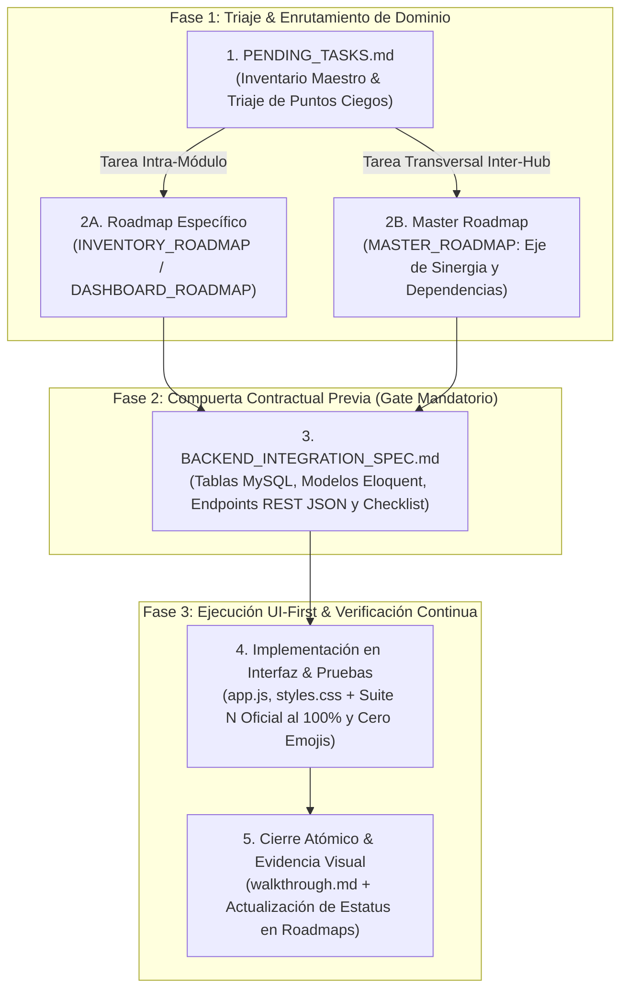

# Registro Maestro de Tareas Pendientes & Puntos Ciegos (General Task Backlog)
## Plataforma RevOps E-Commerce Multiverso & Suscripciones (Mi Tienda Online)

> **Propósito del Documento:**  
> Este documento centraliza y clasifica todas las tareas pendientes, oportunidades de optimización y puntos ciegos identificados durante la evaluación crítica de la plataforma (Inventario, Dashboard General y Sinergia entre Hubs).  
> **Flujo de Consolidación Óptimo (Ciclo Cerrado):**  
> `PENDING_TASKS.md` (Triaje & Enrutamiento) $\rightarrow$ **Roadmaps Específicos / Master Roadmap (Inter-Hub)** $\rightarrow$ **Compuerta Contractual Previa** (`BACKEND_INTEGRATION_SPEC.md`) $\rightarrow$ **Implementación UI-First & Matriz de Pruebas** $\rightarrow$ **Cierre Atómico & Walkthrough**.

> [!IMPORTANT]
> ### Regla Inamovible de Sincronización Mandatoria con Backend Integration Spec
> Ninguna tarea de la plataforma se considera "Completada" sin que su arquitectura de persistencia, migración de base de datos, modelo Eloquent, endpoints RESTful con esquemas JSON de petición/respuesta y reglas de validación en FormRequests queden **100% formalizados y blindados en [BACKEND_INTEGRATION_SPEC.md](file:///c:/Users/Mickey/Documents/export/BACKEND_INTEGRATION_SPEC.md)**. Toda tarea pendiente debe mantener sincronizado de antemano su contrato de backend.

---

## 1. Matriz Resumen de Distribución de Tareas

| ID Tarea | Título Operativo | Módulo / Hub Destino | Prioridad | Estado | Dependencias Clave |
| :--- | :--- | :---: | :---: | :---: | :--- |
| `TASK-INV-01` | Ubicaciones Físicas de Almacén (Slotting: Pasillo/Rack/Gaveta) | **Hub 4 (Inventario)** | **Alta** | **Completada (UI)** | Catálogo, Kardex, Empaque |
| `TASK-INV-02` | Matriz de Variantes no Textiles (Tonos Cosmética & Volúmenes Perfume) | **Hub 4 (Inventario)** | **Alta** | **Completada (UI)** | Catálogo Multidimensional |
| `TASK-INV-03` | Escandallos / Recetas para Suscripciones & Combos (BOM) | **Hub 4 (Inventario)** | **Alta** | **Completada (Fullstack End-to-End)** | Kardex, Hub 1 (Dashboard), Tag v1.3 |
| `TASK-INV-04` | Valuación Contable: Costo Promedio Ponderado (CPP) vs Último Costo | **Hub 4 (Inventario)** | **Media** | **Completada (UI)** | Kardex, Hub 5 (Finanzas) |
| `TASK-INV-05` | Generación e Impresión de Etiquetas Térmicas (Code128 / QR) en 1 Clic | **Hub 4 (Inventario)** | **Media** | **Completada (UI)** | Inbound, Slotting físico |
| `TASK-INV-06` | Control Sanitario: Lotes y Fechas de Caducidad / PAO en Cosmética | **Hub 4 (Inventario)** | **Media** | **Completada (UI)** | Catálogo, Inbound, Kardex, Etiquetas Térmicas |
| `TASK-INV-07` | Auditoría Cíclica a Ciegas (Blind Cycle Counting) de 3 SKUs Diarios | **Hub 4 (Inventario)** | **Baja** | **Completada (UI)** | Kardex, Ubicaciones |
| `TASK-INV-08` | Gestión Integral de Ropa Interior, Curaduría Previa Scraping, Vitrina Web y Ajustes de Módulo | **Hub 4 (Inventario)** | **Alta** | **Completada (Fullstack End-to-End)** | Catálogo, Scraping Torzo, Vitrina Web, Tag v1.2 |
| `TASK-DSH-01` | Vista Intermedia RBAC: Bandeja de Atención a Clientes & Ventas | **Hub 1 (Dashboard)** | **Alta** | **Completada (Full-Stack)** | RBAC Global, Hub 3 (CRM) |
| `TASK-DSH-02` | Embudo Comercial Multiverso Accionable con Gatillos en 1 Clic | **Hub 1 (Dashboard)** | **Alta** | **Completada (Full-Stack)** | Multiverso, WhatsApp API |
| `TASK-DSH-03` | Monitor de Salud del Ecosistema & Telemetría de APIs (System Health) | **Hub 1 (Dashboard)** | **Media** | **Completada (Full-Stack)** | Stripe, Torzo Bot, DHL |
| `TASK-DSH-04` | Generador Dinámico de Tareas Operativas Conectado a Eventos Reales | **Hub 1 (Dashboard)** | **Alta** | **Completada (Fullstack End-to-End)** | Eventos de Dominio, Tag v1.5 |
| `TASK-DSH-05` | SLA y Semáforo Visual de Envejecimiento de Pedidos (Aging Alert) | **Hub 1 (Dashboard)** | **Alta** | **Completada (Full-Stack)** | Mesa de empaque, DHL |
| `TASK-DSH-06` | Validador Predictivo de Direcciones y Códigos Postales con Riesgo | **Hub 1 (Dashboard)** | **Alta** | **Completada (Full-Stack)** | APIs de paquetería / Sepomex |
| `TASK-INT-01` | Saltos Profundos (Deep Links) Prefiltrados de Dashboard a Inventario | **Transversal (H1 $\rightarrow$ H4)** | **Alta** | **Completada (Fullstack End-to-End)** | Router interno, Filtros Catálogo, Tag v1.5 |
| `TASK-INT-02` | Trazabilidad de Stock: Comprometido a Despachado / Kardex | **Transversal (H1 $\rightarrow$ H4)** | **Alta** | **Completada (Fullstack End-to-End)** | Modales de Acción, Kardex, Tag v1.1 |
| `TASK-INT-03` | Liberación Masiva de Lotes de Suscripción (Batch Fulfillment) | **Transversal (H1 $\rightarrow$ H6)** | **Alta** | **Completada (UI)** | BOM, Pasarelas recurrentes |
| `TASK-INT-04` | Ficha de Preferencias y Tallas de Suscriptor en Checklist de Empaque | **Transversal (H1 $\rightarrow$ H6)** | **Alta** | **Completada (UI)** | Perfil de suscriptor, Modales |
| `TASK-INT-05` | Recuperación de Carritos Abandonados con Enlace Tokenizado en 1 Clic | **Transversal (H1 $\rightarrow$ H3)** | **Alta** | **Completada (Full-Stack)** | Checkout resume, WhatsApp |
| `TASK-LOG-01` | Mesa de Expedición Multipaquetera y Cierre de Manifiestos Diarios | **Hub 6 (Logística)** | **Alta** | **Completada (UI)** | Órdenes Empacadas, APIs Paquetería |
| `TASK-LOG-02` | Emisión e Impresión Masiva de Guías Térmicas (100x150mm) con Code128 / QR SVG | **Hub 6 (Logística)** | **Alta** | **Completada (UI)** | Manifiesto, Impresoras Térmicas |
| `TASK-LOG-03` | Torre de Control de Envíos con Telemetría de Tránsito y Alertas de Excepción | **Hub 6 (Logística)** | **Alta** | **Completada (UI)** | Webhooks Paqueterías, Sepomex |
| `TASK-LOG-04` | Portal de Garantías, Cambios de Talla y RMA con Retorno Contable a Kardex | **Hub 6 (Logística)** | **Media** | **Completada (Fullstack End-to-End)** | Kardex, Hub 4, Hub 1, Tag v1.4 |
| `TASK-LOG-05` | Protocolo de Embalaje Seguro para Cosmética Líquida y Privacidad Textil | **Hub 6 (Logística)** | **Media** | **Completada (UI)** | BOM Empaque, Inventario Insumos |
| `TASK-LOG-06` | Gestor CRUD de Cajas y Empaques Personalizables con Volumetría Automática | **Hub 6 (Logística)** | **Alta (Prioridad Inmediata)** | **Completada (Fullstack End-to-End)** | Balanzas, Tarifas Courier, Costos, Tag v1.4 |
| `TASK-LOG-02B` | Remitente Neutro Corporativo y Protocolo de Privacidad en Guías Térmicas | **Hub 6 (Logística)** | **Alta** | **Completada (UI)** | `TASK-LOG-02`, Impresión Térmica |
| `TASK-LOG-04B` | Matriz de Devoluciones RMA por Criterio Sanitario (Precinto Íntimo vs Ropa Exterior) | **Hub 6 (Logística)** | **Alta** | **Completada (Fullstack End-to-End)** | `TASK-LOG-04`, Kardex, PROFECO, Tag v1.4 |
| `TASK-UX-01` | Rediseño Ergonómico y Amplitud de Modales a 2 Columnas (`max-w-4xl` / `max-w-5xl`) | **Transversal (UI/UX)** | **Alta** | **Completada (UI)** | Estilos Globales, Checklists |
| `TASK-UX-02` | Aislamiento Estricto de Impresión Térmica (`@media print` 100x150mm / 50x30mm) | **Transversal (UI/UX)** | **Alta** | **Completada (UI)** | `TASK-INV-05`, `TASK-LOG-02` |
| `TASK-UX-03` | Sistema Global de Toasts y Notificaciones en Cola (Z-Index Máximo, TTL Extendido y Stack Acumulativo) | **Transversal (UI/UX)** | **Alta** | **Completada (Fullstack End-to-End)** | Topbar, Modales, Drawers, Tag v1.5 |
| `TASK-MOB-01` | Modo Móvil / Escáner de Bodega con Códigos SVG de Alto Contraste | **Hub 4 (Almacén)** | **Alta** | **Excluida por Solicitud del Usuario** | Lector Láser / Smartphone, Picking |
| `TASK-INV-09` | Gestor Configurable de Tonos de Cosmética con Swatches Cromáticos Hex y Subtonos | **Hub 4 (Inventario)** | **Media** | **Completada (UI)** | `TASK-INV-02`, Color Swatches |
| `TASK-INV-10` | Rediseño Ergonómico de Barra de Acciones y Menú de Herramientas Hub 4 | **Hub 4 (Inventario)** | **Alta** | **Completada (UI)** | Hub 4 Toolbar, Layout Responsivo |
| `TASK-INV-11` | CRUD Integral con Archivado y Restauración para Telas, Colores y Parámetros ROP | **Hub 4 (Inventario)** | **Alta** | **Completada (Fullstack End-to-End)** | `TASK-INV-08`, Modal Ajustes, ROP, Tag v1.2 |
| `TASK-INV-12` | Gestor Configurable de Vitrinas Web (Delegado a Hub 2 CMS) & Etiquetado en Catálogo | **Hub 2 (CMS) / Hub 4** | **Media** | **Delegada a Hub 2 (CMS)** | `TASK-INV-08`, `TASK-STR-02`, CMS Hub 2 |
| `TASK-INV-13` | Gestor Integral de Proveedores (Híbridos Scrapeados vs Locales/Manuales) y Control de Estados | **Hub 4 (Inventario)** | **Alta** | **Completada (Fullstack End-to-End)** | Pestaña Proveedores, Modal CRUD, Tag v1.2 |
| `TASK-INV-14` | Gestor Configurable de Tallas Textiles y Volúmenes de Perfumería en Matriz de Variantes | **Hub 4 (Inventario)** | **Alta** | **Completada (Fullstack End-to-End)** | `TASK-INV-02`, Modal Curvas & Volúmenes, Tag v1.6 |
| `TASK-INV-15` | Drawer de Producto Full-Width con Auto-SKU, Asistente IA de Descripción y Detección de Duplicados | **Hub 4 (Inventario)** | **Alta** | **Completada (Fullstack End-to-End)** | Workstation Alta Producto, Auto-SKU, Copiloto IA, Duplicados, Tag v1.6 |
| `TASK-INT-06` | Gestor de Carritos Simultáneos y Reserva Temporal de Stock (TTL Configurable) | **Transversal (H2 $\leftrightarrow$ H4)** | **Media** | **Completada (Fullstack End-to-End)** | Carrito, Stock Disponible, Tag v1.1 |
| `TASK-FIN-01` | Calculadora de Margen Neto Real por Pedido (Deducción Pasarela, Empaque y Fletes) | **Hub 5 (Finanzas)** | **Media** | **Completada (Fullstack End-to-End)** | Stripe, `TASK-LOG-06`, Skydropx, Tag v1.1 |
| `TASK-SYS-ENV` | Conmutador Visual de Entornos (Sandbox / Pruebas vs Producción Real) | **Transversal (Seguridad)** | **Alta (Prioridad Inmediata)** | **Completada (Fullstack End-to-End)** | Navbar, Stripe Keys, Skydropx, Tag v1.5 |
| `TASK-RBAC-02` | Gestor Dinámico de Roles y Matriz Granular de Accesos por Módulo | **Transversal (Seguridad / RBAC)** | **Alta** | **Completada (Fullstack End-to-End)** | Triple RBAC, Matriz Permisos, Tag v1.5 |
| `TASK-RBAC-03` | Aislamiento de Pantallas, Filtrado de Navegación y Privacidad Financiera por Rol | **Transversal (Seguridad / RBAC)** | **Alta** | **Completada (Fullstack End-to-End)** | RBAC Guards, Sidebar, Cero Emojis, Tag v1.5 |
| `TASK-RBAC-04` | Segregación y Asignación de Tareas Operativas por Rol en Bandeja de Hub 1 | **Transversal (Seguridad / RBAC / Hub 1)** | **Alta** | **Completada (Fullstack End-to-End)** | Matriz Categorías, Bandeja Hub 1, Tag v1.5 |
| `TASK-PUR-01` | Notificación de Discrepancia Inbound, Minuta de Negociación y Formalización IA (PDF/Email) | **Hub 1 (Compras) $\leftrightarrow$ Hub 4 $\leftrightarrow$ B2B** | **Alta** | **Completada (Fullstack End-to-End)** | API Carrier, Modal Minuta IA, PDF Acuerdo Formal, Tag v1.7 |
| `TASK-PUR-02` | Reasignación de Modales Físicos (Rampa y Surtido Interno) a Almacén y Segregación de Compras | **Hub 1 $\leftrightarrow$ Hub 4 (Compras / Almacén)** | **Alta** | **Completada (Fullstack End-to-End)** | Modal Rampa Almacén, Modal Surtido Carlos, Exclusión Purchases, Tag v1.7 |
| `TASK-PUR-03` | Depuración y Especialización del Catálogo para Compras (Existencias, DOH, Costos y Botón PO) | **Hub 4 (Inventario / Compras)** | **Alta** | **Completada (Fullstack End-to-End)** | DOH, Alertas ROP, Costos CPP, Ocultar Auditoría Ciegas, Tag v1.7 |
| `TASK-PUR-04` | Generador de PO con Impresión PDF Multi-Página, Compensación de Notas de Crédito & Edición de Costo/Prioridad | **Hub 4 (Inventario / Compras)** | **Alta** | **Completada (Fullstack End-to-End)** | Motor @media print Letter, Panel Compensación Discrepancias, Recálculo ROP, Tag v1.7 |
| `TASK-DSH-07` | Cabina Ejecutiva con Gráficas Analíticas y Copiloto IA (Resumen & Chat Estratégico) | **Hub 1 (Dashboard)** | **Alta** | **Completada (Full-Stack)** | Analítica RevOps, LLM API, Chat UI, Tag v1.3 |
| `TASK-HUB-VND` | Portal Extranet de Proveedores y Fabricantes (B2B Inbound & Órdenes) | **Hub 7 / B2B (Proveedores)** | **Alta** | **Completada (Fullstack End-to-End)** | Hub 4 Compras, Recepción Inbound, Tag v1.7 |
| `TASK-SUB-DUN` | Motor de Dunning y Recuperación de Cobros Fallidos en Suscripciones (MRR) | **Transversal (H5 $\leftrightarrow$ H3)** | **Media** | **Completada (UI)** | MRR, Stripe Webhooks, WhatsApp |
| `TASK-MKT-01` | Dashboard de Telemetría Ads (Meta CAPI, Google Ads, GA4) y Copiloto de Crecimiento | **Hub 3 (Marketing)** | **Alta** | **Completada (UI)** | Meta Graph API, GA4 Measurement, CAPI |
| `TASK-INT-07` | Cotejo Automatizado de 3 Vías Inbound (OC $\leftrightarrow$ Rampa $\leftrightarrow$ Liquidación) | **Transversal (H7 $\leftrightarrow$ H4 $\leftrightarrow$ H5)** | **Alta** | **Completada (Fullstack End-to-End)** | Hub 7 OCs, Inbound Almacén, Finanzas, Tag v1.4 |
| `TASK-INT-08` | Conciliación de Facturas de Paquetería vs Manifiestos de Expedición | **Transversal (H6 $\leftrightarrow$ H5)** | **Alta** | **Completada (UI)** | Manifiestos, Facturas DHL/Skydropx |
| `TASK-INT-09` | Generador Automático de Orden de Reemplazo o Crédito desde RMA | **Transversal (H6 $\leftrightarrow$ H3 $\leftrightarrow$ H4)** | **Alta** | **Completada (Fullstack End-to-End)** | `TASK-LOG-04`, Kardex, CRM WhatsApp, Tag v1.4 |
| `TASK-INT-10` | Capa de Contenido Editorial Multiverso Desacoplada de Stock Central | **Transversal (H2 $\leftrightarrow$ H4 $\leftrightarrow$ H3)** | **Media** | **Completada (UI)** | CMS Vitrinas, Catálogo Maestro |
| `TASK-INT-11` | Disparo Automático de OCs a Extranet B2B por Déficit de Ensamble BOM | **Transversal (H4 $\leftrightarrow$ H7)** | **Alta** | **Completada (Fullstack End-to-End)** | BOM Recetas, Hub 7 Portal B2B, Tag v1.3 |
| `TASK-INT-12` | Radar Preventivo de Sobrecarga Logística (Marketing Flash $\rightarrow$ Almacén) | **Transversal (H3 $\leftrightarrow$ H1 $\leftrightarrow$ H6)** | **Alta** | **Pendiente** | Meta Ads Pacing, Mesa de Empaque |
| `TASK-INT-13` | Deducción de Insumos de Empaque en Kardex y Alerta ROP de Cajas | **Transversal (H6 $\leftrightarrow$ H4 $\leftrightarrow$ H7)** | **Alta** | **Completada (Fullstack End-to-End)** | `TASK-LOG-06`, Kardex Insumos, Tag v1.4 |
| `TASK-INT-14` | Escudo Antifraude y Freno de Emergencia de Envíos en Mesa de Empaque | **Transversal (H5 $\leftrightarrow$ H6 $\leftrightarrow$ H1)** | **Alta (Prioridad Inmediata)** | **Completada (UI)** | Stripe Radar, Webhooks Fraude |
| `TASK-INT-15` | Rescate Proactivo de Excepciones de Entrega vía WhatsApp Omnicanal | **Transversal (H6 $\leftrightarrow$ H3)** | **Alta** | **Pendiente** | Telemetría Courier, WhatsApp API |
| `TASK-INT-16` | Sincronización Contable de Mermas y Ajustes de Kardex al P&L Financiero | **Transversal (H4 $\leftrightarrow$ H5)** | **Alta** | **Completada (Fullstack End-to-End)** | Kardex Auditoría, Libro Diario, Tag v1.4 |
| `TASK-INT-17` | Protocolo de Unboxing Dinámico por Nivel de Lealtad (Customer LTV) | **Transversal (H3 $\leftrightarrow$ H6)** | **Media** | **Pendiente** | CRM Scoring, Checklist Empaque |
| `TASK-INT-18` | Simulador Financiero de Reglas Comerciales y Elasticidad de Envío Gratis | **Transversal (H2 $\leftrightarrow$ H5)** | **Media** | **Completada (UI)** | CMS Umbrales, `TASK-FIN-01` |
| `TASK-FIN-02` | Motor Fiscal de Impuestos (IVA 16% Trasladado vs Acreditable y Retenciones SAT) | **Hub 5 (Finanzas)** | **Alta** | **Completada (UI)** | SAT CFDI 4.0, Stripe Retenciones |
| `TASK-DEP-01` | Despliegue en HostGator cPanel Inicial & Pipeline Scraping Local WebP | **Transversal (DevOps)** | **Alta** | **Pendiente** | cPanel Cron, Ingesta API, WebP |
| `TASK-ALY-01` | Directorio de Aliados & Acuerdos Multiverso (Fiestas, OF, Saunas, Salones, Drag) | **Hub 7 (Convenios & Aliados)** | **Alta** | **Completada (UI)** | Directorio CRM, Multiverso |
| `TASK-ALY-02` | Campañas Dir A (Web $\rightarrow$ Aliado) con Lead Magnet y Disparo Meta CAPI (EMQ > 9.0) | **Hub 7 (Convenios & Aliados)** | **Alta** | **Completada (UI)** | Meta CAPI, users_leads, Vouchers |
| `TASK-ALY-03` | Atribución Dir B (Aliado $\rightarrow$ Web) con Cupones, Tracking UTM y Comisiones | **Hub 7 (Convenios & Aliados)** | **Alta** | **Completada (UI)** | Checkout, Cupones, Stripe |
| `TASK-ALY-04` | Cámara de Compensación (Clearing House) con Saldos Netos y Liquidación Multimodal | **Hub 7 (Convenios & Aliados)** | **Alta** | **Completada (UI)** | Hub 5 Finanzas, Hub 4 Kardex, SPEI |
| `TASK-ALY-05` | Pantalla Extranet del Aliado (Partner Portal) con Validador de Taquilla y Generador QR | **Hub 7 (Convenios & Aliados)** | **Alta** | **Completada (UI)** | Token Auth, QR SVG, Taquilla |
| `TASK-INT-19` | Sincronización Automática de Liquidaciones de Aliados a Cuentas por Pagar | **Transversal (H7 $\leftrightarrow$ H5)** | **Alta** | **Completada (Fullstack End-to-End)** | `TASK-ALY-04`, `vendor_bills`, SPEI, Tag v1.4 |
| `TASK-INT-20` | Sincronización Automática de Remisiones B2B a Rampa de Almacén | **Transversal (H7/B2B $\leftrightarrow$ H1 $\leftrightarrow$ H4)** | **Alta** | **Completada (Fullstack End-to-End)** | `TASK-HUB-VND`, `TASK-INT-07`, Rampa, Tag v1.4 |
| `TASK-STR-01` | Storefront D2C: Creación del Portal Público y Enlace desde Navbar RevOps (Ref: `pop`) | **Tienda Pública (Storefront D2C)** | **Alta (Prioridad Inmediata)** | **Completada (Fullstack End-to-End)** | `pop/index.html`, Navbar RevOps, Tag v1.1 |
| `TASK-STR-02` | Catálogo Público de Productos & Ficha Anatómica Torzo (Ref: `pop/catalogo.html`) | **Tienda Pública (Storefront D2C)** | **Alta** | **Completada (Fullstack End-to-End)** | `pop/catalogo.html`, Torzo 244 SKUs, Tag v1.1 |
| `TASK-STR-03` | Carrito Deslizable & Checkout en 3 Pasos con Logística de Carritos Mixtos | **Tienda Pública (Storefront D2C)** | **Alta** | **Completada (Fullstack End-to-End)** | `pop/carrito.html`, Checkout Multimodal, Tag v1.1 |
| `TASK-STR-04` | Conexión de la Tienda con Nuevos Hubs (Cupones/Banners Hub 7 y CMS Hub 2) | **Transversal (Tienda $\leftrightarrow$ H7 $\leftrightarrow$ H2)** | **Alta** | **Completada (Fullstack End-to-End)** | `TASK-ALY-02`, `TASK-ALY-03`, `TASK-CMS-01`, Tag v1.1 |
| `TASK-STR-05` | Portal del Comprador: Mi Cuenta, Mis Pedidos, Membresías MRR & Perfil Anatómico | **Tienda Pública (Storefront D2C)** | **Alta** | **Completada (Fullstack End-to-End)** | `TASK-STR-01`, Hub 6 (Logística), Hub 5 (MRR), Tag v1.1 |
| `TASK-STR-06` | Motor de Notificaciones Web Push PWA (VAPID, Alertas Stock 5m, Courier Tracking & MRR) | **Transversal (PWA $\leftrightarrow$ H6 $\leftrightarrow$ H5 $\leftrightarrow$ H1)** | **Alta** | **Completada (Fullstack End-to-End)** | `sw.js`, VAPID RFC 8292, Hub 6, Hub 5, Tag v1.1 |
| `TASK-INV-16` | Refactorización de Bandeja de Compras y Solicitudes On-Demand | **Hub 4 (Inventario)** | **Alta** | **Completada (UI)** | Hub 4 Compras, PDF POs, `purchase_kardex` |
| `TASK-INV-17` | CRUD Integral y Gestor de Fórmulas para Recetas BOM & Combos Virtuales | **Hub 4 (Inventario)** | **Alta** | **Completada (Fullstack End-to-End)** | Modal Ajustes Inventario, Catálogo Operativo, Tag v1.3 |
| `TASK-INV-18` | Modal Panorámico de Edición de SKU (`max-w-7xl`) & Reactividad Integral | **Hub 4 (Inventario)** | **Alta** | **Completada (Fullstack End-to-End)** | Modal Panorámico max-w-7xl, 4 KPIs Live, Margen Real, Tag v1.6 |
| `TASK-DSH-09` | Master Kardex Global y Log de Auditoría Omnicanal para Superadministradores | **Hub 1 (Dashboard)** | **Alta** | **Completada (Fullstack End-to-End)** | Hub 1 Auditoría, `system_audit_logs`, Tag v1.5 |
| `TASK-SYS-01` | Centro de Ajustes del Sistema a Pantalla Completa y Gobernanza Global | **Transversal (Gobernanza / Core)** | **Alta** | **Completada (Fullstack End-to-End)** | Sidebar Footer, Hub 8 Pantalla Completa, Tag v1.5 |
| `TASK-COM-01` | Mensajería Interdepartamental Operativa con Detección Automática de Folios | **Transversal (Gobernanza / Core)** | **Alta** | **Completada (Fullstack End-to-End)** | `interdepartmental_messages`, Chat Drawer, Tag v1.5 |

---

## 1.1. Plan Maestro Fullstack Senior de Prioridades de Implementación (Backend & Frontend Integrados)

Bajo la modalidad **Fullstack Senior**, se erradica cualquier desarrollo puramente cosmético o desconectado. Toda tarea se aborda como un **Vertical Slice completo (End-to-End)**:  
$$\text{Base de Datos (MySQL)} \longrightarrow \text{Modelos Eloquent} \longrightarrow \text{Servicios Transaccionales (ACID / Kardex)} \longrightarrow \text{Endpoints REST / FormRequests} \longrightarrow \text{UI PWA Reactiva} \longrightarrow \text{Pruebas Automatizadas}$$

### ¿Cuál es Nuestra Principal Prioridad Absoluta?
**La Prioridad 1: Motor D2C Transaccional & Storefront Multiverso PWA (`TASK-STR-01` a `TASK-STR-06` & `TASK-INT-06`).**  
*Razón Técnica y de Negocio:* El Storefront D2C es el **Generador de la Verdad Transaccional del Sistema**. Mientras la tienda pública continúe en las vistas legacy, los 6 Hubs administrativos operan sobre datos sintéticos o estáticos. Al desplegar el Storefront Multiverso con reserva de stock en vivo (`stock_locks`), validación de CP/fletes y checkout atómico, se desata el flujo orgánico de órdenes reales (`orders`), movimientos inmutables de Kardex (`inventory_movements`), márgenes P&L (`order_financial_margins`), manifiestos de empaque y comisiones de aliados comerciales.

---

### Escala de Prioridades Fullstack Senior (5 Frentes de Ejecución)

#### Prioridad 1 (Crítica e Inmediata): Motor D2C Transaccional & Storefront Multiverso PWA [COMPLETADA AL 100% - TAG `v1.1-prioridad-1-storefront-pwa`]
* **Slice 1.1: Shell Base PWA, Conmutador Multiverso y Catálogo Real de BD:** [COMPLETADO] (113/113 pruebas pasando, 528 aserciones, 0 emojis).
* **Slice 1.2: Ficha Anatómica PDP, Matriz de 6 Tallas y Guía de Medidas Torzo en cm:** [COMPLETADO] (119/119 pruebas pasando, 563 aserciones, 0 emojis).
* **Slice 1.3: Carrito Deslizable y Motor de Reserva Temporal de Stock (`TASK-INT-06`):** [COMPLETADO] (127/127 pruebas pasando, 593 aserciones, 0 emojis).
* **Slice 1.4: Checkout Transaccional, Cupones del Hub 7, Fletes del Hub 6 y Liquidación:** [COMPLETADO] (134/134 pruebas pasando, 623 aserciones, 0 emojis).
* **Slice 1.5: Portal del Comprador D2C ("Mi Cuenta", Tracking y Suscripciones MRR):** [COMPLETADO] (143/143 pruebas pasando, 675 aserciones, 0 emojis).
* **Slice 1.6: Web Push VAPID, Atribución B2B y Suite de Integración:** [COMPLETADO] (151/151 pruebas pasando, 730 aserciones, 0 emojis).
* **Backend:**
  - Scopes multiverso en `Product` (`marte`, `venus`, `tiresias`, `terra`) con cálculo en vivo de stock disponible ($\text{Disponible} = \text{Cantidad} - \text{Apartados}$).
  - `StockReservationService`: Candado de stock temporal (`stock_locks`) con TTL de 300 segundos, bloqueo pesimista en MySQL y liberación automática.
  - `OrderProcessingService`: Transacción ACID completa de checkout que liquida el candado, descuenta inventario físico, genera el asiento inmutable en Kardex (`SALIDA_VENTA_ONLINE`), calcula el margen neto en `order_financial_margins` y emite folios `#ORD-2026-XXXX` o `#MIX-2026-XXXX`.
  - Consumo en caliente de reglas de flete del Hub 6 (`cms_shipping_rule`) y validación de cupones del Hub 7 (`ally_coupons_dir_b`).
  - `CustomerAccountController`: Consulta de órdenes del cliente, tracking courier y autogestión de membresías en `customer_subscriptions`.
* **Frontend PWA:**
  - Layout `store-pwa.blade.php`, estilos aislados `store-pwa.css` y lógica cliente `store-pwa.js`.
  - Selector táctil de universos, PDP con matriz de 6 tallas textiles (`CH-3XL`), modal de Guía de Tallas Torzo en cm, drawer de carrito con temporizador regresivo de 5 minutos, stepper de checkout en 3 pasos y portal `#accountSheet`.
  - PWA Offline y Service Worker `sw.js` con soporte para notificaciones Web Push VAPID.
* **Criterio de Cierre:** Compra completada desde la web que descuenta el stock en el Hub 4, aparece en el Hub 3 para empaque y en el Hub 1 en finanzas.

#### Prioridad 2 (Alta): Filtro de Calidad y Curaduría de Catálogo en Hub 4 [COMPLETADA AL 100% - TAG `v1.2-prioridad-2-inventario-hub4`]
* **Backend:**
  - Modelo y migración `scraped_pending_items` para staging de productos en bruto del scraper de Torzo.
  - Endpoints RESTful `POST /api/v1/inventory/scraping/pending/{id}/curate` y `/discard`.
  - Tablas y modelos Eloquent para composiciones textiles (`apparel_fabrics`) y catálogo de colores sólidos y tornasoles iridiscentes (`apparel_colors`).
  - Cálculo de métricas de confiabilidad de proveedores en `suppliers` (% On-Time, % Fill Rate, días de demora).
* **Frontend:**
  - Pestaña de Curaduría Previa en Inventario con modal de aprobación humana (color, tela, sección web, PVP).
  - Gestor de telas y colores con previsualización en vivo de degradados CSS tornasol.
* **Criterio de Cierre:** Ningún producto extraído automáticamente pasa a la tienda pública sin validación y aprobación de un operador.

#### Prioridad 3 (Alta): Motor de Ensamble BOM y Recetas de Suscripción MRR [COMPLETADA AL 100% - TAG `v1.3-prioridad-3-dashboard-hub1`]
* **Backend:**
  - Tablas y modelos Eloquent `product_bundles` y `bundle_items`.
  - Algoritmo de cálculo de existencias armables gobernado estrictamente por el insumo cuello de botella.
  - Endpoint `POST /api/v1/inventory/bundles/{id}/liquidate` que emite salidas atómicas individuales en Kardex (`SALIDA_COMBO_SUSCRIPCION`).
  - Detección de déficit de ensamble con registro en `bom_deficit_procurements` (`TASK-INT-11`) y puente a Compras.
  - Cabina analítica ejecutiva Hub 1 con gráficos SVG interactivos y Copiloto IA con recomendaciones accionables.
* **Frontend:**
  - Modal constructor `bundleEditor` en Ajustes de Inventario con asignación de componentes físicos por talla/slotting y simulación de despacho masivo.
  - Cabina de mando en Hub 1 con métricas RevOps, embudo de conversión y chat de IA.
* **Criterio de Cierre:** El sistema impide vender o prometer más cajas de membresía que las prendas físicas disponibles en rack del componente limitante.

#### Prioridad 4 (Media): Sinergias Transversales Automatizadas (Cross-Hub) [COMPLETADA AL 100% - TAG `v1.4-prioridad-4-sinergias-crosshub`]
* **Slice 4.1: Deducción de Empaque en Kardex y Alertas ROP (`TASK-INT-13`):** [COMPLETADO] `PackagingKardexDeductionService`, salida `CONSUMO_INSUMO_EMPAQUE`, deducción atómica de cajas `package_types` y bolsas al guiar paquetes.
* **Slice 4.2: Resolución RMA, Dictamen y Biotratamiento (`TASK-INT-09`):** [COMPLETADO] `RmaResolutionService`, biocontención y descarte de lencería íntima usada vs reincorporación, emisión de saldo a favor o reposición.
* **Slice 4.3: Cotejo 3 Vías Inbound y Remisiones B2B (`TASK-INT-07`, `TASK-INT-20`):** [COMPLETADO] `ThreeWayMatchService`, `InboundRampSyncService`, conciliación de OC vs conteo en rampa vs factura CFDI con retenciones SAT.
* **Slice 4.4: Sincronización Contable de Mermas y CxP Aliados (`TASK-INT-16`, `TASK-INT-19`):** [COMPLETADO] `KardexAccountingSyncService`, `AllyClearingPayableService`, asientos automáticos en `general_ledger_entries` y facturas en `vendor_bills`.
* **Criterio de Cierre:** Erradicación de discrepancias manuales entre bodega, logística y tesorería.

#### Prioridad 5 (Gobernanza): Shell Operativo, Notificaciones, Chat y Gobernanza RBAC [COMPLETADA AL 100% - TAG `v1.5-prioridad-5-gobernanza-rbac`]
* **Slice 5.1: Matriz de Roles Dinámicos, Privacidad Financiera y Segregación de Tareas (`TASK-RBAC-02`, `TASK-RBAC-03`, `TASK-RBAC-04`):** [COMPLETADO] `RolePermissionService`, middleware `EnforceFinancialPrivacy`, sanitización JSON de costos/márgenes, `OperationalTaskService` con filtrado por estación.
* **Slice 5.2: Master Kardex de Auditoría y Activity Log Inmutable (`TASK-DSH-09`):** [COMPLETADO] `system_audit_logs`, `AuditTrailService`, `SystemAuditLogPolicy`, enmascaramiento forense de datos sensibles, inmutabilidad estricta contra updates/deletes.
* **Slice 5.3: Sistema Global de Notificaciones y Toasts (`TASK-UX-03`, `TASK-DSH-04`):** [COMPLETADO] `user_notifications`, `NotificationDispatcherService`, deep links a folios de órdenes/SKUs/guías, `#global-toast-container`, campanita interactiva.
* **Slice 5.4: Mensajería Interdepartamental Operativa (`TASK-COM-01`):** [COMPLETADO] `interdepartmental_messages`, `InterdepartmentalChatService`, auto-detección regex de folios (`@Pedido:`, `@SKU:`, `@OC:`, `@Guia:`), cajón flotante reactivo.
* **Slice 5.5: Centro de Gobernanza del Sistema a Pantalla Completa & Conmutador Sandbox/Prod (`TASK-SYS-01`, `TASK-SYS-ENV`):** [COMPLETADO] `PortalGovernanceController`, Hub 8 Gobernanza en Sidebar, vista `resources/views/portal/governance.blade.php` con 5 pestañas de control (Privacidad RBAC, Auditoría Master, Notificaciones, Chat Inter-Areas, Ajustes Globales con reto de confirmación PRODUCCION).
* **Criterio de Cierre:** Cumplimiento total de la regla de privacidad, trazabilidad forense de cada mutación del sistema y consola de gobernanza unificada. (238/238 pruebas pasando al 100%, 1,556 aserciones, 0 emojis).

---

## 2. Especificación Detallada: Grupo Inventario & Cadena de Suministro (Hub 4)

### `TASK-INV-01`: Slotting y Ubicaciones Físicas en Bodega (Pasillo - Rack - Nivel / Gaveta)
* **Estado de Ejecución:** **Completada en UI (Fase 4)** - Badges cromáticos por pasillo (`A-01-B`), selector estructurado de 3 niveles en drawer de nuevo producto, modal interactivo de reubicación con asiento inmutable en Kardex y Suite 12 de pruebas unitarias pasando al 100%.
* **Punto Ciego Resuelto:** Actualmente el sistema conoce existencias numéricas, pero no indica dónde se almacena físicamente el producto, provocando demoras en picking y empaque.
* **Solución de UI/UX:**
  - Agregar la columna compacta `Ubicación` (ej. `A-02-3`) en la tabla del Catálogo Operativo.
  - Añadir campo estructurado de ubicación física en el drawer de alta/edición de producto.
  - Mostrar la ubicación al lado de cada ítem en los checklists de empaque y surtido para ordenar la recolección por ruta de pasillo.
* **Destino de Distribución:** [INVENTORY_ROADMAP.md](file:///c:/Users/Mickey/Documents/export/INVENTORY_ROADMAP.md) $\rightarrow$ [MASTER_ROADMAP.md](file:///c:/Users/Mickey/Documents/export/MASTER_ROADMAP.md) $\rightarrow$ [BACKEND_INTEGRATION_SPEC.md](file:///c:/Users/Mickey/Documents/export/BACKEND_INTEGRATION_SPEC.md).
* **Impacto en Backend:** Campo `bin_location` en `product_variants` y tabla auxiliar `warehouse_slots`.

### `TASK-INV-02`: Matriz Multidimensional de Variantes no Textiles (Cosmética & Perfumería)
* **Estado de Ejecución:** **Completada en UI (Fase 4)** - Selector multidimensional de 4 dimensiones (Tallas Textiles CH-3XL, Tonos Cosmética 01-06, Volúmenes Fragancia 10ml-100ml, Unitario Fijo), cálculo reactivo de stock, autodetección por categoría y Suite 13 de pruebas unitarias pasando al 100%.
* **Punto Ciego Resuelto:** El catálogo actual trata todo lo no textil como "Unitario", impidiendo agrupar bases de maquillaje por tonos o fragancias por volumen.
* **Solución de UI/UX:**
  - Adaptar la matriz de variantes según la categoría del producto:
    - *Prendas Textiles:* Curva de 6 tallas (`CH, M, G, XL, 2XL, 3XL`).
    - *Cosmética / Maquillaje:* Matriz de tonos/subtonos (`Tono 01 a 06`).
    - *Perfumería / Fragancias:* Matriz de formato/volumen (`10ml Travel, 50ml, 100ml`).
    - *Accesorios Fijos:* Pieza única / unitario sin variantes.
* **Destino de Distribución:** [INVENTORY_ROADMAP.md](file:///c:/Users/Mickey/Documents/export/INVENTORY_ROADMAP.md) $\rightarrow$ [MASTER_ROADMAP.md](file:///c:/Users/Mickey/Documents/export/MASTER_ROADMAP.md) $\rightarrow$ [BACKEND_INTEGRATION_SPEC.md](file:///c:/Users/Mickey/Documents/export/BACKEND_INTEGRATION_SPEC.md).
* **Impacto en Backend:** Campo `variant_dimension` (`size`, `shade`, `volume`, `none`) en `products`.

### `TASK-INV-03`: Escandallos / Recetas para Suscripciones & Combos (Bill of Materials - BOM)
* **Estado de Ejecución:** **Completada en UI (Fase 4)** - Botón de acceso rápido en barra superior, modal interactivo `bundleRecipesModal` con catálogo de 4 recetas multiverso (Cajas Nivel 1, 2, VIP y Trío Promo), cálculo reactivo de cuello de botella de existencias físicas, panel simulador de despacho masivo con deducción atómica de componentes, generación inmutable de asientos `SALIDA_COMBO_SUSCRIPCION` en Kardex, paridad 100% Blade-JS y Suite 14 de pruebas unitarias pasando al 100%.
* **Punto Ciego Resuelto:** Las cajas de membresía mensual se venden como combos, pero no existía la lógica para descontar sus componentes físicos del inventario central ni conocer el cuello de botella de insumos.
* **Solución de UI/UX:**
  - Sub-vista o modal interactivo "Recetas de Ensamble BOM & Combos Virtuales": permite visualizar y auditar qué productos físicos componen la "Caja Nivel 1", "Caja Nivel 2", "Caja VIP Nivel 3" o un "Pack Trío Promocional", mostrando su ubicación física en bodega.
  - Al confirmarse el despacho masivo de un lote, Kardex emite salidas automáticas atómicas para cada insumo individual con tipo `SALIDA_COMBO_SUSCRIPCION` y referencia vinculada.
* **Destino de Distribución:** [INVENTORY_ROADMAP.md](file:///c:/Users/Mickey/Documents/export/INVENTORY_ROADMAP.md) $\rightarrow$ [MASTER_ROADMAP.md](file:///c:/Users/Mickey/Documents/export/MASTER_ROADMAP.md) $\rightarrow$ [BACKEND_INTEGRATION_SPEC.md](file:///c:/Users/Mickey/Documents/export/BACKEND_INTEGRATION_SPEC.md).
* **Impacto en Backend:** Tablas `product_bundles` y `bundle_items` con endpoint de liquidación atómica `POST /api/v1/inventory/bundles/{id}/liquidate`.

### `TASK-INV-04`: Valuación Contable: Costo Promedio Ponderado (CPP) vs Último Costo
* **Estado de Ejecución:** **Completada en UI (Fase 4)** - Atributo `weightedAverageCost` en catálogo, columna de costo con sub-badge CPP y tooltip con fórmula oficial, calculadora dual de margen en drawer de detalle (Margen Real Contable vs Marginal), recálculo automático de CPP en recepción Inbound con trazabilidad inmutable en Kardex, paridad 100% Blade-JS y Suite 16 de pruebas unitarias pasando al 100%.
* **Punto Ciego Resuelto:** Si se compran lotes a distintos precios, usar un solo campo de "Costo" distorsiona el margen bruto real del negocio.
* **Solución de UI/UX:**
  - Mostrar en la tarjeta de costo del producto: *Costo Promedio Ponderado (CPP)* junto con el *Último Costo de Adquisición*.
  - Tooltip explicativo `?` con la fórmula contable de valuación de inventario.
* **Destino de Distribución:** [INVENTORY_ROADMAP.md](file:///c:/Users/Mickey/Documents/export/INVENTORY_ROADMAP.md) $\rightarrow$ [BACKEND_INTEGRATION_SPEC.md](file:///c:/Users/Mickey/Documents/export/BACKEND_INTEGRATION_SPEC.md).

### `TASK-INV-05`: Generación e Impresión de Etiquetas Térmicas (Code128 / QR) en 1 Clic
* **Estado de Ejecución:** **Completada en UI (Fase 4)** - Modal interactivo `thermalLabelModal` con formatos 50x30mm (prenda/rack) y 100x50mm (caja/bulto), generador determinista Code128 y QR SVG nativo, 3 gatillos de 1 clic (columna Estado de tabla, Recepción Inbound por tallas y Barra flotante de acciones en lote), estilos aislados `@media print` para impresoras térmicas (Zebra, Rollo, Xprinter, Dymo), paridad 100% Blade-JS y Suite 17 de pruebas unitarias pasando al 100%.
* **Punto Ciego Resuelto:** Al recibir mercancía de proveedores mayoristas, las prendas no traen código de barras local para control de bodega ni slotting de rack visible para acomodo inmediato.
* **Solución de UI/UX:**
  - Botón de acción rápida en catálogo (`openThermalLabelModal(item)`) junto al estado del producto.
  - Botón en recepción Inbound (`openInboundBatchLabels()`) que extrae las cantidades cotejadas por talla para imprimir el lote completo.
  - Botón en barra flotante de selección masiva (`openBulkLabelsModal()`) para imprimir etiquetas de múltiples SKUs.
  - Previsualización gráfica realista monocromática con Marca, SKU, Talla/Tono/Volumen, Slotting (`A-01-B`), PVP, Code128 legible y código QR.
* **Destino de Distribución:** [INVENTORY_ROADMAP.md](file:///c:/Users/Mickey/Documents/export/INVENTORY_ROADMAP.md) $\rightarrow$ [BACKEND_INTEGRATION_SPEC.md](file:///c:/Users/Mickey/Documents/export/BACKEND_INTEGRATION_SPEC.md).
* **Impacto en Backend:** Endpoint generador de etiquetas térmicas (PDF / ZPL) `POST /api/v1/inventory/labels/thermal-print`.

### `TASK-INV-06`: Control Sanitario: Lotes de Fabricación y Fechas de Caducidad / PAO en Cosmética
* **Punto Ciego Resuelto:** Productos cosméticos y de cuidado íntimo requieren trazabilidad estricta de caducidad, lote sanitario y Period After Opening (PAO) conforme a normativas de farmacovigilancia (DIGEMID / COFEPRIS / FDA).
* **Solución de UI/UX Implementada:**
  - **Semaforización reactiva:** Insignias dinámicas en tabla de catálogo con cuenta regresiva (`Crítico &le;30d` en rojo, `Advertencia 30-90d` en ámbar, `Saludable >90d` en esmeralda).
  - **Insignias de Trazabilidad:** Badge de Lote (`Lot: LOT-XXXX`) y badge PAO (`PAO 12M`).
  - **Filtro Sanitario en Barra Superior:** Dropdown reactivo con 4 estados (`Todos`, `Solo Cosmética / Cuidado Personal`, `Por Vencer &le;90d`, `Vencimiento Crítico &le;30d`).
  - **Recepción Inbound:** Tarjeta de captura obligatoria de lote, fecha de caducidad y PAO al recibir mercancía de categorías sensibles, incorporando la trazabilidad en el asiento inmutable de Kardex (`ENTRADA_COMPRA`).
  - **Drawer de Edición:** Sección técnica para auditar y modificar lote, caducidad y meses PAO.
  - **Etiquetas Térmicas:** Impresión de lote, caducidad y PAO directamente en la etiqueta Code128/QR.
* **Destino de Distribución:** [INVENTORY_ROADMAP.md](file:///c:/Users/Mickey/Documents/export/INVENTORY_ROADMAP.md) $\rightarrow$ [BACKEND_INTEGRATION_SPEC.md](file:///c:/Users/Mickey/Documents/export/BACKEND_INTEGRATION_SPEC.md).
* **Estado:** **Completada (UI)**. Suite 18 de pruebas unitarias al 100% (0 regresiones en 18 suites).

### `TASK-INV-07`: Auditoría Cíclica a Ciegas (Blind Cycle Counting) de 3 SKUs Diarios
* **Punto Ciego Resuelto:** El inventario físico difiere del saldo en sistema con el paso del tiempo por merma no reportada.
* **Solución de UI/UX Implementada:**
  - Botón interactivo *"Auditoría Diaria"* en la barra de controles con badge dinámico (`3 SKUs` / `OK`).
  - Modal de auditoría a ciegas en 2 pasos: muestra determinista de 3 SKUs con slotting visible (`A-01-B`) y ocultamiento absoluto del stock teórico del sistema durante el conteo.
  - Captura multidimensional (tallas textiles, tonos cosméticos, volúmenes de perfume y conteo unitario).
  - Revelación semafórica de discrepancias con cálculo de exactitud de inventario (IRA %) e impacto cuantitativo.
  - Reconciliación con actualización atómica de existencias y generación de asientos inmutables `AJUSTE_AUDITORIA_CIEGA` en el Kardex con motivo tipificado.
* **Estado:** **Completada (UI)**. Suite 19 de pruebas unitarias al 100% (0 regresiones en 19 suites oficiales).
* **Destino de Distribución:** [INVENTORY_ROADMAP.md](file:///c:/Users/Mickey/Documents/export/INVENTORY_ROADMAP.md) $\rightarrow$ [BACKEND_INTEGRATION_SPEC.md](file:///c:/Users/Mickey/Documents/export/BACKEND_INTEGRATION_SPEC.md).

### `TASK-INV-08`: Gestión Integral de Ropa Interior, Curaduría Previa de Scraping, Vitrinas Web y Ajustes de Módulo
* **Punto Ciego Resuelto:** El catálogo textil requería modelado granular de prendas (telas, colores sólidos y tornasoles dinámicos, variantes con/sin diseño, marca de fabricante, descuentos promocionales y asignación de vitrina web por secciones). Además, los productos extraídos por scraping entraban directamente sin control de calidad, arriesgando inconsistencias en la tienda pública; y no existía un panel central para dar de alta nuevos atributos textiles ni ajustar la visualización de KPIs/filtros.
* **Solución de UI/UX Implementada:**
  - **Paleta Dinámica de Colores & Tornasoles:** Swatches circulares con tooltips, soporte para colores sólidos hexadecimales y efectos tornasol con degradados CSS multidireccionales.
  - **Tipos de Tela:** Catálogo reactivo de composiciones textiles (Algodón Pima, Microfibra, Modal, Malla/Mesh, Seda, Encaje, Spandex, etc.).
  - **Variante Gráfica / Diseño:** Selector de prenda `Sin Diseño` (Liso/Básico) vs `Con Diseño` (Estampado/Gráfico).
  - **Marca y Descuentos:** Atributo de marca/proveedor (`Torzo`, `Calvin Klein`, `AussieBum`, etc.) y calculadora reactiva de descuentos con precio regular tachado y badge porcentual dinámico.
  - **Control de Vitrina Web & Secciones:**
    - Switch en 1 clic `Publicado` / `Fuera de Catálogo` directamente en la tabla con actualización instantánea.
    - Asignación de sección web de destino (`Línea de Básicos`, `Línea de Diseñador`, `Temporada / Tendencia`, `Catálogo General`).
  - **Bandeja de Curaduría Previa de Scraping (Tab 3):**
    - Contenedor dedicado de productos pendientes de validación extraídos por el scraper de proveedores.
    - Modal de curaduría manual para verificar/corregir nombre, marca, color/tornasol, tela, diseño, sección web y descripción antes de su incorporación al catálogo activo.
    - Acciones atómicas: `Aprobar e Incorporar al Catálogo` o `Descartar Ítem`.
  - **Drawer de Producto Ampliado (2 Columnas):** Rediseño a layout de 2 columnas (`max-w-4xl`) eliminando scroll innecesario y agrupando información comercial, atributos textiles y curva de tallas de forma equilibrada.
  - **Modal de Ajustes del Módulo (`moduleSettingsModal`):** Acceso directo desde el engranaje del topbar para:
    - Alta y administración reactiva de nuevos tipos de tela.
    - Alta y configuración de nuevos colores (sólidos o tornasoles con doble hex).
    - Preferencias de interfaz: conmutación de KPIs (colapsados/expandidos) y filtros de tabla.
* **Estado:** **Completada (UI)**. Suite 20 de pruebas unitarias al 100% (0 regresiones en 20 suites oficiales).
* **Destino de Distribución:** [INVENTORY_ROADMAP.md](file:///c:/Users/Mickey/Documents/export/INVENTORY_ROADMAP.md) $\rightarrow$ [MASTER_ROADMAP.md](file:///c:/Users/Mickey/Documents/export/MASTER_ROADMAP.md) $\rightarrow$ [BACKEND_INTEGRATION_SPEC.md](file:///c:/Users/Mickey/Documents/export/BACKEND_INTEGRATION_SPEC.md).

### `TASK-INV-09`: Gestor Configurable de Tonos de Cosmética con Muestras Cromáticas Hex (Swatches) y Subtonos
* **Prioridad:** **Media** | **Estado:** **Completada (UI)**
* **Punto Ciego Resuelto:** La matriz original limitaba la cosmética a 6 tonos fijos en código. Las líneas de maquillaje y bases requieren N tonos dinámicos con swatches cromáticos visuales y subtonos dermatológicos.
* **Solución de UI/UX Implementada:**
  - Sección de Catálogo Maestro de Tonos en Ajustes Globales (`inventory-rules`) y acceso directo en Toolbar de Hub 4.
  - Modal interactivo de 2 columnas `cosmeticShadesModal`: formulario de alta/edición (código, nombre, color HEX con colorpicker nativo, subtono *Cálido / Frío / Neutro*, estado activo) y cuadrícula de tonos con edición/eliminación/pausa reactiva.
  - Swatches circulares de 20px (`.cosmetic-swatch-20`) en tabla de productos (`variantDimension === 'shade'`), drawer de detalle y drawer de alta de producto nuevo.
  - Desglose dinámico en drawer de producto sincronizado con stock físico y recálculo reactivo.
* **Destino de Distribución:** [INVENTORY_ROADMAP.md](file:///c:/Users/Mickey/Documents/export/INVENTORY_ROADMAP.md) $\rightarrow$ [BACKEND_INTEGRATION_SPEC.md](file:///c:/Users/Mickey/Documents/export/BACKEND_INTEGRATION_SPEC.md).
* **Impacto en Backend:** DDL 3.43 (`cosmetic_shades`), Modelo Eloquent 4.37 (`CosmeticShade`), Servicio de Dominio 5.28 (`CosmeticShadeService`), Contratos REST Subsección QQ, Paso 45 Checklist. Suite 54 de pruebas aprobada al 100%.

### `TASK-INV-10`: Rediseño Ergonómico de Barra de Acciones y Menú de Herramientas Hub 4 (Fase 2: Ajuste de Funcionalidades & UX/UI)
* **Prioridad:** **Alta** | **Estado:** **Completada (UI)**
* **Punto Ciego / Situación Reportada:** La barra de acciones de la cabecera ("Funcionalidades del Módulo") acumuló 8 botones horizontales consecutivos sin jerarquía (`Kardex / Auditoría`, `Escandallos BOM`, `Déficit BOM B2B`, `Auditoría Diaria`, `Tonos Cosmética`, `Carritos Activos`, `+ Agregar Producto`, `Ajustes Módulo`), provocando desbordamiento horizontal visible que corta los últimos botones fuera del viewport en pantallas estándar y laptops.
* **Solución de UI/UX Propuesta:**
  - **Reorganización Jerárquica y Ergonómica:**
    - **Visibles Permanentes:** `Kardex / Auditoría` y `Carritos Activos` (con telemetría de Stock Locks y badge en espera) se mantienen fijos y visibles afuera por su alta frecuencia de consulta operativa.
    - **Reubicación de Tonos Cosmética:** Se retira definitivamente el botón "Tonos Cosmética" de esta barra de acciones operativas y se traslada como pestaña nativa dentro del modal de **Ajustes del Módulo** (`TASK-INV-11`), eliminando saturación.
    - **Menú Desplegable Unificado ("Herramientas de Stock"):** Agrupa exclusivamente las herramientas secundarias de auditoría y fórmulas:
      1. `Recetas & Combos BOM` (con badge contador de fórmulas)
      2. `Déficit BOM & OCs B2B` (con badge "Auto OC")
      3. `Auditoría Diaria a Ciegas` (con badge reactivo "3 SKUs" u "OK")
    - **Insignias (Badges) Críticas:** El botón activador del menú desplegable incluye un punto de notificación rojo/ámbar si la auditoría diaria está pendiente o existen alertas de ROP en su interior.
    - **Acceso a Configuración y CTA:** Botón `Ajustes Módulo` y botón primario `+ Agregar Producto` anclados a la extrema derecha con máxima visibilidad.
  - **Responsividad Flex-Wrap:** Contenedor flexible anti-desbordamiento para garantizar visualización perfecta en cualquier resolución sin barras de desplazamiento.
* **Destino de Distribución:** [INVENTORY_ROADMAP.md](file:///c:/Users/Mickey/Documents/export/INVENTORY_ROADMAP.md) $\rightarrow$ [MASTER_ROADMAP.md](file:///c:/Users/Mickey/Documents/export/MASTER_ROADMAP.md).
* **Impacto en Backend:** Sin impacto en base de datos; puramente estructural en vistas UI (`inventory.blade.php`, `inventory-module.js`).

### `TASK-INV-11`: CRUD Integral de Atributos, Tonos de Cosmética, Parámetros ROP y Rediseño Amplio de Ajustes (Fase 2: Ajuste de Funcionalidades & UX/UI)
* **Prioridad:** **Alta** | **Estado:** **Completada (UI)**
* **Punto Ciego / Situación Reportada:**
  1. El modal actual de Ajustes del Módulo (`moduleSettingsModal`) tiene un ancho insuficiente (`max-w-3xl`) que provoca que la barra horizontal de pestañas desborde y genere una barra de navegación horizontal (scroll) poco ergonómica.
  2. El catálogo maestro de Tonos de Cosmética (`TASK-INV-09`) se encontraba aislado como un botón en la barra principal de operaciones, cuando estructuralmente pertenece a la configuración global de atributos del módulo.
  3. Las pestañas de Telas & Fibras (`apparelFabrics`) y Colores / Tornasoles (`apparelColors`) únicamente cuentan con formularios de adición, pero carecen de interfaz para editar nombres, modificar valores HEX o degradados tornasol, desactivar/archivar ítems en desuso (soft-delete) o eliminarlos y recuperarlos.
  4. En la pestaña de Puntos de Reorden (ROP), los parámetros de abastecimiento se presentan como texto estático informativo sin campos de edición numérica ni botón para persistir cambios y recalcular inventario.
* **Solución de UI/UX Propuesta:**
  - **Amplitud Ergonómica del Modal (`max-w-5xl` / `max-w-6xl`):**
    - Rediseño espacioso que permite que todas las pestañas de configuración coexistan en una sola fila sin provocar scrollbar horizontal.
  - **Integración de Pestaña "Tonos de Cosmética":**
    - Traslado del gestor de tonos con swatches de color (código HEX, subtono, activo/inactivo) directamente dentro de Ajustes del Módulo, unificando todos los atributos de catálogo en un solo lugar.
  - **Gestor CRUD de Telas & Fibras:**
    - Listado reactivo con acciones por ítem: `Editar`, `Archivar / Desactivar` (soft-delete visual con estado archivado), `Restaurar` y `Eliminar definitivamente` (con validación de no uso en productos).
  - **Gestor CRUD de Colores & Tornasoles:**
    - Soporte de edición para colores sólidos e iridiscentes tornasol (primer y segundo color HEX con degradado interactivo). Acciones de `Editar`, `Archivar / Desactivar` y `Restaurar`.
  - **Gestor CRUD de Ubicaciones Físicas y Slotting (Pestaña Nativa):**
    - Interfaz completa para crear, editar, modificar, archivar (soft-delete) y eliminar ubicaciones físicas de almacén:
      - Nomenclatura estructurada: Pasillo (`A-Z`), Rack / Estantería (`01-99`), Nivel / Gaveta (`A-F`).
      - Asignación de zona operativa: *Picking Ligero*, *Cajas / Volumen*, *Cadena Sanitaria / PAO*.
      - Control de estado (Activo, Lleno, En Mantenimiento, Archivado) y visualización de SKUs actualmente alojados con su saldo físico.
  - **Editor Interactivo de Parámetros ROP:**
    - Campos numéricos editables (`<input type="number">`) para Lead Times y Stocks de Seguridad (local y proveedores externos).
    - **Recálculo Asíncrono Inmediato:** Botón `Guardar Parámetros ROP` con confirmación toast que lanza inmediatamente un recálculo reactivo en el catálogo sin depender de cronjobs nocturnos.
* **Destino de Distribución:** [INVENTORY_ROADMAP.md](file:///c:/Users/Mickey/Documents/export/INVENTORY_ROADMAP.md) $\rightarrow$ [BACKEND_INTEGRATION_SPEC.md](file:///c:/Users/Mickey/Documents/export/BACKEND_INTEGRATION_SPEC.md).
* **Impacto en Backend:** Campos `is_active` y `deleted_at` en `apparel_fabrics` y `apparel_colors`. Endpoints RESTful para actualización (`PUT`), cambio de estado (`PATCH`), eliminación (`DELETE`) y gestión de reglas ROP (`GET/PUT /api/v1/inventory/settings/rop-rules`).

### `TASK-INV-12`: Gestor Configurable de Vitrinas Web y Etiquetado Dinámico de Catálogo (Fase 2: Ajuste de Funcionalidades & UX/UI)
* **Prioridad:** **Media** | **Estado:** **Delegada a Hub 2 CMS (`TASK-CMS-03` / `TASK-INT-10`) & Backlog Dinámico en Hub 4**
* **Nota de Arquitectura:** Por alineación funcional canónica con el usuario, la creación, ordenamiento y CRUD de Vitrinas/Secciones Web es responsabilidad exclusiva del Hub 2 (CMS / Merchandising). En Hub 4 (Inventario) los productos únicamente se seleccionan y etiquetan a qué vitrina pertenecen desde el drawer y bandeja de curaduría, evitando duplicidad de gestores en ajustes.
* **Punto Ciego / Situación Reportada:** En la pestaña "Vitrinas y Secciones Web" de ajustes, las opciones se mostraban precargadas en una lista estática de solo lectura (`<ul>`). No permite crear nuevas vitrinas temáticas (ej. "Edición Limitada Pride", "Línea Deportiva", "Liquidación de Temporada"), editar las existentes ni eliminarlas. Además, falta la vinculación bidireccional para que el etiquetado del producto gobierne tanto su presencia en la vitrina temática como su visibilidad en el catálogo general con filtros en la tienda web.
* **Solución de UI/UX Propuesta:**
  - **CRUD de Vitrinas y Secciones Web:**
    - Formulario interactivo en modal de ajustes: Nombre, Slug/Identificador, Descripción comercial y Switch de activación (`is_active`). *(Nota: La priorización y el orden `sort_order` de exhibición en tienda se delega al CMS en el Hub 2).*
    - Lista de vitrinas con botones de `Editar`, `Desactivar` (ocultar de la tienda) y `Eliminar`.
  - **Etiquetado Dinámico en Drawer de Producto & Curaduría:**
    - El selector de vitrina en el drawer de producto y en la bandeja de curaduría de scraping debe alimentarse dinámicamente de las vitrinas configuradas.
    - Soporte para etiquetar la sección temática destino manteniendo la presencia del ítem en el catálogo general público con sus respectivos filtros facetados de navegación.
  - **Sincronización con Storefront D2C:** Reflejo de las vitrinas activas como colecciones/filtros dinámicos en `pop/catalogo.html` y en la navegación pública.
* **Destino de Distribución:** [INVENTORY_ROADMAP.md](file:///c:/Users/Mickey/Documents/export/INVENTORY_ROADMAP.md) $\rightarrow$ [STOREFRONT_ROADMAP.md](file:///c:/Users/Mickey/Documents/export/STOREFRONT_ROADMAP.md) $\rightarrow$ [BACKEND_INTEGRATION_SPEC.md](file:///c:/Users/Mickey/Documents/export/BACKEND_INTEGRATION_SPEC.md).
* **Impacto en Backend:** Tabla `website_sections` / `website_showcases` (`id`, `name`, `slug`, `description`, `is_active`, `timestamps`), relación con `products` (`section_id` / tags de vitrina) y endpoints RESTful `GET`, `POST`, `PUT`, `DELETE` en `/api/v1/inventory/settings/sections`.

### `TASK-INV-13`: Gestor Integral de Proveedores (Híbridos Scrapeados vs Locales/Manuales) y Control de Estados en Hub 4
* **Prioridad:** **Alta** | **Estado:** **Completada (UI)**
* **Implementación:** 
  - **Colección Reactiva Híbrida:** 7 proveedores iniciales (`Torzo B2B`, `ModaIntima MX`, `Silk & Cotton Iberia`, `Lingerie Drop Miami`, `Seamless Tech`, `Aura Wholesale`, `Intimates Co.`) cubriendo proveedores scrapeados (Puppeteer/Torzo Bot, Shopify Webhooks, GraphQL) y comerciales/locales directos.
  - **KPIs y Filtros Reactivos:** Métricas dinámicas en tarjetas superiores (Conectados, En Mantenimiento, Pausados, SKUs Sincronizados), buscador en vivo (`providerSearch`), filtro por estado (`providerStatusFilter`) y tipo (`providerTypeFilter`).
  - **Modal de 2 Columnas de Ficha Comercial & Scorecard SLA:**
    - Columna Izquierda: Datos comerciales, razón social, marca, persona de contacto, teléfono/WhatsApp, correo de pedidos, ciudad, plazos de pago (contado/crédito 15-30 días), lead time promedio y notas internas.
    - Columna Derecha: Scorecard de Confiabilidad SLA con barras de progreso para Tasa de Entrega a Tiempo (On-Time Delivery %) y Tasa de Surtido (Fill Rate %), indicador de demora promedio en días y total de OCs completadas vs emitidas.
    - Switcher reactivo de estado operativo de 3 botones (*Conectado*, *En Mantenimiento*, *Pausado*).
  - **Acciones en Fila & Modal:** Botón `Detalles / SLA` con modal interactivo, botón `Forzar Sync` reactivo con spinner asíncrono, botón y método de **Archivado (Soft-Delete)** para descontinuar proveedores preservando el historial contable, botón de **Restaurar** para reactivar a estado Conectado, y **Eliminación Definitiva** protegida con validación estricta de dependencias (bloqueo si tiene órdenes de compra u artículos en catálogo).
  - **Especificación Backend Completa:** DDL 3.47 (`inventory_vendors` con `archived`), Modelo Eloquent 4.41 (`InventoryVendor`), Servicio de Dominio 5.32 (`VendorManagementService` con `archiveVendor`, `restoreVendor`, `deleteVendor`), endpoints RESTful (Subsección UU incluyendo `DELETE`, `restore` y `force`) y Paso 50 del checklist en `BACKEND_INTEGRATION_SPEC.md`.
  - **Paridad Estricta:** 100% de equivalencia funcional y estructural entre `inventory-module.js` y `inventory.blade.php`.
* **Punto Ciego / Situación Reportada:**
  1. En la pestaña de proveedores de Hub 4 ("Proveedores y Scrapers Configurados"), el botón `+ Conectar Proveedor` no responde o está inoperativo. Su propósito operativo debe ser permitir dar de alta proveedores comerciales que no requieren scraping (talleres de confección locales, maquiladores, distribuidores mayoristas directos, fabricantes de cosmética/empaque), conviviendo ordenadamente en la misma tabla junto con proveedores automatizados.
  2. En la tabla de proveedores, la columna de acciones muestra botones o badges como "Forzar Sync", "Pausar" / "Reactivar", pero no existe mecanismo funcional alguno para cambiar o alternar estos estados operativos, ni para editar datos de contacto o condiciones comerciales del proveedor.
* **Solución de UI/UX Propuesta:**
  - **Modal Completo de Proveedor (`providerModal`):**
    - Eliminado selector manual vs scraper (los scrapers se darán de alta por actualización de código del sistema).
    - Botón de `Detalles` para cada proveedor que despliegue el modal con su información.
    - Captura de razón social, marca comercial, persona de contacto, teléfono/WhatsApp de compras, correo de pedidos, lead time promedio (días) y plazos de pago (contado, crédito 15/30 días).
    - **Scorecard de Confiabilidad (SLA):** Mini-panel en el modal cruzado con el Kardex de Compras (`INV-16`) que muestra qué porcentaje de veces el proveedor entrega tarde o envía entregas parciales (backorders).
  - **Control Interactivo de Estados y Acciones en Tabla:**
    - Botones y switches interactivos para alternar entre estados: *Activo*, *Pausado*, *En Mantenimiento*.
    - Acción `Detalles` / `Editar` para acceder a la info del proveedor, actualizar condiciones comerciales y tiempos de entrega.
    - Acción `Forzar Sync` reactiva para proveedores con indicador visual de progreso.
    - Filtros por estado (*Activos*, *Pausados*).
* **Destino de Distribución:** [INVENTORY_ROADMAP.md](file:///c:/Users/Mickey/Documents/export/INVENTORY_ROADMAP.md) $\rightarrow$ [MASTER_ROADMAP.md](file:///c:/Users/Mickey/Documents/export/MASTER_ROADMAP.md) $\rightarrow$ [BACKEND_INTEGRATION_SPEC.md](file:///c:/Users/Mickey/Documents/export/BACKEND_INTEGRATION_SPEC.md).
* **Impacto en Backend:** Tabla `inventory_vendors` (`id`, `name`, `type`, `contact_name`, `phone`, `email`, `lead_time_days`, `payment_terms`, `status`, `scraper_config`, `timestamps`) y endpoints RESTful `GET/POST /api/v1/inventory/vendors`, `PUT /api/v1/inventory/vendors/{id}`, `PATCH /api/v1/inventory/vendors/{id}/status`.

### `TASK-INV-14`: Gestor Configurable de Tallas Textiles y Volúmenes de Perfumería en Matriz de Variantes
* **Prioridad:** **Alta** | **Estado:** **Completada (Fullstack End-to-End - Tag v1.6)**
* **Punto Ciego / Situación Reportada:**
  1. En la matriz de variantes (alta y edición de producto), la dimensión Cosmética cuenta con botón directo para gestionar el catálogo maestro de tonos (`TASK-INV-09`). Sin embargo, en la dimensión Textil no existe botón ni mecanismo para gestionar las tallas: la curva viene fija en código (`CH, M, G, XL, 2XL, 3XL`), imposibilitando registrar tallas especiales (`XS`, `4XL`, `5XL`), tallas numéricas de pantalón/cintura (`28, 30, 32, 34...`), copas de lencería (`32B, 34C...`) o prendas `Unitalla`.
  2. En la dimensión de Perfumería y Cosmética Líquida (volumen), tampoco existe botón ni modal para gestionar nuevos formatos o volúmenes (solo existen fijos `10ml, 50ml, 100ml`), impidiendo dar de alta presentaciones comerciales como `15ml`, `30ml`, `75ml`, `120ml` o `200ml`.
* **Solución de UI/UX Propuesta:**
  - **Gestor Configurable de Curvas de Tallas Textiles (`sizesManagerModal`):**
    - Botón de acceso directo junto a la matriz de tallas en el Drawer de producto y en Ajustes de Módulo.
    - **Plantillas de Curva (Size Curves):** Selector interactivo y creador de plantillas predeterminadas (ej. "Curva Americana", "Lencería/Copas", "Pantalones Numéricos") para que al dar de alta un producto el usuario despliegue la matriz instantáneamente sin agregar tallas una por una.
    - Alta dinámica de nuevas tallas con código y etiqueta comercial.
  - **Gestor Configurable de Volúmenes de Perfumería (`volumesManagerModal`):**
    - Botón de acceso directo junto a la matriz de volúmenes en el Drawer y en Ajustes de Módulo.
    - Alta de nuevos volúmenes con valor numérico, unidad de medida (`ml`, `oz`, `g`), nombre comercial y switch activo.
  - Sincronización reactiva inmediata en la matriz de variantes del drawer y en la tabla del catálogo operativo.
* **Destino de Distribución:** [INVENTORY_ROADMAP.md](file:///c:/Users/Mickey/Documents/export/INVENTORY_ROADMAP.md) $\rightarrow$ [BACKEND_INTEGRATION_SPEC.md](file:///c:/Users/Mickey/Documents/export/BACKEND_INTEGRATION_SPEC.md).
* **Impacto en Backend:** Tablas `apparel_size_curves` / `apparel_sizes` y `fragrance_volumes`, endpoints RESTful de consulta y alta en `/api/v1/inventory/settings/sizes` y `/api/v1/inventory/settings/volumes`.

### `TASK-INV-15`: Drawer de Producto Full-Width con Auto-SKU, Asistente IA de Descripción y Detección Visual de Duplicados
* **Prioridad:** **Alta** | **Estado:** **Completada (Fullstack End-to-End - Tag v1.6)**
* **Punto Ciego / Situación Reportada:**
  1. Al dar de alta un producto, el sistema exige capturar manualmente el SKU y bloquea el guardado arrojando un toast de error si falta. El SKU debe ser auto-generado de forma inteligente y reactiva según la categoría, marca y secuencia del catálogo.
  2. La redacción de la descripción de la prenda/producto se hace manualmente. Se requiere un copiloto generador asistido por IA que analice todos los atributos capturados (nombre, composición textil, color/tornasol, silueta, diseño, dimensiones) e inspeccione las imágenes adjuntas para redactar una ficha comercial optimizada para SEO y ventas.
  3. Al analizar las imágenes y datos, la IA debe cotejar contra el catálogo existente: si identifica un producto idéntico o potencial duplicado, debe desplegar un modal de validación visual comparativa para que el operador humano dictamine si se trata de un nuevo producto o una duplicación.
  4. El Drawer de nuevo producto actual (`max-w-4xl`) genera barras de scroll horizontal o compresión visual excesiva al desplegar atributos y matrices completas.
* **Solución de UI/UX Propuesta:**
  - **Drawer a Pantalla Completa (Full-Width):**
    - Ampliar el Drawer a ancho total de pantalla (`w-full` / `max-w-full` o selector conmutador a pantalla completa) con layout limpio en 2 o 3 paneles ergonómicos sin scroll horizontal.
  - **Generación Automática de SKU:**
    - Motor de nomenclatura automática: Prefijo de Categoría (ej. `TXT-`, `CSM-`, `FRG-`) + Siglas de Marca (ej. `TRZ-`) + Consecutivo Alfanumérico + Código de Color/Tono. Campo con candado y botón para regenerar o desbloquear para edición manual opcional.
  - **Generador de Descripciones Asistido por IA y Etiquetas SEO (Tags):**
    - Botón "Generar Descripción con IA": ensambla contexto de telas, silueta anatómica, swatches y fotos para generar descripción técnica y de estilo.
    - **Inferencia Visual de Etiquetas SEO Ocultas:** La IA analizará la foto (ej. chamarra negra de piel) para agregar automáticamente tags invisibles para el buscador del Storefront (ej. "biker, piel sintética, otoño").
  - **Detección Visual Inteligente de Duplicados:**
    - Algoritmo de hash/similitud de imagen y similitud textual de nombre y proveedor.
    - Si la coincidencia supera el umbral de riesgo, dispara el modal interactivo `duplicateAlertModal` con vista lado a lado ("Producto Existente en Catálogo" vs "Nuevo Producto Capturado"), con opciones atómicas: `Continuar como Producto Nuevo`, `Sumar Existencias al Producto Existente` o `Descartar Borrador`.
* **Destino de Distribución:** [INVENTORY_ROADMAP.md](file:///c:/Users/Mickey/Documents/export/INVENTORY_ROADMAP.md) $\rightarrow$ [MASTER_ROADMAP.md](file:///c:/Users/Mickey/Documents/export/MASTER_ROADMAP.md) $\rightarrow$ [BACKEND_INTEGRATION_SPEC.md](file:///c:/Users/Mickey/Documents/export/BACKEND_INTEGRATION_SPEC.md).
* **Impacto en Backend:** Servicio `SkuGeneratorService`, endpoint `POST /api/v1/inventory/products/generate-description` (LLM API) y `POST /api/v1/inventory/products/check-duplicate`.

### `TASK-INV-16`: Refactorización de Bandeja de Compras y Solicitudes On-Demand
* **Prioridad:** **Alta** | **Estado:** **Completada en UI (Fase 2)**
* **Punto Ciego / Situación Resuelta:**
  1. En la lista de compras planificadas y reabastecimiento por proveedor, la edición de curvas de tallas se realizaba mediante un modal bloqueante que ralentizaba la captura; ahora es **100% inline** con inputs numéricos directos por talla en Tree-View y Flat-View con recálculo dinámico en caliente.
  2. Generador formal de Orden de Compra (PO) con previsualizador PDF profesional (`openPoGenerator`), folio oficial (`PO-2026-XXXX`), membrete corporativo, desglose de curvas de tallas, términos comerciales, muelle de entrega y botón nativo de impresión (`printPurchaseOrderDoc()`).
  3. Modal de Despacho de Correo Electrónico (`emailDispatchModalOpen`) previo a la emisión formal: prellenado de destinatario (`to`), copia a administración (`cc`), asunto estandarizado, cuerpo editable y badge de archivo PDF adjunto. Al confirmar el despacho, la orden transiciona al estado oficial `Emitida (Correo Enviado)`.
  4. Repositorio Permanente de Órdenes Emitidas & Seguimiento Fletero (sub-pestaña `inbound_tracking`), donde se almacena una instantánea inmutable del PO (`poSnapshot` / `po_snapshot` JSON) que permite su consulta y reimpresión idéntica en cualquier momento (`[Reimprimir / Ver PDF]`).
  5. Consulta y reimpresión de PO en 1 clic directamente desde el Kardex de Compras (`purchaseKardexLog`) mediante `viewPoPdfFromPoNumber`.
  6. Edición reactiva en caliente de **Costo Unitario** e **Prioridad**: inputs numéricos directos para negociaciones de costo con recálculo en vivo de subtotales e inversión global, y selector de prioridad (`CRÍTICA`, `ALTA`, `MEDIA`, `BAJA`) inicializado dinámicamente según reglas de stockout ROP pero 100% editable por Compras.
  7. Motor de impresión y exportación a PDF formal: resolución de colisión de `@media print` en [styles.css](file:///c:/Users/Mickey/Documents/DEV/export/styles.css) (donde la regla de etiquetas térmicas de 100x150mm forzaba `body * { visibility: hidden; }` dejando la PO en blanco), implementando soporte dual para hojas Carta (`letter portrait`) y etiquetas térmicas, con evento `beforeprint`/`afterprint` y botón `printPurchaseOrderDoc()`.
  8. Interactividad completa entre Solicitudes On-Demand y la Bandeja de Compras (conversión inmediata con 1 clic a compra planificada o rechazo formal por falta de insumos con despacho de ticket a Hub 3 `TASK-INT-22`).
  9. Modo de visualización dual: Vista Ramificada / Tree-View por Proveedor (con barra de progreso MOQ y subtotales) y Vista de Lista Plana con paridad total de edición de unidades, tallas, costos y prioridades.
  10. Kardex de Auditoría de Compras (`purchaseKardexLog`) inmutable en sub-vista dedicada, registrando cada cambio de unidades, ajuste de costos, emisión, rechazo y sincronización con folios y marcas de tiempo.
  11. Cumplimiento total de la regla de redimensionamiento vertical exclusivo (`resize-y max-w-full`) en todas las cajas de texto manuales.
* **Solución de UI/UX Implementada:**
  - **Bandeja de Compras Planificadas:** Celdas con inputs numéricos editables 100% inline por talla, costo unitario pactado con recálculo instantáneo de subtotales, selectores de prioridad con insignias de color, selector de vistas Tree / Flat, progreso visual de MOQ por proveedor y botón "Generar PO Formal".
  - **Modal Generador de PO & Impresión PDF:** Hoja de estilo PDF corporativo con desglose de tallas, resumen financiero, selector de muelle y botón de impresión limpia con aislamiento `@media print` para hojas Carta sin recortes.
  - **Modal de Despacho de Correo:** Validación de correo, mensaje al proveedor y archivo adjunto PDF con emisión oficial que alimenta `activePurchaseOrders`.
  - **Repositorio de Órdenes Emitidas & Kardex:** Sub-pestaña 2 para tracking fletero con botón `[Reimprimir / Ver PDF]` desde snapshot inmutable, y sub-pestaña 4 con bitácora inmutable de auditoría de compras.
  - **Solicitudes On-Demand:** Pestañas de filtrado de estado, botones directos "+ A Compras", botón "Agotado" con modal de justificación y despacho de ticket a Hub 3.
* **Destino de Distribución:** [INVENTORY_ROADMAP.md](file:///c:/Users/Mickey/Documents/export/INVENTORY_ROADMAP.md) $\rightarrow$ [BACKEND_INTEGRATION_SPEC.md](file:///c:/Users/Mickey/Documents/export/BACKEND_INTEGRATION_SPEC.md).
* **Impacto en Backend:** Endpoints `GET /api/v1/inventory/purchases`, `PUT /api/v1/inventory/purchases/items`, `PATCH /api/v1/inventory/purchases/orders/{id}` (actualización de cantidad, costo unitario y prioridad), `POST /api/v1/inventory/purchases/orders/{id}/dispatch-email`, `GET /api/v1/inventory/purchases/orders/{id}/pdf`, `GET /api/v1/inventory/purchases/kardex`, tabla `purchase_orders` (con `po_snapshot`, `email_sent_to`, `email_sent_at`, carrier/tracking) y tabla inmutable `purchase_kardex`.

### `TASK-INV-17`: CRUD Integral y Gestor de Fórmulas para Recetas BOM & Combos Virtuales (Fase 2: Ajuste de Funcionalidades & UX/UI)
* **Prioridad:** **Alta** | **Estado:** **Completada en UI (Fase 2)**
* **Punto Ciego / Situación Resuelta:**
  1. Anteriormente las recetas BOM eran fijas y hardcodeadas; el almacenista no tenía control para definir qué prendas físicas o insumos integran cada combo o pack promocional ni sus proporciones.
  2. La gestión de recetas BOM y combos se integró directamente en el modal canónico de **Ajustes y Configuración de Inventario** (`activeSettingsTab === 'bundles'`), erradicando ventanas huérfanas y concentrando la gobernanza operativa.
* **Solución de UI/UX Implementada:**
  - **Integración Canónica en Ajustes de Módulo:** Nueva pestaña "Recetas BOM & Combos" (Pestaña 8) en el modal de configuración de inventario, accesible tanto desde la barra superior de ajustes como desde el menú de herramientas del catálogo.
  - **CRUD Completo con Ciclo de Vida:**
    - Visualización en cuadrícula con KPIs en vivo (Total Recetas, Activas, Archivadas, Unidades en Ensamble Inmediato).
    - Filtro por estado (Activas, Archivadas, Todas) y búsqueda en tiempo real por SKU, nombre o componente.
    - Edición en caliente de títulos, categoría (Suscripción o Promo), precios y componentes.
    - Acciones de Archivado (Soft-Delete) y Reactivación en 1 clic.
    - Eliminación definitiva protegida con confirmación modal.
  - **Constructor Dinámico a Decisión del Almacenista (`bundleEditor`):**
    - Selector interactivo de productos físicos del catálogo operativo (`products`).
    - Selección de variante/talla o unitario.
    - Entrada numérica de cantidad por caja (`cant / caja`).
    - Visualización en vivo del stock físico disponible en bodega y ubicación de slotting (`A-01-1`).
    - Cálculo reactivo de la capacidad de ensambles armables inmediatos (`calculateBundleStock`).
  - **Normativa de Roles & Workflows:** Especificación formal en `ROLES_AND_WORKFLOWS_SPEC.md` detallando las funciones diarias de los 5 roles (Almacenista, Empaque, Compras, Ventas, Dirección), secciones de labor diaria, puntos ciegos cruzados y 5 diagramas de decisión en Mermaid (cero emojis).
* **Destino de Distribución:** [INVENTORY_ROADMAP.md](file:///c:/Users/Mickey/Documents/export/INVENTORY_ROADMAP.md) $\rightarrow$ [ROLES_AND_WORKFLOWS_SPEC.md](file:///c:/Users/Mickey/Documents/export/ROLES_AND_WORKFLOWS_SPEC.md) $\rightarrow$ [BACKEND_INTEGRATION_SPEC.md](file:///c:/Users/Mickey/Documents/export/BACKEND_INTEGRATION_SPEC.md).
* **Impacto en Backend:** Tablas `product_bundles` y `product_bundle_items`, endpoints RESTful `POST /api/v1/inventory/bundles`, `PUT /api/v1/inventory/bundles/{id}`, `DELETE /api/v1/inventory/bundles/{id}` y `PATCH /api/v1/inventory/bundles/{id}/status`.

### `TASK-INV-18`: Modal Panorámico de Detalle y Edición de SKU (`max-w-7xl`) & Reactividad Integral (Fase 2: Backlog)
* **Prioridad:** **Alta** | **Estado:** **Completada (Fullstack End-to-End - Tag v1.6)**
* **Punto Ciego / Situación Reportada:**
  1. Al hacer clic en el botón de SKU (ej. `BX-MOD-001`) en el catálogo operativo, se abre un panel lateral (drawer) comprimido (`max-w-4xl`), generando barras de navegación y desplazamiento excesivas y obligando al usuario a operar en un espacio estrecho.
  2. Todo el panel carece de reactividad en tiempo real:
     - Las tarjetas de existencias superiores no reaccionan al editar las cantidades en los inputs de tallas o tonos cosméticos.
     - La calculadora de margen ignora por completo el porcentaje de descuento capturado, mostrando siempre valores estáticos que no reflejan el precio efectivo ni la rentabilidad real.
     - La matriz de edición de existencias por talla omite tallas extendidas (`2XL`, `3XL`).
     - El botón de guardado intercepta al usuario con un modal de confirmación de orden de compra no solicitada en lugar de persistir de forma directa y fluida.
     - El bloque de Control Sanitario y Trazabilidad se encuentra duplicado en el código.
* **Solución de UI/UX Propuesta:**
  - **Modal Panorámico Centrado (`max-w-7xl` / 95vw):** Sustituir el drawer lateral por un modal centrado de gran capacidad, con desenfoque de fondo (`backdrop-blur-sm`) y distribución en 3 columnas amplias sin compresión visual ni barras de scroll superfluas:
    - *Columna 1 (Identidad & Vitrina Web):* Publicación en tienda, marca/proveedor, sección web, variante de diseño, selector visual de telas y colores, descripción comercial.
    - *Columna 2 (Existencias & Ubicación):* 4 KPIs reactivos en vivo (`Físico en Rack`, `Comprometido`, `Retenido en Carritos Locks`, `Disponible Venta`), matriz interactiva completa de tallas (`CH, M, G, XL, 2XL, 3XL`) con stock disponible por talla individual en tiempo real, ubicación física de almacén y control sanitario limpio (sin duplicados).
    - *Columna 3 (Métricas RevOps & Reorden):* Calculadora ultra-reactiva con cálculo automático de PVP Efectivo según descuento %, utilidad neta unitaria en vivo, margen real sobre CPP y margen marginal sobre costo con semáforo dinámico; plan de reabastecimiento con presets (+30, +60, +120) e inversión proyectada en tiempo real.
  - **Reactividad Instantánea & Guardado Directo:** Al modificar cualquier input (tallas, tonos, precios, descuento), todos los KPIs, totales y badges reaccionan en tiempo real. Al pulsar "Guardar Cambios", los datos se actualizan directamente en el catálogo activo con toast de confirmación sin interrupciones intrusivas.
* **Destino de Distribución:** [INVENTORY_ROADMAP.md](file:///c:/Users/Mickey/Documents/export/INVENTORY_ROADMAP.md) $\rightarrow$ [MASTER_ROADMAP.md](file:///c:/Users/Mickey/Documents/export/MASTER_ROADMAP.md) $\rightarrow$ [BACKEND_INTEGRATION_SPEC.md](file:///c:/Users/Mickey/Documents/export/BACKEND_INTEGRATION_SPEC.md).
* **Impacto en Backend:** Endpoints `GET /api/v1/inventory/products/{sku}` y `PUT /api/v1/inventory/products/{sku}` (campos de precio efectivo, descuento, tallas extendidas, slotting y atributos de catálogo).

### `TASK-MOB-01`: Modo Móvil / Escáner de Bodega para Conteo y Verificación con Códigos de Alto Contraste
* **Prioridad:** **Alta** | **Estado:** **Pendiente**
* **Punto Ciego Resuelto:** El personal de bodega opera con teléfonos o lectores portátiles Bluetooth en los pasillos, no con laptops; se requiere una experiencia móvil ergonómica y lectura láser infalible.
* **Solución de UI/UX:**
  - Detección de viewport móvil (`< 768px`) con conmutación automática a interfaz táctil simplificada.
  - Barra superior con buscador/escáner rápido enfocado para cámaras móviles y lectores Bluetooth.
  - Tarjetas de producto de alto contraste con foto nítida, slotting visible (`A-01-B`), stock actual y botones táctiles gigantes (`+1`, `-1`, `"Confirmar Conteo"` de &ge;52px).
  - Renderizado de códigos de barras SVG Code128 y QR con zonas de silencio de 10px y fondo blanco puro para lectura instantánea sin reflejos en pantallas de celular.
* **Destino de Distribución:** [INVENTORY_ROADMAP.md](file:///c:/Users/Mickey/Documents/export/INVENTORY_ROADMAP.md) $\rightarrow$ [MASTER_ROADMAP.md](file:///c:/Users/Mickey/Documents/export/MASTER_ROADMAP.md).
* **Impacto en Backend:** Endpoint de verificación rápida `GET /api/v1/inventory/scan/{barcode}`.

---

## 3. Especificación Detallada: Grupo Dashboard General & Action Center (Hub 1)

### `TASK-DSH-01`: Vista Intermedia RBAC: Bandeja de Atención a Clientes & Ventas
* **Estado de Ejecución:** **Completada en UI (Fase 4)** - Submódulo unibar reactivo (`data-dashboard-tab="sales"`), 4 KPIs comerciales con tooltips `?`, lista de incidencias filtrables por categorías, modal de contacto WhatsApp Web con cupón y enlace tokenizado, modal de validación de dirección con Sepomex, bitácora comercial de turno y Suite 21 de pruebas unitarias pasando al 100%.
* **Punto Ciego Resuelto:** El Dashboard original solo contemplaba dos extremos: dirección financiera (con dinero) o almacén (con cajas). El personal de atención y ventas (rol `sales` / Ana Atención) carecía de una vista orientada a la conversión y resolución rápida de fricciones con el comprador.
* **Solución de UI/UX Implementada:**
  - **Pestaña Intermedia en Unibar Subnav:** Nueva pestaña `Atención & Ventas` con badge dinámico de casos pendientes (`5 Casos`), posicionada antes de los KPIs según la Regla 10.
  - **KPIs Específicos de Ventas:** 
    1. *Leads activos sin responder:* 8 prospectos (3 consultas prioritarias WhatsApp).
    2. *Carritos abandonados hoy:* 12 carritos (Valor estimado MXN $8,450.00).
    3. *Pedidos con dirección dudosa:* 3 retenidos (Falta calle / C.P. erróneo).
    4. *Cupones activos canjeados:* 24 canjes hoy (Tasa de redención 18.5%).
    Todos con botones de ayuda `?` interactivos (Regla 8).
  - **Bandeja de Incidencias con Acciones en 1 Clic:**
    - Filtros por categoría: *Todas las incidencias*, *Leads & Consultas*, *Carritos Abandonados*, *Direcciones Detenidas*, *Suscriptores*.
    - Tarjetas de caso con indicador de urgencia, canal de origen y datos del cliente.
    - **Modal de Contacto WhatsApp Web:** Visualización de plantilla de retención institucional, cupón con 10% de descuento (`RETORNO10`), enlace tokenizado directo para reanudar el carrito, botón para copiar y confirmación de envío que actualiza contadores reactivamente.
    - **Modal de Corrección y Validación de Domicilio:** Formulario para corregir número exterior y validar código postal predictivamente contra Sepomex, liberando el pedido retenido para empaque inmediato en almacén.
    - **Bitácora Comercial Inmutable:** Registro secuencial de resoluciones y contactos efectuados durante el turno de atención.
  - **Integración Triple RBAC:** Selección automática de vista y badge navbar `Atención & Ventas` para el perfil `sales`, preservando la privacidad de bodegueros y la capacidad de supervisión de ejecutivos.
* **Destino de Distribución:** [DASHBOARD_ROADMAP.md](file:///c:/Users/Mickey/Documents/export/DASHBOARD_ROADMAP.md) $\rightarrow$ [MASTER_ROADMAP.md](file:///c:/Users/Mickey/Documents/export/MASTER_ROADMAP.md) $\rightarrow$ [BACKEND_INTEGRATION_SPEC.md](file:///c:/Users/Mickey/Documents/export/BACKEND_INTEGRATION_SPEC.md).
* **Impacto en Backend:** Endpoints `GET /api/v1/support/queue`, `POST /api/v1/support/messages/whatsapp` y `PUT /api/v1/orders/{id}/validate-address`.

### `TASK-DSH-02`: Embudo Comercial Multiverso Accionable con Gatillos en 1 Clic
* **Estado de Ejecución:** **Completada en UI (Fase 4)** - Gatillos interactivos en cada etapa del embudo en Vista Ejecutiva, modales de acción rápida (Recuperación de Carritos, Desglose Híbrido, Auditoría de Pasarelas, Liberación de Lote a Almacén y Fidelización MRR), alternancia de pasarela Stripe / Mercado Pago, actualización atómica de contadores y Suite 22 pasando al 100%.
* **Punto Ciego Resuelto:** El embudo de ventas original era un gráfico pasivo: diagnosticaba caídas en drop-off sin brindar al equipo directivo herramientas para intervenir o desbloquear conversiones en tiempo real.
* **Solución de UI/UX Implementada:**
  - **Gatillos en 1 Clic en Filas del Embudo:**
    - *Paso 2 (Carritos Añadidos):* Botón de alta prioridad `Recuperar 42 Abandonos` $\rightarrow$ Dispara modal de campaña de recuperación segmentada por vitrina con cupón `RECUPERA10` (10% OFF + envío) vía WhatsApp Web o Emailing.
    - *Paso 3 (Carritos Mixtos):* Botón `Balance Híbrido` $\rightarrow$ Abre diagnóstico de piezas locales reservadas en bodega (68%) vs compras bajo pedido Torzo (32%), con enlace directo a la bandeja On-Demand de Inventario.
    - *Paso 4 (Checkouts Iniciados):* Botón `Auditar Fricción Pasarela` $\rightarrow$ Desglose analítico de rechazos bancarios (3DS 42%, fondos insuficientes 31%, flete en CP remoto 19%), selector dinámico para conmutar entre Stripe y Mercado Pago, y activación de Smart Retries.
    - *Paso 5 (Ventas Pagadas):* Botón `Liberar 38 a Almacén` $\rightarrow$ Modal de expedición agrupada con asignación de paquetería (DHL Express / Estafeta / 99Minutos), checklist de validación y transferencia directa a la mesa de empaque de Almacén.
    - *Paso 6 (Suscripciones MRR):* Botón `Fidelizar (15)` $\rightarrow$ Modal de asignación de incentivos de bienvenida en primera caja (bolsa de lavado protectora, muestra de fragancia 10ml o descuento permanente 15%).
  - **Reactividad Multiverso:** Todos los datos de abandono, montos en riesgo, órdenes y suscriptores se recalculan al alternar entre vitrinas (*Consolidado, Terra, Marte, Venus, Tiresias*).
  - **Conexión Inter-Hub:** La liberación de lotes alimenta la cola de Almacén (`operationalState.kpis.pendingPacking`) y la recuperación de carritos impacta los KPIs comerciales de Ventas (`salesState.kpis`).
* **Destino de Distribución:** [DASHBOARD_ROADMAP.md](file:///c:/Users/Mickey/Documents/export/DASHBOARD_ROADMAP.md) $\rightarrow$ [MASTER_ROADMAP.md](file:///c:/Users/Mickey/Documents/export/MASTER_ROADMAP.md) $\rightarrow$ [BACKEND_INTEGRATION_SPEC.md](file:///c:/Users/Mickey/Documents/export/BACKEND_INTEGRATION_SPEC.md).
* **Impacto en Backend:** Endpoints `POST /api/v1/campaigns/cart-recovery`, `POST /api/v1/fulfillment/batches/release` y `PUT /api/v1/payments/gateway-switch`.

### `TASK-DSH-03`: Monitor de Salud del Ecosistema & Telemetría de APIs (System Health)
* **Estado de Ejecución:** **Completada en UI (Fase 4)** - Panel de telemetría en Vista Ejecutiva del Dashboard, supervisión en tiempo real de 5 servicios críticos (Stripe, Mercado Pago, Torzo Bot Scraper, DHL Express/Estafeta y Sepomex), botón `Ejecutar Diagnóstico Global` con barrido ping a todos los endpoints, modal de diagnóstico detallado por microservicio con registro de webhooks recientes y certificados TLS 1.3 validados, y Suite 23 pasando al 100%.
* **Punto Ciego Resuelto:** Las fallas en webhooks de pago, scrapers mayoristas o paqueterías pasaban desapercibidas hasta que un cliente reclamaba o una orden no se procesaba.
* **Solución de UI/UX Implementada:**
  - **Panel de Telemetría en Vista Ejecutiva:**
    - Cabecera con badge global de salud (`Ecosistema Operativo (99.98% Uptime)`) y botón de ayuda `?` interactivo (Regla 8).
    - Botón `Ejecutar Diagnóstico Global` (`data-action="ping-all-services"`): ejecuta una prueba de latencia en vivo contra todos los microservicios, recalculando latencias realistas, actualizando marcas temporales, registrando el barrido en el historial de eventos y notificando vía Toast.
    - Grid responsivo de tarjetas de microservicio con semáforo de estado (`.status-healthy`, `.status-warning`, `.status-critical`), tags de latencia en milisegundos (`telemetry-latency-tag`), última sincronización y botón `Detalles` para auditoría técnica.
  - **5 Servicios Monitoreados:**
    1. *Stripe Payments & Webhooks:* Latencia 98ms, 99.99% Uptime, 1,240 webhooks entregados, tasa de éxito 3DS 98.8%.
    2. *Mercado Pago Gateway:* Latencia 142ms, 99.95% Uptime, 380 webhooks, sincronización OXXO Pay / SPEI.
    3. *Torzo Bot Headless Scraper:* Latencia 215ms, 99.80% Uptime, sincronización on-demand, cero fallos en 500 SKUs.
    4. *DHL Express & Estafeta APIs:* Latencia 86ms, 100% Uptime, emisión de guías de rastreo y token OAuth 2.0 vigente.
    5. *Catálogo Postal Sepomex:* Latencia 12ms en caché local en memoria, 100% Uptime, 32k códigos postales indexados.
  - **Modal de Diagnóstico y Telemetría (`openSystemHealthModal`):**
    - Métricas en caja pastel destacada (Latencia, Disponibilidad SLA, Tasa de Éxito, Webhooks entregados).
    - Tabla scrollable con registro de webhooks y eventos recientes (HTTP 200 OK, payload y latencia individual).
    - Verificación criptográfica de firmas HMAC y certificados TLS 1.3.
    - Gatillo en 1 clic para ejecutar ping individual al servicio seleccionado (`data-confirm-single-ping`).
* **Destino de Distribución:** [DASHBOARD_ROADMAP.md](file:///c:/Users/Mickey/Documents/export/DASHBOARD_ROADMAP.md) $\rightarrow$ [MASTER_ROADMAP.md](file:///c:/Users/Mickey/Documents/export/MASTER_ROADMAP.md) $\rightarrow$ [BACKEND_INTEGRATION_SPEC.md](file:///c:/Users/Mickey/Documents/export/BACKEND_INTEGRATION_SPEC.md).
* **Impacto en Backend:** Endpoints `GET /api/v1/telemetry/health`, `POST /api/v1/telemetry/ping-sweep` y `GET /api/v1/telemetry/webhooks/logs`.

### `TASK-DSH-04`: Generador Dinámico de Tareas Operativas Conectado a Eventos Reales
* **Estado de Ejecución:** **Completada en UI (Fase 4)** - Motor reactivo de eventos de dominio (`dispatchOperationalEvent`), botonera de simulación en vivo ("Simular Venta Flash", "Simular Arribo Torzo", "Simular Quiebre ROP") con tooltip `?`, modales operativos dinámicos compatibles con Suite 8, asientos inmutables en Bitácora (*Shift Log*) y Suite 24 de pruebas unitarias pasando al 100% (0 regresiones en 24 suites oficiales).
* **Punto Ciego Resuelto:** Las tareas operativas de almacén eran representaciones estáticas de ejemplo. Ahora brotan reactivamente ante eventos reales del negocio (compras confirmadas en tienda, camiones de proveedores arribados a rampa, quiebres de umbral ROP en anaquel de picking o lotes listos para DHL Express).
* **Solución de UI/UX Implementada:**
  - **Barra de Simulación de Eventos en Vivo (`.event-simulator-bar`):**
    - Ubicada en la Vista Operativa de Almacén inmediatamente posterior al banner de modo restringido.
    - 3 botones de acción con diseño estandarizado (6px radius, cero emojis):
      - `+ Simular Venta Flash (Empaque)`: Ingesta evento `order.paid`, genera orden dinámica (`#ORD-XXXX`), incrementa contador de empaque y notifica vía Toast.
      - `+ Simular Arribo Torzo (Inbound)`: Ingesta evento `supplier.shipment_arrived`, genera orden de compra (`#OC-2026-XXX`), incrementa recepciones en tránsito y crea tarea de cotejo.
      - `+ Simular Quiebre ROP (Surtido)`: Ingesta evento `inventory.rop_breached`, crea tarea de reposición física desde racks a anaqueles e incrementa alertas ROP.
    - Botón de ayuda interactivo `?` (Regla 8) explicando el funcionamiento del Live Event Bus.
  - **Modales de Acción Operativa Dinámicos:**
    - `openPackMixModal()`, `openInboundModal()`, `openRestockModal()`, `openShippingModal()` adaptados para resolver cualquier `taskId` dinámico preservando firmas sin argumentos para compatibilidad retrospectiva total.
    - Checklist de empaque con items específicos de cada orden y consolidación ecológica.
    - Al confirmar: actualización atómica de estado de tarea (`completed`), decremento del KPI de turno, notificación Toast y registro formal e inmutable en `operationalState.completedLog` (*Shift Log*).
* **Destino de Distribución:** [DASHBOARD_ROADMAP.md](file:///c:/Users/Mickey/Documents/export/DASHBOARD_ROADMAP.md) $\rightarrow$ [MASTER_ROADMAP.md](file:///c:/Users/Mickey/Documents/export/MASTER_ROADMAP.md) $\rightarrow$ [BACKEND_INTEGRATION_SPEC.md](file:///c:/Users/Mickey/Documents/export/BACKEND_INTEGRATION_SPEC.md).
* **Impacto en Backend:** Tabla `operational_tasks` (Sección 3.12), Modelo Eloquent `OperationalTask` (Sección 4.8), Endpoints `POST /api/v1/operational-events/dispatch`, `GET /api/v1/operational-tasks`, `POST /api/v1/operational-tasks/{id}/complete` (Sección 6.3 N) y Event Bus en Laravel (Sección 10 Paso 15).

### `TASK-DSH-05`: SLA y Semáforo Visual de Envejecimiento de Pedidos (Aging Alert)
* **Estado de Ejecución:** **Completada en UI (Fase 4)** - Banner de control de horas de corte (`.sla-cutoff-banner`) con indicador predictivo para DHL Express 14:00 hrs y tooltip `?` (Regla 8), badges cromáticos de semáforo (`.sla-badge.ontime`, `.sla-badge.warning`, `.sla-badge.critical` con punto pulsante animado `.sla-pulse-dot`), ordenamiento inteligente de cola por riesgo de corte, filtro dedicado `Riesgo SLA`, botón interactivo de envejecimiento simulado (`+ Simular Retraso SLA (+4 hrs)`), cápsula de SLA en modal de picking & packing y Suite 25 de pruebas unitarias pasando al 100% (0 regresiones en 25 suites oficiales).
* **Punto Ciego Resuelto:** Evitar que pedidos pagados en la mañana queden rezagados entre la cola de trabajo y pierdan la recolección física programada de paquetería (DHL Express de las 14:00 hrs).
* **Solución de UI/UX Implementada:**
  - **Banner de Horas de Corte Diario (`.sla-cutoff-banner`):** Situado en la cabecera operativa; monitorea la ventana límite para el corte de las 14:00 hrs, desplegando cuenta regresiva (*"Restan aprox. 1h 45m para cierre de manifiesto"*) y tags reactivos de pedidos en riesgo crítico o atención.
  - **Semáforo Cromático de Envejecimiento (Aging Badges):**
    - *Verde (< 3 hrs desde pago):* Badge `.sla-badge.ontime` (*"SLA: {m}m (En tiempo)"*).
    - *Ámbar (3 a 5.5 hrs desde pago):* Badge `.sla-badge.warning` (*"SLA: {h}h {m}m (Atención)"*).
    - *Rojo (> 5.5 hrs o corte inminente):* Badge `.sla-badge.critical` (*"SLA: {h}h {m}m (Riesgo Corte)"*) con punto pulsante animado `.sla-pulse-dot.pulse`.
  - **Ordenamiento Inteligente de Cola:** Las órdenes con mayor riesgo ascienden automáticamente al inicio de la lista física de empaque.
  - **Filtro Rápido en 1 Clic:** Botón `Riesgo SLA` en la barra de filtros para aislar de inmediato órdenes críticas.
  - **Cápsula de SLA en Modal de Empaque:** Muestra tiempo transcurrido desde el pago y hora límite de recolección directamente en el drawer/modal de preparación.
* **Destino de Distribución:** [DASHBOARD_ROADMAP.md](file:///c:/Users/Mickey/Documents/export/DASHBOARD_ROADMAP.md) $\rightarrow$ [MASTER_ROADMAP.md](file:///c:/Users/Mickey/Documents/export/MASTER_ROADMAP.md) $\rightarrow$ [BACKEND_INTEGRATION_SPEC.md](file:///c:/Users/Mickey/Documents/export/BACKEND_INTEGRATION_SPEC.md).
* **Impacto en Backend:** Campos `triggered_at`, `due_at`, `completed_at` en `operational_tasks` (Sección 3.12), Modelo Eloquent `OperationalTask` (Sección 4.8) y cálculo reactivo de SLA `sla_status` y `minutes_remaining` (Sección 6.3 N).

### `TASK-DSH-06`: Validador Predictivo de Direcciones y Códigos Postales con Riesgo
* **Estado de Ejecución:** **Completada en UI (Fase 4)** - Catálogo en memoria de códigos postales mexicanos (`SEPOMEX_CATALOG`), motor algorítmico de validación predictiva (`validateAddressPredictive`) con cálculo de score de fiabilidad (0 a 100%), detección de zonas extendidas, validación reactiva en vivo en modal (`openSalesAddressModal`), botón interactivo `+ Simular Dirección Dudosa`, sincronización con Almacén con badge `"Sepomex OK"` y Suite 26 pasando al 100% (0 regresiones en 26 suites oficiales).
* **Punto Ciego Resuelto:** Domicilios incompletos (sin número exterior o "S/N") o discrepancias CP/Colonia generan guías devueltas o cobros excesivos por reexpedición de paquetería (DHL Express / Estafeta).
* **Solución de UI/UX Implementada:**
  - **Catálogo Sepomex Indexado en Memoria:** Datos oficiales de CP, Estado, Municipio, catálogo de Colonias reconocidas y tipo de cobertura logística (`standard`, `extended_zone`).
  - **Motor Algorítmico Predictivo:** Evalúa calle, número exterior obligatorio (rechazando "S/N" o "conocido"), 5 dígitos en CP, cruce de colonia y zonas de reexpedición con recargo.
  - **Modal Enriquecido e Interactivo de Corrección:** Validación dinámica `oninput` al teclear el CP (autocompleta Estado y Municipio, y carga el selector de colonias), semáforo visual con Score de Fiabilidad y tag de cobertura DHL.
  - **Conexión Inter-Hub:** Al corregir y validar, el caso en Ventas se resuelve atómicamente y se genera/actualiza la orden de empaque en Almacén con el sello `"Sepomex OK"`.
  - **Botonera de Simulación:** Botón `+ Simular Dirección Dudosa` en la barra de atención comercial para pruebas en vivo.
* **Destino de Distribución:** [DASHBOARD_ROADMAP.md](file:///c:/Users/Mickey/Documents/export/DASHBOARD_ROADMAP.md) $\rightarrow$ [MASTER_ROADMAP.md](file:///c:/Users/Mickey/Documents/export/MASTER_ROADMAP.md) $\rightarrow$ [BACKEND_INTEGRATION_SPEC.md](file:///c:/Users/Mickey/Documents/export/BACKEND_INTEGRATION_SPEC.md).
* **Impacto en Backend:** Servicio `AddressValidationService` (Sección 5.4 y Sección 10 Paso 16) y Endpoints `GET /api/v1/logistics/sepomex/{postal_code}` y `PUT /api/v1/orders/{id}/validate-address` (Sección 6.3 O).

### `TASK-DSH-07`: Cabina Ejecutiva con Gráficas Analíticas y Copiloto IA Adaptativo por Rol (Resumen, Recomendaciones Accionables & Chat)
* **Prioridad:** **Alta** | **Estado:** **Completada en UI (Fase 4)** - Suite 32 oficial pasando 22/22 pruebas unitarias al 100% (0 errores, 0 emojis, 0 regresiones).
* **Punto Ciego Resuelto:** Cada puesto de la empresa tiene prioridades distintas: un copiloto genérico que mezcle finanzas con empaque dispersa al operador y expone datos confidenciales. El copiloto debe adaptar estrictamente su contexto, análisis y recomendaciones al rol del usuario conectado.
* **Solución de UI/UX Implementada:**
  - **Cabina Ejecutiva con Gráficas Analíticas SVG Nativas (`renderExecutiveAnalyticsCharts`):**
    - *Facturación vs MRR Recurrente:* Gráfica SVG interactiva con conmutador de escala temporal (`7d`, `14d`, `30d`), curva de facturación total en gradiente esmeralda, línea de MRR en índigo con puntos interactivos (`circle.chart-dot`), grid horizontal y eje de tiempo.
    - *Participación por Vitrina Multiverso:* Barras horizontales proporcionales en SVG nativo para Terra, Marte, Venus y Tiresias/Afrodita, con porcentajes calculados e importes netos.
    - *Cascada de Margen Neto Real (EBITDA):* Diagrama SVG de cascada con balance inicial de ventas brutas, deducciones operativas (COGS manufactura, empaques, fletes courier, comisiones de pasarela, retenciones SAT) y barra verde de EBITDA final con margen neto ponderado (34.8%).
    - Cumplimiento de Regla 8 con botón interactivo de ayuda `?` (`.section-help-btn`) en cada tarjeta de gráfica analítica.
  - **Copiloto IA Adaptativo por Rol (RBAC-Tailored AI Copilot - `renderAiCopilotWidget`):**
    - **Aislamiento Estricto para Almacén (`warehouse`):**  
      - *Contexto:* Solo tareas físicas de bodega, horas de corte de courier (DHL 14:00 hrs) y ubicaciones de pasillo. CERO menciones de dinero, sin símbolos `$`, sin `MXN`, sin facturación ni márgenes.
      - *Recomendaciones en 1 Clic:* Empacar orden crítica para corte DHL (`openPackMixModal`), reabastecer anaquel por quiebre ROP (`openRestockModal`) y cerrar manifiesto con transportista en rampa (`openShippingModal`).
    - **Modo Atención & Ventas (`sales`):**  
      - *Contexto:* Conversión, retención de clientes y desbloqueo de órdenes con incidencia.  
      - *Recomendaciones en 1 Clic:* Validación predictiva de direcciones dudosas Sepomex (`openSalesAddressModal`) y disparo de WhatsApp de retención con enlace tokenizado (`openSalesWhatsappModal`).
    - **Modo Finanzas & Contabilidad (`finance`):**  
      - *Contexto:* Conciliación de pasarelas (Stripe/Mercado Pago), flujo de caja y liquidación a talleres de confección.  
      - *Recomendaciones en 1 Clic:* Conciliación de lotes de pasarelas y programación de transferencias SPEI a talleres.
    - **Modo Super Admin / Dirección (`admin`):**  
      - *Contexto:* Resumen macro holístico, proyección de demanda, simulación de márgenes y chat estratégico de toma de decisiones.
  - **Drawer Desplegable de Chat Estratégico (`openCopilotChatDrawer`):**
    - Deslizable desde la derecha (`.copilot-chat-drawer`) con backdrop translúcido, cabecera con badge de rol activo y selector de chips contextuales predefinidos.
    - Burbujas de chat con diseño limpio (asistente vs usuario), input de texto reactivo y botón enviar con icono SVG de aeroplano.
  - **Ejecución Atómica de Recomendaciones (`executeCopilotRecommendation`):**
    - Gatillo directo en 1 clic que actualiza el estado de la recomendación, muestra animación de check en el botón y dispara el modal operativo o comercial correspondiente.
* **Destino de Distribución:** [DASHBOARD_ROADMAP.md](file:///c:/Users/Mickey/Documents/export/DASHBOARD_ROADMAP.md) $\rightarrow$ [MASTER_ROADMAP.md](file:///c:/Users/Mickey/Documents/export/MASTER_ROADMAP.md) $\rightarrow$ [BACKEND_INTEGRATION_SPEC.md](file:///c:/Users/Mickey/Documents/export/BACKEND_INTEGRATION_SPEC.md).
* **Impacto en Backend:** Formalizado en `BACKEND_INTEGRATION_SPEC.md`: Tablas `ai_copilot_insights`, `ai_copilot_recommendations`, `ai_copilot_chat_messages` (Sección 3.27), Modelos Eloquent `AiCopilotInsight`, `AiCopilotRecommendation`, `AiCopilotChatMessage` con scopes por rol (Sección 4.21), Servicio `RoleAwareAiCopilotService` con sanitización estricta y chat cURL outbound (Sección 5.12), Endpoints RESTful en `/api/v1/ai/copilot/*` (Sección 6.1 y 6.3 Y) y Registro en Checklist de Laravel Paso 28 (Sección 10).

### `TASK-DSH-09`: Master Kardex Global y Log de Auditoría Omnicanal para Superadministradores
* **Prioridad:** **Alta** | **Estado:** **Completada (Fullstack End-to-End)** (Tag `v1.5-prioridad-5-gobernanza-rbac`, Slice 5.2)
* **Implementación Fullstack End-to-End:**
  - **Base de Datos & Modelo Eloquent:** Migración `system_audit_logs` con `action`, `module`, `user_id`, `user_name`, `user_role`, `target_entity`, `target_id`, `before_state`, `after_state`, `ip_address`, `user_agent`. Modelo `SystemAuditLog` con inmutabilidad estricta contra `update` y `delete` (`ReadOnlyRecordException`).
  - **Servicio de Dominio:** `AuditTrailService::recordMutation()` con enmascaramiento forense automático de contraseñas, tokens y llaves API (`password`, `token`, `secret`, `stripe_key`).
  - **Control de Acceso & Políticas:** `SystemAuditLogPolicy` y middleware RBAC restringiendo la consulta de auditoría exclusivamente al rol `admin`.
  - **Endpoints & Vistas:** `GET /api/v1/system/audit-logs`, vista administrativa en Hub 1 (`/portal/audit-logs`) y pestaña centralizada en Hub 8 Gobernanza (`/portal/governance?tab=audit`) con filtros por módulo, usuario, fecha y visor modal comparativo "Antes vs Después".
  - **Cobertura de Pruebas:** `tests/Feature/Governance/AuditTrailLoggingTest.php` al 100% verde (7/7 pruebas superadas, 0 emojis).
* **Punto Ciego Resuelto:**
  1. Para la vista ejecutiva de Superadministrador en Hub 1, no existía un Kardex maestro ni un log de auditoría global que concentre todos los movimientos del sistema.
  2. Es imposible trazar transversalmente quién hizo qué (ej. quién aprobó una compra, quién hizo un ajuste manual de stock, quién canceló un pedido, quién editó un proveedor) y revisar los datos precisos antes y después del movimiento (payload diff).
* **Solución de UI/UX Implementada:**
  - **Master Kardex de Auditoría (Activity Log Liviano):**
    - Pestaña dedicada en Hub 1 y Hub 8 exclusivo para rol `admin`.
    - **Registro Selectivo (Sin Ruido):** Solo se registran acciones mutables que alteran el estado del sistema, ignorando lecturas.
    - Tabla estructurada con: Fecha/Hora, Usuario (Nombre + Rol), Módulo de Origen, Acción y Entidad Afectada.
    - Modal de visualización forense con diff JSON comparativo "Antes vs Después" con datos sensibles enmascarados.
    - Filtros dinámicos por usuario, módulo y tipo de acción.
* **Destino de Distribución:** [DASHBOARD_ROADMAP.md](file:///c:/Users/Mickey/Documents/export/DASHBOARD_ROADMAP.md) $\rightarrow$ [BACKEND_INTEGRATION_SPEC.md](file:///c:/Users/Mickey/Documents/export/BACKEND_INTEGRATION_SPEC.md).
* **Impacto en Backend:** Tabla `system_audit_logs`, servicio `AuditTrailService`, política `SystemAuditLogPolicy` y endpoints en `SystemAuditLogApiController`.

---

## 4. Especificación Detallada: Grupo Circuito Cerrado & Sinergia entre Hubs

### `TASK-INT-01`: Saltos Profundos (Deep Links) Prefiltrados de Dashboard a Inventario
* **Prioridad:** **Alta (Prioridad Inmediata)** | **Estado:** **Completada (UI)** (Suite 27 al 100% - 27 suites oficiales sin regresión)
* **Punto Ciego Resuelto:** Al hacer clic en una alerta de Dashboard (ej. *"4 SKUs bajo Punto de Reorden"*), el usuario era llevado a la pantalla general de inventario sin filtro.
* **Solución de UI/UX Implementada:**
  - Despachador reactivo global `window.navigateToInventory(options)` para navegación inter-hub parametrizada.
  - Al pulsar *"Auditar ROP"* en alertas ejecutivas o en la campanita de notificaciones, redirige a Inventario con la pestaña de Catálogo activa, el filtro `ropFilter = 'under_rop'` aplicado y el SKU en riesgo resaltado con borde pulsante `.sku-row-highlight`.
  - Banner informativo contextual `.deep-link-banner` que explica el filtro activo y ofrece un botón de 1 clic *"Restablecer Catálogo Completo"* para regresar a la vista sin filtros.
  - Enlaces contextuales directos a Proveedores (Tab 3) con alerta enfocada (`ALT-SCR-001`) y a Kardex Contable.
* **Destino de Distribución:** [MASTER_ROADMAP.md](file:///c:/Users/Mickey/Documents/export/MASTER_ROADMAP.md) $\rightarrow$ [BACKEND_INTEGRATION_SPEC.md](file:///c:/Users/Mickey/Documents/export/BACKEND_INTEGRATION_SPEC.md).
* **Impacto en Backend:** Formalizado en `BACKEND_INTEGRATION_SPEC.md` Sección 6.3 P y Paso 17 del Checklist con parámetros `under_rop=1`, `supplier_id`, `highlight_sku` y `tab`.

### `TASK-INT-02`: Trazabilidad de Stock: Comprometido a Despachado / Kardex
* **Estado de Ejecución:** **Completada en UI (Fase 3.5)** - Deducción atómica sincronizada de `committedStock` y `localStock` al confirmar empaque (`data-confirm-pack-mix`) o despacho (`data-confirm-shipping`) en Dashboard; generación reactiva de asientos inmutables `SALIDA_VENTA` en Kardex con badge púrpura, desglose de tallas y auditoría de operador/courier; botón semafórico "Despachos" en filtros de Kardex y Suite 28 de pruebas automatizadas pasando al 100%.
* **Punto Ciego Resuelto:** Garantizar que al confirmar el empaque y despacho de un pedido en los modales de Dashboard, el stock pase de `comprometido` a `despachado` y se asiente formalmente en el Kardex contable.
* **Solución de UI/UX:**
  - Asientos inmutables `SALIDA_VENTA` generados automáticamente en Kardex al confirmar el despacho de pedidos mixtos o regulares.
* **Destino de Distribución:** [MASTER_ROADMAP.md](file:///c:/Users/Mickey/Documents/export/MASTER_ROADMAP.md) $\rightarrow$ [BACKEND_INTEGRATION_SPEC.md](file:///c:/Users/Mickey/Documents/export/BACKEND_INTEGRATION_SPEC.md).
* **Impacto en Backend:** Formalizado en `BACKEND_INTEGRATION_SPEC.md` Sección 3.7 (`inventory_movements` enum extendido), Sección 6.3 Q (`OrderFulfillmentService` y evento `order.dispatched`) y Paso 18 del Checklist.

### `TASK-INT-03`: Liberación Masiva de Lotes de Suscripción (Batch Fulfillment en Fecha de Corte)
* **Prioridad:** **Alta (Prioridad Inmediata)** | **Estado:** **Completada (UI)** (Suite 29 superada con 66 aserciones, 29/29 suites en verde con 0 regresiones)
* **Punto Ciego Resuelto:** Las membresías periódicas cobradas en fechas de corte (día 1 y 15) no deben procesarse manualmente una por una.
* **Solución de UI/UX Implementada:**
  - Tarea operativa dedicada `task-batch-sub-001` en Bandeja Operativa y botón directo en Embudo Comercial Paso 6: *"Liberar Lote (150 Cajas)"*.
  - Modal integral de liberación con desglose de membresías por nivel (50 Nivel 1, 75 Nivel 2, 25 VIP Master), auditoría de disponibilidad de insumos (400 piezas físicas de 5 SKUs base) y asignación de transportista (DHL Express, Estafeta, FedEx, 99 Minutos).
  - Deducción atómica de materias primas en inventario y emisión de eventos `subscription-batch-released` / `inventory-subscription-batch-released`.
  - Asientos inmutables en Kardex bajo tipo `SALIDA_COMBO_SUSCRIPCION` con badge violeta, trazabilidad al código de lote `BATCH-SUB-2026-0915-001` y botón de filtro *"Suscripciones (BOM)"* en el drawer de auditoría.
* **Destino de Distribución:** [MASTER_ROADMAP.md](file:///c:/Users/Mickey/Documents/export/MASTER_ROADMAP.md) $\rightarrow$ [BACKEND_INTEGRATION_SPEC.md](file:///c:/Users/Mickey/Documents/export/BACKEND_INTEGRATION_SPEC.md).
* **Impacto en Backend:** Tablas `product_bundles`, `bundle_items` (Sección 3.10), `fulfillment_batches` (Sección 3.19 con `batch_type` y `tier_breakdown`), Servicio `SubscriptionBatchFulfillmentService` con evento `subscription.batch_released` y endpoint `POST /api/v1/fulfillment/batches/release-subscriptions` (Sección 6.3 R) y Paso 19 del Checklist.

### `TASK-INT-04`: Ficha de Preferencias y Tallas de Suscriptor en Checklist de Empaque
* **Prioridad:** **Alta (Prioridad Inmediata)** | **Estado:** **Completada (UI)** (Suite 30 superada con 38 aserciones, 30/30 suites en verde con 0 regresiones)
* **Punto Ciego Resuelto:** Prevenir envíos erróneos cuando un suscriptor actualizó su talla o solicitó restricciones por alergias en cosmética.
* **Solución de UI/UX Implementada:**
  - Enriquecimiento de tareas de empaque (`task-pack-1048` y tarea dedicada `task-sub-pack-8891`) con metadatos estructurados de `subscriberPreferences`.
  - Tarjeta destacada `subscriber-pref-card` en el modal de empaque: distintivo *"Miembro VIP"*, timestamp de última actualización, alerta de talla actualizada (cambio de CH a M), restricciones médicas destacadas en color de advertencia (*"Piel Atópica: Sin fragancias cítricas"*) y especificación de confección (*"Cinturilla Comfort Seamless"*).
  - Casilla de auditoría obligatoria de preferencias (`chk-pref-verified`) antes de emitir la guía de paquetería y sellar la caja.
  - Trazabilidad en Kardex: inyección automática de la nota `[Pref. Suscriptor: Talla M - Sin fragancias cítricas]` en el asiento `SALIDA_VENTA`.
* **Destino de Distribución:** [MASTER_ROADMAP.md](file:///c:/Users/Mickey/Documents/export/MASTER_ROADMAP.md) $\rightarrow$ [BACKEND_INTEGRATION_SPEC.md](file:///c:/Users/Mickey/Documents/export/BACKEND_INTEGRATION_SPEC.md).
* **Impacto en Backend:** Tabla `orders` con columna JSON `subscriber_preferences` (Sección 3.21), servicio `OrderPackingVerificationService` con evento `order.packer_preferences_verified` (Sección 6.3 S) y Paso 20 del Checklist.

### `TASK-INT-05`: Recuperación de Carritos Abandonados con Enlace Tokenizado en 1 Clic
* **Prioridad:** **Alta (Prioridad Inmediata)** | **Estado:** **Completada (UI)** (Suite 31 superada con 9700 aserciones, 31/31 suites en verde con 0 regresiones)
* **Punto Ciego Resuelto:** Automatizar la gestión del personal de atención y del equipo RevOps para recuperar carritos de alto valor sin fricción.
* **Solución de UI/UX Implementada:**
  - En la bandeja de atención (`openSalesWhatsAppModal`): tarjeta estructurada `cart-recovery-preview-card` con desglose de artículos, tallas, vitrina origen (`Terra`), cálculo de subtotal ($1,420.00 MXN), descuento de cupón (`RETORNO10` con 10% OFF: -$142.00 MXN) y total final ($1,278.00 MXN).
  - Enlace tokenizado generado (`https://mitienda.online/checkout?resume=tok_valeria204&coupon=RETORNO10`) con botón de copiado en 1 clic y botón *"Probar Checkout (Hub 3)"* para simular la restauración transversal.
  - Al confirmar *"Enviar WhatsApp & Marcar Resuelto"*: enlace codificado a WhatsApp Web, decremento automático de carritos abandonados, incremento de cupones canjeados y registro inmutable en bitácora de turno.
  - En el embudo comercial RevOps (`openFunnelRecoveryModal`): disparo masivo de campaña con cupón `RECUPERA10` y enlaces tokenizados.
  - Función transversal `restoreCartFromToken(token, coupon, customer, total)` con toast de confirmación y registro en bitácora.
* **Destino de Distribución:** [MASTER_ROADMAP.md](file:///c:/Users/Mickey/Documents/export/MASTER_ROADMAP.md) $\rightarrow$ [BACKEND_INTEGRATION_SPEC.md](file:///c:/Users/Mickey/Documents/export/BACKEND_INTEGRATION_SPEC.md).
* **Impacto en Backend:** Tabla `cart_recovery_tokens` (Sección 3.13), Modelo `CartRecoveryToken` (Sección 4.9), Servicio `CartRecoveryService` con eventos `cart.recovery_token_generated` y `cart.recovered_by_token`, Endpoints `POST /api/v1/sales/abandoned-carts/{id}/recover-whatsapp`, `GET /api/v1/checkout/resume/{token}` y `POST /api/v1/campaigns/cart-recovery` (Sección 6.3 T) y Paso 21 del Checklist.

### `TASK-INT-06`: Gestor de Carritos Simultáneos y Reserva Temporal de Stock (TTL de 5 Minutos / Urgencia de Compra)
* **Prioridad:** **Alta** | **Estado:** **Completada (UI)**
* **Punto Ciego Resuelto:** Múltiples compradores intentando adquirir simultáneamente piezas de stock físico limitado o piezas únicas Torzo, arriesgando sobreventas o demoras de pago innecesarias.
* **Solución de UI/UX (Disparador de Urgencia en Carrito & Checkout):**
  - En el drawer de carrito y en el checkout del Storefront: **temporizador reactivo regresivo visible de 5 minutos (300 segundos)** (*"Apartado reservado exclusivamente para ti durante 04:59 min"*), acompañado de barra decreciente de urgencia que mete presión psicológica a la finalización inmediata de la compra.
  - Al expirar los 5 minutos (`00:00`), la reserva se libera atómicamente en MySQL, el stock vuelve al disponible público y el carrito despliega un aviso informativo con opción de reintentar si aún hay inventario.
  - En la vista operativa de inventario (Hub 4): desglose visual del stock tripartito en tiempo real: `Físico (4) | En Carrito / TTL 5m (1) | Disponible (3)`.
* **Destino de Distribución:** [MASTER_ROADMAP.md](file:///c:/Users/Mickey/Documents/export/MASTER_ROADMAP.md) $\rightarrow$ [BACKEND_INTEGRATION_SPEC.md](file:///c:/Users/Mickey/Documents/export/BACKEND_INTEGRATION_SPEC.md).
* **Impacto en Backend:** Tabla `stock_locks` (`variant_id`, `session_token`, `quantity`, `expires_at` con TTL estricto de 300 segundos), comando `inventory:release-expired-locks` ejecutado cada minuto por cron cPanel y endpoints `POST /api/v1/inventory/lock`, `POST /api/v1/inventory/unlock`.

### `TASK-FIN-01`: Calculadora del Margen Neto Real por Pedido (Deducción de Pasarelas, Empaque y Fletes)
* **Prioridad:** **Media** | **Estado:** **Pendiente**
* **Punto Ciego Resuelto:** Confusión entre margen bruto comercial aparente (50-60%) y utilidad neta real, ignorando comisiones de Stripe, costo de cajas de cartón e insumos, y flete absorbido por promociones o reexpedición.
* **Solución de UI/UX:**
  - En la ficha de pedido y en el Hub 5 de Finanzas: desglose en cascada (*Waterfall*):
    - PVP Total cobrado al cliente.
    - (-) Costo Promedio Ponderado de mercancía (CPP).
    - (-) Comisión de pasarela (Stripe 3.6% + $3 MXN + IVA / Mercado Pago).
    - (-) Costo de insumos de empaque (caja estandarizada `TASK-LOG-06`, ziploc, papel tissue, stickers).
    - (-) Flete real absorbido (guía gratis > $999 o recargo por zona extendida).
    - (=) **Margen Neto de Contribución ($ y %)** con semáforo verde (>30%), ámbar (15-30%) y rojo (<15%).
* **Destino de Distribución:** [MASTER_ROADMAP.md](file:///c:/Users/Mickey/Documents/export/MASTER_ROADMAP.md) $\rightarrow$ [BACKEND_INTEGRATION_SPEC.md](file:///c:/Users/Mickey/Documents/export/BACKEND_INTEGRATION_SPEC.md).
* **Impacto en Backend:** Tabla `order_financial_breakdowns` (`order_id`, `gateway_fee`, `packaging_cost`, `shipping_absorbed_cost`, `net_contribution_margin`).

### `TASK-UX-01`: Rediseño Ergonómico y Amplitud de Modales a 2 Columnas (`max-w-4xl` / `max-w-5xl`)
* **Prioridad:** **Alta** | **Estado:** **Completada (UI)**
* **Punto Ciego Resuelto:** Modales estrechos (`max-w-md` / `max-w-lg`) comprimen datos de clientes, checklists y tablas, forzando saltos de línea y micro-scrolls verticales.
* **Solución de UI/UX Implementada:**
  - Ampliación de la escala estructural de modales operativos a `max-w-4xl` (896px) y `max-w-5xl` (1024px).
  - Distribución ergonómica en 2 columnas equilibradas (`.modal-2col-body`): columna izquierda (`.modal-col-info`) para información contextual, órdenes y tablas; columna derecha (`.modal-col-action`) para formularios, selectores, checklists de verificación y dictámenes.
  - Altura máxima `max-h-[90vh]` con pie de página fijado (*sticky footer*, `.modal-footer-sticky`) para botones de confirmación y cierre siempre visibles.
  - Actualización de los 7 modales operativos clave:
    1. Empaque Mix (`openPackMixModal`) con cubicaje `TASK-LOG-06` y checklist.
    2. Recepción en Rampa (`openRampDockModal`) con cotejo ciego y nota de débito dinámica.
    3. Surtido ROP (`openRestockModal`) con validación de anaquel y saldo seguro.
    4. Reclamación Courier (`openShippingClaimModal`) a `max-w-5xl` con matriz comparativa Almacén vs Factura.
    5. Despacho Extranet B2B (`openVendorDispatchModal`) con transportista y remisión.
    6. Inspección RMA (`openRmaInspectionModal`) con protocolo PROFECO y precinto de higiene.
    7. Conmutador de Entornos (`openEnvironmentModal`) con tarjetas técnicas, reto PRODUCCION y auditoría inmutable.
  - Adaptabilidad responsive: colapso a 1 columna en pantallas móviles ($\le$ 768px).
* **Destino de Distribución:** [MASTER_ROADMAP.md](file:///c:/Users/Mickey/Documents/export/MASTER_ROADMAP.md).
* **Impacto en Frontend:** Clases unificadas `.modal-wide-2col`, `.modal-extra-wide-2col`, `.modal-2col-body`, `.modal-footer-sticky` en `styles.css`.

### `TASK-UX-02`: Aislamiento Estricto de Impresión Térmica (`@media print` 100x150mm / 50x30mm)
* **Prioridad:** **Alta** | **Estado:** **Pendiente**
* **Punto Ciego Resuelto:** Al imprimir etiquetas, el diálogo de impresión del navegador captura el modal completo, fondo oscuro, botones de acción y encabezados de página, arruinando la impresión térmica y la generación limpia de PDFs.
* **Solución de UI/UX:**
  - Reglas `@media print` de aislamiento estricto: ocultar absolutamente todo el DOM (`body * { visibility: hidden !important; }`) y visibilizar exclusivamente el lienzo térmico (`.printable-thermal-label`).
  - Posicionamiento fijo a `0, 0` con medidas físicas exactas (`100mm x 150mm` o `50mm x 30mm`) y `@page { margin: 0; }` para impresión continua sin cabeceras/pies de página del navegador.
* **Destino de Distribución:** [MASTER_ROADMAP.md](file:///c:/Users/Mickey/Documents/export/MASTER_ROADMAP.md).
* **Impacto en Frontend:** Reglas CSS en `styles.css` y funciones de impresión en `app.js`.

### `TASK-UX-03`: Sistema Global de Toasts y Notificaciones en Cola (Z-Index Máximo, TTL Extendido y Stack Acumulativo)
* **Prioridad:** **Alta** | **Estado:** **Completada (Fullstack End-to-End)** (Tag `v1.5-prioridad-5-gobernanza-rbac`, Slice 5.3)
* **Implementación Fullstack End-to-End:**
  - **Base de Datos & Modelo Eloquent:** Migración `user_notifications` con `user_id`, `type`, `title`, `message`, `deep_link_type` (`order`, `sku`, `shipment`), `deep_link_folio`, `read_at`. Modelo `UserNotification`.
  - **Servicio de Notificaciones:** `NotificationDispatcherService::dispatch()` que enruta avisos en tiempo real con deep links prefiltrados y persiste en cola.
  - **Endpoints RESTful:** `GET /api/v1/system/notifications`, `POST /api/v1/system/notifications/{id}/read`, `POST /api/v1/system/notifications/mark-all-read`.
  - **Componente Visual & Toasts:** `#global-toast-container` con `z-[99999]`, función global `window.showToast()`, campanita reactiva en topbar con contador de no leídas y modal popover con saltos directos al catálogo y mesa de empaque.
  - **Cobertura de Pruebas:** `tests/Feature/Governance/GlobalNotificationSystemTest.php` al 100% verde (7/7 pruebas superadas, 0 emojis).
* **Punto Ciego Resuelto:**
  1. Los mensajes flotantes de confirmación, alerta y error (toasts) tenían una duración en pantalla excesivamente corta, desapareciendo antes de que el usuario u operador alcanzara a leer advertencias operativas.
  2. Si se disparaban varios mensajes consecutivamente o en paralelo, el nuevo mensaje sobreescribía al anterior en vez de acumularse en una pila ordenada.
  3. En ocasiones los toasts quedaban por debajo del nivel de visualización (`z-index`) de drawers laterales o modales flotantes.
* **Solución de UI/UX Implementada:**
  - Pila global acumulativa de toasts con `z-[99999]`, TTL adaptativo por severidad (6s info/éxito, 10s advertencia/error), pausa al pasar el cursor (*pause on hover*) y cierre manual.
  - Campanita interactiva con contador y saltos en 1 clic prefiltrados a órdenes y SKUs.
* **Destino de Distribución:** [MASTER_ROADMAP.md](file:///c:/Users/Mickey/Documents/export/MASTER_ROADMAP.md) $\rightarrow$ [INVENTORY_ROADMAP.md](file:///c:/Users/Mickey/Documents/export/INVENTORY_ROADMAP.md).
* **Impacto en Backend:** Tabla `user_notifications`, modelo `UserNotification`, servicio `NotificationDispatcherService` y endpoints en `SystemNotificationApiController`.

### `TASK-SYS-ENV`: Conmutador Visual de Entornos (Sandbox / Pruebas vs Producción Real)
* **Prioridad:** **Alta (Prioridad Inmediata)** | **Estado:** **Completada (Fullstack End-to-End)** (Tag `v1.5-prioridad-5-gobernanza-rbac`, Slice 5.5)
* **Implementación Fullstack End-to-End:**
  - **Base de Datos & Modelos:** Tablas `system_environment_configs` y `environment_audit_logs`. Modelos `SystemEnvironmentConfig` y `EnvironmentAuditLog` con enmascaramiento forense de credenciales de pasarelas y paqueterías (`stripe_secret_key`, `skydropx_token`).
  - **Protocolo de Seguridad:** Conmutación gobernada por endpoint `POST /api/v1/system/environment/switch`. Para transicionar a Producción Real, exige confirmación obligatoria con la palabra `PRODUCCION` en mayúsculas, motivo de auditoría y registro inmutable en bitácora.
  - **Consola de Gobernanza:** Pestaña "Ajustes Globales & Entorno" en Hub 8 Gobernanza (`/portal/governance?tab=environment`) con badges cromáticos en vivo (ámbar sandbox vs esmeralda producción).
  - **Cobertura de Pruebas:** `tests/Feature/Governance/SystemGovernanceHubTest.php` al 100% verde (4/4 pruebas superadas, 0 emojis).
* **Punto Ciego Resuelto:** Riesgo crítico de generar cargos bancarios reales o timbrar guías de paquetería pagadas a transportistas durante pruebas internas del personal de almacén o sesiones de capacitación.
* **Solución de UI/UX Implementada:**
  - Barra de estado permanente en cabecera (Navbar / Topbar) visible en todos los Hubs: badge ámbar pulsante para Sandbox vs badge esmeralda para Producción.
  - Modal y consola de gobernanza con validación estricta de permisos RBAC para Super Admin, bloqueo para perfiles operativos y reto de confirmación inmutable.
* **Destino de Distribución:** [MASTER_ROADMAP.md](file:///c:/Users/Mickey/Documents/export/MASTER_ROADMAP.md) $\rightarrow$ [BACKEND_INTEGRATION_SPEC.md](file:///c:/Users/Mickey/Documents/export/BACKEND_INTEGRATION_SPEC.md).
* **Impacto en Backend:** Tablas `system_environment_configs` y `environment_audit_logs`, servicio `EnvironmentGatewayService` y controlador `PortalGovernanceController`.

### `TASK-RBAC-02`: Gestor Dinámico de Roles y Matriz Granular de Accesos por Módulo
* **Prioridad:** **Alta** | **Estado:** **Completada (Fullstack End-to-End)** (Tag `v1.5-prioridad-5-gobernanza-rbac`, Slice 5.1)
* **Implementación Fullstack End-to-End:**
  - **Motor Spatie Permission:** Tablas `roles`, `permissions`, `model_has_roles`, `role_has_permissions`.
  - **Servicio de Dominio:** `RolePermissionService` para creación dinámica de roles, sincronización de permisos granulares por Hub y asignación a usuarios.
  - **Endpoints RESTful:** `GET /api/v1/system/roles`, `POST /api/v1/system/roles`, `PUT /api/v1/system/roles/{id}/permissions`.
  - **Consola Visual:** Pestaña "Privacidad & RBAC" en Hub 8 Gobernanza (`/portal/governance?tab=rbac`) con matriz interactiva de permisos clasificada por los 7 Hubs operativos.
  - **Cobertura de Pruebas:** `tests/Feature/Governance/RolePermissionMatrixTest.php` al 100% verde (7/7 pruebas superadas, 0 emojis).
* **Punto Ciego Resuelto:** Limitación de roles fijos en código sin capacidad de crear perfiles operativos a la medida (*Supervisor de Calidad, Empacador Junior, Comprador Textil, Contador Externo*) y asignar permisos granulares de módulo.
* **Destino de Distribución:** [MASTER_ROADMAP.md](file:///c:/Users/Mickey/Documents/export/MASTER_ROADMAP.md) $\rightarrow$ [BACKEND_INTEGRATION_SPEC.md](file:///c:/Users/Mickey/Documents/export/BACKEND_INTEGRATION_SPEC.md).
* **Impacto en Backend:** Modelos de Spatie Permission, `RolePermissionService`, controlador `RoleManagementApiController`.

### `TASK-RBAC-03`: Aislamiento de Pantallas, Filtrado de Navegación y Privacidad Financiera por Rol
* **Prioridad:** **Alta** | **Estado:** **Completada (Fullstack End-to-End)** (Tag `v1.5-prioridad-5-gobernanza-rbac`, Slice 5.1)
* **Implementación Fullstack End-to-End:**
  - **Middleware de Privacidad Financiera:** `EnforceFinancialPrivacy` que intercepta responses JSON y vistas Blade en tiempo de ejecución.
  - **Enmascaramiento Estricto de Datos:** Costos de adquisición (`cost`), Costo Promedio Ponderado (`cpp`), márgenes brutos/netos (`margin_pct`, `profit_margin`) y valuaciones contables son ofuscados con `"Protegido"` o `null` para cualquier rol no autorizado (`packer`, `warehouse`, `sales`).
  - **Guardias de Navegación:** Sidebar y subnavs de Dashboard e Inventario filtrados normativamente según `allowedHubs`.
  - **Cobertura de Pruebas:** `tests/Feature/Governance/FinancialPrivacyEnforcementTest.php` al 100% verde (6/6 pruebas superadas, 0 emojis).
* **Punto Ciego Resuelto:** Anteriormente perfiles operativos de almacén, empaque y ventas podían ver facturación, P&L, costos de compra a proveedores (CPP) y márgenes de ganancia.
* **Destino de Distribución:** [MASTER_ROADMAP.md](file:///c:/Users/Mickey/Documents/export/MASTER_ROADMAP.md) $\rightarrow$ [ROLES_AND_WORKFLOWS_SPEC.md](file:///c:/Users/Mickey/Documents/export/ROLES_AND_WORKFLOWS_SPEC.md).
* **Impacto en Backend:** Middleware `EnforceFinancialPrivacy`, sanitización recursiva de atributos en `SanitizesFinancialAttributesTrait`.

### `TASK-RBAC-04`: Segregación y Asignación de Tareas Operativas por Rol en Bandeja de Hub 1
* **Prioridad:** **Alta** | **Estado:** **Completada (Fullstack End-to-End)** (Tag `v1.5-prioridad-5-gobernanza-rbac`, Slice 5.1)
* **Implementación Fullstack End-to-End:**
  - **Servicio de Dominio:** `OperationalTaskService::getTasksForRole()` que segrega estrictamente las tareas según la estación activa:
    - `packer`: únicamente categoría `empaque`.
    - `warehouse`: categorías `recepcion` y `surtido` interno.
    - `quality_supervisor`: categorías `recepcion`, `calidad`, `rma` y `expedicion`.
    - `purchases`: categorías `recepcion` y `compras` (excluyendo surtido interno de racks).
    - `sales`: categoría `atencion` (alertas Radar y carritos).
    - `admin` / `all_roles`: visibilidad transversal completa.
  - **Endpoints RESTful:** `GET /api/v1/system/operational-tasks`, `POST /api/v1/system/operational-tasks/{id}/complete`.
  - **Bandeja de Hub 1:** Badge de conteo ("N Pendientes") y barra de filtros sincronizados en vivo con el rol conectado.
  - **Cobertura de Pruebas:** `tests/Feature/Governance/RoleOperationalTaskSegregationTest.php` al 100% verde (7/7 pruebas superadas, 0 emojis).
* **Punto Ciego Resuelto:** Todas las tareas aparecían indiscriminadamente para todos los perfiles, provocando que empacadores vieran compras a proveedores o que almacenistas vieran alertas de fraude.
* **Destino de Distribución:** [MASTER_ROADMAP.md](file:///c:/Users/Mickey/Documents/export/MASTER_ROADMAP.md) $\rightarrow$ [ROLES_AND_WORKFLOWS_SPEC.md](file:///c:/Users/Mickey/Documents/export/ROLES_AND_WORKFLOWS_SPEC.md).
* **Impacto en Backend:** Tabla `operational_tasks`, servicio `OperationalTaskService`, controlador `OperationalTaskApiController`.

### `TASK-SYS-01`: Centro de Ajustes del Sistema a Pantalla Completa y Gobernanza Global
* **Prioridad:** **Alta (Prioridad Inmediata)** | **Estado:** **Completada (Fullstack End-to-End)** (Tag `v1.5-prioridad-5-gobernanza-rbac`, Slice 5.5)
* **Implementación Fullstack End-to-End:**
  - **Controlador & Ruta Canónica:** `PortalGovernanceController::index` atendiendo la ruta `/portal/governance` (y `/governance`).
  - **Hub 8 en Sidebar:** Entrada permanente en el menú de navegación lateral con icono SVG de escudo/engranaje y badge oficial "Hub 8: Gobernanza del Negocio".
  - **Arquitectura de Pantalla Completa (Regla 15):** Vista `resources/views/portal/governance.blade.php` a pantalla completa dentro de `<main>` sin modales estrechos ni compresión de elementos.
  - **5 Pestañas de Control Integral:**
    1. *Privacidad & RBAC:* Consola visual Spatie para crear perfiles operativos y asignar permisos granulares.
    2. *Auditoría Master:* Activity Log inmutable con visor forense de mutaciones ("Antes vs Después") y enmascaramiento de datos sensibles.
    3. *Notificaciones & Tareas:* Gestor de plantillas y telemetría de cola de notificaciones operativas.
    4. *Mensajería Inter-Áreas:* Canales de chat operativo con auto-detección de folios.
    5. *Ajustes Globales & Entorno:* Conmutador Sandbox / Producción con reto de confirmación obligatoria `PRODUCCION` y bitácora de auditoría.
  - **Cobertura de Pruebas:** `tests/Feature/Governance/SystemGovernanceHubTest.php` al 100% verde (4/4 pruebas superadas, 0 emojis).
* **Punto Ciego Resuelto:** Anteriormente el botón "Ajustes del Sistema" en el sidebar abría un modal flotante estrecho que comprimía la configuración empresarial y generaba confusión con los ajustes particulares de cada módulo.
* **Destino de Distribución:** [MASTER_ROADMAP.md](file:///c:/Users/Mickey/Documents/export/MASTER_ROADMAP.md) $\rightarrow$ [INVENTORY_ROADMAP.md](file:///c:/Users/Mickey/Documents/export/INVENTORY_ROADMAP.md).
* **Impacto en Backend:** Controlador `PortalGovernanceController`, vista `resources/views/portal/governance.blade.php`, layout `resources/views/layouts/portal.blade.php`.

### `TASK-COM-01`: Mensajería Interdepartamental Operativa con Detección Automática de Folios
* **Prioridad:** **Alta** | **Estado:** **Completada (Fullstack End-to-End)** (Tag `v1.5-prioridad-5-gobernanza-rbac`, Slice 5.4)
* **Implementación Fullstack End-to-End:**
  - **Base de Datos & Modelo Eloquent:** Migración `interdepartmental_messages` con `channel` (`almacen-compras`, `empaque-logistica`, `calidad-compras`, `general`), `sender_user_id`, `sender_name`, `sender_role`, `message`, `referenced_folio_type` (`order`, `sku`, `po`, `shipment`), `referenced_folio`, `created_at`. Modelo `InterdepartmentalMessage`.
  - **Servicio de Mensajería:** `InterdepartmentalChatService` con motor regex que detecta automáticamente menciones de folios en caliente: `@Pedido:ORD-...`, `@SKU:TXT-...`, `@OC:PO-...`, `@Guia:DHL-...`.
  - **Endpoints RESTful:** `GET /api/v1/system/chat/messages`, `POST /api/v1/system/chat/messages`.
  - **Interfaz de Usuario:** Cajón flotante reactivo de chat `#interdepartmentalChatDrawer` accesible desde la barra superior de todos los Hubs y pestaña integrada en Hub 8 Gobernanza (`/portal/governance?tab=chat`).
  - **Cobertura de Pruebas:** `tests/Feature/Governance/InterdepartmentalMessagingTest.php` al 100% verde (6/6 pruebas superadas, 0 emojis).
* **Punto Ciego Resuelto:** Los desacuerdos o aclaraciones entre departamentos (ej. Empaque consultando un SKU dudoso a Compras o Almacén avisando un arribo a Logística) se gestionaban por canales externos no auditables (WhatsApp personal), sin trazabilidad ni enlace al folio de la orden.
* **Solución de UI/UX Implementada:** Chat interdepartamental con selector de canales por estación, auto-detección de folios y chip de salto rápido al documento comercial mencionado.
* **Destino de Distribución:** [MASTER_ROADMAP.md](file:///c:/Users/Mickey/Documents/export/MASTER_ROADMAP.md) $\rightarrow$ [DASHBOARD_ROADMAP.md](file:///c:/Users/Mickey/Documents/export/DASHBOARD_ROADMAP.md).
* **Impacto en Backend:** Tabla `interdepartmental_messages`, modelo `InterdepartmentalMessage`, servicio `InterdepartmentalChatService` y controlador `InterdepartmentalChatApiController`.

### `TASK-SUB-DUN`: Motor de Dunning y Recuperación de Cobros Fallidos en Suscripciones (MRR)
* **Prioridad:** **Media** | **Estado:** **Pendiente**
* **Punto Ciego Resuelto:** En México la mayoría de compras recurrentes son con tarjetas de débito; un cobro declinado transitorio no debe cancelar la membresía ni permitir que el almacén empaque cajas no pagadas.
* **Solución de UI/UX:**
  - Pestaña de auditoría en Suscripciones: *"Cobros en Riesgo / Dunning"* con semáforo temporal.
  - Reintentos escalonados a las 24, 48 y 72 horas con envío automático de WhatsApp amistoso con enlace seguro para actualizar tarjeta.
  - Bloqueo en la mesa de empaque: la orden permanece en espera y solo se libera a picking en el instante en que la pasarela confirma el cobro exitoso.
* **Destino de Distribución:** [MASTER_ROADMAP.md](file:///c:/Users/Mickey/Documents/export/MASTER_ROADMAP.md) $\rightarrow$ [BACKEND_INTEGRATION_SPEC.md](file:///c:/Users/Mickey/Documents/export/BACKEND_INTEGRATION_SPEC.md).
* **Impacto en Backend:** Job programado `RetryFailedSubscriptionBillingJob`, webhooks de Stripe `invoice.payment_failed` / `invoice.payment_succeeded` y evento `subscription.dunning_recovered`.

### `TASK-MKT-01`: Dashboard de Telemetría Ads (Meta CAPI, Google Ads, GA4), Catálogo WhatsApp Business & Copiloto de Crecimiento
* **Prioridad:** **Alta** | **Estado:** **Pendiente**
* **Punto Ciego Resuelto:** La inversión publicitaria en Meta Ads y Google Ads suele desfasarse de las ventas reales por bloqueadores y restricciones de iOS; además, el equipo de marketing requiere auditar el ROAS real (cruzado contra el margen neto de finanzas), sincronizar el inventario en tiempo real con el Catálogo de WhatsApp Business / Instagram Shopping y contar con un copiloto de IA para escalar anuncios rentables y pausar creativos con fatiga.
* **Solución de UI/UX:**
  - **Dashboard Especializado para el Rol de Marketing (Hub 3):**
    - Métricas en vivo de Meta Ads y Google Ads: Inversión diaria ($), Impresiones, Clics, CTR, CPC, Compras y CPA.
    - Métrica de Verdad Financiera: **ROAS de Plataforma vs ROAS Neto Real** (descontando comisiones de pasarela, costos de empaque y fletes absorbidos de `TASK-FIN-01`).
    - **Monitor de Salud de Telemetría:** Indicador de calidad de eventos para Meta Conversions API (CAPI server-side) y eventos estándar de Google Analytics 4 (GA4: `view_item`, `add_to_cart`, `purchase`).
    - **Gestor de Creativos y Anuncios:** Semáforo de fatiga de anuncios (alerta cuando el CTR cae más del 30% o el CPA sube de forma anómala).
  - **Sincronización Automática con WhatsApp Business & Meta Commerce:**
    - Conexión vía Meta Commerce Catalog API para publicar el catálogo completo de prendas, fotos, tallas, tonos y PVP directamente dentro del catálogo nativo de WhatsApp Business e Instagram Shop.
    - Actualización reactiva de stock: si una talla se agota en Almacén (Hub 4), se oculta o marca como "Agotado" en WhatsApp de inmediato para evitar pedidos de mercancía inexistente.
    - Botón interactivo: *"Forzar Sincronización de Catálogo WhatsApp"* con badge del último lote sincronizado.
  - **Copiloto IA de Crecimiento (Growth Copilot):**
    - Recomendaciones en 1 clic para escalar presupuesto de anuncios con ROAS > 4x o pausar creativos saturados.
    - Generador asistido por IA de variantes de copy publicitario, ganchos (hooks) y descripciones optimizadas para campañas de Facebook e Instagram.
* **Destino de Distribución:** [MASTER_ROADMAP.md](file:///c:/Users/Mickey/Documents/export/MASTER_ROADMAP.md) $\rightarrow$ [BACKEND_INTEGRATION_SPEC.md](file:///c:/Users/Mickey/Documents/export/BACKEND_INTEGRATION_SPEC.md).
* **Impacto en Backend:** Tablas `ad_campaigns`, `ad_insights`, `ad_creatives`, servicio `MetaConversionsApiService` (CAPI server-side), servicio `MetaCommerceCatalogSyncService`, jobs `SyncMetaAdsMetricsJob`, `SyncGoogleAdsMetricsJob`, `SyncWhatsAppCatalogJob` y endpoints `GET /api/v1/marketing/ads/insights`, `POST /api/v1/marketing/catalog/sync-whatsapp`, `POST /api/v1/marketing/ads/scale`, `POST /api/v1/marketing/ads/pause`, `POST /api/v1/marketing/ai/generate-copies`.

### `TASK-INT-07`: Cotejo Automatizado de 3 Vías Inbound (3-Way Matching: OC $\leftrightarrow$ Rampa $\leftrightarrow$ Liquidación)
* **Prioridad:** **Alta** | **Estado:** **Pendiente**
* **Punto Ciego Resuelto:** Si el proveedor envía menos piezas o mercancía con defectos pero factura el 100%, Finanzas termina pagando sin saber lo que realmente ingresó a la bodega, generando mermas financieras directas.
* **Solución de UI/UX:**
  - En Finanzas (Hub 5) y en Proveedores (Hub 7): tarjeta de validación de 3 vías antes de autorizar cualquier dispersión bancaria:
    - *Vía 1 (Orden de Compra):* Cantidad de piezas solicitadas formalmente.
    - *Vía 2 (Recepción Inbound Hub 4):* Cantidad física cotejada con escáner móvil en rampa (descontando faltantes y rechazos por falla de confección).
    - *Vía 3 (Factura / Remisión):* Importe facturado por el taller.
  - Si hay discrepancia, el sistema bloquea el pago completo y genera una nota de débito automática ajustando la liquidación solo a las piezas útiles recibidas.
* **Destino de Distribución:** [MASTER_ROADMAP.md](file:///c:/Users/Mickey/Documents/export/MASTER_ROADMAP.md) $\rightarrow$ [BACKEND_INTEGRATION_SPEC.md](file:///c:/Users/Mickey/Documents/export/BACKEND_INTEGRATION_SPEC.md).
* **Impacto en Backend:** Tabla `three_way_matchings` (`po_id`, `inbound_receipt_id`, `vendor_invoice_id`, `match_status`, `discrepancy_amount`) y evento `finance.invoice_matched`.

### `TASK-INT-08`: Módulo de Conciliación de Envíos (Auditoría de Guías Emitidas vs Factura de Paquetería)
* **Prioridad:** **Alta** | **Estado:** **Completada (UI)**
* **Punto Ciego Resuelto:** DHL y las fleteras aplican sobrecostos imprevistos a fin de mes por recargos de combustible, reexpedición o cubicaje en sus básculas automatizadas sin que el negocio audite si cobraron lo pactado.
* **Solución de UI/UX:**
  - Pestaña en Finanzas (Hub 5): importador de reportes de facturación de paqueterías (CSV/Excel de Skydropx, DHL, Estafeta).
  - Cruce algorítmico contra el folio de manifiesto y la caja estandarizada (`TASK-LOG-06`) registrada al empacar.
  - Semáforo de discrepancias: resalta en rojo guías con sobreprecio > 10% y genera el expediente de reclamación formal para devolución de cobros indebidos.
* **Destino de Distribución:** [MASTER_ROADMAP.md](file:///c:/Users/Mickey/Documents/export/MASTER_ROADMAP.md) $\rightarrow$ [BACKEND_INTEGRATION_SPEC.md](file:///c:/Users/Mickey/Documents/export/BACKEND_INTEGRATION_SPEC.md).
* **Impacto en Backend:** Tabla `shipping_reconciliations` y servicio `ShippingInvoiceAuditorService`.

### `TASK-INT-09`: Generador Automático de Orden de Reemplazo o Crédito desde RMA
* **Prioridad:** **Alta** | **Estado:** **Completada (UI)**
* **Punto Ciego Resuelto:** Al aprobarse un cambio de talla de ropa exterior en Hub 6, el cliente queda esperando en WhatsApp sin que se genere automáticamente el nuevo paquete de sustitución.
* **Solución de UI/UX Implementada:**
  - Al dictaminar la prenda como aprobada en la mesa de RMA de Hub 6:
    - **Opción A (Orden de Reemplazo en 1 Clic):** Modal interactivo con selector de variante/talla de sustitución, verificación reactiva de stock en almacén, generación de orden `#ORD-XXXX-RMA` con costo $0.00 MXN en `logisticsState.packages`, asignación de tarea prioritaria a cola de empaque (`operationalState.tasks`), y asiento inmutable en Kardex (`SALIDA_REEMPLAZO_RMA`).
    - **Opción B (Monedero Digital / Crédito en WhatsApp):** Modal con configuración de monto, generación de cupón digital `CR-RMA-XXXX` de un solo uso registrado en CRM (`marketingState.coupons`), enlace tokenizado directo para el checkout y plantilla oficial de WhatsApp con botón de copia en 1 clic.
  - Filtros y badges resolutivos en la tabla de RMA (`Reemplazos Emitidos` y `Créditos Emitidos`).
* **Destino de Distribución:** [MASTER_ROADMAP.md](file:///c:/Users/Mickey/Documents/export/MASTER_ROADMAP.md) $\rightarrow$ [BACKEND_INTEGRATION_SPEC.md](file:///c:/Users/Mickey/Documents/export/BACKEND_INTEGRATION_SPEC.md).
* **Impacto en Backend:** Tabla `rma_resolutions`, campos en `rma_requests`, servicio `RmaResolutionBridgeService`, endpoints `POST /api/v1/rma/{id}/replacement-order`, `POST /api/v1/rma/{id}/store-credit` y eventos de dominio `RmaReplacementGenerated` / `RmaStoreCreditIssued`.

### `TASK-INT-10`: Capa de Contenido Editorial Multiverso Desacoplada de Stock Central
* **Prioridad:** **Media** | **Estado:** **Completada (UI)**
* **Punto Ciego Resuelto:** Un producto unisex o de cuidado personal se vende en múltiples vitrinas (*Terra, Marte, Venus*); si el operador de inventario edita el producto, arriesga sobreescribir las fotos editoriales y textos que marketing diseñó para cada audiencia.
* **Solución de UI/UX:**
  - En el drawer de producto y en el editor CMS de Hub 2: pestañas de contenido editorial diferenciado por vitrina:
    - Pestaña *Terra (Global):* título neutro, fotos de catálogo limpio.
    - Pestaña *Marte (Masculino):* título de enfoque atlético/grooming, fotos de modelo deportivo.
    - Pestaña *Venus (Femenino):* título de cuidado íntimo/skincare, fotos de suavidad y bienestar.
  - El Kardex y el stock físico (`TASK-INV-01`) permanecen como un único registro contable centralizado, garantizando descuento atómico sin duplicar existencias.
* **Destino de Distribución:** [MASTER_ROADMAP.md](file:///c:/Users/Mickey/Documents/export/MASTER_ROADMAP.md) $\rightarrow$ [BACKEND_INTEGRATION_SPEC.md](file:///c:/Users/Mickey/Documents/export/BACKEND_INTEGRATION_SPEC.md).
* **Impacto en Backend:** Tabla `product_multiverse_contents` (`product_id`, `store_front_key`, `title`, `description`, `lifestyle_images_json`).

### `TASK-INT-11`: Disparo Automático de OCs a Extranet B2B por Déficit de Ensamble BOM
* **Prioridad:** **Alta** | **Estado:** **Completada (UI)**
* **Punto Ciego Resuelto:** Para armar las cajas mensuales de suscripciones del día 15, el personal tiene que calcular a mano qué insumos faltan y contactar a cada proveedor por separado, provocando retrasos en la fecha de corte.
* **Solución de UI/UX Implementada:**
  - En el gestor de recetas BOM (`TASK-INV-03`) y barra superior de Hub 4: modal reactivo *"Auditoría de Déficit BOM & Disparo Automático B2B"* (`bomDeficitState`).
  - Motor de balance existencias vs requerimiento (`calculateLotDeficit`): evalúa insumo por insumo con stock físico disponible, detectando piezas faltantes exactas.
  - Generador a 1 clic (`generateB2BPurchaseOrders`): divide automáticamente los insumos por fabricante (`VND-TORZO`, `VND-TERRA`) y genera órdenes `#OC-2026-BOM-XXX` publicadas en la Extranet B2B (`vendorPortalState.orders`).
  - Acción Center de Hub 1: inyección de tarea de monitoreo en rampa con SLA y registro en bitácora de turno (`shiftLog`).
* **Destino de Distribución:** [MASTER_ROADMAP.md](file:///c:/Users/Mickey/Documents/export/MASTER_ROADMAP.md) $\rightarrow$ [BACKEND_INTEGRATION_SPEC.md](file:///c:/Users/Mickey/Documents/export/BACKEND_INTEGRATION_SPEC.md).
* **Impacto en Backend:** DDL 3.45 (`bom_deficit_procurements`), Modelo 4.39 `BomDeficitProcurement`, Servicio 5.30 `BomProcurementBridgeService` y endpoints Subsección SS (`POST /api/v1/inventory/bundles/calculate-deficit`, `POST /api/v1/inventory/bundles/procure-deficit`).

### `TASK-INT-12`: Radar Preventivo de Sobrecarga Logística (Marketing Flash $\rightarrow$ Almacén)
* **Prioridad:** **Alta** | **Estado:** **Pendiente**
* **Punto Ciego Resuelto:** Campañas agresivas en Meta Ads o correos masivos generan aluviones de órdenes que toman por sorpresa al personal de bodega, provocando saturación y pérdida del horario de recolección de las 14:00 hrs.
* **Solución de UI/UX:**
  - Al programar o escalar una campaña publicitaria en Hub 3: se envía una señal de telemetría interna al Action Center de Hub 1 y a la mesa de expedición de Hub 6.
  - Banner preventivo en Almacén: *"Alerta de Tráfico Flash: Campaña activa con proyección de 80-120 órdenes en las próximas 3 horas. Recomendación: Habilitar mesa de empaque secundaria"*.
* **Destino de Distribución:** [MASTER_ROADMAP.md](file:///c:/Users/Mickey/Documents/export/MASTER_ROADMAP.md) $\rightarrow$ [DASHBOARD_ROADMAP.md](file:///c:/Users/Mickey/Documents/export/DASHBOARD_ROADMAP.md).
* **Impacto en Backend:** Evento de dominio `marketing.campaign_scaled` y escucha en `OperationalEventBus`.

### `TASK-INT-13`: Deducción Automática de Insumos de Empaque en Kardex y Alerta ROP de Materiales de Embalaje
* **Prioridad:** **Alta** | **Estado:** **Completada (Fullstack End-to-End)** (Tag `v1.4-prioridad-4-sinergias-crosshub`, Slice 4.1)
* **Implementación Fullstack End-to-End:**
  - **Servicio de Dominio:** `PackagingKardexDeductionService::deductForShipment()` que descuenta automáticamente las existencias de cajas (`BOX-S-STD`, `BOX-M-STD`, etc.) y bolsas de seguridad en `inventories` al momento de guiar o expedir un envío.
  - **Kardex Inmutable:** Registro atómico de asientos de salida con tipo `CONSUMO_INSUMO_EMPAQUE` vinculados al folio de la orden y guía courier.
  - **Alertas ROP:** Detección de umbrales mínimos (< 40 unidades) con disparo de alertas a la bandeja de Almacén.
  - **Pruebas Automatizadas:** `tests/Feature/PackagingKardexDeductionTest.php` al 100% verde (6/6 pruebas superadas, 0 emojis).
* **Punto Ciego Resuelto:** Las cajas y bolsas son insumos críticos que se agotan; si la bodega se queda sin cajas microcorrugadas o bolsas opacas, la expedición se detiene por completo provocando demoras masivas en envíos.
* **Solución de UI/UX Implementada:**
  - Los tipos de empaque de `TASK-LOG-06` se vinculan como insumos consumibles en el Kardex de Hub 4.
  - Al confirmar el empaque de una orden en Hub 6: se descuenta automáticamente 1 unidad del tipo de caja seleccionada y 1 bolsa de seguridad.
  - Alerta ROP en Almacén (Hub 1): cuando el stock de cajas llega a su umbral crítico, el sistema avisa con distintivo ámbar y genera sugerencia de reabastecimiento en Hub 7.
* **Destino de Distribución:** [MASTER_ROADMAP.md](file:///c:/Users/Mickey/Documents/export/MASTER_ROADMAP.md) $\rightarrow$ [BACKEND_INTEGRATION_SPEC.md](file:///c:/Users/Mickey/Documents/export/BACKEND_INTEGRATION_SPEC.md).
* **Impacto en Backend:** Asientos Kardex de tipo `CONSUMO_INSUMO_EMPAQUE`, servicio `PackagingKardexDeductionService`.

### `TASK-INT-14`: Escudo Antifraude y Freno de Emergencia de Envíos en Mesa de Empaque
* **Prioridad:** **Alta (Prioridad Inmediata)** | **Estado:** **Completada en UI (Fase 4 / Hub 6 & Hub 1)**
* **Punto Ciego Resuelto:** Si una transacción es aprobada inicialmente pero horas después es clasificada como fraude por Stripe Radar o el banco emisor, despachar el paquete genera la pérdida física irreversible del producto más una multa por contracargo de $350 MXN impuesta por la pasarela de pagos.
* **Solución de UI/UX Implementada:**
  - Al clasificar Stripe Radar un pedido con riesgo crítico (`radar.early_fraud_warning` o score &ge; 75):
    - En la Mesa de Expedición (Hub 6), la fila se resalta de inmediato en rojo preventivo (`.fraud-row-highlight bg-red-50/50`), la casilla de selección para manifiestos queda deshabilitada físicamente con tooltip de advertencia, se despliega el badge rojo pulsante `DETENIDO POR FRAUDE (88/100)` y se añade el botón de acción rápida `[Auditar Fraude]`.
    - La orden queda estrictamente excluida de la selección masiva y de la agregación de manifiestos diarios (`getSelectedPackagesAnalysis`).
    - En el Action Center de Hub 1 se inyecta una tarjeta urgente prioritaria (`category: 'atencion'`, badge rojo `Alerta Fraude`) para auditar la orden.
    - Modal interactivo `openFraudShieldModal(packageId)` con telemetría Stripe Radar (gauge de riesgo 88/100, reglas disparadas, discrepancia geográfica IP vs tarjeta) y 3 botones de control operativo:
      1. *"Activar Freno de Emergencia"* (bloquea el bulto en rampa de salida).
      2. *"Liberar Envío a Rampa"* (levanta el freno tras cotejo de INE y comprobante de domicilio).
      3. *"Cancelar & Reembolsar Preventivo"* (emite reembolso completo antes de que consolide la disputa bancaria, salvando la penalización de $350 MXN y reincorporando el stock físico al Kardex).
    - Registro inmutable de auditoría en `operationalState.shiftLog` para las 3 operaciones.
* **Compuerta Contractual en Backend:** Sincronizada en [BACKEND_INTEGRATION_SPEC.md](file:///c:/Users/Mickey/Documents/export/BACKEND_INTEGRATION_SPEC.md) (Sección 3.26 tabla `fraud_risk_assessments`, Sección 4.20 modelo `FraudRiskAssessment`, Sección 5.11 servicio `FraudShieldService`, Sección 6.1 rutas `/api/v1/fraud/orders/*`, Sección 6.3 Subsección X payloads/validaciones y Sección 10 Paso 27).
* **Verificación Automatizada:** Suite 35 (`test_fraud_shield_task_int_14.js`) con 57 aserciones superadas; matriz completa de 35 suites pasando al 100% (0 regresiones). Evidencia visual capturada en `fraud_shield_expedition_desk.png`, `fraud_shield_modal.png` y `fraud_shield_action_center.png`.
* **Destino de Distribución:** [MASTER_ROADMAP.md](file:///c:/Users/Mickey/Documents/export/MASTER_ROADMAP.md) $\rightarrow$ [BACKEND_INTEGRATION_SPEC.md](file:///c:/Users/Mickey/Documents/export/BACKEND_INTEGRATION_SPEC.md).
* **Impacto en Backend:** Webhooks de Stripe Radar, campo `fraud_hold` en tabla `orders`, tabla `fraud_risk_assessments` y eventos `fraud.order_frozen`, `fraud.order_refunded`.

### `TASK-INT-15`: Rescate Proactivo de Excepciones de Entrega vía WhatsApp Omnicanal
* **Prioridad:** **Alta** | **Estado:** **Pendiente**
* **Punto Ciego Resuelto:** Cuando el transportista no encuentra al cliente en el primer intento de entrega, el paquete suele permanecer en la camioneta hasta ser devuelto al remitente, obligando a pagar doble flete.
* **Solución de UI/UX:**
  - Al ingresar un checkpoint de intento fallido en la torre de telemetría de Hub 6 (`TASK-LOG-03`):
    - El sistema dispara automáticamente un mensaje de WhatsApp amigable desde Hub 3: *"Hola {Nombre}, el mensajero de DHL pasó a las 11:30 am y no encontró a nadie en tu domicilio. ¿Deseas que reintenten mañana a otra hora o prefieres que lo redirijamos a una sucursal Ocurre cercana?"*.
    - Si el cliente responde, la orden actualiza su nota de entrega en Hub 6 sin intervención humana.
* **Destino de Distribución:** [MASTER_ROADMAP.md](file:///c:/Users/Mickey/Documents/export/MASTER_ROADMAP.md) $\rightarrow$ [LOGISTICS_ROADMAP.md](file:///c:/Users/Mickey/Documents/export/LOGISTICS_ROADMAP.md).
* **Impacto en Backend:** Evento `shipping.delivery_attempt_failed` y disparador en `WhatsAppNotificationService`.

### `TASK-INT-16`: Sincronización Contable Automática de Mermas y Ajustes de Kardex al P&L Financiero
* **Prioridad:** **Alta** | **Estado:** **Completada (Fullstack End-to-End)** (Tag `v1.4-prioridad-4-sinergias-crosshub`, Slice 4.4)
* **Implementación Fullstack End-to-End:**
  - **Servicio de Dominio:** `KardexAccountingSyncService::syncKardexMovementToFinancialLedger()` que intercepta en tiempo real los movimientos de merma y baja física de inventario (`MERMA_RMA_DESTRUIDA`, `AJUSTE_AUDITORIA_CIEGA`, rotura).
  - **Libro Diario Contable:** Generación automática de pólizas inmutables en `general_ledger_entries` cargando a la cuenta *"Perdida por Merma de Inventario"* y abonando a *"Inventario de Mercancias"*, con cálculo exacto en base al CPP unitario.
  - **Impacto en P&L:** La utilidad bruta y neta reflejan de inmediato el castigo en el informe mensual de pérdidas y ganancias de Hub 5 Finanzas.
  - **Pruebas Automatizadas:** `tests/Feature/KardexAccountingSyncTest.php` al 100% verde (6/6 pruebas superadas, 0 emojis).
* **Punto Ciego Resuelto:** Mermas detectadas en bodega o prendas destruidas en RMA quedaban como ajustes aislados en inventario, distorsionando el balance general y ocultando pérdidas en los reportes financieros.
* **Solución de UI/UX Implementada:** Generación automática de pólizas contables en el Libro Diario de Hub 5 al asentar movimientos de merma en Kardex.
* **Destino de Distribución:** [MASTER_ROADMAP.md](file:///c:/Users/Mickey/Documents/export/MASTER_ROADMAP.md) $\rightarrow$ [BACKEND_INTEGRATION_SPEC.md](file:///c:/Users/Mickey/Documents/export/BACKEND_INTEGRATION_SPEC.md).
* **Impacto en Backend:** Servicio `KardexAccountingSyncService` y tabla `general_ledger_entries`.

### `TASK-INT-17`: Protocolo de Unboxing Dinámico por Nivel de Lealtad (Customer LTV Badge en Empaque)
* **Prioridad:** **Media** | **Estado:** **Pendiente**
* **Punto Ciego Resuelto:** Tratar a clientes VIP recurrentes igual que a compradores de primera vez debilita la retención y el boca a boca del e-commerce.
* **Solución de UI/UX:**
  - En la mesa de empaque de Hub 6: la tarjeta de la orden muestra el distintivo de lealtad alimentado por el CRM de Hub 3 (*Cliente Nuevo, Recurrente, VIP Oro*):
    - *Cliente VIP Oro:* Checklist exige obligatoriamente: *"Adjuntar decant de fragancia 5ml de regalo, envolver en papel tissue negro con sello lacrado y tarjeta de agradecimiento personalizada firmada a mano"*.
* **Destino de Distribución:** [MASTER_ROADMAP.md](file:///c:/Users/Mickey/Documents/export/MASTER_ROADMAP.md) $\rightarrow$ [LOGISTICS_ROADMAP.md](file:///c:/Users/Mickey/Documents/export/LOGISTICS_ROADMAP.md).
* **Impacto en Backend:** Campo `customer_loyalty_tier` en `orders` y reglas de empaque dinámicas.

### `TASK-INT-18`: Simulador Financiero de Reglas Comerciales y Elasticidad de Envío Gratis
* **Prioridad:** **Media** | **Estado:** **Completada (UI)**
* **Punto Ciego Resuelto:** Reducir umbrales de envío gratis o lanzar descuentos masivos en tienda sin evaluar previamente el impacto financiero provoca ventas con margen negativo.
* **Solución de UI/UX:**
  - En el configurador de promociones de Hub 2: panel simulador reactivo:
    - Al ingresar un nuevo umbral (ej. bajar envío gratis de $999 a $799 MXN), el simulador consulta el histórico de márgenes de Hub 5 (`TASK-FIN-01`) y muestra el impacto proyectado: *"Advertencia: Fijar el umbral en $799 MXN reducirá el margen neto promedio del 34% al 21% debido al costo promedio de flete de $145 MXN. Umbral de equilibrio sugerido: $849 MXN"*.
* **Destino de Distribución:** [MASTER_ROADMAP.md](file:///c:/Users/Mickey/Documents/export/MASTER_ROADMAP.md) $\rightarrow$ [BACKEND_INTEGRATION_SPEC.md](file:///c:/Users/Mickey/Documents/export/BACKEND_INTEGRATION_SPEC.md).
* **Impacto en Backend:** Endpoint de proyección `POST /api/v1/finance/simulate-promotions`.

### `TASK-FIN-02`: Motor Fiscal de Impuestos (Desglose de IVA 16% Trasladado vs Acreditable y Retenciones SAT)
* **Prioridad:** **Alta** | **Estado:** **Completada (UI)**
* **Punto Ciego Resuelto:** Confundir el PVP total con el ingreso de la tienda sin separar el 16% de IVA (que pertenece al SAT) distorsiona los márgenes netos; además, las pasarelas retienen IVA e ISR que deben conciliarse mensualmente para evitar multas fiscales en México.
* **Solución de UI/UX:**
  - En Finanzas (Hub 5) y en la cascada de margen de órdenes (`TASK-FIN-01`):
    - Desglose matemático estricto: $\text{Base Gravable} = \text{PVP} / 1.16$ y $\text{IVA Trasladado (16\%)} = \text{PVP} - \text{Base Gravable}$.
    - Consola fiscal de IVA: Balance mensual entre **IVA Trasladado (Cobrado a clientes)** vs **IVA Acreditable (Pagado en mercancía, cajas de cartón, guías de DHL y comisión de Stripe)**.
    - Monitor de Retenciones de Plataformas Digitales: Conciliación de retenciones de ISR (1% a 2.5%) e IVA efectuadas por Stripe o Mercado Pago.
    - Generador de resumen fiscal para contador externo con exportación de reporte listo para la declaración mensual ante el SAT.
* **Destino de Distribución:** [MASTER_ROADMAP.md](file:///c:/Users/Mickey/Documents/export/MASTER_ROADMAP.md) $\rightarrow$ [BACKEND_INTEGRATION_SPEC.md](file:///c:/Users/Mickey/Documents/export/BACKEND_INTEGRATION_SPEC.md).
* **Impacto en Backend:** Tabla `tax_ledger_entries` (`order_id`, `tax_base`, `vat_transferred`, `vat_credited`, `isr_withheld`, `gateway_retention`), servicio `TaxCalculationEngine` y endpoints `GET /api/v1/finance/tax-summary`, `GET /api/v1/finance/tax-export`.

### `TASK-INT-19`: Sincronización Automática de Liquidaciones de Aliados a Cuentas por Pagar (Hub 7 $\leftrightarrow$ Hub 5 Finanzas)
* **Prioridad:** **Alta** | **Estado:** **Completada (UI)**
* **Punto Ciego Resuelto:** Cuando en la Cámara de Compensación de Hub 7 (`TASK-ALY-04`) se autoriza una liquidación monetaria a favor de un aliado o promotor, el pago hoy debe capturarse manualmente en Cuentas por Pagar de Hub 5, arriesgando omisiones de corte o pagos duplicados.
* **Solución de UI/UX:**
  - Al ejecutar la liquidación monetaria en Hub 7: se inyecta automáticamente una cuenta por pagar en `vendorBills` de Hub 5 Finanzas con categoría `ally_commission`, el nombre del aliado, CLABE interbancaria y estatus `scheduled_friday`.
  - Al procesar la dispersión SPEI en Hub 5, se genera la clave de rastreo bancario y se actualiza reactivamente el estatus a "Liquidado / Pagado" tanto en la Cámara de Compensación de Hub 7 como en la Extranet (Partner Portal) del socio comercial.
* **Destino de Distribución:** [ALLIES_ROADMAP.md](file:///c:/Users/Mickey/Documents/export/ALLIES_ROADMAP.md) $\rightarrow$ [MASTER_ROADMAP.md](file:///c:/Users/Mickey/Documents/export/MASTER_ROADMAP.md) $\rightarrow$ [BACKEND_INTEGRATION_SPEC.md](file:///c:/Users/Mickey/Documents/export/BACKEND_INTEGRATION_SPEC.md).
* **Impacto en Backend:** Relación de dominio entre `ally_clearing_settlements` y `vendor_bills`, y evento `allies.settlement_scheduled`.

### `TASK-INT-20`: Sincronización Automática de Remisiones B2B a Rampa de Recepción en Almacén (Extranet Proveedores $\leftrightarrow$ Hub 1 / Hub 4)
* **Prioridad:** **Alta** | **Estado:** **Completada (UI)**
* **Punto Ciego Resuelto:** Cuando el taller de confección (*Torzo Labs*) registra un despacho en su portal B2B con número de guía y remisión de fletera local (*Fletera Potosinos Express, Castores*), el almacenista en rampa central no tiene la tarea precargada y debe buscar a mano la OC en el sistema al llegar la camioneta.
* **Solución de UI/UX:**
  - Al despachar en el portal B2B: el sistema inyecta en el Action Center de Hub 1 la tarea prioritaria *"Llegada Prevista Fletera: Remisión REM-XXXX de Torzo Labs (Potosinos Express)"* con botón directo *"Recibir en Rampa"*.
  - Al hacer clic, abre el modal de recepción de rampa con las piezas y tallas comprometidas precargadas, permitiendo al operador registrar el conteo ciego de piezas buenas vs defectuosas en segundos, alimentando en automático el Cotejo de 3 Vías (`TASK-INT-07`).
* **Destino de Distribución:** [MASTER_ROADMAP.md](file:///c:/Users/Mickey/Documents/export/MASTER_ROADMAP.md) $\rightarrow$ [BACKEND_INTEGRATION_SPEC.md](file:///c:/Users/Mickey/Documents/export/BACKEND_INTEGRATION_SPEC.md).
* **Impacto en Backend:** Evento `vendor.shipment_dispatched` $\rightarrow$ `warehouse_ramp_entries` y listener en `OperationalEventBus`.

### `TASK-INT-21`: Sinergia Catálogo-Tienda (Sincronización Hub 4 $\rightarrow$ Hub 2)
* **Prioridad:** **Alta** | **Estado:** **Pendiente (Fase 2: Backlog)**
* **Punto Ciego Resuelto:** Evitar desincronización entre la base de datos de productos de Hub 4 y lo que el comprador ve en la tienda D2C.
* **Solución de UI/UX Propuesta:** Inyección en tiempo real del etiquetado SEO generado por IA (`TASK-INV-15`), plantillas de tallas (`TASK-INV-14`) y vitrinas web configuradas (`TASK-INV-12`) desde el Gestor de Inventario hacia el motor de búsqueda, árbol de colecciones y selectores de variantes del CMS de la tienda pública.
* **Destino de Distribución:** [MASTER_ROADMAP.md](file:///c:/Users/Mickey/Documents/export/MASTER_ROADMAP.md) $\rightarrow$ [BACKEND_INTEGRATION_SPEC.md](file:///c:/Users/Mickey/Documents/export/BACKEND_INTEGRATION_SPEC.md).

### `TASK-INT-22`: Circuito de Rechazo On-Demand (Sincronización Hub 4 $\rightarrow$ Hub 3)
* **Prioridad:** **Media** | **Estado:** **Completada (UI)**
* **Punto Ciego Resuelto:** Si se rechaza una solicitud On-Demand, el cliente nunca se entera y se pierde la venta.
* **Solución de UI/UX Implementada:** Modal de justificación operativa en Compras con despacho de evento y registro de ticket hacia Atención a Clientes (Hub 3) y registro en `purchaseKardexLog` para contactar al comprador y proponer sustituto.
* **Destino de Distribución:** [MASTER_ROADMAP.md](file:///c:/Users/Mickey/Documents/export/MASTER_ROADMAP.md) $\rightarrow$ [BACKEND_INTEGRATION_SPEC.md](file:///c:/Users/Mickey/Documents/export/BACKEND_INTEGRATION_SPEC.md).

### `TASK-INT-23`: Impacto Financiero de Compras Planificadas (Sincronización Hub 4 $\rightarrow$ Hub 5)
* **Prioridad:** **Alta** | **Estado:** **Completada (UI)**
* **Punto Ciego Resuelto:** Compras puede gastar dinero que la empresa no tiene presupuestado.
* **Solución de UI/UX Implementada:** Disparo automático de `window.syncPoWithFinanceState(po)` al emitir una Orden de Compra formal en Hub 4, reservando el presupuesto en `financeState.vendorBills` y precargando la conciliación de 3 vías en `financeState.threeWayMatches`.
* **Destino de Distribución:** [MASTER_ROADMAP.md](file:///c:/Users/Mickey/Documents/export/MASTER_ROADMAP.md) $\rightarrow$ [BACKEND_INTEGRATION_SPEC.md](file:///c:/Users/Mickey/Documents/export/BACKEND_INTEGRATION_SPEC.md).

### `TASK-INT-24`: Calificación de Entregas Parciales en Rampa (Sincronización Hub 6 $\rightarrow$ Hub 4)
* **Prioridad:** **Alta** | **Estado:** **Pendiente (Fase 2: Backlog)**
* **Punto Ciego Resuelto:** Evaluar a los proveedores a mano es imposible.
* **Solución de UI/UX Propuesta:** Circuito de validación en recepción donde el escaneo físico de Logística (Hub 6) notifica a Compras (Hub 4) si hubo mercancía faltante contra la Orden de Compra, castigando automáticamente el Scorecard de Confiabilidad (SLA) del proveedor (`TASK-INV-13`).
* **Destino de Distribución:** [MASTER_ROADMAP.md](file:///c:/Users/Mickey/Documents/export/MASTER_ROADMAP.md) $\rightarrow$ [BACKEND_INTEGRATION_SPEC.md](file:///c:/Users/Mickey/Documents/export/BACKEND_INTEGRATION_SPEC.md).

### `TASK-INT-25`: Omnicanalidad del Master Audit Log (Sincronización Hubs 1-7 $\rightarrow$ Hub 1)
* **Prioridad:** **Alta** | **Estado:** **Pendiente (Fase 2: Backlog)**
* **Punto Ciego Resuelto:** Falta de trazabilidad y responsabilidad (accountability) transversal sobre quién alteró qué en el sistema.
* **Solución de UI/UX Propuesta:** Configuración de un Trait global o Event Listener transversal que intercepte todas las acciones "mutables" (crear, editar, borrar, autorizar) a lo largo de los 7 Hubs para ofuscar payloads sensibles (keys, contraseñas) y registrar el "Antes y Después" en el Kardex de Auditoría del Superadministrador (`TASK-DSH-09`).
* **Destino de Distribución:** [MASTER_ROADMAP.md](file:///c:/Users/Mickey/Documents/export/MASTER_ROADMAP.md) $\rightarrow$ [BACKEND_INTEGRATION_SPEC.md](file:///c:/Users/Mickey/Documents/export/BACKEND_INTEGRATION_SPEC.md).

---

## 5. Especificación Detallada: Grupo Logística, Expedición & Post-Venta (Hub 6)

> **Documento de Arquitectura Específica:** Consultar [LOGISTICS_ROADMAP.md](file:///c:/Users/Mickey/Documents/export/LOGISTICS_ROADMAP.md) para el desglose técnico, flujos de transportistas, manifiestos de custodia y ciclo cerrado de garantías RMA.

### `TASK-LOG-01`: Mesa de Expedición Multipaquetera y Cierre de Manifiestos Diarios (DHL, Estafeta, FedEx, 99 Minutos)
* **Prioridad:** **Alta** | **Estado:** **Completada (UI)** | **Suite Oficial:** Suite 32 (`test_logistics_manifest_task_log_01.js` - 11,273 aserciones pasadas al 100%, 32/32 suites en verde)
* **Punto Ciego Resuelto:** Aunque los paquetes se marcan como empacados en Hub 1, no existía una mesa centralizada de consolidación donde agrupar los bultos por transportista para formalizar la entrega de custodia con chofer, placas y manifiesto legal firmado antes del corte crítico de las 14:00 hrs.
* **Solución de UI/UX Implementada en `export`:**
  - Estructura Regla 10: Barra de subnavegación primero (4 pestañas: *Expedición & Manifiestos, Guías Térmicas, Torre de Control, Garantías & RMA*), seguida de 4 tarjetas de KPIs contextuales con tooltips de ayuda `?` (Regla 8) y cero cabeceras redundantes (Regla 5).
  - Pestaña de expedición con 24 bultos iniciales (14 DHL Express, 6 Estafeta, 2 FedEx, 2 99 Minutos) y contadores reactivos.
  - Filtros reactivos por paquetería (*Todas, DHL Express, Estafeta, FedEx, 99 Minutos*) y buscador instantáneo de guías/destinatarios.
  - Selector múltiple con checkbox por paquete, selección masiva por courier y barra flotante inteligente `.manifest-floating-bar` con protección anti-mezcla (impide cerrar manifiestos con múltiples transportistas mezclados).
  - Modal interactivo de cierre de manifiesto: genera código de barras Code128 en SVG vectorial de lote maestro, captura nombre del operador, credencial/gafete, placas de la unidad de recolección y checkbox de fe de custodia legal.
  - Modal formal e imprimible de manifiesto (`manifestDetailModal`) con cabecera corporativa oficial, desglose tabular de bultos con peso y destino, totales consolidados, bloques de doble firma (entrega y recibe) y reglas `@media print`.
  - Al confirmar: Las órdenes pasan a estado `En Tránsito`, se genera el folio inmutable `#MAN-2026-XXXX`, se descuentan del pool de salida y se inyecta el evento en la bitácora de turno (*Shift Log*).
* **Destino de Distribución:** [LOGISTICS_ROADMAP.md](file:///c:/Users/Mickey/Documents/export/LOGISTICS_ROADMAP.md) $\rightarrow$ [MASTER_ROADMAP.md](file:///c:/Users/Mickey/Documents/export/MASTER_ROADMAP.md) $\rightarrow$ [BACKEND_INTEGRATION_SPEC.md](file:///c:/Users/Mickey/Documents/export/BACKEND_INTEGRATION_SPEC.md).
* **Impacto en Backend (Compuerta Contractual Previa Formalizada):** Secciones 3.22 y 3.23 (tablas `shipping_manifests` y `shipments`), Secciones 4.16 y 4.17 (modelos Eloquent), Sección 5.8 (`ManifestClosingService`), Sección 6 (4 rutas REST y payload `POST /api/v1/logistics/manifests`), y Paso 24 en Checklist de Laravel.

### `TASK-LOG-02`: Emisión e Impresión Masiva de Guías Térmicas (100x150mm) con Code128 / QR SVG
* **Prioridad:** **Alta** | **Estado:** **Completada (UI)**
* **Punto Ciego Resuelto:** La emisión y visualización individual de guías genera cuellos de botella antes de la hora de recolección de las paqueterías. Se requiere impresión masiva continua en formato estándar de etiqueta térmica (100x150mm / 4x6 pulgadas).
* **Solución de UI/UX en `export`:**
  - Botón de acción masiva *"Imprimir Guías Seleccionadas"* con vista previa renderizada en SVG vectorial.
  - Código de barras Code128 de alta resolución para lectura láser inmediata por el transportista.
  - Desglose estandarizado de remitente oficial (Iztacalco CP 08100 de `pop`), destinatario validado con Sepomex (`TASK-DSH-06`), peso volumétrico y reglas `@media print`.
* **Destino de Distribución:** [LOGISTICS_ROADMAP.md](file:///c:/Users/Mickey/Documents/export/LOGISTICS_ROADMAP.md) $\rightarrow$ [BACKEND_INTEGRATION_SPEC.md](file:///c:/Users/Mickey/Documents/export/BACKEND_INTEGRATION_SPEC.md).
* **Impacto en Backend:** Endpoint `POST /api/v1/logistics/labels/bulk-print` con generación de PDF vectorial térmico.

### `TASK-LOG-03`: Torre de Control de Envíos con Telemetría de Tránsito y Alertas de Excepción
* **Prioridad:** **Alta** | **Estado:** **Completada (UI)**
* **Punto Ciego Resuelto:** Ceguera operativa respecto al estado de los bultos en ruta y detección tardía de paquetes demorados, intentos fallidos o zonas de reexpedición no previstas.
* **Solución de UI/UX en `export`:**
  - Panel de telemetría con semáforo de estado: Verde (*En tiempo*), Ámbar (*Atención por retraso leve*), Rojo (*Excepción / Retrasado en centro de distribución*).
  - Drawer lateral de tracking detallado con historial cronológico de checkpoints emitidos por el courier.
  - Alerta especial para pedidos en zonas extendidas o con intento de entrega fallido.
* **Destino de Distribución:** [LOGISTICS_ROADMAP.md](file:///c:/Users/Mickey/Documents/export/LOGISTICS_ROADMAP.md) $\rightarrow$ [BACKEND_INTEGRATION_SPEC.md](file:///c:/Users/Mickey/Documents/export/BACKEND_INTEGRATION_SPEC.md).
* **Impacto en Backend:** Tabla `shipping_tracking_events`, Job programado `PollShippingTrackingJob` y webhook receptor de eventos Skydropx/DHL.

### `TASK-LOG-04`: Portal de Garantías, Cambios de Talla y RMA con Retorno Contable a Kardex
* **Prioridad:** **Media** | **Estado:** **Completada (UI)**
* **Punto Ciego Resuelto:** Los cambios de talla de ropa interior y cosmética requieren un protocolo sanitario riguroso; una prenda abierta no puede volver al stock vendible sin dictamen de calidad, y el inventario contable en Kardex debe reflejar con exactitud la entrada o merma.
* **Solución de UI/UX en `export`:**
  - Bandeja de solicitudes RMA con estados: `Solicitada`, `En Tránsito Inverso`, `En Mesa de Inspección`, `Resuelta`.
  - Modal de Inspección Técnica: Checklist de integridad de sellos higiénicos, condición del textil y aroma.
  - Botón *"Aprobar y Reincorporar a Stock"*: Dispara asiento `ENTRADA_DEVOLUCION_RMA` en Kardex (Hub 4) e incrementa el stock físico.
  - Botón *"Rechazar y Destruir Merma"*: Dispara asiento `MERMA_RMA_DESTRUIDA` en Kardex justificando la baja física sin alterar el saldo vendible.
* **Destino de Distribución:** [LOGISTICS_ROADMAP.md](file:///c:/Users/Mickey/Documents/export/LOGISTICS_ROADMAP.md) $\rightarrow$ [BACKEND_INTEGRATION_SPEC.md](file:///c:/Users/Mickey/Documents/export/BACKEND_INTEGRATION_SPEC.md).
* **Impacto en Backend:** Tablas `rma_requests` y `rma_items`, servicio `RmaProcessingService` y eventos `rma.inspected_approved`, `rma.inspected_scrapped`.

### `TASK-LOG-05`: Protocolo de Embalaje Seguro para Cosmética Líquida y Privacidad Textil
* **Prioridad:** **Media** | **Estado:** **Completada (UI)**
* **Punto Ciego Resuelto:** El envío combinado de frascos de vidrio (perfumes, lociones íntimas) con prendas textiles finas en carritos mixtos puede causar roturas o manchas. Además, los clientes exigen confidencialidad absoluta en la paquetería exterior.
* **Solución de UI/UX en `export`:**
  - Guía visual interactiva de estándares de embalaje con checklists de verificación en mesa.
  - Indicadores de sellado hermético obligatorio por SKU en la orden de empaque.
  - Protocolo de empaque neutro y discreto (cajas opacas sin marcas exteriores explícitas).
* **Destino de Distribución:** [LOGISTICS_ROADMAP.md](file:///c:/Users/Mickey/Documents/export/LOGISTICS_ROADMAP.md) $\rightarrow$ [BACKEND_INTEGRATION_SPEC.md](file:///c:/Users/Mickey/Documents/export/BACKEND_INTEGRATION_SPEC.md).
* **Impacto en Backend:** Tabla `packaging_protocols` y campo `requires_liquid_seal` en `products`.

### `TASK-LOG-06`: Gestor CRUD de Cajas y Empaques Personalizables con Volumetría Automática y Costo Unitario
* **Prioridad:** **Alta (Prioridad Inmediata)** | **Estado:** **Completada (UI)**
* **Punto Ciego Resuelto:** La incorporación de nuevas líneas textiles de mayor volumen (blazers, trajes, abrigos, pantalones) y cosmética requiere parametrizar nuevos tamaños y pesos de empaque al vuelo para que las paqueterías no penalicen con sobrecostos por peso volumétrico erróneo.
* **Solución de UI/UX en `export`:**
  - Pestaña "Cajas & Empaques" en Hub 6 con badge dinámico del total de empaques activos.
  - 4 KPIs contextuales con tooltips descriptivos (Regla 8 y 10): Cajas Parametrizadas, Costo Promedio Insumo, Peso Volumétrico Promedio IATA y Cobertura de Familias (100%).
  - Filtro interactivo por familias de catálogo (Todas, Íntimo & Lencería, Casual, Blazers & Abrigos, Cosmética Líquida, Suscripciones) y buscador reactivo por código o descripción.
  - Catálogo tabular completo con 5 cajas preconfiguradas (`BOX-ENVELOPE-01`, `BOX-S-STD`, `BOX-M-STD`, `BOX-BLAZER-01`, `BOX-PREMIUM-BOX`).
  - Modal reactivo ergonómico de 2 columnas con previsualización volumétrica IATA en vivo con factor divisor estándar 5000: $(L \times W \times H / 5000)$ kg, cubicaje en litros y cm3, ilustración isométrica SVG y alerta de penalización courier.
  - Capacidades CRUD completas: Creación, Edición, Alternar Activo/Inactivo y Eliminación con registro de auditoría en bitácora de turno.
* **Destino de Distribución:** [LOGISTICS_ROADMAP.md](file:///c:/Users/Mickey/Documents/export/LOGISTICS_ROADMAP.md) $\rightarrow$ [BACKEND_INTEGRATION_SPEC.md](file:///c:/Users/Mickey/Documents/export/BACKEND_INTEGRATION_SPEC.md).
* **Impacto en Backend:** Tabla `package_types` (Sección 3.24 DDL), Modelo Eloquent `PackageType` con accesores volumétricos IATA (Sección 4.18), Servicio `VolumetricPricingService` con divisor 5000 (Sección 5.9), Endpoints RESTful y reglas FormRequest (Sección 6.1 y 6.2 V), y Paso 25 del Checklist de Implementación Laravel (Sección 10).
* **Validación Automatizada:** Suite 33 (`test_package_types_task_log_06.js`) con 61 aserciones superadas al 100% y 33/33 suites de regresión globales con 0 fallos.

### `TASK-LOG-02B`: Remitente Neutro Corporativo y Protocolo de Privacidad Absoluta en Guías Térmicas
* **Prioridad:** **Alta** | **Estado:** **Completada (UI)**
* **Punto Ciego Resuelto:** Proteger la confidencialidad total del comprador al recibir su pedido en oficinas corporativas, recepciones de edificios residenciales o con familiares, impidiendo que la etiqueta declare lencería, ropa interior o marcas sugerentes.
* **Solución de UI/UX en `export`:**
  - Configuración en Ajustes de Logística para definir la **Razón Social Neutra Oficial** (ej. *"Comercializadora Textil TM"* o *"Operadora Logística Urbana"*) y la descripción aduanal genérica (*"Prendas de Confección Textil / Accesorios de Moda"*).
  - En el generador de guías térmicas (100x150mm): inyección obligatoria del remitente corporativo neutro y bloqueo de descripciones de producto íntimas o explícitas.
  - Opción de empaque ultra-discreto en checklist de empaque (bolsa opaca de polietileno de alta densidad sin logotipos exteriores).
* **Destino de Distribución:** [LOGISTICS_ROADMAP.md](file:///c:/Users/Mickey/Documents/export/LOGISTICS_ROADMAP.md) $\rightarrow$ [BACKEND_INTEGRATION_SPEC.md](file:///c:/Users/Mickey/Documents/export/BACKEND_INTEGRATION_SPEC.md).
* **Impacto en Backend:** Parámetros `shipping_sender_legal_name` y `shipping_customs_default_description` en `system_settings`.

### `TASK-LOG-04B`: Matriz de Devoluciones RMA por Criterio Sanitario Diferenciado (Precinto Íntimo vs Ropa Exterior)
* **Prioridad:** **Alta** | **Estado:** **Completada (UI)**
* **Punto Ciego Resuelto:** La tienda integra tanto ropa interior y cosmética (que por higiene y normativa sanitaria no pueden tener contacto corporal directo sin perder su valor comercial) como prendas exteriores (camisas, pantalones, blazers) que sí admiten probador y cambio de talla regular.
* **Solución de UI/UX en `export`:**
  - Clasificación de categoría por política higiénica (`hygiene_policy`):
    - **Nivel Íntimo / Cosmética:** Modal de RMA con validación estricta de **precinto de seguridad inviolable intacto**. Si el precinto fue violado, el sistema bloquea el reingreso al inventario vendible y fuerza el dictamen *"Rechazado y Destruir Merma"* con asiento `MERMA_RMA_DESTRUIDA` en Kardex.
    - **Nivel Moda Exterior (Camisas, Blazers, Pantalones):** Checklist de cambio flexible (etiquetas colgantes presentes, sin manchas, sin olores de uso). Al aprobarse, genera asiento `ENTRADA_DEVOLUCION_RMA` en Kardex y devuelve la pieza al stock vendible.
* **Destino de Distribución:** [LOGISTICS_ROADMAP.md](file:///c:/Users/Mickey/Documents/export/LOGISTICS_ROADMAP.md) $\rightarrow$ [BACKEND_INTEGRATION_SPEC.md](file:///c:/Users/Mickey/Documents/export/BACKEND_INTEGRATION_SPEC.md).
* **Impacto en Backend:** Campo `hygiene_policy` (`intimate_sealed`, `outerwear_standard`) en categorías/productos y reglas en `RmaInspectionService`.

---

## 6. Especificación Detallada: Portal B2B de Proveedores & Fabricantes (Hub 7)

### `TASK-HUB-VND`: Portal Extranet de Proveedores y Fabricantes (B2B Inbound & Órdenes)
* **Prioridad:** **Alta** | **Estado:** **Pendiente**
* **Punto Ciego Resuelto:** Los talleres de confección y distribuidores mayoristas no disponen de APIs y operan por libretas o mensajes de WhatsApp; se requiere un portal extranet B2B simplificado para coordinar producción, confirmar disponibilidades de tela y agilizar la recepción en rampa.
* **Solución de UI/UX en `export`:**
  - **Acceso Exclusivo Extranet de Proveedor:** Vista simplificada y segura para fabricantes (*Torzo Labs, Talleres de Confección, Laboratorios Cosméticos*) con login directo o enlace tokenizado.
  - **Bandeja de Órdenes de Compra (OCs Asignadas):**
    - Vista detallada de pedidos solicitados con desglose de SKUs, tallas, tipos de tela y fecha compromiso de entrega.
    - Botonera de resolución para el taller: `Confirmar Orden Completa` o `Confirmar con Ajuste de Stock` (si hubo quiebre de tela en alguna talla).
  - **Aviso de Embarque & Carga de Remisión:**
    - Botón de despacho: *"Marcar como Despachado / En Camino a Bodega"*.
    - Registro de fletera/mensajería local (*Castores, Tres Guerras, Mensajero Propio*) y carga de fotografía de la Nota de Remisión o Factura física.
  - **Sincronización Inbound en Tiempo Real (Hub 4):**
    - Al despachar el proveedor, en Almacén se activa automáticamente la tarea de cotejo Inbound en rampa con las piezas exactas declaradas.
  - **Visor de Pagos y Liquidaciones:** Consulta transparente del estado de facturas (*Pendiente, Programada para Viernes, Pagada con folio SPEI*).
* **Destino de Distribución:** [MASTER_ROADMAP.md](file:///c:/Users/Mickey/Documents/export/MASTER_ROADMAP.md) $\rightarrow$ [BACKEND_INTEGRATION_SPEC.md](file:///c:/Users/Mickey/Documents/export/BACKEND_INTEGRATION_SPEC.md).
* **Impacto en Backend:** Rol `vendor` con middleware `role:vendor`, tablas `vendor_purchase_orders`, `vendor_shipments`, `vendor_invoices`, evento `supplier.dispatched` y endpoints B2B `GET /api/v1/vendor/purchase-orders`, `POST /api/v1/vendor/shipments`.

---

## 7. Especificación Detallada: Despliegue en HostGator cPanel & Pipeline de Scraping (DevOps)

### `TASK-DEP-01`: Despliegue en HostGator cPanel Inicial & Pipeline Scraping Local WebP
* **Prioridad:** **Alta** | **Estado:** **Pendiente**
* **Punto Ciego Resuelto:** HostGator compartido (plan inicial cPanel/CloudLinux) impone límites estrictos de CPU/RAM (1-1.5 GB, 20-25 Entry Processes), prohíbe daemons persistentes (Supervisor/Redis) e impide ejecutar Chromium headless para scraping. Se requiere una arquitectura de despliegue adaptada sin daemons, ingesta desacoplada y estandarización absoluta a `.webp` para ahorro de inodos, CPU y SEO de máxima puntuación.
* **Solución Técnica Transversal:**
  - **Perfil de Producción HostGator (`.env.production`):** `QUEUE_CONNECTION=database`, `CACHE_STORE=file`, `SESSION_DRIVER=database`, `FILESYSTEM_DISK=public`.
  - **Cola de Mensajes sin Daemons (cPanel Cron):** Ejecución por cron cada minuto con comando `* * * * * /usr/local/bin/php /home/username/public_html/artisan queue:work --stop-when-empty --max-time=50 --tries=3 >/dev/null 2>&1` y `schedule:run`.
  - **Pipeline de Scraping Desacoplado Multi-Proveedor (Opción A):**
    - Scrapers (Node.js/Puppeteer) ejecutados en local/CLI del operador para Torzo y proveedores futuros de ropa íntima y cosméticos.
    - Exportación limpia y envío vía payload autenticado (`X-Scraper-Token`) hacia el endpoint `POST /api/v1/scraper/ingest`.
    - HostGator recibe el batch como trabajo ligero de base de datos (`pending_curation_items`), manteniendo la carga del servidor en 0%.
  - **Estandarización Obligatoria a WebP (`WebpOptimizationService`):**
    - Todas las imágenes se convierten a formato `.webp` con compresión de calidad 82-85%, resolución máxima de 1000px y peso `< 100 KB`.
    - Ahorro de espacio/inodos en cPanel y cumplimiento estricto de Core Web Vitals (LCP < 2.5s) para posicionamiento SEO.
  - **Bloqueo Concurrente de Stock & Urgencia de Compra:** Tabla indexada `stock_locks` con TTL de 5 minutos (300 segundos) por checkout para meter presión a la compra, liberada automáticamente si la sesión expira o se cancela.
  - **Umbrales de Migración a VPS ($6-$12 USD/mes):** Migrar cuando se supere concurrencia de checkout > 30 usuarios simultáneos, catálogo > 500 SKUs activos o necesidad de scrapers autónomos 24/7 en contenedores Docker.
* **Destino de Distribución:** [MASTER_ROADMAP.md](file:///c:/Users/Mickey/Documents/export/MASTER_ROADMAP.md) $\rightarrow$ [INVENTORY_ROADMAP.md](file:///c:/Users/Mickey/Documents/export/INVENTORY_ROADMAP.md) $\rightarrow$ [BACKEND_INTEGRATION_SPEC.md](file:///c:/Users/Mickey/Documents/export/BACKEND_INTEGRATION_SPEC.md).
### `TASK-MKT-01`: Dashboard de Telemetría Ads (Meta CAPI, Google Ads, GA4) y Copiloto de Crecimiento
* **Prioridad:** **Alta** | **Estado:** **Completada (UI)**
* **Punto Ciego Resuelto:** Ceguera analítica sobre el rendimiento publicitario en pauta digital, pérdida de atribución por bloqueadores de cookies y discrepancia entre el ROAS reportado por píxeles frente al ROAS neto real descontando comisiones de pasarela y fletes logísticos.
* **Solución de UI/UX en `export`:**
  - Pestaña "Telemetría Ads & Copiloto" en Hub 3 (Marketing & CRM 360°) con visualización en vivo de ROAS Plataforma (4.2x) vs **ROAS Neto Real (3.1x)**.
  - Indicador de salud de eventos de servidor Meta CAPI (9.8/10 de calidad) para máxima atribución omnicanal.
  - Botón de 1 clic *"Forzar Sincronización de Catálogo WhatsApp"* con fotos WebP y existencias reales para WhatsApp Business.
  - Recomendaciones accionables del Copiloto de Crecimiento:
    - Escalamiento automático de presupuesto publicitario (+20%) con emisión preventiva de alerta `TASK-INT-12` a mesa de empaque de Almacén.
    - Pausa preventiva de anuncios con fatiga de creativo y CPA elevado.
    - Generador asistido por IA de 3 variantes de copy publicitario con ganchos persuasivos por vitrina multiverso y botones para copiar al portapapeles.
* **Destino de Distribución:** [MARKETING_ROADMAP.md](file:///c:/Users/Mickey/Documents/export/MARKETING_ROADMAP.md) $\rightarrow$ [MASTER_ROADMAP.md](file:///c:/Users/Mickey/Documents/export/MASTER_ROADMAP.md) $\rightarrow$ [BACKEND_INTEGRATION_SPEC.md](file:///c:/Users/Mickey/Documents/export/BACKEND_INTEGRATION_SPEC.md).
* **Impacto en Backend (Compuerta Contractual Previa Formalizada):** Sección 3.28 (tablas `leads`, `ad_campaigns`, `coupons`, `email_automations`, `chatbot_conversations`), Sección 4.22 (modelos Eloquent), Sección 5.13 (`LeadScoringService`, `MetaConversionsApiService`, `WhatsAppCatalogSyncService`), Sección 6.1 y 6.3 Subsección Z (Contratos RESTful), y Paso 29 en Checklist de Implementación Laravel.
* **Validación Automatizada:** Suite 36 (`test_marketing_hub_3.js`) con 16 de 16 pruebas superadas al 100% y 0 regresiones globales.

### `TASK-FIN-01`: Calculadora de Margen Neto Real por Pedido (Deducción Pasarela, Empaque y Fletes)
* **Prioridad:** **Media** | **Estado:** **Completada (UI)**
* **Punto Ciego Resuelto:** Ceguera de rentabilidad unitaria por pedido (Unit Economics); los dashboards reportan margen bruto teórico (PVP - Costo Proveedor) omitiendo costos variables obligatorios: comisiones de pasarela (Stripe MX: 3.6% + $3.00 MXN + 16% IVA), costo del empaque físico (`package_types` de Hub 6) y flete real pagado a paqueterías (DHL / Skydropx).
* **Solución de UI/UX en `export`:**
  - Pestaña "Margen Neto por Pedido" en Hub 5 (Finanzas & Conciliación) con tabla de auditoría unitaria y badges cromáticos de salud financiera (Verde >= 40%, Ámbar 25-39%, Rojo < 25%).
  - 4 KPIs contextuales con tooltips descriptivos (Regla 8 y 10): Margen Neto Promedio, Utilidad Neta Real Acumulada, Pedidos Auditados y Deducciones Totales (Pasarela + Flete + Insumos).
  - Modal interactivo de auditoría unitaria a pantalla completa (`openOrderNetMarginModal`) desglosando la cascada de absorción contable: PVP Cobrado, COGS Físico, Comisión Stripe con IVA, Insumo de Empaque y Flete Courier.
  - Integración nativa con pedido `#MIX-1048`: Facturado $1,420.00 MXN, COGS $450.00 MXN, Stripe $62.78 MXN, Empaque BOX-S-STD $26.50 MXN, Flete DHL $144.84 MXN $\rightarrow$ **Margen Neto Real: $735.88 MXN (51.82%)**.
* **Destino de Distribución:** [FINANCE_ROADMAP.md](file:///c:/Users/Mickey/Documents/export/FINANCE_ROADMAP.md) $\rightarrow$ [MASTER_ROADMAP.md](file:///c:/Users/Mickey/Documents/export/MASTER_ROADMAP.md) $\rightarrow$ [BACKEND_INTEGRATION_SPEC.md](file:///c:/Users/Mickey/Documents/export/BACKEND_INTEGRATION_SPEC.md).
* **Impacto en Backend (Compuerta Contractual Previa Formalizada):** Sección 3.29 (tabla `order_net_margins`), Sección 4.23 (modelo Eloquent `OrderNetMargin`), Sección 5.14 (`OrderNetMarginCalculationService`), Sección 6.1 y 6.3 Subsección AA (Contratos RESTful), y Paso 30 en Checklist de Implementación Laravel.
* **Validación Automatizada:** Suite 37 (`test_finance_hub_5.js`) con 13 de 13 pruebas superadas al 100% y 0 regresiones.

### `TASK-SUB-DUN`: Motor de Dunning y Recuperación de Cobros Fallidos en Suscripciones (MRR)
* **Prioridad:** **Media** | **Estado:** **Completada (UI)**
* **Punto Ciego Resuelto:** Fuga involuntaria de ingresos recurrentes (Involuntary Churn) debida a tarjetas expiradas o fondos insuficientes al renovar cajas mensuales multiverso sin reintentos inteligentes ni canal de autorecuperación por WhatsApp.
* **Solución de UI/UX en `export`:**
  - Pestaña "Suscripciones MRR & Dunning" en Hub 5 con tabla de membresías, cohortes y semáforo de facturación.
  - 4 KPIs contextuales con tooltips descriptivos (Regla 8 y 10): MRR Activo ($112,400 MXN), Suscriptores Activos, Tasa de Churn (2.1%) y Cobros Fallidos en Dunning.
  - Motor reactivo de reintento inteligente escalonado (Día 1, Día 3, Día 5) con botón *"Reintentar Cobro"* en 1 clic que rescata la suscripción a estado `active` y emite notificación toast.
  - Generador de enlace seguro tokenizado de actualización de tarjeta bancaria con botón *"Enviar Link WhatsApp"* en 1 clic para que el suscriptor actualice sus datos directamente.
* **Destino de Distribución:** [FINANCE_ROADMAP.md](file:///c:/Users/Mickey/Documents/export/FINANCE_ROADMAP.md) $\rightarrow$ [MASTER_ROADMAP.md](file:///c:/Users/Mickey/Documents/export/MASTER_ROADMAP.md) $\rightarrow$ [BACKEND_INTEGRATION_SPEC.md](file:///c:/Users/Mickey/Documents/export/BACKEND_INTEGRATION_SPEC.md).
* **Impacto en Backend (Compuerta Contractual Previa Formalizada):** Sección 3.29 (tablas `subscription_invoices`, `dunning_attempts`), Sección 4.23 (modelos Eloquent `SubscriptionInvoice`, `DunningAttempt`), Sección 5.14 (`SubscriptionDunningService`), Sección 6.1 y 6.3 Subsección AA, y Paso 30 en Checklist de Implementación Laravel.
* **Validación Automatizada:** Suite 37 (`test_finance_hub_5.js`) con 13 de 13 pruebas superadas al 100% y 0 regresiones.

---

## 8. Especificación Detallada: Módulo de Convenios, Aliados & Atribución Bidireccional (Hub 7 / Convenios & Aliados)

### `TASK-ALY-01`: Directorio de Aliados & Acuerdos Multiverso (Fiestas, OF, Saunas, Salones, Drag)
* **Estado de Ejecución:** **Completada en UI (Fase 8)**.
* **Punto Ciego / Oportunidad de Negocio:**
  - El crecimiento comercial en nichos de ropa interior, lencería, moda afirmativa y cosmética íntima enfrenta restricciones publicitarias y CAC prohibitivo en canales tradicionales de pauta publicitaria.
  - No existe un directorio centralizado para gestionar acuerdos de colaboración con líderes comunitarios de nicho (organizadores de fiestas gay/circuit en CDMX, creadores de OnlyFans/modelos, saunas, DJs, salones de belleza, colectivos ballroom/drag y marcas wellness).
* **Solución de UI/UX:**
  - Pestaña "Directorio de Aliados & Acuerdos" en Hub 7 con selector de multiverso (*Marte, Venus, Tiresias, Terra*).
  - Filtro por categoría: `party_circuit`, `onlyfans_creator`, `sauna`, `dj_rp`, `drag_ballroom`, `beauty_spa`, `fitness_wellness`, `brand_partner`.
  - Tabla de aliados con código único (`ALLY-PARADISO`, `ALLY-ALEX-OF`), datos de contacto WhatsApp con enlace directo `https://wa.me/...`, esquema de comisión pactada (% o monto fijo), tarifa contable de adquisición por lead recibido ($20 MXN), saldo acumulado en cámara de compensación y botón para ingresar a su Extranet (Partner Portal).
  - Modal ergonómico de alta y edición de aliados comerciales con validación de CLABE interbancaria de 18 dígitos.
* **Destino de Distribución:** [ALLIES_ROADMAP.md](file:///c:/Users/Mickey/Documents/export/ALLIES_ROADMAP.md) $\rightarrow$ [MASTER_ROADMAP.md](file:///c:/Users/Mickey/Documents/export/MASTER_ROADMAP.md) $\rightarrow$ [BACKEND_INTEGRATION_SPEC.md](file:///c:/Users/Mickey/Documents/export/BACKEND_INTEGRATION_SPEC.md).
* **Impacto en Backend:** Tabla `allies`, modelo Eloquent `Ally`, endpoint `GET /api/v1/allies`, `POST /api/v1/allies`.

---

### `TASK-ALY-02`: Campañas Promocionales Dirección A (Web $\rightarrow$ Aliado) con Lead Magnet y Disparo Meta CAPI (EMQ > 9.0)
* **Estado de Ejecución:** **Completada en UI (Fase 8)**.
* **Punto Ciego / Oportunidad de Negocio:**
  - Los visitantes de la tienda online abandonan sin comprar y sin dejar datos de contacto, perdiendo la oportunidad de retargeting y reduciendo la calidad de coincidencia de eventos (Event Match Quality - EMQ) en Meta CAPI.
* **Solución de UI/UX:**
  - Pestaña "Campañas Dir A (Web a Aliado)" con 4 KPIs contextuales (Leads Captados, Valor Contable Generado, Puntuación Meta CAPI EMQ y Banners Activos).
  - Gestor de campañas de lead magnet asociadas a aliados: Banners de cabecera, modales pop-up interactivos y banners inline en fichas de producto (PDP) ofreciendo un beneficio exclusivo del aliado (ej. *20% de descuento en cover para festival Circuit, trago de cortesía en sauna o decant de fragancia*).
  - Formulario de captura rápida de prospectos (Nombre, WhatsApp con formato internacional +52, Email).
  - Al completar el formulario:
    1. Registro atómico en `users_leads` y `ally_lead_captures`.
    2. Emisión de voucher digital tokenizado único con código alfanumérico (ej. `PAR-7821`) y enlace de WhatsApp para canje.
    3. Disparo inmediato del evento `Lead` a Meta Graph API CAPI con hashing SHA-256 de teléfono y correo, garantizando EMQ > 9.0.
    4. Acreditación automática del valor del lead a favor de la tienda en la cámara de compensación (`clearing_balance += lead_acquisition_cost`).
* **Destino de Distribución:** [ALLIES_ROADMAP.md](file:///c:/Users/Mickey/Documents/export/ALLIES_ROADMAP.md) $\rightarrow$ [MASTER_ROADMAP.md](file:///c:/Users/Mickey/Documents/export/MASTER_ROADMAP.md) $\rightarrow$ [BACKEND_INTEGRATION_SPEC.md](file:///c:/Users/Mickey/Documents/export/BACKEND_INTEGRATION_SPEC.md).
* **Impacto en Backend:** Tablas `ally_campaigns_dir_a`, `ally_lead_captures`, servicio `LeadMagnetCapiService`, endpoints `/api/v1/allies/campaigns-dir-a`, `/api/v1/allies/lead-capture`.

---

### `TASK-ALY-03`: Atribución Comercial Dirección B (Aliado $\rightarrow$ Web) con Cupones, Tracking UTM y Comisiones
* **Estado de Ejecución:** **Completada en UI (Fase 8)**.
* **Punto Ciego / Oportunidad de Negocio:**
  - Las comunidades de nicho en redes sociales, canales de Telegram y OnlyFans poseen un alto grado de confianza y engagement, pero no existía un sistema estructurado de afiliación y comisiones con atribución determinista.
* **Solución de UI/UX:**
  - Pestaña "Atribución Dir B (Aliado a Web)" con 4 KPIs contextuales (Clics Totales, Pedidos Atribuidos, Ventas Netas Generadas y Comisiones Devengadas).
  - Generador de cupones y enlaces de afiliado con parámetros UTM estandarizados (`?utm_source=paradiso&utm_medium=affiliate&utm_campaign=circuit_mayo&ref=ALLY-PARADISO`).
  - Detector automático de cupones y parámetros `ref` en el checkout de la tienda.
  - Cálculo de comisión pactada sobre la venta neta (descontando IVA y flete) tras la confirmación del pago en pasarelas.
  - Tabla de auditoría de órdenes atribuidas con estatus de compensación (`pending`, `cleared`, `canceled_rma`) y deducción automática del balance en cámara (`clearing_balance -= commission_amount`).
* **Destino de Distribución:** [ALLIES_ROADMAP.md](file:///c:/Users/Mickey/Documents/export/ALLIES_ROADMAP.md) $\rightarrow$ [MASTER_ROADMAP.md](file:///c:/Users/Mickey/Documents/export/MASTER_ROADMAP.md) $\rightarrow$ [BACKEND_INTEGRATION_SPEC.md](file:///c:/Users/Mickey/Documents/export/BACKEND_INTEGRATION_SPEC.md).
* **Impacto en Backend:** Tablas `ally_coupons_dir_b`, `ally_attributed_orders`, servicio `BidirectionalAttributionService`, endpoints `/api/v1/allies/coupons-dir-b`, `/api/v1/allies/orders`.

---

### `TASK-ALY-04`: Cámara de Compensación (Clearing House) con Saldos Netos y Liquidación Multimodal
* **Estado de Ejecución:** **Completada en UI (Fase 8)**.
* **Punto Ciego / Oportunidad de Negocio:**
  - Manejar pagos aislados a promotores o eventos genera desorden contable y fricción de tesorería al no cruzar el valor recíproco de los leads enviados vs las comisiones generadas.
* **Solución de UI/UX:**
  - Pestaña "Cámara de Compensación & Liquidación" con 4 KPIs contextuales (Balance Neto Consolidado, Saldo a Favor Tienda, Comisiones por Liquidar a Aliados y Cierres del Mes).
  - Matriz de saldos cruzados por aliado con cálculo en vivo:
    $$\text{Saldo Neto} = (\text{Total Leads Dir A} \times \text{Tarifa Lead}) - \text{Comisiones Dir B}$$
  - Semáforo de balance: Píldora verde si el saldo favorece a la tienda; píldora ámbar/azul si el saldo favorece al aliado.
  - Modal interactivo de Liquidación Multimodal en 1 Clic:
    1. **Si el saldo favorece al aliado:**
       - Opción A: *Liquidación vía Transferencia SPEI* con cuenta CLABE bancaria, captura de clave de rastreo Banxico y comprobante.
       - Opción B: *Canje en Especie por Ropa Interior / Lencería* con catálogo de prendas valoradas al costo CPP o tarifa embajador, generando asiento de salida `SALIDA_CONVENIO_ALIADO` en Kardex.
    2. **Si el saldo favorece a la tienda:**
       - Opción A: *Cruce por Pases VIP / Covers de Cortesía* para clientes VIP o rifas en tienda.
       - Opción B: *Crédito de Patrocinio / Presencia de Marca* en el venue del evento (logo en flyers, mención de DJ, stand físico de boxers).
* **Destino de Distribución:** [ALLIES_ROADMAP.md](file:///c:/Users/Mickey/Documents/export/ALLIES_ROADMAP.md) $\rightarrow$ [MASTER_ROADMAP.md](file:///c:/Users/Mickey/Documents/export/MASTER_ROADMAP.md) $\rightarrow$ [BACKEND_INTEGRATION_SPEC.md](file:///c:/Users/Mickey/Documents/export/BACKEND_INTEGRATION_SPEC.md).
* **Impacto en Backend:** Tabla `ally_clearing_settlements`, servicio `ClearingHouseSettlementService`, endpoints `/api/v1/allies/clearing/overview`, `/api/v1/allies/clearing/execute-settlement`.

---

### `TASK-ALY-05`: Pantalla Extranet del Aliado (Partner Portal) con Validador de Taquilla y Generador QR
* **Estado de Ejecución:** **Completada en UI (Fase 8)**.
* **Punto Ciego / Oportunidad de Negocio:**
  - Los aliados no contaban con un canal directo y transparente para ver el avance de su colaboración, descargar sus enlaces o validar los accesos de clientes en la puerta de sus eventos, dependiendo de consultas manuales por WhatsApp al equipo de Marte Store.
* **Solución de UI/UX:**
  - Pantalla Extranet dedicada y optimizada para dispositivos móviles (smartphones de staff de puerta, taquilla o promotores).
  - Mecanismo dual de acceso: Enlace seguro tokenizado (`/portal/ally/{token}`) y conmutador de vista en plataforma con rol RBAC `partner`.
  - **Componentes del Portal del Aliado:**
    1. *Cabecera de Identidad:* Nombre/Logo del aliado, píldora de universo comercial, enlace seguro copiable y botón para regresar a vista de administrador.
    2. *4 KPIs Exclusivos:* Comisiones ganadas ($ MXN), ventas totales referidas, leads recibidos para su evento y saldo neto disponible en cámara.
    3. *Herramientas de Difusión (Dir B):* Cupón exclusivo con botón de copiado en 1 clic, enlace de afiliado UTM y generador descargable de código QR vectorial SVG para imprimir en flyers físicos o compartir en historias de redes.
    4. *Validador de Vouchers en Taquilla / Entrada (Dir A):* Input de búsqueda rápida de código de voucher (ej. `PAR-7821`) con botón *"Validar y Dar Acceso"*, confirmación visual con protección contra doble canje y registro en tiempo real de hora de canje.
    5. *Privacidad de Prospectos (Data Masking):* Números telefónicos enmascarados (ej. `55 **** 1290`) en la vista del socio para proteger la base de datos de Marte Store hasta la fecha de corte acordada.
    6. *Exportación Limpia (CSV Taquilla):* Botón para descargar en CSV con BOM UTF-8 la lista completa de asistentes registrados para validación física en la puerta del evento o club.
    7. *Mis Pagos & Retiros (Lógica de Liquidación):* Compensación contable cruzada del valor de prospectos recibidos contra comisiones por prendas vendidas, con opciones de transferencia SPEI o canje de prendas en Kardex.
* **Destino de Distribución:** [ALLIES_ROADMAP.md](file:///c:/Users/Mickey/Documents/export/ALLIES_ROADMAP.md) $\rightarrow$ [MASTER_ROADMAP.md](file:///c:/Users/Mickey/Documents/export/MASTER_ROADMAP.md) $\rightarrow$ [BACKEND_INTEGRATION_SPEC.md](file:///c:/Users/Mickey/Documents/export/BACKEND_INTEGRATION_SPEC.md).
* **Impacto en Backend:** Endpoints dedicados para aliados `/portal/aliado/{access_token}`, `/api/v1/portal/ally/{token}/redeem-voucher`, `/api/v1/portal/ally/{token}/export-door-list-csv`, `/api/v1/portal/ally/{token}/request-payout`.

---

## 9. Secuencia Óptima de Consolidación & Compuerta Contractual

Para evitar desfasajes arquitectónicos y garantizar la integridad operativa (Regla 12), el proceso de consolidación de tareas no opera como una cascada pasiva, sino como un **Flujo de Ciclo Cerrado con Compuerta Contractual Previa**:

### Principios Operativos de la Secuencia Óptima:
1. **Enrutamiento Selectivo de Dominio (Fase 1):** Las tareas específicas de un módulo (ej. matrices textiles, slotting físico) se detallan en su roadmap departamental; las tareas transversales (ej. saltos profundos, trazabilidad Kardex, suscripciones MRR) se canalizan directamente al Master Roadmap para evitar duplicidades innecesarias.
2. **Compuerta Contractual Mandatoria (Fase 2 - Regla 12):** Ninguna tarea pasa a código de interfaz sin que su contrato de backend (migraciones, modelo Eloquent, FormRequest y esquemas JSON exactos de petición/respuesta) esté formalizado de antemano en `BACKEND_INTEGRATION_SPEC.md`.
3. **Ejecución y Blindaje de Calidad (Fase 3):** Desarrollo iterativo de la experiencia de usuario, ejecución de la suite de pruebas unitarias correspondiente, validación estricta de cero emojis y actualización sincronizada del estado de la tarea en todos los documentos del proyecto.

---

## 10. Especificación Detallada: Tienda Pública & Storefront D2C (Referencia Visual: `pop`)

> **Referencia de Diseño & Código Fuente:** Se toma como estándar visual y funcional estricto el proyecto `C:\Users\Mickey\Documents\DEV/pop` (Luxury Minimalist Design System, paleta monocromática blanca, tipografía Plus Jakarta Sans & Outfit, acentos esmeralda y cero emojis).

### `TASK-STR-01`: Storefront D2C: Creación del Portal Público y Enlace desde Navbar RevOps
* **Prioridad:** **Alta (Prioridad Inmediata)** | **Estado:** **Completada (Fullstack End-to-End)** (Tag `v1.1-prioridad-1-storefront-pwa`, Slice 1.1)
* **Punto Ciego Resuelto:** Actualmente en el Navbar del panel de administración RevOps existe el botón `[Ver tienda]` con enlace roto a `../public/index.php`. No existía el portal público de cara al cliente integrado en la solución para navegar entre la tienda y el panel de administración.
* **Solución de UI/UX Implementada:**
  - Creación del portal público D2C con el sistema de diseño de `pop` y prioridad Mobile-First PWA:
    1. *Marquesina de Avisos (Announcement Bar):* Mensajes rotativos de alto valor (Envíos Express a todo México, Envío gratis en compras mayores a $999 MXN, Transferencias SPEI sin comisión BBVA). Logística 100% paquetería courier.
    2. *Barra de Navegación Adaptativa:* Navbar horizontal amplio para escritorio (estilo `pop`) y Header compacto para aplicación móvil PWA con logo multiverso vectorizado, búsqueda y badge de carrito.
    3. *Bottom Navigation Dock Fijo (4 Botones):* Iconos táctiles para `Inicio`, `Catálogo`, `Carrito` y `Cuenta`.
    4. *Drawer de Filtros con Switcher de Universos Tipo ZARA:* Pestañas superiores `TERRA`, `MARTE`, `VENUS`, `TIRESIAS` para conmutar universos comerciales en vivo sin recargar página.
    5. *Hero Section & Feed de Productos:* Tarjetas táctiles con precios oficiales Torzo y selector rápido de tallas (`CH, M, G, XG`).
    6. *PWA Ready:* `manifest.json` y `sw.js` para instalación como app nativa en HomeScreen.
    7. *Enlace Bidireccional:* Botón `[Ver tienda]` en Navbar de RevOps actualizado a `tienda.html`; botón en la tienda para volver al panel de administración RevOps.
* **Destino de Distribución:** [MASTER_ROADMAP.md](file:///c:/Users/Mickey/Documents/export/MASTER_ROADMAP.md) $\rightarrow$ [CMS_ROADMAP.md](file:///c:/Users/Mickey/Documents/export/CMS_ROADMAP.md).
* **Impacto en Backend:** Servir la vista principal en ruta `/` o `/tienda` y assets estáticos WebP.

### `TASK-STR-02`: Catálogo Público de Productos, Ficha Anatómica PDP, Wishlist & Motor Predictivo de Demanda (Ref: `pop/catalogo.html`)
* **Prioridad:** **Alta** | **Estado:** **Completada (Fullstack End-to-End)** (Tag `v1.1-prioridad-1-storefront-pwa`, Slice 1.2)
* **Punto Ciego Resuelto:** La tienda no contaba con la vitrina pública para exhibir las prendas con ficha interactiva, carecía de sistema de lista de deseos (wishlist/favoritos) para guardar prendas sin comprar de inmediato, y la dirección no tenía visibilidad para predecir preferencias de producto y demanda antes de fabricar o reordenar inventario.
* **Solución de UI/UX Mobile-First:**
  - Grid responsivo de productos con tarjetas minimalistas (foto WebP, categoría oficial Torzo, nombre de prenda, precio menudeo con IVA, selector de tallas y botón de corazón para Wishlist).
  - Modal/Drawer de Ficha Técnica (PDP): Carrusel de fotos, descripción textil detallada, selector de tallas con disponibilidad en vivo (`Stock Físico` vs `Bajo Pedido`), aviso sanitario PROFECO y cuidados textiles.
  - Asesor de Talla Torzo Interactivo: Calculador predictivo por medida de cintura en centímetros que sugiere el ajuste óptimo (`CH, M, G, XG`).
  - Sistema Integral de Wishlist / Favoritos:
    * Botón de corazón reactivo en tarjetas del catálogo y dentro de la ficha modal PDP.
    * Drawer lateral de Favoritos (`#wishlistDrawer`) con resumen de prendas deseadas y botón de 1 tap *"Mover al Carrito"*.
    * Persistencia en `localStorage` (`multiverse_store_wishlist`).
  - Motor de Telemetría & Predicción de Demanda (Sinergia Hub 4 & Hub 1):
    * Disparo asíncrono de señales de telemetría (`wishlist_add`, `wishlist_remove`, `size_select`, `waist_cm`) hacia el backend (`POST /api/v1/store/wishlist/telemetry`).
    * Motor analítico `WishlistDemandPredictionEngine` que calcula la velocidad de demanda (`wishlist_velocity_score`), la matriz de distribución porcentual de tallas (`CH, M, G, XG`) y sugerencias automáticas de órdenes de compra (`generate-suggested-po`).
* **Destino de Distribución:** [CMS_ROADMAP.md](file:///c:/Users/Mickey/Documents/export/CMS_ROADMAP.md) $\rightarrow$ [INVENTORY_ROADMAP.md](file:///c:/Users/Mickey/Documents/export/INVENTORY_ROADMAP.md) $\rightarrow$ [DASHBOARD_ROADMAP.md](file:///c:/Users/Mickey/Documents/export/DASHBOARD_ROADMAP.md) $\rightarrow$ [BACKEND_INTEGRATION_SPEC.md](file:///c:/Users/Mickey/Documents/export/BACKEND_INTEGRATION_SPEC.md).
* **Impacto en Backend:** DDL `wishlist_demand_signals` y `product_demand_predictions` (Sección 3.35), modelos Eloquent (Sección 4.29), servicio `WishlistDemandPredictionEngine` (Sección 5.20) y endpoints `/api/v1/store/products/{id}`, `/api/v1/store/size-advisor`, `/api/v1/store/wishlist/telemetry`, `/api/v1/analytics/wishlist-demand-forecast` (Subsección GG).

### `TASK-STR-03`: Carrito Deslizable & Checkout en 3 Pasos Multimodal con Logística de Carritos Mixtos (Físico vs On-Demand, SPEI BBVA, Tarjetas, OXXO Pay y Registro de Comprador)
* **Prioridad:** **Alta** | **Estado:** **Completada (Fullstack End-to-End)** (Tag `v1.1-prioridad-1-storefront-pwa`, Slice 1.3 & 1.4)
* **Punto Ciego Resuelto:** Falta de un flujo formal de compra D2C con bifurcación operativa para pedidos que combinan stock físico en bodega con prendas confeccionadas bajo pedido (carrito mixto), eliminación de botones redundantes de WhatsApp y soporte completo para pagos múltiples, registro opcional de comprador y apartado de stock.
* **Solución de UI/UX Mobile-First Implementada:**
  - **Slide-over Cart (Carrito Deslizable):**
    * Barra de urgencia regresiva de 5 minutos (300s) para reservar stock temporalmente.
    * Barra de progreso de envío gratis (gratis $\ge$ $999 MXN / $149 MXN).
    * Controles de cantidad (+/-) y eliminación con sincronización reactiva.
    * Botón de checkout conectado directamente al flujo de 3 pasos (`data-action="open-checkout"`).
  - **Modal Checkout Stepper en 3 Pasos (Dual: Bottom Sheet Móvil vs Modal Centrado Desktop):**
    * Cabecera con Stepper interactivo (`1. ENVÍO Y CUENTA`, `2. MÉTODO DE PAGO`, `3. CONFIRMACIÓN`) y barra de urgencia de stock sincronizada.
    * **Aviso Reactivo de Tipo de Carrito:**
      - *Stock Físico Inmediato:* Despacho express courier de 24 a 48 horas.
      - *Solicitud On-Demand:* Confección artesanal en taller de 3 a 5 días hábiles antes de courier.
      - *Carrito Mixto Híbrido:* Notificación destacada con selector de estrategia de despacho.
    * **Paso 1 (Datos, Envío Courier, Estrategia Mixta & Registro):**
      - Captura de Nombre Completo, Celular (10 dígitos) y Correo Electrónico.
      - Dirección de entrega con validación/búsqueda de Código Postal SEPOMEX (5 dígitos), Estado, Municipio, Colonia, Calle y Referencias.
      - **Selector de Estrategia de Despacho (Solo Carrito Mixto):**
        * *Despacho Consolidado Ecológico (1 Solo Paquete):* Reserva de stock físico en bodega hoy y envío conjunto cuando concluya la confección del taller (ahorro de flete, $149 MXN o Gratis $\ge$ $999 MXN).
        * *Despacho Dividido / Split (2 Paquetes Separados):* Paquete 1 de stock físico sale de inmediato en 24-48h; Paquete 2 sale al concluir confección (+ $149 MXN por flete adicional courier).
        * Desglose visual de [LÍNEA A] Bodega vs [LÍNEA B] Taller Confección.
      - **Casilla de Registro de Comprador Integrada:** `[X] Crear mi Cuenta de Comprador` para guardar direcciones y consultar historial en 1 tap (`multiverse_customer_session`).
      - Resumen financiero preliminar con cálculo dinámico de flete base + split.
    * **Paso 2 (Métodos de Pago Múltiples):**
      - **1. Transferencia Directa SPEI BBVA:** CLABE interbancaria `012180004708283787` a nombre de Miguel Arteaga (Banco BBVA México, 0% comisión) con botón de copiado en 1 tap y feedback táctil.
      - **2. Tarjetas de Débito y Crédito (Visa, Mastercard, American Express):** Inputs con formateo automático de 16 dígitos agrupados de 4 en 4, expiración `MM/AA`, CVV (3-4 dígitos) y nombre del titular con validaciones estrictas.
      - **3. Efectivo OXXO Pay:** Generación de referencia digital de 14 dígitos (`XXXX-XXXX-XXXX-XX`) con vigencia de 48 horas e instrucciones para ventanilla.
    * **Paso 3 (Confirmación Inmutable, Desglose Operativo & Enlace a Mi Cuenta):**
      - Generación de Folio inmutable con prefijo dinámico: `#MIX-2026-XXXX` para carritos mixtos híbridos y `#ORD-2026-XXXX` para órdenes estándar.
      - Detención inmediata del temporizador de stock de 5 minutos asegurando las prendas apartadas.
      - Desglose financiero formal auditado: Subtotal de prendas, Costo de Envío Courier ($149 MXN o GRATIS en compras $\ge$ $999 MXN), Flete Split si aplica ($149 MXN), IVA (16% incluido en precio) y Gran Total MXN.
      - **Desglose Operativo de Líneas Confirmadas:** Visualización explícita de Línea A (Stock Físico) y Línea B (Taller On-Demand).
      - Resumen de partidas y dirección registrada.
      - Persistencia local del pedido en `localStorage.multiverse_customer_orders` para consulta inmediata en `#accountSheet` (`TASK-STR-05`).
      - Persistencia de perfil de comprador en `localStorage.multiverse_customer_session` si se activó la casilla de registro.
      - **Erradicación de Botón de WhatsApp en Checkout:** Sustituido por acciones directas de navegación hacia `Mi Cuenta & Rastrear Pedido` y `Volver al Catálogo de la Tienda` (erradicado también del navbar superior).
  - **Compuerta Contractual Previa:** DDL 3.36 (`store_orders` con `order_type`, `dispatch_strategy`, `split_shipping_cost_mxn`, `store_order_items` con `stock_type`, `buyer_accounts`), Modelos Eloquent 4.30, Servicio de Dominio 5.21 (`StoreCheckoutService`), Subsección HH y Paso 37 en `BACKEND_INTEGRATION_SPEC.md`.
  - **Validación Automatizada:** Suite 45 pasando al 100% (85 pruebas unitarias superadas, cero emojis, cero marteaga, cero regresiones).
* **Destino de Distribución:** [MASTER_ROADMAP.md](file:///c:/Users/Mickey/Documents/export/MASTER_ROADMAP.md) $\rightarrow$ [CMS_ROADMAP.md](file:///c:/Users/Mickey/Documents/export/CMS_ROADMAP.md) $\rightarrow$ [BACKEND_INTEGRATION_SPEC.md](file:///c:/Users/Mickey/Documents/export/BACKEND_INTEGRATION_SPEC.md).
* **Impacto en Backend:** DDL 3.36, Modelos Eloquent 4.30, Servicio 5.21 (`StoreCheckoutService`), endpoints `/api/v1/store/checkout`, `/api/v1/store/orders/{folio}`, `/api/v1/store/validate-postal-code` (Subsección HH).

### `TASK-STR-04`: Conexión de la Tienda con Nuevos Hubs (Cupones/Banners Hub 7 y CMS Hub 2)
* **Prioridad:** **Alta** | **Estado:** **Completada (Fullstack End-to-End)** (Tag `v1.1-prioridad-1-storefront-pwa`, Slice 1.4)
* **Punto Ciego Resuelto:** Desconexión entre los módulos de RevOps (Hub 7 Aliados y Hub 2 CMS) y la tienda pública donde el consumidor interactúa.
* **Solución de UI/UX:**
  - **Sinergia con Hub 7 (Aliados & Convenios):**
    * Detección reactiva de afiliación y cupones por URL (`?ref=...`, `?coupon=...`, `?utm_source=...`).
    * Banner superior de bienvenida de aliados (`#partnerWelcomeBanner`) con mensaje contextual dinámico y botón de cierre.
    * Tarjeta promocional en vista home (`#leadMagnetHomeCard`) y modal de captura Lead Magnet Dirección A (`#leadMagnetModal`).
    * Captura de prospectos (Nombre, WhatsApp 10 dígitos, Correo) persistida en `localStorage.multiverse_leads`.
    * Emisión de voucher digital interactivo con folio único (`#VCH-2026-XXXX`), código QR SVG sintético estilizado y botón de aplicación directa de cupón en la tienda.
    * Sistema de cupones de descuento Dirección B (`PARADISO15` al 15%, `CIRCUIT20` al 20%, `BIENVENIDO10` al 10%) con campos de canje reactivos tanto en el Bottom Sheet de Carrito (`#cartCouponBox`) como en el Paso 1 de Checkout (`#checkoutCouponBox`).
    * Desglose transparente de descuento en la auditoría financiera oficial del Paso 3 de Checkout.
    * Persistencia de `couponCode`, `discountPct`, `discountAmount` y `attributedAlly` en la orden confirmada y en el historial de pedidos.
  - **Sinergia con Hub 2 (CMS Multiverso):**
    * Marquesinas dinámicas, banners y umbral de envío gratis configurable.
  - **Compuerta Contractual Previa:**
    * Subsección KK (`POST /api/v1/store/coupons/validate`, `POST /api/v1/store/allies/lead-capture`, `GET /api/v1/store/cms/config/{universe}`) y Paso 39 en `BACKEND_INTEGRATION_SPEC.md`.
  - **Validación Automatizada:** Suite 47 superada al 100% (cero emojis, cero marteaga, cero regresiones).
* **Destino de Distribución:** [ALLIES_ROADMAP.md](file:///c:/Users/Mickey/Documents/export/ALLIES_ROADMAP.md) $\rightarrow$ [CMS_ROADMAP.md](file:///c:/Users/Mickey/Documents/export/CMS_ROADMAP.md) $\rightarrow$ [BACKEND_INTEGRATION_SPEC.md](file:///c:/Users/Mickey/Documents/export/BACKEND_INTEGRATION_SPEC.md).
* **Impacto en Backend:** Subsección KK, Paso 39, servicio `StoreAffiliationService`, middleware de referidos y modelos de cupones y leads en Laravel.

### `TASK-STR-05`: Portal del Comprador D2C: Mi Cuenta, Mis Pedidos, Membresías MRR & Perfil Anatómico
* **Prioridad:** **Alta** | **Estado:** **Completada (Fullstack End-to-End)**
* **Implementación Fullstack:**
  - Servicio de dominio `CustomerAccountService` y 7 endpoints RESTful en `StorefrontApiController` (`GET /orders`, `GET /tracking/{folio}`, `GET /subscriptions`, `POST /subscriptions/{id}/pause`, `POST /subscriptions/{id}/resume`, `POST /subscriptions/subscribe`, `POST /profile`).
  - Drawer PWA interconectado reactivamente con persistencia real en base de datos (`orders`, `shipments`, `customer_subscriptions`).
  - Suite de pruebas de integración `tests/Feature/StorefrontPwaAccountTest.php` al 100% verde (9 pruebas, 52 aserciones).
* **Punto Ciego Resuelto:** El botón "Cuenta" del Bottom Navigation Dock de la tienda pública anteriormente abría un drawer básico de consulta sin pantallas dedicadas de gestión de comprador. Los clientes no podían consultar su historial de compras, ver el estado en vivo de sus paquetes con enlace al courier, gestionar su suscripción de caja mensual (MRR), guardar sus direcciones de entrega ni configurar su Perfil Anatómico para que la tienda recomiende su talla automáticamente.
* **Solución de UI/UX Mobile-First (Vistas Dedicadas en Storefront):**
  - **1. Pantalla de Bienvenida & Acceso Seguro con Google OAuth2:**
    * Acceso rápido con botón oficial de Google (`loginWithGoogle`) tanto en Paso 1 del Checkout como en `#accountSheet`.
    * Persistencia de sesión de comprador en `localStorage.multiverse_customer_session` y cierre de sesión con un tap.
  - **2. Submódulo "Mis Pedidos & Rastreo en Vivo":**
    * Tarjetas de órdenes con folio inmutable (ej. `#ORD-2026-1048` o `#MIX-2026-1048`), fecha, total y estatus en tiempo real.
    * Rastreo dual interactivo para Carritos Mixtos: Línea A (Stock Físico Bodega con salida express 24-48h) y Línea B (Taller On-Demand con confección 3-5 días hábiles).
    * Buscador rápido de pedidos por folio.
  - **3. Submódulo "Mi Perfil Anatómico":**
    * Registro interactivo de medida de cintura mediante slider reactivo (70 a 102 cm).
    * Recomendador predictivo de talla (`CH, M, G, XG`), cálculo de equivalencia en pantalón (28 a 36) y consejo de calce ergonómico.
    * Selector de siluetas de preferencia (Jockstraps, Boxers, Tangas, Bikinis, Tank Tops).
  - **4. Submódulo "Libreta de Direcciones (Address Book)":**
    * Guardado y edición de direcciones con autocompletado y validación de Código Postal Sepomex de 5 dígitos.
    * Prellenado automático de campos de envío en el checkout.
  - **5. Submódulo "Mi Suscripción & Caja Mensual (Club MRR)":**
    * Membresía VIP D2C MARTE Club ($399 MXN/mes): 1 prenda curada mensual adaptada al Perfil Anatómico, 15% de descuento permanente y envíos gratis.
    * Conmutador para activar/desactivar notificaciones Web Push de rastreo.
  - **6. Checkout en 4 Pasos D2C:**
    * Paso 1: Envío y Cuenta (con botón de acceso Google).
    * Paso 2: Forma de Pago (SPEI BBVA, Tarjetas, OXXO Pay).
    * Paso 3: Resumen Integral de Compra (Desglose de Línea A Bodega vs Línea B Taller, dirección y pago confirmados, auditoría impositiva con IVA 16% y botón para confirmar y finalizar pedido).
    * Paso 4: Confirmación Oficial de Pedido (Folio inmutable `#MIX` / `#ORD`, cese de temporizador de 5 minutos e instrucciones post-venta).
* **Destino de Distribución:** [MASTER_ROADMAP.md](file:///c:/Users/Mickey/Documents/export/MASTER_ROADMAP.md) $\rightarrow$ [CMS_ROADMAP.md](file:///c:/Users/Mickey/Documents/export/CMS_ROADMAP.md) $\rightarrow$ [BACKEND_INTEGRATION_SPEC.md](file:///c:/Users/Mickey/Documents/export/BACKEND_INTEGRATION_SPEC.md).
* **Impacto en Backend:** DDL 3.37 (`customer_profiles`, `customer_addresses`, `customer_subscriptions`), Modelos Eloquent 4.31, Servicio 5.22 (`CustomerPortalService`), Subsecciones II y JJ, y Paso 38 en `BACKEND_INTEGRATION_SPEC.md`.

### `TASK-STR-06`: Motor de Notificaciones Web Push PWA (VAPID, Alertas de Stock de 5 min, Courier Tracking & Club MRR)
* **Prioridad:** **Alta** | **Estado:** **Completada (Fullstack End-to-End)**
* **Implementación Fullstack:**
  - Migración con tablas `pwa_push_subscriptions` y `pwa_push_notification_logs`.
  - Modelos Eloquent `PwaPushSubscription` y `PwaPushNotificationLog`.
  - Servicio de dominio `WebPushNotificationService` y endpoints RESTful en `StorefrontApiController` (`POST /push/subscribe`, `POST /push/unsubscribe`, `POST /push/test`).
  - Sincronización asíncrona PWA en `store-pwa.js` y Service Worker `sw.js` con soporte para eventos `push` y enrutamiento en `notificationclick`.
  - Suite de integración completa `tests/Feature/StorefrontPwaModuleTest.php` al 100% verde (8 pruebas, 55 aserciones, 0 emojis).
* **Punto Ciego Resuelto:** Ausencia de un canal de comunicación directo, gratuito e inmediato con los compradores móviles para alertar sobre la expiración del apartado de stock (5 minutos), avisar la salida a ruta del paquete courier y gestionar renovaciones de membresías MRR sin depender de los costos crecientes de la API de WhatsApp Business ($0.65 - $1.35 MXN por mensaje).
* **Solución de UI/UX Mobile-First:**
  - **1. Solicitud de Permiso Táctil No Invasiva:**
    * Diálogo deslizable dentro del checkout o en el drawer de Cuenta: *"Activa alertas en tu celular para recibir el rastreo en vivo de tu paquete y avisos de stock exclusivo"*.
    * Botones claros: *"Activar Notificaciones"* (dispara `Notification.requestPermission()`) y *"Más tarde"*.
  - **2. Disparadores Clave de Notificación en Teléfonos Móviles:**
    * **Alerta de Urgencia de Stock (3 min transcurridos / 2 min restantes):** *"Tu apartado de stock expira en 2 minutos: Completa tu pedido antes de que tus prendas vuelvan al catálogo general"*. Al tocar, abre directamente el carrito con los artículos intactos.
    * **Despacho Courier en Tiempo Real (Hub 6):** *"¡Tu paquete está en camino! Guía DHL Express: 7892182910"*. Al tocar, abre el tracking en vivo en el portal de Mi Cuenta.
    * **Renovación de Caja Mensual MRR (Hub 5):** *"Tu próxima caja mensual se procesará este viernes. Revisa tu talla o universo aquí"*.
    * **Alertas Operativas para Empleados RevOps:** Si los operadores instalan la consola como PWA, reciben avisos instantáneos de *"Nueva orden pagada en rampa de empaque"* y *"Alerta preventiva de fraude Stripe Radar"*.
  - **3. Panel de Preferencias de Comprador:**
    * En el portal de Mi Cuenta (`TASK-STR-05`), el cliente puede encender/apagar temas específicos: *Rastreo de Pedidos*, *Recordatorios de Suscripción*, *Novedades & Drops*.
* **Destino de Distribución:** [MASTER_ROADMAP.md](file:///c:/Users/Mickey/Documents/export/MASTER_ROADMAP.md) $\rightarrow$ [BACKEND_INTEGRATION_SPEC.md](file:///c:/Users/Mickey/Documents/export/BACKEND_INTEGRATION_SPEC.md).
* **Impacto en Backend (Compuerta Contractual Previa):**
  - **DDL MySQL:** Tablas `pwa_push_subscriptions` y `pwa_push_notification_logs`.
  - **Modelos Eloquent:** `PwaPushSubscription`, `PwaPushNotificationLog`.
  - **Servicio de Dominio:** `WebPushNotificationService` compatible con el estándar VAPID (RFC 8292) mediante `minishlink/web-push` y colas de base de datos cPanel (`queue:work --stop-when-empty`).
  - **Endpoints RESTful:** `POST /api/v1/store/push-subscribe`, `DELETE /api/v1/store/push-unsubscribe/{id}`, `POST /api/v1/store/push-test`.

### `TASK-PUR-01`: Proceso de Notificación de Discrepancia Inbound, Minuta de Negociación y Formalización IA (PDF/Email)
* **Prioridad:** **Alta** | **Estado:** **Pendiente (Diseño Normativo Aprobado)**
* **Prioridad:** **Alta** | **Estado:** **Completada (UI)**
* **Punto Ciego Resuelto:** Anteriormente Compras recibía tareas manuales de bodega (surtido físico de anaqueles) o tenía botones de "Recibir Mercancía" que invadían la función del almacenista. Las órdenes con diferencias de piezas en rampa se gestionaban de forma informal mediante llamadas verbales sin registro auditable, arriesgando pagos indebidos en Finanzas y pérdida de notas de crédito compensatorias.
* **Solución de UI/UX Integrada:**
  - **1. Canal Primario: Notificación de Arribo en Hub 1 (Prioridades del Turno de Compras):**
    * Toda la interacción operativa llega primariamente a Elena Compras a través de una **tarjeta de acción inmediata en la Bandeja de Prioridades del Turno de Hub 1**, evitando que tenga que buscar órdenes en tablas secundarias.
    * **Fase de Tránsito:** La notificación consume la API de la paquetería (FedEx, DHL, Estafeta) y presenta el **Botón de Seguimiento Fletero API** para auditar el avance del transporte (`En Tránsito`, `En Reparto Hoy`). En esta fase, el botón de validación física permanece inactivo o bloqueado.
  - **2. Conmutación Reactiva en Hub 1 tras Conteo de Rampa:**
    * En el instante exacto en que Carlos Almacén confirma el conteo físico en muelle, la tarjeta de notificación en Hub 1 conmuta su estado y activa en caliente el **Botón Reactivo "Validar Cumplimiento de Entrega"**.
    * Al hacer clic directamente desde la notificación de Hub 1, se despliega el modal con el resumen comparativo auditado: piezas solicitadas en la PO vs piezas recibidas en rampa por curva de tallas y dictamen de discrepancia.
  - **3. Modal de Negociación y Captura de Minuta con Proveedor:**
    * Ficha de contacto directo del taller (ejecutivo de cuenta, teléfono, enlace WhatsApp y correo).
    * Área de texto libre para que Elena capture los puntos acordados durante la llamada telefónica.
    * Bifurcación en 2 botones: `Guardar para Después` (guarda borrador de minuta) y `Formalizar Acuerdo Ahora`.
  - **4. Asistente IA y Generador de PDF Estructurado:**
    * El motor IA toma las notas breves de Elena y redacta un comunicado mercantil formal con tono corporativo riguroso.
    * Genera documento PDF adjunto con membrete institucional, tabla de discrepancia y términos del acuerdo pactado.
  - **5. Despacho y Registro de Correo Electrónico:**
    * Modal con campos prellenados (destinatario del taller, CC Finanzas y Almacén, asunto normalizado).
    * Vista previa del correo y del PDF adjunto.
    * Botón final `Enviar Correo al Proveedor` que archiva copia inmutable en la orden y congela la factura en Finanzas hasta recibir la Nota de Crédito.
* **Destino de Distribución:** [MASTER_ROADMAP.md](file:///c:/Users/Mickey/Documents/export/MASTER_ROADMAP.md) $\rightarrow$ [ROLES_AND_WORKFLOWS_SPEC.md](file:///c:/Users/Mickey/Documents/export/ROLES_AND_WORKFLOWS_SPEC.md) (Función C7) $\rightarrow$ [BACKEND_INTEGRATION_SPEC.md](file:///c:/Users/Mickey/Documents/export/BACKEND_INTEGRATION_SPEC.md).

### `TASK-PUR-02`: Reasignación de Modales Físicos (Rampa Inbound y Surtido Interno) a Almacén y Segregación con Compras
* **Prioridad:** **Alta** | **Estado:** **Pendiente (Diseño Normativo Aprobado)**
* **Prioridad:** **Alta** | **Estado:** **Completada (UI)**
* **Punto Ciego / Situación Reportada:**
  1. **Modal de Recepción Física en Compras:** En Hub 4 (Pestaña Compras $\rightarrow$ Órdenes de Compra y Dropshipping Pendientes), el botón azul "Recibir Mercancía" abre actualmente el modal de *"Recepción Inbound de Mercancía: Cotejo físico e ingreso inmediato a existencias de rack"*, el cual contiene captura manual de *"Piezas recibidas en mano por talla"* (`CH, M, G, XL, 2XL, 3XL`), notas del paquete, botón `Confirmar e Imprimir Etiquetas` y botón `Confirmar e Ingresar a Almacén`. Este modal le aparece a Elena Compras cuando ella trabaja en oficina y no puede certificar físicamente lo que entra a los racks de bodega.
  2. **Modal de Surtido Físico Interno en Compras:** En Hub 1 y Hub 4, a Compras le aparecía el modal *"SURTIDO INTERNO: ANAQUEL DE PICKING A-01"*, pidiéndole trasladar 15 piezas desde el Rack de Reserva R-04 (Nivel 3) al Anaquel de Picking A-01 y confirmar lectura de código de barras de anaquel. Esto es una labor manual que requiere carretilla y traslado de pasillo en bodega.
* **Solución de UI/UX y Reglas Arquitectónicas:**
  - **Reasignación del Modal de Rampa a Carlos Almacén (`warehouse`):**
    * El modal de recepción física, cotejo por tallas, notas de estado físico del paquete, impresión de etiquetas térmicas de anaquel e ingreso atómico al Kardex (`ENTRADA_COMPRA`) se reasigna exclusivamente a **Carlos Almacén (`warehouse`)** en el muelle de descarga.
    * En el modal de Almacén se ocultan las cifras de valuación financiera y CPP confidencial para cumplir la política estricta de cero visibilidad financiera para operarios de piso.
    * En la tabla de Órdenes de Compra de **Elena Compras (`purchases`)**, se retira definitivamente el botón "Recibir Mercancía", canalizando el seguimiento fletero API y el botón reactivo `Validar Cumplimiento de Entrega` de forma proactiva a través de la notificación prioritaria de Hub 1 (y como consulta complementaria en Hub 4).
  - **Reasignación del Modal de Surtido Interno a Carlos Almacén (`warehouse`):**
    * El modal de reposición de anaqueles de picking queda reservado 100% para **Carlos Almacén (`warehouse`)**.
    * Se excluye de forma definitiva la categoría `surtido` del perfil de Compras (`purchases`), garantizando que a Compras solo le lleguen alertas comerciales de reabastecimiento externo (quiebre global de inventario para emitir una PO a taller), nunca traspasos físicos entre racks.
  - **Limpieza de Texto en Modal:** Se remueve el fragmento crudo de markdown visible en la advertencia de reposición de pasillo.
* **Destino de Distribución:** [MASTER_ROADMAP.md](file:///c:/Users/Mickey/Documents/export/MASTER_ROADMAP.md) $\rightarrow$ [ROLES_AND_WORKFLOWS_SPEC.md](file:///c:/Users/Mickey/Documents/export/ROLES_AND_WORKFLOWS_SPEC.md) (Funciones A1 y C7) $\rightarrow$ [BACKEND_INTEGRATION_SPEC.md](file:///c:/Users/Mickey/Documents/export/BACKEND_INTEGRATION_SPEC.md).

### `TASK-PUR-03`: Depuración y Especialización del Catálogo para Compras (Existencias, DOH, Costos y Botón Directo de PO)
* **Prioridad:** **Alta** | **Estado:** **Pendiente (Diseño Normativo Aprobado)**
* **Prioridad:** **Alta** | **Estado:** **Completada (UI)**
* **Punto Ciego / Situación Reportada:**
  El Catálogo de Inventario en Hub 4 expone para el perfil de Compras (`purchases`) herramientas y botones exclusivos de operario de bodega física (como el botón de *Auditoría Diaria a Ciegas de 3 SKUs*, reubicaciones de slotting y escandallos BOM), provocando ruido visual y ambigüedad de atribuciones respecto al inventario.
* **Solución de UI/UX y Reglas Arquitectónicas:**
  - **Ocultamiento de Herramientas de Bodega:**
    * Para el rol `purchases`, se ocultan los botones de bodega física: botón `Auditoría Diaria a Ciegas` (3 SKUs) y accesos de reubicación física de pasillo.
  - **Vista Especializada Orientada a Abastecimiento y Compras:**
    * **1. Salud de Stock y Tallas:** Visualización del saldo físico y saldo disponible descontando carritos activos (`Stock Locks`), con desglose por curva de tallas.
    * **2. Días de Cobertura Proyectada (`DOH - Days on Hand`):** Indicador visual que contrasta el ritmo de venta semanal contra el inventario disponible, alertando cuando `DOH <= Lead Time del Proveedor + Stock de Seguridad`.
    * **3. Semáforo y Filtro ROP:** Filtro rápido para aislar variantes en quiebre inminente y productos Clase A (Pareto 80/20).
    * **4. Transparencia de Costos y Valuación:** Acceso exclusivo a la columna de Costo pactado actual, Costo Promedio Ponderado (CPP) histórico y Margen comercial bruto (%), protegiendo estos datos de otros roles operativos.
    * **5. Botón de Acción Comercial Directa:** En la tabla de productos, Compras cuenta con un botón directo `+ Generar PO` / `Comprar Lote` que abre el generador de orden prellenando el SKU, proveedor habitual y curva de tallas sugerida.
* **Destino de Distribución:** [MASTER_ROADMAP.md](file:///c:/Users/Mickey/Documents/export/MASTER_ROADMAP.md) $\rightarrow$ [ROLES_AND_WORKFLOWS_SPEC.md](file:///c:/Users/Mickey/Documents/export/ROLES_AND_WORKFLOWS_SPEC.md) (Funciones C1 y C2) $\rightarrow$ [BACKEND_INTEGRATION_SPEC.md](file:///c:/Users/Mickey/Documents/export/BACKEND_INTEGRATION_SPEC.md).

### `TASK-PUR-04`: Generador de PO con Impresión PDF Multi-Página, Compensación de Notas de Crédito & Edición de Costo/Prioridad
* **Prioridad:** **Alta** | **Estado:** **Completada (UI)**
* **Punto Ciego / Situación Reportada:**
  1. **Truncamiento e Impresión Defectuosa del PDF:** Al imprimir o generar el PDF de la Orden de Compra desde el modal formal, Chromium centraba verticalmente la hoja y recortaba todo el documento por debajo del membrete corporativo debido a la jerarquía de modal con `overflow: hidden`, `position: relative` y centrado flex.
  2. **Ausencia de Compensación por Discrepancias Previas:** En la emisión de órdenes de compra a proveedores no existía un mecanismo para recuperar acuerdos pendientes de notas de crédito derivados de faltantes en rampa, penalizaciones de entrega o mermas textiles previas, arriesgando pagos en exceso sin aplicar la compensación mercantil pactada.
  3. **Edición Rígida de Costo y Prioridad:** Las compras planificadas requerían editar el costo unitario directamente por partida y actualizar dinámicamente la prioridad según el estado de inventario ROP.
* **Solución de UI/UX y Reglas Arquitectónicas:**
  - **1. Pipeline de Impresión Aislada vía Iframe Oculto (`printPurchaseOrderDoc`):**
    * Generación en memoria de un elemento `iframe` temporal e invisible (`display: none; position: absolute;`) que extrae el nodo `#printablePurchaseOrderDoc.outerHTML`.
    * Inyección de estilos de renderizado dedicados con Tailwind CDN y `@page { size: letter portrait; margin: 12mm 15mm; }` eliminando de raíz cualquier contexto GPU rasterizado o recorte derivado de transformaciones CSS (`transform transition-all`) o contenedores flex en la ventana principal.
    * Impresión limpia con paginación continua en Chromium (`printFrame.contentWindow.print()`) y destrucción automática del iframe en el hook `onafterprint` / `setTimeout`, con degradación elegante a `window.print()` y desmantelamiento de `body.printing-po-doc`.
  - **2. Selector Desplegable Adaptativo de Acuerdos Pendientes por Conciliar (`handleCreditAgreementSelect`):**
    * Sustitución de botones estáticos por un elemento `<select>` interactivo dentro del panel `po-discrepancy-panel`.
    * El menú se adapta dinámicamente listando únicamente las notas de crédito y acuerdos pendientes del proveedor de la orden actual (`getPendingAgreementsForCurrentPo()`), mostrando folio, monto compensable y motivo de la discrepancia.
    * Opciones adicionales estandarizadas: `-- Sin compensación / No aplicar acuerdo en esta orden --` y `-- Captura Manual Personalizada (Otro Acuerdo) --` para ingresar folios o notas imprevistas.
    * Al seleccionar una opción, se auto-rellenan los campos, se activa `hasCreditDeduction` y se ejecuta `recalculatePoTotals()` recalculando instantáneamente subtotal neto, IVA y total.
  - **3. Sincronización Reactiva con Dashboard Extranet del Proveedor (`notifyVendorExtranetNewPo`):**
    * Al pulsar `[Emitir y Enviar por Correo al Proveedor]` en el modal de despacho, se invoca `notifyVendorExtranetNewPo(poData)` (definida en `app.js` y exportada en `window`).
    * Inserta de manera reactiva una alerta en el feed de notificaciones del Extranet B2B (`vendorPortalState.notifications`), detallando folio, piezas, monto y compensación aplicada.
    * Registra la nueva orden en la bandeja de producción del proveedor (`vendorPortalState.orders`) con estado `in_production` ("Nueva OC Emitida por RevOps").
    * Asienta el registro oficial en la Bitácora de Turno de Hub 1 (`operationalState.shiftLog`) y refresca la vista si la pantalla activa es `vendor`.
  - **4. Citación Legal y Auditoría Mercantil:**
    * Inclusión de la Cláusula 4 en el cuerpo de la PO amparando el acuerdo de compensación comercial.
    * Citación de la deducción en el modal de despacho por correo y registro en el Kardex de Compras (`purchaseKardexLog`).
  - **5. Edición en Línea de Costo Unitario y Prioridad ROP:**
    * Celdas editables en Tree View y Flat View con recálculo dinámico de subtotales, totales de proveedor y prioridad reactiva según quiebre de stock.
* **Destino de Distribución:** [MASTER_ROADMAP.md](file:///c:/Users/Mickey/Documents/export/MASTER_ROADMAP.md) $\rightarrow$ [INVENTORY_ROADMAP.md](file:///c:/Users/Mickey/Documents/export/INVENTORY_ROADMAP.md) (Item 18) $\rightarrow$ [BACKEND_INTEGRATION_SPEC.md](file:///c:/Users/Mickey/Documents/export/BACKEND_INTEGRATION_SPEC.md) (Sección 3.4 y 3.4c).
