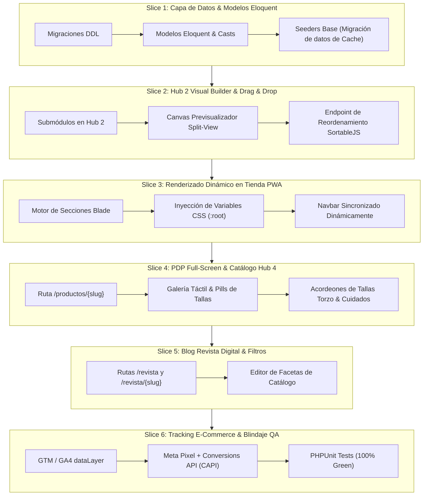
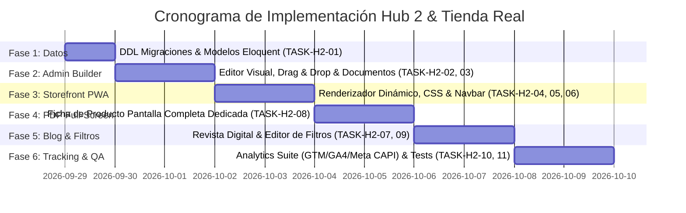

# Plan de Implementación Fullstack: Hub 2 (CMS & Editor Visual) & Conexión Reactiva con la Tienda Real PWA

**Rama de Trabajo:** `feature/hub2-real-store-integration`  
**Roles de Ejecución:** Senior Fullstack Architect | Lead UX/UI Designer | Lead QA Engineer  
**Paradigma:** Vertical Slice Architecture & Decoupled Headless CMS (DDL $\rightarrow$ Modelos $\rightarrow$ Servicios $\rightarrow$ Admin Builder Hub 2 $\rightarrow$ Storefront PWA $\rightarrow$ Pruebas Automatizadas)  
**Dependencias Contractuales:** [`docs/CMS_ROADMAP.md`](file:///c:/laragon/www/mi-tienda-online/docs/CMS_ROADMAP.md), [`docs/BACKEND_INTEGRATION_SPEC.md`](file:///c:/laragon/www/mi-tienda-online/docs/BACKEND_INTEGRATION_SPEC.md), [`docs/PENDING_TASKS.md`](file:///c:/laragon/www/mi-tienda-online/docs/PENDING_TASKS.md)

---

## 1. Visión y Diagnóstico de Desacoplamiento Real

El propósito de esta intervención es eliminar la simulación por caché en el **Hub 2: Tienda & CMS Multiverso** y conectarlo de manera bidireccional y reactiva con la tienda pública real (**PWA Mobile-First**) y el inventario físico centralizado de **Hub 4**.

### 1.1. Brecha Técnica Actual vs. Estado Objetivo

| Vector de Control | Estado Actual en Repositorio | Brecha Técnica Resuelta en este Plan |
| :--- | :--- | :--- |
| **Persistencia CMS** | Arreglos volátiles en memoria/caché (`Cache::get('cms_storefront_marte')`). Se resetean al limpiar caché. | Capa de persistencia DDL en base de datos (`cms_sections`, `cms_storefront_configs`, `cms_pages`, `cms_blog_posts`, `cms_official_documents`, `cms_tracking_settings`). |
| **Arquitectura de Secciones** | Home rígido cableado en [`resources/views/store/pwa/home.blade.php`](file:///c:/laragon/www/mi-tienda-online/resources/views/store/pwa/home.blade.php). | Motor de secciones dinámicas modulares con Drag & Drop (`SortableJS`), renderizado polimórfico y soporte para HTML/CSS/JS custom aislado. |
| **Ficha de Producto (PDP)** | Apertura forzada de un Drawer/Modal mediante parámetro `autoOpenProductId` sobre el home. | Pantalla completa dedicada en ruta `/productos/{slug}` sin drawers, con carrusel táctil, variantes reales de Hub 4, SEO estructurado y sticky bottom bar móvil. |
| **Páginas Institucionales** | Rutas estáticas desconectadas. | CRUD de páginas administrables sincronizadas automáticamente en el Navbar móvil y de escritorio. |
| **Revista Digital / Blog** | Inexistente. | CMS editorial completo para artículos, categorías, tags, autores y schema JSON-LD para posicionamiento orgánico. |
| **Editor de Filtros** | Valores de marcas predefinidos en código. | Gestor interactivo de taxonomías de catálogo (Universos, Familias, Categorías, Subcategorías, Tags) con control de visibilidad. |
| **Analítica y Píxeles** | Inyecciones manuales ausentes o inconsistentes. | Suite unificada de tracking (GTM, GA4, Meta Pixel y Meta Conversions API en backend con deduplicación por `event_id`). |

---

## 2. Matriz de Tareas Oficiales del Programa (Hub 2)

| ID Tarea | Nombre Operativo | Requerimiento Base | Responsables | Estado |
| :--- | :--- | :--- | :--- | :---: |
| `TASK-H2-01` | **DDL & Capa de Persistencia Relacional CMS** | Arquitectura de datos para configuraciones, secciones, páginas, blog y tracking. | Fullstack | 📋 Planificada |
| `TASK-H2-02` | **Motor Drag & Drop de Secciones en Hub 2** | Creación y ordenamiento arrastrable de secciones basadas en taxonomías o código custom. | Fullstack / UX | 📋 Planificada |
| `TASK-H2-03` | **Gestor de Contenidos Oficiales & Documentación** | CRUD de guías de tallas Torzo, protocolos de cuidado textil y avisos normativos PROFECO. | Fullstack / UX | 📋 Planificada |
| `TASK-H2-04` | **CMS de Páginas Dinámicas & Sincronización Navbar** | Creación de páginas institucionales con enlaces dinámicos en el Navbar y Drawer. | Fullstack / UX | 📋 Planificada |
| `TASK-H2-05` | **Motor de Paletas Globales & Personalización CSS** | Configuración de colores primarios, acento, fondo y fuentes por universo en `:root`. | Fullstack / UX | 📋 Planificada |
| `TASK-H2-06` | **Renderizador Modular en Storefront PWA (Mobile-First)** | Sustitución del home estático por el renderizador dinámico de secciones de BD. | Fullstack / UX | 📋 Planificada |
| `TASK-H2-07` | **CMS de Blog para Revista Digital & SEO** | Módulo de artículos con categorías, tags, imágenes WebP y metadatos SEO/OpenGraph. | Fullstack / UX | 📋 Planificada |
| `TASK-H2-08` | **Ficha de Producto (PDP) a Pantalla Completa Dedicada** | Refactorización de `/productos/{slug}` sin modales ni drawers, con variantes en vivo de Hub 4. | Fullstack / UX | 📋 Planificada |
| `TASK-H2-09` | **Editor Dinámico de Filtros y Taxonomías** | Gestor de filtros en catálogo sincronizado con categorías, familias y marcas de Hub 4. | Fullstack / UX | 📋 Planificada |
| `TASK-H2-10` | **Suite de Tracking & Analítica (GTM, GA4, Meta Pixel/CAPI)** | Inyección de scripts y eventos del lado del servidor para medición de conversiones. | Fullstack / QA | 📋 Planificada |
| `TASK-H2-11` | **Batería de Pruebas Automatizadas & Auditoría QA** | Pruebas de integración, verificación de regresión con Hub 4 y auditoría Lighthouse PWA. | QA Lead | 📋 Planificada |

---

## 3. Especificación Arquitectónica Detallada por Vertical Slice



---

### Slice 1: Capa de Persistencia DDL y Modelos Eloquent (`TASK-H2-01`)
* **Migración `2026_09_28_000001_create_cms_hub2_tables.php`:**
  1. `cms_storefront_configs`: Almacena paletas de colores (`primary_color`, `accent_color`, `background_color`, `surface_color`, `text_color`), tipografías, metadatos SEO globales y fragmentos de CSS/JS personalizados por universo (`terra`, `marte`, `venus`, `tiresias`).
  2. `cms_sections`: Soporta las secciones arrastrables del Home.
     - Columnas: `id`, `universe`, `name`, `type` (enum: `hero_carousel`, `categories_grid`, `family_showcase`, `subcategories_slider`, `tags_cloud`, `custom_html_css_js`, `curated_products`, `brand_pillars`, `editorial_banner`), `title`, `subtitle`, `query_rules` (JSON: reglas de filtrado conectadas a productos de Hub 4), `custom_html`, `custom_css`, `custom_js`, `sort_order` (integer), `status` (enum: `active`, `draft`, `archived`), `timestamps`.
  3. `cms_pages`: Páginas estáticas/institucionales.
     - Columnas: `id`, `slug` (unique), `title`, `content_html`, `show_in_navbar` (boolean), `navbar_order` (integer), `show_in_footer` (boolean), `seo_title`, `seo_description`, `status` (`active`, `draft`), `timestamps`.
  4. `cms_blog_posts`: Revista Digital.
     - Columnas: `id`, `slug` (unique), `title`, `excerpt`, `body`, `featured_image`, `category_name`, `tags` (JSON), `author_name`, `reading_time_minutes`, `seo_meta` (JSON), `status` (`draft`, `published`, `archived`), `published_at`, `timestamps`.
  5. `cms_official_documents`: Guías oficiales de tallas, protocolos de cuidado textil y normativas sanitarias.
     - Columnas: `id`, `code` (ej: `SIZE_GUIDE_TORZO`, `CARE_PROTOCOLS`, `PROFECO_SANITARY_NOTICE`), `title`, `payload` (JSON estructurado), `version`, `is_active`, `timestamps`.
  6. `cms_tracking_settings`:
     - Columnas: `id`, `gtm_id`, `ga4_measurement_id`, `facebook_pixel_id`, `facebook_capi_token`, `facebook_test_event_code`, `is_active`, `timestamps`.

---

### Slice 2: Hub 2 Visual Builder & Editor Drag & Drop (`TASK-H2-02`, `TASK-H2-03`)
* **Panel de Control Hub 2 (`resources/views/portal/store.blade.php`):**
  - **Pestaña 1: Editor Visual & Paletas:** Controles HSL/Hex interactivos para colores globales y tipografías con vista previa inmediata.
  - **Pestaña 2: Secciones & Drag and Drop:** Listado de secciones activas con tiradores de arrastre basados en `SortableJS`. 
  - **Modal de Creación de Sección:** Selector de origen (Categorías, Familias, Subcategorías, Tags de Hub 4 o Banners con editor HTML/CSS/JS con resaltado de sintaxis).
  - **Reordenamiento Atómico:** Endpoint `POST /admin/tienda-cms/sections/reorder` que actualiza los índices `sort_order` de todas las secciones en una única transacción de base de datos.
  - **Pestaña de Documentos Normativos:** Editor tabular para la Guía de Tallas Torzo (CH a 3XL con medidas en cm de cintura/cadera y pantalón), Protocolos de Lavado y Avisos Sanitarios PROFECO.

---

### Slice 3: Renderizado Dinámico en Tienda PWA & Navbar Sincronizado (`TASK-H2-04`, `TASK-H2-05`, `TASK-H2-06`)
* **Inyección de Estilos en `<head>`:**
  - El layout [`resources/views/layouts/store-pwa.blade.php`](file:///c:/laragon/www/mi-tienda-online/resources/views/layouts/store-pwa.blade.php) inyecta las variables CSS semánticas dinámicamente en `:root` según la vitrina activa:
    ```html
    <style id="hub2DynamicTheme">
      :root {
        --color-primary: {{ $storefrontConfig->primary_color }};
        --color-accent: {{ $storefrontConfig->accent_color }};
        --color-bg: {{ $storefrontConfig->background_color }};
        --color-surface: {{ $storefrontConfig->surface_color }};
      }
      {!! $storefrontConfig->custom_css !!}
    </style>
    ```
* **Renderizador de Secciones:**
  - `resources/views/store/pwa/home.blade.php` itera sobre `$sections` (ordenadas por `sort_order`) y renderiza componentes Blade modulares (`store.pwa.sections.*`).
* **Sincronización del Navbar:**
  - Las páginas de `cms_pages` marcadas con `show_in_navbar = true` se inyectan mediante un View Composer global en el menú lateral y la barra de navegación.

---

### Slice 4: Detalle de Producto (PDP) a Pantalla Completa Dedicada (`TASK-H2-08`)
* **Refactorización de `/productos/{slug}`:**
  - La ruta se desliga de la apertura de modales en el Home. Se genera una vista Blade nativa dedicada: `resources/views/store/pwa/product-detail.blade.php`.
* **Especificaciones UX/UI Senior:**
  - **Carrusel Táctil de Alta Resolución:** Deslizamiento por gestos *swipe* en móviles, zoom modal progresivo y soporte WebP optimizado con placeholders de baja resolución (LQIP).
  - **Selector de Tallas Ergonómico:** Botones de gran formato táctil (&ge; 48px de altura) con validación de inventario en tiempo real proveniente de las variantes de Hub 4 (`ProductVariant` y `Inventory`). Las tallas sin stock muestran estado visual inhabilitado.
  - **Acordeones de Información Desplegable:**
    1. *Descripción y Composición de Tejido:* Fibras naturales (modal pima, viscosa de bambú) y elasticidad.
    2. *Guía Interactiva de Tallas Torzo:* Despliegue de la matriz antropométrica oficial gestionada en `cms_official_documents`.
    3. *Protocolos de Cuidado Textil:* Instrucciones de lavado para microfibras y prendas delicadas.
    4. *Garantía Sanitaria y Empaque Discreto:* Fundamentación legal PROFECO para prendas íntimas con precinto termosellado.
  - **Sticky Bottom Action Bar:** Barra fija en la parte inferior de la pantalla para móviles con el precio actual, indicador de envío gratis o flete, y botón de llamada a la acción "AGREGAR AL CARRITO" con feedback háptico.

---

### Slice 5: CMS de Blog (Revista Digital) & Editor de Filtros (`TASK-H2-07`, `TASK-H2-09`)
* **Revista Digital:**
  - Rutas públicas:
    - `GET /revista`: Feed editorial en cuadrícula responsiva tipo tarjeta con artículos destacados, tiempo de lectura y filtros por categoría temática.
    - `GET /revista/{slug}`: Lectura inmersiva con tipografía editorial optimizada, autor, fecha, botones para compartir y bloque de productos relacionados recomendados de la tienda.
* **Editor de Filtros de Catálogo:**
  - Panel administrativo en Hub 2 para activar, desactivar y renombrar las facetas de búsqueda del catálogo público:
    - Universos (Terra, Marte, Venus, Tiresias).
    - Familias textiles (Underwear, Activewear, Loungewear, Skincare).
    - Categorías y Subcategorías sincronizadas con la base de datos de Hub 4.
    - Curva de Tallas (CH, M, G, XL, 2XL, 3XL).
    - Rango de precios dinámico.

---

### Slice 6: Suite de Tracking & Analítica E-Commerce (`TASK-H2-10`)
* **Google Tag Manager & Google Analytics 4:**
  - Inyección configurable del script de GTM en `<head>` y `<noscript>` en `<body>`.
  - Capa de datos `dataLayer` estandarizada para e-commerce GA4:
    - `view_item_list` (al navegar por secciones o catálogo).
    - `view_item` (en la PDP a pantalla completa).
    - `add_to_cart` (al añadir variantes desde el Sticky Bar).
    - `begin_checkout` y `purchase` (en el embudo transaccional).
* **Meta Pixel & Meta Conversions API (CAPI):**
  - Eventos de Pixel en cliente para eventos de navegación.
  - Servicio de backend `MetaConversionsApiService` para reportar eventos críticos (`Purchase`, `InitiateCheckout`) directamente de servidor a servidor vía HTTP Graph API de Meta.
  - Mecanismo de deduplicación mediante `event_id` idéntico generado en la sesión y transmitido en ambos canales.

---

## 4. Estrategia de Calidad y Criterios de Aceptación (QA Lead)

### 4.1. Batería de Pruebas Automatizadas (`TASK-H2-11`)
Se desarrollarán y verificarán las siguientes suites en `tests/Feature/`:
1. `tests/Feature/Hub2CmsPersistenceTest.php`:
   - Creación, actualización y archivado de secciones, banners y páginas.
   - Verificación de transacción atómica en reordenamiento de secciones.
2. `tests/Feature/StorefrontDynamicSectionsTest.php`:
   - Comprobación de que el Home PWA renderiza exactamente las secciones activas en el orden establecido en base de datos.
   - Validación de inyección de variables CSS y código custom sin escape de estilos.
3. `tests/Feature/StorefrontPdpFullScreenTest.php`:
   - Acceso directo a `/productos/{slug}` devolviendo código HTTP 200 sin cargar el modal ni dependencias del feed del home.
   - Comprobación de la disponibilidad real de variantes cruzadas contra el inventario de Hub 4.
   - Visualización de la Guía de Tallas Torzo y protocolos de cuidado desde la base de datos de documentos oficiales.
4. `tests/Feature/StorefrontBlogCmsTest.php`:
   - Navegación al índice de la revista `/revista` y al artículo individual `/revista/{slug}`.
   - Validación de tags Open Graph y schema structured data JSON-LD.
5. `tests/Feature/StorefrontTrackingIntegrationTest.php`:
   - Verificación de la presencia condicional de etiquetas de GTM, GA4 y Meta Pixel según la configuración activa.

### 4.2. Criterios de Aceptación de UX y PWA
- **Lighthouse Performance Score:** $\ge 90$ en móvil.
- **Cumulative Layout Shift (CLS):** $< 0.1$ durante la carga de secciones dinámicas y carruseles.
- **Accesibilidad (WCAG 2.1 AA):** Contraste cromático validado automáticamente al modificar paletas de color en el editor visual.
- **PWA Standalone Compliance:** Funcionamiento garantizado con Service Worker activo y navegación fluida sin recargas bruscas.

---

## 5. Cronograma Secuencial de Ejecución


