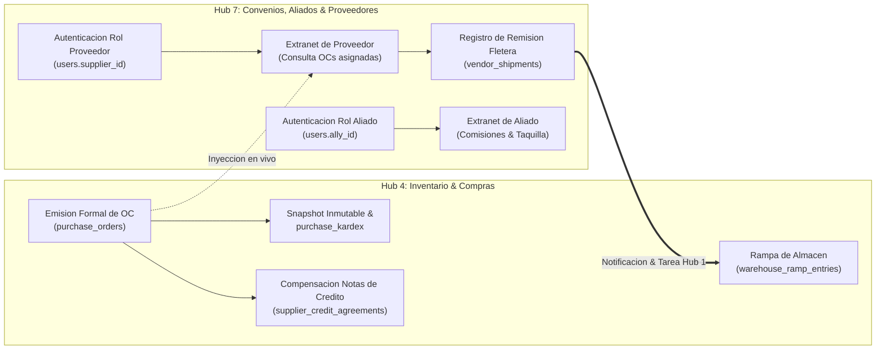
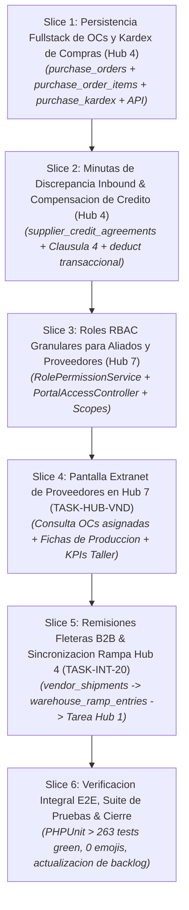

# Plan Maestro de Implementacion: Hub 4 (Compras & Kardex Inmutable) y Hub 7 (Extranet B2B de Proveedores & Aliados)
## Plataforma RevOps E-Commerce Multiverso & Suscripciones (Mi Tienda Online)

> **Contexto de Arquitectura:**  
> Este documento rige la implementacion fullstack de la persistencia real de Compras (`TASK-INV-16`, `TASK-PUR-01` a `TASK-PUR-04`) en el Hub 4 y el despliegue del Portal Extranet de Proveedores (`TASK-HUB-VND`) y Aliados residiendo en el Hub 7, con roles RBAC granulares asociados a la entidad comercial correspondiente.  
> **Rama de Trabajo:** `feature/hub4-compras-proveedores-extranet`  
> **Referencias Normativas:** [MASTER_ROADMAP.md](file:///c:/laragon/www/mi-tienda-online/docs/MASTER_ROADMAP.md), [PENDING_TASKS.md](file:///c:/laragon/www/mi-tienda-online/docs/PENDING_TASKS.md), [BACKEND_INTEGRATION_SPEC.md](file:///c:/laragon/www/mi-tienda-online/docs/BACKEND_INTEGRATION_SPEC.md), [INVENTORY_ROADMAP.md](file:///c:/laragon/www/mi-tienda-online/docs/INVENTORY_ROADMAP.md) y [ALLIES_ROADMAP.md](file:///c:/laragon/www/mi-tienda-online/docs/ALLIES_ROADMAP.md).  
> **Regla de Oro:** Se prohibe terminantemente el uso de emoticones o emojis en codigo, vistas, comentarios, mensajes de commit y documentacion (Regla 1). La carpeta `import/` permanece estrictamente de solo lectura.

---

## 1. Vision Estrategica y Diagnostico de Dominio

El ecosistema actual cuenta con un Catálogo de Inventario avanzado (tallas dinamicas, auto-SKU, copiloto IA y modal panoramico en Hub 4), pero el circuito de compras, abastecimiento mayorista y conexion con terceros mantiene dos brechas operativas criticas:

1. **Persistencia y Trazabilidad Mercantil en Compras (Hub 4):**
   - La emision de Ordenes de Compra (`purchase_orders`), las partidas de tallas (`purchase_order_items`) y las deducciones por acuerdos comerciales requieren conexion fullstack estricta contra base de datos MySQL, erradicando estados volátiles en cliente.
   - Las discrepancias fisicas detectadas en rampa (piezas faltantes, defectos de confeccion o danos) deben plasmarse en minutas formales de discrepancia (`supplier_credit_agreements`), amparando compensaciones que se deduzcan con validez fiscal y juridica en la siguiente OC del fabricante.
   - Cada evento debe emitir un asiento inmutable en la bitacora forense `purchase_kardex` (`PO_CREATED`, `PO_DISPATCHED`, `CREDIT_APPLIED`, `PO_RECEIVED_PARTIAL`, `PO_CLOSED`).

2. **Extranet B2B Supeditada a Roles en Hub 7 (Convenios, Aliados & Proveedores):**
   - Por definicion de negocio, la **Extranet de Proveedores reside en el Hub 7**, centralizando las relaciones con actores externos (talleres de confeccion, fabricantes de cosmetica y aliados comerciales).
   - Se requiere la creacion y segregacion de dos roles RBAC externos:
     - **Rol Proveedor (`vendor` / `supplier`):** Inicia sesion o accede a su modulo en Hub 7, estando **estrictamente supeditado al proveedor (`supplier_id`)** registrado en el sistema (ej. Torzo B2B, ModaIntima, Silk & Cotton). Solo visualiza las OCs emitidas a su empresa, fichas tecnicas, curvas de tallas requeridas, estado de pagos y puede registrar remisiones fleteras hacia la rampa central de Hub 4.
     - **Rol Aliado (`ally` / `partner`):** Inicia sesion o accede a su modulo en Hub 7, estando **estrictamente supeditado al aliado comercial (`ally_id`)** y su categoria de nicho (fiestas/circuit, creadores OnlyFans, saunas, DJs, salones de belleza, drag/ballroom). Visualiza sus codigos promocionales, enlaces UTM, comisiones devengadas, validador de taquilla y liquidaciones SPEI.

---

## 2. Arquitectura de Roles y Control de Acceso Granular (RBAC)

Para evitar fugas de informacion confidencial entre fabricantes competidores y entre aliados comerciales, se definen los siguientes perfiles de acceso:

| Rol | Tipo de Actor | Pantalla / Modulo Destino | Restriccion de Dominio (Scope) | Capacidades Clave |
| :--- | :--- | :--- | :--- | :--- |
| `vendor` | Externo (Proveedor) | **Hub 7: Extranet Proveedores** | `WHERE supplier_id = auth()->user()->supplier_id` | Consulta de OCs en produccion, descarga de PDF de compra, envio de confirmacion de recepcion, registro de remisiones con guia fletera. |
| `ally` | Externo (Aliado) | **Hub 7: Extranet Aliados** | `WHERE ally_id = auth()->user()->ally_id` | Telemetria de cupones, conversion CAPI, validador de accesos QR en taquilla, consulta de liquidaciones en camara de compensacion. |
| `purchases` | Interno (Elena Compras) | **Hub 4: Compras & Reabastecimiento** | Global Compras | Planificacion de compras, generacion de POs, aplicacion de compensaciones mercantiles, comunicacion con proveedores. |
| `warehouse` | Interno (Carlos Almacen) | **Hub 4: Almacen & Rampa** | Operativo Fisico (Cero Finanzas) | Recepcion de camionetas en rampa contra remision B2B, cotejo fisico por tallas y slotting. |
| `superadmin` | Interno (Direccion) | **Todos los Hubs (1 a 8)** | Global Irrestricto | Gobernanza total, auditoria omnicanal, conmutador de roles y sobreescritura de politicas. |

---

## 3. Modelo de Datos y Esquema Relacional

### 3.1. Extension de Usuarios (`users`)
- `supplier_id` (`unsignedBigInteger`, `nullable`, `foreign` a `suppliers.id`): Vincula al usuario con un proveedor especifico cuando su rol es `vendor`.
- `ally_id` (`unsignedBigInteger`, `nullable`, `foreign` a `allies.id`): Vincula al usuario con un aliado especifico cuando su rol es `ally`.

### 3.2. Ordenes de Compra y Partidas (`purchase_orders`, `purchase_order_items`)
- `purchase_orders`:
  - `id`, `po_number` (`string` unico, ej. `PO-2026-0042`), `supplier_id`, `status` (`draft`, `pending`, `confirmed`, `in_production`, `in_transit`, `received_partial`, `received_full`, `cancelled`).
  - `subtotal_amount`, `credit_deduction_amount`, `tax_base_amount`, `tax_amount` (IVA 16%), `total_amount`.
  - `priority` (`baja`, `media`, `alta`, `critica`), `credit_agreement_id` (`nullable`).
  - `notes`, `expected_delivery_date`, `sent_at`, `received_at`, `po_snapshot` (`json` inmutable).
- `purchase_order_items`:
  - `id`, `purchase_order_id`, `product_id`, `product_variant_id` (`nullable`), `size_name` (`nullable`), `quantity`, `unit_cost`, `subtotal`.

### 3.3. Bitacora Inmutable de Compras (`purchase_kardex`)
- `id`, `purchase_order_id` (`nullable`), `supplier_id`, `action_type` (`PO_CREATED`, `PO_SENT`, `PO_CONFIRMED_VENDOR`, `PO_DISPATCHED_VENDOR`, `CREDIT_APPLIED`, `PO_RECEIVED_RAMP`, `PO_DISCREPANCY_REGISTERED`).
- `description`, `total_amount`, `user_id` (`nullable`), `created_at`. Inmutable contra `UPDATE` y `DELETE`.

### 3.4. Acuerdos y Minutas de Discrepancia Inbound (`supplier_credit_agreements`)
- `id`, `folio` (`NC-TORZO-XXXX`), `supplier_id`, `purchase_order_id` (`nullable`), `amount`, `status` (`pending`, `applied`, `cancelled`).
- `reason` (`missing_units`, `damaged_units`, `fabric_defect`, `commercial_rebate`), `discrepancy_minutes` (`text`), `formal_agreement_doc` (`nullable`), `applied_to_po_id` (`nullable`).

### 3.5. Remisiones Fleteras B2B (`vendor_shipments`)
- `id`, `purchase_order_id`, `supplier_id`, `remission_number`, `courier_name` (`Castores`, `Potosinos`, `Tres Guerras`, `DHL`, `Propio`), `tracking_number`.
- `packages_count`, `estimated_delivery_date`, `shipped_at`, `driver_name`, `driver_phone`, `vehicle_plates`, `status` (`in_transit`, `delivered_ramp`, `rejected`).

---

## 4. Desglose del Programa de Implementacion por Vertical Slices

---

### Slice 1: Persistencia Fullstack de Ordenes de Compra y Kardex de Compras (Hub 4)
* **Objetivo:** Conectar la emision, reimpresion y gestion de Ordenes de Compra en Hub 4 con persistencia relacional real en base de datos, calculo fiscal estricto y bitacora inmutable.
* **Backend:**
  - `StorefrontController::portalInventory`:
    - Hidratacion directa desde base de datos de `$portalPurchaseOrders` (`PurchaseOrder::with(['supplier', 'items.product', 'items.variant'])->latest()->get()`).
    - Hidratacion de `$portalPurchaseKardex` (`PurchaseKardex::with(['supplier', 'purchaseOrder'])->latest()->get()`).
  - `InventoryApiController`:
    - Endpoint `POST /api/v1/inventory/purchases/orders`: Valida proveedor existente, partidas por talla, recalcula subtotales e IVA 16%, crea registros en `purchase_orders` y `purchase_order_items`, genera `po_snapshot` JSON y asienta `PO_CREATED` en `purchase_kardex`.
    - Endpoint `POST /api/v1/inventory/purchases/orders/{id}/dispatch`: Actualiza estatus a `in_transit`, asienta `PO_SENT` en `purchase_kardex` y dispara notificacion al bus de eventos.
* **Frontend:**
  - `resources/views/portal/inventory.blade.php` e `inventory-module.js`:
    - El formulario de emision de POs invoca directamente al endpoint RESTful.
    - Actualizacion reactiva del repositorio de OCs activas e historial de Kardex sin recargar pantalla.
    - Soporte de reimpresion continua en iframe aislado mediante el snapshot guardado.
* **Pruebas:** `tests/Feature/Inventory/PurchaseOrderPersistenceTest.php` validando transacciones ACID, calculos fiscales y creacion de asientos inmutables.

---

### Slice 2: Minutas de Discrepancia Inbound y Compensacion de Notas de Credito (Hub 4)
* **Objetivo:** Formalizar la captura de acuerdos por diferencias en rampa y permitir su deduccion automatica en la siguiente OC del proveedor.
* **Backend:**
  - Migracion y actualizacion de `supplier_credit_agreements` asegurando columnas `folio`, `discrepancy_minutes`, `reason`, `amount`, `status`, `applied_to_po_id`.
  - `InventoryApiController`:
    - `POST /api/v1/inventory/purchases/credit-agreements`: Registro formal de minuta de discrepancia por rampa.
    - Logica en `storePurchaseOrder`: Al recibir `credit_agreement_id`, valida que el acuerdo pertenezca al proveedor, deduce el importe de la base gravable, marca el acuerdo como `applied` y emite el asiento `CREDIT_APPLIED` en `purchase_kardex`.
* **Frontend:**
  - Modal de Minuta de Discrepancia Inbound: captura de motivo, piezas afectadas, resolucion acordada y generacion del acta.
  - Generador de PO (`po-discrepancy-panel`): selector desplegable de notas de credito del proveedor seleccionado; al elegir una, inserta la Clausula 4 en el PDF de la orden y recalcula el neto a liquidar.
* **Pruebas:** `tests/Feature/Inventory/SupplierCreditAgreementTest.php` comprobando la deduccion mercantil, cambio de estado del credito y proteccion contra doble aplicacion.

---

### Slice 3: Roles RBAC Granulares para Aliados y Proveedores en Hub 7 (COMPLETADO)
* **Objetivo:** Equipar al sistema de gobernanza con los roles formales `vendor` y `ally`, asociando cada cuenta de usuario a su entidad comercial especifica con aislamiento estricto multi-inquilino.
* **Backend:**
  - Migracion `2026_09_28_000000_add_supplier_id_and_ally_id_to_users_table.php`: agrega `supplier_id` y `ally_id` a la tabla `users` con claves foraneas protegidas (`nullOnDelete()`) e indices compuestos.
  - Modelo `User`: casts, relaciones `supplier()` y `ally()`, helpers booleanos `isVendor()` e `isAlly()`, mapeo de seguridad en `canAccessHub()` restringiendo a proveedores a `vendor_extranet` y a aliados a `ally_extranet`, y restriccion automatica de acceso financiero.
  - Middleware `EnsureEntityIsolation` (`entity.isolation`): valida que el usuario autenticado solo pueda consultar registros vinculados a su `supplier_id` o `ally_id`, inyectando atributos de entidad en el request y denegando el paso con HTTP 403 a usuarios huerfanos.
  - Extension de `PortalAccessController::switchRole`: permite alternar en entornos de prueba a perfiles con rol `vendor` y `ally` con registro automatico de auditoria en `system_audit_logs`.
  - Matriz de Gobernanza en `PortalGovernanceController`: roles `vendor` y `ally` agregados con sus respectivas descripciones y alcances.
* **Pruebas:** `tests/Feature/Governance/EntityRbacIsolationTest.php` (11/11 tests pasando, 43 aserciones).
* **Frontend:**
  - Conmutador visual de rol en Navbar / Governance con soporte para los nuevos roles.
  - Filtrado del Sidebar: al entrar con rol `vendor` o `ally`, la navegacion se restringe exclusivamente al Hub 7 con su pantalla correspondiente.
* **Pruebas:** `tests/Feature/Governance/EntityRbacIsolationTest.php` validando que un proveedor no pueda acceder a datos de otro proveedor ni a modales administrativos.

---

### Slice 4: Pantalla Extranet de Proveedores en Hub 7 (`TASK-HUB-VND`)
* **Objetivo:** Construir la interfaz dedicada para fabricantes y talleres dentro del Hub 7, supeditada al proveedor asociado en sesion.
* **Backend:**
  - `VendorPortalController`: Controlador dedicado para el Hub 7 Extranet.
  - Endpoints RESTful:
    - `GET /api/v1/hub7/vendor/dashboard`: 4 KPIs contextuales (OCs en cola, piezas en costura/ensamble, remisiones despachadas, saldo de notas de credito).
    - `GET /api/v1/hub7/vendor/orders`: Listado de OCs asignadas al proveedor con filtros por estatus.
    - `GET /api/v1/hub7/vendor/orders/{id}/pdf`: Descarga del PDF formal de compra con ficha tecnica y curvas de tallas.
* **Frontend:**
  - Vista Blade: `resources/views/portal/hub7-vendor-extranet.blade.php`.
  - Diseno ergonomico sin emojis: tarjetas KPI de alto contraste, tabla de OCs con barra de progreso de produccion, visor de especificaciones tecnicas y boton para confirmar recepcion de orden.
* **Pruebas:** `tests/Feature/Hub7/VendorExtranetOrdersTest.php` evaluando la carga de datos del taller, descarga de documentos y proteccion de acceso.

---

### Slice 5: Remisiones Fleteras B2B y Sincronizacion con Rampa Hub 4 (`TASK-INT-20`)
* **Objetivo:** Permitir al proveedor registrar el despacho fletero de una orden y notificar automaticamente a la rampa de almacen central.
* **Backend:**
  - Modelo y migracion `vendor_shipments`.
  - Endpoint `POST /api/v1/hub7/vendor/shipments`: Captura numero de remision, fletera, guia, bultos y chofer.
  - Evento de dominio `VendorShipmentDispatched`:
    - Inserta registro en `warehouse_ramp_entries` de Hub 4 con estatus `expected`.
    - Genera tarea prioritaria en Hub 1 (`OperationalTask`) para el Almacenista: *"Llegada Prevista Fletera: Remision REM-XXXX de Torzo Labs"*.
    - Actualiza estatus de la PO a `in_transit` y genera asiento en `purchase_kardex`.
* **Frontend:**
  - Modal de Despacho y Remision en la Extranet del Proveedor (Hub 7).
  - Reflejo reactivo en la vista de Rampa de Almacen en Hub 4.
* **Pruebas:** `tests/Feature/Hub7/VendorShipmentRampSyncTest.php` validando la creacion de la remision, insercion en rampa y notificacion en Hub 1.

---

### Slice 6: Verificacion Integral E2E, Suite de Pruebas & Sincronizacion de Documentacion
* **Objetivo:** Garantizar la estabilidad total del sistema y certificar la paridad del circuito Compras $\leftrightarrow$ Extranet $\leftrightarrow$ Rampa.
* **Acciones:**
  - Ejecucion de la suite completa de pruebas: `php artisan test` (superando las 263 pruebas existentes sin regresiones).
  - Auditoria estricta de CERO emojis en codigo, vistas Blade, controladores, migraciones y commits.
  - Actualizacion de estado en [PENDING_TASKS.md](file:///c:/laragon/www/mi-tienda-online/docs/PENDING_TASKS.md), [INVENTORY_ROADMAP.md](file:///c:/laragon/www/mi-tienda-online/docs/INVENTORY_ROADMAP.md) y [ALLIES_ROADMAP.md](file:///c:/laragon/www/mi-tienda-online/docs/ALLIES_ROADMAP.md).
