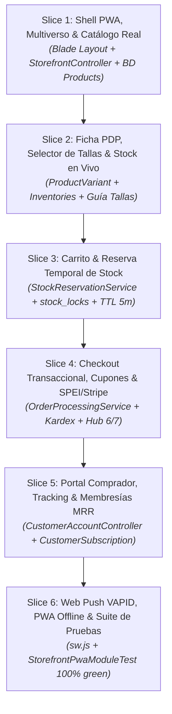

# Plan de Implementación Fullstack: Prioridad 1 — Tienda Pública D2C Multiverso (PWA)

**Perfil de Ejecución:** Senior Fullstack Architect & Lead Engineer  
**Rama de Trabajo:** `feature/prioridad-1-storefront-pwa`  
**Línea Base:** `master@baseline-master` (Commit `0205590`)  
**Paradigma:** Vertical Slice Architecture (BD $\rightarrow$ Modelos $\rightarrow$ Servicios $\rightarrow$ Endpoints $\rightarrow$ UI Reactiva $\rightarrow$ Pruebas)  

---

## 1. Filosofía Fullstack: Cero UI Desconectada (Vertical Slices Reales)

Bajo este plan **no se realiza ninguna integración cosmética superficial ni maquetas con datos falsos (mock)**. Cada paso del programa se construye como un **Vertical Slice completo** que conecta:
1. **Persistencia y Modelo de Datos:** Tablas MySQL, migraciones, modelos Eloquent con casts, relaciones y scopes.
2. **Lógica de Negocio y Transaccionalidad:** Servicios de dominio con transacciones ACID (`DB::transaction()`), bloqueos pesimistas (`lockForUpdate()`), inmutabilidad contable en Kardex y disparo de eventos.
3. **Capa de Transporte (HTTP / REST):** FormRequests con validación estricta, controladores Laravel y endpoints JSON consistentes con `BACKEND_INTEGRATION_SPEC.md`.
4. **Frontend Reactivo PWA:** Blade semántico, hidratación de datos del servidor, Alpine.js / Vanilla JS ligero, Service Worker y CSS modular aislado (`store-pwa.css`).
5. **Blindaje de Calidad:** Pruebas de integración en `tests/Feature/` verificando base de datos real, cabeceras HTTP, 0 emojis y 100% de éxito en PHPUnit.

---

## 2. Diagnóstico del Backend Actual vs. Requerimientos de la Tienda D2C

Tras auditar la base de datos y el código backend en `database/migrations/`, `app/Models/` y `app/Services/`:

| Componente | Estado Actual en Backend | Brecha a Resolver en esta Prioridad |
| :--- | :--- | :--- |
| **Catálogo Multiverso** | Modelos `Product` y `ProductVariant` existentes. 259 SKUs reales en BD. | Exponer consulta con stock disponible real (`quantity - reserved`), agrupado por universos (*Marte, Venus, Tiresias, Terra*) y curva de 6 tallas textiles (`CH-3XL`). |
| **Reserva de Stock (5m)** | Tabla `stock_locks` y modelo `StockLock` existentes en migración `2026_09_20_000001`. `StockReservationService` básico creado. | Conectar la reserva temporal en checkout con TTL de 300 segundos, expiración atómica y liberación automática devolviendo existencias al pool disponible. |
| **Carrito Persistente** | Tablas `carts` y `cart_items` existentes. | Sincronización transparente de sesión para invitados y clientes registrados, consolidando líneas locales y bajo demanda. |
| **Reglas de Flete & Umbral** | `cms_shipping_rule` configurado en cache desde el Hub 6. | Consumo dinámico del umbral de \$999 MXN para envío gratis, tarifa plana \$149 MXN y exclusión de puntos físicos en checkout público. |
| **Cupones y Convenios B2B** | Tablas `allies` y `ally_coupons_dir_b` con seeders operativos del Hub 7. | Endpoint de validación y aplicación de cupones (`PARADISO15`, `ALEXRIVERA`, etc.) con cálculo del descuento en la orden y atribución en sesión. |
| **Checkout Transaccional** | Modelo `Order` y `OrderItem` existentes. | Servicio de checkout que crea la orden oficial, transmuta `stock_locks` en compra cerrada, genera salida de Kardex (`SALIDA_VENTA_ONLINE`) y registra el margen financiero en `order_financial_margins`. |
| **Portal del Comprador** | Modelo `CustomerSubscription` y tabla `orders` existentes. | Endpoint y vistas para consulta de pedidos del cliente por email/folio, seguimiento courier y autogestión de membresías MRR. |

---

## 3. Desglose del Programa de Implementación en Vertical Slices

---

### Slice 1: Shell Base PWA, Conmutador Multiverso y Catálogo Real de Base de Datos
* **Backend:**
  - `StorefrontController::home()` y `StorefrontController::catalog()`: Consulta optimizada de `Product::with(['variants.inventories', 'categories'])->where('visible', true)`.
  - Scopes de universo (`scopeForUniverse($query, $universe)`) para filtrar productos de *Marte, Venus, Tiresias y Terra*.
  - Cache de catálogo público con invalidación ante actualizaciones de stock.
* **Frontend:**
  - Layout maestro `resources/views/layouts/store-pwa.blade.php` con tipografía Plus Jakarta Sans / Outfit y cero colisiones CSS (`store-pwa.css`).
  - Barra superior táctil de universos multiverso y marquesina superior de avisos comerciales del Hub 6.
  - Bottom dock bar PWA fijo con 4 destinos táctiles.
* **Verificación:** `GET /` renderiza el catálogo real con precios, imágenes WebP y badges de stock en vivo.

---

### Slice 2: Ficha Anatómica PDP, Matriz de 6 Tallas y Guía de Medidas Torzo
* **Backend:**
  - Endpoint `GET /api/v1/store/products/{slug}` que devuelve el producto con sus 6 tallas textiles (`CH, M, G, XL, 2XL, 3XL`), stock disponible real por talla (`quantity - reserved`) y composición de tela.
* **Frontend:**
  - Modal centrado en desktop y bottom-sheet en móvil (`#productDetailSheet`) con selector de tallas reactivo.
  - Desactivación automática de tallas sin existencias físicas en bodega.
  - Modal interactivo de Guía de Tallas Torzo con tabla de medidas en centímetros (cintura 71-120 cm) y recomendador de ajuste ergonómico.
  - Lista de deseos (*Wishlist*) persistida en cliente con sincronización asíncrona.
* **Verificación:** Un SKU con stock 0 en talla M aparece inhabilitado para compra inmediata en la ficha del producto.

---

### Slice 3: Carrito Deslizable y Motor de Reserva Temporal de Stock (`TASK-INT-06`)
* **Backend:**
  - `CartService` y `StockReservationService`:
    - Creación/recuperación atómica de carrito (`Cart` y `CartItem`).
    - Endpoint `POST /api/v1/store/cart/lock`: ejecuta `reserveStock()` bloqueando el inventario (`inventories.reserved += qty`) y creando registro en `stock_locks` con `expires_at = now()->addMinutes(5)`.
    - Endpoint `POST /api/v1/store/cart/release`: libera el candado antes de tiempo si el usuario elimina la prenda.
    - Comando Artisan / Job programado `php artisan stock-locks:cleanup` que libera reservas vencidas cada minuto.
* **Frontend:**
  - Drawer lateral deslizable `#cartSheet`.
  - Temporizador reactivo en cabecera: cuenta regresiva de 300 segundos con barra decreciente.
  - Desglose de carrito mixto: Línea A (Bodega local, entrega 24-48h) vs Línea B (Taller On-Demand, entrega 3-5 días).
  - Aviso suave `.cart-expiry-notice` cuando la reserva caduca.
* **Verificación:** Al agregar un ítem, la base de datos refleja `inventories.reserved = 1` y la tabla `stock_locks` tiene el registro activo.

---

### Slice 4: Checkout Transaccional, Cupones del Hub 7, Fletes del Hub 6 y Liquidación
* **Backend:**
  - `OrderProcessingService`:
    - Validación de código postal con API Sepomex y aplicación de flete (\$149 MXN o \$0 si subtotal $\ge \$999$ MXN).
    - Validación de cupón contra `AllyCouponDirB` y `Coupon`, deduciendo el porcentaje correspondiente y vinculando el `ally_id` para comisiones del Hub 7.
    - Transacción ACID de checkout:
      1. Transmuta `stock_locks` a estado `purchased`.
      2. Descuenta el inventario físico (`inventories.quantity -= qty`, `inventories.reserved -= qty`).
      3. Asienta el movimiento inmutable en Kardex (`InventoryMovement::create(['type' => 'SALIDA_VENTA_ONLINE'])`).
      4. Crea la `Order` con folio unívoco (`#ORD-2026-XXXX` o `#MIX-2026-XXXX`).
      5. Genera la orden financiera en `order_financial_margins` deduciendo comisión de pasarela y flete real.
* **Frontend:**
  - Stepper en drawer de checkout (Paso 1: Resumen y cupón; Paso 2: Dirección y flete; Paso 3: Pago).
  - Selector de pago: Transferencia SPEI directa BBVA (con CLABE y copiado en 1 clic) o pasarela con tarjeta.
* **Verificación:** Completar una compra genera la orden en `orders`, el asiento en `inventory_movements`, y descuenta las existencias físicas en el Hub 4 de Inventario.

---

### Slice 5: Portal del Comprador D2C ("Mi Cuenta", Tracking y Suscripciones MRR)
* **Backend:**
  - `CustomerAccountController`:
    - Consulta de pedidos del comprador por sesión autenticada o token seguro de consulta por folio/email.
    - Consulta y actualización de suscripciones en `customer_subscriptions` (pausar, reactivar o cambiar fecha de entrega de Cajas Nivel 1, 2 o VIP).
    - Actualización de perfil anatómico en `users` o metadatos de cliente.
* **Frontend:**
  - Bottom-sheet y panel desktop `#accountSheet` con 4 pestañas: *Mis Pedidos* (con estatus courier y guía), *Perfil Anatómico* (slider de cintura 70-102 cm), *Direcciones* y *Membresías MRR*.
* **Verificación:** El comprador puede consultar su historial y pausar su suscripción con persistencia inmediata en la tabla `customer_subscriptions`.

---

### Slice 6: Web Push VAPID, Atribución B2B y Suite de Pruebas de Integración
* **Backend:**
  - `WebPushNotificationService`: Manejo de endpoints `/api/v1/pwa/push/subscribe` con llaves VAPID.
  - Middleware de captura UTM para registrar el aliado comercial en sesión.
* **Frontend:**
  - Banner de bienvenida `#partnerWelcomeBanner` para usuarios referidos de convenios (`?utm_source={aliado}&coupon={codigo}`).
  - Service Worker `sw.js` y `manifest.json` registrados y funcionales.
* **Suite de Pruebas:**
  - `tests/Feature/StorefrontPwaModuleTest.php`:
    - Test de renderizado del catálogo multiverso con productos reales.
    - Test del ciclo de vida de `stock_locks` (reserva atómica, bloqueo concurrente y liberación).
    - Test de validación y cálculo de cupones B2B.
    - Test de checkout de punta a punta con deducción en Kardex y creación de orden.
    - Test de acceso al portal de cliente.
    - Verificación automatizada de **cero emojis** en todas las vistas y controladores.
* **Criterio de Cierre:** 100% de pruebas en verde en `php artisan test`.
