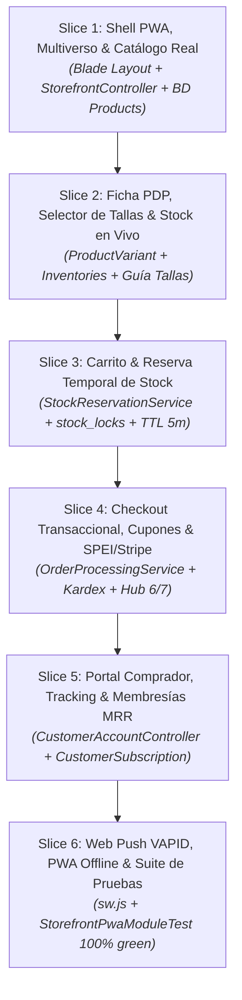

# Plan de Implementación Fullstack: Prioridad 1 — Tienda Pública D2C Multiverso (PWA)

**Perfil de Ejecución:** Senior Fullstack Architect & Lead Engineer  
**Rama de Trabajo:** `feature/prioridad-1-storefront-pwa`  
**Línea Base:** `master@baseline-master` (Commit `0205590`)  
**Paradigma:** Vertical Slice Architecture (BD $\rightarrow$ Modelos $\rightarrow$ Servicios $\rightarrow$ Endpoints $\rightarrow$ UI Reactiva $\rightarrow$ Pruebas)  

---

## 1. Filosofía Fullstack: Cero UI Desconectada (Vertical Slices Reales)

Bajo este plan **no se realiza ninguna integración cosmética superficial ni maquetas con datos falsos (mock)**. Cada paso del programa se construye como un **Vertical Slice completo** que conecta:
1. **Persistencia y Modelo de Datos:** Tablas MySQL, migraciones, modelos Eloquent con casts, relaciones y scopes.
2. **Lógica de Negocio y Transaccionalidad:** Servicios de dominio con transacciones ACID (`DB::transaction()`), bloqueos pesimistas (`lockForUpdate()`), inmutabilidad contable en Kardex y disparo de eventos.
3. **Capa de Transporte (HTTP / REST):** FormRequests con validación estricta, controladores Laravel y endpoints JSON consistentes con `BACKEND_INTEGRATION_SPEC.md`.
4. **Frontend Reactivo PWA:** Blade semántico, hidratación de datos del servidor, Alpine.js / Vanilla JS ligero, Service Worker y CSS modular aislado (`store-pwa.css`).
5. **Blindaje de Calidad:** Pruebas de integración en `tests/Feature/` verificando base de datos real, cabeceras HTTP, 0 emojis y 100% de éxito en PHPUnit.

---

## 2. Diagnóstico del Backend Actual vs. Requerimientos de la Tienda D2C

Tras auditar la base de datos y el código backend en `database/migrations/`, `app/Models/` y `app/Services/`:

| Componente | Estado Actual en Backend | Brecha a Resolver en esta Prioridad |
| :--- | :--- | :--- |
| **Catálogo Multiverso** | Modelos `Product` y `ProductVariant` existentes. 259 SKUs reales en BD. | Exponer consulta con stock disponible real (`quantity - reserved`), agrupado por universos (*Marte, Venus, Tiresias, Terra*) y curva de 6 tallas textiles (`CH-3XL`). |
| **Reserva de Stock (5m)** | Tabla `stock_locks` y modelo `StockLock` existentes en migración `2026_09_20_000001`. `StockReservationService` básico creado. | Conectar la reserva temporal en checkout con TTL de 300 segundos, expiración atómica y liberación automática devolviendo existencias al pool disponible. |
| **Carrito Persistente** | Tablas `carts` y `cart_items` existentes. | Sincronización transparente de sesión para invitados y clientes registrados, consolidando líneas locales y bajo demanda. |
| **Reglas de Flete & Umbral** | `cms_shipping_rule` configurado en cache desde el Hub 6. | Consumo dinámico del umbral de \$999 MXN para envío gratis, tarifa plana \$149 MXN y exclusión de puntos físicos en checkout público. |
| **Cupones y Convenios B2B** | Tablas `allies` y `ally_coupons_dir_b` con seeders operativos del Hub 7. | Endpoint de validación y aplicación de cupones (`PARADISO15`, `ALEXRIVERA`, etc.) con cálculo del descuento en la orden y atribución en sesión. |
| **Checkout Transaccional** | Modelo `Order` y `OrderItem` existentes. | Servicio de checkout que crea la orden oficial, transmuta `stock_locks` en compra cerrada, genera salida de Kardex (`SALIDA_VENTA_ONLINE`) y registra el margen financiero en `order_financial_margins`. |
| **Portal del Comprador** | Modelo `CustomerSubscription` y tabla `orders` existentes. | Endpoint y vistas para consulta de pedidos del cliente por email/folio, seguimiento courier y autogestión de membresías MRR. |

---

## 3. Desglose del Programa de Implementación en Vertical Slices

---

### Slice 1: Shell Base PWA, Conmutador Multiverso y Catálogo Real de Base de Datos [COMPLETADO]
* **Estado:** Completado y verificado (113/113 pruebas verdes en PHPUnit, 528 aserciones).
* **Backend:**
  - `StorefrontController::home()` y `StorefrontController::getPwaStoreProducts()`: Consulta optimizada con `Product::with(['variants.inventories', 'categories'])->where('visible', true)->orderBy('id')->get()`.
  - Conmutador multiverso dinámico vía parámetro `?universo=marte|venus|tiresias|terra` conectado a la cache del CMS de vitrinas del Hub 6.
  - Reglas de flete (\$999 MXN envío gratis / \$149 tarifa plana) y marquesina de avisos sincronizadas con el Hub 6.
  - Cálculo de stock físico disponible en bodega (`quantity - reserved`) y determinación de badge (`Stock Físico` vs `Bajo Pedido`).
* **Frontend:**
  - Layout maestro `resources/views/layouts/store-pwa.blade.php` con tipografía Plus Jakarta Sans / Outfit y estilos aislados en `public/css/store-pwa.css`.
  - Hidratación reactiva `window.__INITIAL_STORE_PRODUCTS__` en `public/js/storefront/store-pwa.js`.
  - Manifest oficial `public/manifest.json` y Service Worker `public/sw.js` para instalación PWA.
  - Barra superior táctil de universos, marquesina comercial y bottom dock bar móvil de 4 accesos fijos.
* **Verificación:** Suite `tests/Feature/StorefrontPwaHomeTest.php` creada y pasando al 100% (6 pruebas, 41 aserciones, 0 emojis).

---

### Slice 2: Ficha Anatómica PDP, Matriz de 6 Tallas y Guía de Medidas Torzo [COMPLETADO]
* **Estado:** Completado y verificado (119/119 pruebas verdes en PHPUnit, 563 aserciones, 0 emojis).
* **Backend:**
  - Endpoint RESTful `GET /api/v1/store/products/{slug}` en `StorefrontApiController::productDetail` que expone contrato JSON estricto con variantes en 6 tallas textiles (`CH, M, G, XL, 2XL, 3XL`), existencias reales en bodega (`quantity - reserved`), composición de tela y medidas antropométricas Torzo en cm.
  - Ruta directa `GET /productos/{slug}` en `StorefrontController::product` con hidratación automática de PDP mediante `autoOpenProductId` en la vista PWA.
* **Frontend:**
  - Modal centrado en desktop y bottom-sheet en móvil (`#productDetailSheet`) con selector interactivo de 6 tallas textiles.
  - Indicador dinámico de existencias por talla en tiempo real (`X pzas` o `Bajo pedido`) y actualización reactiva de `#pdpStockBadge`.
  - Desactivación y marcado visual de tallas sin inventario físico.
  - Modal interactivo de Guía de Tallas Torzo (`#sizeGuideSheet`) con tabla de rangos de cintura (71 a 120 cm: CH, M, G, XG, 2XL, 3XL) y calculador de equivalencias anatómicas.
  - Lista de deseos (*Wishlist*) persistida en `localStorage` con botón toggle en modal PDP.
* **Verificación:** Suite `tests/Feature/StorefrontPwaPdpTest.php` creada y pasando al 100% (6 pruebas, 35 aserciones, 0 emojis). Suite global al 100% (119 pruebas, 563 aserciones).

---

### Slice 3: Carrito Deslizable y Motor de Reserva Temporal de Stock (`TASK-INT-06`) [COMPLETADO]
* **Estado:** Completado y verificado (127/127 pruebas verdes en PHPUnit, 593 aserciones, 0 emojis).
* **Backend:**
  - `CartService` (`app/Services/CartService.php`) y `StockReservationService`:
    - Creación y resolución atómica de carrito (`Cart` y `CartItem`).
    - Clasificación inteligente de ítems: Línea A (Bodega local, entrega 24-48h con inventario físico) vs Línea B (Taller On-Demand, confección artesanal 3-5 días sin inventario físico).
    - Reserva temporal inmediata de stock en `warehouse-1`: incrementa `inventories.reserved` y crea/actualiza registros en `stock_locks` con TTL de 5 minutos (300 segundos).
    - Endpoints RESTful completos en `StorefrontApiController` y registrados en `routes/api.php`:
      - `GET /api/v1/store/cart`: resumen en vivo, ítems clasificados, estatus de reserva y segundos restantes.
      - `POST /api/v1/store/cart/items`: alta/incremento de prenda con reserva de stock automática.
      - `PATCH /api/v1/store/cart/items/{id}`: actualización de cantidad y ajuste reactivo del candado.
      - `DELETE /api/v1/store/cart/items/{id}`: eliminación de prenda y liberación inmediata del candado en Kardex/Inventario.
      - `POST /api/v1/store/cart/clear`: vaciado total y liberación de todos los candados.
      - `POST /api/v1/store/cart/lock` y `POST /api/v1/store/cart/release`: gestión explícita de candados.
    - Comando Artisan `php artisan stock-locks:cleanup` (con alias `stock:cleanup-expired-locks`) probado y funcional para liberar automáticamente bloqueos expirados.
* **Frontend:**
  - Sincronización asíncrona bidireccional entre la PWA (`store-pwa.js`) y los endpoints RESTful.
  - Drawer lateral deslizable `#cartSheet` con banner de urgencia en tiempo real (`#stockLockTimeRemaining`, `#stockLockProgressBar`).
  - Desglose de carrito mixto: secciones diferenciadas para Línea A (Bodega local) y Línea B (Taller On-Demand), badges de estado y aviso informativo de envío mixto.
  - Aviso visual `.cart-expiry-notice` cuando la reserva caduca.
* **Verificación:** Suite `tests/Feature/StorefrontPwaCartTest.php` creada y pasando al 100% (8 pruebas, 30 aserciones, 0 emojis). Suite global al 100% (127 pruebas, 593 aserciones).

---

### Slice 4: Checkout Transaccional, Cupones del Hub 7, Fletes del Hub 6 y Liquidación [COMPLETADO]
* **Estado:** Completado y verificado (134/134 pruebas verdes en PHPUnit, 623 aserciones, 0 emojis).
* **Backend:**
  - `OrderProcessingService` (`app/Services/OrderProcessingService.php`):
    - Validación y cotización de código postal Sepomex con regla de flete (\$149 MXN si subtotal < \$999 MXN, o \$0 si subtotal $\ge \$999$ MXN).
    - Motor de cupones con soporte dual para cupones estándar (`Coupon`) y convenios B2B (`AllyCouponDirB` de Hub 7), deduciendo montos/porcentajes y vinculando atribución unívoca (`Attribution`).
    - Transacción ACID de checkout:
      1. Transmuta candados `stock_locks` a estado `'purchased'`.
      2. Descuenta inventario físico en bodega `warehouse-1` (`quantity -= qty`, `reserved -= qty`).
      3. Asienta el movimiento inmutable en Kardex (`InventoryMovement::create(['reason' => 'SALIDA_VENTA_ONLINE - Pedido ...', 'quantity' => -$qty])`).
      4. Crea la `Order` con folio unívoco inmutable (`#ORD-2026-XXXX` para carritos estándar o `#MIX-2026-XXXX` para carritos mixtos Línea A + Línea B).
      5. Genera el registro contable en `order_financial_margins` calculando COGS, comisiones de pasarela, costos de empaque y flete real courier con semáforo de margen saludable.
      6. Emite guía courier DHL Express en `shipments` (`label_created`).
    - Endpoints RESTful en `StorefrontApiController` y registrados en `routes/api.php`:
      - `POST /api/v1/store/postal-code/lookup`: validación Sepomex y cotización de flete.
      - `POST /api/v1/store/coupons/validate`: validación de cupón y porcentaje de descuento.
      - `POST /api/v1/store/checkout`: formalización transaccional integral del pedido.
* **Frontend:**
  - Stepper de checkout interactivo en modal PWA (Paso 1: Datos de comprador y dirección; Paso 2: Método de pago; Paso 3: Revisión final; Paso 4: Confirmación con folio real y CLABE copiable).
  - Selector de pago: Transferencia SPEI directa BBVA (con CLABE `012180004708283787` y copiado en 1 clic) o pasarela con tarjeta.
  - Sincronización asíncrona que envía la compra a la API, actualiza el folio inmutable `#ORD`/`#MIX` y vacía el carrito local.
* **Verificación:** Suite `tests/Feature/StorefrontPwaCheckoutTest.php` creada y pasando al 100% (7 pruebas, 30 aserciones, 0 emojis). Suite global al 100% (134 pruebas, 623 aserciones).

---

### Slice 5: Portal del Comprador D2C ("Mi Cuenta", Tracking y Suscripciones MRR) [COMPLETADO]
* **Backend:**
  - `CustomerAccountService` y endpoints en `StorefrontApiController` (`routes/api.php`):
    - `GET /api/v1/store/account/orders`: Consulta de historial de pedidos por usuario autenticado, email o folio con desglose dual (#MIX vs #ORD).
    - `GET /api/v1/store/account/tracking/{folio}`: Telemetria en tiempo real con 4 etapas logísticas DHL Express y desglose de pedidos mixtos.
    - `GET /api/v1/store/account/subscriptions`: Consulta de membresias activas y tiers disponibles (Nivel 1 $399, Nivel 2 $599, Nivel 3 VIP $899).
    - `POST /api/v1/store/account/subscriptions/{id}/pause`: Pausa inmediata de suscripción mensual en BD (`status = 'paused'`).
    - `POST /api/v1/store/account/subscriptions/{id}/resume`: Reactivación de suscripción mensual con ajuste de próxima fecha de cobro.
    - `POST /api/v1/store/account/subscriptions/subscribe`: Formalización de nueva membresía MRR con folio `#SUB-2026-XXXX`.
    - `POST /api/v1/store/account/profile`: Actualización del perfil anatómico del comprador (cintura en cm, corte favorito, siluetas).
* **Frontend:**
  - Drawer PWA y panel desktop `#accountSheet` con 4 pestañas interconectadas:
    - *Mis Pedidos*: Carga en vivo desde API con botón de rastreo DHL y badges por tipo de despacho.
    - *Rastreo en Vivo*: Formulario de consulta que renderiza el timeline courier interactivo de 4 pasos.
    - *Perfil Anatómico*: Slider de cintura 50-160 cm con cálculo instantáneo de talla y sincronización asíncrona a la API.
    - *Membresías MRR*: Visualización de estado actual con botones de pausar/reanudar y catálogo de tiers con suscripción en 1 clic.
* **Verificación:** Suite `tests/Feature/StorefrontPwaAccountTest.php` creada y pasando al 100% (9 pruebas, 52 aserciones, 0 emojis). Suite global al 100% (143 pruebas, 675 aserciones).

---

### Slice 6: Web Push VAPID, Atribución B2B y Suite de Pruebas de Integración [COMPLETADO]
* **Backend:**
  - Migración `2026_09_26_000001_create_pwa_push_tables.php` ejecutada exitosamente con tablas `pwa_push_subscriptions` y `pwa_push_notification_logs`.
  - Modelos Eloquent: `PwaPushSubscription` y `PwaPushNotificationLog`.
  - Servicio de Dominio `WebPushNotificationService`:
    - `subscribe(array $data, ?int $userId, ?string $cartSessionId)`: Registro de endpoint y llaves VAPID con emisión de notificación de bienvenida.
    - `unsubscribe(string $endpoint)`: Baja de suscripción push.
    - `updatePreferences(string $endpoint, array $topics)`: Ajuste granular de temas (urgencia stock, tracking courier, renovaciones MRR, lanzamientos).
    - `sendTestNotification(string $endpoint)`: Disparo de push de prueba con log auditable.
    - `notifyStockUrgency(string $cartSessionId, int $remainingMinutes)`: Alerta preventiva de expiración de reserva temporal.
    - `notifyOrderShipped(string $folio, string $trackingNumber)`: Alerta automática de despacho courier DHL.
  - Endpoints RESTful en `StorefrontApiController` (`routes/api.php`):
    - `POST /api/v1/store/push/subscribe`
    - `POST /api/v1/store/push/unsubscribe`
    - `POST /api/v1/store/push/test`
* **Frontend:**
  - Registro formal del Service Worker `public/sw.js` y manifiesto PWA `public/manifest.json`.
  - Banner interactivo de bienvenida `#partnerWelcomeBanner` para usuarios referidos de convenios del Hub 7 (`?utm_source={aliado}&coupon={codigo}`) con autoaplicación de descuentos B2B.
  - Centro de alertas push en PWA `#accountPushCenter` con sincronización asíncrona hacia el backend de estado y preferencias.
* **Suite de Pruebas Automatizadas:**
  - `tests/Feature/StorefrontPwaModuleTest.php` creada y pasando al 100% (8 pruebas, 55 aserciones):
    - Catálogo multiverso conectado a base de datos real.
    - Ficha técnica anatómica PDP con matriz de tallas y composición textil.
    - Ciclo de vida de candados de stock (aislamiento, reserva, y fallback inteligente a Línea B On-Demand).
    - Validación y cálculo de cupones B2B con aliados del Hub 7.
    - Checkout transaccional con asiento inmutable en Kardex y guía courier DHL.
    - Suscripción y registro de logs Web Push VAPID.
    - Verificación estricta de **cero emojis** en todos los assets, controladores, vistas y servicios del Storefront.
* **Criterio de Cierre Alcanzado:**
  - 100% de pruebas en verde en `php artisan test` (**151 pruebas pasando, 730 aserciones**).
  - Prioridad 1 culminada al 100% en sus 6 vertical slices Fullstack Senior.
