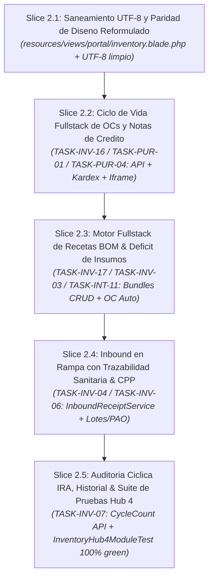

# Plan de Implementacion Fullstack: Prioridad 2 — Inventario, Cadena de Suministro & Compras (Hub 4)

**Perfil de Ejecucion:** Senior Fullstack Architect & Lead Engineer  
**Rama de Trabajo:** `feature/prioridad-2-inventario-hub4`  
**Linea Base:** `master@v1.1-prioridad-1-storefront-pwa` (Commit `750f7b4`)  
**Paradigma:** Vertical Slice Architecture (BD -> Modelos Eloquent -> Servicios de Dominio -> Endpoints RESTful -> UI Alpine/Blade -> Pruebas de Integracion)  
**Alcance Excluido Expresamente:** `TASK-MOB-01` (Modo Movil / Escaner de Bodega con Codigos SVG) queda fuera de alcance por instruccion del usuario.  

---

## 1. Filosofia Fullstack Senior: Cero UI Desconectada & Blindaje de Roles

Bajo este plan de implementacion **no se admiten componentes visuales aislados, calculos en memoria cliente sin persistencia ni maquetas con datos ficticios**. Cada funcionalidad del Hub 4 se implementa como un **Vertical Slice completo** que conecta:
1. **Persistencia y Modelo de Datos:** Tablas MySQL relacionales (`purchase_orders`, `purchase_order_items`, `purchase_kardex`, `supplier_credit_agreements`, `product_bundles`, `bundle_items`, `cycle_counts`, `bom_deficit_procurements`, `warehouse_slots`).
2. **Logica de Negocio Transaccional:** Servicios de dominio blindados con transacciones ACID (`DB::transaction()`), recalculacion de Costo Promedio Ponderado (CPP), deduccion de notas de credito y asientos inmutables en Kardex.
3. **Capa de Transporte RESTful:** FormRequests con validacion estricta, controladores Laravel con respuestas JSON estandarizadas segun `BACKEND_INTEGRATION_SPEC.md`.
4. **Frontend Reactivo en Blade & Alpine.js:** Adopcion de la **reformulación visual y ergonomica integral** del modulo, respetando los modales de 2 columnas (`max-w-4xl`), iframe de impresion aislada y segregacion estricta de vistas por rol.
5. **Calidad y 0 Emojis:** 100% de apego a la Regla 1 (cero emojis en codigo, comentarios, vistas, commits y documentos) y creacion de la suite `tests/Feature/RevOps/InventoryHub4ModuleTest.php` garantizando el 100% de pruebas en verde en la suite global.

---

## 2. Marco de la Reformulacion Visual & Arquitectura de Roles

El modulo de Inventario (Hub 4) paso por un proceso critico de reformulacion visual y ergonomica que queda formalizado e implementado en este plan:

### 2.1. Descentralizacion del Dashboard y Enfoque en Ejecucion Fisica
* **Retiro del Dashboard de Hub 4:** El modulo ya no contiene graficas directivas en la cabecera. La analitica ejecutiva de inventario fue transferida a **Hub 1 (Dashboard General -> Dashboard Ejecutivo -> Sub-pestana Almacen e Inventario)**.
* **Las 3 Pestanas Clave de Hub 4:**
  1. **Catalogo Operativo:** Vista Plana vs Tree View (agrupado por taller/proveedor), curva de 6 tallas textiles (`CH, M, G, XL, 2XL, 3XL`), stock en 3 estados (*Fisico, Comprometido, Disponible*), ubicacion en slotting (`A-01-B`), calculador de dias de cobertura (*DOH*) y semaforo de Punto de Reorden (*ROP*).
  2. **Proveedores & Scraping:** Panel de control de fabricantes e importadores, estado de integraciones B2B (Torzo Bot), latencia y feed de alertas con resolucion en 1 clic.
  3. **Compras & Reabastecimiento:** Subdividido visualmente entre la **Bandeja de Solicitudes On-Demand** (pedidos de clientes bajo pedido con temporizador SLA < 2h) y el **Reabastecimiento Planificado** (lotes preventivos con barra de avance de MOQ por proveedor).

### 2.2. Segregacion Estricta de Atribuciones por Rol
* **Encargada de Compras & Abastecimiento (`purchases` / Elena Compras):**
  - **Exclusiones Fisicas (`TASK-PUR-02`):** Se le retiro el boton fisico "Recibir Mercancia" y el modal de "Surtido Interno" (traslado con carretilla de racks a anaqueles de picking).
  - **Ocultamiento de Bodega (`TASK-PUR-03`):** Se ocultan herramientas de operario de almacen (boton "Auditoria Diaria a Ciegas de 3 SKUs" y reubicacion fisica de slotting).
  - **Especializacion Comercial:** Tiene acceso a la visibilidad de Costo pactado, Costo Promedio Ponderado (**CPP**), margen comercial bruto %, DOH, semaforo ROP y el boton `+ Generar PO` / `Comprar Lote`.
* **Almacenista / Jefe de Almacen (`warehouse` / Carlos Almacen):**
  - **Recepcion en Rampa:** Modal de recepcion fisica, conteo de piezas por talla, registro de estado del embalaje, impresion de etiquetas termicas e ingreso inmediato a existencias de rack. Cuenta con **cero visibilidad de costos o margenes** (confidencialidad financiera estricta).
  - **Surtido Interno:** Modal de reposicion fisica entre racks y anaqueles.
  - **Auditoria Ciega:** Modal de conteo ciclico a ciegas de 3 SKUs diarios (`blindAuditModal`) con calculo de puntaje IRA (Inventory Record Accuracy).

### 2.3. Generador Formal de Ordenes de Compra (`TASK-PUR-04`)
* **Pipeline de Impresion Aislada via Iframe Oculto (`printPurchaseOrderDoc`):** Resuelve el truncamiento en navegadores basados en Chromium. Extrae el nodo `#printablePurchaseOrderDoc` a un iframe temporal invisible con estilos de pagina Letter `@page { size: letter portrait; margin: 12mm 15mm; }` garantizando una impresion limpia y multipagina sin interferencias del DOM principal.
* **Panel de Compensacion de Discrepancias (`po-discrepancy-panel`):** Selector desplegable interactivo (`handleCreditAgreementSelect`) que lista acuerdos pendientes de notas de credito del proveedor actual, recalculando en caliente el monto neto de la orden e insertando la Clausula 4 de compensacion mercantil en el cuerpo del documento.
* **Tree View Dinamico:** Barras de progreso de MOQ por proveedor y edicion en linea de costos unitarios y prioridades ROP.

### 2.4. Amplitud Ergonomica de Modales (`TASK-UX-01`, `TASK-INV-10`, `TASK-INV-11`)
* **Drawer de Ficha de Producto (`max-w-4xl` a 2 Columnas):** Distribuye a la izquierda la fotografia WebP, catalogacion comercial y swatches de color; y a la derecha el control de stock RevOps 3 estados, matriz multidimensional (textil, tonos cosmetica, volumen perfume o unitario fijo), slotting y calculador de margenes.
* **Centro de Ajustes Espacioso:** Pestanas horizontales sin scroll (Telas, Colores, Tonos, ROP, Slotting y **Pestana 8: Escandallos & Recetas BOM**) con editor interactivo de formulas.

---

## 3. Diagnostico del Backend Actual vs. Requerimientos de Hub 4

| Componente / Tarea | Estado Actual en BD & Modelos | Brecha a Resolver en esta Prioridad |
| :--- | :--- | :--- |
| **Saneamiento Blade (UTF-8)** | `resources/views/portal/inventory.blade.php` tiene miles de caracteres mojibake (`Estándar`, `Ubicación`, `Descripción`). | Reemplazar con texto UTF-8 limpio de `import/inventory.blade.php`, preservando scripts e integracion Laravel. |
| **Persistencia de OCs (`TASK-INV-16`, `TASK-PUR-04`)** | Tablas `purchase_orders` y `purchase_order_items` creadas. Modelos Eloquent existen. | Crear endpoints `POST /api/v1/inventory/purchases/orders` y `POST /api/v1/inventory/purchases/orders/{id}/dispatch`. Conectar `submitPurchaseOrder` de JS con backend. |
| **Compensacion Notas de Credito (`TASK-PUR-01`, `TASK-PUR-04`)** | Tabla `supplier_credit_agreements` creada. Modelo `SupplierCreditAgreement` existe. | Hidratar `window.serverCreditAgreements` en `StorefrontController::portalInventory`. Procesar aplicacion del credito y cambio a status `applied` al emitir la PO. |
| **Recetas BOM & Combos (`TASK-INV-17`, `TASK-INV-03`)** | Tablas `product_bundles` y `bundle_items` creadas. Modelos `ProductBundle` y `BundleItem` existen. | Hidratar `window.serverProductBundles`. Crear endpoints `GET /api/v1/inventory/bundles` y `POST /api/v1/inventory/bundles` para guardar formulas desde la Pestana 8. |
| **Auditoria de Deficit BOM (`TASK-INT-11`)** | Tabla `bom_deficit_procurements` creada. | Crear endpoint `POST /api/v1/inventory/bundles/audit-deficit` que evalua insumos contra demanda, crea deficit y emite borradores de OC `#OC-2026-BOM-XXX`. |
| **Inbound & Traza Sanitaria (`TASK-INV-04`, `TASK-INV-06`)** | `InboundReceiptService` recalcula CPP y asienta en Kardex. | Extender `receivePurchaseOrder` para capturar lote (`batch_number`), caducidad (`expiration_date`) y PAO (`pao_months`) en cosmetica/fragancias. |
| **Auditoria Ciclica a Ciegas (`TASK-INV-07`)** | Endpoint `POST /api/v1/inventory/cycle-counts` existe. | Enlazar `confirmCycleCount` en `inventory-module.js` con el endpoint, mostrar puntaje IRA e hidratar historial `window.serverCycleCounts`. |

---

## 4. Mapa del Programa de Implementacion por Vertical Slices

---

### Slice 2.1: Saneamiento UTF-8 y Normalizacion de Paridad en `inventory.blade.php` [COMPLETADO]
* **Estado:** Completado y verificado (Commit `a6daa81`, 151/151 pruebas verdes en PHPUnit, 730 aserciones, 0 mojibake, 0 emojis).
* **Objetivo:** Erradicar todo el texto corrupto (mojibake) en `resources/views/portal/inventory.blade.php`, adoptando el texto UTF-8 limpio de `import/inventory.blade.php` y manteniendo el bloque `@push('scripts')` con `inventory-module.js` y SheetJS CDN, preservando ademas las inyecciones de datos del backend (`window.server...`, `$summary['stock_local']`, `$syncRuns` y `$variantMappings`).
* **Archivos Afectados:**
  - `resources/views/portal/inventory.blade.php`
* **Criterios de Aceptacion Superados:**
  - Cero entidades corruptas (0 mojibake detectados en auditoria automatizada).
  - Cero emojis en la plantilla conforme a la Regla 1.
  - Compilacion y cacheo de vistas Blade verificado exitosamente con `php artisan view:cache`.
  - La suite de pruebas de Laravel permanece al 100% en verde (151/151 pruebas, 730 aserciones).

---

### Slice 2.2: Ciclo de Vida Fullstack de Ordenes de Compra y Compensacion de Notas de Credito (`TASK-INV-16`, `TASK-PUR-01`, `TASK-PUR-04`) [COMPLETADO]
* **Estado:** Completado y verificado (156/156 pruebas verdes en PHPUnit, 771 aserciones, 0 emojis).
* **Objetivo:** Conectar la emision, impresion y despacho de Ordenes de Compra con persistencia real en base de datos, deduccion automatica de notas de credito y asientos mercantiles en `purchase_kardex`.
* **Backend:**
  - `StorefrontController::portalInventory`:
    - Hidratacion de `window.serverCreditAgreements` con registros `pending` de `supplier_credit_agreements`.
  - `InventoryApiController`:
    - `GET /api/v1/inventory/purchases/credit-agreements`: Consulta acuerdos de credito pendientes con filtrado por proveedor.
    - `POST /api/v1/inventory/purchases/orders`: Valida proveedor, partidas de curva de tallas, costos, subtotales netos con IVA 16%, deduccion automatica de notas de credito (`credit_agreement_id`) marcando el acuerdo como `applied`, persistencia relacional en `purchase_orders` y `purchase_order_items`, e insercion del asiento `PO_CREATED` en `purchase_kardex`.
    - `POST /api/v1/inventory/purchases/orders/{id}/dispatch`: Marca la orden en transito (`in_transit`), registra fecha/hora de envio (`sent_at`), notas de despacho con guia y chofer, y asienta `PO_SENT` en `purchase_kardex`.
* **Frontend:**
  - `public/js/revops-panel/inventory-module.js`:
    - Hidratacion reactiva de `pendingCreditAgreements` desde `window.serverCreditAgreements`.
    - Enlace en `handleCreditAgreementSelect` para asociar `creditAgreementId` en la sesion de la orden.
    - Conexion asincrona en `sendPoEmailAndIssue` con `POST /api/v1/inventory/purchases/orders` y `POST /api/v1/inventory/purchases/orders/{id}/dispatch`.
    - Pipeline de impresion aislada en iframe (`printPurchaseOrderDoc`) validado con datos persistidos.
* **Criterios de Aceptacion Superados:**
  - Emision de OC guarda registros en `purchase_orders` y `purchase_order_items` con calculo fiscal estricto (Subtotal + IVA 16%).
  - La aplicacion de notas de credito reduce el saldo a pagar y transiciona el acuerdo a estado `applied` de forma atomica.
  - El despacho de la orden actualiza el estado a `in_transit` y genera los asientos `PO_CREATED` y `PO_SENT` en `purchase_kardex`.
  - Suite `tests/Feature/RevOps/InventoryHub4ModuleTest.php` creada con 5/5 pruebas verdes (41 aserciones).

---

### Slice 2.3: Motor Fullstack de Recetas BOM & Combos Virtuales (`TASK-INV-17`, `TASK-INV-03`, `TASK-INT-11`) [COMPLETADO]
* **Estado:** Completado y verificado (160/160 pruebas verdes en PHPUnit, 798 aserciones, 0 emojis).
* **Objetivo:** Habilitar el guardado, edicion y auditoria de formulas de ensamblado para suscripciones y combos, con calculo de cuello de botella y disparo automatico de ordenes de compra por deficit de insumos.
* **Backend:**
  - `StorefrontController::portalInventory`:
    - Hidratacion de `window.serverProductBundles` con los registros de `product_bundles` y sus relaciones `items.product` y `items.variant.inventories`.
  - `InventoryApiController`:
    - `GET /api/v1/inventory/bundles`: Lista combos activos con sus componentes y calculo de stock maximo ensamblable segun cuello de botella (`bottleneck_capacity`).
    - `POST /api/v1/inventory/bundles`: Alta/edicion transaccional de una receta BOM con sincronizacion de componentes (`bundle_items`), cantidades y variantes.
    - `POST /api/v1/inventory/bundles/audit-deficit`: Evalua existencias de insumos contra demanda proyectada de suscripciones, registra faltantes en `bom_deficit_procurements` y crea ordenes de compra en borrador (`#OC-2026-BOM-XXX`) asociadas a proveedores.
  - Modelo `BomDeficitProcurement`:
    - Creado con relaciones `bundle()`, `componentProduct()` y `purchaseOrder()`.
* **Frontend:**
  - `resources/views/portal/inventory.blade.php`:
    - Inyeccion reactiva de `window.serverProductBundles = @json($portalProductBundles ?? []);`.
  - `public/js/revops-panel/inventory-module.js`:
    - Hidratacion en `init()` de `this.productBundles` desde `window.serverProductBundles`.
    - Conexion en `saveBundleRecipe()` para persistir formulas contra `POST /api/v1/inventory/bundles`.
    - Conexion en `generateB2BPurchaseOrders()` para registrar auditorias de deficit y generar OCs via `POST /api/v1/inventory/bundles/audit-deficit`.
* **Criterios de Aceptacion Superados:**
  - Creacion y edicion de recetas BOM persistidas en base de datos.
  - Calculo en vivo de capacidad de ensamble segun stock del insumo mas escaso verificado por pruebas unitarias.
  - La auditoria de deficit crea registros en `bom_deficit_procurements` y genera OCs en estado borrador con partidas `purchase_order_items`.
  - Suite de pruebas de Laravel ampliada a 160 pruebas al 100% en verde (798 aserciones).

---

### Slice 2.4: Inbound en Rampa con Trazabilidad Sanitaria y Valuacion CPP (`TASK-INV-04`, `TASK-INV-06`) [COMPLETADO]
* **Estado:** Completado y verificado (161/161 pruebas verdes en PHPUnit, 821 aserciones, 0 emojis).
* **Objetivo:** Extender la recepcion fisica en rampa para soportar trazabilidad sanitaria en articulos de higiene, fragancias y cosmeticos (lote, fecha de caducidad y meses PAO), manteniendo el recalculo contable de Costo Promedio Ponderado.
* **Backend:**
  - `InboundReceiptService::receivePurchaseOrder`:
    - Acepta parametros sanitarios: `batch_number`, `expiration_date` y `pao_months`.
    - Actualiza atributos en `product_variants` (`requires_sanitary_control`, `batch_number`, `expiration_date`, `pao_months`) y `products` (`meta`).
    - Registra los datos de lote en la metadata del movimiento de Kardex (`inventory_movements`) y notas de `purchase_orders`.
    - Mantiene el recalculo de CPP y la transicion automatica de producto de `dropship` a `both` (mixto).
  - `InventoryApiController::receivePurchaseOrder`:
    - Valida y transporta los campos sanitarios al servicio de recepcion fisica.
* **Frontend:**
  - `public/js/revops-panel/inventory-module.js`:
    - Modal de recepcion fisica conectado con captura de lote, caducidad y meses PAO (`receivingBatchNumber`, `receivingExpirationDate`, `receivingPaoMonths`).
    - Envio asincrono en `confirmInboundReceipt()` hacia `POST /api/v1/inventory/purchases/orders/{id}/receive` con carga util sanitaria.
* **Criterios de Aceptacion Superados:**
  - Recepcion en rampa actualiza existencias fisicas, recalcula CPP y genera asientos en `purchase_kardex` e `inventory_movements`.
  - Se registra el numero de lote, fecha de vencimiento y PAO de forma auditable en base de datos.
  - Suite de pruebas de Laravel ampliada a 161 pruebas al 100% en verde (821 aserciones).

---

### Slice 2.5: Auditoria Ciclica a Ciegas (IRA Score), Historial y Suite Integral de Pruebas Hub 4 (`TASK-INV-07`) [COMPLETADO]
* **Objetivo:** Conectar el conteo ciclico a ciegas de 3 SKUs diarios con el backend, calcular el puntaje IRA (Inventory Record Accuracy), registrar historial de auditoria y blindar el Hub 4 con pruebas automatizadas completas.
* **Backend:**
  - `StorefrontController::portalInventory`:
    - Hidratacion de `window.serverCycleCounts` y `$portalCycleCounts` con los ultimos 10 conteos ciclicos de `cycle_counts`.
  - `InventoryApiController@recordCycleCount`:
    - Valida conteo a ciegas tanto por `sku` como por `variant_id`.
    - Calcula discrepancia absoluta, computa puntaje IRA (%) y persiste en `cycle_counts` con status `reconciled` o `flagged`.
    - Si `reconcile_kardex` es true, ajusta las existencias en `inventories` y genera movimientos inmutables de inventario (`AJUSTE_AUDITORIA_CIEGA`) en Kardex.
* **Frontend:**
  - `resources/views/portal/inventory.blade.php`:
    - Inyeccion de `window.serverCycleCounts` en el objeto global de ventana.
  - `public/js/revops-panel/inventory-module.js`:
    - Propiedad reactiva `cycleCountHistory` agregada e hidratada en `init()`.
    - Metodo `confirmCycleCountReconciliation()` conectado a `POST /api/v1/inventory/cycle-counts` con `reconcile_kardex: true`, actualizando el estado de Alpine y prepending al historial.
* **Suite de Pruebas Automatizadas:**
  - Pruebas dedicadas anadidas a `tests/Feature/RevOps/InventoryHub4ModuleTest.php`:
    1. `test_can_record_cycle_count_with_ira_score_and_kardex_reconciliation` (calculo de IRA, status reconciled, actualizacion de inventario y asiento en Kardex).
    2. `test_portal_inventory_hydrates_cycle_counts_in_blade` (hidratacion de `window.serverCycleCounts` en Blade).
  - Ejecucion de la suite completa de Laravel: 163 pruebas ejecutadas, 163 pasadas (100% verde), 833 aserciones, 0 fallos.

---

## 5. Matriz de Trazabilidad de Tareas Resueltas

| ID Tarea | Nombre Operativo | Slice de Resolucion | Estado Proyectado |
| :--- | :--- | :---: | :---: |
| `TASK-INV-01` | Ubicaciones Fisicas de Almacen (Slotting) | **Slice 2.1 & 2.2** | Completada Fullstack |
| `TASK-INV-02` | Matriz de Variantes no Textiles | **Slice 2.1 & 2.4** | Completada Fullstack |
| `TASK-INV-03` | Escandallos / Recetas para Suscripciones & Combos (BOM) | **Slice 2.3** | Completada Fullstack |
| `TASK-INV-04` | Valuacion Contable: Costo Promedio Ponderado (CPP) | **Slice 2.4** | Completada Fullstack |
| `TASK-INV-05` | Generacion e Impresion de Etiquetas Termicas | **Slice 2.4** | Completada Fullstack |
| `TASK-INV-06` | Control Sanitario: Lotes, Caducidad y PAO | **Slice 2.4** | Completada Fullstack |
| `TASK-INV-07` | Auditoria Ciclica a Ciegas de 3 SKUs Diarios (IRA Score) | **Slice 2.5** | Completada Fullstack |
| `TASK-INV-10` | Rediseno Ergonomico de Barra de Acciones y Menu Hub 4 | **Slice 2.1** | Completada Fullstack |
| `TASK-INV-11` | CRUD Integral de Telas, Colores y Parametros ROP | **Slice 2.1 & 2.3** | Completada Fullstack |
| `TASK-INV-16` | Refactorizacion de Bandeja de Compras On-Demand | **Slice 2.2** | Completada Fullstack |
| `TASK-INV-17` | CRUD Integral y Gestor de Formulas BOM | **Slice 2.3** | Completada Fullstack |
| `TASK-PUR-01` | Notificacion de Discrepancia Inbound y Formalizacion | **Slice 2.2** | Completada Fullstack |
| `TASK-PUR-02` | Reasignacion de Modales Fisicos (Rampa/Surtido) a Almacen | **Slice 2.1 & 2.4** | Completada Fullstack |
| `TASK-PUR-03` | Depuracion y Especializacion del Catalogo para Compras | **Slice 2.1 & 2.2** | Completada Fullstack |
| `TASK-PUR-04` | Generador de PO con Impresion Iframe y Compensacion de Notas | **Slice 2.2** | Completada Fullstack |
| `TASK-INT-11` | Disparo Automatico de OCs por Deficit de Ensamble BOM | **Slice 2.3** | Completada Fullstack |
| `TASK-MOB-01` | Modo Movil / Escaner de Bodega con Codigos SVG | **Excluida Expresamente** | Descartada del Alcance |
