# Especificación Normativa Integral de Roles, Procesos Diarios, Puntos Ciegos y Diagramas de Decisión

## 1. Propósito y Alcance
Este documento formaliza la definición completa de las funciones, procesos diarios y toma de decisiones de todos los roles operativos, comerciales y directivos de la plataforma RevOps E-Commerce Multiverso (Mi Tienda Online).
Tiene como objetivos:
1. Especificar de manera exhaustiva **todas las funciones operativas** que integran la labor de cada puesto.
2. Mapear con precisión las **pantallas, secciones y herramientas del sistema** donde se ejecuta cada acción.
3. Identificar sistemáticamente los **puntos ciegos** (riesgos de proceso, asimetrías de información y cuellos de botella) junto con los **mecanismos de mitigación** incorporados en el software.
4. Establecer **diagramas de decisión interactivos (Mermaid)** para estandarizar la toma de decisiones críticas sin ambigüedad.
5. Servir de base normativa inmutable para el **Manual de Capacitación en PDF** de la organización.

---

## 2. Matriz General de Roles y Atribuciones

| Rol / Perfil | Identificador de Sistema | Enfoque Operativo | Acceso Financiero | Módulo Principal |
| :--- | :--- | :--- | :--- | :--- |
| **Almacenista / Jefe de Almacén** | `warehouse` / `operator` | Custodia física de stock, slotting, recetas BOM, recepción Inbound, auditorías cíclicas y despacho courier | Cero cifras monetarias (política estricta de privacidad) | Hub 4 (Inventario) & Hub 1 (Dashboard Operativo) |
| **Operador de Empaque y Picking** | `picker` / `packer` | Surtido por pasillo, validación de prendas, ensamblado físico de combos, embalaje volumétrico y rotulación térmica | Restringido (solo cantidades físicas) | Hub 1 (Kanban Piso) & Hub 6 (Logística) |
| **Encargada de Compras & Abastecimiento** | `purchases` / `buyer` | Reabastecimiento ROP, emisión de OCs a talleres, relación B2B, curaduría de scraping y cotejo de 3 vías | Costos de compra (CPP), términos de crédito y fletes | Hub 4 (Compras & Proveedores) & Hub 7 (B2B) |
| **Asesora Comercial & Atención (Ana)** | `sales` / `support` | Validación Sepomex, recuperación de carritos WhatsApp, membresías MRR, guía de tallas y escudo antifraude | PVP, cupones de descuento y estados de pago | Hub 1 (Dashboard Ventas) & WhatsApp CRM |
| **Editor de Contenidos & CMS / Merchandiser** | `cms_editor` / `store_manager` | Curaduría de vitrinas multiverso, constructor modular Drag & Drop, paleta cromática de 8 tokens, gestión de banners, páginas y revista digital | Cero acceso a balances contables ni márgenes confidenciales | Hub 2 (Tienda & CMS Multiverso) & Storefront PWA |
| **Director General / RevOps / Finanzas** | `admin` / `finance` | Cascada de margen neto real, análisis Pareto ABC, conversión multiverso, fiscal SAT y telemetría de sistemas | Acceso total a facturación, P&L, MRR y márgenes | Hub 1 (Dashboard Ejecutivo) & Todos los Hubs |
| **Operador Integral / Administrador Multirrol** | `all_roles` / `super_operator` | Orquestación total y ejecución transversal de todas las áreas operativas, comerciales y directivas | Acceso total e irrestricto | Todos los Hubs (Hub 1 al Hub 7) |


---

## 3. Especificación Detallada de Funciones por Rol

---

### 3.1. Rol: Almacenista / Jefe de Almacén (`warehouse`)

#### Función A1: Recepción Inbound, Descarga en Rampa & Cotejo de OCs
- **Objetivo Operativo:** Validar la mercancía física entregada por proveedores o talleres contra la Orden de Compra (PO), garantizando que no ingresen productos defectuosos o cantidades discrepantes.
- **Secciones del Sistema:**
  - *Hub 1 (Dashboard Operativo):* Bandeja de Acciones Inmediatas $\rightarrow$ Botón `Recepción en Rampa`.
  - *Hub 4 (Catálogo Operativo):* Historial de Kardex $\rightarrow$ Asiento `ENTRADA_COMPRA` con recálculo automático de Costo Promedio Ponderado (CPP).
- **Punto Ciego:** Ingresar lotes con piezas faltantes o dañadas que luego son reportadas semanas después, perdiendo el derecho a garantía de maquila.
- **Mitigación en Software:** El modal de rampa exige el conteo individual por talla antes de liberar el ingreso a Kardex; si hay faltantes, se emite automáticamente una discrepancia vinculada a la PO.
- **Diagrama de Decisión: Recepción en Rampa:**
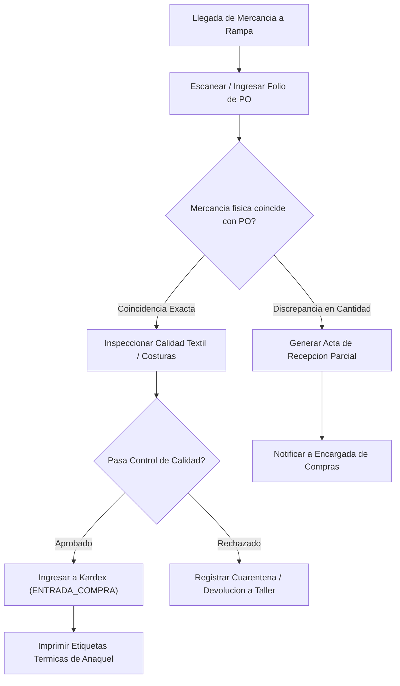

#### Función A2: Zonificación y Slotting Físico en Anaqueles (Pasillo - Rack - Nivel/Gaveta)
- **Objetivo Operativo:** Organizar físicamente los productos en ubicaciones normalizadas (`Pasillo-Rack-Nivel`, ej. `A-01-A`) para reducir tiempos de recolección y evitar extravíos.
- **Secciones del Sistema:**
  - *Hub 4 (Catálogo Operativo):* Columna compacta `Ubicación` y Modal de Reubicación de Anaquel.
  - *Hub 4 (Ajustes de Inventario):* Pestaña 4 (`slotting`) para alta y reconfiguración de zonas de bodega.
- **Punto Ciego:** Dejar prendas en pasillos o estantes temporales sin registrar el cambio de slot en el sistema, provocando demoras en la mesa de empaque.
- **Mitigación en Software:** Toda modificación de anaquel actualiza en caliente la ficha del producto y refleja la nueva ubicación en los checklists de picking de todos los operadores.
- **Diagrama de Decisión: Asignación de Slotting:**
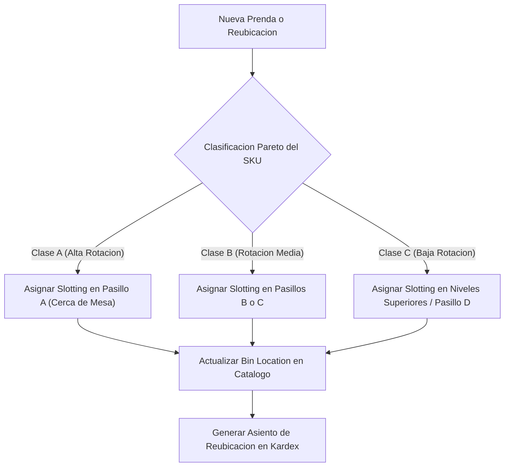

#### Función A3: Configuración y Gestión de Recetas BOM & Combos Virtuales (TASK-INV-17)
- **Objetivo Operativo:** Diseñar y auditar las fórmulas de ensamble para cajas de suscripción y packs promocionales, seleccionando prendas físicas del catálogo y supervisando existencias armables.
- **Secciones del Sistema:**
  - *Hub 4 (Ajustes de Inventario):* Pestaña 8 (`bundles`) con KPIs de recetas activas, archivadas y capacidad inmediata.
  - *Modal Constructor / Editor (`bundleEditor`):* Selector de prendas operativas, tallas, cantidades por caja y slotting.
- **Punto Ciego:** Publicar promociones o prometer cajas mensuales cuando uno de sus insumos está agotado en rack, paralizando pedidos masivos.
- **Mitigación en Software:** Cálculo reactivo de la capacidad gobernado estrictamente por el insumo cuello de botella (`calculateBundleStock`).
- **Diagrama de Decisión: Gestión de Recetas BOM:**
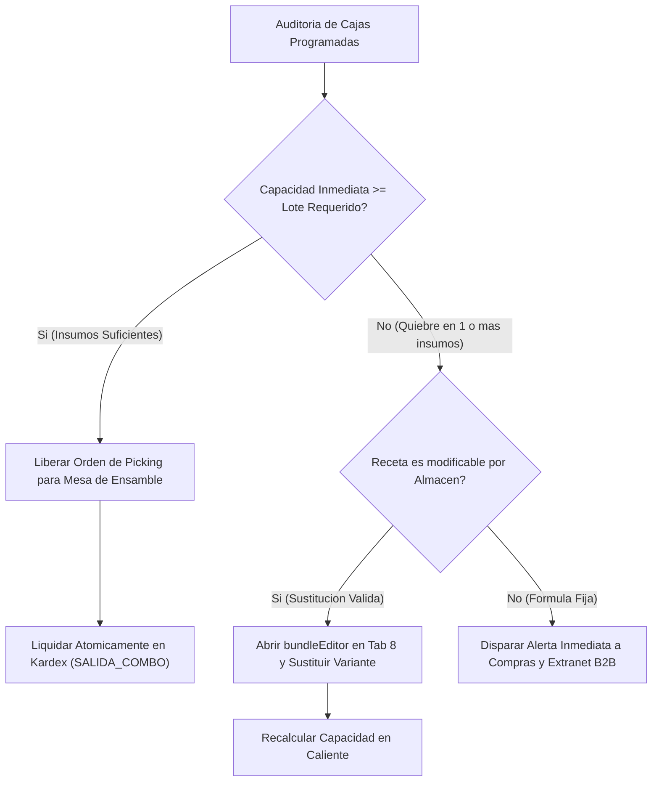

#### Función A4: Conteo Cíclico a Ciegas (Blind Cycle Counting - 3 SKUs Diarios)
- **Objetivo Operativo:** Auditar diariamente 3 productos aleatorios sin mostrar las existencias del sistema al operador, garantizando veracidad total del inventario físico.
- **Secciones del Sistema:**
  - *Hub 4 (Inventario):* Modal de Conteo Cíclico a Ciegas (`blindAuditModal`).
  - *Historial Kardex:* Asientos tipificados de conciliación (`AJUSTE_FISICO_AUDITORIA`).
- **Punto Ciego:** Conteo sesgado donde el operador confirma la cifra del sistema sin contar físicamente las prendas en gaveta.
- **Mitigación en Software:** La interfaz oculta por completo las cifras teóricas hasta que el usuario captura y guarda el conteo físico real.
- **Diagrama de Decisión: Auditoría Cíclica a Ciegas:**
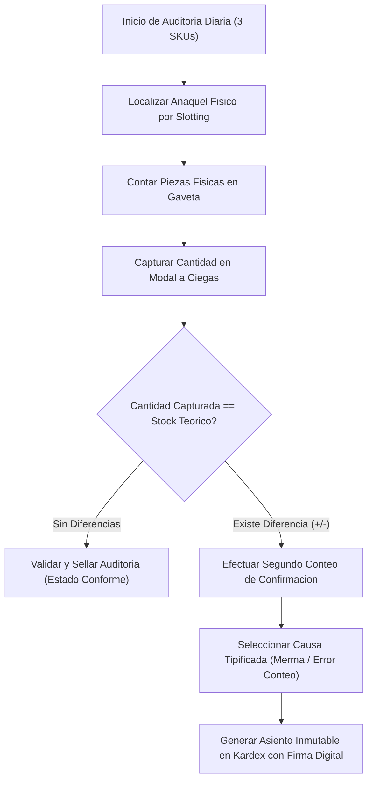

#### Función A5: Control Sanitario, Lotes y Caducidades / PAO Cosmética
- **Objetivo Operativo:** Controlar la caducidad y el Periodo Tras Apertura (PAO: 6M, 12M, 24M) en bases, sueros y fragancias cosméticas para evitar entregar productos caducados.
- **Secciones del Sistema:**
  - *Hub 4 (Catálogo Operativo):* Módulo de Control Sanitario y Trazabilidad de Lotes.
- **Punto Ciego:** Despachar productos cosméticos próximos a caducar por falta de visibilidad del lote en el anaquel.
- **Mitigación en Software:** Semáforo cromático de caducidad con regla FEFO (First Expired, First Out) y bloqueo automático de selección para lotes con menos de 60 días de vida útil.
- **Diagrama de Decisión: Control Sanitario Cosmético:**
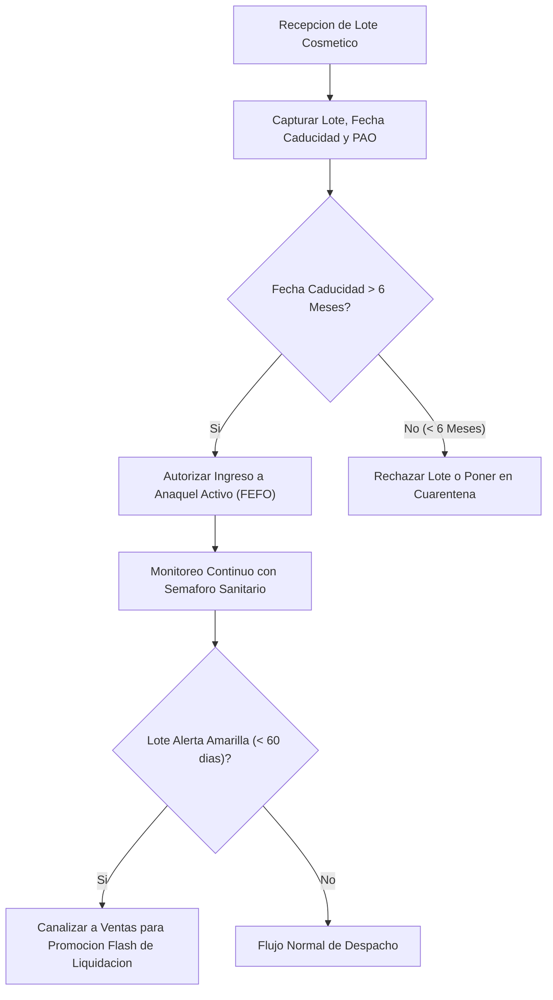

#### Función A6: Generación e Impresión de Etiquetas Térmicas de Anaquel y Prenda
- **Objetivo Operativo:** Identificar con código de barras Code128 y QR cada producto y gaveta para agilizar la lectura con escáner láser o smartphone.
- **Secciones del Sistema:**
  - *Hub 4 (Catálogo Operativo):* Botón de impresión térmica individual y por lote.
- **Punto Ciego:** Prendas en rack sin etiqueta o con código ilegible, retrasando el picking.
- **Mitigación en Software:** Formato vectorial SVG de alto contraste configurado a 50x30mm para impresoras térmicas (Zebra/Xprinter), inmune a distorsiones de resolución.
- **Diagrama de Decisión: Etiquetado Térmico:**
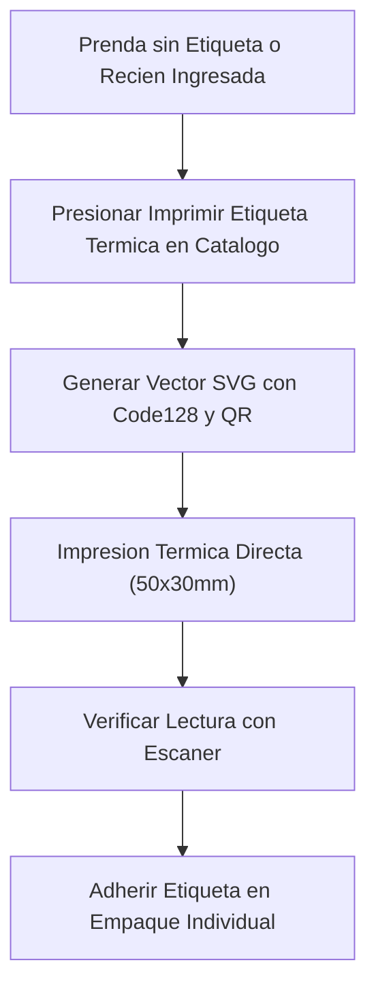

---

### 3.2. Rol: Operador de Empaque, Surtido & Picking (`packer`)

#### Función E1: Picking por Ruta Óptima de Pasillo
- **Objetivo Operativo:** Recolectar de los anaqueles las prendas de las órdenes aprobadas siguiendo una trayectoria secuencial óptima para evitar recorridos redundantes en bodega.
- **Secciones del Sistema:**
  - *Hub 1 (Dashboard Operativo):* Tablero Kanban de Piso $\rightarrow$ Columna `Por Recolectar`.
- **Punto Ciego:** Recolectar órdenes al azar, caminando varias veces por el mismo pasillo y retrasando el corte matutino.
- **Mitigación en Software:** La hoja de ruta agrupa los artículos ordenados estrictamente por secuencia de pasillos (`A-01` $\rightarrow$ `A-02` $\rightarrow$ `B-01`).
- **Diagrama de Decisión: Ruta de Picking:**
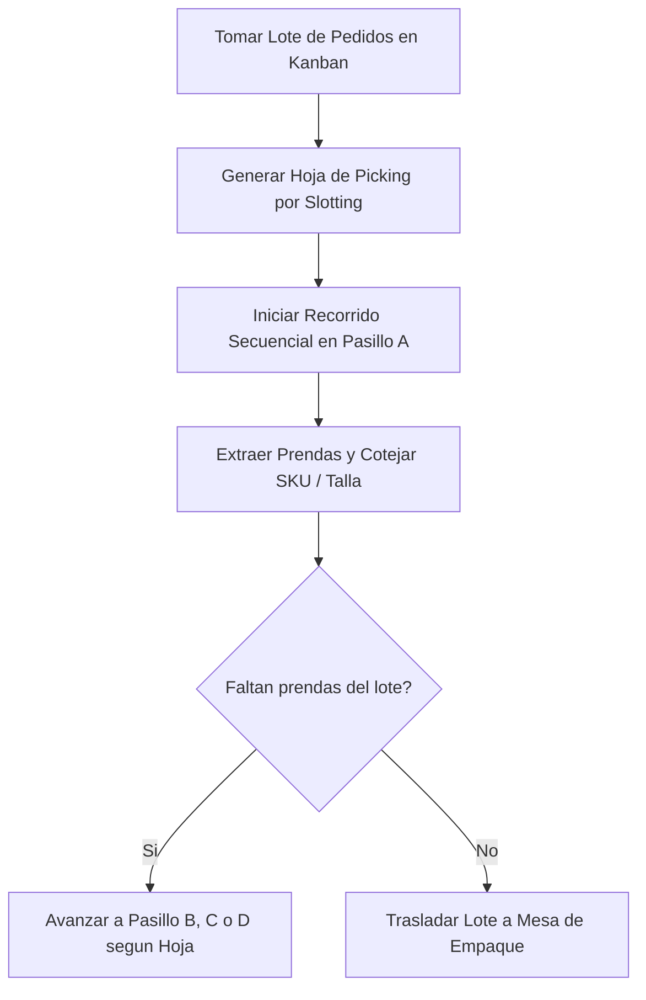

#### Función E2: Checklist Físico y Verificación de Calidad en Mesa de Empaque
- **Objetivo Operativo:** Validar que las prendas recolectadas coincidan exactamente con la orden en SKU, talla, color y condición física antes de introducirlas en la caja.
- **Secciones del Sistema:**
  - *Hub 1 / Hub 6:* Modal de Surtido y Checklist Interactivo de Mesa de Empaque.
- **Punto Ciego:** Empacar una talla equivocada (ej. CH en lugar de G) o una prenda con hilo suelto, generando quejas y costos dobles de flete por devolución.
- **Mitigación en Software:** El botón de emisión de guía térmica permanece deshabilitado hasta marcar interactivamente el 100% de las casillas de verificación.
- **Diagrama de Decisión: Checklist de Empaque:**
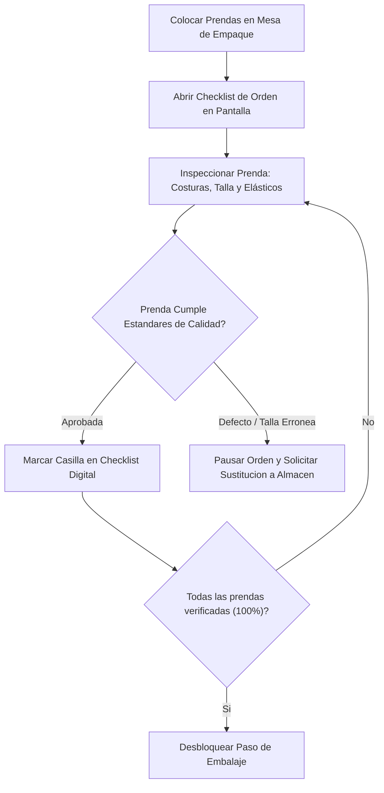

#### Función E3: Selección de Caja Volumétrica y Protocolo de Embalaje Seguro
- **Objetivo Operativo:** Escoger la caja adecuada según el volumen de las prendas y aplicar protección impermeable para cosméticos líquidos y papel de seda con sello de privacidad para prendas íntimas.
- **Secciones del Sistema:**
  - *Hub 6 (Logística):* Gestor de Cajas y Empaques con cubicaje volumétrico automático.
- **Punto Ciego:** Usar una caja sobredimensionada que dispara la tarifa de peso volumétrico de DHL, o derrames de lociones íntimas sobre ropa interior.
- **Mitigación en Software:** El sistema calcula el cubicaje estimado del carrito y sugiere la caja óptima (Chica, Mediana, Grande), alertando con bandera obligatoria de bolsa hermética si la orden contiene cosmética líquida.
- **Diagrama de Decisión: Embalaje Seguro:**
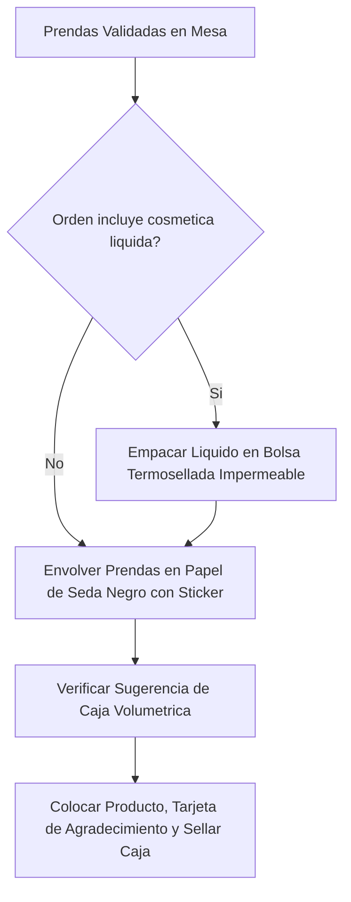

#### Función E4: Emisión de Guías Térmicas (100x150mm) con Remitente Neutro
- **Objetivo Operativo:** Generar e imprimir la etiqueta oficial de transporte courier garantizando la privacidad del cliente y la legibilidad del código de barras.
- **Secciones del Sistema:**
  - *Hub 1 / Hub 6:* Emisión de Guías Térmicas en 1 Clic (`100x150mm`).
- **Punto Ciego:** Imprimir etiquetas que revelen el contenido íntimo del paquete o emitir guías para pedidos con alertas de fraude bancario activas.
- **Mitigación en Software:** El remitente se genera forzosamente como nombre corporativo neutro ("Operaciones Logísticas") y el motor bloquea la emisión si Stripe Radar detecta riesgo.
- **Diagrama de Decisión: Emisión de Guía:**
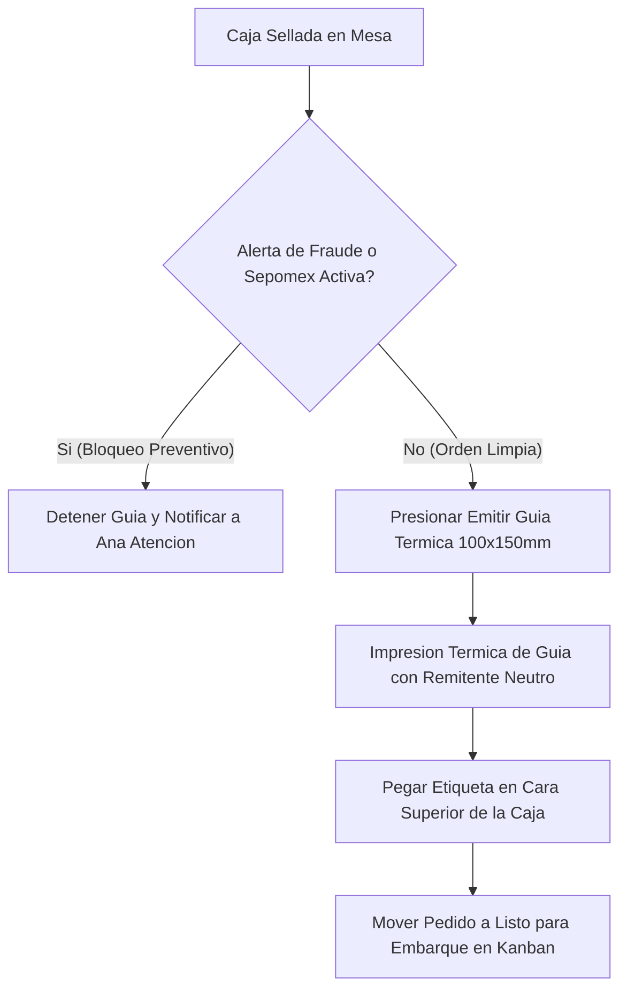

#### Función E5: Cierre de Manifiesto Diario y Entrega al Courier (Corte DHL 14:00 hrs)
- **Objetivo Operativo:** Agrupar todos los paquetes del día en un manifiesto único de entrega, recolectar la firma del chofer y transferir la custodia a la paquetería.
- **Secciones del Sistema:**
  - *Hub 1:* Banner de Cuenta Regresiva de Corte SLA.
  - *Hub 6:* Módulo de Cierre de Manifiesto y Despacho.
- **Punto Ciego:** Entregar paquetes sueltos al chofer sin manifiesto firmado, perdiendo respaldo ante extravíos en tránsito.
- **Mitigación en Software:** Generación del documento maestro con código de barras consolidado; el sistema no permite cerrar el día hasta registrar el folio del manifiesto firmado.
- **Diagrama de Decisión: Cierre de Manifiesto:**
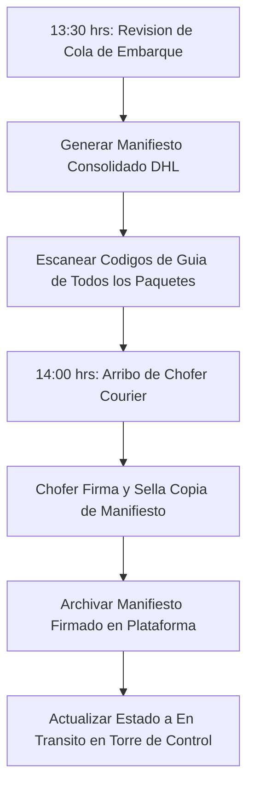

#### Función E6: Inspección Sanitaria de Devoluciones RMA (Precinto Íntimo vs Exterior)
- **Objetivo Operativo:** Dictaminar si una prenda devuelta puede reintegrarse a inventario o debe destruirse por normatividad sanitaria (COFEPRIS/PROFECO).
- **Secciones del Sistema:**
  - *Hub 6 (Logística):* Módulo de Devoluciones y Garantías RMA.
- **Punto Ciego:** Devolver al anaquel ropa interior usada o manipulada sin precinto higiénico, cometiendo una infracción sanitaria grave.
- **Mitigación en Software:** Clasificación forzada de la inspección: si la prenda es ropa interior y el precinto protector fue violado, el sistema solo permite el asiento `BAJA_DESTRUCCION_SANITARIA` sin retorno a stock comercial.
- **Diagrama de Decisión: Inspección RMA:**
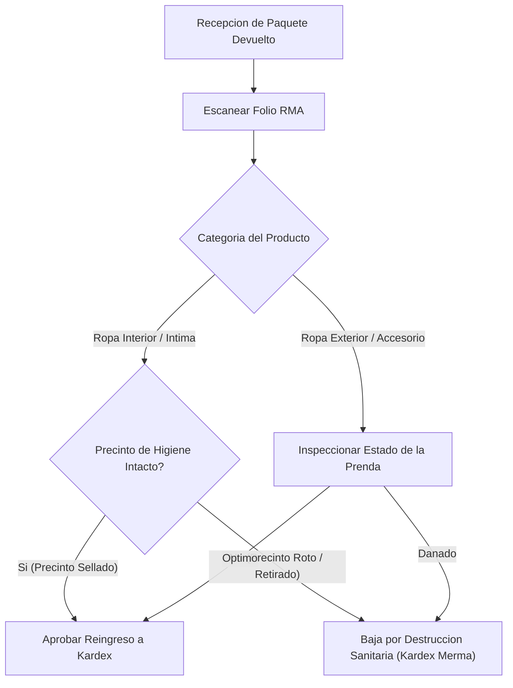

---

### 3.3. Rol: Encargada de Compras & Abastecimiento (`purchases`)

#### Función C1: Monitoreo de Puntos de Reorden (ROP) y Alertas de Stock Crítico
- **Objetivo Operativo:** Evaluar diariamente los ritmos de consumo y tiempos de entrega de talleres para anticipar quiebres de inventario.
- **Secciones del Sistema:**
  - *Hub 4 (Compras & Reabastecimiento):* Calculadora ROP y Semáforo de Cobertura en Días.
- **Punto Ciego:** Comprar basándose en corazonadas o inventario estático en lugar de la velocidad de venta semanal (run-rate), provocando desabasto de tallas populares (M, G).
- **Mitigación en Software:** Alerta automática cuando los días proyectados de vida caen por debajo del lead time del proveedor más el stock de seguridad.
- **Diagrama de Decisión: Evaluación ROP:**
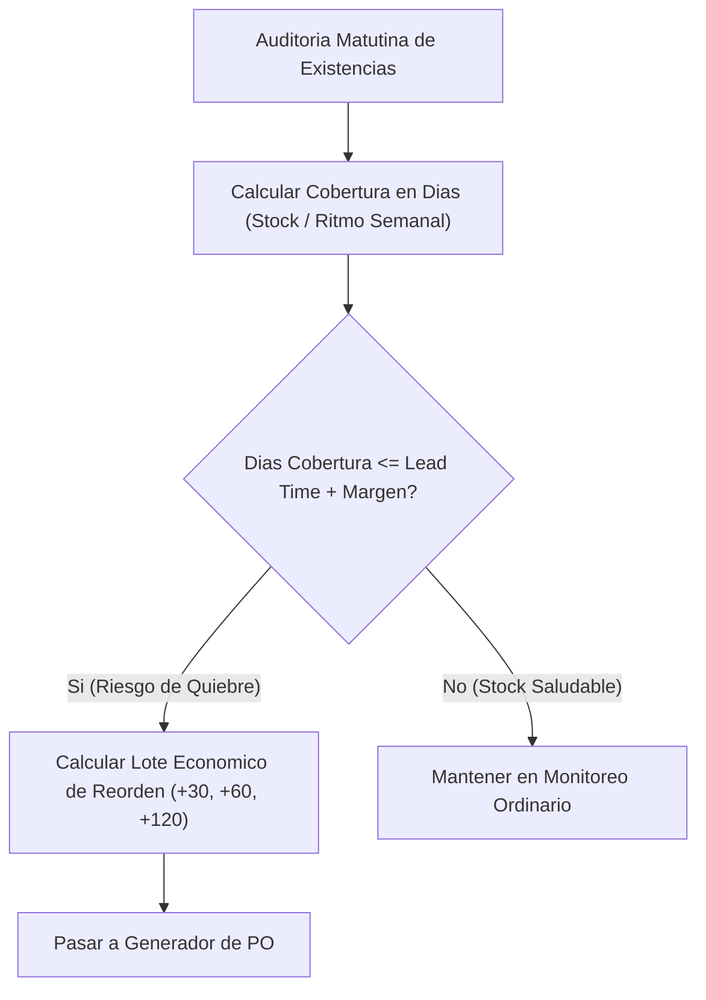

#### Función C2: Generación, Despacho por Correo y Archivo Inmutable de Órdenes de Compra (PO)
- **Objetivo Operativo:** Formalizar los requerimientos de producción con especificación exacta de curvas de tallas (CH a 3XL), telas, colores y fechas compromiso de entrega, despachando la orden oficial por correo electrónico con PDF adjunto y almacenando una instantánea inmutable para reimpresión histórica.
- **Secciones del Sistema:**
  - *Hub 4 (Compras & Reabastecimiento - Sub-pestaña 1: Planificación):* Tabla interactiva con edición de curvas de tallas **100% inline** en vistas Tree-View (con avance de MOQ y subtotales) y Flat-View.
  - *Modal Generador de PO (`openPoGenerator`):* Hoja de estilo PDF corporativo con desglose de tallas, resumen financiero, selector de muelle y botón de impresión nativa (`window.print()`).
  - *Modal de Despacho de Correo (`emailDispatchModalOpen`):* Verificación de destinatario (`to`), copia a administración (`cc`), asunto, cuerpo editable y badge de archivo adjunto PDF.
  - *Hub 4 (Compras - Sub-pestaña 2: Órdenes Emitidas & Seguimiento Fletero):* Repositorio de órdenes emitidas con instantánea inmutable (`po_snapshot` JSON) y botón `[Reimprimir / Ver PDF]`.
  - *Hub 4 (Compras - Sub-pestaña 4: Kardex de Compras):* Asientos inmutables de auditoría con botón `viewPoPdfFromPoNumber` para consultar el PDF histórico.
- **Punto Ciego:** Solicitar cantidades globales sin curva de tallas detallada, enviar órdenes por canales informales sin acuse o perder la versión histórica del pedido si cambian los costos del catálogo.
- **Mitigación en Software:** Edición 100% inline de tallas, generación automática de PDF corporativo, compuerta obligatoria de despacho por correo antes de la emisión, y almacenamiento inmutable de la instantánea (`po_snapshot`) garantizando reimpresión idéntica en cualquier momento.
- **Diagrama de Decisión: Emisión y Despacho de PO:**
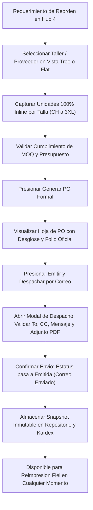

#### Función C3: Conexión y Disparo de Órdenes a Extranet B2B de Proveedores (TASK-HUB-VND)
- **Objetivo Operativo:** Notificar digitalmente las órdenes de compra al portal de proveedores para que el fabricante confirme corte, avance y despacho local.
- **Secciones del Sistema:**
  - *Hub 7 / Portal B2B (`vendorPortalState`):* Sincronización de órdenes y telemetría de producción.
- **Punto Ciego:** Enviar pedidos por canales informales (mensajería personal) sin confirmación de recepción ni seguimiento formal de hitos.
- **Mitigación en Software:** La orden viaja directamente al portal B2B con token de seguridad donde el proveedor marca hitos auditables: `Corte Iniciado`, `En Confección`, `En Tránsito a Rampa`.
- **Diagrama de Decisión: Flujo B2B:**
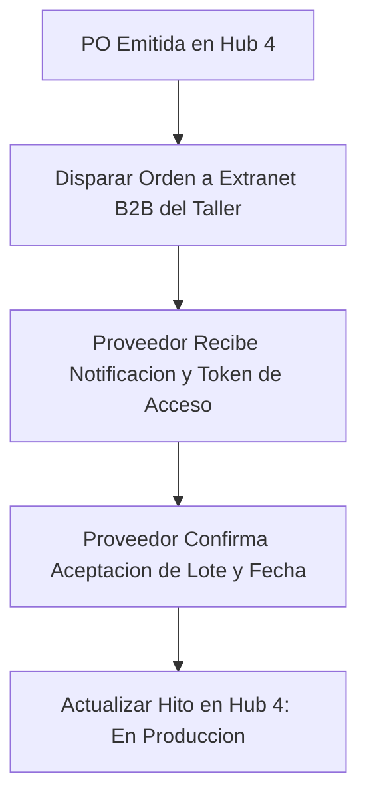

#### Función C4: Evaluación de Proveedores y Scorecards SLA (Fill Rate % & On-Time %)
- **Objetivo Operativo:** Evaluar cuantitativamente a talleres y proveedores para decidir asignaciones futuras de presupuesto y negociar mejores plazos.
- **Secciones del Sistema:**
  - *Hub 4 (Proveedores & Scraping):* Scorecard SLA con KPIs en vivo (`averageSlaScore`).
- **Punto Ciego:** Continuar asignando maquila a proveedores con retrasos crónicos que afectan el nivel de servicio a clientes.
- **Mitigación en Software:** Algoritmo automático que calcula el puntaje de cumplimiento (0 a 100) ponderando puntualidad de entrega y tasa de defectos en rampa.
- **Diagrama de Decisión: Evaluación SLA de Proveedores:**
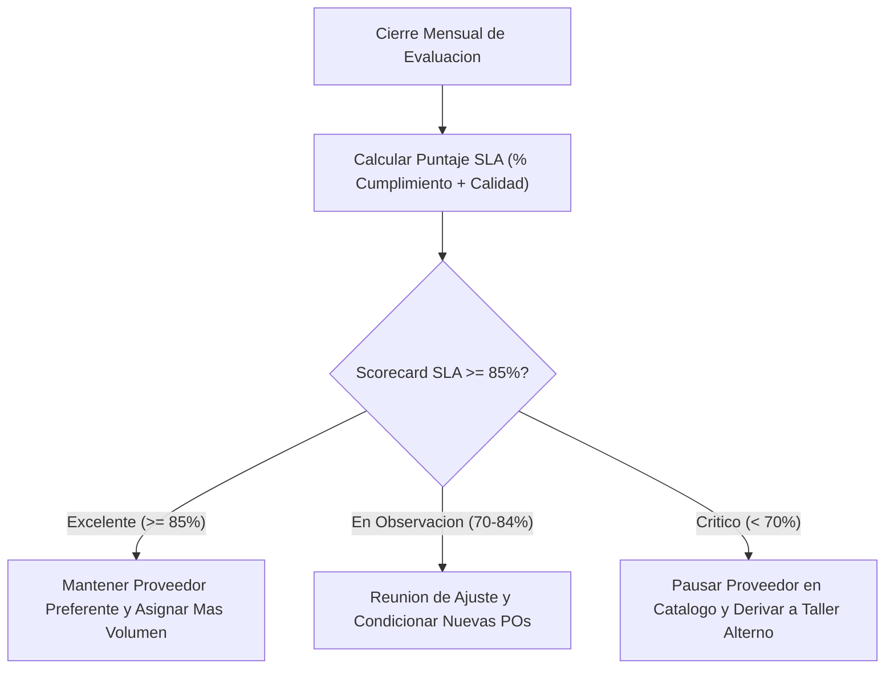

#### Función C5: Curaduría Previa y Auditoría de Scraping de Catálogo Externo (Torzo)
- **Objetivo Operativo:** Supervisar la ingesta de productos obtenidos por el robot de scraping para evitar ingresar descripciones erróneas o márgenes inviables.
- **Secciones del Sistema:**
  - *Hub 4 (Ajustes de Módulo -> Pestaña Scraping & Curaduría).*
- **Punto Ciego:** Publicar automáticamente productos de scraping con imágenes de baja calidad, tablas de tallas incorrectas o precios sin margen de ganancia.
- **Mitigación en Software:** Bandeja de curaduría intermedia donde los productos scrapeados permanecen en estado `Pendiente de Curaduría` hasta que compras aprueba imágenes, silueta y margen.
- **Diagrama de Decisión: Curaduría de Scraping:**
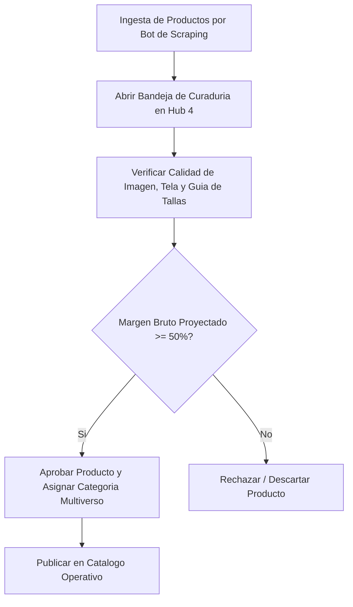

#### Función C6: Cotejo Automatizado de 3 Vías (OC $\leftrightarrow$ Rampa $\leftrightarrow$ Liquidación Fiscal)
- **Objetivo Operativo:** Validar que la factura fiscal del proveedor coincida con la PO emitida y con lo recibido físicamente en rampa antes de autorizar el pago SPEI.
- **Secciones del Sistema:**
  - *Hub 4 (Compras) & Hub 5 (Finanzas -> Matriz de 3 Vías Inbound).*
- **Punto Ciego:** Pagar facturas con sobrecostos no autorizados o cobrar piezas que nunca llegaron a rampa.
- **Mitigación en Software:** El botón de liquidación bancaria SPEI se bloquea automáticamente si existe cualquier discrepancia en precio unitario o unidades físicas.
- **Diagrama de Decisión: Cotejo de 3 Vías:**
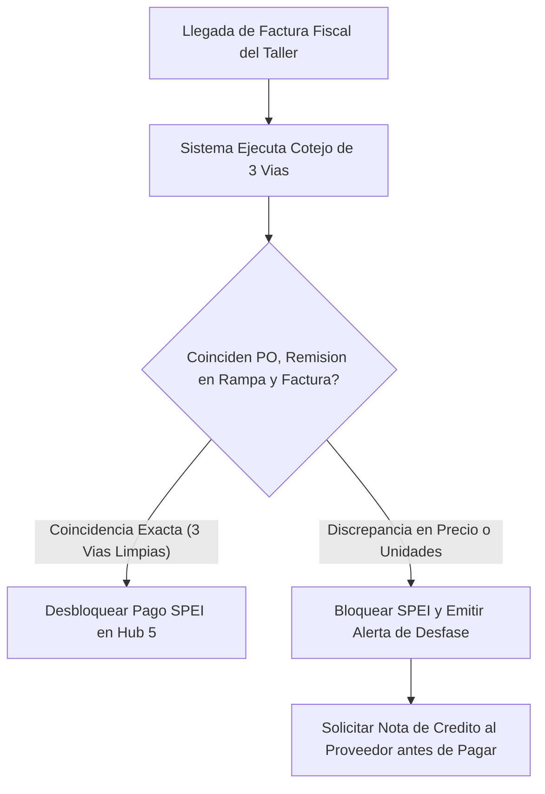

#### Función C7: Proceso Normativo tras Discrepancia en Recibo de Pedido (Seguimiento Fletero, Minuta IA y Formalización PDF/Email)
- **Objetivo Operativo:** Coordinar la resolución expedita de diferencias entre la mercancía pactada y la recibida físicamente en rampa, negociando acuerdos comerciales con el proveedor y formalizándolos por correo electrónico institucional con respaldo en PDF asistido por IA.
- **Secciones del Sistema:**
  - *Hub 1 (Prioridades del Turno de Compras):* Tarjeta reactiva de Notificación de Arribo Fletero con telemetría en vivo de API de paquetería y botón condicional `Validar Cumplimiento de Entrega`.
  - *Hub 1 / Hub 4:* Modal de Auditoría Cruzada de Recepción (PO vs Conteo Físico de Rampa).
  - *Modal de Negociación y Minuta:* Ficha de contacto del proveedor y área de captura rápida de acuerdos alcanzados.
  - *Asistente IA de Redacción Mercantil:* Motor generador de comunicado formal y PDF ejecutivo adjunto.
  - *Consola de Despacho de Correo:* Prellenado automático de destinatarios, asunto normalizado y vista previa del PDF.
- **Punto Ciego:** Tratar discrepancias de bultos mediante llamadas informales sin registro documental ni acuerdos firmados, lo que deriva en facturas pagadas en exceso, pérdida de notas de crédito y fricciones contables durante el cierre mensual.
- **Mitigación en Software:**
  1. *Seguimiento Fletero vía API:* La tarjeta de Hub 1 consume el webhook/API de la transportista (FedEx, DHL, Estafeta) reflejando hitos de tránsito en tiempo real; el botón de validación de Compras se mantiene inactivo hasta que Carlos Almacén certifica la descarga física en muelle.
  2. *Auditoría Cruzada Instantánea:* El modal contrasta automáticamente las piezas ordenadas contra las unidades contadas por Almacén desglosadas por talla.
  3. *Captura Rápida de Minuta:* Elena Compras registra en lenguaje natural los acuerdos pactados en llamada con el taller.
  4. *Bifurcación Operativa:* Permite elegir entre `Guardar Borrador para Después` (para negociaciones en pausa) o `Formalizar Acuerdo Inmediatamente`.
  5. *Reescritura IA y Generación de PDF:* La IA reescribe las notas coloquiales en un acta mercantil formal con membrete corporativo, tabla de diferencias físicas y cláusula de compensación (nota de crédito SAT o reposición en siguiente corrida de confección), adjuntando el PDF al correo con campos y destinatarios prellenados.
- **Diagrama de Decisión: Proceso de Discrepancia y Formalización IA:**
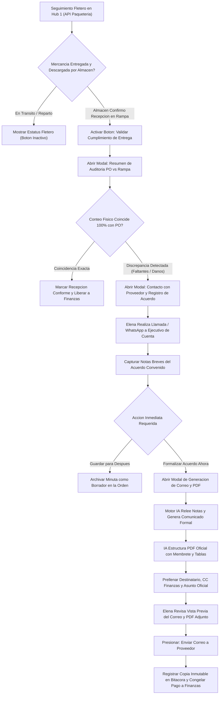

---

### 3.4. Rol: Asesora Comercial & Atención - Ana (`sales`)

#### Función V1: Validación Predictiva de Códigos Postales y Direcciones Sepomex
- **Objetivo Operativo:** Auditar los domicilios de entrega capturados por clientes en checkout para asegurar que sean válidos ante el catálogo postal oficial Sepomex antes de empacar.
- **Secciones del Sistema:**
  - *Hub 1 (Bandeja Ana Atención -> Alertas de Riesgo Sepomex).*
- **Punto Ciego:** Enviar paquetes con colonia o municipio inexistente, provocando retrasos, devoluciones de DHL y cobros por reexpedición.
- **Mitigación en Software:** Motor predictivo que detecta inconsistencias y retiene la orden en estado `Sepomex en Revisión`, canalizándola directamente a la pantalla de Ana para corrección en 1 clic.
- **Diagrama de Decisión: Validación Sepomex:**
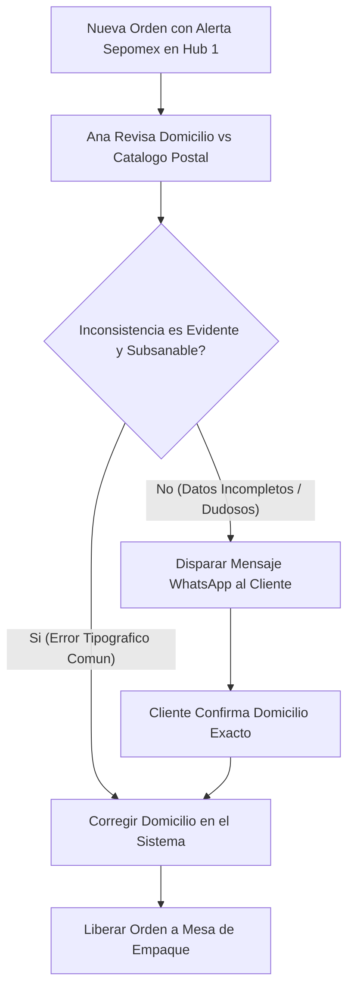

#### Función V2: Recuperación de Carritos Abandonados con Enlaces Tokenizados WhatsApp
- **Objetivo Operativo:** Rescatar ventas no concluidas en la tienda web contactando a los compradores que dejaron productos en el carrito.
- **Secciones del Sistema:**
  - *Hub 1 (Embudo Comercial Multiverso -> Botón de Rescate en 1 Clic).*
- **Punto Ciego:** Contactar al cliente demasiado tarde o enviarle un enlace genérico que obliga a buscar y agregar las prendas de nuevo.
- **Mitigación en Software:** Generador de enlaces tokenizados que restauran el carrito con 1 solo clic y plantilla dinámica de WhatsApp con saludo personalizado y detalle de prendas.
- **Diagrama de Decisión: Rescate de Carritos:**
```mermaid
flowchart TD
    A20["Deteccion de Carrito Abandonado (> 15 min)"] --> B20["Ana Evalua Valor del Carrito y Prendas"]
    B20 --> C20{"Ticket > $800 MXN?"}
    C20 -- "Si (Carrito Alto Valor)" --> D20["Disparar WhatsApp con Enlace Tokenizado + Cupon Envio Gratis"]
    C20 -- "No (Ticket Estandar)" --> E20["Disparar WhatsApp Recordatorio Amigable"]
    D20 --> F20["Cliente Hace Clic y Completa Checkout"]
    E20 --> F20
    F20 --> G20["Venta Pagada Registrada en Sistema"]
```

#### Función V3: Asesoría Anatómica y Guía de Siluetas Íntimas (Torzo Fit)
- **Objetivo Operativo:** Asesorar a compradores sobre la silueta idónea (Boxer, Jockstrap, Tanga, Bikini) y tallaje textil según su fisonomía corporal.
- **Secciones del Sistema:**
  - *WhatsApp CRM integrado con Ficha Anatómica de Producto.*
- **Punto Ciego:** Respuestas genéricas que derivan en compras de talla incorrecta y devoluciones sanitarias posteriores.
- **Mitigación en Software:** Ficha anatómica con medidas exactas de cintura en centímetros, elasticidad de la tela y recomendaciones según contextura física.
- **Diagrama de Decisión: Asesoría Anatómica:**
```mermaid
flowchart TD
    A21["Consulta de Cliente sobre Talla o Silueta"] --> B21["Solicitar Medida de Cintura en cm y Preferencia de Ajuste"]
    B21 --> C21{"Cliente Prefiere Ajuste"}
    C21 -- "Compresion Deportiva" --> D21["Recomendar Silueta Jockstrap en Talla Exacta"]
    C21 -- "Comodidad Diario" --> E21["Recomendar Boxer Modal Seamless"]
    C21 -- "Minima Cobertura" --> F21["Recomendar Tanga Velvet Touch"]
    D21 --> G21["Enviar Enlace Directo a Producto"]
    E21 --> G21
    F21 --> G21
```

#### Función V4: Gestión de Membresías y Suscripciones Recurrentes (MRR)
- **Objetivo Operativo:** Administrar cambios de preferencias, pausas de suscripción y resolución de cobros fallidos (dunning) para preservar los ingresos recurrentes de la tienda.
- **Secciones del Sistema:**
  - *Hub 1 (Bandeja de Membresías) & Hub 5 (Motor de Dunning).*
- **Punto Ciego:** Cancelación definitiva de clientes por cobros declinados en tarjetas sin reintento asistido.
- **Mitigación en Software:** Motor de reintento inteligente y notificación preventiva por WhatsApp 3 días antes del cobro para actualizar método de pago.
- **Diagrama de Decisión: Gestión de Membresías:**
```mermaid
flowchart TD
    A22["Alerta de Cobro Fallido de Suscripcion"] --> B22["Disparar Notificacion Preventiva por WhatsApp"]
    B22 --> C22["Cliente Actualiza Tarjeta en Enlace Seguro"]
    C22 --> D22{"Reintento de Cobro Exitoso?"}
    D22 -- "Si" --> E22["Renovacion MRR Confirmada y Liberada a BOM"]
    D22 -- "No" --> F22["Ofrecer Metodo Alternativo (OXXO Pay / SPEI)"]
```

#### Función V5: Tramitación de Garantías, Cambios de Talla y Emisión de Reemplazos
- **Objetivo Operativo:** Resolver inconformidades de clientes emitiendo reemplazos ágiles sin fricción innecesaria.
- **Secciones del Sistema:**
  - *Hub 6 (Portal de Garantías) & Hub 1 (Bandeja Post-Venta).*
- **Punto Ciego:** Exigir devoluciones físicas de prendas de bajo costo donde el flete de retorno supera el costo de la prenda, molestando al cliente y perdiendo dinero.
- **Mitigación en Software:** Regla de decisión de retorno inteligente: si el valor de la prenda es menor al costo del flete y la evidencia fotográfica es concluyente, se aprueba el reenvío directo sin exigir retorno físico.
- **Diagrama de Decisión: Tramitación de Garantías:**
```mermaid
flowchart TD
    A23["Solicitud de Garantia con Fotografia"] --> B23["Verificar Defecto de Fabricacion"]
    B23 --> C23{"Costo Prenda < Costo Guia Retorno?"}
    C23 -- "Si (Costo Menor)" --> D23["Aprobar Reemplazo Directo sin Retorno Fisico"]
    C23 -- "No (Prenda de Alto Valor)" --> E23["Generar Guia Prepagada de Devolucion al Cliente"]
    D23 --> F23["Generar Orden de Envio en Hub 1"]
    E23 --> G23["Esperar Recepcion e Inspeccion en Mesa"]
    G23 --> F23
```

#### Función V6: Escudo Antifraude y Retención Preventiva en Mesa de Empaque
- **Objetivo Operativo:** Bloquear en tiempo real el empaque y despacho de pedidos sospechosos de fraude con tarjetas de crédito comprometidas.
- **Secciones del Sistema:**
  - *Hub 1 (Alerta Stripe Radar & Botón de Freno de Emergencia).*
- **Punto Ciego:** Despachar un pedido fraudulento que luego se convierte en contracargo con penalización bancaria.
- **Mitigación en Software:** El sistema recibe el webhook de Stripe Radar y congela instantáneamente la orden en la mesa de empaque con alarma visual roja.
- **Diagrama de Decisión: Escudo Antifraude:**
```mermaid
flowchart TD
    A24["Disparo de Alerta de Alto Riesgo en Stripe Radar"] --> B24["Sistema Congela Orden en Mesa de Empaque"]
    B24 --> C24["Ana Solicita Validacion de Identidad al Comprador"]
    C24 --> D24{"Cliente Acredita Titularidad de la Tarjeta?"}
    D24 -- "Si (Acreditado)" --> E24["Descongelar Orden y Liberar a Empaque"]
    D24 -- "No (Fraude Confirmado)" --> F24["Cancelar Pedido y Reembolsar a Pasarela"]
    F24 --> G24["Reintegrar Prendas a Stock Disponible"]
```

---

### 3.5. Rol: Dirección General / RevOps / Finanzas (`admin` / `finance`)

#### Función D1: Auditoría de Cascada de Margen Neto Real por Pedido
- **Objetivo Operativo:** Conocer la rentabilidad neta real de las operaciones descontando todos los costos directos e indirectos (prenda, pasarela, empaque y paquetería).
- **Secciones del Sistema:**
  - *Hub 1 (Concentrador Ejecutivo -> Cascada de Margen RevOps).*
- **Punto Ciego:** Evaluar el éxito comercial con base en facturación bruta (GMV), ocultando que ciertos pedidos con envíos lejanos generan pérdida neta.
- **Mitigación en Software:** Gráfica interactiva de cascada que calcula deducción por deducción el margen neto real por pedido y por vitrina.
- **Diagrama de Decisión: Cascada de Margen:**
```mermaid
flowchart TD
    A25["Revision Semanal de P&L"] --> B25["Calcular Cascada de Margen (GMV - CPP - Stripe - Fletes - Empaque)"]
    B25 --> C25{"Margen Neto Real >= 40%?"}
    C25 -- "Si (Rentabilidad Optima)" --> D25["Mantener Estructura y Evaluar Nuevas Promociones"]
    C25 -- "No (< 40%)" --> E25["Analizar Fuga Principal en Cascada"]
    E25 --> F25{"Fuga Principal"}
    F25 -- "Fletes Courier Altos" --> G25["Ajustar Umbral de Envio Gratis a $1,200 MXN"]
    F25 -- "Costo de Adquisicion Alto" --> H25["Optimizar Pauta y Mejorar Conversion Organica"]
```

#### Función D2: Análisis Pareto ABC (80/20) del Catálogo y Liquidación de Clase C
- **Objetivo Operativo:** Clasificar los SKUs según su contribución al negocio para concentrar capital en productos ganadores y liquidar artículos estancados.
- **Secciones del Sistema:**
  - *Hub 1 (Concentrador Ejecutivo -> Sub-pestaña Almacén e Inventario).*
- **Punto Ciego:** Mantener capital inmovilizado en 500 SKUs de rotación casi nula mientras faltan fondos para surtir el Top 10.
- **Mitigación en Software:** Clasificación matemática automática (Clase A: 80% ventas; Clase B: 15%; Clase C: 5%) con saltos prefiltrados al catálogo para aplicar promociones en 1 clic.
- **Diagrama de Decisión: Análisis Pareto ABC:**
```mermaid
flowchart TD
    A26["Auditoria Mensual de Catalogo ABC"] --> B26["Identificar 50% de SKUs en Clase C (< 5% Facturacion)"]
    B26 --> C26{"Tiempo en Anaquel > 90 Dias?"}
    C26 -- "Si (Inventario Ocioso)" --> D26["Crear Pack Promocional Outlet con 40% Descuento"]
    D26 --> E26["Liberar Capital de Trabajo y Espacio en Racks"]
    C26 -- "No (Producto Reciente)" --> F26["Revisar Precio y Fotos en Vitrina Web"]
```

#### Función D3: Monitoreo del Embudo Multiverso y Optimización de Pauta Publicitaria
- **Objetivo Operativo:** Supervisar la tasa de conversión en cada etapa del embudo comercial (Sesiones $\rightarrow$ Carrito $\rightarrow$ Checkout $\rightarrow$ Venta) para optimizar el gasto publicitario en Meta CAPI y Google Ads.
- **Secciones del Sistema:**
  - *Hub 1 (Dashboard Ejecutivo -> Embudo Comercial Accionable).*
- **Punto Ciego:** Aumentar presupuesto de publicidad cuando el problema está en una alta fricción en el formulario de pago.
- **Mitigación en Software:** Telemetría en tiempo real con diagnóstico de caídas anormales en checkout y disparadores de corrección.
- **Diagrama de Decisión: Optimización de Pauta:**
```mermaid
flowchart TD
    A27["Analisis Diario de Embudo"] --> B27{"Tasa de Conversion Global >= 3.2%?"}
    B27 -- "Si (Embudo Saludable)" --> C27["Autorizar Incremento de 20% en Pauta Meta Ads"]
    B27 -- "No (Fuga en Embudo)" --> D27["Identificar Etapa con Mayor Abandono"]
    D27 --> E27{"Paso Critico"}
    E27 -- "Carrito a Checkout" --> F27["Auditar Costos de Envio y Opciones de Pago"]
    E27 -- "Checkout a Pago" --> G27["Revisar Tasa de Rechazo de Pasarelas Stripe/OXXO"]
```

#### Función D4: Motor Fiscal SAT, Conciliación de IVA y Retenciones
- **Objetivo Operativo:** Garantizar el cumplimiento tributario en comercio electrónico separando el IVA trasladado del neto cobrado y conciliando retenciones de plataformas.
- **Secciones del Sistema:**
  - *Hub 5 (Finanzas -> Consola Fiscal SAT & Reportes para Contador).*
- **Punto Ciego:** Considerar el IVA recaudado como ingreso propio del negocio, provocando desbalances de liquidez en el pago mensual al SAT.
- **Mitigación en Software:** Separación contable automática: por cada venta, calcula `Base Gravable = Total / 1.16` e `IVA Trasladado = Total - Base`, generando reportes limpios en UTF-8 para el despacho contable.
- **Diagrama de Decisión: Conciliación Fiscal:**
```mermaid
flowchart TD
    A28["Cierre de Mes Fiscal"] --> B28["Generar Reporte de Base Gravable vs IVA Trasladado"]
    B28 --> C28["Conciliar Retenciones de Plataformas (1% ISR + 8% IVA)"]
    C28 --> D28{"Cifras Conciliadas con Estado de Cuenta Stripe?"}
    D28 -- "Si" --> E28["Exportar Reporte Fiscal Limpio a Contador"]
    D28 -- "No" --> F28["Revisar Transacciones Reembolsadas o Contracargos"]
```

#### Función D5: Conciliación de Facturas de Paquetería vs Manifiestos Emitidos
- **Objetivo Operativo:** Auditar las facturas emitidas por DHL/Skydropx contra los manifiestos de bodega para evitar cobros por sobrepeso inexistente o zonas extendidas erróneas.
- **Secciones del Sistema:**
  - *Hub 6 & Hub 5 (Matriz de Conciliación de Fletes).*
- **Punto Ciego:** Pagar cargos extras de paqueterías por diferencias de pesaje volumétrico no auditadas.
- **Mitigación en Software:** Cruce automático de cada número de guía contra las dimensiones registradas en la mesa de empaque, generando tickets de reclamación formal ante cobros inflados.
- **Diagrama de Decisión: Conciliación de Fletes:**
```mermaid
flowchart TD
    A29["Recepcion de Factura Quincenal DHL"] --> B29["Cotejar Cada Guia vs Registro de Mesa de Empaque"]
    B29 --> C29{"Existe Cobro por Sobrepeso no Registrado?"}
    C29 -- "Si" --> D29["Generar Ticket de Disputa con Foto de Balanza y Medidas"]
    D29 --> E29["Deducir Monto Disputado del Pago al Courier"]
    C29 -- "No" --> F29["Autorizar Pago de Factura Logistica"]
```

#### Función D6: Telemetría de APIs, Health Check y Consulta al Copiloto IA
- **Objetivo Operativo:** Monitorear la estabilidad de las integraciones externas (Stripe, DHL, Torzo Bot) y usar el Copiloto IA para la toma de decisiones complejas.
- **Secciones del Sistema:**
  - *Hub 1 (System Health Monitor & Copiloto IA en Columna Derecha).*
- **Punto Ciego:** Caídas silenciosas de webhooks de pasarelas que impiden registrar pagos de clientes durante horas.
- **Mitigación en Software:** Monitoreo activo de latencia y tasa de éxito; si una API falla, emite un banner de alerta con plan de contingencia sugerido por la IA.
- **Diagrama de Decisión: Telemetría y Contingencia:**
```mermaid
flowchart TD
    A30["Monitoreo de Telemetria en Hub 1"] --> B30{"Estado de APIs Externas (Stripe / DHL)"}
    B30 -- "Verde (Operativo < 300ms)" --> C30["Operacion Ordinaria Continua"]
    B30 -- "Rojo (Falla / Timeout)" --> D30["Activar Modo Contingencia Local"]
    D30 --> E30["Consultar Copiloto IA en Columna Derecha"]
    E30 --> F30["Ejecutar Procedimiento de Respaldo Sugerido"]
```

---

### 3.6. Rol: Operador Integral / Administrador Multirrol (`all_roles`)

#### Función M1: Orquestación Secuencial de la Jornada mediante Time-Boxing Estricto
- **Objetivo Operativo:** Organizar el día a través de bloques horarios inflexibles para asegurar que una sola persona cubra eficazmente almacén, empaque, atención, compras y finanzas sin colapsar.
- **Secciones del Sistema:**
  - *Hub 1 (Cabina Multirrol con Conmutador de Bloques Horarios).*
- **Punto Ciego:** Atender consultas de clientes o compras por la mañana y perder la recolección courier de las 14:00 hrs.
- **Mitigación en Software:** La interfaz reconfigura las alertas según la franja horaria, priorizando en la mañana únicamente el semáforo SLA de empaque.
- **Diagrama de Decisión: Time-Boxing Multirrol:**
```mermaid
flowchart TD
    A31["Inicio de Jornada del Operador Integral"] --> B31{"Hora Actual < 13:30 hrs?"}
    B31 -- "Si (Ventana Critica Matutina)" --> C31["Activar Modo Almacen y Mesa de Empaque"]
    C31 --> D31["Foco Exclusivo en Picking, Checklist y Guias"]
    D31 --> E31["14:00 hrs: Entrega y Cierre de Manifiesto DHL"]
    B31 -- "No (Post-Recoleccion)" --> F31{"Hora Actual entre 14:00 y 17:30 hrs?"}
    F31 -- "Si (Ventana Vespertina)" --> G31["Activar Modo Comercial y Compras"]
    G31 --> H31["Rescate Carritos WhatsApp + Alertas ROP"]
    F31 -- "No (Bloque Cierre > 17:30 hrs)" --> I31["Activar Modo Direccion, Finanzas y Kardex"]
```

#### Función M2: Ejecución del Ciclo Físico Matutino (Almacén + Picking + Empaque + Courier)
- **Objetivo Operativo:** Realizar personalmente el surtido por anaqueles, verificación de prendas, empaque seguro y rotulación de etiquetas térmicas.
- **Secciones del Sistema:**
  - *Hub 1 (Kanban de Piso) & Hub 4 (Ajustes -> Recetas BOM).*
- **Punto Ciego:** Cometer omisiones en el checklist por la prisa de empacar solo.
- **Mitigación en Software:** Verificación interactiva forzada en pantalla con validación de tallas antes de imprimir la guía.
- **Diagrama de Decisión: Ciclo Físico Matutino:**
```mermaid
flowchart TD
    A32["08:00 hrs: Revision de Pedidos Pendientes"] --> B32["Verificar Existencias BOM en Tab 8 de Ajustes"]
    B32 --> C32["Generar Hoja de Picking y Recolectar en Anaqueles"]
    C32 --> D32["Validar Checklist Fisico de Prendas"]
    D32 --> E32["Embalar en Caja y Emitir Guia Termica 100x150mm"]
    E32 --> F32["14:00 hrs: Entregar Manifiesto Sellado a DHL"]
```

#### Función M3: Recepción Inbound y Descarga en Rampa Post-Corte Courier
- **Objetivo Operativo:** Recibir e ingresar físicamente la nueva mercancía recibida de proveedores inmediatamente después de despachar la camioneta de DHL.
- **Secciones del Sistema:**
  - *Hub 1 (Rampa) & Hub 4 (Kardex).*
- **Punto Ciego:** Dejar bultos recibidos en el piso sin inventariar, generando inconsistencias entre lo físico y el catálogo web.
- **Mitigación en Software:** Entrada directa en rampa que actualiza el Kardex e imprime etiquetas de anaquel de inmediato.
- **Diagrama de Decisión: Recepción Post-Corte:**
```mermaid
flowchart TD
    A33["14:00 hrs: Despachada Camioneta DHL"] --> B33["Recepcion de Bultos Nuevos en Rampa"]
    B33 --> C33["Cotejo Fisico de Prendas vs Remision del Taller"]
    C33 --> D33["Ingresar Unidades a Kardex (ENTRADA_COMPRA)"]
    D33 --> E33["Acomodar en Slotting de Anaquel Asignado"]
```

#### Función M4: Rescate Comercial y Gestión de Incidencias en Bloque Vespertino
- **Objetivo Operativo:** Concentrar la atención al cliente, corrección de domicilios Sepomex y recuperación de carritos en una ventana horaria dedicada sin interrupciones físicas.
- **Secciones del Sistema:**
  - *Hub 1 (Bandeja Ana Atención) & WhatsApp CRM.*
- **Punto Ciego:** Responder mensajes a deshoras o de forma desordenada, perdiendo clientes calientes.
- **Mitigación en Software:** Bandeja priorizada con botones de WhatsApp en 1 clic que precargan mensajes con enlaces directos.
- **Diagrama de Decisión: Gestión Comercial Vespertina:**
```mermaid
flowchart TD
    A34["14:30 hrs: Apertura de Bloque Comercial"] --> B34["Revisar Alertas Sepomex y Corregir Domicilios"]
    B34 --> C34["Revisar Carritos Abandonados de la Manana"]
    C34 --> D34["Disparar Mensajes Tokenizados de WhatsApp"]
    D34 --> E34["Atender Consultas Anatómicas de Clientes"]
```

#### Función M5: Balance de Abastecimiento ROP y Emisión de Órdenes de Compra
- **Objetivo Operativo:** Supervisar el inventario restante al cierre de la tarde y ordenar reposición a talleres antes de que se agote.
- **Secciones del Sistema:**
  - *Hub 4 (Compras & Extranet B2B).*
- **Punto Ciego:** Olvidar emitir órdenes de compra por atender emergencias de empaque.
- **Mitigación en Software:** Resumen de quiebres inminentes en la cabina multirrol con botón de emisión rápida hacia la Extranet B2B.
- **Diagrama de Decisión: Reorden Multirrol:**
```mermaid
flowchart TD
    A35["16:30 hrs: Revision de Puntos de Reorden (ROP)"] --> B35{"Existen SKUs con Cobertura < 7 dias?"}
    B35 -- "Si" --> C35["Generar PO Digital en Hub 4"]
    C35 --> D35["Disparar Orden a Extranet B2B de Talleres"]
    B35 -- "No" --> E35["Inventario Cubierto para Siguiente Jornada"]
```

#### Función M6: Cierre Financiero Diario, Conciliación de Kardex y Planificación IA
- **Objetivo Operativo:** Auditar las ganancias netas de la jornada, asegurar que no haya desbalances en almacén y planear el día siguiente con el Copiloto IA.
- **Secciones del Sistema:**
  - *Hub 1 (Concentrador Ejecutivo & Copiloto IA en Columna Derecha).*
- **Punto Ciego:** Sesgo de auto-auditoría donde el operador no registra mermas por falta de supervisión.
- **Mitigación en Software:** Asientos inmutables de cierre con verificación obligatoria de discrepancias y recomendaciones de la IA.
- **Diagrama de Decisión: Cierre Financiero:**
```mermaid
flowchart TD
    A36["17:30 hrs: Bloque de Cierre y Direccion"] --> B36["Revisar Margen Neto Real en Cascada RevOps"]
    B36 --> C36["Auditar Movimientos de Kardex del Dia"]
    C36 --> D36["Consultar Copiloto IA en Columna Derecha"]
    D36 --> E36["Guardar Plan de Accion y Cerrar Jornada"]
```

---

### 3.7. Rol: Editor de Contenidos & CMS / Merchandiser de Vitrina (`cms_editor` / `store_manager`)

#### Función C1: Configuración de Vitrina Multiverso, Activos Gráficos & Paleta Cromática (8 Tokens)
- **Objetivo Operativo:** Administrar la identidad comercial de las 4 vitrinas (`marte`, `venus`, `tiresias`, `terra`), actualizando logos vectoriales para desktop, logos compactos para PWA, favicon del sitio y la paleta de 8 tokens cromáticos sincronizados con el storefront en tiempo real.
- **Secciones del Sistema:**
  - *Hub 2 (Tienda & CMS Multiverso):* Submódulo 1 (`storeVisualPanel`) $\rightarrow$ Conmutador de Vitrinas $\rightarrow$ Formulario de Identidad & Paleta de Vitrina.
  - *Previsualizador en Vivo a Escala:* Frame interactivo con conmutador Desktop / Móvil (375px) y visualización inmediata de tokens CSS.
- **Punto Ciego:** Guardar cambios de color que comprometan el contraste y legibilidad según pautas WCAG AA (ej. texto oscuro sobre fondo oscuro o botones invisibles).
- **Mitigación en Software:** El formulario incluye pickers con feedback de valor hexadecimal simultáneo, validación reactiva en el Previsualizador en Vivo y aplicación inmediata de variables CSS scoped en `:root` (`--brand-primary`, `--brand-secondary`, `--brand-accent`, `--brand-bg`, `--brand-surface`, `--brand-text`, `--brand-muted`, `--brand-border`).
- **Diagrama de Decisión: Configuración de Vitrina y Paleta Cromática:**
```mermaid
flowchart TD
    A37["Seleccionar Vitrina Multiverso (Marte/Venus/Tiresias/Terra)"] --> B37["Ajustar Nombre Comercial, Kicker & Activos de Marca"]
    B37 --> C37["Cargar / Actualizar Logo Desktop, Logo Movil PWA y Favicon"]
    C37 --> D37["Configurar Paleta Integral de 8 Tokens Cromaticos"]
    D37 --> E37["Verificar Legibilidad y Jerarquia en Previsualizador en Vivo"]
    E37 --> F37{"Pasa Contraste y Escala Responsive (Desktop/375px)?"}
    F37 -- "Si (Optimo)" --> G37["Guardar Asincronamente en Base de Datos (AJAX)"]
    G37 --> H37["Inyeccion Automatica en Storefront PWA (Tokens :root)"]
    F37 -- "No (Bajo Contraste)" --> I37["Ajustar Tokens de Superficie, Texto o Acento"]
    I37 --> E37
```

#### Función C2: Constructor Modular Drag & Drop & Ordenamiento Visual del Home
- **Objetivo Operativo:** Construir, reordenar y activar secciones dinámicas en la página de inicio pública mediante la interfaz ergonómica SortableJS (bifurcación entre colecciones de catálogo y contenido institucional).
- **Secciones del Sistema:**
  - *Hub 2 (Tienda & CMS):* Submódulo 1 $\rightarrow$ Tabla Modular de Secciones del Home con tirador de arrastre (drag handle `:::`) y botones de acción rápida.
  - *Modal Bifurcador:* `openCreateSectionModal()` con modo `catalog` (taxonomías, marcas, tipos de prenda, descuentos) vs modo `content` (heros, carruseles, custom HTML/CSS/JS).
- **Punto Ciego:** Crear secciones de catálogo apuntando a marcas o etiquetas sin inventario físico disponible en bodega, resultando en estantes vacíos.
- **Mitigación en Software:** La directiva Blade `@forelse` evalúa el conteo de SKUs activos y oculta automáticamente contenedores vacíos; además, el editor permite filtrar taxonomías con contador de productos en tiempo real.
- **Diagrama de Decisión: Creación y Reordenamiento de Secciones:**
```mermaid
flowchart TD
    A38["Abrir Modal 'Nueva Sección' en Hub 2"] --> B38{"Tipo de Seccion Requerida"}
    B38 -- "Catalogo de Productos" --> C38["Seleccionar Taxonomias (Familia, Categoria, Descuento, Marca)"]
    C38 --> D38["Definir Layout (Grid de Tarjetas / Carrusel Horizontal)"]
    B38 -- "Contenido Editorial / Banner" --> E38["Seleccionar Hero, Banner Promocional o Custom HTML"]
    E38 --> F38["Configurar Imagen, Copy Persuasivo y CTA de Destino"]
    D38 --> G38["Guardar Seccion y Asignar a Vitrina"]
    F38 --> G38
    G38 --> H38["Reordenar Posicion en Tabla con Drag & Drop (SortableJS)"]
    H38 --> I38["Sincronizacion Atomica de 'sort_order' en Base de Datos"]
```

#### Función C3: Desacoplamiento de Heros, Banners Promocionales y Marquesinas
- **Objetivo Operativo:** Gestionar los banners de impacto comercial y la marquesina de anuncios superiores de forma desacoplada de la configuración estática de vitrina, permitiendo programar campañas temporales sin alterar la identidad de marca.
- **Secciones del Sistema:**
  - *Hub 2 (Tienda & CMS):* Submódulo 2 (`storeBannersPanel`) $\rightarrow$ Marquesina de Avisos y Gestor de Banners Publicitarios.
- **Punto Ciego:** Mantener banners activos de promociones ya vencidas (ej. "Cyber Monday" o "Envío Gratis 24 Horas"), induciendo a error al comprador.
- **Mitigación en Software:** Conmutador atómico de estado (`Activo` / `Inactivo`) con botón de un clic que sincroniza el banner de inmediato en todas las vistas públicas.
- **Diagrama de Decisión: Gestión de Anuncios y Banners:**
```mermaid
flowchart TD
    A39["Planificacion de Campaña Comercial"] --> B39{"Tipo de Elemento Publicitario"}
    B39 -- "Marquesina Superior de Anuncios" --> C39["Actualizar Texto Persuasivo y Color de Acento"]
    C39 --> D39["Guardar Marquesina con Toggle de Activacion Global"]
    B39 -- "Banner Promocional de Impacto" --> E39["Definir Titulo, Subtitulo, Imagen y URL de Destino"]
    E39 --> F39["Asignar Vitrina de Despliegue y Estado Inicial"]
    F39 --> G39["Monitorear Interacciones y Conmutar a Inactivo al Vencer"]
```

#### Función C4: Auditoría de Protocolos de Tallas y Documentos Oficiales
- **Objetivo Operativo:** Asegurar que las guías de tallas anatómicas (Torzo Masculino, Femenino y No Binario) y los protocolos de cuidado textil estén permanentemente actualizados para reducir devoluciones y quejas en soporte.
- **Secciones del Sistema:**
  - *Hub 2 (Tienda & CMS):* Submódulo 4 (`storeEditorialPanel`) $\rightarrow$ Formularios JSON estructurados de Guías de Tallas y Protocolos de Cuidado.
- **Punto Ciego:** Discrepancias en medidas anatómicas que provocan que los clientes compren tallas incorrectas, incrementando el costo logístico inverso.
- **Mitigación en Software:** Los documentos oficiales se guardan como JSON inmutable en `cms_official_documents`, con validación estricta de rangos de cintura, cadera y talla de pantalón.
- **Diagrama de Decisión: Actualización de Guías de Tallas:**
```mermaid
flowchart TD
    A40["Reporte de Ana Atencion: Devoluciones por Talla"] --> B40["Revisar Matriz de Tallas en Submodulo 4 (Editorial)"]
    B40 --> C40["Ajustar Medidas en Centimetros y Recomendacion de Calce"]
    C40 --> D40["Guardar Documento Oficial (SIZE_GUIDE_TORZO)"]
    D40 --> E40["Verificar Despliegue Inmediato en Storefront PWA"]
```

---

## 4. Matriz de Puntos Ciegos Cruzados entre Roles


| Intersección entre Roles | Punto Ciego Operativo Común | Solución Sistémica en Plataforma |
| :--- | :--- | :--- |
| **Almacenista $\leftrightarrow$ Compras** | Almacén no avisa el quiebre de un insumo de combo hasta que el empaque está detenido. | La capacidad de armado en la pestaña `bundles` recalcula existencias en tiempo real y notifica automáticamente cuando el stock armable cae bajo el umbral mínimo. |
| **Almacenista $\leftrightarrow$ Empaque** | El empaque utiliza variantes equivocadas por falta de rotulación clara en racks. | El sistema exige la asignación obligatoria de ubicación (*slotting*) en cada insumo y restringe el checklist de salida. |
| **Empaque $\leftrightarrow$ Ventas** | Pedidos con dirección errónea se imprimen y empacan, generando costo de guía perdida. | Bloqueo automático pre-empaque con canalización directa a la bandeja de Ana Atención para subsanación con Sepomex. |
| **Ventas $\leftrightarrow$ Dirección** | Descuentos otorgados por asesores erosionan el margen neto sin control centralizado. | El copiloto de ventas restringe los cupones a umbrales parametrizados según el valor del carrito y el margen marginal del SKU. |
| **Compras $\leftrightarrow$ Dirección** | Compromiso de pagos a proveedores sin visibilidad del calendario de ingresos por suscripción MRR. | Conciliación directa en el Concentrador Ejecutivo entre proyecciones de cobro bimensual y vencimientos de crédito de maquila. |
| **Operador Integral $\leftrightarrow$ Almacén / Empaque** | Pérdida de la recolección courier de las 14:00 hrs por atender dudas de clientes o compras en la mañana. | Bloqueo de prioridades matutinas en Hub 1 enfocado exclusivamente en semáforo SLA de corte DHL hasta liberar la cola de empaque. |
| **Operador Integral $\leftrightarrow$ Auditoría / Finanzas** | Sesgo de auto-auditoría: mermas o diferencias de conteo no se asientan formalmente al no haber supervisión externa. | Registro inmutable forzado en Kardex con causa tipificada obligatoria y trazabilidad criptográfica de usuario único. |
| **Editor CMS $\leftrightarrow$ Compras / Inventario** | Publicación de colecciones de productos o vitrinas destacadas sin stock visible en bodega. | El motor dinámico de secciones de Hub 2 evalúa existencias activas y oculta automáticamente estantes sin inventario. |
| **Editor CMS $\leftrightarrow$ Ventas / Dirección** | Inconsistencia de identidad visual, paletas ilegibles o banners con promociones vencidas. | Tokens cromáticos centralizados inyectados en `:root` del Storefront PWA y conmutador atómico de activación de banners. |


---

## 5. Mantenimiento y Evolución de la Especificación
Este documento es normativo y debe actualizarse ante cualquier cambio en los workflows operativos, adición de sub-módulos o reconfiguración de permisos RBAC en el backend Laravel.
