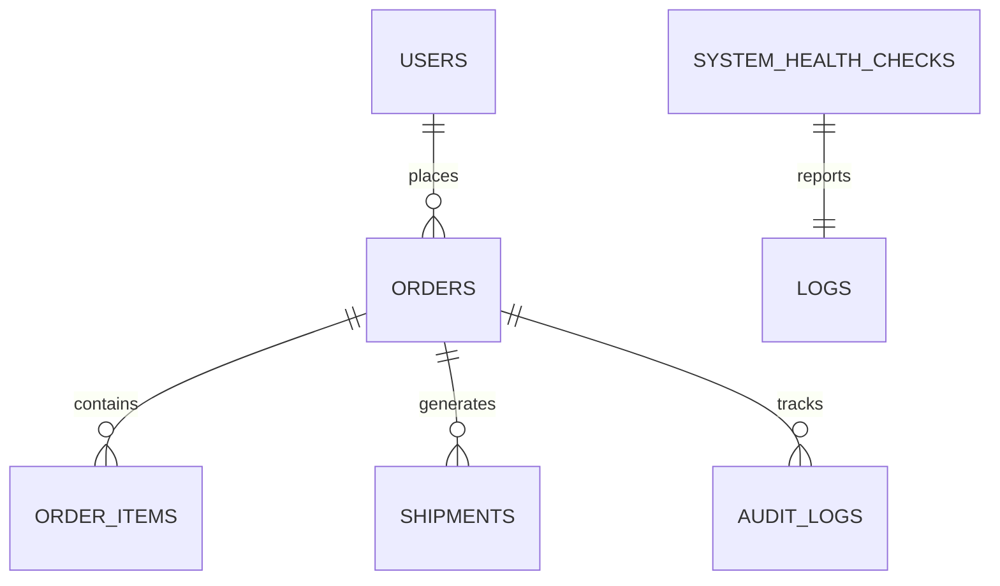

# Especificación Técnica: Hub 1 - Cabina Ejecutiva & Dashboard
## Plataforma RevOps E-Commerce Multiverso & ERP (Mi Tienda Online)

**Módulo:** Hub 1 (Cabina Ejecutiva & Centro de Acción Inmediata)  
**Versión de Especificación:** 3.0 (SSOT)  
**Vistas Principales:** `resources/views/portal/dashboard.blade.php`  
**Controlador:** `app/Http/Controllers/PortalController.php`

---

## 1. Propósito & Alcance del Módulo

El **Hub 1** centraliza la supervisión estratégica y operativa del negocio en tiempo real. Actúa como el centro de mando de la plataforma, coordinando:
1. **Centro de Acción Inmediata (Action Center):** Generación automática de tareas operativas priorizadas disparadas por eventos reales (pedidos estancados, stock crítico, discrepancias en rampa).
2. **Semáforo de Envejecimiento de Pedidos (Aging SLA):** Clasificación visual de órdenes por horas transcurridas desde el pago para prevenir cancelaciones y quejas ante PROFECO.
3. **Monitor de Salud del Ecosistema (System Health):** Telemetría de latencia y estado de conectividad con pasarelas (Stripe/Openpay), transportistas (DHL/FedEx), WhatsApp Cloud API y Torzo Bot Scraper.
4. **Embudo Comercial Multiverso:** Visualización del ciclo de vida del cliente desde la visita anónima hasta la membresía recurrente (MRR).

---

## 2. Modelo de Datos & Entidades Clave

### Tablas MySQL Principales:
* `orders`: Estado de pago (`paid`, `pending`, `failed`), estado logístico (`pending_fulfillment`, `packing`, `shipped`, `delivered`), total, fecha de creación.
* `order_items`: SKUs adquiridos, cantidad, precio unitario, estatus individual de reserva.
* `cms_tracking_settings`: Credenciales y estado de integración de telemetría (GTM, GA4, Meta Pixel).
* `kardex_movements`: Asientos para calcular velocidad de venta y productos Top 10 en tiempo real.

---

## 3. Lógica de Negocio & Algoritmos

### 3.1. Semáforo de Envejecimiento de Pedidos (Aging SLA)
Calculado dinámicamente mediante la diferencia en horas entre el momento del pago confirmado y el tiempo actual:
$$\text{Aging (Horas)} = \frac{\text{now}() - \text{order.paid\_at}}{3600}$$

* **Verde (Óptimo / 0 a 12h):** Pedido en tiempo de surtido estándar.
* **Amarillo (Alerta / 12h a 24h):** Próximo a vencer la promesa de despacho express en el mismo día.
* **Rojo (Crítico / > 24h):** Pedido retrasado. Dispara notificación push y tarea de alta prioridad en la mesa de empaque.

### 3.2. Centro de Acción Dinámico (Dynamic Action Triggers)
El sistema analiza eventos de dominio y genera acciones automáticas:
* Si `unfulfilled_orders_count > 10`: Acción `Liberar Lote de Surtido en Mesa de Empaque`.
* Si existen ítems con `stock <= rop_threshold`: Acción `Emitir PO de Reorden a Taller`.
* Si hay carritos abandonados con `updated_at > 2h`: Acción `Disparar Campaña WhatsApp Concierge`.

---

## 4. Endpoints RESTful & Contratos de API

### `GET /admin/dashboard`
* **Descripción:** Renderiza la vista principal con KPIs consolidados.
* **Acceso:** Roles autorizados vía `access-hub:dashboard`.
* **Datos Inyectados:**
  - `kpis`: GMV del día, pedidos pendientes, stock crítico, MRR activo.
  - `agingOrders`: Colección de órdenes agrupadas por franjas de SLA.
  - `systemHealth`: Estado binario (online/degraded/offline) de los servicios externos.

---

## 5. [TODO: Definir regla exacta]

1. `[TODO: Definir regla exacta]` **Tiempo de retención de telemetría histórica de APIs externas.**  
   *Nota actual:* Los logs de latencia se conservan en la base de datos por 30 días. Se debe definir si después se depuran automáticamente vía Scheduled Task o se archivan en frío.
