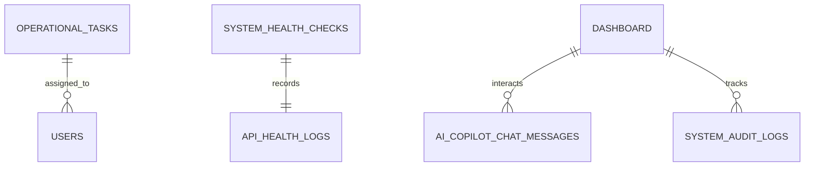

# Especificación Técnica: Hub 1 - Cabina Ejecutiva & Dashboard
## Plataforma RevOps E-Commerce Multiverso & ERP (Mi Tienda Online)

**Módulo:** Hub 1 (Cabina Ejecutiva & Centro de Acción Inmediata)  
**Versión de Especificación:** 3.1 (SSOT - Auditada con Código Real)  

---

## 1. Propósito & Alcance del Módulo

El **Hub 1** centraliza la supervisión estratégica y operativa del negocio en tiempo real. Actúa como el centro de mando de la plataforma, coordinando:
1. **Centro de Acción Inmediata (Action Center):** Generación automática de tareas operativas priorizadas con SLAs dinámicos.
2. **Semáforo de Envejecimiento de Pedidos (Aging SLA):** Clasificación visual de órdenes para prevenir cancelaciones.
3. **Monitor de Salud del Ecosistema (System Health):** Telemetría de latencia y estado de conectividad con pasarelas (Stripe) y transportistas (DHL).
4. **Asistente de IA (AI Copilot):** Motor conversacional integrado al dashboard con `action_chips` que sugieren acciones proactivas sobre el ecosistema.

---

## 2. Modelo de Datos & Entidades Clave

*(Nota de Auditoría: El sistema se fundamenta nativamente en el motor de tareas operativas y telemetría, prescindiendo de tablas temporales no persistentes).*

---

## 3. Lógica de Negocio, File Scope & Contratos de Datos

### 3.1. Centro de Acción Dinámico (Operational Tasks)
- **Estado:** `[IMPLEMENTADO]`
- **Contrato de Datos:**
  - **Modelo Eloquent:** `App\Models\OperationalTask`
  - **Estructura MySQL:** 
    - `operational_tasks` (`title`, `priority`, `assigned_role`, `status` enum: `'pending', 'in_progress', 'completed', 'dismissed'`, `sla_minutes_limit`, `action_payload` JSON)
- **File Scope:**
  - `app\Http\Controllers\Api\RevOps\DashboardApiController.php`
- **Flujos y Casos Límite:**
  - Creación dinámica con `action_payload`. Por ejemplo, inyectar el JSON de la acción permite crear botones contextuales en el dashboard que redirigen exactamente a la vista necesaria (ej. `goto_warehouse_tab`, `open_task_manifest`, `open_rescue_first`).

### 3.2. Monitor de Salud del Ecosistema (System Health)
- **Estado:** `[IMPLEMENTADO]`
- **Contrato de Datos:**
  - **Modelo Eloquent:** `App\Models\ApiHealthLog`
  - **Estructura MySQL:** 
    - `api_health_logs` (`service_name`, `status_code`, `response_time_ms`, `status_verdict` enum: `'healthy', 'degraded', 'down'`, `error_message`)
- **File Scope:**
  - `app\Http\Controllers\Api\RevOps\DashboardApiController.php` (Método `getSystemHealth`)
- **Flujos y Casos Límite:**
  - Telemetría persistente de latencias externas y degradaciones (`degraded` o `down`).

### 3.3. Asistente AI Copilot y Atajos Operativos
- **Estado:** `[IMPLEMENTADO]`
- **Contrato de Datos:**
  - **Modelos Eloquent:** `App\Models\AiCopilotChatMessage`, `App\Models\AiCopilotInsight`
  - **Estructura MySQL:** 
    - `ai_copilot_chat_messages` (`message`, `action_chips_json`)
- **File Scope:**
  - `app\Http\Controllers\Api\RevOps\DashboardApiController.php`
- **Flujos y Casos Límite:**
  - Análisis de intenciones semánticas: Cuando un operador escribe algo con las palabras "dhl" o "corte", el sistema devuelve un chip de acción dinámico como `Inspeccionar Manifiesto DHL`.

### 3.4. Semáforo de Envejecimiento de Pedidos (Aging SLA)
- **Estado:** `[IMPLEMENTADO]`
- **Contrato de Datos:** `App\Models\Order`
- **File Scope:**
  - `app\Http\Controllers\StorefrontController.php` (Pipeline general y `dashboardAlerts()`).
- **Flujos y Casos Límite:**
  - *SLA Minutes Limit* incrustado en la creación de las tareas operativas asociadas a rescates.
  - El aging previene multas ante PROFECO alertando si el pedido supera las ventanas establecidas de surtido (Verde, Amarillo, Rojo).

---

## 4. Reglas de Negocio Oficiales

1. **Tiempo de retención de telemetría histórica de APIs externas:**  
   *Regla de Negocio:* Borrado automático (Cron) de registros más antiguos a **30 días**. Se implementará un Schedule command de Laravel para purgar la tabla `api_health_logs` diariamente y optimizar la base de datos.

1. `[TODO: Definir regla exacta]` **Tiempo de retención de telemetría histórica de APIs externas.**  
   *Nota de Auditoría Actual:* A nivel base de datos, la tabla `api_health_logs` acumula registros de forma indefinida y no cuenta con política de eliminación en cascada. Se debe definir si configuramos un Cron (Scheduled Task) en Laravel Forge que ejecute un borrado automático de registros más antiguos a 30 días, o si los exportamos en frío a Amazon S3.
