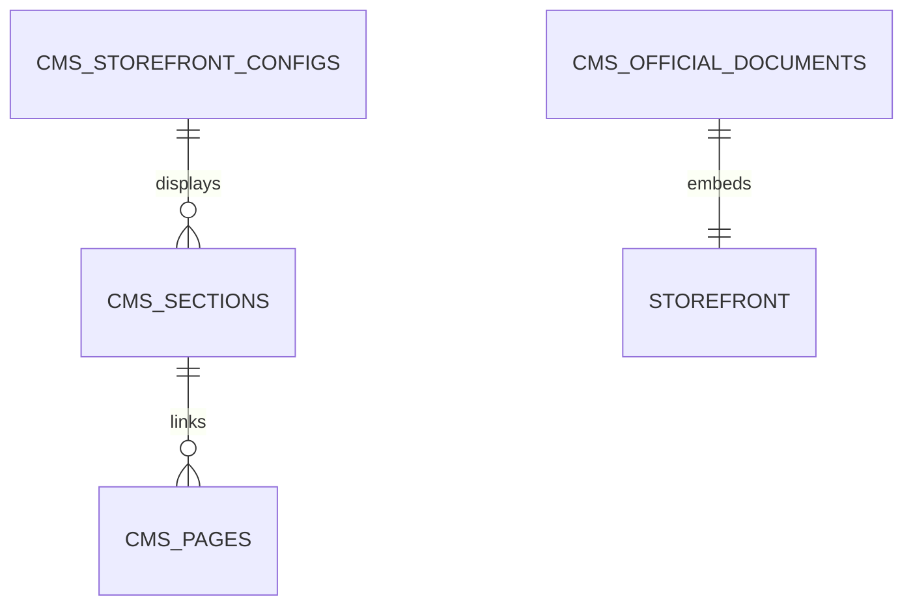

# Especificación Técnica: Hub 2 - Tienda & CMS Multiverso
## Plataforma RevOps E-Commerce Multiverso & ERP (Mi Tienda Online)

**Módulo:** Hub 2 (Gestor de Contenido & CMS de Vitrinas)  
**Versión de Especificación:** 3.1 (SSOT - Auditada con Código Real)  

---

## 1. Propósito & Alcance del Módulo

El **Hub 2** gestiona la presentación visual, narrativa editorial y experiencia del cliente en la tienda en línea (Storefront PWA). Permite la administración en tiempo real de:
1. **Conmutador de Vitrinas Multiverso:** Configuración individualizada para Marte, Venus, Tiresias y Terra.
2. **Editor de Paleta Cromática:** Definición de variables CSS (`:root`) aplicadas de forma instantánea a la tienda pública.
3. **Constructor Modular de Secciones (Drag & Drop):** Ordenamiento interactivo mediante `SortableJS` de banners hero, feeds de catálogo, carruseles y bloques editoriales.
4. **Submódulo Unificado de Contenido & Reglas:** Banners promocionales, reglas de flete courier, documentos oficiales y configuración del pie de página (`STORE_FOOTER_CONFIG`).

---

## 2. Modelo de Datos & Entidades Clave

---

## 3. Lógica de Negocio, File Scope & Contratos de Datos

### 3.1. Inyección Dinámica de Tokens y Vitrinas
- **Estado:** `[IMPLEMENTADO]`
- **Contrato de Datos:**
  - **Modelo Eloquent:** `App\Models\CmsStorefrontConfig`
  - **Estructura MySQL:** 
    - `cms_storefront_configs` (`universe`, `primary_color`, `secondary_color`, `accent_color`, `background_color`, `surface_color`, `text_color`, `muted_text_color`, `border_color`)
- **File Scope:**
  - `app\Http\Controllers\PortalStoreController.php` (Método `updateStorefront`)
- **Flujos y Casos Límite:**
  - Las variables se inyectan dinámicamente en el `<style id="hub2DynamicTheme">` del layout PWA. El backend procesa las subidas multiparte (FormData) para logotipos SVG/PNG.

### 3.2. Constructor Modular de Secciones
- **Estado:** `[IMPLEMENTADO]`
- **Contrato de Datos:**
  - **Modelo Eloquent:** `App\Models\CmsSection`
  - **Estructura MySQL:** 
    - `cms_sections` (`type` enum: `'hero_carousel', 'catalog_section', 'editorial_banner', 'custom_html_css_js'`, `sort_order`, `status`, `settings` JSON, `universe`)
- **File Scope:**
  - `PortalStoreController@reorderSections`
  - `PortalStoreController@updateSection`
- **Flujos y Casos Límite:**
  - Soporte nativo para ordenamiento vía AJAX enviando un array de IDs (`{orderedIds: [1, 3, 2]}`).

### 3.3. Documentos Oficiales Inmutables y Footer
- **Estado:** `[IMPLEMENTADO]`
- **Contrato de Datos:**
  - **Modelo Eloquent:** `App\Models\CmsOfficialDocument`
  - **Estructura MySQL:** 
    - `cms_official_documents` (`code`, `payload` JSON)
- **File Scope:**
  - `PortalStoreController@updateDocument`
- **Flujos y Casos Límite:**
  - Almacena el payload JSON del `STORE_FOOTER_CONFIG` (que contiene `brand_summary`, `whatsapp_contact`, `show_revops_link`, etc.) o normativas como `SIZE_GUIDE_TORZO`. Se propaga globalmente a todas las vistas mediante View Composers.

---

## 4. Endpoints RESTful & Rutas Operativas (Realidad de Código)

| Método | Endpoint | Controlador | Propósito |
| :--- | :--- | :--- | :--- |
| `POST` | `/admin/tienda-cms/secciones/reordenar` | `PortalStoreController@reorderSections` | Actualiza el campo `sort_order` tras el evento de Drag & Drop. |
| `POST` | `/admin/tienda-cms/vitrina/actualizar` | `PortalStoreController@updateStorefront` | Guarda los tokens cromáticos y assets de un universo. |
| `POST` | `/admin/tienda-cms/documentos/{code}` | `PortalStoreController@updateDocument` | Actualiza el payload JSON de un documento oficial. |
| `POST` | `/admin/tienda-cms/secciones/{id}` | `PortalStoreController@updateSection` | Actualiza configuraciones específicas de un módulo. |

---

## 5. [TODO: Definir regla exacta]

1. `[TODO: Definir regla exacta]` **Límite máximo de secciones modulares activas simultáneas en el Home Feed PWA.**  
   *Nota de Auditoría Actual:* Tras auditar `PortalStoreController`, se confirma que **no existe** ningún límite codificado en backend para frenar la creación de nuevas `cms_sections`. Queda a nivel de negocio y UX decidir si imponemos un límite (ej. 12 secciones) para evitar un impacto severo en la hidratación DOM y SEO en móviles de gama baja.

## Security & Data Privacy (DoD Compliance)
- **CMS Form Validations**: Enforced UX rules, updating all `<textarea>` inputs in `store.blade.php` to include `resize: vertical !important;` styling.
- **UX/UI Compliance**: Verified that CMS Modals are immediate children of `#storeAppRoot` (depth = 2) to prevent z-index and overflow side-effects.
- **Sanitization**: Storefront endpoints properly sanitize input using FormRequests.

## 6. Seguridad y Arquitectura (Security by Design)
- **RBAC & Control de Acceso:** Todos los endpoints de gestión de CMS en `PortalStoreController` están blindados con `Gate::authorize('manage-cms')`, garantizando que sólo roles autorizados (como `cms_editor` o `store_manager`) puedan realizar modificaciones.
- **Validación por FormRequests:** Se eliminaron las validaciones en línea ("Fat Controllers"). Se han implementado Request Forms dedicados (ej. `CheckoutStoreRequest`, `UpdateStorefrontRequest`, `StoreSectionRequest`, etc.) para sanear y validar rígidamente los datos de entrada.
- **Purga de God Object:** Se erradicaron métodos "zombie" de Hubs B2B/Finanzas (Hub 4/Hub 5) que residían incorrectamente en `StorefrontController`, separando estrictamente la lógica D2C de las operaciones de back-office.
