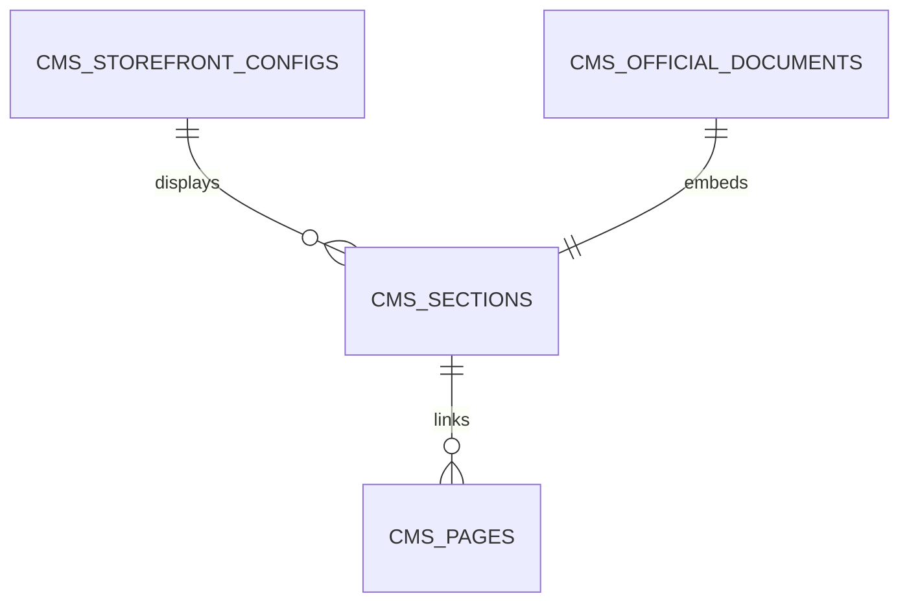

# Especificación Técnica: Hub 2 - Tienda & CMS Multiverso
## Plataforma RevOps E-Commerce Multiverso & ERP (Mi Tienda Online)

**Módulo:** Hub 2 (Gestor de Contenido & CMS de Vitrinas)  
**Versión de Especificación:** 3.0 (SSOT)  
**Vistas Principales:** `resources/views/portal/store.blade.php`, `resources/views/layouts/store-pwa.blade.php`  
**Controlador Principal:** `app/Http/Controllers/PortalStoreController.php`

---

## 1. Propósito & Alcance del Módulo

El **Hub 2** gestiona la presentación visual, narrativa editorial y experiencia del cliente en la tienda en línea (Storefront PWA). Permite la administración en tiempo real de:
1. **Conmutador de Vitrinas Multiverso:** Configuración individualizada para Marte (Masculino), Venus (Lencería), Tiresias (Afirmativo) y Terra (Unisex/Matriz).
2. **Editor de Paleta Cromática (8 Tokens Semánticos):** Definición de variables CSS `:root` aplicadas de forma instantánea a la tienda pública.
3. **Constructor Modular de Secciones (Drag & Drop):** Ordenamiento interactivo mediante `SortableJS` de banners hero, feeds de catálogo, carruseles y bloques editoriales.
4. **Submódulo Unificado de Contenido & Reglas (Acordeón de 4 Módulos):**
   - *Sección 1:* Banners promocionales y marquesinas superiores continuas.
   - *Sección 2:* Reglas de flete courier y simulador de elasticidad financiera.
   - *Sección 3:* Guía oficial de tallas y protocolos sanitarios PROFECO.
   - *Sección 4:* Editor oficial de pie de página (`STORE_FOOTER_CONFIG`).

---

## 2. Modelo de Datos & Entidades Clave



### Tablas MySQL Principales:
* `cms_storefront_configs`: Almacena por universo (`universe`) los 8 tokens cromáticos (`primary_color`, `secondary_color`, `accent_color`, `background_color`, `surface_color`, `text_color`, `muted_text_color`, `border_color`), logos SVG/PNG y metaetiquetas SEO.
* `cms_sections`: Secciones modulares del home con campos `type` (`hero_carousel`, `catalog_section`, `editorial_banner`, `custom_html_css_js`), `sort_order`, `status`, `settings` (JSON) y `universe`.
* `cms_pages`: Páginas de contenido estático o exploración con atributos para orden en navbar desktop y móvil.
* `cms_official_documents`: Documentos normativos inmutables almacenados como JSON payload bajo claves únicas (`SIZE_GUIDE_TORZO`, `CARE_PROTOCOLS`, `PROFECO_SANITARY_NOTICE`, `STORE_FOOTER_CONFIG`).

---

## 3. Lógica de Negocio & Algoritmos

### 3.1. Inyección Dinámica de Tokens en `:root`
El layout maestro `resources/views/layouts/store-pwa.blade.php` inyecta en el `<head>` un bloque `<style id="hub2DynamicTheme">` que vincula las variables CSS al universo seleccionado en URL (`?universo=marte|venus|tiresias|terra`):

```css
:root {
  --brand-primary: {{ $storefrontConfig->primary_color }};
  --brand-secondary: {{ $storefrontConfig->secondary_color }};
  --brand-accent: {{ $storefrontConfig->accent_color }};
  --brand-bg: {{ $storefrontConfig->background_color }};
  --brand-surface: {{ $storefrontConfig->surface_color }};
  --brand-text: {{ $storefrontConfig->text_color }};
  --brand-muted: {{ $storefrontConfig->muted_text_color }};
  --brand-border: {{ $storefrontConfig->border_color }};
}
```

### 3.2. Persistencia del Pie de Página Oficial (`STORE_FOOTER_CONFIG`)
El pie de página global se sincroniza mediante `CmsOfficialDocument::getByCode('STORE_FOOTER_CONFIG')` y es compartido automáticamente con todas las vistas mediante un `View::composer` en `AppServiceProvider.php`.
* **Campos del Payload:**
  - `brand_summary`: Narrativa institucional.
  - `whatsapp_contact`: Teléfono directo de concierge.
  - `support_email`: Correo corporativo.
  - `shipping_badge_text`, `packaging_badge_text`, `payments_badge_text`: Distintivos de políticas y confianza.
  - `show_revops_link`: Booleano para conmutar la visibilidad de acceso al panel interno.
  - `show_zero_emojis_badge`: Booleano para el sello de política vectorial estricta.

---

## 4. Endpoints RESTful & Rutas Operativas

| Método | Ruta | Propósito | Formato Entrada | Formato Salida |
| :--- | :--- | :--- | :--- | :--- |
| `POST` | `/admin/tienda-cms/secciones/reordenar` | Actualiza `sort_order` tras arrastre con SortableJS | JSON array `{orderedIds: [1, 3, 2]}` | JSON `{success: true}` |
| `POST` | `/admin/tienda-cms/vitrina/actualizar` | Guarda los 8 tokens cromáticos y branding | FormData multipart | JSON `{success: true}` |
| `POST` | `/admin/tienda-cms/documentos/{code}` | Actualiza el payload de un documento oficial | Form POST `payload[...]` | Redirect back con flash toast |
| `POST` | `/admin/tienda-cms/secciones` | Crea una nueva sección modular | FormData multipart con `type` | Redirect back |

---

## 5. [TODO: Definir regla exacta]

1. `[TODO: Definir regla exacta]` **Límite máximo de secciones modulares activas simultáneas en el Home Feed PWA.**  
   *Nota actual:* Actualmente no existe tope superior; se recomienda limitar a 12 secciones para evitar degradar el rendimiento de la hidratación en dispositivos móviles de gama baja.
