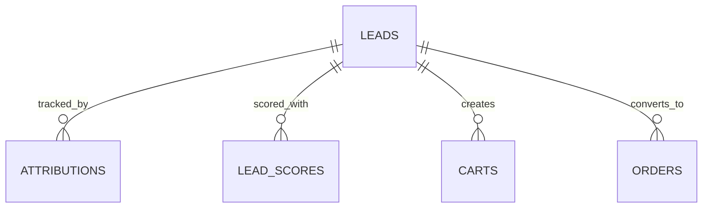

# Especificación Técnica: Hub 3 - Marketing, CRM & Fidelización
## Plataforma RevOps E-Commerce Multiverso & ERP (Mi Tienda Online)

**Módulo:** Hub 3 (Gestión de Relaciones con Clientes, Atribución & Automatización)  
**Versión de Especificación:** 3.0 (SSOT)  
**Vistas Principales:** `resources/views/portal/crm.blade.php`, `resources/views/portal/leads.blade.php`  
**Controladores:** `app/Http/Controllers/LeadController.php`, `app/Http/Controllers/CrmController.php`

---

## 1. Propósito & Alcance del Módulo

El **Hub 3** convierte prospectos anónimos en clientes fidelizados de alto valor de vida (LTV). Orquesta:
1. **Atribución de Tráfico Multicanal:** Captura transparente de parámetros UTM (`utm_source`, `utm_medium`, `utm_campaign`) y convenios de aliados (Hub 7).
2. **Motor de Puntuación Predictiva (Lead Scoring):** Clasificación algorítmica de prospectos en caliente basada en eventos de navegación y compra.
3. **Recuperación Activa de Carritos Abandonados:** Automatización de enlaces tokenizados en 1 clic para reactivación de checkout mediante WhatsApp Concierge.
4. **Telemetría de Conversión CAPI:** Envío redundante de eventos de servidor a Meta Conversions API y Google Analytics 4 (Measurement Protocol).

---

## 2. Modelo de Datos & Entidades Clave

### Tablas MySQL Principales:
* `leads`: Nombre, email, teléfono/WhatsApp, estado (`new`, `contacted`, `nurturing`, `opportunity`, `converted`, `lost`), score total acumulado.
* `attributions`: Sesión, dirección IP anonimizada, URL de aterrizaje, fuente UTM, campaña y token de alianza.
* `lead_scores`: Bitácora inmutable de variaciones de puntuación (evento detonador, delta de puntos, marca temporal).
* `carts`: Carrito activo o abandonado con `is_abandoned` (booleano), `session_id`, items seleccionados y token de reactivación.

---

## 3. Lógica de Negocio & Algoritmos

### 3.1. Matriz de Puntuación (Lead Scoring Engine)
El sistema actualiza el score del lead en función de micro-conversiones observadas:

| Evento de Usuario | Puntos Asignados | Explicación Operativa |
| :--- | :---: | :--- |
| Visita a Ficha de Producto (PDP) | `+1` | Interés pasivo en catálogo. |
| Agregar prenda a Carrito | `+5` | Intención de compra evidente. |
| Abandono de Carrito en Checkout | `+10` | Fricción en pago; candidato para recuperación inmediata. |
| Registro de Formulario / Lead Magnet | `+20` | Captura de datos personales consentidos. |
| Apertura / Clic en enlace WhatsApp | `+15` | Interacción directa con concierge. |

Cuando el puntaje acumulado supera el umbral de **30 puntos**, el lead transiciona automáticamente a estado `opportunity` y aparece resaltado en el dashboard de ventas de Ana (Hub 1).

### 3.2. Mecanismo de Reactivación de Carrito Tokenizado
Cuando un carrito supera 120 minutos sin concretar pago:
1. Se genera un token criptográfico único (`hash_hmac`).
2. Se ensambla un enlace profundo: `https://tienda.com/carrito?resume={token}`.
3. La asesora comercial puede pulsar el botón **"Contactar por WhatsApp"** en Hub 1 o Hub 3, abriendo la API de WhatsApp con el mensaje pre-redactado:
   > *"Hola [Nombre], vimos que dejaste tus prendas en carrito. Tu reserva expira pronto, puedes retomarla directamente aquí: [Enlace Tokenizado]"*

---

## 4. Endpoints RESTful & Servicios

### `POST /api/v1/crm/lead/track-event`
* **Payload:** `{ lead_id: 124, event_type: "cart_abandoned", metadata: { cart_id: 562 } }`
* **Respuesta:** `{ success: true, new_score: 35, status: "opportunity" }`

---

## 5. [TODO: Definir regla exacta]

1. `[TODO: Definir regla exacta]` **Límite de mensajes de reactivación por WhatsApp por cliente al mes.**  
   *Nota actual:* El sistema no restringe el reenvío si hay múltiples carritos. Debe establecerse una política de no-spam (máximo 2 contactos por semana por número telefónico).
