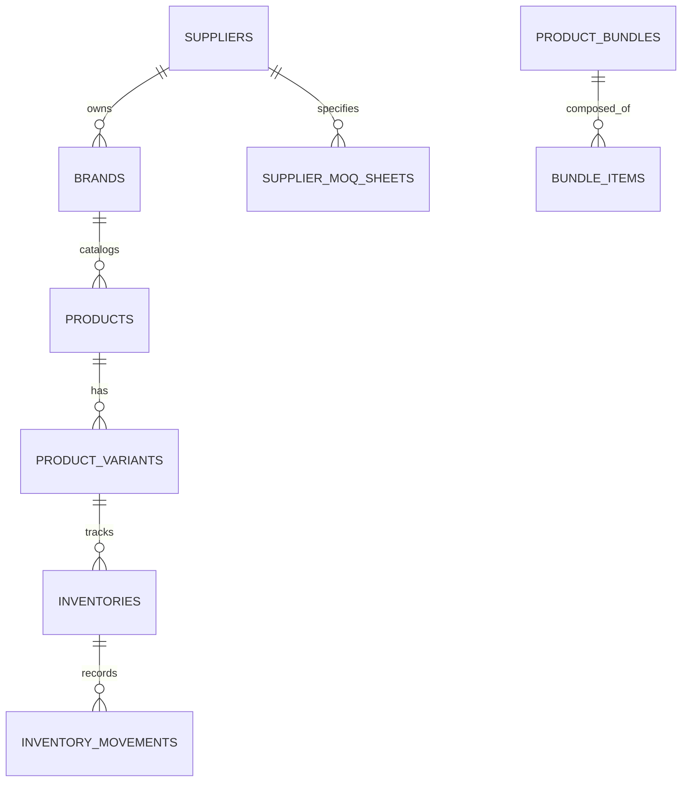

# Especificación Técnica: Hub 4 - Inventario, Catálogo & Compras
## Plataforma RevOps E-Commerce Multiverso & ERP (Mi Tienda Online)

**Módulo:** Hub 4 (Gestor Central de Catálogo, Almacén & Cadena de Suministro)  
**Versión de Especificación:** 3.1 (SSOT - Auditada con Código Real)  

---

## 1. Propósito & Alcance del Módulo

El **Hub 4** es el núcleo de persistencia transaccional y catálogo físico de la plataforma. Gobierna:
1. **Catálogo Maestro Textil & Curvas de Talla:** Normalización bajo la matriz de tallas de la empresa.
2. **Kardex Transaccional ACID Inmutable:** Registro de entradas de compra, apartados de checkout, mermas, ensamblados y retornos RMA.
3. **Control de Ubicaciones Físicas (Slotting):** Nomenclatura normalizada optimizada para recorridos de picking.
4. **Escandallos y Bundles (BOM):** Definición de listas de materiales para combos, multipacks y cajas de suscripción mensual (MRR).
5. **Gobernanza de Proveedores & Marcas:** Vinculación estricta de marcas a fabricantes, acuerdos de crédito y tabuladores MOQ escalonados.
6. **Bandeja de Curaduría de Scraping:** Normalización e importación controlada de catálogos mayoristas externos (Torzo B2B).

---

## 2. Modelo de Datos & Diagrama Entidad-Relación

---

## 3. Lógica de Negocio, File Scope & Contratos de Datos

### 3.1. Catálogo Maestro Textil & Curvas de Talla
- **Estado:** `[IMPLEMENTADO]`
- **Contrato de Datos:**
  - **Modelos Eloquent:** `App\Models\Product`, `App\Models\ProductVariant`
  - **Estructura MySQL:** 
    - `products` (`id`, `sku`, `title`, `slug`, `brand`, `type` enum: `'physical','dropship','both'`, `price`, `cost`)
    - `product_variants` (`id`, `product_id`, `sku`, `attributes`, `price`)
- **File Scope:**
  - `app/Http/Controllers/Api/ProductController.php`
  - `app/Services/Inventory/VariantDimensionService.php`
  - `app/Services/Inventory/SkuGeneratorService.php`
- **Flujos y Casos Límite:**
  - Garantía de unicidad en SKU impuesta directamente en el Blueprint de la migración (`$table->string('sku')->unique()`).

### 3.2. Kardex Transaccional ACID Inmutable
- **Estado:** `[IMPLEMENTADO]`
- **Contrato de Datos:**
  - **Modelos Eloquent:** `App\Models\Inventory`, `App\Models\InventoryMovement`, `App\Models\PurchaseKardex`
  - **Estructura MySQL:** 
    - `inventories` (`variant_id`, `location` default: `'warehouse-1'`, `quantity`, `reserved`, `type`)
    - `inventory_movements` (`inventory_id`, `user_id`, `quantity`, `quantity_before`, `quantity_after`, `reason`)
- **File Scope:**
  - `app/Services/StockReservationService.php`
  - `app/Services/InboundReceiptService.php`
- **Flujos y Casos Límite:**
  - **Fórmula de Stock Real:** `Stock Disponible = quantity - reserved`.
  - Si no existe inventario, el sistema arroja: `Exception("No existe registro de inventario para la variante #{$variantId}")`.
  - Si el stock es insuficiente para un apartado, el sistema arroja: `Exception("Stock disponible insuficiente ({$available} unidades disponibles, se solicitaron {$quantityDelta} adicionales)")`.
  - **Flujos Cross-Hub (Event-Driven):**
    - `InboundReceiptService` emite el evento `App\Events\Inventory\PurchaseOrderReceived` para delegar la actualización de Tareas Operativas (Hub 1), Liberación de Rampa (Hub 6) y Cuentas por Pagar / VendorBills (Hub 5).
    - `StockReservationService` emite el evento `App\Events\Inventory\OrderStockCommitted` al confirmarse el checkout para disparar el flujo de recolección física (Hub 6) y asentar ingresos (Hub 5).

### 3.3. Gobernanza de Proveedores & Marcas
- **Estado:** `[IMPLEMENTADO]`
- **Contrato de Datos:**
  - **Modelos Eloquent:** `App\Models\Supplier`, `App\Models\Brand`, `App\Models\SupplierMoqSheet`
  - **Estructura MySQL:**
    - `suppliers` (`name`, `type` enum: `'dropship_api','dropship_scrape','wholesale','local'`)
    - `brands` (`supplier_id`, `name`, `slug`)
    - `supplier_moq_sheets` (`supplier_id`, `tiers` JSON, `rows` JSON)
- **File Scope:**
  - `app/Http/Controllers/Api/RevOps/BrandApiController.php`
- **Flujos y Casos Límite:**
  - Implementación estricta de Regla 6.47 (integridad relacional de Marcas a Proveedores) respaldada por llaves foráneas y eliminación en cascada (`nullOnDelete` / `cascadeOnDelete`).

### 3.4. Escandallos y Recetas BOM (Bundles)
- **Estado:** `[IMPLEMENTADO]` *(Arquitecturado como Bundles en el código base).*
- **Contrato de Datos:**
  - **Modelos Eloquent:** `App\Models\ProductBundle`
  - **Estructura MySQL:**
    - `product_bundles` (`name`, `slug`, `bundle_type` enum: `'box_subscription','pack_multiple','combo_cross'`, `bundle_price`)
    - `bundle_items` (`product_bundle_id`, `product_id`, `product_variant_id`, `quantity`)
    - `bom_deficit_procurements` (`bundle_id`, `component_product_id`, `deficit_units`, `status`)
- **File Scope:**
  - Mapeado nativamente en base de datos. Rutas de controlador y servicios específicos de ensamble en progreso de estabilización.
- **Flujos y Casos Límite:**
  - Gestión explícita de MRR (Suscripciones Mensuales recurrentes) mediante el tipo `box_subscription`.
  - Sistema reactivo de déficit: Genera registros en `bom_deficit_procurements` con estado inicial `detected` cuando falta stock físico para ensamblar el bundle.

### 3.5. Bandeja de Curaduría de Scraping
- **Estado:** `[IMPLEMENTADO]`
- **Contrato de Datos:**
  - **Modelos Eloquent:** `App\Models\ScrapedPendingItem`
  - **Estructura MySQL:**
    - `scraped_pending_items` (`supplier_id`, `curated_color`, `curated_design_type`, `curation_status` enum: `'pending','approved','rejected'`, `rejection_reason`)
- **File Scope:**
  - `app/Services/SupplierCatalogSyncService.php`
  - `app/Services/Inventory/DuplicateDetectionService.php`
  - `app/Services/Inventory/ProductAiCopilotService.php`
- **Flujos y Casos Límite:**
  - Un ítem rechazado por curaduría DEBE poblar la columna `rejection_reason`.

### 3.6. Vitrinas Web E-Commerce & Reglas de Catálogo
- **Estado:** `[IMPLEMENTADO]`
- **Contrato de Datos:**
  - **Modelos Eloquent:** `App\Models\CmsSection`
  - **Estructura MySQL:**
    - `cms_sections` (`title`, `slug`, `type: 'catalog_section'`, `status`, `sort_order`, `query_rules` JSON: `is_new`, `has_discount`, `fabric_id`, `category_id`, `subcategory_id`)
- **File Scope:**
  - `app/Http/Controllers/Api/RevOps/InventorySettingsApiController.php` (`getStoreSections`, `storeStoreSection`, `updateStoreSection`, etc.)
  - `public/js/revops-panel/inventory-module.js`
  - `resources/views/portal/inventory.blade.php` (Pestaña 7: Vitrinas Web)
- **Flujos y Casos Límite:**
  - Creación o actualización en Hub 4 registra automáticamente la sección modular en `cms_sections`, insertándola al final de la secuencia (`sort_order = max + 1`).
  - Las vitrinas se reflejan de inmediato en la lista Drag & Drop del Hub 2.
  - Soporte de apertura reactiva directa por URL (`/admin/inventario-catalogo?tab=sections&edit_section_id={id}`), activando la pestaña de vitrinas y cargando automáticamente el formulario de edición.

### 3.7. Gobernanza de Curvas de Talla Descentralizadas
- **Estado:** `[IMPLEMENTADO]`
- **Contrato de Datos:**
  - **Modelos Eloquent:** `App\Models\ApparelSizeCurve`, `App\Models\ApparelSize`
  - **Estructura MySQL:**
    - `apparel_size_curves` (`brand_id`, `supplier_id`, `name`, `gender`, `is_active`)
    - `apparel_sizes` (`size_curve_id`, `code`, `label`, `waist_min_cm`, `waist_max_cm`, `sort_order`, `is_active`)
- **Flujos y Casos Límite:**
  - **Regla Estricta de Marca:** Cada curva de tallas pertenece exclusivamente a una Marca (`Brand`) o a un Proveedor (`Supplier`).
  - Si un producto no tiene curva asociada a su marca o proveedor, el sistema no sintetiza curvas genéricas ni fallbacks; en la tienda pública simplemente no existe curva y el botón "Guía de tallas" se omite.

### 3.8. Telas y Fibras Textiles
- **Estado:** `[IMPLEMENTADO]`
- **Contrato de Datos:**
  - **Modelo Eloquent:** `App\Models\ApparelFabric`
  - **Estructura MySQL:**
    - `apparel_fabrics` (`name`, `slug`, `code`, `composition`, `care_instructions`, `is_active`)
- **Flujos y Casos Límite:**
  - Las telas dadas de alta en Hub 4 se sincronizan con el selector de fibras en Hub 2 (Protocolos de Cuidado Textil) y alimentan la Ficha Técnica Oficial en la PDP del Storefront.

---

## 4. Reglas de Negocio Específicas

1. **Criterio de Redondeo (Costo Promedio Ponderado - CPP):**
   - **Regla SSOT:** El sistema calcula y almacena obligatoriamente los costos con **4 decimales** de precisión (`decimal(12,4)`) en la base de datos para evitar micro-fugas contables en grandes volúmenes. El redondeo a 2 decimales se aplica *únicamente* en la capa de presentación (UI) del Dashboard.
2. **Tratamiento Contable de Mermas (MERMA_RAMPA):**
   - **Regla SSOT:** Cuando se declara una merma física en rampa, el sistema descuenta inmediatamente el inventario físico para evitar sobreventas. Sin embargo, el impacto financiero contra el proveedor es **Manual**. El sistema NO emite notas de crédito automáticamente; el equipo de Finanzas/Compras debe emitir y conciliar la deuda con el taller de forma independiente.
## 5. Security & Data Privacy (DoD Compliance)
- **Protección de PII y Costos (Ciberseguridad):**
  - Los modelos `Product` y `ProductVariant` ocultan explícitamente el atributo `cost` (`$hidden = ['cost']`).
  - La capa de presentación RESTful utiliza `ProductResource` y `ProductVariantResource` para filtrar la historia financiera (`meta.moq_cost_layers`), mostrándola exclusivamente a peticiones autenticadas bajo el Gate `view-financials`.
- **Sanitización y Autorización Restrictiva (RevOps):**
  - `BrandApiController` (y controladores homólogos) requiere el Gate `manage-catalog` para lectura y escritura.
  - La captura de datos de inventario pasa por `FormRequests` estrictos (`StoreBrandRequest`, `UpdateBrandRequest`) equipados con `strip_tags` para mitigar vectores de inyección XSS.
