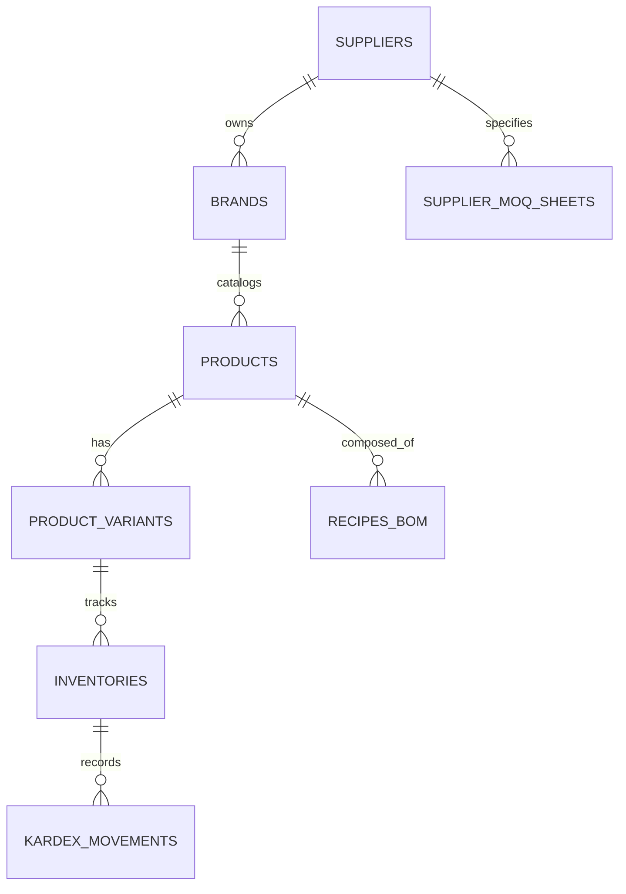

# Especificación Técnica: Hub 4 - Inventario, Catálogo & Compras
## Plataforma RevOps E-Commerce Multiverso & ERP (Mi Tienda Online)

**Módulo:** Hub 4 (Gestor Central de Catálogo, Almacén & Cadena de Suministro)  
**Versión de Especificación:** 3.0 (SSOT)  
**Vistas Principales:** `resources/views/portal/inventory.blade.php`  
**Controladores:** `app/Http/Controllers/ProductController.php`, `app/Http/Controllers/InventoryController.php`, `app/Http/Controllers/Api/RevOps/BrandApiController.php`

---

## 1. Propósito & Alcance del Módulo

El **Hub 4** es el núcleo de persistencia transaccional y catálogo físico de la plataforma. Gobierna:
1. **Catálogo Maestro Textil & Curvas de Talla:** Normalización bajo la matriz fija de 6 tallas (`CH`, `M`, `G`, `XL`, `2XL`, `3XL`).
2. **Kardex Transaccional ACID Inmutable:** Registro de entradas de compra, apartados de checkout, mermas, ensamblados BOM y retornos RMA.
3. **Control de Ubicaciones Físicas (Slotting):** Nomenclatura normalizada `Pasillo-Rack-Nivel/Gaveta` optimizada para recorridos de picking.
4. **Escandallos y Recetas BOM:** Definición de listas de materiales para combos, multipacks y cajas de suscripción mensual (MRR).
5. **Gobernanza de Proveedores & Marcas:** Vinculación estricta de marcas a fabricantes, acuerdos de crédito y tabuladores MOQ escalonados.
6. **Bandeja de Curaduría de Scraping:** Normalización e importación controlada de catálogos mayoristas externos (Torzo B2B).

---

## 2. Modelo de Datos & Diagrama Entidad-Relación

### Tablas MySQL Principales:
* `products`: SKU maestro, nombre, descripción, marca (`brand`), tipo de catálogo (`propio`, `dropship`, `mixto`), imágenes WebP, status.
* `product_variants`: SKU de variante (ej. `TRZ-BX-M-AZU`), talla (`CH`..`3XL`), color (`color_id`), código de barras (EAN/Code128).
* `inventories`: `local_stock` (físico), `committed_stock` (apartado), `reorder_point` (ROP), `bin_location` (slotting).
* `kardex_movements`: Tipo de movimiento (`ENTRADA_COMPRA`, `SALIDA_VENTA`, `APARTADO_CHECKOUT`, `LIBERACION_EXPIRADA`, `ENSAMBLE_BOM`, `AJUSTE_AUDITORIA`), cantidad, costo unitario, costo promedio ponderado resultante (CPP).
* `suppliers`: Razón social, RFC fiscal, días de crédito, estado.
* `brands`: Nombre de marca comercial, slug, proveedor asociado (`supplier_id`).
* `supplier_moq_sheets`: Tabuladores de compra mínima (`tier_name`, `min_quantity`, `unit_cost_discount`).
* `scraped_pending_items`: Prendas importadas por bot en espera de aprobación de curaduría.

---

## 3. Lógica de Negocio & Algoritmos

### 3.1. Fórmula del Stock de Tres Estados
Para cada variante y talla:
$$\text{Stock Disponible} = \text{local\_stock} - \text{committed\_stock}$$
* Si $\text{Stock Disponible} \le 0$, el Storefront PWA bloquea la adición inmediata al carrito y muestra la etiqueta *"Agotado en Tienda / Disponible bajo pedido"*.

### 3.2. Cálculo del Punto de Reorden (ROP)
$$\text{ROP} = (\text{VMD} \times \text{Lead Time Días}) + \text{Stock de Seguridad}$$
* **VMD (Venta Media Diaria):** Unidades vendidas en los últimos 30 días / 30.
* **Lead Time:** Días promedio que tarda el taller o mayorista en entregar en rampa.
* **Stock de Seguridad:** Días de cobertura amortiguadora ante picos de demanda.

### 3.3. Gobernanza de Marcas en Alta de Producto (Regla 6.47)
Queda prohibido registrar o actualizar un producto sin vincularlo a un `supplier_id` válido y seleccionar una `brand` autorizada para dicho proveedor. Las interfaces de alta, edición y curaduría incorporan botones de creación rápida in situ (`+ Nuevo Proveedor` y `+ Nueva Marca`) para no interrumpir el flujo del operador.

---

## 4. Endpoints RESTful Principales

| Método | Endpoint | Acción |
| :--- | :--- | :--- |
| `POST` | `/api/v1/inventory/adjust` | Registra ajuste manual de existencias con asiento formal en Kardex. |
| `POST` | `/api/v1/inventory/products` | Alta de nueva prenda textil con generación automática de matriz 6 tallas. |
| `POST` | `/api/v1/suppliers/{id}/brands` | Registra marca comercial vinculada al proveedor. |
| `POST` | `/api/v1/scraper/curate/{id}/approve` | Aprueba prenda de scraping, convierte imágenes a WebP y publica a catálogo. |

---

## 5. [TODO: Definir regla exacta]

1. `[TODO: Definir regla exacta]` **Criterio de redondeo en decimales para el cálculo de Costo Promedio Ponderado (CPP).**  
   *Nota actual:* El sistema trunca a 4 decimales en base de datos (`decimal(12,4)`) y redondea a 2 decimales para la visualización en pantalla.
2. `[TODO: Definir regla exacta]` **Tratamiento contable para mermas de empaque dañadas en rampa.**  
   *Nota actual:* El movimiento `MERMA_RAMPA` descuenta del conteo físico sin afectar el saldo por cobrar al taller hasta que se emite la nota de crédito formal.
