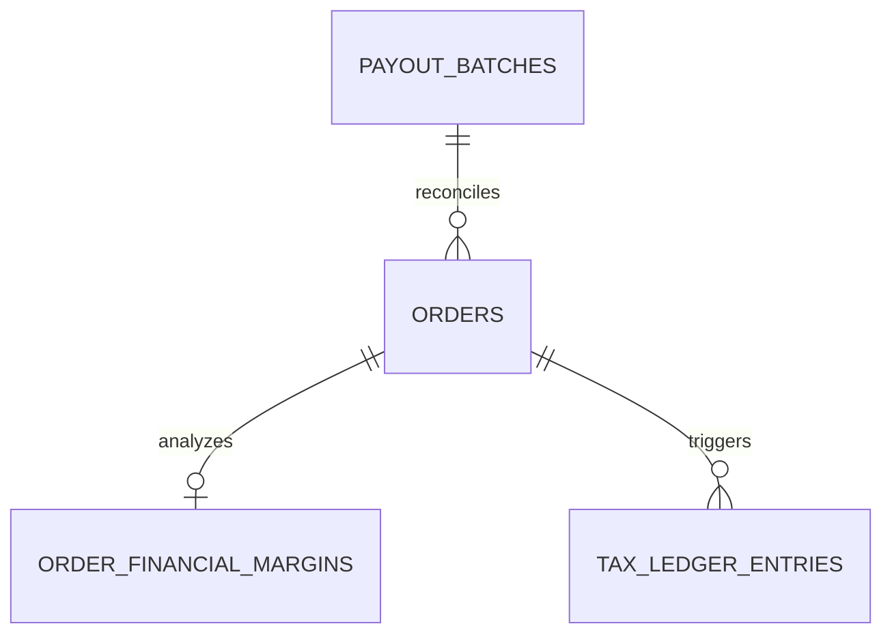

# Especificación Técnica: Hub 5 - Finanzas, P&L & Fiscal SAT
## Plataforma RevOps E-Commerce Multiverso & ERP (Mi Tienda Online)

**Módulo:** Hub 5 (Control Financiero, Cascada de Margen & Facturación)  
**Versión de Especificación:** 3.1 (SSOT - Auditada con Código Real)  

---

## 1. Propósito & Alcance del Módulo

El **Hub 5** garantiza la salud económica y el rigor contable del negocio. Sus atribuciones comprenden:
1. **Cascada de Margen Neto Real:** Cálculo transacción por transacción de la utilidad neta efectiva tras deducir costos reales.
2. **Conciliación de Pasarelas de Pago (Settlement):** Cuadre entre ventas reportadas en tienda y depósitos bancarios de Stripe, Mercado Pago, OXXO Pay y SPEI.
3. **Simulador de Elasticidad y Absorción de Fletes:** Modelado predictivo del impacto en el margen EBITDA al modificar el umbral de envío gratis.
4. **Tax Ledger y Facturación Electrónica SAT (CFDI 4.0):** Emisión automatizada y retenciones contables para clientes y aliados.

---

## 2. Modelo de Datos & Entidades Clave

*(Nota de Auditoría: Las tablas genéricas planteadas inicialmente como `transactions` y `payment_reconciliations` se materializaron en modelos más robustos como `order_financial_margins` y `payout_batches` para abarcar el ecosistema P&L).*

---

## 3. Lógica de Negocio, File Scope & Contratos de Datos

### 3.1. Cascada de Margen Neto Real
- **Estado:** `[IMPLEMENTADO]`
- **Contrato de Datos:**
  - **Modelo Eloquent:** `App\Models\OrderFinancialMargin`
  - **Estructura MySQL:**
    - `order_financial_margins` (`order_id`, `gross_revenue`, `cogs_total`, `gateway_fee`, `packaging_cost`, `shipping_courier_cost`, `net_profit`, `net_margin_percent`, `margin_health_level` enum: `'healthy', 'standard', 'critical'`)
- **File Scope:**
  - Lógica encapsulada principalmente dentro del pipeline de procesamiento de órdenes e instanciada vía jobs asíncronos tras el pago.
- **Flujos y Casos Límite:**
  - **Semáforo de Salud:** Si el `net_margin_percent` cae por debajo del 30%, el `margin_health_level` cambia a `critical`.

### 3.2. Conciliación de Pasarelas de Pago (Settlements)
- **Estado:** `[IMPLEMENTADO]`
- **Contrato de Datos:**
  - **Modelo Eloquent:** `App\Models\PayoutBatch`
  - **Estructura MySQL:**
    - `payout_batches` (`payout_id_external`, `gateway`, `gross_amount`, `fee_amount`, `tax_withheld`, `net_deposited`, `bank_account_target`, `status` enum: `'pending', 'reconciled', 'disputed'`)
- **File Scope:**
  - `app/Services/ClearingHouseSettlementService.php`
- **Flujos y Casos Límite:**
  - Concilia netos bancarios reales contra comisiones (ej. `Stripe 3.6% + $3 MXN`).

### 3.3. Simulador de Elasticidad y Absorción de Fletes
- **Estado:** `[IMPLEMENTADO]`
- **Contrato de Datos:** No requiere persistencia dedicada (es una proyección calculada en tiempo real).
- **File Scope:**
  - `app/Http/Controllers/PortalStoreController.php` (Líneas ~209-233)
- **Flujos y Casos Límite:**
  - **Fórmula Real Implementada:** `$ratio = max(10, min(85, round(75 - (($threshold - 699) / 800) * 45, 1)));`
  - **EBITDA:** `$projectedMargin = round(max(15, 52.0 - (($absorbedCost / $projectedGmv) * 100)), 2);`
  - Se retorna un flag booleano `isHealthy => $projectedMargin >= 30.00` directo al Storefront.

### 3.4. Facturación Electrónica SAT y Tax Ledger
- **Estado:** `[IMPLEMENTADO]`
- **Contrato de Datos:**
  - **Modelo Eloquent:** `App\Models\TaxLedgerEntry`
  - **Estructura MySQL:**
    - `tax_ledger_entries` (`period_month`, `transaction_date`, `pvp_gross_amount`, `taxable_base`, `iva_transferred_16`, `net_iva_payable`, `cfdi_uuid`)
- **File Scope:**
  - `app/Services/Finance/TaxCalculationEngineService.php`
- **Flujos y Casos Límite:**
  - Se disgrega el IVA trasladado y las retenciones (`platform_retention_isr_1`, `platform_retention_iva_8`) por transacción para el cierre contable mensual.

---

## 4. Seguridad y Arquitectura (Security by Design)

- **RBAC & Control de Acceso:** Todo endpoint en `FinanceApiController` requiere estrictamente `Gate::authorize('manage-finance')`. Sólo los roles `admin` y `finance` pueden autorizar SPEI o visualizar márgenes.
- **Validación Estricta:** Uso exclusivo de `FormRequests` dedicados (`UploadShippingReconciliationRequest`, `VerifyThreeWayMatchingRequest`, etc.) para proteger contra Mass Assignment y ataques de validación. Las validaciones "inline" en el controlador están prohibidas.

---

## 5. [TODO: Definir regla exacta]

1. `[TODO: Definir regla exacta]` **Tratamiento de contracargos bancarios (chargebacks) en el cálculo de margen histórico.**  
   *Nota actual:* El contracargo se registra como egreso del mes en que ocurre. Se debe definir si reclasifica negativamente la orden original del mes previo.
