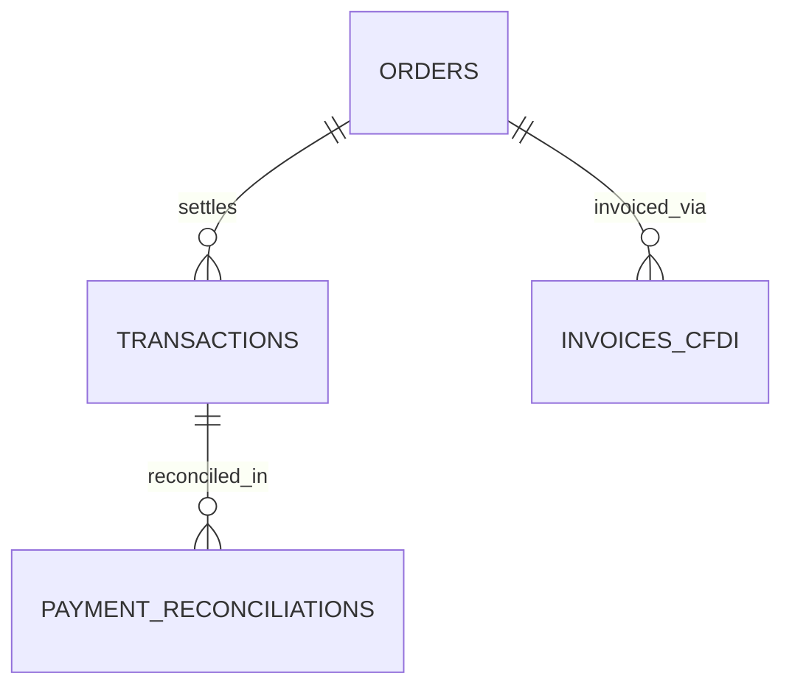

# Especificación Técnica: Hub 5 - Finanzas, P&L & Fiscal SAT
## Plataforma RevOps E-Commerce Multiverso & ERP (Mi Tienda Online)

**Módulo:** Hub 5 (Control Financiero, Cascada de Margen & Facturación)  
**Versión de Especificación:** 3.0 (SSOT)  
**Vistas Principales:** `resources/views/portal/finance.blade.php`  
**Controladores:** `app/Http/Controllers/FinanceController.php`

---

## 1. Propósito & Alcance del Módulo

El **Hub 5** garantiza la salud económica y el rigor contable del negocio. Sus atribuciones comprenden:
1. **Cascada de Margen Neto Real:** Cálculo transacción por transacción de la utilidad neta efectiva tras deducir costos reales.
2. **Conciliación de Pasarelas de Pago:** Cuadre entre ventas reportadas en tienda y depósitos bancarios de Stripe, Mercado Pago, OXXO Pay y SPEI BBVA.
3. **Simulador de Elasticidad y Absorción de Fletes:** Modelado predictivo del impacto en el margen EBITDA al modificar el umbral de envío gratis.
4. **Facturación Electrónica SAT (CFDI 4.0):** Emisión automatizada de comprobantes fiscales digitales para clientes que lo soliciten en checkout.

---

## 2. Modelo de Datos & Entidades Clave

### Tablas MySQL Principales:
* `transactions`: Folio, orden vinculada (`order_id`), pasarela (`gateway`), monto bruto, comisión de pasarela deducida, monto neto, fecha de dispersión.
* `payment_reconciliations`: Lote bancario, diferencia detectada, estado (`matched`, `discrepancy`, `chargeback`).
* `invoices_cfdi`: UUID del SAT, RFC receptor, régimen fiscal, uso de CFDI, XML timbrado, PDF generado.

---

## 3. Lógica de Negocio & Algoritmos

### 3.1. Cascada de Margen Neto Real (Fórmula Obligatoria)
Toda transacción calcula su rentabilidad sin recurrir a promedios abstractos:

$$\begin{aligned}
\text{Margen Neto Real} = \text{GMV (Cobrado al Cliente)} \\
&- \text{Descuentos \& Cupones Redimidos} \\
&- \text{Comisión Pasarela (Stripe 3.6\% + \$3 MXN / OXXO)} \\
&- \text{Costo de Adquisición de Prendas (CPP Kardex)} \\
&- \text{Costo Real de Guía Courier (\$145 MXN promedio)} \\
&- \text{Costo Materiales Empaque (Receta BOM Caja + Precinto)} \\
&- \text{IVA Trasladado / Retenciones Fiscales}
\end{aligned}$$

### 3.2. Simulador de Elasticidad de Flete Courier
Implementado en `PortalStoreController` para proteger la viabilidad del negocio:
* **Umbral Base:** `$999 MXN`.
* **Proyección de Órdenes Bonificadas:**
  $$\text{Ratio (\%)} = \max\left(10, \min\left(85, 75 - \left(\frac{\text{Umbral} - 699}{800}\right) \times 45\right)\right)$$
* **Costo Mensual Absorbido:** $\text{Órdenes Bonificadas} \times \$145.00 \text{ MXN}$.
* **Margen EBITDA Proyectado:** Si el margen resultante cae por debajo del **30.0%**, el sistema emite un semáforo de alerta advirtiendo sobre dilución de flujo de caja.

---

## 4. Endpoints RESTful & Servicios

### `POST /admin/finanzas/simular-flete`
* **Entrada:** `{ threshold: 899 }`
* **Salida:** `{ projectedMargin: 38.4, isHealthy: true, absorbedCost: 11455.00 }`

---

## 5. [TODO: Definir regla exacta]

1. `[TODO: Definir regla exacta]` **Tratamiento de contracargos bancarios (chargebacks) en el cálculo de margen histórico.**  
   *Nota actual:* El contracargo se registra como egreso del mes en que ocurre. Se debe definir si reclasifica negativamente la orden original del mes previo.
