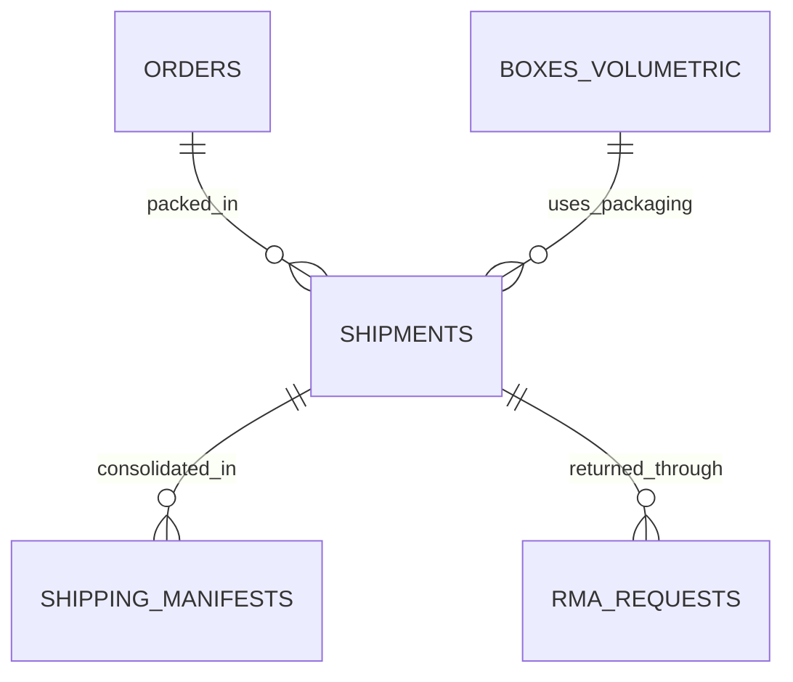

# Especificación Técnica: Hub 6 - Logística & Mesa de Expedición
## Plataforma RevOps E-Commerce Multiverso & ERP (Mi Tienda Online)

**Módulo:** Hub 6 (Fulfillment, Expedición Courier & Logística Inversa)  
**Versión de Especificación:** 3.0 (SSOT)  
**Vistas Principales:** `resources/views/portal/logistics.blade.php`  
**Controladores:** `app/Http/Controllers/LogisticsController.php`, `app/Http/Controllers/ShipmentController.php`

---

## 1. Propósito & Alcance del Módulo

El **Hub 6** opera la estación física de empaque y la interfaz con empresas de paquetería express. Es responsable de:
1. **Mesa de Expedición y Balanzas:** Pesaje, validación de prendas por código de barras y selección volumétrica de cajas.
2. **Emisión de Guías Térmicas SVG (100x150mm):** Impresión en 1 clic optimizada para impresoras térmicas Zebra/Xprinter sin dependencias de servicios de pago.
3. **Protocolo de Privacidad y Remitente Neutro:** Rotulación con remitente corporativo discreto para salvaguardar la intimidad de los clientes de ropa interior.
4. **Cierre de Manifiestos Diarios de Salida:** Acta formal de entrega a choferes de paquetería (DHL, FedEx, Estafeta, 99Minutos).
5. **Portal de Garantías & Matriz Sanitaria RMA (PROFECO):** Gestión de devoluciones bajo el Artículo 53 de la Ley Federal de Protección al Consumidor.

---

## 2. Modelo de Datos & Entidades Clave

### Tablas MySQL Principales:
* `shipments`: Tracking number, paquetería (`courier`), peso real (g), dimensiones (Largo x Ancho x Alto cm), costo de flete, estado (`manifested`, `in_transit`, `delivered`, `exception`).
* `shipping_manifests`: Folio de manifiesto, transportista, chofer receptor, total de bultos entregados, firma digital.
* `boxes_volumetric`: Catálogo de cajas (`caja_chica`, `caja_mediana`, `caja_regalo`, `sobre_kraft`) con peso tara y costo BOM.
* `rma_requests`: Folio de devolución, motivo, estado del precinto de higiene (`intact`, `broken`), dictamen sanitario.

---

## 3. Lógica de Negocio & Algoritmos

### 3.1. Matriz de Devoluciones por Criterio Sanitario (Regla PROFECO)
Por motivos estrictos de salud pública e higiene:
* **Prendas con Precinto Intacto:** Elegibles para cambio de talla o reembolso a monedero electrónico. Al ingresar, el sistema asienta `ENTRADA_RMA` en Kardex y devuelve las unidades al stock disponible.
* **Prendas con Precinto Vulnerado o Retirado:** Rechazo automático de retorno a stock comercial. Si la empresa concede reposición por cortesía comercial, las prendas vulneradas se clasifican como `MERMA_SANITARIA_DESTRUIDA` y no vuelven a estantes.

### 3.2. Aislamiento Estricto de Impresión Térmica
La emisión de guías se gobierna mediante `@media print` en `100mm x 150mm` a 203 DPI, forzando márgenes en 0 (`@page { margin: 0; size: 100mm 150mm; }`) y renderizando códigos de barra Code128 en SVG vectorial de alto contraste para lectura instantánea con escáner láser.

---

## 4. Endpoints RESTful Principales

| Método | Endpoint | Acción |
| :--- | :--- | :--- |
| `POST` | `/api/v1/shipments/create` | Genera registro de envío, asigna caja y calcula peso volumétrico. |
| `GET` | `/admin/logistica/guias/{id}/termica` | Renderiza guía en SVG puro para impresión inmediata. |
| `POST` | `/admin/logistica/manifiestos/cerrar` | Cierra lote diario de recolección y bloquea modificaciones en guías. |

---

## 5. [TODO: Definir regla exacta]

1. `[TODO: Definir regla exacta]` **Tiempo máximo de custodia de paquetes devueltos no reclamados por el cliente.**  
   *Nota actual:* El almacén resguarda paquetes retornados en el rack de incidencias por 30 días naturales antes de destruirlos o donarlos.
