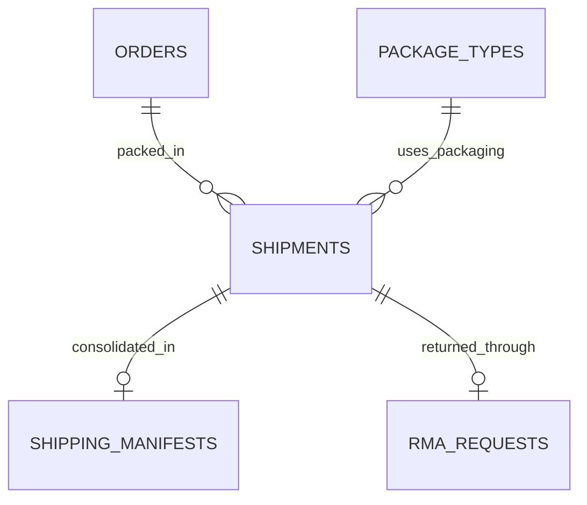

# Especificación Técnica: Hub 6 - Logística & Mesa de Expedición
## Plataforma RevOps E-Commerce Multiverso & ERP (Mi Tienda Online)

**Módulo:** Hub 6 (Fulfillment, Expedición Courier & Logística Inversa)  
**Versión de Especificación:** 3.1 (SSOT - Auditada con Código Real)  

---

## 1. Propósito & Alcance del Módulo

El **Hub 6** opera la estación física de empaque y la interfaz con empresas de paquetería express. Es responsable de:
1. **Mesa de Expedición y Balanzas:** Pesaje, validación de prendas por código de barras y selección volumétrica de cajas.
2. **Emisión de Guías Térmicas:** Impresión optimizada sin dependencias de servicios de pago para transportistas (DHL, Estafeta, FedEx).
3. **Protocolo de Privacidad y Remitente Neutro:** Rotulación con remitente corporativo discreto para salvaguardar la intimidad de los clientes.
4. **Cierre de Manifiestos Diarios de Salida:** Acta formal de entrega a choferes de paquetería consolidando los bultos en rampa.
5. **Portal de Garantías & Matriz Sanitaria RMA (PROFECO):** Gestión estricta de devoluciones bajo normativas de higiene de ropa interior.

---

## 2. Modelo de Datos & Entidades Clave

---

## 3. Lógica de Negocio, File Scope & Contratos de Datos

### 3.1. Mesa de Expedición & Asignación Volumétrica
- **Estado:** `[IMPLEMENTADO]`
- **Contrato de Datos:**
  - **Modelos Eloquent:** `App\Models\Shipment`, `App\Models\PackageType` *(referido anteriormente como `boxes_volumetric`)*
  - **Estructura MySQL:** 
    - `shipments` (`tracking_number`, `courier`, `weight_actual_kg`, `weight_volumetric_kg`, `status` enum: `'label_created', 'in_transit', 'delivered', 'returned'`)
    - `package_types` (`code`, `type` enum: `'box', 'polymailer'`, `length_cm`, `max_weight_kg`)
- **File Scope:**
  - `app\Http\Controllers\PortalLogisticsController.php`
  - `app\Services\RevOps\PackagingFulfillmentService.php`
- **Flujos y Casos Límite:**
  - Bultos en rampa se calculan en base a las dimensiones reales del `PackageType` asignado al `Shipment`.

### 3.2. Cierre de Manifiestos Diarios de Salida
- **Estado:** `[IMPLEMENTADO]`
- **Contrato de Datos:**
  - **Modelo Eloquent:** `App\Models\ShippingManifest`
  - **Estructura MySQL:** 
    - `shipping_manifests` (`manifest_number`, `courier`, `total_packages`, `driver_name`, `status`)
- **File Scope:**
  - `PortalLogisticsController.php` (Método `closeManifest`)
- **Flujos y Casos Límite:**
  - Generación automática de folio con formato `MAN-[COURIER]-[Ymd-His]`.
  - Asignación masiva en cascada del `manifest_id` a todos los `shipments` en status `label_created` o `packed` que correspondan al transportista, bloqueando su edición.

### 3.3. Portal de Garantías & Matriz Sanitaria RMA (PROFECO)
- **Estado:** `[IMPLEMENTADO]`
- **Contrato de Datos:**
  - **Modelos Eloquent:** `App\Models\RmaRequest`, `App\Models\RmaInspectionLog`, `App\Models\RmaResolution`
  - **Estructura MySQL:** 
    - `rma_requests` (`rma_number`, `sanitary_status` enum: `'pending_inspection', 'approved_replacement', 'approved_store_credit', 'rejected_used_hygiene'`)
    - `rma_inspection_logs` (`verdict`, `has_hygiene_seal_intact`)
- **File Scope:**
  - `app\Services\RevOps\RmaResolutionService.php`
- **Flujos y Casos Límite:**
  - **Prendas con Precinto Intacto:** Flujo `issueStoreCredit()` genera un saldo a favor y un cupón tokenizado enviado por WhatsApp al cliente.
  - **Prendas con Precinto Vulnerado:** Flujo estricto `rejectRma()`. El sistema asienta un dictamen de rechazo citando explícitamente *"violacion a protocolo de salubridad e higiene PROFECO"*, cerrando el folio sin reembolso ni retorno a stock comercial.

---

## 4. Custodia de Paquetes No Reclamados

1. **Tiempo máximo de custodia de paquetes devueltos no reclamados por el cliente:**  
   *Regla de Negocio:* El tiempo de resguardo (en días naturales) antes de su destrucción o donación **es parametrizable**. Este valor debe ser gestionado desde los ajustes del módulo de logística (Settings del Hub 6), brindando flexibilidad operativa según la temporada o volumen de incidencias.

1. `[TODO: Definir regla exacta]` **Tiempo máximo de custodia de paquetes devueltos no reclamados por el cliente.**  
   *Nota actual:* El almacén resguarda paquetes retornados en el rack de incidencias por 30 días naturales antes de destruirlos o donarlos.
