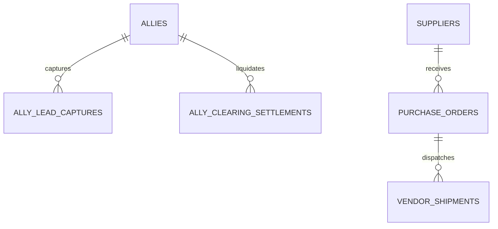

# Especificación Técnica: Hub 7 - Convenios B2B & Extranet de Proveedores
## Plataforma RevOps E-Commerce Multiverso & ERP (Mi Tienda Online)

**Módulo:** Hub 7 (Extranet B2B, Red de Aliados & Vouchers Digitales)  
**Versión de Especificación:** 3.1 (SSOT - Auditada con Código Real)  

---

## 1. Propósito & Alcance del Módulo

El **Hub 7** administra las relaciones inter-empresariales con talleres de maquila, fabricantes textiles y aliados comerciales estratégicos de la comunidad. Gobierna:
1. **Extranet Multi-Inquilino de Proveedores:** Portal seguro donde los talleres consultan sus Órdenes de Compra (POs) asignadas, confirman fechas de embarque y adjuntan remisiones de tela.
2. **Cámara de Compensación (Clearing House B2B):** Control de comisiones por referidos, liquidaciones quincenales y notas de crédito comerciales.
3. **Generador de Vouchers Digitales & Lead Magnets:** Emisión de pases de cortesía con código QR para aliados de vida nocturna y creadores de contenido, operando como gancho de adquisición.

---

## 2. Modelo de Datos & Entidades Clave

*(Nota de Auditoría: Las tablas genéricas planteadas inicialmente como `vouchers` y `partner_agreements` se materializaron en las tablas específicas `ally_lead_captures`, `ally_campaigns_dir_a` y `ally_clearing_settlements` para separar adquisición de liquidación contable).*

---

## 3. Lógica de Negocio, File Scope & Contratos de Datos

### 3.1. Extranet Multi-Inquilino de Proveedores
- **Estado:** `[IMPLEMENTADO]`
- **Contrato de Datos:**
  - **Modelos Eloquent:** `App\Models\Supplier`, `App\Models\PurchaseOrder`
  - **Estructura MySQL:** 
    - `purchase_orders` (`po_number`, `supplier_id`, `status`)
- **File Scope:**
  - `app\Http\Controllers\PortalVendorController.php`
- **Flujos y Casos Límite:**
  - En lugar de Global Scopes, el aislamiento se impone algorítmicamente en cada petición del controlador.
  - **Regla Anti-Fuga de Datos:** Se inyecta una guardia estricta: `if (!$isGlobalAdmin && (int) $order->supplier_id !== $supplierId)`. Si falla, se revoca el acceso impidiendo que un taller inspeccione costos u órdenes de su competencia.

### 3.2. Vouchers Digitales & Lead Magnets (Aliados)
- **Estado:** `[IMPLEMENTADO]`
- **Contrato de Datos:**
  - **Modelo Eloquent:** `App\Models\AllyLeadCapture`
  - **Estructura MySQL:** 
    - `ally_lead_captures` (`voucher_code`, `ally_id`, `lead_name`, `lead_whatsapp`, `is_redeemed`, `redeemed_at`, `redeemed_by`)
- **File Scope:**
  - `app\Http\Controllers\PortalAlliesController.php`
  - `app\Http\Controllers\Api\RevOps\AlliesApiController.php`
- **Flujos y Casos Límite:**
  - **Prevención de Fraude:** El endpoint de taquilla comprueba el estado previo de redención. Si el QR se clona y escanea dos veces, se levanta la excepción: `"ALERTA ANTI-DUPLICADO: El voucher {$code} ya fue canjeado a las {$lead->redeemed_at} por {$lead->redeemed_by}."`
  - Deja registro de auditoría identificando a la persona/dispositivo en puerta (`redeemed_by` ej. *'Staff Puerta Taquilla #1'*).

### 3.3. Cámara de Compensación (Clearing House B2B)
- **Estado:** `[IMPLEMENTADO]`
- **Contrato de Datos:**
  - **Modelo Eloquent:** `App\Models\AllyClearingSettlement`
  - **Estructura MySQL:** 
    - `allies` (`code`, `portal_token`, `clearing_balance`)
    - `ally_clearing_settlements` (`ally_id`, `leads_credit`, `commissions_debit`, `net_balance`, `settlement_type`, `status` enum: `'scheduled', 'executed', 'cancelled'`)
- **File Scope:**
  - Resuelto vía base de datos (Modelo) y expuesto en las vistas del `PortalAlliesController`.
- **Flujos y Casos Límite:**
  - Soporte nativo para liquidaciones no monetarias: El `settlement_type` permite compensar en especie (`in_kind_apparel`) o por patrocinios VIP (`sponsorship_vip`), no solo por transferencia SPEI (`spei_transfer`).

---

## 4. [TODO: Definir regla exacta]

1. `[TODO: Definir regla exacta]` **Plazo de prescripción para liquidación de comisiones acumuladas por aliados.**  
   *Nota actual:* El saldo de comisiones se liquida los días 1 y 15 de cada mes. Se debe definir si existe monto mínimo para corte de transferencia bancaria (ej. mínimo $500 MXN).
