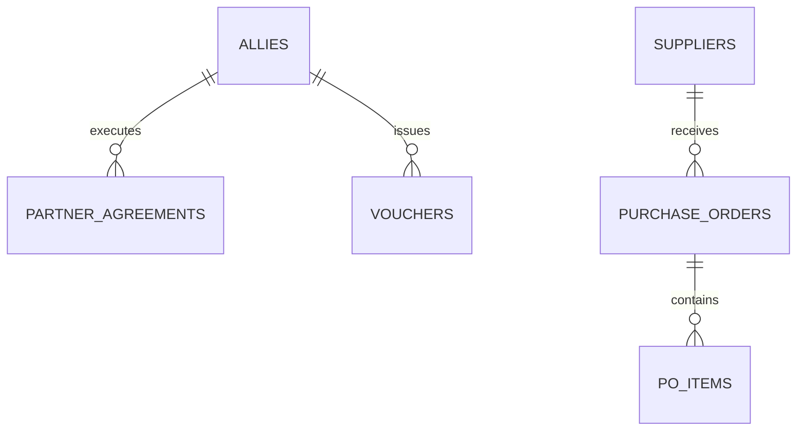

# Especificación Técnica: Hub 7 - Convenios B2B & Extranet de Proveedores
## Plataforma RevOps E-Commerce Multiverso & ERP (Mi Tienda Online)

**Módulo:** Hub 7 (Extranet B2B, Red de Aliados & Vouchers Digitales)  
**Versión de Especificación:** 3.0 (SSOT)  
**Vistas Principales:** `resources/views/portal/allies.blade.php`, `resources/views/portal/hub7-vendor-extranet.blade.php`  
**Controladores:** `app/Http/Controllers/AlliesController.php`

---

## 1. Propósito & Alcance del Módulo

El **Hub 7** administra las relaciones inter-empresariales con talleres de maquila, fabricantes textiles y aliados comerciales estratégicos de la comunidad. Gobierna:
1. **Extranet Multi-Inquilino de Proveedores:** Portal seguro donde los talleres consultan sus Órdenes de Compra (POs) asignadas, confirman fechas de embarque y adjuntan remisiones de tela.
2. **Cámara de Compensación (Clearing House B2B):** Control de comisiones por referidos, liquidaciones quincenales y notas de crédito comerciales.
3. **Generador de Vouchers Digitales & Lead Magnets:** Emisión de pases de cortesía con código QR para aliados de vida nocturna (ej. Paradiso Club, Circuit CDMX) como gancho de adquisición.

---

## 2. Modelo de Datos & Entidades Clave



### Tablas MySQL Principales:
* `allies`: Nombre del aliado, tipo (`venue`, `influencer`, `brand_partner`), porcentaje de comisión acordado, token de tracking.
* `vouchers`: Código único, folio alfanumérico, lead vinculado, estado (`active`, `redeemed`, `expired`), fecha de caducidad.
* `partner_agreements`: Términos de intercambio comercial, cupo de cortesías mensuales y contraprestaciones en marketing.

---

## 3. Lógica de Negocio & Algoritmos

### 3.1. Aislamiento Multi-Inquilino en Extranet de Talleres
Los usuarios con rol `vendor` solo tienen visibilidad de las órdenes asignadas a su razón social mediante alcances globales de Eloquent:
```php
public function scopeForVendor($query, $supplierId) {
    return $query->where('supplier_id', $supplierId);
}
```
Ningún taller puede visualizar precios de venta al público (PVP) ni órdenes de otros fabricantes.

### 3.2. Ciclo de Redención de Vouchers Digitales (Lead Magnet)
1. El usuario visualiza el modal de cortesía en la tienda PWA y registra su nombre, WhatsApp y correo.
2. El sistema crea un registro en `leads` y genera un boleto digital en `vouchers`.
3. El aliado escanea el QR en taquilla/barra mediante la URL de redención `https://tienda.com/aliados/canjear/{codigo}`.
4. El sistema valida la vigencia, transiciona a `redeemed` y anota el evento para la cámara de compensación.

---

## 4. Endpoints RESTful Principales

| Método | Endpoint | Acción |
| :--- | :--- | :--- |
| `GET` | `/admin/hub7/vendor/ordenes` | Listado multi-tenant de OCs asignadas al taller. |
| `POST` | `/api/v1/allies/voucher/redeem` | Valida y canjea un código QR en punto de venta del aliado. |

---

## 5. [TODO: Definir regla exacta]

1. `[TODO: Definir regla exacta]` **Plazo de prescripción para liquidación de comisiones acumuladas por aliados.**  
   *Nota actual:* El saldo de comisiones se liquida los días 1 y 15 de cada mes. Se debe definir si existe monto mínimo para corte de transferencia bancaria (ej. mínimo $500 MXN).
