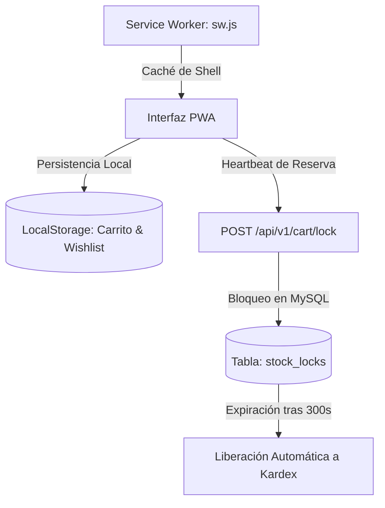

# Especificación Técnica: Storefront PWA Multiverso (Canal D2C)
## Plataforma RevOps E-Commerce Multiverso & ERP (Mi Tienda Online)

**Módulo:** Canal Público de Venta Directa (Storefront PWA)  
**Versión de Especificación:** 3.0 (SSOT)  
**Vistas Principales:** `resources/views/layouts/store-pwa.blade.php`, `resources/views/store/pwa/*.blade.php`  
**Controlador Principal:** `app/Http/Controllers/StorefrontController.php`  
**Assets Principales:** `public/js/storefront/store-pwa.js`, `public/css/store-pwa.css`, `public/sw.js`

---

## 1. Propósito & Alcance del Módulo

El **Storefront PWA** es la aplicación web progresiva orientada al consumidor final (D2C). Diseñada bajo la filosofía Mobile-First y lujo minimalista, entrega:
1. **Multiverso Conmutable en 4 Universos:** Experiencia de marca adaptada para Marte (Hombre), Venus (Lencería), Tiresias (Afirmativo) y Terra (Unisex/Matriz).
2. **Navegación Móvil de 5 Botones (Bottom App Dock):** Exactamente 5 pestañas fijas (`Inicio`, `Explorar`, `Catálogo`, `Carrito`, `Cuenta`).
3. **Ficha de Producto (PDP) a Pantalla Completa:** Eliminación total de modales o drawers deslizables; renderizado nativo en URL canónica `/producto/{slug}`.
4. **Reserva de Stock en Carrito con Cuenta Regresiva (Stock Locks):** Bloqueo transaccional de prendas por 5 minutos (300 segundos) para inducir urgencia de compra y liberar inventario automáticamente si se abandona el carrito.
5. **Instalabilidad PWA & Modo Offline:** Service Worker con precaché de assets, manifest interactivo y funcionamiento standalone en iOS y Android.
6. **Motor Anti-FOUC de Modo Oscuro / Claro / Sistema:** Sincronización instantánea con preferencias del sistema operativo sin parpadeos visuales al cargar.

---

## 2. Modelo de Estado del Cliente & Almacenamiento Local

### Llaves en `localStorage`:
* `pwa_cart_items`: Array JSON con items agregados, variantes, tallas y cantidades.
* `pwa_cart_lock_expires`: Marca de tiempo Unix que gobierna el temporizador visible en checkout.
* `pwa_wishlist`: Colección de SKUs guardados en lista de deseos.
* `app_theme`: Estado cromático forzado (`dark`, `light`, `system`).
* `last_active_universe`: Universo guardado para retener la experiencia de marca preferida.

---

## 3. Lógica de Negocio & Algoritmos

### 3.1. Bloqueo Transaccional de Stock con TTL (Stock Locks)
Cuando el cliente agrega un producto al carrito:
1. Se invoca `POST /api/v1/cart/lock`.
2. Laravel incrementa `committed_stock` en la tabla `inventories` para la variante y talla.
3. Se inserta un registro en `stock_locks` con `expires_at = now() + 300s`.
4. El frontend renderiza un banner flotante de urgencia:
   > *"Tus prendas están reservadas por 04:59. Completa tu pedido antes de que se liberen para otros compradores."*
5. Si el temporizador llega a `00:00` o la sesión expira, un comando de Laravel o evento de limpieza restaura `committed_stock` a 0 y disuelve la reserva.

### 3.2. Conmutación de Color e Imágenes en PDP
En la ficha del producto (`resources/views/store/pwa/product-detail.blade.php`), al pulsar sobre una píldora de color:
* El script filtra la galería fotográfica mostrando exclusivamente las tomas asociadas a dicho tono (`data-color-id`).
* La imagen principal cambia al primer plano de dicha silueta sin recargar la página.
* Las opciones de talla se actualizan en caliente mostrando sólo las existencias disponibles para dicho color.

---

## 4. Endpoints RESTful Principales

| Método | Endpoint | Acción |
| :--- | :--- | :--- |
| `GET` | `/api/v1/store/products` | Catálogo filtrado por universo, categoría, talla y color. |
| `GET` | `/api/v1/store/products/{slug}` | Ficha técnica con matriz anatómica, composición y fotos. |
| `POST` | `/api/v1/cart/lock` | Bloquea unidades en almacén con TTL de 300 segundos. |
| `POST` | `/api/v1/cart/release` | Libera unidades retenidas voluntariamente por el cliente. |

---

## 5. [TODO: Definir regla exacta]

1. `[TODO: Definir regla exacta]` **Límite máximo de renovaciones de reserva de stock permitidas por sesión.**  
   *Nota actual:* El cliente puede extender el temporizador volviendo a tocar el selector de talla. Debe definirse si se limita a un máximo de 2 extensiones (15 minutos totales) para evitar acaparamiento desleal de prendas de alta demanda.
