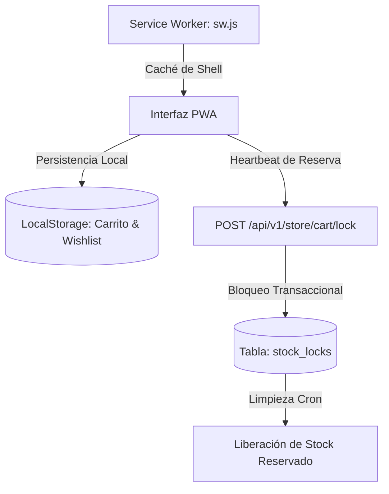

# Especificación Técnica: Storefront PWA Multiverso (Canal D2C)
## Plataforma RevOps E-Commerce Multiverso & ERP (Mi Tienda Online)

**Módulo:** Canal Público de Venta Directa (Storefront PWA)  
**Versión de Especificación:** 3.1 (SSOT - Auditada con Código Real)  

---

## 1. Propósito & Alcance del Módulo

El **Storefront PWA** es la aplicación web progresiva orientada al consumidor final (D2C). Diseñada bajo la filosofía Mobile-First, entrega:
1. **Multiverso Conmutable en 4 Universos:** Experiencia de marca adaptada para Marte, Venus, Tiresias y Terra.
2. **Navegación Móvil de 5 Botones (Bottom App Dock):** Pestañas fijas (`Inicio`, `Explorar`, `Catálogo`, `Carrito`, `Cuenta`).
3. **Ficha de Producto (PDP) a Pantalla Completa:** Eliminación de modales deslizables; renderizado nativo en URL canónica `/producto/{slug}`.
4. **Reserva de Stock en Carrito con Cuenta Regresiva (Stock Locks):** Bloqueo transaccional de prendas por 5 minutos (300 segundos) para inducir urgencia de compra y prevenir sobreventa concurrente.
5. **Instalabilidad PWA & Modo Offline:** Service Worker con precaché de assets.
6. **Motor Anti-FOUC:** Sincronización cromática inmediata con el SO del cliente.

---

## 2. Modelo de Estado del Cliente & Almacenamiento Local

---

## 3. Lógica de Negocio, File Scope & Contratos de Datos

### 3.1. Bloqueo Transaccional de Stock (Stock Locks)
- **Estado:** `[IMPLEMENTADO]`
- **Contrato de Datos:**
  - **Modelos Eloquent:** `App\Models\StockLock`, `App\Models\Inventory`
  - **Estructura MySQL:** 
    - `stock_locks` (`cart_id`, `product_variant_id`, `quantity`, `expires_at`, `status` enum: `'active', 'released', 'purchased'`)
- **File Scope:**
  - `app\Services\StockReservationService.php`
  - `app\Http\Controllers\Api\StorefrontApiController.php`
- **Flujos y Casos Límite:**
  - Prevención estricta de *race conditions* usando bloqueos a nivel base de datos (`->lockForUpdate()`) al momento de retener stock.
  - Al bloquear, se incrementa temporalmente la columna `reserved` en `inventories`.
  - Excepción operativa: Lanza error si se rebasa el inventario disponible: `Exception("Stock disponible insuficiente ({$available} unidades disponibles, se solicitaron {$quantityDelta} adicionales)")`.

### 3.2. Conmutación Dinámica en Ficha de Producto (PDP)
- **Estado:** `[IMPLEMENTADO]`
- **Contrato de Datos:** Lógica de presentación (Frontend/Blade).
- **File Scope:**
  - `resources/views/store/pwa/product-detail.blade.php`
- **Flujos y Casos Límite:**
  - Al pulsar una píldora de color, JS filtra la galería fotográfica usando el atributo `data-color-id` sin recargar la vista, actualizando en caliente la disponibilidad de tallas.

---

## 4. Endpoints RESTful Principales (Realidad de Código)

| Método | Endpoint | Controlador | Acción |
| :--- | :--- | :--- | :--- |
| `GET` | `/api/v1/store/products/{slug}` | `StorefrontApiController@productDetail` | Despacha la ficha técnica con matriz anatómica y variantes. |
| `POST` | `/api/v1/store/cart/lock` | `StorefrontApiController@lockCart` | Invoca a `StockReservationService` para retener unidades por 5 min. |
| `POST` | `/api/v1/store/cart/release` | `StorefrontApiController@releaseCartLock` | Libera unidades retenidas voluntariamente antes del TTL. |
| `POST` | `/api/v1/store/cart/checkout` | `StorefrontApiController@checkout` | Transforma un candado (Lock) activo a estado `purchased` consolidando la orden. |

---

## 5. [TODO: Definir regla exacta]

1. `[TODO: Definir regla exacta]` **Límite máximo de renovaciones de reserva de stock permitidas por sesión.**  
   *Nota de Auditoría Actual:* En el código, el método `reserveStock` del `StockReservationService` **no tiene límite de renovaciones**. Actualmente, cada vez que se envía un latido al API, se sobreescribe `expires_at` infinitamente. El negocio debe decidir si se impone un tope técnico (ej. máximo 3 extensiones o 15 minutos totales) para evitar acaparamiento malicioso.

## Security & Data Privacy (DoD Compliance)
- **FormRequests**: Removed inline validation and `$request->all()` usage. Implemented strict FormRequests (`CheckoutRequest`, `UpdateProfileRequest`, `SubscribeRequest`, `PushSubscribeRequest`, `PushEndpointRequest`) with XSS sanitization (`strip_tags`) via `prepareForValidation()`.
- **Data Leaks Prevented**: Removed `cost` property exposure in `StorefrontApiController@productDetail`.
- **UX/UI Compliance**: Enforced `resize: vertical !important;` on all CMS `<textarea>` fields, verified modal depths (`#storeAppRoot` architecture compliance), and ensured emoji-free UI elements (SVG replacements where needed).
