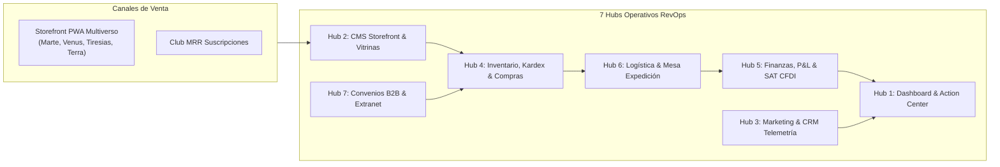
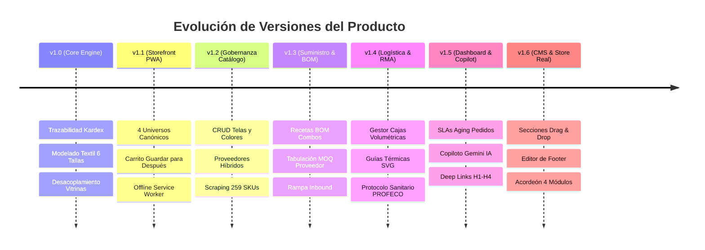
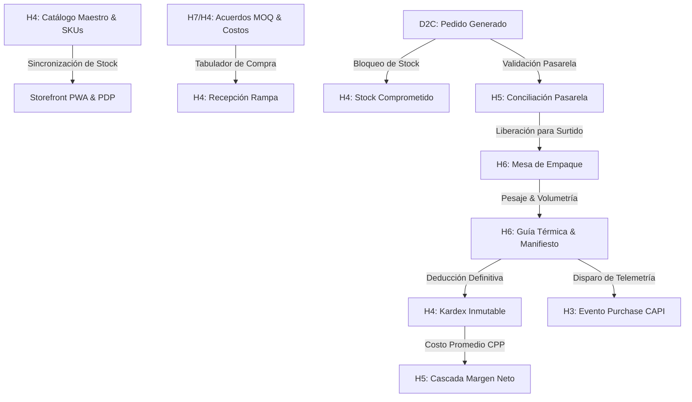

# Hoja de Ruta Maestra del Producto (Master Roadmap SSOT)
## Plataforma RevOps E-Commerce Multiverso & ERP D2C/B2B (Mi Tienda Online)

**Versión del Documento:** 3.0 (SSOT Canon)  
**Fecha de Publicación:** Octubre 2026  
**Ámbito:** Plan Maestro de Producto, Hitos, Dependencias y Estado de Entrega  
**Referencia Histórica:** Archivo consolidado en `docs/archivo/legacy-roadmaps/`

---

## 1. Visión Estratégica del Producto

**Mi Tienda Online** es una plataforma unificada de comercio digital y ERP modular construida para integrar en circuito cerrado:
1. **Canal de Venta Directa (D2C):** Storefront PWA Mobile-First con 4 vitrinas multiverso diferenciadas compartiendo un único catálogo central.
2. **Modelo de Ingresos Recurrentes (MRR):** Membresías mensuales y suscripciones periódicas de reposición textil y cosmética íntima.
3. **Catálogo Híbrido:** Gestión combinada de stock físico en almacén local (`localStock`), catálogo remoto bajo demanda/dropshipping (`supplierStock`) y combos/kits (`BOM`).
4. **Circuito Operativo RevOps (7 Hubs):** Orquestación transversal desde la rampa de proveedores hasta la conciliación fiscal SAT y logística inversa.

---

## 2. Los 7 Hubs Operativos: Definición de Alcance

| Hub | Denominación Oficial | Propósito Primario | Tecnologías Base |
| :--- | :--- | :--- | :--- |
| **Hub 1** | **Cabina Ejecutiva & Dashboard** | Centro neurálgico de alertas operativas, SLAs de pedidos, aging semafórico y telemetría de APIs. | Blade, Alpine.js, Tailwind, Chart.js |
| **Hub 2** | **Tienda & CMS Multiverso** | Constructor Drag & Drop de secciones modulares, editor de paletas cromáticas (8 tokens `:root`), banners, blog y pie de página. | Blade, SortableJS, PWA Engine, CSS Variables |
| **Hub 3** | **Marketing, CRM & Fidelización** | Lead scoring por comportamiento, recuperación automatizada de carritos por WhatsApp, y telemetría CAPI/UTMs. | Laravel Jobs, Webhooks, WhatsApp Cloud API |
| **Hub 4** | **Inventario, Catálogo & Compras** | Catálogo maestro de 6 tallas textiles, Kardex ACID, slotting físico, recetas BOM, gobernanza de marcas/proveedores y scraping B2B. | MySQL 8.0, Transacciones ACID, SheetJS, Gemini Copilot |
| **Hub 5** | **Finanzas, P&L & Fiscal** | Cascada de margen neto real, reconciliación de pasarelas, simulador de absorción de fletes y emisión de CFDIs. | Eloquent, Servicios Financieros, Facturación SAT |
| **Hub 6** | **Logística & Expedición** | Mesa de empaque multipaquetería (DHL/FedEx/99Minutos), impresión térmica 100x150mm, empaque neutro y portal RMA. | SVG Barcode/QR Engine, Webhooks Paquetería |
| **Hub 7** | **Convenios B2B & Extranet** | Portal multi-inquilino para talleres/fabricantes, clearing house de comisiones y vouchers digitales aliados. | Multi-tenant Auth, Blade, Voucher Engine |

---

## 3. Matriz Maestra de Hitos y Estado de Implementación

### Hitos Completados (Tags v1.0 a v1.6)

| Hito / Tag | Código | Componentes Entregados | Estado | Verificación QA |
| :--- | :--- | :--- | :---: | :---: |
| **v1.0** | `TAG-CORE-01` | Kardex transaccional ACID, stock 3 estados, modelo 6 tallas (`CH`, `M`, `G`, `XL`, `2XL`, `3XL`). | **Completado** | 100% Tests Verdes |
| **v1.1** | `TAG-PWA-02` | Storefront PWA, navegación 5 botones, cart reservation locks, checkout responsive, service worker. | **Completado** | 100% Tests Verdes |
| **v1.2** | `TAG-INV-03` | CRUD de insumos, telas, colores ROP, gestión de marcas asociadas a proveedores, alta in situ. | **Completado** | 100% Tests Verdes |
| **v1.3** | `TAG-BOM-04` | Recetas BOM para combos/suscripciones, tabuladores MOQ por proveedor, módulo de acuerdos de crédito. | **Completado** | 100% Tests Verdes |
| **v1.4** | `TAG-LOG-05` | Embalaje volumétrico, impresión térmica SVG (Code128), matriz de retorno sanitario RMA. | **Completado** | 100% Tests Verdes |
| **v1.5** | `TAG-DSH-06` | Dashboard Aging alertas, integraciones Gemini Copilot para SEO y descripciones, toasts acumulativos. | **Completado** | 100% Tests Verdes |
| **v1.6** | `TAG-CMS-07` | Editor visual Drag & Drop SortableJS, hero modular 100vw, editor oficial de footer (Acordeón Secc. 4). | **Completado** | 100% Tests Verdes |

---

## 4. Grafo de Dependencias Inter-Hub

El desarrollo agéntico y la evolución de funcionalidades deben respetar estrictamente el orden causal de datos:

### Reglas de Bloqueo por Dependencia:
1. **Regla DEP-01 (Kardex $\rightarrow$ Ventas):** Ninguna vitrina puede habilitar checkout con stock inmediato si el producto carece de registro en `inventories` con `local_stock > committed_stock`.
2. **Regla DEP-02 (Finanzas $\rightarrow$ Logística):** La mesa de empaque (`Hub 6`) no genera guía de paquetería para órdenes en estado pendiente de cobro hasta que `Hub 5` asiente la transacción como `paid`.
3. **Regla DEP-03 (Proveedores $\rightarrow$ Alta de Producto):** No es admisible registrar un producto sin asociarlo previamente a un proveedor formalmente registrado y con marcas comerciales vinculadas.

---

## 5. Próximos Hitos & Backlog de Innovación (v2.0+)

### Hito v2.0: Automatización Extranet B2B & Facturación Nativa SAT
- **Objetivo:** Conectar directamente el portal de proveedores Hub 7 con emisión automática de Purchase Orders por punto de reorden (ROP).
- **Entregables:**
  - Emisión de OCs digitales en PDF/XML para talleres de confección.
  - Recepción de XML CFDI 4.0 de compras con validación automática de RFC y montos contra la PO.
  - Estado: **Planificado** | Dependencias: `TAG-BOM-04`, `TAG-CORE-01`.

### Hito v2.1: Expansión de Canales de Suscripción (MRR Recurrente)
- **Objetivo:** Motor nativo de cobro recurrente con renovación mensual automatizada de bóxers/lencería con personalización de silueta.
- **Entregables:**
  - Tokenización de tarjetas en Stripe / Openpay para pedidos cíclicos.
  - Surtido automatizado en Hub 6 el primer día hábil del mes.
  - Estado: **Planificado** | Dependencias: `v2.0`, `TAG-PWA-02`.

---

## 6. [TODO: Definir regla exacta]

1. `[TODO: Definir regla exacta]` **Límite de tiempo para cancelación de orden por parte del cliente en PWA antes de que entre a mesa de empaque.**  
   *Nota actual:* El sistema bloquea la orden una vez que el estado cambia a `packing`. Se debe definir si el cliente dispone de una ventana de gracia fija (ej. 15 minutos posteriores al pago).
2. `[TODO: Definir regla exacta]` **Umbral de discrepancia permitido en cubicaje volumétrico de cajas de empaque frente a la báscula física de paquetería.**  
   *Nota actual:* Se asume tolerancia estándar del 5% antes de disparar alerta de sobrecosto courier.
